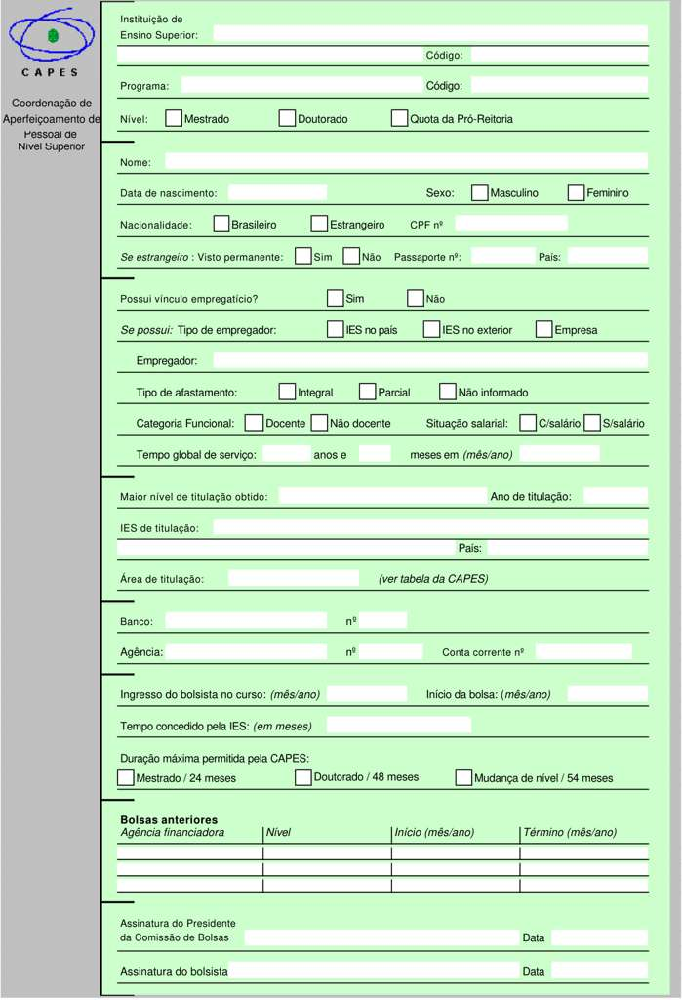

<!-- page 1 -->

# **Programa de Demanda Social Cadastramento de bolsista** 

<!-- figure p01-fig1 | described_by: agy | ocr_overlap: 0.99 | needs_review: false -->
### 1. Tipo de figura
Trata-se de um **formulário institucional em branco** da **CAPES** (Coordenação de Aperfeiçoamento de Pessoal de Nível Superior) destinado ao cadastro ou registro de bolsista de pós-graduação, composto por campos de preenchimento de texto, caixas de seleção (*checkboxes*), uma tabela para histórico de bolsas anteriores e campos de assinatura e data.

---

### 2. Todo o texto visível (literal)

**Painel lateral esquerdo (abaixo do logotipo):**
- `C A P E S`
- `Coordenação de`
- `Aperfeiçoamento de`
- `Pessoal de`
- `Nivel Superior` *(observação: sem acento agudo visível no "i"; a parte superior das letras "P" em "Pessoal" e "S" em "Superior" apresenta leve corte horizontal)*

**Corpo do formulário (de cima para baixo, linha a linha):**

*Seção 1*
- `Instituição de` / `Ensino Superior:`
- `Código:`
- `Programa:` | `Código:`
- `Nível:` | `Mestrado` | `Doutorado` | `Quota da Pró-Reitoria`

*Seção 2*
- `Nome:`
- `Data de nascimento:` | `Sexo:` | `Masculino` | `Feminino`
- `Nacionalidade:` | `Brasileiro` | `Estrangeiro` | `CPF nº`
- *`Se estrangeiro :`* `Visto permanente:` | `Sim` | `Não` | `Passaporte nº:` | `País:`

*Seção 3*
- `Possui vínculo empregatício?` | `Sim` | `Não`
- *`Se possui:`* `Tipo de empregador:` | `IES no país` | `IES no exterior` | `Empresa`
- `Empregador:`
- `Tipo de afastamento:` | `Integral` | `Parcial` | `Não informado`
- `Categoria Funcional:` | `Docente` | `Não docente` | `Situação salarial:` | `C/salário` | `S/salário`
- `Tempo global de serviço:` | `anos e` | `meses em` *`(mês/ano)`*

*Seção 4*
- `Maior nível de titulação obtido:` | `Ano de titulação:`
- `IES de titulação:`
- `País:`
- `Área de titulação:` | *`(ver tabela da CAPES)`*

*Seção 5*
- `Banco:` | `nº`
- `Agência:` | `nº` | `Conta corrente nº`

*Seção 6*
- `Ingresso do bolsista no curso:` *`(mês/ano)`* | `Início da bolsa:` *`(mês/ano)`*
- `Tempo concedido pela IES:` *`(em meses)`*
- `Duração máxima permitida pela CAPES:`
- `Mestrado / 24 meses` | `Doutorado / 48 meses` | `Mudança de nível / 54 meses`

*Seção 7*
- **`Bolsas anteriores`**
- Cabeçalho da tabela (em itálico): *`Agência financiadora`* | *`Nível`* | *`Início (mês/ano)`* | *`Término (mês/ano)`*
- Células das linhas de dados: todas em branco (sem texto).

*Seção 8*
- `Assinatura do Presidente` / `da Comissão de Bolsas` | `Data`
- `Assinatura do bolsista` | `Data`

---

### 3. Estrutura

A figura está organizada em **dois painéis verticais principais** (com uma estreita margem vertical adicional à direita):

- **Painel esquerdo (faixa institucional, cerca de 15% da largura):** contém no topo o logotipo da CAPES (anéis orbitais ao redor de um núcleo oval central), seguido da sigla `C A P E S` em negrito e do nome por extenso da instituição centralizado em quatro linhas.
- **Painel direito (área do formulário, cerca de 83% da largura):** separado do painel esquerdo por uma linha vertical preta contínua que percorre toda a altura do documento. Dessa linha vertical partem **9 traços horizontais curtos e espessos** voltados para a direita (um no topo, sete divisores intermediários e um na base), segmentando o formulário em **8 blocos (seções)** horizontais. Não há setas nem eixos gráficos. Dentro de cada bloco, linhas horizontais finas separam as fileiras de campos. Todas as caixas de seleção são quadrados brancos de borda preta (todas desmarcadas) e todos os campos de preenchimento são retângulos brancos sem borda (todos vazios).

Detalhamento dos 8 blocos, linha a linha:

1. **Bloco 1 — Identificação institucional e do programa (4 linhas):**
   - Linha 1: rótulo em duas linhas (`Instituição de` / `Ensino Superior:`) + campo retangular largo.
   - Linha 2: campo retangular largo à esquerda (continuação do nome da instituição) + `Código:` + campo retangular médio à direita.
   - Linha 3: `Programa:` + campo retangular largo + `Código:` + campo retangular médio.
   - Linha 4: `Nível:` + 3 caixas de seleção (`[ ] Mestrado`, `[ ] Doutorado`, `[ ] Quota da Pró-Reitoria`).

2. **Bloco 2 — Dados pessoais do bolsista (4 linhas):**
   - Linha 1: `Nome:` + campo retangular ocupando toda a largura restante.
   - Linha 2: `Data de nascimento:` + campo retangular curto + `Sexo:` + 2 caixas de seleção (`[ ] Masculino`, `[ ] Feminino`).
   - Linha 3: `Nacionalidade:` + 2 caixas de seleção (`[ ] Brasileiro`, `[ ] Estrangeiro`) + `CPF nº` + campo retangular médio-curto.
   - Linha 4: `Se estrangeiro :` + `Visto permanente:` + 2 caixas de seleção (`[ ] Sim`, `[ ] Não`) + `Passaporte nº:` + campo retangular curto + `País:` + campo retangular curto.

3. **Bloco 3 — Vínculo empregatício (6 linhas):**
   - Linha 1: `Possui vínculo empregatício?` + 2 caixas de seleção (`[ ] Sim`, `[ ] Não`).
   - Linha 2: `Se possui:` + `Tipo de empregador:` + 3 caixas de seleção (`[ ] IES no país`, `[ ] IES no exterior`, `[ ] Empresa`).
   - Linha 3: `Empregador:` + campo retangular ocupando toda a largura restante.
   - Linha 4: `Tipo de afastamento:` + 3 caixas de seleção (`[ ] Integral`, `[ ] Parcial`, `[ ] Não informado`).
   - Linha 5: `Categoria Funcional:` + 2 caixas de seleção (`[ ] Docente`, `[ ] Não docente`) + `Situação salarial:` + 2 caixas de seleção (`[ ] C/salário`, `[ ] S/salário`).
   - Linha 6: `Tempo global de serviço:` + campo retangular curto + `anos e` + campo retangular muito curto + `meses em (mês/ano)` + campo retangular curto.

4. **Bloco 4 — Titulação obtida (4 linhas):**
   - Linha 1: `Maior nível de titulação obtido:` + campo retangular médio-largo + `Ano de titulação:` + campo retangular curto.
   - Linha 2: `IES de titulação:` + campo retangular ocupando toda a largura restante.
   - Linha 3: campo retangular largo à esquerda (continuação da IES) + `País:` + campo retangular médio à direita.
   - Linha 4: `Área de titulação:` + campo retangular médio + indicação `(ver tabela da CAPES)`.

5. **Bloco 5 — Dados bancários (2 linhas):**
   - Linha 1: `Banco:` + campo retangular médio + `nº` + campo retangular muito curto.
   - Linha 2: `Agência:` + campo retangular médio + `nº` + campo retangular curto + `Conta corrente nº` + campo retangular curto-médio.

6. **Bloco 6 — Cronograma e duração da bolsa (3 linhas):**
   - Linha 1: `Ingresso do bolsista no curso: (mês/ano)` + campo retangular curto + `Início da bolsa: (mês/ano)` + campo retangular curto.
   - Linha 2: `Tempo concedido pela IES: (em meses)` + campo retangular médio.
   - Linha 3: rótulo `Duração máxima permitida pela CAPES:` acima de 3 caixas de seleção alinhadas horizontalmente (`[ ] Mestrado / 24 meses`, `[ ] Doutorado / 48 meses`, `[ ] Mudança de nível / 54 meses`).

7. **Bloco 7 — Tabela de bolsas anteriores:**
   - Título em negrito `Bolsas anteriores`.
   - Grade tabular com **4 colunas** (`Agência financiadora`, `Nível`, `Início (mês/ano)` e `Término (mês/ano)`) e **4 linhas** (1 linha de cabeçalho + 3 linhas de preenchimento em branco). As colunas são divididas por 3 traços verticais internos e as linhas por traços horizontais (sem bordas verticais externas nas laterais esquerda e direita da tabela).

8. **Bloco 8 — Assinaturas e datas (2 linhas):**
   - Linha 1: rótulo em duas linhas (`Assinatura do Presidente` / `da Comissão de Bolsas`) + campo retangular largo + `Data` + campo retangular curto.
   - Linha 2: `Assinatura do bolsista` + campo retangular largo + `Data` + campo retangular curto.

---

### 4. Todos os números e valores de dados

O formulário está **totalmente em branco**, sem nenhum dado preenchido em seus campos, caixas de seleção ou células de tabela. Os únicos valores numéricos presentes são os prazos máximos impressos nas opções do bloco 6 (`Duração máxima permitida pela CAPES:`):

- `24` (em `Mestrado / 24 meses`)
- `48` (em `Doutorado / 48 meses`)
- `54` (em `Mudança de nível / 54 meses`)

---

### 5. Cores com significado funcional

- **Cinza:** delimita o painel lateral institucional à esquerda (identidade da CAPES) e uma estreita borda externa à direita, separando-os visualmente da área de preenchimento.
- **Verde-claro:** serve como cor de fundo do corpo principal do formulário, agrupando os rótulos e instruções.
- **Branco:** destaca todos os espaços interativos destinados ao preenchimento (retângulos de texto livre, interior das caixas de seleção e as 3 linhas preenchíveis da tabela `Bolsas anteriores`).
- **Preto:** empregado na tipografia, nos contornos das caixas de seleção, nas divisórias horizontais e verticais e na barra vertical com marcas espessas que estruturam os 8 blocos.
- **Azul e verde (no emblema da CAPES):** cores institucionais do logotipo (anéis orbitais azuis ao redor de um núcleo verde).

~~~text ocr
CAPES
Coordenação de
Aperfeiçoamento d
Pessoal de
Nivel Superior
Instituição de
Ensino Superior:
Código:
Programa: Código:
Nível: [ | Mestrado [|] Doutorado [|] Quota da Pró-Reitoria
Nome:
Data de nascimento: Sexo: [| Masculino [| Feminino
Nacionalidade: [] Brasileiro [|] Estrangeiro CPF nº
Se estrangeiro : Visto permanente: [ Passaporte nº: País:
Possui vínculo empregatício? [ Isim
Se possui: Tipo de empregador: [|] IES no país [|] IES no exterior [| Empresa
Empregador:
Tipo de afastamento: [|] Integral [|] Parcial [|] Não informado
Categoria Funcional: [ | Docente [| Não docente Situação salarial:
Tempo global de serviço: anos e meses em (mês/ano)
Maior nível de titulação obtido: Ano de titulação:
IES de titulação:
País:
Área de titulação: (ver tabela da CAPES)
Banco: nº
Agência: nº Conta corrente nº
Ingresso do bolsista no curso: (mês/ano) Início da bolsa: (mês/ano)
Tempo concedido pela IES: (em meses)
Duração máxima permitida pela CAPES:
[] Mestrado / 24 meses [|] Doutorado / 48 meses [|] Mudança de nível / 54 meses
Bolsas anteriores
Agência financiadora Nível Início (mês/ano) Término (mês/ano)
Assinatura do Presidente
da Comissão de Bolsas Data
Assinatura do bolsista Data
~~~

<!-- Start of picture text -->
Instituição de Ensino Superior: Código: Programa:  Código: Coordenação de Aperfeiçoamento de Nível: Mestrado  Doutorado Quota da Pró-Reitoria Pessoal de Nível Superior Nome: Data de nascimento: Sexo:  Masculino Feminino Nacionalidade: Brasileiro Estrangeiro CPF nº Se estrangeiro : Visto permanente:  Sim Não Passaporte nº:  País: Possui vínculo empregatício?  Sim Não Se possui:  Tipo de empregador: IES no país IES no exterior Empresa Empregador: Tipo de afastamento:  Integral Parcial Não informado Categoria Funcional:  Docente Não docente Situação salarial: C/salário S/salário Tempo global de serviço:  anos e meses em  (mês/ano) Maior nível de titulação obtido: Ano de titulação: IES de titulação: País: Área de titulação:  (ver tabela da CAPES) Banco:  nº Agência:  nº Conta corrente nº Ingresso do bolsista no curso:  (mês/ano) Início da bolsa: ( mês/ano) Tempo concedido pela IES:  (em meses) Duração máxima permitida pela CAPES: Mestrado / 24 meses Doutorado / 48 meses Mudança de nível / 54 meses Bolsas anteriores Agência financiadora Nível Início (mês/ano) Término (mês/ano) Assinatura do Presidente da Comissão de Bolsas Data Assinatura do bolsista Data <!-- End of picture text -->

**SAC -  IES / DS**
