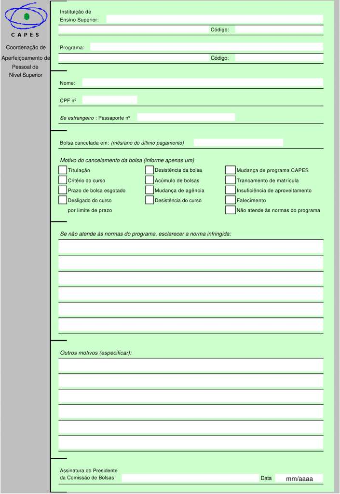

<!-- page 1 -->

# **Programa de Demanda Social Comunicado de Cancelamento de bolsa** 

<!-- figure p01-fig1 | described_by: agy | ocr_overlap: 1.0 | needs_review: false -->
**1. Tipo de figura**
Trata-se de um formulário administrativo oficial em branco, em formato de ficha/documento preenchível de página única, referente ao cancelamento de bolsa da CAPES (Coordenação de Aperfeiçoamento de Pessoal de Nível Superior).

**2. Todo o texto visível (verbatim)**

*Coluna lateral esquerda (identificação institucional):*
- `C A P E S`
- `Coordenação de`
  `Aperfeiçoamento de`
  `Pessoal de`
  `Nível Superior`

*Corpo principal do formulário (de cima para baixo):*
- `Instituição de`
  `Ensino Superior:`
- `Código:`
- `Programa:`
- `Código:`
- `Nome:`
- `CPF nº`
- `Se estrangeiro : Passaporte nº` *(com "Se estrangeiro :" em itálico)*
- `Bolsa cancelada em: (mês/ano do último pagamento)` *(com "(mês/ano do último pagamento)" em itálico)*
- `Motivo do cancelamento da bolsa (informe apenas um)` *(em itálico)*
  - Coluna 1:
    - `Titulação`
    - `Critério do curso`
    - `Prazo de bolsa esgotado`
    - `Desligado do curso`
      `por limite de prazo`
  - Coluna 2:
    - `Desistência da bolsa`
    - `Acúmulo de bolsas`
    - `Mudança de agência`
    - `Desistência do curso`
  - Coluna 3:
    - `Mudança de programa CAPES`
    - `Trancamento de matrícula`
    - `Insuficiência de aproveitamento`
    - `Falecimento`
    - `Não atende às normas do programa`
- `Se não atende às normas do programa, esclarecer a norma infringida:` *(em itálico)*
- `Outros motivos (especificar):` *(em itálico)*
- `Assinatura do Presidente`
  `da Comissão de Bolsas`
- `Data`
- `mm/aaaa`

**3. Estrutura**
A página tem orientação vertical e divide-se em dois painéis verticais principais, mais uma estreita margem vertical à direita:
- **Painel esquerdo (faixa institucional):** ocupa cerca de um sexto da largura à esquerda e contém, na parte superior, o logotipo da CAPES (anéis elípticos entrelaçados em torno de um núcleo oval) seguido pela sigla `C A P E S` e pelo nome completo da instituição centralizado em quatro linhas.
- **Linha divisória vertical com marcadores de seção:** uma linha preta vertical contínua separa o painel esquerdo do corpo do formulário. Dessa linha partem sete pequenos traços horizontais voltados para a direita (no topo, no rodapé e em cinco divisões intermediárias), delimitando **seis seções verticais** empilhadas no painel principal:
  1. **Seção 1 — Instituição e Programa:** composta por dois blocos de duas linhas cada, separados por linhas horizontais pretas:
     - Bloco `Instituição de Ensino Superior:`: linha 1 com o rótulo à esquerda e um campo de texto horizontal longo à direita; linha 2 com continuação do campo de texto à esquerda, seguida do rótulo `Código:` e um campo de texto menor à direita.
     - Bloco `Programa:`: mesma estrutura de duas linhas, com campo de texto longo na linha 1 e continuação + `Código:` + campo menor na linha 2.
  2. **Seção 2 — Identificação do bolsista:** três linhas empilhadas, cada uma sublinhada por uma linha horizontal preta:
     - `Nome:` seguido de um campo de texto longo.
     - `CPF nº` seguido de um campo de texto curto.
     - `Se estrangeiro : Passaporte nº` seguido de um campo de texto médio.
  3. **Seção 3 — Data e motivo do cancelamento:**
     - Linha superior com `Bolsa cancelada em: (mês/ano do último pagamento)` seguido de um campo de texto médio, sublinhado por uma linha horizontal preta.
     - Abaixo, o cabeçalho `Motivo do cancelamento da bolsa (informe apenas um)` seguido por uma grade de **13 caixas de seleção (quadrados com borda preta, todas desmarcadas)** distribuídas em **3 colunas**: 4 opções na coluna 1 (a quarta com texto em duas linhas), 4 opções na coluna 2 e 5 opções na coluna 3.
  4. **Seção 4 — Norma infringida:** cabeçalho `Se não atende às normas do programa, esclarecer a norma infringida:` acima de uma área de texto aberta composta por **6 linhas horizontais de preenchimento**, delimitadas acima e abaixo por 7 traços horizontais pretos.
  5. **Seção 5 — Outros motivos:** cabeçalho `Outros motivos (especificar):` acima de uma área de texto aberta idêntica, com **6 linhas horizontais de preenchimento**, delimitadas por 7 traços horizontais pretos.
  6. **Seção 6 — Assinatura e data:** linha única na base do formulário com o rótulo em duas linhas `Assinatura do Presidente / da Comissão de Bolsas`, seguido de um campo horizontal para assinatura, o rótulo `Data` e um campo menor contendo o texto-guia `mm/aaaa`, tudo apoiado sobre uma linha horizontal preta.

Não há setas, gráficos, eixos ou conexões diagramáticas; trata-se exclusivamente de um layout linear de formulário tabular/seccional.

**4. Números e valores de dados**
Não há nenhum dado preenchido nem valores numéricos no formulário. Todos os campos de texto estão vazios e todas as 13 caixas de seleção estão desmarcadas. O único conteúdo pré-preenchido em campo é a máscara de formato de data `mm/aaaa` no campo `Data`.

**5. Cores com significado**
- **Cinza (painel esquerdo e borda direita):** diferencia a área institucional fixa e a moldura externa da área útil do formulário.
- **Verde-claro (fundo do painel principal):** identifica o corpo do formulário e serve de fundo para rótulos, instruções e textos fixos.
- **Branco (retângulos horizontais e quadrados das caixas de seleção):** contrasta com o fundo verde-claro para indicar exatamente os espaços editáveis/preenchíveis (campos de entrada de texto e caixas de marcação).
- **Azul e verde (logotipo da CAPES):** compõem a identidade visual oficial da instituição (anéis azuis em torno de núcleo verde).

~~~text ocr
CAPES
Coordenação de
Aperfeiçoamento di
Pessoal de
Nível Superior
Instituição de
Ensino Superior:
Código:
Programa:
Código:
Nome:
CPF nº
Se estrangeiro : Passaporte nº
Bolsa cancelada em: (més/ano do último pagamento)
Motivo do cancelamento da bolsa (informe apenas um)
Titulação
Critério do curso
Prazo de bolsa esgotado
Desligado do curso
por limite de prazo
Desistência da bolsa
Acúmulo de bolsas
Mudança de agência
Desistência do curso
Mudança de programa CAPES
Trancamento de matrícula
Insuficiência de aproveitamento
Falecimento
Não atende às normas do programa
Se não atende às normas do programa, esclarecer a norma infringida:
Outros motivos (especificar):
Assinatura do Presidente
da Comissão de Bolsas
Data mm/aaaa
~~~

<!-- Start of picture text -->
Instituição de Ensino Superior: Código: Coordenação de Programa: Aperfeiçoamento de Código: Pessoal de Nível Superior Nome: CPF nº Se estrangeiro : Passaporte nº Bolsa cancelada em:  (mês/ano do último pagamento) Motivo do cancelamento da bolsa (informe apenas um) Titulação Desistência da bolsa Mudança de programa CAPES Critério do curso Acúmulo de bolsas Trancamento de matrícula Prazo de bolsa esgotado Mudança de agência Insuficiência de aproveitamento Desligado do curso Desistência do curso Falecimento por limite de prazo Não atende às normas do programa Se não atende às normas do programa, esclarecer a norma infringida: Outros motivos (especificar): Assinatura do Presidente da Comissão de Bolsas Data mm/aaaa <!-- End of picture text -->

**SAC -  IES / DS**
