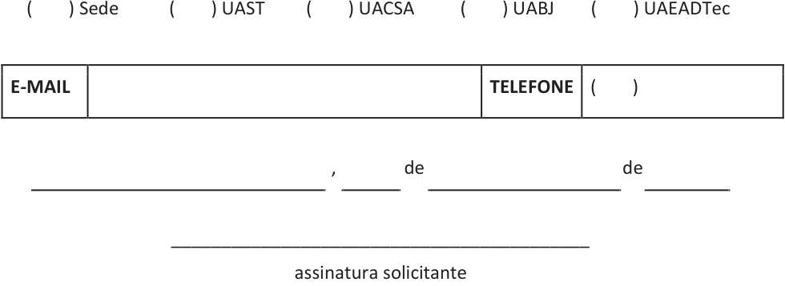

<!-- page 1 -->

(ANEXO DA RESOLUÇÃO CEPE/UFRPE Nº 744, DE 22 DE AGOSTO DE 2024.) 

# **ANEXO VI - REQUERIMENTO PARA SOLICITAÇÃO DE GRAU ANTECIPADA** 

<!-- figure p01-fig2 | described_by: agy | ocr_overlap: 0.8 | needs_review: false -->
1. **Tipo de figura:** Trecho de um formulário em branco (seção final de um formulário ou requerimento), contendo opções de seleção de unidade, uma tabela com campos para dados de contato, uma linha de preenchimento para local e data e um campo de assinatura.

2. **Todo o texto visível (literal):**
   - Linha superior (opções de seleção, da esquerda para a direita):
     - `(     ) Sede`
     - `(     ) UAST`
     - `(     ) UACSA`
     - `(     ) UABJ`
     - `(     ) UAEADTec`
   - Tabela (da esquerda para a direita):
     - Célula 1: `E-MAIL`
     - Célula 2: *(vazia)*
     - Célula 3: `TELEFONE`
     - Célula 4: `(     )`
   - Linha de local e data (intercalada por quatro traços horizontais de preenchimento):
     - `[traço longo] , [traço curto] de [traço médio] de [traço curto]`
     - Caracteres literais visíveis: `,` ; `de` ; `de`
   - Campo de assinatura (abaixo da linha horizontal):
     - `assinatura solicitante`

3. **Estrutura:**
   A figura é composta por quatro blocos dispostos verticalmente de cima para baixo, sem setas, painéis separados ou eixos:
   - **Bloco 1 (topo):** Uma linha horizontal contendo cinco opções de marcação espaçadas uniformemente, cada uma formada por um par de parênteses vazios seguido pelo nome/sigla da opção (`Sede`, `UAST`, `UACSA`, `UABJ`, `UAEADTec`).
   - **Bloco 2 (tabela de contato):** Uma caixa retangular com bordas finas contínuas, estruturada como uma tabela de 1 linha e 4 colunas:
     - Coluna 1 (estreita): rótulo `E-MAIL` em negrito, alinhado à esquerda e centralizado verticalmente.
     - Coluna 2 (larga): espaço retangular em branco destinado ao preenchimento do e-mail.
     - Coluna 3 (estreita): rótulo `TELEFONE` em negrito, alinhado à esquerda e centralizado verticalmente.
     - Coluna 4 (largura média): par de parênteses vazios `(     )` alinhado à esquerda e centralizado verticalmente (para código de área), seguido de espaço em branco para o número.
   - **Bloco 3 (local e data):** Uma linha única composta por quatro traços horizontais inferiores para preenchimento manual, na seguinte sequência: um traço longo, seguido por vírgula `,`, um traço curto, a palavra `de`, um traço médio, a palavra `de` e um traço curto final.
   - **Bloco 4 (assinatura):** Na base e centralizado horizontalmente, um único traço horizontal longo com o texto `assinatura solicitante` centralizado diretamente abaixo dele.

4. **Números e valores de dados:**
   Não há números nem valores de dados preenchidos na figura; todos os campos estão em branco.

5. **Cores com significado:**
   Nenhuma cor carrega significado; a figura utiliza exclusivamente texto e linhas em preto/cinza-escuro sobre fundo branco.

~~~text ocr
( | )JSede ( )UACSA ( ( )UAEADTec
, de de
assinatura solicitante
~~~

# **MINISTÉRIO DA EDUCAÇÃO** 

# **UNIVERSIDADE FEDERAL RURAL DE PERNAMBUCO** 

Rua Dom Manuel de Medeiros, s/n - Dois Irmãos, Recife - PE, 52171-900 

**REQUERIMENTO SOLICITAÇÃO DE COLAÇÃO DE GRAU ANTECIPADA** Ao(à) Senhor(a) reitor(a) ____________________________________. Eu,_______________________________________________, CPF nº________________, concluinte do curso de _______________________________________ desta Universidade, referente ao semestre ____________, solicito **COLAÇÃO DE GRAU ANTECIPADA** , pelo motivo abaixo especificado, conforme documentação comprobatória anexada a este Requerimento, pelo que assumo total responsabilidade pela sua veracidade. 

# **MOTIVO DA SOLICITAÇÃO** 

- (        ) Nomeação em concurso público; 

- (        ) Contratação por empresa pública ou privada; ou 

- (        ) aprovação em curso de pós-graduação externo à UFRPE a ser comprovada através da apresentação dos editais de seleção e convocação. 

# **UNIDADE** 

<!-- Start of picture text -->
(        ) Sede           (        ) UAST         (        ) UACSA          (        ) UABJ        (        ) UAEADTec E-MAIL  TELEFONE  (        ) ,  de  de __________________________________________ assinatura solicitante <!-- End of picture text -->

Confere com o original assinado pela Reitora e arquivado nesta Secretaria Geral.
