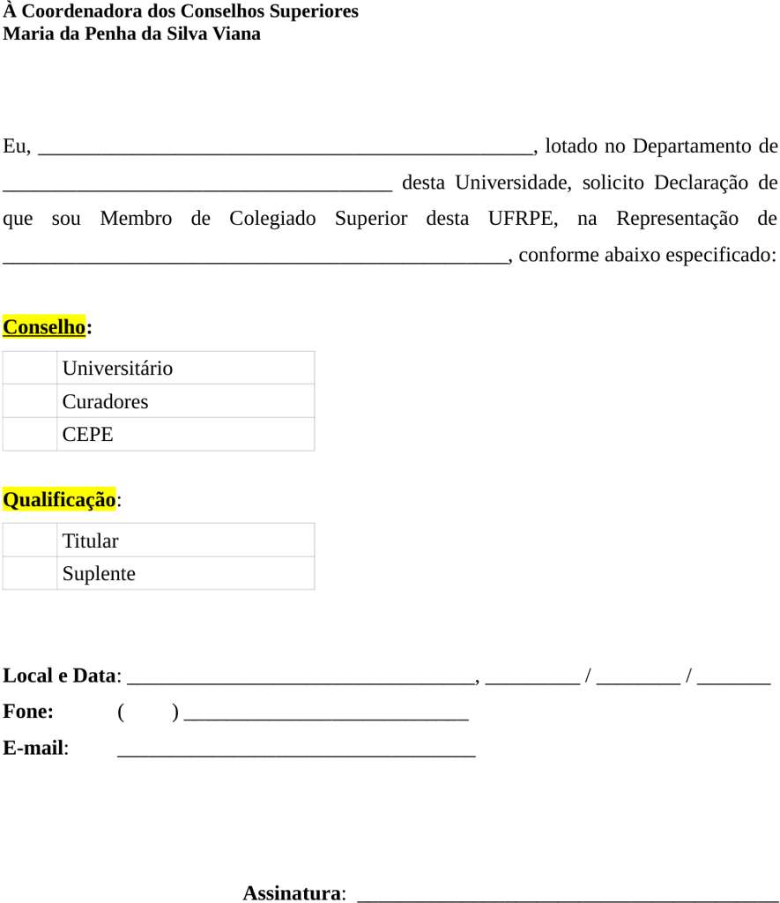

<!-- page 1 -->

# **<u><mark>DECLARAÇÃO MEMBRO CONSELHOS SUPERIORES</mark> :</u>** 

<!-- figure p01-fig1 | described_by: agy | ocr_overlap: 1.0 | needs_review: false -->
**1. Tipo de figura**
Trata-se de um formulário/requerimento administrativo em branco (documento de texto), destinado à solicitação de uma Declaração de Membro de Colegiado Superior da UFRPE (Universidade Federal Rural de Pernambuco), endereçado à Coordenadora dos Conselhos Superiores.

**2. Todo o texto visível (verbatim)**

*Cabeçalho:*
> **À Coordenadora dos Conselhos Superiores**
> **Maria da Penha da Silva Viana**

*Corpo do texto:*
> Eu, _____________________________________, lotado no Departamento de _____________________________ desta Universidade, solicito Declaração de que sou Membro de Colegiado Superior desta UFRPE, na Representação de ______________________________________, conforme abaixo especificado:

*Primeira seção e tabela:*
> **<u>Conselho</u>:**
> - [célula vazia] | Universitário
> - [célula vazia] | Curadores
> - [célula vazia] | CEPE

*Segunda seção e tabela:*
> **<u>Qualificação</u>**:
> - [célula vazia] | Titular
> - [célula vazia] | Suplente

*Bloco de dados finais:*
> **Local e Data:** ______________________________, ________ / _______ / ______
> **Fone:** (     ) ________________________
> **E-mail:** ______________________________

*Rodapé:*
> **Assinatura:** ___________________________________

**3. Estrutura**
O documento apresenta layout vertical em coluna única, sobre fundo branco e fonte serifada preta, sem gráficos, setas, eixos ou painéis. É dividido em seis blocos empilhados de cima para baixo:
- **Destinatário:** duas linhas em negrito alinhadas à esquerda no topo.
- **Parágrafo de solicitação:** separado do cabeçalho por espaço vertical, texto justificado em 4 linhas ocupando toda a largura da página, contendo 3 linhas horizontais de preenchimento em branco (para nome do solicitante, departamento e representação).
- **Tabela "Conselho":** localizada abaixo do título "Conselho:", alinhada à esquerda e ocupando cerca de dois quintos da largura da página. Possui bordas finas cinza-claro, 3 linhas e 2 colunas: uma coluna esquerda estreita com células vazias (para marcação da opção) e uma coluna direita mais larga com os nomes dos conselhos ("Universitário", "Curadores" e "CEPE").
- **Tabela "Qualificação":** localizada abaixo do título "Qualificação:", com o mesmo alinhamento, largura e estilo de bordas da tabela anterior. Possui 2 linhas e 2 colunas: uma coluna esquerda estreita com células vazias (para marcação) e uma coluna direita com as opções "Titular" e "Suplente".
- **Campos de data e contato:** três linhas alinhadas à esquerda na parte inferior. A primeira linha ("Local e Data:") traz uma linha para o local seguida de vírgula e três linhas curtas separadas por duas barras (`/`) para a data. A segunda linha ("Fone:") traz um par de parênteses vazios (para DDD) seguido de uma linha para o número. A terceira linha ("E-mail:") traz uma linha única. Os campos de preenchimento de "Fone:" e "E-mail:" iniciam-se alinhados verticalmente entre si.
- **Assinatura:** posicionada na base do documento após amplo espaço em branco, começando aproximadamente no centro horizontal e estendendo-se até a margem direita com uma linha de preenchimento.

**4. Números e valores de dados**
Não há números, datas preenchidas ou quaisquer valores quantitativos na imagem; todos os campos de preenchimento e caixas de seleção encontram-se em branco.

**5. Cores com significado**
- **Amarelo (realce/marca-texto de fundo):** aplicado exclusivamente sobre as palavras "Conselho" e "Qualificação" (que também estão em negrito e sublinhadas) para destacar os títulos das duas tabelas de opções obrigatórias a serem assinaladas pelo solicitante. As demais cores (texto preto, fundo branco e grades cinza-claro) não carregam codificação semântica adicional.

~~~text ocr
A Coordenadora dos Conselhos Superiores
Maria da Penha da Silva Viana
Eu, , lotado no Departamento de
desta Universidade, solicito Declaração de
que sou Membro de Colegiado Superior desta UFRPE, na Representação de
conforme abaixo especificado:
Universitário
Curadores
CEPE
Titular
Suplente
Local e Data: , / /
Fone: ( )
E-mail:
Assinatura:
~~~

<!-- Start of picture text -->
À Coordenadora dos Conselhos Superiores Maria da Penha da Silva Viana Eu, _______________________________________________, lotado no Departamento de _____________________________________ desta Universidade, solicito Declaração de que sou Membro de Colegiado Superior desta UFRPE, na Representação de ________________________________________________, conforme abaixo especificado: Conselho : Universitário Curadores CEPE Qualificação : Titular Suplente Local e Data : _________________________________, _________ / ________ / _______ Fone: (         ) ___________________________ E-mail :       __________________________________ Assinatura : ________________________________________ <!-- End of picture text -->
