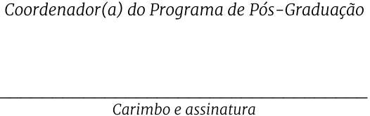

<!-- page 1 -->

<!-- figure p01-fig1 | described_by: agy | ocr_overlap: None | needs_review: false -->
1. **Tipo de figura:** Logotipo institucional (logotipo da CAPES).

2. **Texto visível (literal):**
   - `CAPES`

   Não há títulos adicionais, legendas, rótulos, notas ou outros textos na imagem.

3. **Estrutura:**
   A figura é composta por dois elementos empilhados verticalmente e centralizados sobre um fundo branco, sem caixas, setas, eixos, tabelas ou painéis:
   - **Parte superior (símbolo):** Um círculo sólido central cercado por um traço contínuo espesso que forma dois laços elípticos inclinados e entrelaçados ao redor do centro (lembrando órbitas atômicas). Uma das pontas desse traço estende-se em arco para cima e para a direita, terminando em um pequeno ponto circular preenchido.
   - **Parte inferior (tipografia):** A sigla `CAPES` em letras maiúsculas, fonte sem serifa e traço espesso, disposta horizontalmente logo abaixo do símbolo e com largura semelhante à dele.

4. **Números ou valores de dados:**
   Nenhum. A imagem não contém números nem dados quantitativos.

5. **Cores com significado:**
   As cores compõem a identidade visual da marca e diferenciam o núcleo dos demais elementos: o círculo central é verde; as linhas orbitais (com o ponto na extremidade superior direita) e o texto `CAPES` são azuis, contrastando com o fundo branco.

~~~text ocr
CAPES
~~~

## **TERMO DE COMPROMISSO Programa Demanda Social - DS** 

|Declaro, para os devidos fins, que eu, _____________________________,|
|---|
|CPF ______________, aluno (a) devidamente matriculado (a) na|
|Universidade/Fundação/Instituto/Associação/Escola/Faculdade_______________ ______________________________________________ no|
|Programa de Pós-Graduação ___________________________________|
|sob o número de matrícula ___________________, em nível de|
|__________________, tenho ciência das obrigações inerentes à qualidade de|
|beneficiário de bolsa, conforme regulamento vigente do Programa de Demanda Social –|
|DS, anexo à Portaria nº 76, de 14 de abril de 2010, e da Portaria nº 133, de 10 de julho de 2023, e nesse sentido, COMPROMETO-ME a respeitar as seguintes cláusulas:|

_I – dedicar-me integralmente às atividades do Programa de Pós-Graduação;_ 

_II – comprovar desempenho acadêmico satisfatório, consoante às normas definidas pela instituição promotora do curso; III – realizar estágio de docência de acordo com o estabelecido no art. 18 do regulamento vigente; VI – ser classificado no processo seletivo especialmente instaurado pela Instituição de Ensino Superior em que realiza o curso; V – apresentar Declaração de Acúmulo para informar eventuais, bolsas, vínculos empregatícios ou outros rendimentos e obter autorização da Instituição de Ensino Superior ou do Programa de Pós-Graduação, antes do início da vigência da bolsa;_ 

_VI- informar à coordenação do Programa de Pós-Graduação, por meio de Declaração de Acúmulo, qualquer alteração referente a acúmulos de bolsas, vínculos empregatícios ou outros rendimentos, para fins de atualização das informações na plataforma de concessão e acompanhamento de bolsas; VII – não acumular bolsa de mestrado e doutorado no País com outras bolsas, nacionais e internacionais, de mesmo nível, financiadas com recursos públicos federais;_ 

_VIII – citar a Coordenação de Aperfeiçoamento de Pessoal de Novel Superior - CAPES em trabalhos produzidos e publicados em qualquer mídia, que decorram de atividades financiadas, integral ou parcialmente, pela referida Fundação, conforme art. 1º da Portaria nº 206, de 4 de setembro de 2018;_ 

_IX – assumir a obrigação de restituir os valores despendidos com bolsa, na hipótese de interrupção do estudo, salvo se motivada por caso fortuito, força maior, circunstância alheia à vontade ou doença grave devidamente comprovada._ 

A inobservância das cláusulas citadas acima, ou se praticada qualquer fraude pelo(a) beneficiário, implicará no cancelamento da bolsa, com a restituição integral e imediata dos recursos, atualizados de acordo com os índices previstos em lei competente, acarretando ainda, a impossibilidade de receber benefícios por parte da CAPES, pelo período de 5 (cinco) anos, contados do conhecimento do fato. 

_Local e data: _______________________________________________________________________ 

_Assinatura do(a) beneficiário(a) da bolsa:_ _______________________________________ 

_Coordenador(a) do Programa de Pós-Graduação ___________________________________ Carimbo e assinatura_ 

<!-- page 2 -->

## **DECLARAÇÃO DE ACÚMULOS** 

# CAPES 

Declaro, para os devidos fins, que eu, ___________________________________, CPF ______________, aluno (a) devidamente matriculado (a) da Universidade/Fundação/Instituto/Associação/Escola/Faculdade___________________ _____________________________ no Programa de Pós-Graduação _______________________ sob o número de matrícula ________________, em nível de ______________, em atenção à Portaria nº 133, de 10 de julho de 2023, informo que possuo vínculo empregatício ou outros rendimentos, conforme declarado abaixo: 

☐ Cadastramento de bolsa ☐ Atualização de bolsa Processo SCBA nº_______________ 

#### **1- Atividades Remuneradas:** 

|Tipo de|Vínculo 1||||
|---|---|---|---|---|
|☐ CLT|☐ Pessoa Jurídica|☐ Regime Jurídico Único|☐ Temporário Lei 6.019/74|☐ Contrato por prazo determinado Lei9.601/98|
|Início da|Atividade:||Fim da Atividade:||
|Seção CN|AE*:||Divisão CNAE*:||
|Tipo de|Vínculo 2||||
|☐ CLT|☐ Pessoa Jurídica|☐ Regime Jurídico Único|☐ Temporário Lei 6.019/74|☐ Contrato por prazo determinado Lei9.601/98|
|Início da|Atividade:||Fim da Atividade:||
|Seção CN|AE*:||Divisão CNAE*:||
|Tipo de|Vínculo 3||||
|☐ CLT|☐ Pessoa Jurídica|☐ Regime Jurídico Único|☐ Temporário Lei 6.019/74|☐ Contrato por prazo determinado Lei9.601/98|
|Início da|Atividade:||Fim da Atividade:||
|Seção CN|AE*:||Divisão CNAE*:||

* Utilizar nº CNAE anexo 

#### **2- Outros Rendimentos** 

|Informar os outros rendimentos que possui:||
|---|---|
|1-||
|Início da Atividade:|Fim da Atividade:|
|2-||
|Início da Atividade:|Fim da Atividade:|
|3-||
|Início da Atividade:|Fim da Atividade:|

1/2 

<!-- page 3 -->

#### **3- Bolsas Declaratórias** 

- Acumulará essa bolsa Capes com outra bolsa, nacional ou internacional, de mesmo nível, financiada com <mark>recursos públicos federais?</mark> 

   - <mark>☐</mark> **<mark>Sim</mark>** <mark>☐</mark> **<mark>Não</mark>** 

- <mark>Acumulará essa bolsa Capes com outra bolsa, nacional ou internacional, cuja legislação vigente vede expressamente o acúmulo?</mark> 

   - <mark>☐</mark> **<mark>Sim</mark>** <mark>☐</mark> **<mark>Não</mark>** 

- <mark>Acumulará essa bolsa Capes com outra bolsa, nacional ou internacional, de mesmo nível, financiada com recursos não federais?</mark> 

   - <mark>☐</mark> **<mark>Sim</mark>** <mark>☐</mark> **<mark>Não</mark>** 

- <mark>Acumulará essa bolsa Capes com outra bolsa, nacional ou internacional, que não seja de mesmo nível?</mark> 

   - <mark>☐</mark> **<mark>Sim</mark>** <mark>☐</mark> **<mark>Não</mark>** 

_Local e data: _____________________________________________________________________ 

_Assinatura do(a) beneficiário(a):_ __________________________________________ 

### <mark>☐</mark> **Os acúmulos registrados acima estão de acordo com os critérios de acúmulo previstos no regulamento da Instituição de ensino e pesquisa ou PP** **_G_** _._ 

<!-- figure p03-fig1 | described_by: agy | ocr_overlap: 1.0 | needs_review: false -->
1. **Tipo de figura:** Campo de assinatura e carimbo de um documento/formulário oficial (em branco, sem preenchimento).
2. **Texto visível (literal):**
   - Na parte superior, centralizado em itálico: `Coordenador(a) do Programa de Pós-Graduação`
   - Na parte inferior, centralizado em itálico, logo abaixo da linha: `Carimbo e assinatura`
3. **Estrutura:** Disposição vertical simples composta por um cabeçalho de texto no topo, um amplo espaço em branco central destinado ao carimbo e à assinatura, uma linha horizontal preta contínua (formada por sublinhados consecutivos) que atravessa toda a largura da imagem e a legenda imediatamente abaixo da linha. Não há caixas, setas, eixos, tabelas ou painéis.
4. **Números ou valores de dados:** Nenhum.
5. **Cores com significado:** Nenhuma (apenas texto e linha em preto sobre fundo branco/claro).

~~~text ocr
Coordenador(a) do Programa de Pós-Graduação
Carimbo e assinatura
~~~

<!-- Start of picture text -->
Coordenador(a) do Programa de Pós-Graduação ___________________________________ Carimbo e assinatura <!-- End of picture text -->

2/2 

<!-- page 4 -->

|SEÇÃO CNAE|DIVISÃO CNAE|
|---|---|
|A - AGRICULTURA, PECUÁRIA, PRODUÇÃO FLORESTAL, PESCA E AQÜICULTURA|01 - AGRICULTURA, PECUÁRIA ESERVIÇOS RELACIONADOS 02 - PRODUÇÃO FLORESTAL |
||03 - PESCA EAQÜICULTURA 05 - EXTRAÇÃO DE CARVÃO MINERAL |
|B - INDÚSTRIAS EXTRATIVAS|06 - EXTRAÇÃO DE PETRÓLEO E GÁS NATURAL 07 - EXTRAÇÃO DE MINERAIS METÁLICOS |
||08 - EXTRAÇÃO DE MINERAIS NÃO-METÁLICOS 09 - ATIVIDADES DE APOIO À EXTRAÇÃO DE MINERAIS |
||10 - FABRICAÇÃO DE PRODUTOS ALIMENTÍCIOS 11 - FABRICAÇÃO DE BEBIDAS|
|| 12 - FABRICAÇÃO DE PRODUTOS DO FUMO 13  FABRICAÃO DE PRODUTOS TÉXTEIS|
||- Ç 14 - CONFECÇÃO DEARTIGOS DO VESTUÁRIO EACESSÁRIOS|
|| 15 - PREPARAÇÃO DE COUROS E FABRICAÇÃO DE ARTEFATOS DE COURO, ARTIGOS PARA VIAGEM E CALÇADOS 16 - FABRICAÇÃO DE PRODUTOS DE MADEIRA|
|| 17 - FABRICAÇÃO DE CELULOSE, PAPEL E PRODUTOS DE PAPEL 18 - IMPRESSÃO E REPRODUÇÃO DE GRAVAÇÕES |
||19 - FABRICAÇÃO DE COQUE, DE PRODUTOS DERIVADOS DO PETRÓLEO E DE BIOCOMBUSTÍVEIS 20 - FABRICAÇÃO DE PRODUTOS QUÍMICOS |
|C - INDÚSTRIAS DE TRANSFORMAÇÃO|21 - FABRICAÇÃO DE PRODUTOS FARMOQUÍMICOS E FARMACÊUTICOS 22 - FABRICAÇÃO DE PRODUTOS DE BORRACHA E DE MATERIAL PLÁSTICO|
|| 23 - FABRICAÇÃO DE PRODUTOS DE MINERAIS NÃO-METÁLICOS 24 -METALURGIA|
|| 25 - FABRICAÇÃO DE PRODUTOS DE METAL, EXCETO MÁQUINAS E EQUIPAMENTOS Á  Ô Ó|
||26 - FABRICAÇÃO DE EQUIPAMENTOS DE INFORMTICA, PRODUTOS ELETRNICOS EPTICOS 27 - FABRICAÇÃO DE MÁQUINAS, APARELHOS E MATERIAIS ELÉTRICOS 28 - FABRICAÇÃO DE MÁQUINAS E EQUIPAMENTOS|
|| 29 - FABRICAÇÃO DE VEÍCULOS AUTOMOTORES, REBOQUES E CARROCERIAS|
|| 30 - FABRICAÇÃO DE OUTROS EQUIPAMENTOS DETRANSPORTE, EXCETO VEICULOS AUTOMOTORES 31 - FABRICAÃO DE MÓVEIS|
||Ç 32 - FABRICAÇÃO DE PRODUTOS DIVERSOS Ã Ã  Ã  Á|
|D - ELETRICIDADE E GÁS|33 - MANUTENÇO, REPARAÇO E INSTALAÇO DE MQUINAS E EQUIPAMENTOS 35 - ELETRICIDADE, GÁS E OUTRAS UTILIDADES |
||36 - CAPTAÇÃO, TRATAMENTO E DISTRIBUIÇÃO DE ÁGUA|
|E - ÁGUA ESGOTO ATIVIDADES DE GESTÃO DE RESÍDUOS E DESCONTAMINAÃO| 37 - ESGOTO EATIVIDADES RELACIONADAS|
|, ,       Ç| 38 - COLETA, TRATAMENTO E DISPOSIÇÃO DE RESÍDUOS|
|| 39 - DESCONTAMINAÇÃO E OUTROSSERVIÇOS DE GESTÃO DE RESÍDUOS |
|F - CONSTRUÇÃO|41 - CONSTRUÇÃO DE EDIFICIOS 42 - OBRAS DE INFRA-ESTRUTURA |
|G - COMÉRCIO|43 - SERVIÇOS ESPECIALIZADOS PARA CONSTRUÇÃO|
||49 - TRANSPORTE TERRESTRE 50 - TRANSPORTEAQUAVIARIO|
|H - TRANSPORTE, ARMAZENAGEME CORREIO| 51 - TRANSPORTE AEREO|
|| 52 - ARMAZENAMENTO E ATIVIDADES AUXILIARES DOS TRANSPORTES 53 - CORREIO E OUTRAS ATIVIDADES DE ENTREGA |
|I - ALOJAMENTO E ALIMENTAÇÃO|55- ALOJAMENTO 56 - ALIMENTAÇÃO |
|| 58 - EDIÇÃO E EDIÇÃO INTEGRADA À IMPRESSÃO |
|| 59 - ATIVIDADES CINEMATOGRÁFICAS, PRODUÇÃO DE VÍDEOS E DE PROGRAMAS DE TELEVISÃO|
|J - INFORMAÇÃO E COMUNICAÇÃO| 60 - ATIVIDADES DE RÁDIO E DE TELEVISÃO 61  TELECOMUNICAÕES|
||- Ç G  D D S DS D A  C A0|
|| 63 - ATIVIDADES DE PRESTAÇÃO DE SERVIÇOS DE INFORMAÇÃO |
|K - ATIVIDADES FINANCEIRAS, DE SEGUROS E SERVIÇOS RELACIONADOS|64 - ATIVIDADES DE SERVIÇOS FINANCEIROS 65 - SEGUROS, RESSEGUROS, PREVIDÊNCIA COMPLEMENTAR E PLANOS DE SAÚDE |
|L - ATIVIDADES IMOBILIÁRIAS|G S      S  S  DE 68 - ATIVIDADES IMOBILIÁRIAS|
|| 69 - ATIVIDADES JURÍDICAS DE CONTABILIDADE E DE AUDITORIA|
||, 70 - ATIVIDADES DE SEDES DE EMPRESAS E DE CONSULTORIA EM GESTÃO EMPRESARIAL |
|M - ATIVIDADES PROFISSIONAIS, CIENTIFICAS E TÉCNICAS|71 - SERVIÇOS DE ARQUITETURA E ENGENHARIA 72 - PESQUISA E DESENVOLVIMENTO CIENTÍFICO|
||73 - PUBLICIDADEE PESQUISA DE MERCADO 74 - OUTRAS ATTVIDADES PROFISSIONAIS, CIENTÍFICAS ETÉCNICAS 75 - ATIVIDADES VETERINÁRIAS|
|| 77- ALUGUÉIS NÃO-IMOBILIÁRIOS E GESTÃO DE ATIVOS INTANGÍVEIS NÃO-FINANCEIROS Ã   Ã  Ã|
||78 - SELEÇO, AGENCIAMENTO E LOCAÇO DE MO-DE-OBRA |
|N - ATIVIDADES ADMINISTRATIVAS E SERVIÇOS COMPLEMENTARES|79 - AGÉNCIAS DE VIAGENS, OPERADORES TURÍSTICOS ESERVIÇOS DE RESERVAS 80 - ATIVIDADES DE VIGILÂNCIA, SEGURANÇA E INVESTIGAÇÃO|
||81 - SERVIÇOS PARA EDIFICIOS EATIVIDADES PAISAGISTICAS |
|0 - ADMINISTRAÇÃO PÚBLICA, DEFESA E SEGURIDADE SOCIAL| 82 - SERVIÇOS DE ESCRITÓRIO, DE APOIO ADMINISTRATIVO E OUTROS SERVIÇOS PRESTADOS AS EMPRESAS 84 - ADMINISTRAÇÃO PÚBLICA DEFESA E SEGURIDADE SOCIAL|
| P - EDUCAÇÃO|, 85 - EDUCAÇÃO Ã  Ú|
|Q - SAÚDE HUMANA E SERVIÇOS SOCIAIS|86 - ATTVIDADES DE ATENÇO A SADE HUMANA 87 - ATIVIDADES DEATENÇÃO À SAÚDE HUMANAINTEGRADAS COM ASSISTÉNCIA SOCIAL, PRESTADAS EM RESIDÊNCIAS COLETIVAS E PARTICULARES |
||88 - SERVIÇOS DE ASSISTÊ NCIA SOCIAL SEM ALOJAMENTO |
|R - ARTES CULTURA ESPORTE E RECREAÇÃO|90 - ATIVIDADES ARTÍSTICAS, CRIATIVAS E DE ESPETÁCULOS 91 - ATIVIDADES LIGADAS AO PATRIMÓNIO CULTURAL E AMBIENTAL|
|, ,|92 - ATIVIDADES DE EXPLORAÇÃO DE JOGOS DE AZAR E APOSTAS 93 - ATIVIDADES ESPORTIVAS E DE RECREAÇÃO E LAZER |
|S - OUTRAS ATIVIDADES DE SERVIÇOS|94 - ATIVIDADES DE ORGANIZAÇÕES ASSOCIATIVAS 95 - REPARAÇÃO E MANUTENÇÃO DE EQUIPAMENTOS DE INFORMÁTICA E COMUNICAÇÃO E DE OBJETOS PESSOAIS E DOMÉSTICOS |
|T - SERVIÇOS DOMÉSTICOS |96 - OUTRAS ATIVIDADES DE SERVIÇOS PESSOAIS 97 - SERVIÇOS DOMÉSTICOS |
|U - ORGANISMOS INTERNACIONAIS E OUTRAS INSTTTUIÇÕES EXTRATERRITORIAIS|3/2 99 - ORGANISMOS INTERNACIONAIS E OUTRAS INSTITUIÇÕES EXTRATE RRITORIAIS|
