<!-- page 1 -->


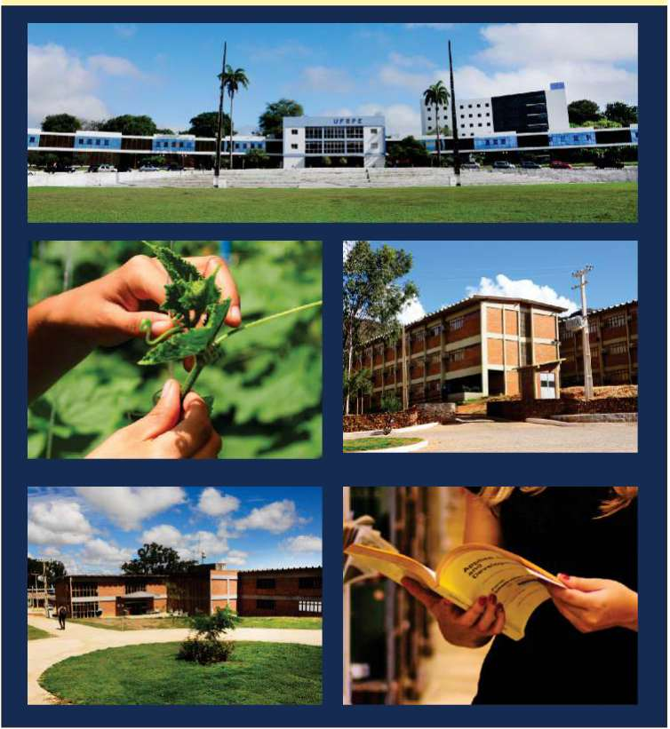

<!-- figure p01-fig2 | described_by: agy | ocr_overlap: None | needs_review: false -->
1. **Kind of figure:** A five-panel photographic collage consisting of five colour photographs arranged in a grid on a solid dark navy-blue background (with a thin pale cream horizontal edge at the very top). There are no overlaid titles, labels, captions, legends, diagrams, or data graphics.

2. **All visible text (verbatim):**
   No overlaid titles, labels, legends, captions, axis ticks, or cell values appear on the figure. The only visible text is incidental text inside two of the photographs:
   - **Top panel (on the upper facade of the central building):** `UFRPE`
   - **Bottom-right panel (printed on the curved yellow cover of the open book):**
     - Line 1: `Applied [illegible]`
     - Line 2: `and`
     - Line 3: `Develop[illegible]`
     - Additional smaller printed lines beneath the title: `[illegible]`

3. **Structure:**
   The figure contains no arrows, flow boxes, connectors, or axes. Its five rectangular photographic panels are arranged in **3 rows** separated by uniform dark navy-blue borders and gutters:
   - **Row 1 (1 full-width panoramic panel):** Exterior wide-angle daytime photograph of a university campus main building. A wide green lawn and a white stepped terrace occupy the foreground, flanked by two tall dark flagpoles and palm trees. Behind them stands a central white-and-light-blue facade with a large gridded glass window wall and the letters `UFRPE` along the top parapet, joined on both sides by long low wings with blue glass facade panels and parked cars in front. A taller multi-story white-and-dark building rises behind the right wing, with trees and a blue sky with clouds in the background.
   - **Row 2 (2 equal-width columns):**
     - **Middle-left panel:** Close-up photograph of two hands gently holding and examining a green plant shoot with serrated leaves and a curling tendril against a softly blurred background of green foliage.
     - **Middle-right panel:** Exterior daytime photograph of three-story red-brick and light-concrete academic buildings with horizontal rows of windows, viewed at an angle above low stone retaining walls. A small brick utility booth with a light-grey door stands near the front corner of the building, a concrete utility pole with a transformer stands on the right, tall trees stand on the left, and a paved path with a bicycle parked by the wall appears in the lower left under a blue sky with clouds.
   - **Row 3 (2 equal-width columns):**
     - **Bottom-left panel:** Exterior daytime photograph of a two-story red-brick and concrete building complex with large gridded windows and a curved entrance canopy. In the foreground, a curved paved pathway encircles a round green lawn with a small shrub/tree in the center; a person wearing a backpack walks along the path on the left toward the building. Trees and a blue sky with scattered white clouds appear in the background.
     - **Bottom-right panel:** Close-up photograph of a person in a dark sleeveless top with dark-red nail polish holding open a yellow-covered book or journal in front of blurred bookshelves (a library aisle), with the partially visible English title printed on the curved front cover.

4. **Numbers or data values:**
   None. No numerical values, measurements, dates, scales, or quantitative data appear in the figure.

5. **Colours carrying meaning:**
   No colours encode data or semantic categories. The photographs use natural colour, and the solid dark navy-blue background serves only as a decorative and structural frame separating the five panels.


ESTATUTO EX SEMINE SEGES E REGIMENTO UFRPE GERAL 


<!-- page 2 -->


<!-- page 3 -->


PLANO DE REESTRUTURAÇÃO, ESTATUTOE 

REGIMENTO GERAL DA 

UNIVERSIDADE FEDERAL RURAL DE PERNAMBUCO 

UFRPE, julho/85 


<!-- page 4 -->

#### 378.813 U58p 


UNIVERSIDADE FEDERAL RURAL DE PERNAMBUCO Plano de reestruturação, estatuto e regimento geral da Universidade Federal Rural de Pernambuco. Recife, 1985. 131 p. 

UNIVERSIDADE FEDERAL RURAL DE PERNAMBUCO - reestruturação, estatuto e regimento 

BC/UFRPE 

IL/sm 


<!-- page 5 -->


#### APRESENTAÇÃO 

O PLANO·GERAL DE AÇÃO da UFRPE 

para o quadriênio 1984/87, 

no seu Programa DESENVOLVIMENTO INSTITUCIONAL, prevê como uma de suas metas a atualização da legislação que rege a Institulção, ou seja, o seu ESTATUTO e REGIMENTO GERAL. 

Com essa finalidade, 

a Administração vem colocar à disposição da Comunldade Universitária os referidos Instrumentos, a fim de que possam ser avaliados e, consequentemente, permitir no decorrer da atual gestão, a aprovação de uma legislação Interna mals adequada. 


<!-- page 6 -->


<!-- page 7 -->

### MODIFICAÇÕES NO ESTATUTO E REGIMENTO GERAL 

RESOLUÇÃO N.° 04/80 — Conselho Universitário 

Aprova as modificaões do Estatuio e Regimento Geral da UFRPE, decorrentes da adaptação dos mesmos, aos atuals-textos legais sobre elelção estudantil e representação do Corpo Discente na Administração Universitárla. 

RESOLUÇÃO N.° 05/80 — Conselho Universitário 

Aprova Normas para a escolha dos membros dos Diretórios Acadêmicos e representação do Corpo Discente, nos Örgãos Coleglados da UFRPE. 


<!-- page 8 -->


<!-- page 9 -->

|SUMÁRIO||
|---|---|
||PÁGINA|
|PARTE I — PLANO DE REESTRUTURAÇÃO|01a 19|
|DECRETO N.° 76.212, de 4 de Setembro de 1975, — Aprova o<br>Plano de Reestruturação da Universldade Federal Rural de Per-<br>nambuco...........|ō1|
|PLANO DE REESTRUTURAÇÃO|03 a 07|
|. TíTULO I — Universidadee seus Objetivos<br>. TÍTULO II — Estrutura da Universidade|03<br>04|
|. CAPITULO'I — Órgãos de Dellberação Superior .. .<br>. CAPITULOII — Órgãos Executivos|04<br>05|
|. Seção I— Reltoria ... ..<br>. SeçãoI — Unidades Universitárlas<br>. Seção III Órgãos Suplementares|05<br>05.<br>06|
|. CAPíTULO III — OrganizaçãoDidático-Clentífica.|06 a 07|
|. TíTULOIII— Disposições Gerals e Transitórlas|07|
|MINISTÉRIO DA EDUCAÇÃO E CULTURA — Conselho Federal<br>do5ao||
|Estatuto e Regimento Geral da Universidade Federal Rural de<br>Pernambuco — Processo n.° 15.986/75 e Parecer n.° 4.005/||


—1— 


<!-- page 10 -->

### PÁGINA 

75 aprovado em 08.10.75 — DOU de 17 de novembro de 1975 — Homologado pelo Exmo. Sr. Minlstro da Educação e Cultura, Senador Ney Aminthas de Barros Braga ... ..... 

60 

. Despacho do Ministro  Processo n.° 257.280/75, Processo CFE n.° 15.986, Parecer CEF n.° 4.005/75 ... 

11 

HISTÓRICO 13 I Estatuto 13 a 16 II — Reglmento Geral 16 a 18 III — Voto do Relator . 18 8 19 IV — Conclusão da Câmara 19 

PARTE II — ESTATUTO Resolução n.º 95/75 — Conselho Universitário — Aprova o Estatuto da Unlversidade Federal Rural de Pernambuco 23 ESTATUTO... 25 a 54 . TiTULO I — Da Unlversidade e seus Objetivos 25 a 26 . TíTULO I — Da Organízação Universltárla ... 26 "CAPITULO I — SistemasUniversltárlos . . 27 a 28 . TiTULO III — Da Administração Universitárla ... 28 . CAPITULO I  Administração Superlor... 28 a 29 . Seção I — Conselho Universitárlo ... ... 29 a 30 . Seção II — Conselho de Ensino, Pesqulsa e Extensão 30 a 32 . Seção III — Conselho de Curadores ... 32 a 33 . Seção IV — Reltorla e Vice-Reltorla 33 a 34 . CAPITULO I — Adminlstração Departamental 34 a 35 . Seção I — Diretorla ... …. 35 8 36 . Seção I — Conselho Técnico Administrativo . 36 . Seção III — Secretarla .. 37 37 . TITULO IV — Da Organlzação Dadático-ClentIfica ... 

—II— 


<!-- page 11 -->


##### PÁGINA 

. CAPÍTULO I — EnsIno 37 . Seção INormas Gerais do Ensino 38 à 39 . Seção Il Cursos de Graduação .. 39 à 40 . Seção III — Cursos de Pós-Graduação 40 a 41 . Seção IV — Cursos deEspeclalização, Aperfelçoamento, Extensão, 2.° Grau e Outros ... ... 41 . Seção V — Coordenação Ditática dos Cursos ... 41 a 42 . CAPITULO II— Pesquisa 42 . CAPITULO III — Extensão 42 . TíTULO V — Da Comunldade Universitária ... .. 42 .. CAPITULO I — Corpo Docente 42 a 47 . CAPITULO II — Corpo Discente 47 a 49 . CAPÍTULO III — Corpo Técnico e Administratlvo 49 . CAPITULO IV — DIplomas, Certificados, Títulos e<sup>Me-</sup> dalhas. 49 a 50 . TITULO VI — Do Patrimônlo e dos Recursos financeiros 50 a 51 . TITULO VIl — Das Disposições Gerals e Transitórias .... 51 . CAPITULO I — Disposições Gerals ... 51 a 52 . CAPÍTULO II — DIsposições Transitórlas 53 a 54 PARTE III — REGIMENTO GERAL Resolução n.° 96/75 — Conselho Universitário — Aprova o Projeto de Regimento Geral da Universidade Federal Rural de Pernambuco.. 57 REGIMENTO GERAL —Do Preâmbulo . 59 . TiTULO I — Da Administração .. 59 59 a 60 . SUBTITULO — Dos Órgãos Administrtivos . CAPITULO | — Atribuições dos Coleglados .. 60 . Seção I — Coleglados da Adminlstração Superlor ...... 60 . Subseção I — Conselho Universitário ... 60 a 61 — III— 


<!-- page 12 -->

PÁGINA . Subseção I— Conselho de Ensino, Pesqulsa e Extensão 61 a 62 . Subseção IIl — Conselho de Curadores ... .. 63 . Seção I — Coleglados da Administração Departamental 63 . Subseção IConselho Técnico-Administra:lvo... 63 a 64 . CAPITULO II — Funcionamènto dos Órgãos Coleglados .. 64 a 67 68 . SUBTÍTULO II — Dos ÓrgãosExecutivos . . CAPITULO I →Administração Superlor .. 68 . Seção I — Reltor ... 68 a 70 . Seção I — Vice-Reltor 70 a 71 . Seção III — Pró-Retorias 71 71 a 72 . Seção IV — Órgãos de Apolo e Assessoramento . Seção V — órgãos Executivos da Administração Geral 70 . Seção VI — Órgãos Executivos da Administração Específica. 72 . CAPITULOII — Administração Departamental ... 73 . Seção I — Direorla .. 73 a 74 . Seção Il — Supervlsão das Areas de Conhecimento 74 a 75 . Seção III — Secretaria .. 75 . CAPITULOIII— Órgãos Executivos da Administração Geral (órgãos Suplementares) ... 75 a 77 . TITULO II — Da Organização Didático-Clentifica ÈÉ! . CAPITULO I — EnsIno . 77 

75 a 77 ÈÉ! 

77 


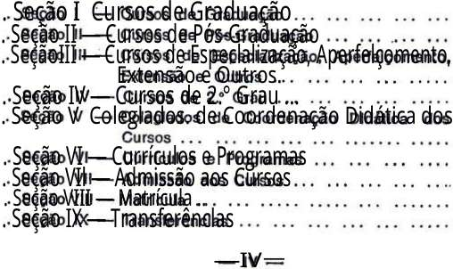

<!-- figure p12-fig1 | described_by: agy | ocr_overlap: 0.75 | needs_review: false -->
### 1. Tipo de figura
Trata-se de um recorte de texto extraído de uma página digitalizada de documento em português, correspondendo a um trecho de sumário (ou índice) com nove seções numeradas e a numeração da página no rodapé. A imagem apresenta duas camadas de texto visivelmente sobrepostas: uma camada de fundo, correspondente ao texto original impresso e escaneado (fonte mais baixa, em tom cinza-escuro/preto levemente borrado, com pontilhados de sumário), e uma camada em primeiro plano, correspondente a texto digital sobreposto (provavelmente de OCR), em fonte preta mais alta, mais fina e ligeiramente deslocada, contendo erros de reconhecimento de caracteres e omissões em relação ao original.

### 2. Todo o texto visível (verbatim)

**Camada sobreposta (primeiro plano, mais nítida e maior):**
- `Seção I Cursos de Graduação`
- `Seção II — Cursos de Pós-Graduação`
- `Seção III — Cursos de Especlalização, Aperfelçomento,`
  `Extensão e Outros`
- `Seção IV — Cursos de 2.° Grau ...`
- `Seção V Coleglados de Coordenação Didática dos`
- `Seção VI — Currículos e Programas`
- `Seção VII — Admissão aos Cursos`
- `Seção VIII — Matrícula`
- `Seção IX — Transferênclas`
- Rodapé centralizado: `— IV =` *(o `IV` e o traço direito apresentam duplicação por sobreposição com a camada de fundo, fazendo o traço à direita parecer um sinal de igual `=`)*

**Camada original impressa (ao fundo, parcialmente encoberta pela camada sobreposta):**
- `.. Seção I — Cursos de Graduação ... ... ... ... ...`
- `.. Seção II — Cursos de Pós-Graduação ... ... ... ...`
- `.. Seção III — Cursos de Especialização, Ape[illegible]mento,` *(a palavra sob `Aperfelçomento,` está parcialmente obstruída na porção central pela sobreposição das letras)*
  `Extensão e Outros ... ... ... ... .....`
- `.. Seção IV — Cursos de 2.° Grau ... ... ... ... .....`
- `.. Seção V — Colegiados de Coordenação Didática dos`
  `Cursos ... ... ... ... ... ....... .....` *(esta linha com a palavra `Cursos` aparece apenas na camada de fundo, sem texto sobreposto)*
- `.. Seção VI — Currículos e Programas ... ... ... ....`
- `.. Seção VII — Admissão aos Cursos ... ... ... ... ...`
- `.. Seção VIII — Matrícula ... ... ..... ..... ... ......`
- `.. Seção IX — Transferências ... ... ... ... ... .....` *(parte das letras finais de `Transferências` fica densamente sobreposta pela camada de primeiro plano)*
- Rodapé centralizado: `— IV —`

### 3. Estrutura
- **Layout geral:** Lista vertical de 9 itens textuais em uma única coluna alinhada à esquerda, sem caixas, bordas, tabelas, gráficos, eixos, setas ou divisões em painéis.
- **Formato de cada entrada:** Cada seção inicia na margem esquerda da camada impressa com dois pequenos pontos (`..`), seguidos por `Seção`, o algarismo romano correspondente (`I` a `IX`), um travessão (`—`) e o título da seção. Após o final do título, sequências espaçadas de pontos guia (pontilhado de sumário) estendem-se horizontalmente até a borda direita do recorte; os números de página correspondentes a cada seção não aparecem na imagem (a margem direita foi cortada antes dessa coluna).
- **Quebras de linha (indentação):** Dois títulos ocupam duas linhas, com a segunda linha recuada e alinhada aproximadamente ao início do texto do título (logo após o travessão):
  - Na `Seção III`, a segunda linha contém `Extensão e Outros` seguido dos pontos guia.
  - Na `Seção V`, a segunda linha contém `Cursos` seguido dos pontos guia.
- **Relação entre as duas camadas:** A camada sobreposta cobre diretamente as mesmas linhas da camada impressa, porém em corpo verticalmente maior e ligeiramente deslocado, gerando sobreposição densa nos caracteres. Na camada sobreposta, os travessões após `Seção I` e `Seção V` não foram reproduzidos (permanecendo visíveis apenas os travessões originais sob a letra `C` de `Cursos` e de `Coleglados`), a segunda linha `Cursos` da `Seção V` não foi reproduzida e a maioria dos pontos guia à direita também não foi reproduzida (exceto os três pontos imediatamente após `Grau` na `Seção IV`).
- **Rodapé:** Abaixo de todo o bloco de lista, separado por um espaço em branco e centralizado horizontalmente na parte inferior da imagem, aparece o marcador de página `— IV —` (com traço duplo à direita devido ao leve desalinhamento vertical entre as duas camadas).

### 4. Números e valores de dados
- **Algarismos romanos das seções (9 entradas):** `I`, `II`, `III`, `IV`, `V`, `VI`, `VII`, `VIII`, `IX`.
- **Numeral ordinal no título da Seção IV:** `2.°` (em `Cursos de 2.° Grau`).
- **Algarismo romano de paginação no rodapé:** `IV`.
- Não há outros números, dados quantitativos ou números de página individuais associados às entradas do sumário visíveis na imagem.

### 5. Cores
Não há cores com significado informacional: a imagem é inteiramente monocromática, composta por texto preto e cinza-escuro sobre fundo branco.

~~~text ocr
- [ a ;
«Seção Cur
Didática des
Admissão Cursas..
- — ...
...
~~~


<!-- Start of picture text -->
. Seção I  Cursos de Graduação<br>. Seção II — Cursos de Pós-Graduação<br>. SeçãoIII — Cursos de Especlalização, Aperfelçomento,<br>Extensão e Outros.<br>. Seção IV — Cursos de 2.° Grau ...<br>. Seção V  Coleglados. de Coordenação Didática dos<br>. Seção VI — Currículos e Programas<br>. Seção VIl — Admissão aos Cursos<br>. Seção VIII — Matrícula ..<br>. Seção IX — Transferênclas<br>—IV—<br><!-- End of picture text -->

77 a 78 78 a 80 

80 a 81 81 a 82 

82 8 84 84 a 86 86 87 a 89 89 a 90 


<!-- page 13 -->

||PÁGINA|
|---|---|
|. Seção X — Verlficação de Aprendizagem ... ...<br>.<br>. Seção Xi— Calendárlo Escolar<br>|..90 a 92<br>92<br>|
|. Seção XIl—Orlentação Acadêmica ...<br>. Seção XIII —Orientação Psicológlca e Apolo Didático ..|93 a 94<br>94|
|. CAPITULO II — Pesquisa..|94 a 95|
|. Seção I — Programação e Execução de Pesqulsas ...<br>. Seção I — Avaliação e Publicação de Pesqulsa .....|95 a 96<br>96|
|. CAPITULO III — Extensão ...|96|
|. Seção I — Coordenação, Programação e Execução ....<br>. Seção I — Integração de Ensino, Pesquisa e Extensão|96 a 97<br>97|
|.TiTULO' IIl— Da Comunidade Universitárla.|98|
|. CAPITULO I — DIsposições Comuns<br>. CAPITULOII — Do Corpo Docente|86<br>66|
|. Seção I — Competição de Mérito para Admissão de<br>Docentes....<br>. Seção I — Regime de Trabalho.<br>|99 a 106<br>106 a 107<br>|
|. Seção III — Regime Disciplinar ...<br>. Seção IV — Férias, Licenças e Afastamentos<br>. Seção V  Remoção e Transferêncla|107 a 108<br>108 a 110<br>110|
|. CAPiTULO III — Corpo Discente|110 a 111|
|. Seção I — Representção<br>|111 a 112<br>|
|. Seção II — Assistência<br>|112 a 113<br>|
|. Seção III — Monitoria ...<br>. Seção IV —Regime Disciplinar|113<br>113 a 118|
|. CAPITULO IV — Corpo Técnico e Administrativo ..|118 a 119|
|. Título IV — Dos Diplomas, Certificados, Títulos e Medalhas|119|
|. CAPíTULO I — Diplomas<br>|119 a 120<br>|
|. CAPITULO II — Certificados<br>|121<br>|
|. CAPITULO III — Títulos<br>|121 a 122|
|. CAPITULO IV — Medalhas de Mérito|122 a 123|


—V- 


<!-- page 14 -->

PÁGINA . CAPíTULO V — Registro e Revalidação de Diploma ... 123 a 124 . TíTULO V — Dos Recursos Financelros ... 124 a 126 . TíTULO VI— Das Disposições Gerals e Transltórlas ... 126 . CAPITULO I — DIsposições Gerals ... ... 126 a 127 . CAPITULO I — DasDisposições Transitórlase Finals .. 127 ANEXOS MODIFICAÇÕES INTRODUZIDAS NOESTATUTOE REGIMENTO GERAL . Resolução n.º 04/80 — Conselho Unlversitárlo — Aprova as modificações do Estatuto e Regimento Geral da UFRPE, decorrentes da adaptação dos mesmos, aos atuals textos legals sobre eleição estudantil e representação do Corpo Discen'e da Administração Universitária 131 . Resolução n.º 05/80 — Conselho Universitárlo  Aprova Normas para a escolha de membros do Diretórlo Acadêmico e representação do Corpo Discente, nos Órgãos Coleglados da UFRPE ... 131 

- VI- 


<!-- page 15 -->


PARTE1 

PLANO DE REESTRUTURAÇÃO 

DA UFRPE 


<!-- page 16 -->


<!-- page 17 -->

DECRETO N.° 76.212 — DE 4 DE SETEMBRO DE 1975 

Aprova o Plano de Reestruturação da Universidade Federal Rural dePernambuco 

O Presldente da República, usando das atribuições que Ihe confere o artigo 81. Itens Ill e V, da Constituição, na forma do disposto na Lel n.º 5.540, de 28 de novembro de 1968, 

DECRETA: 

ART. 1.°— Flca aprovado o Plano de Reestruturação d3 Universldade Federal Rural de Pernambuco, que com este é publicado, assinado pelo Ministro da Educação e Cultura. 

ART. 2.º — Este Decreto entrará em vigor na data de sua publicação, revogado o Decreto n.º 64.067, de 5 de feverelro de 1969, e demals disposições em contrárlo. 

Brasílla, 4 de setembro de 1975; 154.º da Independência e 87.º da República. 

ERNESTO GEISEL Ney Braga 


<!-- page 18 -->


<!-- page 19 -->

###### PLANO DE REESTRUTURAÇÃO 

#### TÍTULO1 

##### UNIVERSIDADE E SEUSOBJETIVOS 

ART. 1.º — A Universidade Federal Rural de Pernambuco, crlada pelo Decreto Estadual n.º 1.741, de 24 de julho de 1974, transformada em Autarquia Federal pela Lei n.º 2.524, de 04 de julho de 1955, vinculada ao Ministérlo da Educação e Cultura pelo Decreto n.c 60.731, de 19 de malo de 1967 e reestruturada pelo. Decreto n.o '64.067, de 05 de fevereiro de 1969, é uma Institulção de ensino, gozando de autonomla didática, administrativa, financeira e disciplinar, a ser exercida na forma da Lel e de seu Estatuto. 

ART. 2.º  No atendlmento de seus objetivos a Universldade promoverá: 

1 

2 

I— a formação de profissionais no âmbito das ciênclas agrárlas e de outras que concorram ou venham a concorrer para o desenvolvimento do melo rural, não somente no grau superior como também no 2.º grau; 

Il — a realização de pesqulsas básicas e aplicadas relaclonadas com aquelas ciências; 

Ill — a realização de cursos de pós-graduação, aperfelçoamento, especialização, extensão e outros, abertos a candidatos que satisfaçam os requisitos exigidos pelo seu Regimento Geral, que atendam às exigências de sua programação específica e às peculiaridades do mercado de trabalho regional; 

-3- 


<!-- page 20 -->

IV — o levantamento da realidade de sua zona geo-econômica, através das atividades de extensão; V — a formação e treinamento de professores agrícolas para o ensino de 2.º grau. Parágrafo Único — As atividades da Universidade serão objetivadas através do ensino, da pesqulsa e da extensão, em seus atuais "campl" universitárlos, locallzados nos Municípios do Recife e São Lourenço da Mata, no Estado de Pernambuco, ou em qualsquer outros locals de sua livra escolha. TÍTULO II ESTRUTURA DA UNIVERSIDADE ART. 3.º — A estrutura da Unlversidade Federal Rural de 3 Pernambuco compreende: I — Órgãos de deliberação superlor; a) Conselho Universitário; b) Conselho de Ensino, Pesqulsa e Extensão; c) Conselho de Curadores. Il — Órgãos Executivos: a) Reltoria; b) Unldades Universitárias; c) Órgãos Suplementares. CAPITULO 1 ÓRGÃOS DE DELIBERAÇÃOSUPERIOR ART. 4.º — Os órgãos de dellberação superior, referidos no artigo anterlor, terão composlção, estrutura e atribuições definidas no Estatuto da Unlversidade. Parágrafo Único — O Conselho Universitárlo e o Conselho de Ensino, Pesquisa e Extensão serão estruturados em Câmaras com atribulções fixadas pelo Estatuto. -4- 


<!-- page 21 -->

#### CAPITULOII 

###### ÓRGÃOS EXECUTIVOS 

#### Seção 1 REITORIA 


ART. 5.º — A Reitoria, órgão executivo da Universidade, compreende: a) o Reitor, indicado e nomeado na forma da Lei e do Estatuto; b) o Vice-Reitor, Indicado e norr.eado na forma da Lel e do Estatuto; c) as Pró-Reltorias, para desempenho de atividades relaclonadas com a administração Universiárla; d) os órgãos de apoio e assessoramento; e) os' órgãos executivos da administração geral; f) os órgãos executivos da administração específica. Parágrafo Único — Os titulares das Pró-Reltorlas e os Diretores e Chefes dos Órgãos acima cliados serão providos na for. ma da legislação pertinente. Seção II UNIDADESUNIVERSITÁRIAS ART. 6.º — A Universidade Federal Rural de Pernambuco, passa a constituir-se das seguintes unidades: I— Sistema Comum de Ensino e Pesquisa Básicos: a) Departamento de Física e Matemática; b) Departamento de Qulmica; c) Departamento de Blologla; d) Departamento de Morfologia e Fislologia Animal; e) Departamanto de Letras e Ciências Humanas. Il — Sistema de Ensino Profisslonal e Pesquisa Apllcada: a) Departamento de Agronomia; b) Departamento de Tecnologia Rural; c) Departamento de Medicina Veterinária; d) Departamentode Zootecnia; . e) Departamento de Pesca; 

5 

6 

-5— 


<!-- page 22 -->

###### f) Departamento de Educação; g) Departamento de Ciências Domésticas. 


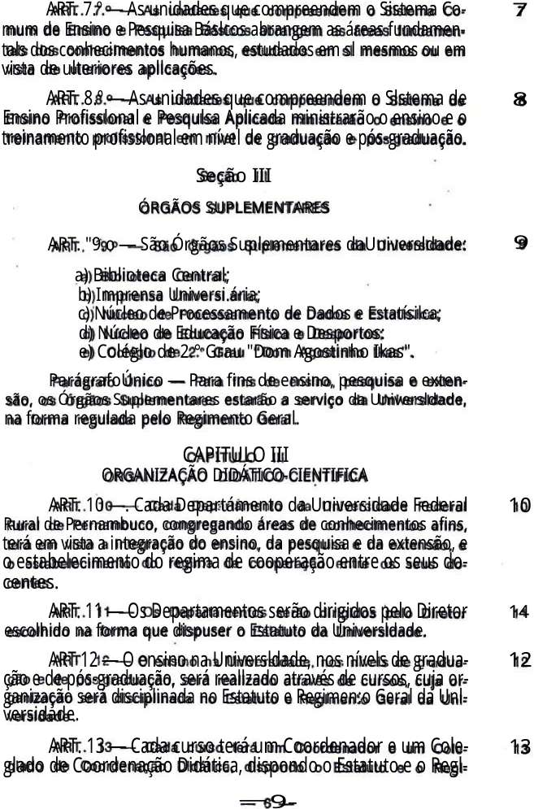

<!-- figure p22-fig1 | described_by: agy | ocr_overlap: 0.77 | needs_review: false -->
**(1) Tipo de figura**
Página digitalizada de um documento normativo/jurídico em língua portuguesa (aparentemente estatuto, regimento ou decreto relativo à Universidade Federal Rural de Pernambuco), extraída de um PDF. A imagem apresenta um defeito visual de dupla camada em toda a sua extensão: sobre o texto impresso original digitalizado (em fonte menor, mais cheia e levemente borrada) há uma camada de texto vetorial/OCR renderizada de forma visível e desalinhada (em fonte sem serifa, maior e de traço mais fino), contendo vários erros de reconhecimento óptico de caracteres. Não há gráficos, ilustrações, tabelas nem diagramas.

---

**(2) Todo o texto visível, ipsis litteris**

Por haver duas camadas sobrepostas e desalinhadas, transcreve-se abaixo o texto contínuo da camada original impressa (linha por linha, com a numeração da margem direita entre colchetes) e, em seguida, todas as divergências literais visíveis na camada sobreposta (OCR):

*Camada original impressa:*
> ART. 7.° — As unidades que compreendem o Sistema Co- [margem direita: 7]
> mum de Ensino e Pesquisa Básicos abrangem as áreas fundamen-
> tais dos conhecimentos humanos, estudados em si mesmos ou em
> vista de ulteriores aplicações.
>
> ART. 8.° — As unidades que compreendem o Sistema de [margem direita: 8]
> Ensino Profissional e Pesquisa Aplicada ministrarão o ensino e o
> treinamento profissional em nível de graduação e pós-graduação.
>
> Seção III
> ÓRGÃOS SUPLEMENTARES
>
> ART. 9.° — São Órgãos Suplementares da Universidade: [margem direita: 9]
>
> a) Biblioteca Central;
> b) Imprensa Universitária;
> c) Núcleo de Processamento de Dados e Estatística;
> d) Núcleo de Educação Física e Desportos;
> e) Colégio de 2.° Grau "Dom Agostinho Ikas".
>
> Parágrafo Único — Para fins de ensino, pesquisa e exten-
> são, os Órgãos Suplementares estarão a serviço da Universidade,
> na forma regulada pelo Regimento Geral.
>
> CAPITULO III
> ORGANIZAÇÃO DIDÁTICO-CIENTIFICA
>
> ART. 10 — Cada Departamento da Universidade Federal [margem direita: 10]
> Rural de Pernambuco, congregando áreas de conhecimentos afins,
> terá em vista a integração do ensino, da pesquisa e da extensão, e
> o estabelecimento do regime de cooperação entre os seus do-
> centes.
>
> ART. 11 — Os Departamentos serão dirigidos pelo Diretor [margem direita: 11]
> escolhido na forma que dispuser o Estatuto da Universidade.
>
> ART. 12 — O ensino na Universidade, nos níveis de gradua- [margem direita: 12]
> ção e de pós-graduação, será realizado através de cursos, cuja or-
> ganização será disciplinada no Estatuto e Regimento Geral da Uni-
> versidade.
>
> ART. 13 — Cada curso terá um Coordenador e um Cole- [margem direita: 13]
> giado de Coordenação Didática, dispondo o Estatuto e o Regi-
>
> — 69 —

*Divergências literais visíveis na camada de texto sobreposta (OCR):*
- No Art. 7.°: `ART. 7.` (sem `°`), `Báslcos`, `tals`, `sl`, `apllcações.`.
- No Art. 8.°: `ART. 8.` (sem `°`), `Slstema`.
- No Art. 9.°: `ART. "9o`, `Unlversldade:`.
- Nas alíneas do Art. 9.°:
  - `b)` lê-se `b) Imprensa Universi.ária;` (ponto no lugar da letra `t`);
  - `c)` lê-se `c) Núcleo de Processamento de Dados e Estatísilca;`;
  - `d)` termina com dois-pontos (`Desportos:`) em vez de ponto e vírgula;
  - `e)` lê-se `e) Coléglo de 2° Grau "Dom Agostinho Ikas".` (com o `2` deslocado à esquerda do `2.°` original, gerando visualmente a sequência `22.°`).
- No Parágrafo Único: `Unlversldade,`.
- Nos títulos de divisão: `CAPITULO III` (sem acento no `I`, como no original) e `ORGANIZAÇÃO DIDÁTICO-CIENTIFICA` (com acento agudo em `Á` e sem acento visível em `CIENTIFICA`).
- No Art. 10: ponto extra após o travessão (`ART. 10 — . Cada`), `regima` (em vez de `regime`) e `do=` (sinal de igual no lugar do hífen).
- No Art. 11: número na margem direita grafado como `14` sobreposto ao `11` original.
- No Art. 12: `Unlversldade,`, `reallzado`, `or=`, `Regimen:o` (dois-pontos no lugar de `t`) e `Unl=`.
- No Art. 13: `Cole=`, `glado` (em vez de `giado`) e `Regl=`.
- No rodapé: traço longo à esquerda deslocado para cima (`—`), algarismo `9` grande sobreposto à direita do `6` original (sobre o `9` original) e traço curto `-` deslocado acima do traço direito original.

---

**(3) Estrutura e organização espacial**
A página tem diagramação vertical em coluna principal única de texto justificado, acompanhada por uma estreita coluna marginal à direita reservada aos números dos artigos, sem caixas, linhas divisórias, setas ou painéis:

- **Bloco superior (continuação de seção anterior):** dois parágrafos com recuo de primeira linha correspondentes aos artigos `ART. 7.°` e `ART. 8.°`, com seus respectivos números (`7` e `8`) alinhados à margem direita na altura da primeira linha de cada artigo.
- **Cabeçalho de seção centralizado:** `Seção III` em uma linha e `ÓRGÃOS SUPLEMENTARES` em caixa alta na linha logo abaixo, com espaçamento vertical acima e abaixo.
- **Corpo da Seção III:**
  - `ART. 9.°` (com recuo de primeira linha e `9` na margem direita);
  - Lista vertical indentada de cinco alíneas (`a)` a `e)`), uma por linha;
  - `Parágrafo Único` em parágrafo justificado com recuo de primeira linha (sem número na margem direita).
- **Cabeçalho de capítulo centralizado:** `CAPITULO III` em uma linha e `ORGANIZAÇÃO DIDÁTICO-CIENTIFICA` em caixa alta logo abaixo, separados por espaço em branco acima e abaixo.
- **Corpo do Capítulo III:** quatro artigos consecutivos em parágrafos justificados com recuo de primeira linha (`ART. 10`, `ART. 11`, `ART. 12` e `ART. 13`), cada qual acompanhado pelo número correspondente na margem direita na altura de sua primeira linha. O `ART. 13` é interrompido ao final da segunda linha com hifenização (`Regi-`), indicando continuação na página seguinte.
- **Rodapé centralizado:** numeração de página entre travessões (`— 69 —`).
- **Sobreposição de camadas:** em toda a página, cada linha da camada de OCR aparece deslocada em poucos pixels (geralmente ligeiramente para cima e/ou para a esquerda) em relação à linha correspondente da digitalização original, fazendo com que números de artigos adjacentes às vezes se combinem visualmente (ex.: `7.7.°`, `8.8.°`, `"99o`, `100`, `111`, `1212`, `133`, `22.°`).

---

**(4) Todos os números e valores**
- **Números de artigos no corpo do texto:** `7.°` (OCR: `7.`), `8.°` (OCR: `8.`), `9.°` (OCR: `"9o`), `10`, `11`, `12`, `13`.
- **Números de artigos na margem direita:** `7`, `8`, `9`, `10`, `11` (OCR sobreposto: `14`), `12`, `13`.
- **Algarismos romanos em cabeçalhos:** `III` (em `Seção III`) e `III` (em `CAPITULO III`).
- **Ordinal no texto da alínea `e)`:** `2.°` (em `Colégio de 2.° Grau`; OCR sobreposto: `2°`, deslocado ao lado do `2.°` original).
- **Número da página no rodapé:** `69` (`6` visível na camada digitalizada; `9` em destaque na camada sobreposta).

---

**(5) Cores**
A figura é monocromática (texto preto e tons de cinza sobre fundo branco). Nenhuma cor tem valor semântico; a diferença de contraste apenas reflete a sobreposição entre a digitalização original em tons de cinza/preto e os traços pretos nítidos da camada de OCR.

~~~text ocr
.7 § Co-
mun de Ensino @
tals dosscontrecimentos humanos, sl mesmos ou em
vista de ulteriores aplicações.
.8 8 o sitema de
Ensino Profissional e Pesquisa Aplicada O
treinamento mivel de graduação @ póssgraduação.
Seção
ÓRGÃOS SUPLEMENTARES
S daU
a) Central; |
desProcessamento de Dados e
d) die e Desportos;
e) Cobégio "Dom
Único — Rana fins deseasino, e exten-
são, os estarão a serviço dia
na forma regulada pelo Regimento Geral.
ORGANIZAÇÃO
.1 epartaanemte daaUniversidade Federal
Rural di Pesrambuco, congregando áreas de conhecimentos afins,
tera em vista à integração do ensino, da pesquisa e da extensão,
o dlo de anise as seus do:
seséo dirigidos pelo Diretor
escolhido ma qua o da
_ nos níveis de gradua-
cão será realizado ale cursos, Euja OF-
sera disciplinada no e Geral da Unl:
e um Cole:
glado de Regl-
10
14
12
13
~~~


<!-- Start of picture text -->
ART. 7.º — As unidades que compreendem o Sistema Co- 7<br>mum de Ensino e Pesquisa Báslcos abrangem as áreas fundamen-<br>tals dos conhecimentos humanos, estudados em sl mesmos ou em<br>vista de ulteriores apllcações.<br>ART. 8.º — As unidades que compreendem o Slstema de 8<br>Ensino Profisslonal e Pesqulsa Aplicada ministrarão o ensino e o<br>treinamento profisslonal em nível de graduação e pós-graduação.<br>Seção III<br>ÓRGÃOS SUPLEMENTARES<br>ART. "9.o — São Órgãos Suplementares daUniversldade: 9<br>a) Biblioteca Central;<br>b) Imprensa Universi.ária;<br>c) Núcleo de Processamento de Dados e Estatísilca;<br>d) Núcleo de Educação Física e Desportos:<br>e) Coléglo de 2.° Grau "Dom Agostinho Ikas".<br>ParágrafoÚnico — Para fins de ensino, pesquisa e exten-<br>são, os Órgãos Suplementares estarão a serviço da Universldade,<br>na forma regulada pelo Regimento Geral.<br>CAPITULO III<br>ORGANIZAÇÃO DIDÁTICO-CIENTIFICA<br>ART. 10 —. Cada Departámento da Universidade Federal 10<br>Rural de Pernambuco, congregando áreas de conhecimentos afins,<br>terá em vista a integração do ensino, da pesquisa e da extensão, e<br>o estabelecimento do regima de cooperação entre os seus do-<br>centes.<br>ART. 11 — Os Departamentos serão dirigidos pelo Diretor 14<br>escolhido na forma que dispuser o Estatuto da Universldade.<br>ART 12 — O ensino na Universldade, nos nívels de gradua- 12<br>ção e de pós-graduação, será reallzado através de cursos, cuja or-<br>ganização será disciplinada no Estatuto e Regimen:o Geral da Unl-<br>versidade.<br>ART. 13 — Cada curso terá um Coordenador e um Cole- 13<br>glado de Coordenação Didática, dispondo o Estatuto e o Regl-<br>—9-<br><!-- End of picture text -->


<!-- page 23 -->


mento Geral sobre as atribuições, constitulção e forma de escolha dossm mos. 

ART. 14 — Na organização dos Cursos serão observadas 14 as seguintes normas: 1—Ma:rfcula por dlsciplina; Il — Currículo hlerarquizado em pré e co-requisitos; IlI — Controle de Integrallzação curricular pelo slstema de créditos. 

##### TÍTULO III 

DISPOSIÇÕES GERAIS E TRANSITÓRIAS 

ART. 15 — Até a nomezção, na forma do Estatuto, do Diretor do Departamento e do Coordenador de Curso, serão designados ti:ulares "pro-tempore" pelo Reitor, ouvido o Conselho Unlversitárlo. 

15 

ART. 16— Os vencimentos dos Diretores nomeados, das Escolas e Insiitutos extintos, ficam mantidos na situação atual até que sejam adaptados à nova sistemática da Lei n.º 5.645, de 10 de dezembro de 1970. 

16 

ART. 17 — Até a aprovação do Estatuto e do Regimento Geral da Universidade, atualizados em função da presente reestruturação, reger-se-á a Universidade pelos Estatuto e Regimento Geral atua!mente existentes, no que não colidirem com a atual estrutura, cabendo ao Conselho Universitário deliberar sobre os casos omissos. 

17 

ART. 18 — Dentro do prazo de cinco (5) anos, a Universida so   s an  r ra, visando Introduzir os reajustamentos que se tornarem necessárlos. Ney Braga 

18 

-7— 


<!-- page 24 -->


<!-- page 25 -->

MINISTÉRIO DA EDUCAÇÃO E CULTURA CONSELHO FEDERAL DE EDUCAÇÃO 

ESTATUTO E REGIMENTO GERAL DA 

UNIVERSIDADE FEDERAL RURAL DE PERNAMBUCO 

Processo n.º15.986/75 Parecer n.º 4.005/75 Aprovado em 08/10/75 Relator: Sr. Cons. Edson Machado de Souza 

Homologado pelo Exmo. Sr. Ministro da Educação e Cultura, Senador Ney Aminthas de Barros Braga 

D. O. de 17 de novembro de 1975 


<!-- page 26 -->


<!-- page 27 -->

###### DESPACHO DO MINISTRO 

Em, 4 de novembro de 1975 

Processo MEC n.º 257.280-75 Processo CFE n.° 15.986-75 Parecer CFE n.º 4.005-75 

Nos termos e para os efeitos do artigo 14 do Decreto-Lei n.º 464, de 11 defevere!ro de1969, homologoo Parecer n.º4.005-75, do Conselho Federal de Educação, decidindo favoravelniente ao Estatuto e Regimento Geral da Unlversidade Federal Rural de Pernambuco, com sede na Cidade do Recife, Estado de Pernambuco. 

##### a) Ney Braga 

— 11— 


<!-- page 28 -->


<!-- page 29 -->

HISTÓRICO : 

O Magnífico Reltor da Universidade Federal Rural de Pernambuco, encaminha à apreclação deste·Conselho seu novo Estatuto e Regimento Geral, organizados de acordo com o Plano de Reestruturação da Universidade, aprovado pelo Decreto n.º 76.212, de 4 de setembro do corrente ano. 

I— ESTATUTO: 

0 projeto do Estatuto fol aprovado pelas Resoluções n°s 55/75 e 95/75, do Conselho de Ensino e Pesquisa e do Conselho Universitário, respectivamente. O Estatuto está dividido em sete títulos, alguns destes subdivididos em capítulos cujas denominações dão bem a idéia do assunto aí focalizado. São eles: 

###### TITULO1— Da Universidade e Seus Objetivos 

#### TITULO II —Da Organlzação Universitárla 

#### CAPITULO I — Princíplos de Organização 

CAPITULO II — Sistemas Universltárlos 

TITULO III — Da AdministraçãoUniversitárla 

#### CAPITULO I — Administração Superior 

SEÇÃO I— Conselho Universitárlo SEÇÃO I — Conselho de Ensino, Pesqulsae Extensão SEÇÃO III — Conselho de Curadores SEÇÃO IV — Reitoria e Vice-Reltorla 

CAPITULO II— Administração Departamental SEÇÃO I — Diretoria SEÇÃO II — Conselho Técnlco-Administrativo SEÇÃO III — Secretarla 

TITULO IV —Da Organlzação Didático-Clentifica 

##### CAPITULO1— Ensino 

SEÇÃOI — Normas Gerals do Ensino SEÇÃO II — Cursos de Graduação 

-13— 


<!-- page 30 -->

SEÇÃO III — Cursos de Pós-graduação SEÇÃO IV — Cursos de Especiallzação, Aperfel- 

çoamento, Exensão, 2.º Grau e Outros 

SEÇÃO V — Coordenação Didática dos Cursos CAPÍTULO II— Pesquisa 

CAPITULO III — Extensão 

TITULO V — Da.Comunidade Universitária 

CAPITULO I — Corpo Docente 

CAPITULO II—Corpo Discente 

CAPITULO III — Corpos Técnlcos e Administrativos CAPITULO IV — Diplomas, Cer:Ificados, Títulos e Medalhas 

TITULO VI — Do Patrimônio e dos Recursos Financeiros 

TITULO VII — Das Disposlções Gerals e Transltórias 

CAPITULO I — DIsposições Gerals CAPITULO II — Disposições Transltórlas 

O artigo 1.° menciona a localização da sede e dos “campl" da Unisidade e relaclona os vários diplomas legais que a crlaram e reestruiram através do tempo. 

O artigo 2.° define a Universidade, e o artigo 3.° descreve os s objetivos, que abrangem a formação e aperfelçoamento, em nível de grau e grau superlor, de professores e proflsslonals na área das clênagrárias, a realização de pesquisas nessa área e o levantamento da lidade das zonas geoeconômicas de Pernambuco e do Nordeste, vldo a Integrar a UFRPE na soluão de problemas estaduais e reglonals. 

A organização geral da Universldade obedece ao disposto na Lel 5.540, de 1968. 

Seus órgãos fundamentais estão agrupados em três sistemas: 

a) Sis'cma Comum de Ensino e Pesqulsa Básicos, constituídos de co departamentos; 

-14— 


<!-- page 31 -->

b) Sistema de Ensino Profissional e Pesquisa Aplicada, constituído de sete departamentos; 

c) Sistema Suplementar, que agrupa a Biblioteca Central, a Imprensa Universitária, o Núcleo de Processamento de Dados e Estatística, o Núcleo de Educação Física e Desportos e o Colégio de 2.° Grau Dom Agostinho Ikas. 

A administração é dividida em dois níveis: o superior e o departamental. A Administração Superior é constituída por três Conselhos: o Universitárlo, o de Ensino, Pesquisa e Extensão e o de Curadores, além de uma Comissão Permanente de Tempo Integral e Dedicação Exclusiva (COPERTIDE). 

Os órgãos executivos da administração superlor são: a Reltoria, a Vice-reltoria, as Pró-reltorias, os órgãos de apolo e assessoramento e os Órgãos executivos da administração geral. 

A administração dos departamentos é exercida por três órgãos: Diretoria, Conselho Técnico-Administrativo e Secretaria. Cada departamento mantém, ainda, comissões permanentes para assuntos de ensino, pesquisa e extensão. 

O Estatuto relaciona os componentes de cada órgão, o sistema de escolha e a duração do mandato de cada membro, assim como a área de atuação e o tipo de atividade dos diferentes órgãos. 

No que se refere ao ensino, a Universldade mantém cursos de graduação, de pós-graduação (mestrado e doutorado), de especlalização e aperfeiçoamento, de extensão e de 2.º grau. (art. 34). 

O artigo 35 esclarece que os currículos dos cursos de graduação e pós-graduação são Integrados por disciplinas cujas ementas constam do Catálogo Geral da Universldade, revls'o e publicado cada dols anos. 

As normas gerals do ensino são tratadas de manelra clara porém sucinta nos artigos 35 a 63, deixando expressamente ao Regimento Geral a tarefa de reçulamentar o assunto com malor minúcia. 

A Comunidade Unlversltárla tratada no Título V é constituída dos corpos docente, discente, técnico e administrativo. 

As disposlções sobre o corpo docente, minuclosas e precisas, são , dispostas nos artigos 67 a 82, Inteiramente de acordo com 9 legislação que rege a matérla. 

Da mesma forma, as disposições sobre o corpo discente (artigos 82 a 90). O ariigo 88 se refere às bolsas de estudo, o artigo 89 às monitorlas, o art. 90 à representação nos órgãos coleglados. 

—15— 


<!-- page 32 -->

O patrimônio e recursos financeiros são matéria do Título VI. Tratando-se de auiarquia federal, as disposições são objetivas e reduzidas. 

As disposições Gerals e Transitórias versam sobre as articulações da Universidade com outras entidades e apresentam dados suplementares sobre as eleições dos seus órgãos coleglados, comparecimento às reunlões, concursos para docência-livre, etc. 

O Estatuto da Universidade esiá pois, bem elaborado, com clareza e precisão e de acordo com a legislação atual sobre o ensino. 

A ele vem incorporado o Regimento Gara! da Universidade que passamos a analisar. 

II — REGIMENTO GERAL: 

O Projeto do Regimento foi aprovado pelas Resoluções nºs. 58/75 e 96/75 do Conselho de Ensino e Pesquisa e do Conse!ho Universitário, respectivamente, de 8 e 5 de setembro do corrente ano. 

Seu arilgo 1.º dispõe: "O presente Regimento Geral disclplina os aspectos da organização e funcionamento comuns dos departamentos, demals órgãos e serviços da Universidade Federal Rural de Pernambuco (UFRPE) completando o Estatuto a que se incorpora". 

Seus primeiros capítulos referem-se à Administração Universitárla. seguińdo em linhas gerals o disposto no Estatuto e descrevendo as atrlbulções e o funclonamento de cada órgão: o Conselho Universitário, o Conselho de Ensino e Pesquisa, o Conselho Administrativo, a Reltoria, as Pró-reltorlas, os órgãos de apoio e assessoramento, órgãos executivos da administração geral, órgãos execu'lvos da administração especifica, as diretorias. 

Trata ainda das a'ribuições, forma de admissão, duração dos mandatos, do reitor, vice-reltor, diretores, professores, etc., sempre de maneira objetiva e de acordo com a lel. 

No que se refere ao ensino, o Regimento dispõe o segulnte: 

Os cursos de graduação são classificados em três áreas: Área I — Clências Humanas, Letras e Artes; ÁreaII — Ciênclas Exatas e Tecnológlcas; Área III — Bioclênclas. 

Os currículos, discriminados no Catálogo Geral da Universidade, vêm agrupados em dois ciclos: o básico e o profisslonal. Os ciclos 

—16— 


<!-- page 33 -->


básicos terão um currículo nuclear para cada área de conhecimento, constituído de disciplinas comuns (art. 38). 

Os cursos de pós-graduação são tratados com minúcia nos artigos 40 a 44, e os de especlalização, aperíelçoamento, extensão e outros, nos artigos 45 a 48. 

O Regimento dedica ainda três artigos (49, 50 e 51) aos cursos de 2.º grau, cuja finalldade é a preparação de profissionais nesse nível para a área de ciências agrárlas e o treinamen:o dos alunos dos cursos de licenclatura mantidos pela Unlversidade. 

A Seção V, do Regimento, trata da Didática dos Cursos e dispõe que "cada curso de graduação ou de pós-graduaçao é coordenado por um Colegiado de Coordenação Didática constituído na forma prevista no art. 54 do Estatuto", (art. 52). Seguem-se, então, as disposições sobre a cons. tituição deste colegiado e as atribuições de seus componentes. 

Currículos e Programas são tratados na Seção VI. 

O currículo de cada curso.compreende um conjunto de disciplinas. hierarqulzadas por melo de pré-requisitos, integralizadas pelo sistema de créditos e grupadas em: 

a) disciplinas do currículo mínimo; 

b) disciplinas complementares obrigatórias; 

c) disciplinas complementares optativas; 

d) disciplinas eletivas. 

Estas últimas não fazem parte do currículo pleno. 

Seguem-se disposições sobre créditos, pré-requisitos, trabalhos de 

campo, estáglos, seminários, etc. 

As seções seguintes tratam da Admissão aos Cursos, Matrícula, Transferências, Verificação de Aprendizagem. 

Depols vêm disposições bastante sucintas sobre o Calendário Escolar, a ser organizado de acordo com o artigo 42 do Estatuto, e a Orlentação Didátlca, objeto da Seção XII. 

Esta dispõe que “os alunos dos cursos de graduação e de pósgraduação serão orientados e aconselhados durante a realização dos seus estudos por um docente". 

Este receberá treinamento específico e será responsável por um grupo de matriculados no curso em que é diplomado (art. 82 e parágrafos). 

- 17— 


<!-- page 34 -->

A Pró-reltoria de Ensino e Graduação terá um setor de Orientação Psicológica para colaborar com os orientadores, e um Setor Técnico de Ensino para orientar e fiscalizar a aplicação da metodologla (art. 84). 

O parágrafo único do artigo 84 dlspõe ainda que "haverá na UFRPE cr  d  d  d o  os, Todo o Capítulo Il do Título Il, que trata da Organização Didáticoclentifica, contém disposições sobre Pesquisa. 

O Capítulo Ill refere-se aos cursos e serviços de extensão, que serão coordenados pela Pró-reltorla correspondente. 

O Título III do Regimento tra'a da Comunidade ·Universltárla cujo Capítulo II, dividido em cinco seções, dispõe sobre o Corpo Docente. 

A Seção 1 trata da Administração, a Seção Il do Regime de Trabalho, a Seção IlI, do Regime Disciplinar, a Seção IV das Férlas, Licenças e Afastamentos e a Seção V de Remoção e Transferêncla. O Capítulo III refere-se ao Corpo Discente. Também está subdidido em Seções assim denominadas: Representação, Assistência, Monitorla,RegimeDiscipllnar. 

O Capítulo IV dispõe sobre o Corpo Técnico-administrativo. 

O Reglmento, nos capítulos seguintes, trata dos Diplomas e Certificados, Titulos Honorfficos, Medalhas de Mérito e alnda do Reglstro e Revalldação de Diplomas. 

A seguir, vêm as disposições, sobre os recursos financelros, onde o o s    d  so  ss s ficado em primeiro lugar no Concurso Vestibular, bem como aos alunos aprovados por média em todas as disclplinas. Conclul, finalmente, o Regimento, com as Disposições Gerals e Transitórlas, sempre pautado pelo Estatuto e lels vlgentes. 

III — VOTO DO RELATOR: 

Muito bem elaborados, de forma concisa e precisa, sen minúcias supérfluas mas enfocando todos os aspectos didático-administrativos necessários ao bom funcionamento da Universidade, no nosso entender, tanto o Estatuto como o Regimento Geral da Universidade Federal Rural de Pernambuco merecem aprovação deste egrégio Conselho. 

O único reparo a fazer, sem prejuízo da aprovação, diz respelto à composição do Conselho Universitário (artigo 11 do Estatuto) a qual deve 

-18- 


<!-- page 35 -->


incluir todos os Pró-reltores da Universidade, excluindo-se a participação dos representantes do Ministério da Educação e Cultura e do Governo do Estado, cuja participação deve se limitar ao Conselho de Curadores. A Universidade providenclará essas modificações. 

IV — CONCLUSÃO DA CÄMARA: 

A Câmara de Ensino Superior, 1.º Grupo, acompanha o voto do Relator. 

Sala das Sessões, em 07/10/75. 

- (a.) Newton Sucuplra — Pres.; Edson Machado de Souza — Rel.; João Paulo do Valle Mendes, Ruy Carlos de Camargo Vlelra, Lafayette de Azevedo Pondé, Lena Castello Branco Ferreira Costa. 

-19— 


<!-- page 36 -->


<!-- page 37 -->

# PARTE11 

ESTATUTO DA UFRPE 


<!-- page 38 -->


<!-- page 39 -->

##### MINISTÉRIO DA EDUCAÇÃO E CULTURA UNIVERSIDADE FEDERAL RURAL DE PERNAMBUCO SECRETARIA GERAL 

CONSELHO UNIVERSITÁRIO 

RESOLUÇÃO N.º 95/75 

EMENTA: Aprovao Estatuto da Universidade Federal Rural de Pernambuco. 

O Presidente do Conselho Universitário da Universldade Federal Rural de Pernambuco, no uso de suas atribulções e tendo em vista a Decisão n.º 82/75, deste Conselho, em sua V Reunião Extraordinária realizada no dia 8 de setembro de 1975, exarada no Processo UFRPE n.º 3854/75. 

RESOLVE: 

ART. 1.º — Flca aprovado o Estatuto da Universidade Federal Rural de Pernambuco, nos termos da Decisão n.º 82/75, do Pleno deste Conselho. 

ART. 2.o — A presente Resolução entra em vigor a partir desta data, revogadas as disposições em contrárlo. 

1 

2 

Sala dos Conselhos da UFRPE, em 8 de setembro de 1975. 

(Prof. HUMBERTO CARNEIRO) Presidente 

-23— 


<!-- page 40 -->


<!-- page 41 -->

##### ESTATUTO 

#### TITULO1 

##### DA UNIVERSIDADE E SEUS OBJETIVOS 

ART. 1.º — A Universidade Federal Rural de Pernambuco — UFRPE — com a:uação prioritária neste Estado, sede em São Lourenço da Mata e "campl" neste município e no do Recife, foi criada pelo Decreto Estadual n.º 1.741, de 24 de julho de 1947, transformada em Autarquia Federal pela Lel n.° 2.424, de 4 de julho de 1955 vinculada ao Ministério da Educação e Cultura através do Decreto n.º 60.731, de 19 de maio de 1967 e reestruturada pelo Decreto n." 76.212, de 4 de setembro de 1975. 

ART. 2." — A UFRPE é uma entidade de ensino superior, organizada em autarquia educacional de regime especial, gozando de autonomia administrativa, didático-clentífica, econômlco-financeira e disciplinar, exercida na forma da legislação em vigor, do presente Estatuto e de seu Regimento Geral. 

ART. 3.° — A UFRPE, objetivando preservar, ampliar e transmiir o saber, nas várias formas do conhecimento puro e aplicado, propõe-se a: 

1 

2 

3 

a) formar profisslonals no âmbito das clências agrárias e de outras que concorram ou venham a concorrer para o desenvolvimento do setor primário da economia no grau superior e no 2.º grau; b) realizar pesqulsas básicas e aplicadas relaclonadas com aquelas ciências, divulgando os resultados obtidos; 

c) promover cursos de pós-graduação, aperfeiçoamento, especialização, extensão e outros, que atendam às exigências de sua programação específica e às pecullarldades do mercado de trabalho reglonal; 

—25— 


<!-- page 42 -->

d) promover o levantamanto da realidade das zonas geoeconômicas de Pernambuco e do Nordeste, através de atividades extensionistas e de outras, que permitam à UFRPE integrar-se na solução dos problemas estaduais e regionais; 

e) formar e treinar professores para o ensino de 1.º e 2.º graus, prioritariamente na área das ciências agrárias, e especlalistas em educação; f) capacitar pessoal não qualificado visando à formação de mão-de-obra para o setor primário. Parágrafo Único — As atividades objetivadas neste artigo serao ruosu  o ,   nlos cals, de livre escolha da Universidade. 

#### TÍTULO II 

##### DAORGANIZAÇÃO UNIVERSITÁRIA 

##### CAPITULO1 

##### PRINCIPIOS DE ORGANIZAÇÃO 

ART. 4." — A organização geral da UFRPE obedece às seguintes diretrizes: 

4 

a) unidade de patrimônio e administração; 

b) estrutura orgânica, com base em departamentos subordinados, dire:amente à Administração Superlor; 

c) Integração do ensino, da pesquisa e da extensão; 

d) organização racional, capaz de assegurar a plena utilização dos recursos materiais e humanos, sendo vedda a dupllcidade de melos para fins Idên:lcos ou equivalentes; 

e) universalidade de campo, pelo cultivo das áreas fundamentais do conhecimento humano estudadas em si mesmas ou em razão de ulteriores aplicações e, prioritariamente, das áreas técnlco-profisslonals ligadas ao desenvolvimento do setor primário; 

f) flexibilidade de métodos e critérios, para atender às diferenças Individuais dos alunos, às pecullarldades reglonals e às possibilidades de comblnações dos conhecimentos para novos cursos e programas de pesqulsas. 

-26— 


<!-- page 43 -->


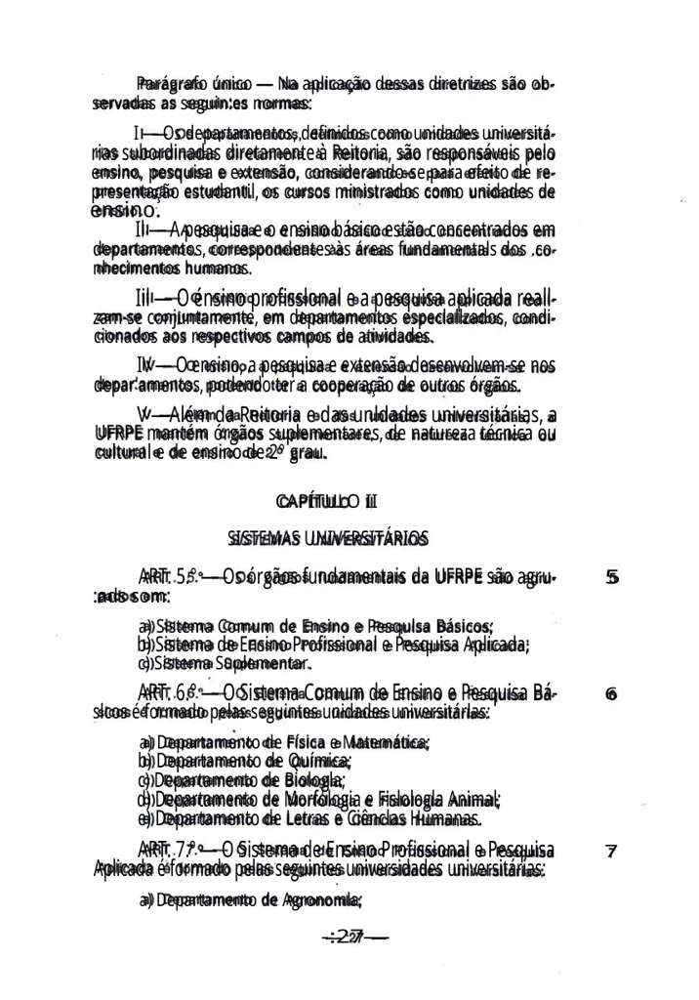

<!-- figure p43-fig1 | described_by: agy | ocr_overlap: 0.71 | needs_review: false -->
### 1. Tipo de figura
Trata-se de uma página única digitalizada (escaneada) de um documento normativo/estatutário impresso em português (disposições organizacionais da UFRPE — Universidade Federal Rural de Pernambuco). Não há gráficos, tabelas, diagramas ou ilustrações. Toda a página apresenta um artefato visual de dupla camada: o texto impresso original escaneado está sobreposto por uma camada visível de texto em fonte sem serifa (oriunda de OCR), ligeiramente desalinhada na horizontal e na vertical, produzindo efeito de duplicação/sombra em todas as linhas e algumas distorções pontuais de caracteres.

---

### 2. Todo o texto visível (verbatim)

Na transcrição abaixo, mantém-se o texto exato da página (incluindo quebras de linha, hifenizações, pontuação e erros tipográficos do original). Onde a camada sobreposta de OCR gera artefatos visíveis distintos do texto original, estes são indicados entre colchetes.

```text
Parágrafo único — Na aplicação dessas diretrizes são ob-
servadas as seguintes normas:

I — Os departamentos, definidos como unidades universitá-
rias subordinadas diretamente à Reitoria, são responsáveis pelo
ensino, pesquisa e extensão, considerando-se para efeito de re-
presentação estudantil, os cursos ministrados como unidades de
ensino.

II — A pesquisa e o ensino básico estão concentrados em
departamentos, correspondentes às áreas fundamentais dos co-
nhecimentos humanos.

III — O ensino profissional e a pesquisa aplicada reali-
zam-se conjuntamente, em departamentos especializados, condi-
cionados aos respectivos campos de atividades.

IV — O ensino, a pesquisa e extensão desenvolvem-se nos
departamentos, podendo ter a cooperação de outros órgãos.

V — Além da Reitoria e das unidades universitárias, a
UFRPE mantém órgãos suplementares, de natureza técnica ou
cultural e de ensino de 2º grau.

CAPÍTULO II

SISTEMAS UNIVERSITÁRIOS

ART. 5.º — Os órgãos fundamentais da UFRPE são agru-     5
:ados em:

a) Sistema Comum de Ensino e Pesquisa Básicos;
b) Sistema de Ensino Profissional e Pesquisa Aplicada;
c) Sistema Suplementar.

ART. 6.º — O Sistema Comum de Ensino e Pesquisa Bá-      6
sicos é formado pelas seguintes unidades universitárias:

a) Departamento de Física e Matemática;
b) Departamento de Química;
c) Departamento de Biologia;
d) Departamento de Morfologia e Fisiologia Animal;
e) Departamento de Letras e Ciências Humanas.

ART. 7.º — O Sistema de Ensino Profissional e Pesquisa   7
Aplicada é formado pelas seguintes universidades universitárias:

a) Departamento de Agronomia;

— 27 —
```

Observações sobre detalhes literais e artefatos visíveis na imagem:
- Na segunda linha do Art. 5.º, a letra inicial de "pados em:" (continuação de "agru-") aparece danificada/cortada à esquerda, lendo-se visualmente como `:ados em:`.
- Na segunda linha do Art. 7.º, o texto impresso contém literalmente a repetição `universidades universitárias:` (em vez de "unidades universitárias:").
- Por causa da sobreposição da camada de texto desalinhada, há duplicação visual nos numerais e em alguns caracteres (por exemplo: `seguin:es` sobre `seguintes`, `Il`/`Iil` sobre `II`/`III`, `,co-` por causa de uma mancha antes de `co-`, `reall-` sobre `reali-`, `depar'amentos` sobre `departamentos`, `ART. 5. 5.º`, `ART. 6. 6.º`, `ART. 7. 7.º` e `-: 27 —` no rodapé).

---

### 3. Estrutura
A figura não contém caixas, setas, conectores, eixos, linhas/colunas de tabela nem múltiplos painéis. Sua estrutura é estritamente textual e hierárquica, em página de coluna única com margens brancas amplas:

- **Bloco superior (continuação de artigo anterior):** inicia com `Parágrafo único` (com recuo de primeira linha e travessão), seguido por cinco incisos (`I` a `V`), cada um disposto como parágrafo independente com recuo de primeira linha, numeral romano, travessão e texto justificado.
- **Cabeçalho de seção centralizado:** separado por espaçamento vertical maior, apresenta em duas linhas centralizadas o título `CAPÍTULO II` e, abaixo, o subtítulo `SISTEMAS UNIVERSITÁRIOS`, ambos em caixa alta.
- **Bloco inferior (artigos e alíneas):** apresenta três artigos consecutivos (`ART. 5.º`, `ART. 6.º` e `ART. 7.º`), cada um com recuo de primeira linha, abreviação `ART.` (em versalete na camada original), número ordinal e travessão, seguido por listas de alíneas mais recuadas à esquerda, identificadas por letras minúsculas com parêntese de fechamento:
  - `ART. 5.º`: 3 alíneas (`a)` a `c)`).
  - `ART. 6.º`: 5 alíneas (`a)` a `e)`).
  - `ART. 7.º`: 1 alínea visível (`a)`), terminando com ponto e vírgula, o que indica continuação na página seguinte.
- **Numeração marginal à direita:** os algarismos `5`, `6` e `7` aparecem isolados na margem direita, alinhados horizontalmente à primeira linha de `ART. 5.º`, `ART. 6.º` e `ART. 7.º`, respectivamente.
- **Rodapé:** paginação centralizada na parte inferior (`— 27 —`).

---

### 4. Todos os números e valores de dados
Não existem dados estatísticos, medições ou valores quantitativos. Todos os números presentes são identificadores legais, ordinais ou de paginação:
- Algarismos romanos dos incisos: `I`, `II`, `III`, `IV`, `V`.
- Ordinal no inciso V: `2º` (em `2º grau`).
- Algarismo romano do capítulo: `II` (em `CAPÍTULO II`).
- Ordinais dos artigos no texto principal: `5.º`, `6.º`, `7.º`.
- Números de referência dos artigos na margem direita: `5`, `6`, `7`.
- Número de página no rodapé: `27`.

---

### 5. Cores com significado
Nenhuma. A imagem é inteiramente monocromática (texto preto sobre fundo branco), sem uso de cores para transmitir significado.

~~~text ocr
— Na aplicação dessas diretrizes são ob-
as seguinies
como unidades Universita-
Reitonia, são pelo
emsino, pesquisa e extemsão, de re-
os cursos como de
ll—-A © ensino em
departamentos, áreas dos
mhecimentos humanos.
pesquisa aplicada reall-
em depantamentos especl ,
aos nespectivos campos de atividades.
AOS
a cooperação de órgãos.
a
UFRPE mantém órgãos suplementases, de tégnica Qu
cultural e de 2º grau.
iil
SISTEMAS
O da UFRPE são
Connum de Ensino e Isa Básicos;
de & Aplicada;
Samennentar.
ART O comum de Ensino é Bá-
universitárias:
a) Departamento dle Física e Matemática;
Departamento de Biologia;
de e Animal;
de Letras e Gências
é
Aplicada pelas seguintes universidades universitárias:
a) de
~~~


<!-- Start of picture text -->
Parágrafo único — Na aplicação dessas diretrizes são ob-<br>servadas as seguin:es normas:<br>I — Os departamentos, definidos como unidades universitá-<br>rias subordinadas diretamente à Reitoria, são responsáveis pelo<br>ensino, pesquisa e extensão, considerando-se para efeito de re-<br>presentação estudantil, os cursos ministrados como unidades de<br>ensino.<br>Il — A pesquisa e o ensino básico estão concentrados em<br>departamentos, correspondentes às áreas fundamentals dos .co-<br>nhecimentos humanos.<br>Iil — O énsino profisslonal e a pesquisa aplicada reall-<br>zam-se conjuntamente, em departamentos especlallzados, condi-<br>cionados aos respectivos campos de atividades.<br>IV — O ensino, a pesquisa e extensão desenvolvem-se nos<br>depar'amentos, podendo ter a cooperação de outros órgãos.<br>V —Além da Reitoria e das unldades universitárias, a<br>UFRPE mantém órgãos suplementares, de natureza técnica ou<br>cultural e de ensino de 2° grau.<br>CAPÍTULO II<br>SISTEMAS UNIVERSITÁRIOS<br>ART. 5.° — Os órgãos fundamentais da UFRPE são agru- 5<br>:ads som:<br>a) Sistema Comum de Ensino e Pesqulsa Básicos;<br>b) Sistema de Ensino Profissional e Pesquisa Aplicada;<br>c) Sistema Suplementar.<br>6<br>ART. 6.° — O Sistema Comum de Ensino e Pesquisa Bá-<br>slcos é formado pelas seguintes unidades universitárlas:<br>a) Departamento de Física e Matemática;<br>b) Departamento de Química;<br>c) Departamento de Biologla;<br>d) Departamento de Morfólogia e Fislologla Animal;<br>e) Departamento de Letras e Ciênclas Humanas.<br>7<br>ART. 7.º — O Sistema de Ensino Profissional e Pesquisa<br>Aplicada é formado pelas seguintes universidades universitárias:<br>a) Departamento de Agronomla;<br>-:27—<br><!-- End of picture text -->


<!-- page 44 -->


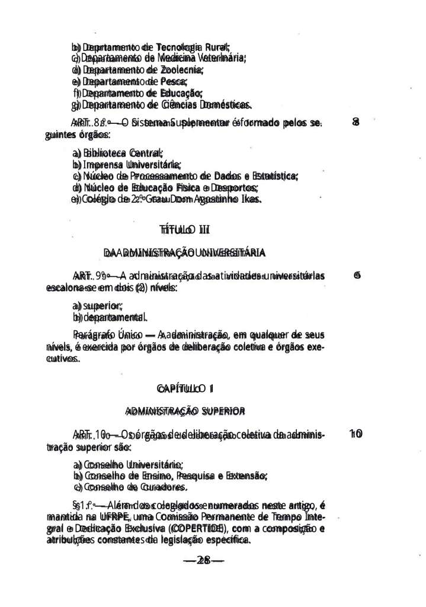

<!-- figure p44-fig1 | described_by: agy | ocr_overlap: 0.84 | needs_review: false -->
### 1. Tipo de figura
Página digitalizada de um documento institucional/normativo impresso em língua portuguesa (trecho de estatuto ou regimento da UFRPE — Universidade Federal Rural de Pernambuco), extraída de um arquivo PDF. Toda a página apresenta um artefato de sobreposição dupla de texto: sobre a camada original digitalizada (texto impresso com serifa/tipografia levemente irregular e pequenos pontos residuais de digitalização) está renderizada, de forma visível e ligeiramente deslocada, uma segunda camada vetorial de texto sem serifa (típica de camada de OCR tornada visível), produzindo efeito de texto duplicado em todas as linhas e contendo algumas pequenas divergências de reconhecimento de caracteres.

---

### 2. Todo o texto visível (ipsis litteris)

Abaixo está a transcrição integral do texto da página, de cima para baixo, mantendo quebras de linha, hifenizações, maiúsculas, pontuação e numeração marginal. Entre colchetes são indicadas as divergências visíveis na camada de texto sobreposta (OCR) quando diferem do texto impresso subjacente:

```
b) Departamento de Tecnologia Rural; [camada sobreposta: "b) Deprtamento de Tecnologia Rural;"]
c) Departamento de Medicina Veterinária;
d) Departamento de Zootecnia; [camada sobreposta: "d) Departamento de Zoolecnia;"]
e) Departamento de Pesca;
f) Departamento de Educação;
g) Departamento de Ciências Domésticas.

ART. 8.º — O Sistema Suplementar é formado pelos se-          8
[camada sobreposta: "ART. 8º — O Sistema Suplementar é formado pelos se." | margem direita: "8"]
guintes órgãos:

a) Biblioteca Central;
b) Imprensa Universitária; [camada sobreposta: "b) Imprensa Universitárla;"]
c) Núcleo de Processamento de Dados e Estatística;
d) Núcleo de Educação Física e Desportos; [camada sobreposta: "Fisica" sem acento visível]
e) Colégio de 2.º Grau Dom Agostinho Ikas. [camada sobreposta: "e) Coléglo de 2º Grau Dom Agostinho Ikas."]

TÍTULO III

DA ADMINISTRAÇÃO UNIVERSITÁRIA [camada sobreposta: palavras quase sem espaço, aparentando "DAADMINISTRAÇÃOUNIVERSITÁRIA"]

ART. 9.º — A administração das atividades universitárias      6
[camada sobreposta: "ART. 9º — A administração das atividades universitárlas" | margem direita: "6"]
escalona-se em dois (2) níveis:

a) superior;
b) departamental.

Parágrafo Único — A administração, em qualquer de seus
níveis, é exercida por órgãos de deliberação coletiva e órgãos exe-
cutivos.

CAPÍTULO I [camada sobreposta: "CAPÍTULO 1"]

ADMINISTRAÇÃO SUPERIOR

ART. 10 — Os órgãos de deliberação coletiva da adminis-      10
tração superior são:

a) Conselho Universitário;
b) Conselho de Ensino, Pesquisa e Extensão;
c) Conselho de Curadores.

§ 1.º — Além dos colegiados enumerados neste artigo, é [camada sobreposta: "§1.º"]
mantida na UFRPE, uma Comissão Permanente de Tempo Inte-
gral e Dedicação Exclusiva (COPERTIDE), com a composição e
atribuições constantes da legislação específica.

—28—
```

---

### 3. Estrutura
A figura consiste em um único painel retangular de página de texto em orientação retrato, sem quadros, caixas, setas, linhas divisórias, tabelas, gráficos ou eixos. O leiaute é organizado verticalmente em coluna principal única, com uma estreita faixa de numeração na margem direita, distribuída na seguinte sequência:

- **Bloco superior (continuação de lista anterior):** seis alíneas recuadas à esquerda (`b)` a `g)`), alinhadas verticalmente entre si.
- **Bloco do Artigo 8.º:**
  - Cabeçalho/enunciado do artigo com recuo na primeira linha (`ART. 8.º — ...`) e segunda linha alinhada à margem esquerda do corpo do texto (`guintes órgãos:`).
  - Na margem direita, separado do corpo de texto por espaço em branco e alinhado horizontalmente à primeira linha do artigo, aparece o número `8`.
  - Lista subordinada de cinco alíneas recuadas (`a)` a `e)`), alinhadas à mesma tabulação das alíneas do bloco superior.
- **Cabeçalho de seção principal:** duas linhas centralizadas na largura do corpo de texto, em caixa alta e separadas por espaçamento vertical (`TÍTULO III` acima de `DA ADMINISTRAÇÃO UNIVERSITÁRIA`).
- **Bloco do Artigo 9.º:**
  - Enunciado com recuo na primeira linha (`ART. 9.º — ...`) e segunda linha na margem esquerda (`escalona-se...`).
  - Na margem direita, alinhado à primeira linha do artigo, aparece o algarismo `6` (aparentando um `9` impresso de cabeça para baixo na composição original).
  - Lista subordinada de duas alíneas recuadas (`a)` e `b)`).
  - Parágrafo subordinado (`Parágrafo Único — ...`) com recuo na primeira linha e duas linhas seguintes alinhadas à margem esquerda do corpo de texto.
- **Cabeçalho de subseção:** duas linhas centralizadas na largura do corpo de texto, em caixa alta (`CAPÍTULO I` acima de `ADMINISTRAÇÃO SUPERIOR`).
- **Bloco do Artigo 10:**
  - Enunciado com recuo na primeira linha (`ART. 10 — ...`) e segunda linha na margem esquerda (`tração superior são:`).
  - Na margem direita, alinhado à primeira linha do artigo, aparece o número `10`.
  - Lista subordinada de três alíneas recuadas (`a)` a `c)`).
  - Parágrafo subordinado (`§ 1.º — ...`) com recuo na primeira linha e três linhas seguintes alinhadas à margem esquerda do corpo de texto.
- **Rodapé:** numeração de página centralizada na parte inferior, ladeada por travessões (`—28—`).

---

### 4. Todos os números e valores de dados
- `8.º` (e `8º` na camada sobreposta) — número ordinal do artigo (`ART. 8.º`).
- `8` — número isolado na margem direita, alinhado ao `ART. 8.º`.
- `2.º` (e `2º` na camada sobreposta) — grau de ensino em `Colégio de 2.º Grau Dom Agostinho Ikas.`.
- `III` — numeral romano em `TÍTULO III`.
- `9.º` (e `9º` na camada sobreposta) — número ordinal do artigo (`ART. 9.º`).
- `6` — dígito isolado na margem direita, alinhado ao `ART. 9.º` (visível como `6` tanto na impressão original quanto na camada sobreposta).
- `2` — algarismo entre parênteses em `em dois (2) níveis:`.
- `I` (camada impressa) / `1` (camada sobreposta) — número do capítulo em `CAPÍTULO I` / `CAPÍTULO 1`.
- `10` — número cardinal do artigo (`ART. 10`).
- `10` — número isolado na margem direita, alinhado ao `ART. 10`.
- `1.º` — número ordinal do parágrafo (`§ 1.º`).
- `28` — número da página no rodapé (`—28—`).

---

### 5. Cores
Não há cores com valor semântico. A imagem é inteiramente monocromática (preto sobre fundo branco).

~~~text ocr
die Rural;
Departamento de
d) Departamento ake Zoolecnia;
e) Pesca;
f) de Educação;
g) Departamento de Ciências Domésticas.
pelos se: 8
guintes órgãos:
a) Biblioteca Central;
b) Imprensa
de de Dados e Estatística;
d) Núcleo de Fisica @ tos;
@)) de Ikas.
Hi
6
escalonasse em dois (2) nfvells:
superior;
Unico — em qualquer de seus
é exercida por órgãos de deliberação coletiva e órgãos exe-
Guitivas..
1
ADMINISTRAÇÃO SUPERIOR
tração superior são:
a) Conselho Universitário;
de Ensino, e
@) de Curadores.
§1 asse neste antigo, é
na UFRPE, uma Comissão de Tempo linte-
gral e Dedicação Exclusiva (COPERTIDE), com a composição e
constantes legislação especifica. e
—28—
~~~


<!-- Start of picture text -->
b) Deprtamento de Tecnologia Rural;<br>c) Departamento de Medicina Veterlnária;<br>d) Departamento de Zoolecnia;<br>e) Departamento de Pesca;<br>f) Departamento de Educação;<br>g) Departamento de Ciências Domésticas.<br>ART. 8.º — O Sistema Suplementar é formado pelos se. 8<br>guintes órgãos:<br>a) Biblioteca Central;<br>b) Imprensa Universitárla;<br>c) Núcleo de Processamento de Dados e Estatística;<br>d) Núcleo de Educação Fisica e Desportos;<br>e) Coléglo de 2.º Grau Dom Agostinho Ikas.<br>TÍTULO III<br>DAADMINISTRAÇÃOUNIVERSITÁRIA<br>ART. 9º — A administração das atividades universitárlas 6<br>escalona-se em dois (2) nívels:<br>a) superior;<br>b) departamental.<br>Parágrafo Único — A administração, em qualquer de seus<br>nívels, é exercida por órgãos de deliberação coletiva e órgãos exe-<br>cutivos.<br>CAPÍTULO 1<br>ADMINISTRAÇÃO SUPERIOR<br>ART. 10 — Os órgãos de deliberação coletiva da adminis- 10<br>tração superior são:<br>a) Conselho Universitário;<br>b) Conselho de Ensino, Pesquisa e Extensão;<br>c) Conselho de Curadores.<br>§ 1.° — Além dos coleglados enumerados neste artigo, é<br>mantida na UFRPE, uma Comissão Permanente de Tempo Inte-<br>gral e Dedicação Exclusiva (COPERTIDE), com a composição e<br>atribulções constantes da legislação especifica.<br>—28—<br><!-- End of picture text -->


<!-- page 45 -->


§ 2.º — Os órgãos executivos da administração superlor são: 

a) Reltoria; b)Vice-Reitoria; c) Pró-Reltorias; d)órgãos de apoio e assessoramento; e) Órgãos executivos da administração geral. 

### SEÇÃO I 

CONSELHO UNIVERSITÁRIO 

ART. 11 —O Conselho Universitárlo, órgão deliberativo, normativo e consultivo em assuntos de política e de planejamento universitário, funcionando também como última instâncla de recurso, no âmbito da UFRPE, é constituído pelos seguintes membros: 

a) Reitor, como presidente; b) Vice-Reltor, como vice-presidente; c) Pró-Reltores; d) Diretores das Unidades Universitárias; e) um (1) representante de cada categoria de Professor do Magistério Superior; f) Diretor do Colégio de 2.° Grau Dom AgosInho Ikas; g) duas (2) personalidades de destaque da comunldade; h) qua:ro (4) representantes do corpo discente da UFRPE. § 1.o — Os representantes citados nas alíneas a, b, c, e f são membros natos. 

§ 2.º — As personalidades mencionadas na alínea g são escolhidas pelo próprio Conselho, entre nomes de destaque na área empresarial e profisslonal do Estado, que contribuem para o desenvolvimento do· meio rural e elevação do nível de vida de sua população, com mandato de dols (2) anos, vedada a recondução. 

§ 3.° — Os representantes mencionados na letra h são escolhidos na forma das disposições vigentes, com mandato de um (1) ano, permitida uma recondução. § 4.º  Os representantes mencionados na letra e são escolhidos entre seus pares, em reunião convocada e presidida pelo Vice-Reitor, com mandato de dols (2) anos, vedado o exercíclo de dols (2) mandatos consecutivos. 

11 

—29— 


<!-- page 46 -->

ART. 12 — O Conselho Universitário delibera em reunlões plenas, após pronunciamento de uma ou mais de suas Câmaras, que são as seguíntes: a) Câmara de Política e Legislação; b) Câmara de Pessoal; c) Câmara de Planejamen'o e Orçamento. § 1.º — A composição de cada Câmara é estabeleclda em reunião plenária do Conselho. 


<!-- Start of picture text -->
12<br><!-- End of picture text -->

§ 2. — Os presiden:es das câmaras são escolhidos, anualmente, por seus pares, por maloria simples dos membros presentes, em escrutínlo secreto. SEÇÃO II CONSELHO DE ENSINO, PESQUISA E EXTENSÃO ART. 13 — O Conselho de Ensino, Pesquisa e Extensão, 13 órgão deliberativo, normativo e consultivo da Universidade, para assuntos ligados às atividades de Ensino, Pesquisa e Extensão, (em a seguinte composição: a) Reitor, como presidente; b) Vice-Reitor, como vice-presidente; c) Pró-Reltor de Ensino de Graduação; d) Pró-Reltor de Pesquisa e Pós-Graduação; e) Pró-Reltor de Atividades de Extensão; f) Coordenadores dos Cursos de Graduação; g) Coordenadores dos Cursos de Pós-Graduação; h) Representante dos professores titulares; 1) Representan'e dos professores adjuntos; j) Representante dos professores asslstentes; 1) Representante dos auxiliares de ensino; m) Dois (2) representantes dos professores dos Departamentos integrantes do Sistema Comum de Ensino e Pesqulsa Báslcos; n) Dois (2) representantes dos professores dos Departamentos Integrantes do Sistema de Ensino Profisslonal e Pesqulsa Aplicada; o) Presldente do Banco de Măo-de-Obra Es:udantil da UFRPE; p) Representante dos professores do Ensino de 2.º Grau; -30— 


<!-- page 47 -->


##### q) Representante da Empresa Brasieira de Pesqulsas Agropecuárlas(EMBRAPA); 

r) Representante do Instituto de Pesquisas Agronômicas de Pernambuco (IPA) ou do órgão que venha substitul-lo; s) Representante da Assoclação Nordestina de Crédito e Assistência Rural de Pernambuco (ANCARPE) ou do órgão que venha substituí-la; t) Seis (6) representantes do corpo discente, sendo quatro (4) dos Cursos de Graduação e dols (2) dos de Pós-Graduação. ART. 14 — A natureza dos mandatos dos conselhelros, sua duração e processo de eleição ou de escolha são os seguintes: 1 — Os mencionados nas alíneas a, b, c, d, e, f, g, e o são membros natos; Il — Os mencionados nas alíneas h, i, 1, 1, m, n e p são escolhidos entre os seus pares em reunião convocada e presidida pelo Vice-Reltor, com mandato de dols (2) anos, vedada a reconuo 

III — Os menclonados nas alíneas q, r e s são indicados pelas suas respectivas entidades, ·com mandato Indeterminado. IV — Os representantes menclonados na alínea t são escoIhidos na forma das disposições legais vigentes, com mandato de um (1) ano, permitida uma recondução. ART. 15 — O Conselho de Ensino, Pesquisa e Extensão delibera através de suas Câmaras, que são as seguintes: a) Câmara de Ensino de Graduação; b) Câmara de Pesquisa e Pós-Graduação; c) Câmara de Extensão. 

§ 1.º — A Câmara de Ensino de Graduação é constituída pelo Pró-Rei:or de Ensino de Graduação, como seu presldente, pelos representantes citados na alínea f, e por um (1) representante de cada uma das alíneas m e n, e dols (2) representantes da alínea t, pertencentes a cursos de graduação. § 2.º — A Câmara de Pesquisa e Pós-Graduação é constituída pelo Pró-Reltor para Pesqulsa e Pós-Graduação, como seu presidente, pelos membros menclonados nas alíneas g, h, i, q e r, e dols (2) representantes menclonados na alínea t, pertencentes a cursos de pós-graduação. 

14 

15 

§3.° — A Camara de Extensão é constituída pelo PróReltor para Atividades de Extensão, como seu presldente, pelos membros mencionados nas alíneas 1, o, p e s, de um (1) repre- 


<!-- page 48 -->

sentante das alíneas m e n, e de dois (2) representantes menclonados na alínea t, pertencentes a cursos de graduação. 

§ 4.o — As Câmaras do Conselho de Ensino, Pesquisa e 

Extensão, somen'e se reúnem validamente com a presença mínlma de dois terços (2/3) de seus membros em exercíclo, deliberando por malorla simples, sobre os assuntos de sua competência. 

§ 5.º — As decisões das Câmaras tomadas por menos de dois terços (2/3) dos membros presentes, serão automaticamente levadas ao pleno. 

§ 6.º — As decisões das Câmaras, divulgadas pela Sécretarla Geral, serão transformadas em Resoluções se, depols de três (3) dias dessa divulgação, não houverem sido Interpostos recursos formals contra elas. 

##### SEÇÃO III 

##### CONSELHO DE CURADORES 

ART. 16 — O Conselho de Curadores, órgão consultivo, normativo e deliberativo para assuntos pertinentes à discriminação, disciplinação e fiscallzação econômico-financelra da Unlversldade, compõe-se: 

16 

a) do Reltor, ou do seu substituto legal, com direito a voz mas sem direlto a voto; 

b) de quatro (4) professores representantes dos departamentos, sendo dols (2) de cada um dos sistemas referidos nas alíneas a e b do art. 5.º; 

c) de um (1) representante do Ministérlo da Educação e Cul- 

tura; 

d) de um (1) representante do Governo do Estado de Pernambuco; 

e) de um (1) representante da Superintendêncla do Desenvolvimento do Nordeste (SUDENE); 

f) de um (1) representante do Banco do Nordeste do Brasil S/A (BNB); 

g) de um (1) representante das pessoas físicas ou Jurídicas, que tenham felto expressivas doações à Universidade e/ou apllquem recursos na Instituição, a juízo do próprio Conseho; h) de dols (2) representantes do corpo discente da Universidade escolhidos na forma da leglslação vigente, com mandato de um (1) ano, permitida uma recondução, sendo um (1) de curso de graduação e um (1) de curso de pós-graduação. 

-32— 


<!-- page 49 -->


§ 1.o — O Conselho elegerá, na primeira reunião de cada ano, seu presidente e seu vice-presidente, entre os representantes referldos na alínea b, os quals serão Imedlatamente empossados. 

§ 2.º — Os representantes referidos na alínea b são escoIhidos por votação secreta, em reunlão convocada e presidida pelo Vice-Rellor, entre os professores com mais de cinco (5) anos de efetivo exercício nos departamentos universitárlos, com mandato de dols (2) anos, vedada a escolha para dois (2) períodos consecutivos. 

§ 3.º — Os representantes citados nas alíneas c, d, e e f são de livre escolha das respectivas entidades, com mandato Indetermlnado. 

§ 4.° — O representante citado na alínea g é escolhido em escrutínio secreto pelo próprio Conselho, com mandato de dols (2) anos, vedada a recondução para perlodo consecutivo. 

#### SEÇÃO IV 

###### REITORIAEVICE-REITORIA 

ART. 17 — A Reltoria, órgão executivo superior, que coordena, fiscaliza e superintende todas as atividades universitárias, é exercida pelo Reitor, com a cooperação direta e efetiva do ViceReltor, que também o substitui em suas faltas e Impedimentos. 

Parágrafo Único — Nas faltas e Impedimentos simultâneos do Reltor e do Vice-Reltor, a Reitorla é exercida pelo professor titular mals antigo no magistério na UFRPE, com assento no Conselho Universitárlo. 

ART. 18 — O Reitor e o Vice-Reltor são nomeados pelo Presldente da República, dentre os nomes Indicados por maloria absoluta em listas sêxtuplas por volação secreta e uninominal, em sessão conjunta do Conselho Universitário, Conselho de Ensino, Pesqulsa e Extensão e Conselho de Curadores, realizada, pelo menos, cento e cinquenta (150) dlas antes do término do mandato do titular, e encaminhadas as referldas listas ao Ministro da Educação e Cultura, até cento e vinte (120) dlas antes do término do mandato do respectivo titular. 

§ 1.º — 0 Reltor e .o Vice-Reltor têm mandato de quatro anos, contados do início do exercíclo nos respectivos cargos. 

17 

### 18 

—33— 


<!-- page 50 -->

§2.° — Cada məmbro do Coléglo Eleitoral, terá direito apenas a um (1) voto, ainda que pertença a mais də um (1) dos Colegiados cl'ados no"Caput" deste artigo. 

§ 3.º — No casode vacância de cargo de Vice-Reltor, será organizada Imediatamente a lista sêxtupla e o mandatò do ViceReltor que vier a ser nomeado expirará quatro (4) meses após o término do mandato do Reitor. § 4.º — No caso de a vacâncla dar-se na segunda metade do mandato do Reitor, este designará Vice-Reltor "pro-tempore" até a nomeação do novo Vice-Reltor. ART. 19 — O Vice-Reltor poderá exercer, além das atrlbulções que lhe são conferidas pela legislação em vigor e por este Estatuto, outras que lhe sejam delegadas pelo Reltor, com a aprovação prévia do Conselho Universitário. ART. 20 — As Pró-Reltorlas, em número de quatro (4), des:Inam-se ao desempenho das atividades relaclonadas com a admlnistração universitárla e são as seguintes: a) Pró-Reitoria de Ensino de Graduação; b) Pró-Reitoria de Planejamento; c) Pró-Reltoria de Pesqulsa e Pós-Graduação; d) Pró-Reitoria de Atividades de Extensão. 

19 

20 

ART. 21 — Os órgãos de Apolo e Assessoramento e os 21 Executivos da Administração Geral, previs.os no Plano de Reestruturação e compreendidos na Reltorla, serão discriminados, com as respectivas atribuições, no Regimento da Reitoria.. ART. 22 —Os órgãos Executivos da Administração Espe22 cifica são as Diretorias dos Departamentos, que constituem o segundo escalão da Administração Universltária, conforme dispõe o art. 4.o, alínea b e o capítulo segulnte, deste Estatuio. CAPITULO II 

ADMINISTRAÇÃO DEPARTAMENTAL 

ART. 23 —OsDepartamentos, como Unldades Universltérias da UFRPE, são responsávels por atividades administrativas, didático-clentíficas e extenslonlstas, nos llmites de sua competêncla. 

23 

—34— 


<!-- page 51 -->

24 

ART. 24 — Os Departamentos compreendem as disciplinas que tra:am de matérias conexas, existentes ou que venham a ser criadas no âmbito da Universidade, reúnem áreas de conhecimentos afins e congregam o pessoal docente respectivo, para objetivos comuns de ensino, pesquisa e extensão. 

Parágrafo Único — Os Departamentos deverão contar com um número mínimo de dezesseis (16) docentes. 

ART. 25 — A administração dos Departamentos é exercida pelos seguintes órgãos: 

25 

a) Diretoria; b) ConselhoTécnico-Administra!Ivo; c) Secretarla. 

Parágrafo Único — Além dos órgãos relaclonados no presente artigo; cada departamento terá comissões permanentes para assuntos de ensino, pesquisa e extensão. SEÇÃO 

##### DIRETORIA 

ART. 26 — A Diretoria, órgão executivo encarregado de superintender, coordenar e fiscalizar as atividades do Departamento, é exercida pelo Diretor e, nas suas faltas e Impedimentos, pelo Vice-Diretor. 

#### 26 

Parágrafo Único — Nas faltas e impedimentos simultâneos do Diretor e do Vice-Diretor, a Diretorla será exerclda pelo professor mais antigo no magistério do Departamento, com assento no Conseiho Técnico-Administrativo. 

ART. 27 — O Diretor e o Vice-Diretor dos Departamentos Universltárlos Acadêmicos, são nomeados pelo Ministro da Educação e Cultura, com mandato de quatro (4) anos e escalhidos entre os nomes dos professores lotados no respectivo Departamento, constante de Iistas sêxtuplas elaboradas pelo Conselho TécnicoAdministrativo do mesmo, em reunião especificamente convocada para tal fim. § 1.° — Os nomes constantes das listas sêxtuplas, serão indicados por maioria absoluta e em votação secreta e unlnominal. 

27 

- § 2.º — A reunião cltada neste artigo será realizada no má- 

- ximo até noventa (90) dias após a posse do Reitor, e as listas sêx- 

—35— 


<!-- page 52 -->

tuplas organizadas, encaminhadas ao Ministério da Educação e Cultura, até cento e vinte (120) dlas após a referida posse. 

§ 3." — No caso de vacância de cargo de Diretor ou de ViceDiretor de Unidade Universitária ocorrer na primeira metade do mandato do Reitor será organizada Imediatamente a lista sêxtupla a que se refere o "Caput" deste artigo. § 4.º — No caso de a vacâncla dar-se na segunda metade do mandato do Reitor será deslgnado Dlrelor ou Vice-Diretor "protempore", pelo Reitor, até a nomeação regular do novo Diretor ou Vice-Diretor. ART. 28 — O Diretor e o Vice-Diretor poderão ser afasta28 dos de suas funções, em conseqüência da Intervenção. no Departamento, aprovada pelo Conselho Universitárlo. SEÇÃO II CONSELHO TÉCNICO-ADMINISTRATIVO ART. 29 — O Conselho Técnico-Administrativo do Depar29 tamento tem a seguinte constitulção: a) Diretor, como presidente; b) Vice-Diretor, como vice-presidente; c) Supervisores das áreas de conhecimento; d) Representante dos professores titulares; e) Representante dos professores adjuntos; f) Representante dos professores asslstentes; g) Representante dos auxiliares de ensino; h) Representante(s) do corpo discente com mandato de um (1) ano, com direlto a uma (1) recondução em número de até um quinto (1/5) do total do Coleglado. § 1.o — Os supervisores das áreas de conhecimento, referidos na alínea c deste artlgo, são escolhidos pelo Diretor, dentre os professores em exerclcio, no Departamento. § 2.º — Os representantes referidos nas alíneas d, e, f e g são escolhldos dentre os seus pares, em votação secreta, em reunlão convocada e presidida pelo Vice-Diretor. § 3.o  O representante referido na alínea h é escolhldo na forma da legislação vigente. ART. 30 — O Regimento Geral fixará as atribuições bási30 cas dos Supervisores e do Conselho Técnlco-Adminlstrativo. —36— 


<!-- page 53 -->


<!-- figure p53-fig1 | described_by: agy | ocr_overlap: None | needs_review: false -->
1. **Type of figure**: This is not a complete figure, chart, diagram, or table. It is an extremely narrow, tall vertical white strip (24 × 1235 pixels) that appears to be an empty margin or a PDF extraction/cropping artifact containing only a tiny clipped edge of a single slanted stroke near the upper-left edge.

2. **Visible text**: `[illegible]` — No complete or readable text, titles, labels, legends, captions, axis ticks, or cell values appear anywhere in the image. The only non-white mark is a tiny truncated diagonal/italic stroke fragment at the left border (near the upper tenth of the strip) that is cut off on the left and cannot be identified.

3. **Structure**: There are no boxes, arrows, connections, axes, rows, columns, or panels. The entire image is a uniform solid white vertical strip except for one small grayscale fragment (approximately 7 pixels wide by 16 pixels tall) flush against the left edge near the top (around 8% down from the top edge).

4. **Numbers and data values**: None.

5. **Meaningful colours**: None. The image is purely grayscale (white background with medium-to-light grey pixels forming the tiny clipped stroke fragment), and colour carries no meaning.


#### SEÇÃO III 

##### SECRETARIA 

31 

ART. 31 — A Secretarla é o órgão de apoio administrativo do Departamento. 

Parágrafo Único — A Chefia da Secretarla é exercida por funcionárlo administrativo, Indicado pelo Diretor do Departamento e designado pelo Reitor. TÍTULO IV DA ORGANIZAÇÃO DIDÁTICO-CIENTÍFICA 

ART. 32 — As atividades universitárias compreendem to32 das as formas de expressão da cultura, compatívels com os objetivos a que se propõe a UFRPE. ART. 33 — A organização dos trabalhos universitárlos te33 rá um sentido de crescente integração, não apenas dos Departamentos e demais órgãos entre si, mas sobretudo das três (3) funções precípuas: ensino, pesquisa e extensão. CAPITULO1 ENSINO 

> ART. 34 — O ensino na Universidade é ministrado atra34 vés das seguintes modalldades de cursos: a) graduação; b) pós-graduação (mestrado e doutorado); c) especialização e aperfeiçoamento; d) extensão e outros; e) 2.º grau. Parágrafo Único — Os cursos de graduação e pós-graduação ministrados na Universidade são coordenados por coleglados próprios, cuja constituição e atribulções estão previstas neste Estatuto e no Regimento Geral. 

-37— 


<!-- page 54 -->

### SEÇÃO1 

###### NORMAIS GERAIS DO ENSINO 

ART. 35 — Os currículos dos cursos de graduação e pósgraduação são integrados por disciplinas cujas ementas consiam do Catálogo Geral da Universidade, revisto e republicado a cada dois (2) anos. 

ART. 36 - Obedecidos os currículos mínimos ·determinados pelos Conselho Federal de Educação, disciplinas poderão ser crladas, modificadas ou extintas pe!o Departamento, por sugestão de colegiado de curso, necessitando, entre'anto, da aprovação da Câmara competente do Conselho de Ensino, Pesquisa e Extensão. Parágrafo Único — O plano de ensino de cada disciplina é apresentado ao Departamento, antes do iníclo de cada período letivo, pelo(s) professor(es) responsável(eis) por seu magistérlo. ART. 37 — A escolha de disciplina para efeito de matrícula depende de sua oferla pelos Departamentos, devidamente aprovada pelas Câmaras de Ensino de Graduação ou de Pesqulsa e Pós-Graduação e publicada semestralmente, pela Pró-Reltorla competente. 

ART. 38 — O Regimento Geral disporá sobre o cancelamento e trancamento de matrícula, bem como sobre a prescrição do direito ao prosseguir processamento de estudos in:errompldos. ART. 39 — Nos cursos de graduação e pós-graduação, a verlficação do rendimento escolar será felta por disciplina de acordo com as normas fixadas no Regimento Geral. 

ART. 40 — A Universidade poderá aceltar a transferêncla de alunos de outras instituições de ensino superior, dependendo da existêncla de vagas, ressalvadas as exceções previstas em lei. 

35 

36 

### 37 

38 

39 

40 

Parágrafo Único — O Regimento Geral definirá as normas a serem adotadas, para cumprimento das adaptações a que poderão estar sujeltos os alunos transferldos. 

ART. 41 — A UFRPE promoverá a revalidação de diplomas estrangeiros, bem como a validação de estudos feltos em outras Institulções, ou o seu aproveltamento. 

41 

Parágrafo Único — A revalidação de diplomas e a validação ou aprovellamento de estudos far-se-ão de acordo com os cri- 

—38— 


<!-- page 55 -->

térios gerals fixados pelo Consclho Federal de Educação e as normas constantes do Regimento Geral. 

ART. 42 — Haverá, por ano, dois (2) períodos regulares de atividades escolares, cada um dos qucis terá um mínimo de noventa (90) dias de trabalho efetivo, excluindo o tempc resərvado a exames, podendo ainda haver um período especial intensivo. 

42 

Parágrafo Único — Os periodos regulares poderão ser dlvididos em subperíodos para efel.o de intensificação do ensino das disciplinas. 

ART. 43 — O registro de diplomas será feito na própria Universidade, por delegação do Ministério da Educação e Cultura, e dará direito ao exercicio profissional, no setor de estudos abrangldos pelo currículo do curso respectivo, com validade em todo o território naclonal. 

ART. 44 — O Regimen'o Geral estabelecerá normas para premlação 'dos alunos que apresentem bom aproveitamento escolar, crlará mecanismos corretivos às atitudes dos que demonstrem desinteresse e insuficiente rendimento escolar. 

43 

44 

#### SEÇÃO II 

###### CURSOS DE GRADUAÇÃO 

ART. 45 — Os cursos de graduação têm por finalidade habilitar alunos à ob'enção de graus acadêmicos ou profisslonais e estão abertos a candidatos que hajam concluído estudos em nível de 2.º Grau ou equlvalente e tenham sido classificados em Concurso Vestibular. nos limites das vagas prefixadas. 

ART. 46 — O Concurso Vestibular será Idêntico em seu conteúdo para as áreas de conhecimen:os afins e unificado em sua execução na Universidade, Isoladamente, ou em convênlo com outras Universldades e/ou Faculdades isoladas, nos termos em que dispuserem a legislação e as normas vigentes. 

ART. 47 — Os cursos de graduação são dividldos em dols (2) ciclos de estudos, correspondendo o primelro às áreas do conhecimənto básico e o segundo às áreas profissionals. 

45 

46 

47 

§ 1.º — A Universidade organizará cursos de curta duração, destinados a proporclonar habilitação Intermedlárla de grau superior. 

§ 2.º — 0 Regimento Geraltixará os crl:érlos para apraveitamento de estudos e conseqüente clrculação de créditos, entre 

-39— 


<!-- page 56 -->


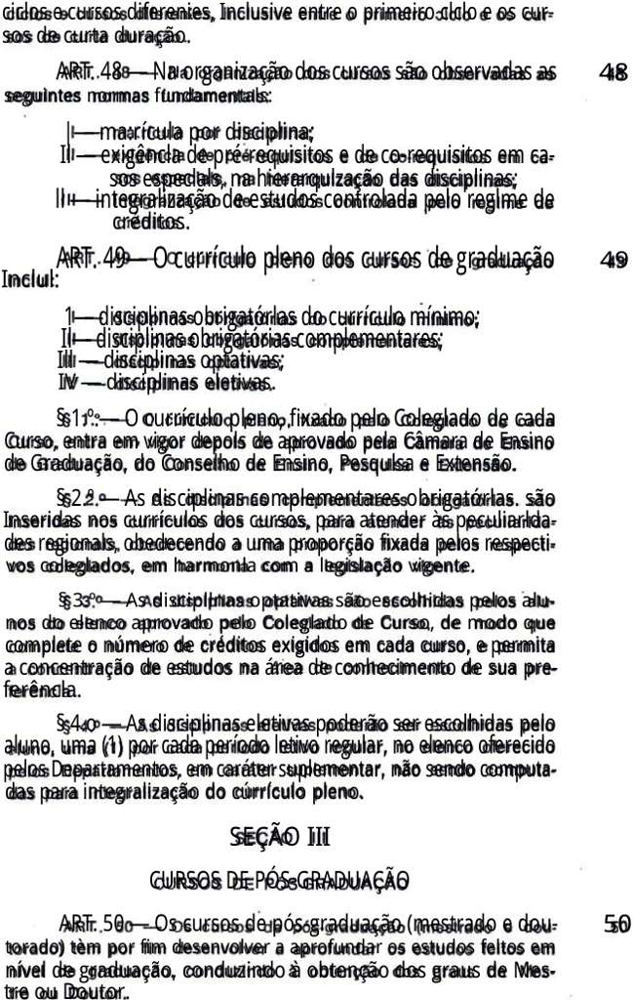

<!-- figure p56-fig1 | described_by: agy | ocr_overlap: 0.78 | needs_review: false -->
**(1) Tipo de figura**
Recorte de página de um documento normativo impresso em português (estatuto ou regimento universitário), extraído de um PDF com artefato visual de dupla camada de texto sobreposta: sobre o texto original digitalizado (de fundo, ligeiramente mais escuro e deslocado um pouco para baixo e para a direita) aparece visivelmente renderizada a camada de texto digital/OCR em fonte sem serifa condensada (ligeiramente deslocada para cima e para a esquerda), criando efeito de texto duplicado em toda a imagem. Não há gráficos, tabelas, diagramas nem ilustrações.

**(2) Todo o texto visível (transcrição literal)**
Abaixo consta o texto integral da página, preservando quebras de linha, hifenização, pontuação, maiúsculas/minúsculas e numeração marginal à direita; divergências visíveis introduzidas pela camada sobreposta de OCR estão indicadas entre colchetes quando relevantes:

> ciclos e cursos diferentes, inclusive entre o primeiro ciclo e os cur-
> sos de curta duração.
>
> ART. 48 — Na organização dos cursos são observadas as    [margem direita: 48]
> seguintes normas fundamentais:
>     I — matrícula por disciplina;
>     II — exigência de pré-requisitos e de co-requisitos em ca-
>          sos especiais, na hierarquização das disciplinas;
>     III — integralização de estudos controlada pelo regime de
>           créditos.
>
> ART. 49 — O currículo pleno dos cursos de graduação    [margem direita: 49]
> inclui:
>     I — disciplinas obrigatórias do currículo mínimo;
>     II — disciplinas obrigatórias complementares;
>     III — disciplinas optativas;
>     IV — disciplinas eletivas.
>
> § 1.º — O currículo pleno, fixado pelo Colegiado de cada
> Curso, entra em vigor depois de aprovado pela Câmara de Ensino
> de Graduação, do Conselho de Ensino, Pesquisa e Extensão.
>
> § 2.º — As disciplinas complementares obrigatórias são
> inseridas nos currículos dos cursos, para atender às peculiarida-
> des regionais, obedecendo a uma proporção fixada pelos respecti-
> vos colegiados, em harmonia com a legislação vigente.
>
> § 3.º — As disciplinas optativas são escolhidas pelos alu-
> nos do elenco aprovado pelo Colegiado de Curso, de modo que
> complete o número de créditos exigidos em cada curso, e permita
> a concentração de estudos na área de conhecimento de sua pre-
> ferência.
>
> § 4.º — As disciplinas eletivas poderão ser escolhidas pelo
> aluno, uma (1) por cada período letivo regular, no elenco oferecido
> pelos Departamentos, em caráter suplementar, não sendo computa-
> das para integralização do currículo pleno.
>
> SEÇÃO III
> CURSOS DE PÓS-GRADUAÇÃO
>
> ART. 50 — Os cursos de pós-graduação (mestrado e dou-    [margem direita: 50]
> torado) têm por fim desenvolver a aprofundar os estudos feitos em
> nível de graduação, conduzindo à obtenção dos graus de Mes-
> tre ou Doutor.

*Observações literais da camada sobreposta de OCR (que se sobrepõe ao texto impresso de fundo):*
- Em diversas palavras, a camada sobreposta substitui `i` por `l` ou `I` (ex.: `Inclusive`, `clclo`, `hierarqulzação`, `reglme`, `Inclul:`, `obrigatórlas`, `Inseridas`, `peculiarlda-`, `coleglados`, `ferêncla`, `feltos`).
- No inciso I do Art. 49, a camada sobreposta exibe o algarismo arábico `1` (`1 — disciplinas obrigatórlas do currículo mínimo;`), enquanto o texto impresso de fundo traz o romano `I`.
- No § 2.º, a camada sobreposta apresenta um ponto após `obrigatórlas.` (`obrigatórlas. são`).
- No Art. 50, lê-se `desenvolver a aprofundar` (com `a` nítido na camada sobreposta e traço sobreposto no texto impresso de fundo, sem ser possível confirmar visualmente se o original impresso tinha `a` ou `e`) e `tèm` na camada sobreposta sobre `têm` no texto de fundo.
- A primeira linha (`ciclos e cursos...`) e a última linha (`tre ou Doutor.`) estão rentes às bordas superior e inferior do recorte, respectivamente, mas permanecem legíveis.

**(3) Estrutura**
A figura consiste em um único bloco de página em coluna única de texto corrido, sem caixas, bordas, setas, eixos, tabelas ou múltiplos painéis, organizado verticalmente na seguinte hierarquia tipográfica:
- **Trecho inicial truncado (2 linhas):** continuação sem recuo do final de um parágrafo ou artigo anterior (que não aparece na imagem).
- **Art. 48:** parágrafo com recuo na primeira linha, acompanhado do número marginal `48` alinhado à direita na mesma linha do título do artigo, seguido de lista recuada com três incisos (`I`, `II`, `III`) separados do texto por travessão (`—`), cujas linhas de continuação mantêm recuo adicional à esquerda.
- **Art. 49:** mesma diagramação do Art. 48, com número marginal `49` à direita, seguido de lista recuada com quatro incisos (`I` a `IV`) e quatro parágrafos subordinados (`§ 1.º` a `§ 4.º`), cada qual com recuo de primeira linha e travessão após o número do parágrafo.
- **Cabeçalho de seção:** duas linhas centralizadas em caixa alta, separadas por espaço em branco acima e abaixo — `SEÇÃO III` na primeira linha e o subtítulo `CURSOS DE PÓS-GRADUAÇÃO` na segunda.
- **Art. 50:** parágrafo com recuo na primeira linha e número marginal `50` alinhado à direita, encerrando-se na borda inferior da figura.

**(4) Números e valores de dados**
- Números de artigos (no corpo do texto e repetidos na margem direita): `48`, `49`, `50`.
- Numeração de seção: `III` (em `SEÇÃO III`).
- Numeração de incisos do Art. 48: `I`, `II`, `III`.
- Numeração de incisos do Art. 49: `I` (aparecendo como `1` na camada OCR sobreposta), `II`, `III`, `IV`.
- Numeração de parágrafos do Art. 49: `1.º`, `2.º`, `3.º`, `4.º` (precedidos de `§`).
- Valor quantitativo no corpo do texto (§ 4.º do Art. 49): `uma (1)` (`1` disciplina eletiva por cada período letivo regular).

**(5) Cores**
A imagem é totalmente monocromática (texto preto e tons de cinza de digitalização sobre fundo branco); as cores não carregam significado informacional.

~~~text ocr
Inclusive entre © OS Gur:
sos de duração.
dos: são as
seguintes manmas ftundamenttails:
por disciplina;
deep résrequisitos e de em
_ das disciplinas;
folada pelo regime de
créditos.
pleno dos cursos de graduação
ili tivas;
IW —
pelo de cada
Curso, emtra em vigor de aprovado pela Câmara de Ensino
de Graduação, do Conselho de Ensino, Pesquisa e Extensão.
952 são
nos dos Guises, para às
des regionals, a uma proporção fixada pelos respecti-
vos em com a vigente.
pelos
mos cio pelo die Cursa, de modo que
complete o número de créditos exigidos em cada curso, e permita
de estudos na che de sua pre-
nota.
As ser pelo
aluno, uma (1) por regular, no elenco
pelos Depastamentos, en não semdo
das para integralização do pleno.
SEÇÃO Ill
CURSOS
(Mestrado e
torado) têm por desenvolver a os estudos em
nível de conduzindo à obtenção des graus de Nes-
tre @u Bouter.
48
49
~~~


<!-- Start of picture text -->
ciclos e cursos diferenies, Inclusive entre o primeiro clclo e os cur-<br>sos de curta duração.<br>ART. 48 — Na organização dos cursos são observadas as 48<br>seguintes normas fundamentals:<br>|— ma:rícula por disciplina;<br>Il — exigêncla de pré-requisitos e de co-requisitos em ca-<br>sos especlals, na hierarqulzação das disciplinas;<br>ll — integralização de estudos controlada pelo reglme de<br>créditos.<br>49<br>ART. 49— O currículo pleno dos cursos de graduação<br>Inclul:<br>1— disciplinas obrigatórlas do currículo mínimo;<br>Il— disciplinas obrigatórias complementares;<br>Ill — disciplinas optativas;<br>IV — disciplinas eletivas.<br>§ 1.º.— O currículo pleno, fixado pelo Coleglado de cada<br>Curso, entra em vigor depols de aprovado pela Câmara de Ensino<br>de Graduação, do Conselho de Ensino, Pesqulsa e Extensão.<br>§ 2.º — As disciplinas complementares obrigatórlas. são<br>Inseridas nos currículos dos cursos, para atender às peculiarlda-<br>des regionals, obedecendo a uma proporção fixada pelos respecti-<br>vos coleglados, em harmonla com a legislação vigente.<br>§ 3.º — As discipllnas optativas são escolhidas pelos alu-<br>nos do elenco aprovado pelo Coleglado de Curso, de modo que<br>complete o número de créditos exigidos em cada curso, e permita<br>a concentração de estudos na área de conhecimento de sua pre-<br>ferêncla.<br>§ 4.o — As disciplinas eletivas poderão ser escolhidas pelo<br>aluno, uma (1) por cada período letivo regular, no elenco oferecido<br>pelos Departamentos, em caráter suplementar, não sendo computa-<br>das para integralização do cúrrículo pleno.<br>SEÇÃO III<br>CURSOS DE PÓS-GRADUAÇÃO<br>ART. 50 — Os cursos de pós-graduação (mestrado e dou- 50<br>torado) tèm por fim desenvolver a aprofundar os estudos feltos em<br>nível de graduação, conduzindo à obtenção dos graus de Mes-<br>tre ou Doutor.<br><!-- End of picture text -->

-40— 


<!-- page 57 -->


§ 1.º — 0 mestrado objetiva enriquecer a competância clentífica e profisslonal dos graduados e pode ser usado como fase preliminar do doutorado, sem constituir, entretanto, requisito Indispensável à inscrição neste último curso. 

§ 2.° — O doutorado proporcionará formação científica e cultural mais ampla e profunda, desenvolvendo a capacidade de pesquisa e poder crlador, nos diferentes ramos do saber. 

#### SEÇÃO IV 

CURSOS DE ESPECIALIZAÇÃO, APERFEIÇOAMENTO, 

##### EXTENSÃO, 2.° GRAU E OUTROS 

ART. 51 — Os cursos de especialização e aperfelçoamento des os  s     me ros à preparação de especialistas em determinados setores de estudos e os segundos à transmissão de novos conhecimentos e de tecnologia mals moderna. 

ART. 52 — Os cursos de extensão objetivam promover a difusão de conhecimentos e de novas técnicas de trabalho coms a finalidade de elevar os padrões sócio-culturais da comunidade. 

Parágrafo Único — Além dos cursos previstos nesta seção, a UFRPE poderá promover outros, para atender às exigênclas de sua programação específica e fazer face à peculiarldade do mercado de trabalhoreglonal. 

ART. 53 — Os cursos de 2.º Grau proporcionam o ensino a es'e nível, destinando-se especialmente à preparação de profissionals de nível médio na área das ciências agrárias. Parágrafo Único — Além das atribuições contidas neste artigo, os cursos de 2.º Grau também servirão para o trelnamento didático dos alnos de licenclatura, da Universidade. 

### SEÇÃO V 

COORDENAÇÃO DIDÁTICA DOS CURSOS 

ART. 54 — A coordenação didática de cada curso de graduação e de pós-graduação é exercida por um Coleglado de Coordenação Didática, constituído pelo Coordenador do Curso, como presidente, pelo Vice-Coordenador, como vice-presidente, por um 

51 

52 

53 

54 

41— 


<!-- page 58 -->

ou mais docentes de cada Departamen:o, que participe do ensino do Curso, e por representante(s) do corpo discente de graduação e de pós-graduação, escolhidos na forma da leglslação vigente, com mandato de um (1) ano, permitida uma recondução. 

§ 1.º — Os Departamentos responsávels por mals de clnco (5) disciplinas obrigatórlas em um Curso de Graduação, têm maior representação no Coleglado correspondente, de acordo com normas constantes do Reglmento Geral. 

§ 2º — O Coordenador e o Vice-Coordenador de cada Curso são designados pelo Reltor, de lista tríplice, elelta pelo respectivo coleglado. 

§ 3.º — As eleições dos componentes das Ilstas tríplices, referidas no parágrafo anterior, bem como a designação dos Integrantes do Colegiado de cada Curso, são disciplinadas no Reglmento Geral. 

ART. 55 — Das decisões ou deliberações dos Colegiados de Coordenação Didática cabem recursos à Câmara de Enslno de Graduação ou à Camara de Pesquisa e Pós-Graduação, conforme o caso. 

55 

##### CAPITULO II 

PESQUISA 

ART. 56 — A pesquisa é oonsiderada como função específica, voltada à busca de novos conhecimentos e técnicas, e como recurso de educação, destinado ao cultivo da atitude clentífica, indispensável a uma formação de grau superior. 

58 

Parágrafo Único — A UFRPE, considerando que a pesqulsa é Indissoclável do ensino, promoverá a coordenação entre os respectivos programas, visando, entre outros objetivos, ao melhor preparo dos estudantes. 

ART. 57 — As pesquisas são organizadas em programas ou projetos destinados, preferencialmente, à solução dos problemas locals, regionals ou naclonals. 

ART. 58 — A UFRPE conslgnará, obrigatorlamente, em seu orçamento próprlo, recursos des'inados às atividades de pesquisa além dos obtidos de outras fontes. 

ART. 59— A Pró-Reltoria de Pesquisa e Pós-Graduação publicará, anualmente, catálogo das pesquisas, bem como manterá perlódicos destinados à divulgação dos trabalhos clentíficos. 

57 

58 

59 

-42- 


<!-- page 59 -->


#### CAPÍTULOIII 

##### EXTENSÃO 

ART. 60 — A UFRPE contribuirá, através das atividades de extensão, para o desenvolvimento social e material da comunidade. 

ART. 61 — A extensão poderá alcançar o âmbito de toda a coletividade ou dirigir-se a pessoas e instituições, através de cursos e serviços, incluídos em planos específicos. 

ART. 62 — As atividades de extensão dəvem ser reallzadas em perfeito entrosamento com .o ensino e a pesqulsa, oferecendo-lhes subsídios e servindo de ligação entre a Universidade e a comunidade. 

ART. 63 — A UFRPE consignará obrigatorlamente, em seu orçamento,, recursos des:inados às atividades de extensão, sem prejuízo dos obtidos em outras fontes. 

#### TITULO V 

###### DACOMUNIDADE UNIVERSITÁRIA 

ART. 64 — A comunidade universitária da UFRPE, estruturada em torno de nobres ideals de solidarledade humana, é constituída por seus corpos docente, discente, técnico e administrativo. 

ART. 5 — Os membros dos corpos docente, técnico e administrativo estão sujeitos ao Estatu:o dos Funcionários Públicos Civis da União, ou à Legislação do Trabalho, conforme o regime jurídico ao qual se vinculem, bem como à legislação do ensino, no que couber a este Estatuto e aos demals Ínstrumentos normativos próprios daUniversidade. 

ART. 66  Os cargos e empregos de docentes, de técnicos e de servidores administrativos Integram o Quadro Único de Pessoal da Universidade e as suas admissões competem ao Reltor. 

### CAPITULO1 

##### CORPO DOCENTE 

ART. 67 — O corpo docente da UFRPE é constituldo de ocupantes de cargos e empregos do Grupo-Magistérlo, Integrantes 

### 60 

#### 61 

62 

63 

### 64 

65 

66 

67 

-43— 


<!-- page 60 -->

de seu Quadro Único de Pessoal, bem como de auxillares de enslno, professores colaboradores e professores visltantes. ART. 68 — A categorla de Professor de Enslno Superlor do 68 Grupo-Magistérlo, compreende os segulntes cargos ou empregos: a) Professor Assistente; b) Professor Adjunto; c) Professor Titular. ART. 69 — Os cargos ou empregos de Professor Assistente 69 são providos mediante concursos públicos de provas e títulos, abertos a candidatos portadores de diploma de Mestre em matérla correlata, obtido em curso credenciado, constituindo título preferenclal o estáglo probatórlo como auxillar de ensino. ART. 70 — Os cargos ou empregos de Professor Adjuntp 70 são provldos, em cinqüenta por cento (50%) das vagas, por ingresso mediante concursos públlcos de provas e títulos abertos a candidatos portadores do diploma de Doutor, obtido em curso credenclado, ou de Livre-Docêncla em matérla correlata e, nas vagas restantes, por progressão funcional dos Professores Assistentes, possuldores do diploma de Doutor. ART. 71 — Os cargos ou empregos de Professor Titular são 71 providos medlante concursos públicos de provas e títulos, aos quais só podem concorrer Professores Adjuntos, ou pessoas de alta qualificação clentífica, reconhecida pelo Conselho Universitárlo e possuidoras do diploma de Doutor ou Livre-Docêncla. ART. 72 — Para complementação das atividades docentes, 72 dos titulares dos cargos ou empregos da categoria funclonal de Professor de Ensino Superior, podəm ser contratados por prazo determinado, na forma da legislação trabalhista, para o desempenho de tarefas próprlas do magistérlo superior, exclusivarrente, os seguintes docentes: 1— auxillares de ensino, na forma prevista no RegimentoGeral; I — professores colaboradores, para atender a eventuals necessidades do ensino, a critério do Conselho de Ensino, Pesquisa e Extensão; III — professores visitantes de reconhecido renome, a critério do Conselho Unlversitárlo. 

71 

72 

-44— 


<!-- page 61 -->

ART. 73 — Os cargos ou empregos da caegoria funcional də Professor de Ensino de 2.º Grau săo providos na forma da lel e do Regimento Geral. 

ART. 74 — Para o provimento de cargo ou emprego de qualquer nível do corpo docente, exige-se, como requisito básico, a graduação em curso de nível superlor, que inclua a área de conhecimento correspondente. 

ART. 75 — Os cargos ou empregos do Grupo-Magistério são desvinculados de disciplinas, devendo, entretanto, atender às preocupações científlco-culturais dos docentes, em harmonla com os Interesses dominantes do Departamento. 

Parágrafo Único — Em qualquer Departamento, poderá haver mals de um professor que ocupe cargo ou emprego da mesma classe da categorla funcional de Professor de Ensino Superlor. ART. 76 — 0 pessoal docente está sujelto a um dos seguintes regimes de trabalho: 

### 73 

74 

75 

76 

a) vinte (20) horas semanais, em um (1) turno diárlo completo; 

b) quarenta (40) horas semanals, em dois (2) turnos dlários completos. com ou sem dedlcação exclusiva. 

§ 1.o — Os auxillares de anslno devem exercer suas ativldades em regime de quarenta (40) horas semanais. 

§ 2.º — No Interesse da Universidade, do turno regular de trabalho dos docentes, em regime de 20 horas semanals, poderá ser determinado o destaque de horas, até o máximo de olto (8) por semana, a serem prestadas em outro turno, exclusivamente destinadas à ministração de aulas, previstas nos horárlos escolares. 

ART. 77 — O pessoal docente da UFRPE fará jus à retribulção, prevista em Lel, conforme o regime de trabalho a que estiver sujelto. 

77 

Parágrafo Único — A retribulção de que trata este artigo compreende o vencimento fixado para cada nível e os Incentivos funcionals a serem concedidos, quando satisfeltos os segulntes requlsitos: 

I— desempenho das respectivas atividades em regime de quarenta (40) horas semanais; 

Il — obtenção do grau de Doutor, em curso credenclado 

-45— 


<!-- page 62 -->

pelo Conselho Federal de Educação, ou título de Livre-Docente na forma da egislação em vigor; Ill — obtenção do grau de Mestre, em curso credenclado pelo Conselho Federal de Educação; IV — conclusão de curso de aperfeiçoamento ou especlalização; V — produção cientifica, cultural ou técnica relevante, ligada ao ensino e à pesquisa; VI — dedicação integral e exclusiva ao ensino, à pesqulsa e à ex.ensão, bem como às atividades de administração universitária. ART, 78 — As horas excedentes da carga horárla mínima de aulas serão utilizadas pelo docente na reallzação de outros trabalhos acadêmicos, tals como ensino, pesquisa, extensão, administração universitária, orientação de alunos, atividades de consultorla e outros correlatos. § 1.o — A carga horária mínima de aulas do pessoal docente, em qualquer regime. é disciplinada pelo Conselho de Enslno, Pesquisa e Extensão, cabendo ao Departamento a sua programação. § 2.º — O controle de assiduidade dos docentes, de acordo com o seu regime de trabalho, é da competência do órgão responsável pelo cumprimento das tarefas em que os mesmos estão empenhados. 

ART. 79 — A UFRPE inclui em seus planos de atividades a progressiva extensão do regime de quarenta (40) horas semanais, com ou sem dedicação exclusiva, ao seu pessoal docente. § 1.o — Cabe ao Reltor solicitar à autoridade competente, que servidor público no exercício cumulativo do seu cargo, com cargo ou função docente na UFRPE, seja posto à disposição da Universidade, para exercer o magistérlo em regime de quarenta (40) horas semanais, com ou sem dedicação integral e exclusiva. § 2.º — O regime de quarenta (40) horas semanals é obrlgatórlo para o Reltor, o Vice-Reltor, os Pró-Reitores, os Dlretores dos Departamen'os Universitários e do Colégio de 2.º Grau Dom Agostinho Ikas, bem como dos Coordenadores de Curso de Graduação ePós-Graduação. ART. 80 — Os membros do Corpo Docente têm direito a quarenta e cinco (45) dlas de férlas anuals, sendo automática a 

78 


<!-- Start of picture text -->
79<br><!-- End of picture text -->

80 

—46— 


<!-- page 63 -->


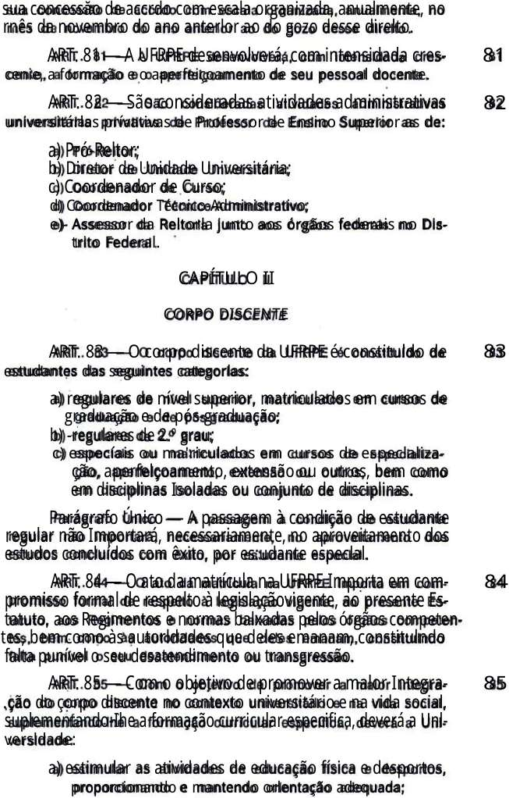

<!-- figure p63-fig2 | described_by: agy | ocr_overlap: 0.74 | needs_review: false -->
### 1. Tipo de figura
Recorte vertical de uma página de texto normativo/estatutário em português (trecho do Estatuto da UFRPE), extraído de um PDF digitalizado no qual duas camadas de texto aparecem visivelmente sobrepostas e ligeiramente desalinhadas: o texto impresso original escaneado (traço mais espesso) e uma camada visível de texto de reconhecimento óptico de caracteres (OCR, em fonte sem serifa mais fina) renderizada por cima. Não há ilustrações, gráficos, diagramas ou tabelas.

---

### 2. Todo o texto visível (verbatim)

*(Observação: todo o texto abaixo aparece duplicado visualmente pela sobreposição da camada de OCR sobre a impressão original; nos trechos em que a camada de OCR apresenta caracteres distintos ou erros de reconhecimento visíveis, eles estão indicados entre colchetes logo após a linha ou palavra correspondente.)*

**Linhas iniciais (continuação de texto anterior):**
> sua concessão de acordo com escala organizada, anualmente, no *(camada de OCR: `accrdo`)*
> mês de novembro do ano anterior ao do gozo desse direito. *(camada de OCR: `rnês da novembro do ano anterlor ao do gozo desse direlto.`)*

**Artigo 81** *(número na margem direita: `81`)*:
> ART. 81 — A UFRPE desenvolverá, com intensidade cres- *(camada de OCR: `intensidada`)*
> cente, a formação e o aperfeiçoamento de seu pessoal docente. *(camada de OCR: `cenle,`)*

**Artigo 82** *(número na margem direita: `82`)*:
> ART. 82 — São consideradas atividades administrativas
> universitárias privativas de Professor de Ensino Superior as de:
> a) Pró-Reitor; *(camada de OCR: `Pró-Reltor;`)*
> b) Diretor de Unidade Universitária;
> c) Coordenador de Curso;
> d) Coordenador Técnico Administrativo;
> e)- Assessor da Reitoria junto aos órgãos federais no Dis- *(camada de OCR: `Reltoria`)*
> trito Federal.

**Cabeçalho centralizado:**
> CAPÍTULO II
>
> CORPO DISCENTE

**Artigo 83** *(número na margem direita: `83`)*:
> ART. 83 — O corpo discente da UFRPE é constituído de *(camada de OCR: `constituldo`)*
> estudantes das seguintes categorias:
> a) regulares de nível superior, matriculados em cursos de
> graduação e de pós-graduação;
> b) -regulares de 2.º grau;
> c) especiais ou matriculados em cursos de especializa- *(camada de OCR: `ma'riculados`)*
> ção, aperfeiçoamento, extensão ou outros, bem como *(camada de OCR: `aperfelçoamento`)*
> em disciplinas isoladas ou conjunto de disciplinas. *(camada de OCR: `Isoladas`)*
>
> Parágrafo Único — A passagem à condição de estudante
> regular não importará, necessariamente, no aproveitamento dos *(camada de OCR: `Importará`)*
> estudos concluídos com êxito, por estudante especial. *(camada de OCR: `es:udante`, `especlal.`)*

**Artigo 84** *(número na margem direita: `84`)*:
> ART. 84 — O ato da matrícula na UFRPE importa em com- *(camada de OCR: `Importa`)*
> promisso formal de respeito à legislação vigente, ao presente Es- *(camada de OCR: `legislaçãovigente`)*
> tatuto, aos Regimentos e normas baixadas pelos órgãos competen- *(camada de OCR: `balxadas`)*
> tes, bem como às autoridades que deles emanam, constituindo *(camada de OCR: `constltuindo`)*
> falta punível o seu desatendimento ou transgressão.

**Artigo 85** *(número na margem direita: `85`)*:
> ART. 85 — Com o objetivo de promover a maior integra- *(camada de OCR: `Integra-`)*
> ção do corpo discente no contexto universitário e na vida social, *(camada de OCR: `,ção`)*
> suplementando-lhe a formação curricular específica, deverá a Uni- *(camada de OCR: `suplementando-Ihe`, `especifica`, `Unl-`)*
> versidade:
> a) estimular as atividades de educação física e desportos,
> proporcionando e mantendo orientação adequada; *(camada de OCR: `orlentação`)*

---

### 3. Estrutura
- **Elementos gráficos:** não há caixas, molduras, setas, conexões, eixos, tabelas nem múltiplos painéis.
- **Disposição em colunas:** coluna principal única de texto justificado/corrido à esquerda, acompanhada de uma coluna marginal estreita à direita reservada exclusivamente à numeração dos artigos (`81`, `82`, `83`, `84` e `85`), cada número alinhado horizontalmente à primeira linha do artigo correspondente.
- **Organização hierárquica (de cima para baixo):**
  1. Duas linhas residuais de um dispositivo iniciado antes do topo da imagem.
  2. `ART. 81` (parágrafo único com recuo de primeira linha).
  3. `ART. 82` (caput com recuo de primeira linha, seguido por lista de cinco alíneas recuadas à esquerda, `a)` a `e)`, sendo a segunda linha de `e)` recuada sob o texto da alínea).
  4. Divisor de seção centralizado em caixa alta, em duas linhas espaçadas: `CAPÍTULO II` e `CORPO DISCENTE`.
  5. `ART. 83` (caput com recuo de primeira linha; lista recuada de três alíneas, `a)` a `c)`, com continuações alinhadas sob o texto das alíneas; seguido por `Parágrafo Único` com recuo de primeira linha).
  6. `ART. 84` (parágrafo único de cinco linhas com recuo de primeira linha).
  7. `ART. 85` (caput de quatro linhas com recuo de primeira linha, seguido pela alínea `a)` recuada em duas linhas, onde a imagem termina).
- **Sobreposição de camadas:** em toda a página, a camada de OCR sobrepõe-se ao texto escaneado com pequeno deslocamento horizontal e vertical, causando efeito visual de texto duplicado em todas as linhas e nos números da margem direita.

---

### 4. Todos os números e valores
- `81` — número do artigo (`ART. 81`) e repetido na margem direita.
- `82` — número do artigo (`ART. 82`) e repetido na margem direita.
- `II` — algarismo romano do capítulo (`CAPÍTULO II`).
- `83` — número do artigo (`ART. 83`) e repetido na margem direita.
- `2.º` — numeral ordinal em `2.º grau` (alínea `b)` do `ART. 83`).
- `84` — número do artigo (`ART. 84`) e repetido na margem direita.
- `85` — número do artigo (`ART. 85`) e repetido na margem direita.

---

### 5. Cores
Não há cores com função informativa ou semântica; a imagem é monocromática (texto preto com leves variações em cinza da digitalização/suavização sobre fundo branco).

~~~text ocr
a ho
de novembro do ano antertor ao do gozo desse
conmintensidada cres-
canie, e de seu pessoal
universitárias as de:
by) Diretor de Umidade
de Curso;
di)
e) Assessor dia jumto ans mo Dis-
tirito Federal.
il
CORPO DISGENTE
883-— da ésconstituldo de
estudiantes das seguintes categorias:
a) reguilares de nível superior, em cursos de
graduação
dle 2.º
ou em cursos dia
ção, au bem como
em disciplinas Isoladas ou conjunto de disciplinas.
Único — A passagem à de estudante
regular não necessariamente, no dos
estudos cancluides com êxito, por especlal.
em com-
promisso ao presente Es-
tatuto, aos Regimentos @
falta ou transgressão.
ep Integra-
«ção di corpo discente mo cantexto uniwersitáriose ma vida social,
esa Unl-
versidade:
a) estimular as atividades de educação física
proporciamentto e mantendo
Kadas pelos coonpeten-
31
82
as
as
~~~


<!-- Start of picture text -->
sua concessăo de accrdo com escala organizada, anualmente, no<br>rnês da novembro do ano anterlor ao do gozo desse direlto.<br>ART. 81 — A UFRPE desenvolverá, com intensidada cres- 81<br>cenie, a formação e o aperfeiçoamento de seu pessoal docente.<br>ART. 82 — São consideradas atividades administrativas 82<br>universitárlas prívativas de Professor de Ensino Superior as de:<br>a) Pró-Reltor;<br>b) Diretor de Unidade Universitária;<br>c) Coordenador de Curso;<br>d) Coordenador Técnico-Administrativo;<br>e)- Assessor da Reltorla junto aos órgãos federais no Dis-<br>trito Federal.<br>CAPÍTULO II<br>CORPO DISCENTE<br>ART. 83 — O corpo discente da UFRPE é constituldo de 83<br>estudantes das seguintes categorlas:<br>a) regulares de nível superior, matriculados em cursos de<br>graduação e de pós-graduação;<br>b) -regulares de 2.º grau;<br>c) especíais ou ma'riculados em cursos de especlaliza-<br>ção, aperfelçoamento, extensão ou outros, bem como<br>em disciplinas Isoladas ou conjunto de disciplinas.<br>Parágrafo Único — A passagem à condição de estudante<br>regular não Importará, necessariamente, no aproveitamento dos<br>estudos concluídos com êxito, por es:udante especlal.<br>ART. 84 — O ato da matrícula na UFRPE Importa em com- 84<br>promisso formal de respelto à legislaçãovigente, ao presente Es-<br>tatuto, aos Regimentos e normas balxadas pelos órgãos competen-<br>tes, bem como às autorldades que deles emanam, constitulndo<br>falta punível o seu desatendimento ou transgressão.<br>ART. 85 — Com o objetivo de promover a malor Integra- 85<br>.ção do çorpo discente no contexto universitário e na vida social,<br>suplementando-Ihe a formação curricular especifica, deverá a Unl-<br>versldade:<br>a) estimular as atividades de educação física e desportos,<br>proporcionando e mantendo orlentação adequada;<br><!-- End of picture text -->

-47— 


<!-- page 64 -->

- b) Incentivar programas que visem à formação cívica, indispensável à crlação de uma consciência de direltos e deveres do cldadão e do profisslonal; 

- c) assegurar a realização de programas culturais, artísticos, cívicos e desportivos por parte dos alunos; 

- d) proporcionar aos estudantes, por melo de cursos e serviços de extensão, oportunidades de participação em projetos de melhorla das condições de vida da comunldade, bem como no processo de desenvolvimento reglonal e nacional; 

- e) estimular as atividades assoclativas dos discentes, por Intermédio do Diretórlo Central de Estudantes, 'e dos Diretórios Acadêmlcos dos Cursos. 

ART. 86 — O Diretório Central de Estudantes (DCE) da UFRPE e os Dlretórios Acadêmlcos (DAs) de seus cursos de nível superior, órgãos de valorização e promoção dos legítimos Interesses dos estudantes, são constituídos cada um por olto (8) membros eleitos em 'pleito direto, na forma da legislação vigente. 

ART. 87 — É vedado ao DCE e DAs, o exercíclo de qualsquer atividades de caráter político-partidárlo, religloso ou racial, bem como suscitar, promover ou aliciar faltas coletivas às aulas, aos trabalhos escolares, e alnda a participação ou representação de entidades alhelas à UFRPE. 

#### 86 

### 87 

Parágrafo Único — Pela infração deste artigo, o Conselho Universitário poderá determinar Intervenção no Diretórlo Central e Diretórlos Acadêmicos, bem como a suspensão ou destitulção de seus membros. 

ART. 88 — Os alunos de balxa renda famillar ou carentes de recursos poderão receber bolsas para moradia, allmentação, pagamento de taxas acadêmicas e outras despesas semelhantes, obrigando-se, em contrapartida, à prestação de serviços à Universidade, na forma estabelecida no Regimento Geral e em Resolução dos Conselhos Universitárlo e de Curadores. 

ART. 89 — Além das monitorias, Instituídas pelo art. 41 da Lei n.° 5.540, de 28.11.68, a UFRPE poderá conceder bolsas especiais de auxillar acadêmico a a unos dos cursos de graduação e pós-graduação, de acordo com normas fixadas pelo Regimento Geral e Resoluções especlals de seus Conselhos Universitérlo e de Curadores. 

#### 88 

#### 68 

—48— 


<!-- page 65 -->


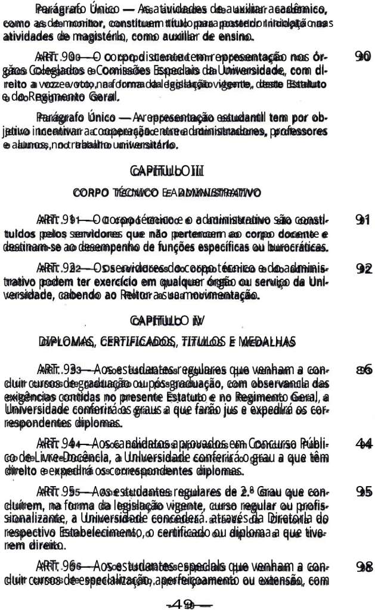

<!-- figure p65-fig1 | described_by: agy | ocr_overlap: 0.8 | needs_review: false -->
### 1. Tipo de figura
Trata-se da imagem de uma página de texto normativo/jurídico digitalizada (página 49 de um Estatuto universitário em português), sem gráficos, tabelas ou ilustrações. A imagem apresenta um artefato de **dupla camada de texto sobreposta**: sobre a digitalização original impressa há uma camada de texto vetorial sem serifa (típica de reconhecimento óptico de caracteres — OCR — renderizado de forma visível e levemente desalinhada para cima e para os lados), o que causa duplicação visual em todas as linhas e alguns erros de reconhecimento na camada sobreposta (principalmente troca de `i` por `l` e erros em números na margem direita).

---

### 2. Todo o texto visível (ipsis litteris)

A seguir está a transcrição integral do texto principal impresso, respeitando quebras de linha, hifenizações, maiúsculas, acentuação e pontuação visíveis, acompanhada da indicação dos números na margem direita e das divergências perceptíveis na camada OCR sobreposta:

**Bloco inicial (continuação do artigo anterior):**
> Parágrafo Único — As atividades de auxiliar acadêmico,
> como as de monitor, constituem título para posterior iniciação nas
> atividades de magistério, como auxiliar de ensino.
*(Nota da camada sobreposta: grafa `magistérlo` e `auxillar`.)*

**Artigo 90** *(número na margem direita: `90`)*:
> ART. 90 — O corpo discente tem representação nos ór-
> gãos Colegiados e Comissões Especiais da Universidade, com di-
> reito a voz e voto, na forma da legislação vigente, deste Estatuto
> e do Regimento Geral.
*(Nota da camada sobreposta: grafa `dl-` e `relto`.)*

> Parágrafo Único — A representação estudantil tem por ob-
> jetivo incentivar a cooperação entre administradores, professores
> e alunos, no trabalho universitário.
*(Nota da camada sobreposta: grafa `estudantll`.)*

**Título de capítulo centralizado:**
> CAPITULO III
> CORPO TÉCNICO E ADMINISTRATIVO

**Artigo 91** *(número na margem direita: `91`)*:
> ART. 91 — O corpo técnico e o administrativo são consti-
> tuídos pelos servidores que não pertencem ao corpo docente e
> destinam-se ao desempenho de funções específicas ou burocráticas.
*(Nota da camada sobreposta: grafa `constl-` e `tuidos`.)*

**Artigo 92** *(número na margem direita: `92`)*:
> ART. 92 — Os servidores do corpo técnico e do adminis-
> trativo podem ter exercício em qualquer órgão ou serviço da Uni-
> versidade, cabendo ao Reitor a sua movimentação.
*(Nota da camada sobreposta: grafa `Unl-` e `Reltor`.)*

**Título de capítulo centralizado:**
> CAPITULO IV
> DIPLOMAS, CERTIFICADOS, TITULOS E MEDALHAS

**Artigo 93** *(número na margem direita: `93` na camada original impressa; `86` na camada OCR sobreposta)*:
> ART. 93 — Aos estudantes regulares que venham a con-
> cluir cursos de graduação ou pós-graduação, com observância das
> exigências contidas no presente Estatuto e no Regimento Geral, a
> Universidade conferirá os graus a que farão jus e expedirá os cor-
> respondentes diplomas.
*(Nota da camada sobreposta: grafa `observancla` e `expedlrá`.)*

**Artigo 94** *(número na margem direita: `94` na camada original impressa; `44` na camada OCR sobreposta)*:
> ART. 94 — Aos candidatos aprovados em Concurso Públi-
> co de Livre Docência, a Universidade conferirá o grau a que têm
> direito e expedirá os correspondentes diplomas.
*(Nota da camada sobreposta: grafa `Unlversidade`, `dlrelto` e `expedlrá`.)*

**Artigo 95** *(número na margem direita: `95`)*:
> ART. 95 — Aos estudantes regulares de 2.º Grau que con-
> cluírem, na forma da legislação vigente, curso regular ou profis-
> sionalizante, a Universidade concederá, através da Diretoria do
> respectivo Estabelecimento, o certificado ou diploma a que tive-
> rem direito.
*(Nota da camada sobreposta: grafa `concederá.` com ponto em vez de vírgula, `Diretorla` e `dlrelto`.)*

**Artigo 96 (interrompido no fim da página)** *(número na margem direita: `96` na camada original impressa; `98` na camada OCR sobreposta)*:
> ART. 96 — Aos estudantes especiais que venham a con-
> cluir cursos de especialização, aperfeiçoamento ou extensão, com
*(Nota da camada sobreposta: grafa `especlals`, `especlallzação` e `aperfelçoamento`.)*

**Rodapé centralizado (número da página):**
> — 49 — *(camada sobreposta renderizada como `-49—`)*

---

### 3. Estrutura e disposição visual
- **Layout geral:** Página em coluna única de texto justificado à esquerda e à direita, com recuo na primeira linha de cada artigo e parágrafo, acompanhada por uma coluna estreita na **margem direita** reservada à numeração de referência dos artigos. Não há caixas, molduras, linhas divisórias, setas, diagramas, eixos nem painéis.
- **Hierarquia e organização vertical (de cima para baixo):**
  1. Um parágrafo avulso no topo (`Parágrafo Único`), continuação de um artigo iniciado na página anterior.
  2. `ART. 90` seguido de seu `Parágrafo Único`.
  3. Cabeçalho centralizado de seção em caixa alta: `CAPITULO III`, seguido logo abaixo pelo subtítulo centralizado em caixa alta (itálico na camada original impressa): `CORPO TÉCNICO E ADMINISTRATIVO`.
  4. Dois artigos pertencentes ao Capítulo III: `ART. 91` e `ART. 92`.
  5. Cabeçalho centralizado de seção em caixa alta: `CAPITULO IV`, seguido logo abaixo pelo subtítulo centralizado em caixa alta (itálico na camada original impressa): `DIPLOMAS, CERTIFICADOS, TITULOS E MEDALHAS`.
  6. Quatro artigos pertencentes ao Capítulo IV: `ART. 93`, `ART. 94`, `ART. 95` e início do `ART. 96` (cuja frase fica incompleta na borda inferior para continuar na página seguinte).
  7. Numeração de página centralizada no rodapé, ladeada por travessões (`— 49 —`).
- **Alinhamento da margem direita:** Na primeira linha de cada artigo (`ART. 90` a `ART. 96`), mas não nos parágrafos únicos, o número do respectivo artigo aparece repetido e alinhado à direita da mancha de texto.
- **Sobreposição tipográfica:** Toda a página exibe duas camadas de texto sobrepostas e ligeiramente deslocadas entre si (a digitalização original em cinza-escuro/preto por baixo e o texto OCR em preto nítido por cima).

---

### 4. Todos os números e valores presentes
- **Numeração romana de capítulos:** `III`, `IV`.
- **Números de artigos no corpo do texto:** `90`, `91`, `92`, `93`, `94`, `95`, `96`.
- **Números de referência na margem direita (camada original impressa / camada OCR sobreposta):**
  - Linha do Art. 90: `90` / `90`
  - Linha do Art. 91: `91` / `91`
  - Linha do Art. 92: `92` / `92`
  - Linha do Art. 93: `93` / `86` *(erro de OCR na sobreposição)*
  - Linha do Art. 94: `94` / `44` *(erro de OCR na sobreposição)*
  - Linha do Art. 95: `95` / `95`
  - Linha do Art. 96: `96` / `98` *(erro de OCR na sobreposição)*
- **Número ordinal no texto (Art. 95):** `2.º` (em `2.º Grau`).
- **Número de página no rodapé:** `49`.

---

### 5. Cores com significado
A imagem é monocromática (texto preto e tons de cinza provenientes da digitalização sobre fundo branco). Nenhuma cor carrega significado semântico.

~~~text ocr
Umico —
como as
atividades de como de ensino.
eppesentação nos ór-
gãos Colegiados Especiais da Universidade, com dl-
reito a ddaldgistágõão
e Geral.
Único — tem por ob-
a
e umivensitário.
CORPO
© são
pelos que mão am corpo docente e
destinam-se ao desempenho de funções específicas ou
e
trativo podem ter exercício em qualquer órgão ou seruigo da Unl-
versidade, cabendo ao ac wad ie
DIPLOMAS, E
venham a con-
com observansla das
exigências contidas mo presente Estatuto e no Regimento Gera), a
Universidade contertedcas graus a que farão jus e Os Gor-
respondentes diplomas.
ART a cam Publi-
a Universidade a que têm
diplomas.
ART regulares de 2.º Grau que con-
duitrem, ma forma da legislação vigente, curso regular ou
a Universi e do
respectiva Estabelecimento, o certificado ou que
nem direito.
que venham a con-
cluitr apesfeigoamento ou extensão, com
9
92
95
~~~


<!-- Start of picture text -->
Parágrafo Único — As atividades de auxiliar acadêmico,<br>como as de monitor, constituem título para posterlor iniclação nas<br>atividades de magistérlo, como auxillar de ensino.<br>ART. 90 — O corpo discente tem representação nos ór- 90<br>găos Coleglados e Comissões Especlais da Universidade, com dl-<br>reito a voz e voto, na forma da legislação vigente, deste Estaluto<br>e do Regimento Geral.<br>Parágrafo Único — A representação estudantll tem por ob-<br>jetivo incentivar a cooperação entre administradores, professores<br>e alunos, no trabalho universitárlo.<br>CAPITULOIII<br>CORPO TÉCNICO E ADMINISTRATIVO<br>ART. 91 — O corpo técnico e o administrativo são constl- 91<br>tuldos pelos servidores que não pertencem ao corpo docente e<br>destinam-se ao desempenho de funções específicas ou burocráticas.<br>ART. 92 — Os servidores do corpo técnico e do adminis- 92<br>trativo podem ter exercício em qualquer órgão ou serviço da Unl-<br>versidade, cabendo ao Reltor a sua movimentação.<br>CAPITULO IV<br>DIPLOMAS, CERTIFICADOS, TITULOS E MEDALHAS<br>ART. 93 — Aos estudantes regulares que venham a con- ε6<br>cluir cursos de graduação ou pós-graduação, com observancla das<br>exigências contidas no presente Estatuto e no Regimento Geral, a<br>Universidade conferirá os graus a que farão jus e expedlrá os cor-<br>respondentes diplomas.<br>ART. 94 — Aos candidatos aprovados em Concurso Públi- 44<br>co de Livre-Docêncla, a Unlversidade conferirá o grau a que têm<br>direlto e expedlrá os correspondentes diplomas.<br>ART. 95 — Aos estudantes regulares de 2.º Grau que con- 95<br>cluírem, na forma da legislação vigente, curso regular ou profis-<br>sionalizante, a Universidəde concederá. através da Diretorla do<br>respectivo Estabelecimento, o certificado ou diploma a que tive-<br>rem direito.<br>ART. 96 — Aos estudantes especlals que venham a con- 98<br>cluir cursos de especlalização, aperfeiçoamento ou extensão, com<br>-49—<br><!-- End of picture text -->


<!-- page 66 -->

observância das exigências constantes dos respectivos planos ou programas, a Universidade expedirá certificados, e quando se tratar de estudantes aprovados em disciplinas Isoladas ou em conjuntos de disciplinas, além do certificado, o respectivo extrato de "crédito. 

ART. 97 — A UFRPE poderá 'distinguir personalidades eminentes nacionais ou es.rangeiras, conferindo-Ihes Títulos Honoríficos ou concedendo-Ihes Medalhas de Mérito. 

### 97 

§ 1.° — Os Títulos Honoríficos a que se refere este artigo são: a) Doutor Honoris Causa; b) Professor Honoris Causa; c) Professor Emérito. § 2.° — As Medalhas de Mérito referldas neste artigo, acompanhadas dos respectivos diplomas, são as segulntes: a) Dom Pedro Roeser; b) Prof. Manoel Rodrigues Filho §3.° — 0Regimento Geral estabelecerá as condições para Indlcação das personalldades a serem distinguldas com os Títulos Honoríficos e das agracladas com as Medalhas de Mérito, deslgnando o órgão proponente e o decisórlo, bem como as datas, as normas e os rituals a serem obedecidos nas cerimònlas de conferição. 

TITULOVI DO PATRIMÔNIO E DOS RECURSOS FINANCEIROS 

ART. 98 — O patrimônio da Universidade é administrado pelo Reitor, com observância das prescrições legals e regulamentares aplicávels. ART. 99 — O patrimônlo é constituído de: a) bens n:óveis, imóveis, somoventes, instalações, títulos e direitos de sua possetradiclonal; b) ou:ros bens e direltos, a ele Incorporados em virtude da lei, ou aceltos como doações ou legados; c) bens e direitos que a Universidade venha a adquirir com recursos próprios; d) fundos especiais. 

86 

66 

—0- 


<!-- page 67 -->

100 


ART. 100 — Os bens e direitos pertencentes à Universidade somente serão utilizados na realização de seus objetivos, para o que ela poderá: 

a) promover Inversões tendentes à valorização patrimonial; b) Instituir, com parte desses bens e direitos, fundação destinada à exploração econômica, cuja renda enseje prover e subsidiar programas de desenvolvimento de ensino, pesquisa e extensão bem como atividades técnicas e administrativas específicas. ART. 101 — As aqulsições de bens e valores por parte da Universldade Independem de aprovação do Governo Federal. ART. 102 — Os recursos financelros da Universidade são provenientes de: a) dotações e subvenções que, a qualquer título, Ihe forem atribuídas nos orçamentos da União, dos Estados, dos Territóriose dos Municíplos; b) dotações e contribulções, a título de subvenção, concedidas por quaisquer pessoas físicas ou jurídicas, naclonais, internacionals ou estrangelras; c) renda da aplicação de bens e valores patrlmonlals e de exploração de patentes; d) retribuição de serviços prestados; e) taxas e emolumentos; f) rendas eventuais. 

ART. 103 — A UFRPE poderá receber doações ou legados, com ou sem encargos, inclusive para a constituição de fundos especlals, ampliação de instalações ou custelo de determinados serviços, nos termos do Regimento Geral. 

#### TÍTULOVII 

DAS 'DISPOSIÇÕES GERAIS E TRANSITÓRIAS 

#### CAPITULOI 

DISPOSIÇÕES GERAIS 

ART. 104 — A Universldade pode articular-se, na forma da lel, mediante convênios ou acordos, com Instituições naclonals, estrangeiras ou internacionais, para o Intercâmbio de professores e outros propósitos relacionados com seus objetivos. 

101 

102 

##### 103 

104 

-51— 


<!-- page 68 -->

ART. 105 — Em quaisquer eleições, havendo empate, ter105 se-á por elel.o o docente mals antigo no magistério na UFRPE e permanecendo o impasse, o mals idoso. ART. 106 — Para efeito exclusivo de organização dos ór105 gãos de representação estudantil, são considerados como Unidades de Ensino, os cursos regulares de nível superior ministrados pelaUniversidade. ART. 107 — 0 Conselho Universitário, por dois terços 107 (2/3) dos seus membros, poderá conceder agregação à estabelecimento isolado de ensino superlor ou de pesqulsa, localizado na área de a.uação da UFRPE, observando o que dispuser o Regimento Geral. ART. 108— O comparecimento às reuniões dos órgãos co108 leglados é obrigatórlo e pretere qua!quer outra atividade. ART. 109 — Nas eleições para representantes dos docentes 109 nos órgãos coleglados da Universidade, serão eleitos também os respectivos'suplentes que substituirão em seus Impedimentos. § 1.o — Verificada a vacâncla do titular, o suplente assumirá sua condição, ficando vaga a suplência. § 2.º — Verificada a vacância da suplência, proceder-se-á dentro do prazo de quinze (15) dlas, à eleição de novo suplente, que completará o mandato. § 3.º — Caberá ao DCE e aos DAs dos Cursos, Indicar os seus respectivos suplentes, na forma prescrita pelo RGU, ou em normas específicas baixadas pelo Conselho Universltárlo. ART. 110 — O quorum para reunião de órgão colegiado se110 rá computado pelo número de seus membros em efetivo exercício. ART. 111 — As emendas ao presente Estatuto, sempre que 111 envolverem matéria pedagógica ou, de algum modo, ligada ao ensin o  o  o  o o  o de sua aprovação. ART. 112 — Por deliberação do Conselho de Ensino, Pes112 qulsa e Extensão poderão ser abertas, anualmente, de preferêncla no perlodo de 1.º a 30 de setembro Inscrições à Docência-Livre em todas as áreas de conhecimento dos Departamentos da Universldade. ART. 113 — Os casos omissos neste Estatuto serão resol113 vidos pelo Conselho Universitário, atendidas as disposições legals vigentes. 

—52— 


<!-- page 69 -->


##### CAPÍTULO II 

###### DISPOSIÇÕES TRANSITÓRIAS 

ART. 114 — Os concursos decorren'es de editals publicados antes da vigêncla deste Estaluto, obedecerão às normas em vigor na data das referldas publicações. 

ART. 115 — As alterações de lotação do pessoal, ou redistribuição de cargos, em conseqüiêncla da nova estrutura, far-se-á por ato do Reltor, segundo as prescrições estabelecidas no Plano de Reestruturação e neste Estatuto. 

ART. 116 — No prazo de trinta (30) dias, após a publicação do presente Estatuto no Diário Oficial, deverão ser reconstltuídos na forma prevista no mesmo, os Conselhos Unlversitárlo, de Ensino, Pesqulsa e Extensão e de Curadores, prorrogando-se durante esse prazo, os mandatos dos atuals membros dos Coleglados da Administração Superlor, extintos com a aludida publicação, por força do que dispõe o art. 17 do Plano de Reestruturação desta Unlversidade (Decreto n.º 76.212, de 4 de setembro de 1975). 

Parágrafo Único — Na reconstitulção dos Conselhos, prevista neste artigo, serão respeltados os mandatos dos atuals representantes estudantis, devendo os dols (2) membros discentes do atual Conselho de Ensino e Pesquisa Integrarem, um (1) a Câmara prevista na alínea a do art. 15 deste Estatuto e o outro a prevista na alínea c do mesmo artigo. 

ART. 117 — Após o prazo de clnco (5) anos da vlgêncla deste Estatuto, a UFRPE promoverá a avaliação do funclonamento de sua nova estrutura, visando Introduzir os reajustamentos que se tornarem necessárlos. 

Parágrafo .Único— O Conselho Universitário poderá aprovar emendas ao presente Estatuto, mesmo antes de decorrido o prazo conslgnado neste artigo, por Iniclativa do Reltor, da malorla dos Conselhos de Ensino, Pesquisa e Extensão ou de Curadores, ou por um terço (1/3) de seus membros, as quals serão submetidas ao Conselho Federal de Educação. 

ART. 118 — Os auxillares de Ensino que tenham completado três (3) anos de efetivo exercíclo em 13.12.74, poderão inscrever-se em concurso para Professor Assistente, dentro de três 

#### 114 

115 

#### 115 

117 

118 

-53- 


<!-- page 70 -->

(3) anos a con'ar daquela data, mesmo não possuindo o diploma de Mestre, conforme dispõe o Inciso I do art. 21 da Lel n.º 6.182/74. ART. 119 — Os professores assistentes que tenham completado três (3) anos de efetivo exercíclo no cargo em 13.12.74, poderão concorrer às vagas para Professor Adjun:o destinadas à progressão funclonal, dentro do período de trés (3) anos, a contar daquela data, mesmo não possuindo o diploma de Doutor, conforme dispõe o Inciso Ill do art. 21 da Lel n.º 6.182/74. ART. 120 — Será automaticamente concedido, aos atuals ocupantes de cargos ou empregos de Professor Titular e'Professor Adjunto, o Incentivo funcional correspondente ao Item Il e aos de Professor Assis'ente o correspondente ao Item IIl do parágrafo único do art. 77 deste Estatuto. 

119 

120 

> ART. 121 — Os Departamentos Unlversitárlos que, na data 121 da aprovação deste Estatuto, não contarem com o número mínimo de docentes previsto no parágrafo único do art. 24 deste diploma legal, terǎo um prazo de dols (2) anos para o cumprimento da exlgencla. ART. 122 — O presente Estatuto, depols de aprovado 122 pel s   a      bll cação, revogadas as disposições em contrárlo. 


<!-- page 71 -->

## PARTE111 

REGIMENTO GERAL DA UFRPE 


<!-- page 72 -->


<!-- page 73 -->

###### MINISTÉRIO DA EDUCAÇÃO E CULTURA 

##### UNIVERSIDADE FEDERAL RURAL DE PERNAMBUCO 

##### SECRETARIA GERAL 

###### CONSELHO UNIVERSITÁRIO 

RESOLUÇÃO N.º 96/75 

EMENTA: Aprova oProjeto de Reglmento Geral da Universldade Federal Rural de Pernambuco. 

O Presldente do Conselho Universltárlo da Universidade Federal Rural de Pernambuco, no uso de suas atribulções e tendo em vista a Decisão n.º 83/75, deste Conselho, em sua V Reunlão Ex'raordinárla realizada no dla 9 de setembro de 1975, exarada no Processo UFRPE n.º 3854-A/75. 

# RESOLVE: 

ART. 1.º — Fica aprovado o Projeto de Regimento Geral da Universidade Federal Rural de Pernambuco, nos termos da Decisão n.º 83/75, do Pleno deste Conselho. 

1 

ART. 2.° —'A presente Resolução entra em vigor a partir desta data, revogadas as disposições em contrárlo. 

2 

Sala dos Conselhos da UFRPE, em 9 de setembro de 1975. 

(Prof. HUMBERTO CARNEIRO) Presidente 

-57— 


<!-- page 74 -->


<!-- page 75 -->


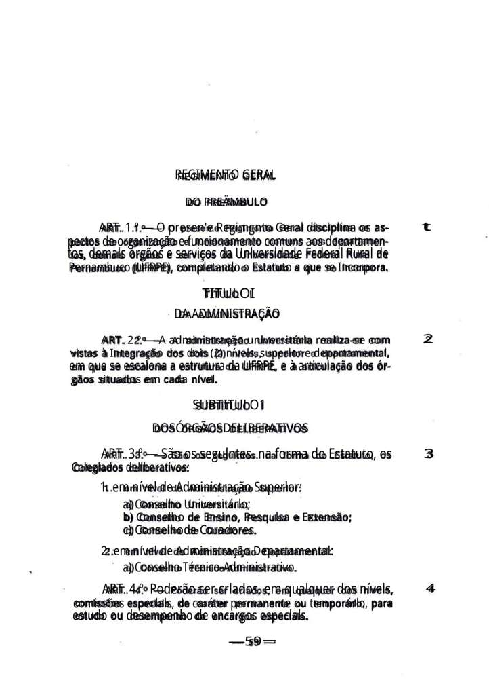

<!-- figure p75-fig1 | described_by: agy | ocr_overlap: 0.73 | needs_review: false -->
### 1. Tipo de figura
Trata-se de uma página digitalizada de documento normativo/institucional em português (página inicial do Regimento Geral da Universidade Federal Rural de Pernambuco — UFRPE). A imagem apresenta uma duplicação visual em todo o texto: sobre a impressão original digitalizada há uma camada visível de texto vetorial/OCR em fonte sem serifa, ligeiramente desalinhada na horizontal e na vertical e contendo pequenos erros tipográficos de reconhecimento óptico.

---

### 2. Todo o texto visível (transcrição literal)

#### Texto principal (camada impressa original, acompanhada da numeração na margem direita)

**Cabeçalhos centrais superiores:**
- `REGIMENTO GERAL`
- `DO PREÂMBULO`

**Artigo 1.º** *(com marcação marginal à direita: `t` — correspondendo visualmente ao dígito `1` distorcido/sobreposto por um `t` minúsculo em negrito)*:
> `ART. 1.º — O presente Regimento Geral disciplina os as-`
> `pectos de organização e funcionamento comuns aos departamen-`
> `tos, demais órgãos e serviços da Universidade Federal Rural de`
> `Pernambuco (UFRPE), completando o Estatuto a que se incorpora.`

**Cabeçalhos centrais do Título I:**
- `TÍTULO I`
- `DA ADMINISTRAÇÃO`

**Artigo 2.º** *(com numeração marginal à direita: `2`)*:
> `ART. 2.º — A administração universitária realiza-se com`
> `vistas à integração dos dois (2) níveis, superior e departamental,`
> `em que se escalona a estrutura da UFRPE, e à articulação dos ór-`
> `gãos situados em cada nível.`

**Cabeçalhos centrais do Subtítulo I:**
- `SUBTÍTULO I`
- `DOS ÓRGÃOS DELIBERATIVOS`

**Artigo 3.º** *(com numeração marginal à direita: `3`)*:
> `ART. 3.º — São os seguintes, na forma do Estatuto, os`
> `Colegiados deliberativos:`
> - `1. em nível de Administração Superior:`
>   - `a) Conselho Universitário;`
>   - `b) Conselho de Ensino, Pesquisa e Extensão;`
>   - `c) Conselho de Curadores.`
> - `2. em nível de Administração Departamental:`
>   - `a) Conselho Técnico-Administrativo.`

**Artigo 4.º** *(com numeração marginal à direita: `4`)*:
> `ART. 4.º — Poderão ser criados, em qualquer dos níveis,`
> `comissões especiais, de caráter permanente ou temporário, para`
> `estudo ou desempenho de encargos especiais.`

**Rodapé central (número da página):**
- `— 59 —`

#### Principais divergências literais visíveis na camada sobreposta (OCR)
Por estar visível sobre a digitalização, a camada superior exibe grafias ligeiramente alteradas em pontos específicos:
- `DO PREÄMBULO` (com dois pontos/trema sobre o `A`).
- Em `ART. 1.º`: `presen'e`, `Regimento` com sobreposição distorcida em `me`, `Unlversidade`, `Incorpora`.
- Na margem direita do Art. 1.º: `t`.
- `TITULOI` (sem acento e sem espaço entre a palavra e o algarismo romano).
- Em `ART. 2.º`: `Integração`, `superlor`.
- `SUBTITULO1` (sem acento, sem espaço e com algarismo arábico `1` no lugar de `I`).
- `DOSÓRGÃOSDELIBERATIVOS` (sem espaços entre as palavras).
- Em `ART. 3.º`: `segulntes.` (com ponto no lugar de vírgula e `l` no lugar de `i`), `dellberativos:`, `1.em nível de Administração Superlor:`, `2.em nível de Administração Departamental:`.
- Em `ART. 4.º`: travessão ausente após `4.º`, `crlados`, `temporárlo`, `especials`.
- No rodapé: `—59=` (com traço duplo/sinal de igual à direita do número).

---

### 3. Estrutura e leiaute
A imagem consiste em uma única página vertical de texto corrido, sem caixas, bordas, tabelas, gráficos, setas ou painéis:
- **Margem superior ampla:** cerca de um quarto superior da página permanece em branco antes do título `REGIMENTO GERAL`.
- **Hierarquia centralizada de títulos e subtítulos:**
  1. `REGIMENTO GERAL` (título principal)
  2. `DO PREÂMBULO` (seção introdutória)
  3. `TÍTULO I` / `DA ADMINISTRAÇÃO` (título e respectiva rubrica, em duas linhas)
  4. `SUBTÍTULO I` / `DOS ÓRGÃOS DELIBERATIVOS` (subtítulo e respectiva rubrica, em duas linhas)
- **Coluna principal de texto:** parágrafos justificados com recuo na primeira linha para cada artigo (`ART. 1.º` a `ART. 4.º`).
- **Lista hierárquica aninhada no Art. 3.º:**
  - Dois itens numerados recuados (`1.` e `2.`), cada qual seguido por alíneas com recuo adicional (`a)`, `b)`, `c)` sob o item `1.`; e `a)` sob o item `2.`).
- **Coluna estreita na margem direita:** alinhada horizontalmente à primeira linha de cada um dos quatro artigos, apresenta a respectiva numeração marginal (`t` [1], `2`, `3`, `4`).
- **Rodapé:** numeração da página (`— 59 —`) centralizada na parte inferior.

---

### 4. Todos os números e valores presentes
- `1.º` — número ordinal do primeiro artigo (`ART. 1.º`).
- `t` (correspondente a `1`) — marcador numérico na margem direita do Art. 1.º.
- `I` — algarismo romano em `TÍTULO I`.
- `2.º` — número ordinal do segundo artigo (`ART. 2.º`).
- `2` — número na margem direita do Art. 2.º.
- `dois (2)` — quantidade de níveis da administração universitária mencionada no texto do Art. 2.º.
- `I` / `1` — algarismo em `SUBTÍTULO I` (aparecendo como `1` na camada sobreposta `SUBTITULO1`).
- `3.º` — número ordinal do terceiro artigo (`ART. 3.º`).
- `3` — número na margem direita do Art. 3.º.
- `1.` — primeiro item da lista de colegiados deliberativos no Art. 3.º.
- `2.` — segundo item da lista de colegiados deliberativos no Art. 3.º.
- `4.º` — número ordinal do quarto artigo (`ART. 4.º`).
- `4` — número na margem direita do Art. 4.º.
- `59` — número da página no rodapé (`— 59 —`).

---

### 5. Cores com significado
A imagem é estritamente monocromática (texto preto e pequenos ruídos/pontos de digitalização pretos sobre fundo branco); as cores não carregam significado informacional.

~~~text ocr
REGIMENTO) GERAL
DO
presere Regimpnto os nm
S comuns
damals Fg e serviços da Unuersidade de
Pernambuco (UFRPE), completando o a que se Incanpora.
ART. 22°—A realiza-se com
vistas à dos diois
em que se escalona a e à dos ór-
gãos em cada nível.
1
sose do os
Colegiados
a)
lb) de Ensino, e Extensão;
@) Conselho di
did
Conselho
440 dos
comissões especiails, de casátier permanente ou temporário, para
estudo ou de encargos especiais.
~~~


<!-- Start of picture text -->
REGIMENTO GERAL<br>DO PREÄMBULO<br>ART. 1.º — O presen'e Regimgnto Geral disciplina os as- t<br>pectos de organização e funcionamento comuns aos departamen-<br>tos, demals órgãos e serviços da Unlversldade Federal Rural de<br>Pernambuco (UFRPE), completando o Estatuto a que se Incorpora.<br>TITULOI<br>DA ADMINISTRAÇÃO<br>ART. 2.º — A administração unlversitárla realiza-se com 2<br>vistas à Integração dos dois (2) nívels, superlor e departamental,<br>em que se escalona a estrutura da UFRPE, e à articulação dos ór-<br>gãos situados em cada nível.<br>SUBTITULO1<br>DOSÓRGÃOSDELIBERATIVOS<br>ART. 3.º — São os segulntes. na forma do Estatuto, os 3<br>Coleglados dellberativos:<br>1. em nível de Administração Superlor:<br>a) Conselho Universitárlo;<br>b) Conselho de Ensino, Pesqulsa e Extensão;<br>c) Conselhode Curadores.<br>2: em nível de Administração Departamental:<br>a) Conselho Técnico-Administrativo.<br>ART. 4.º  Poderão ser crlados, em qualquer dos nívels, 4<br>comissões especlals, de caráter permanente ou temporárlo, para<br>estudo ou desempenho de encargos especlals.<br>—59—<br><!-- End of picture text -->


<!-- page 76 -->

Parágrafo Único — Sem prejuízo de seu funclonamento e atribulções normals. constantes de legislação próprla, a Comlssão Permanente de Tempo Irtegral e Dedicação Excluslva (COPERTIDE poderá desempenhar encargos especlais quę Ihe sejam atribuldos pela Administração Superlor. 


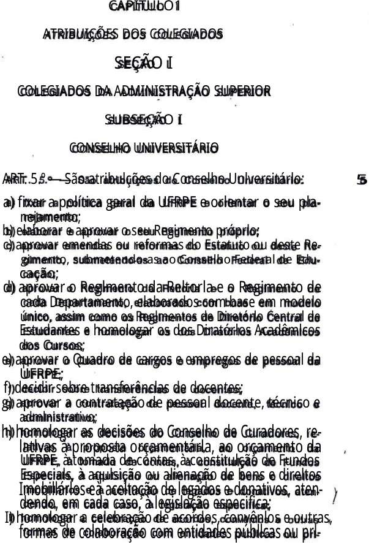

<!-- figure p76-fig1 | described_by: agy | ocr_overlap: 0.78 | needs_review: false -->
1. **Tipo de figura:** Trata-se de um recorte de página de documento textual normativo/regimental digitalizado (em português, referente ao Regimento da UFRPE), apresentando duas camadas de texto sobrepostas e desalinhadas: o texto original impresso escaneado ao fundo e uma camada de texto digital (tipicamente de OCR) visível sobreposta, ligeiramente deslocada para cima e na horizontal, o que gera sobreposição visual em todas as linhas.

2. **Texto visível (verbatim):**

   *Cabeçalhos centralizados (camada impressa original, de cima para baixo):*
   - `CAPÍTULO I` *(na camada sobreposta aparece como `CAPITULO 1`)*
   - `ATRIBUIÇÕES DOS COLEGIADOS`
   - `SEÇÃO I`
   - `COLEGIADOS DA ADMINISTRAÇÃO SUPERIOR`
   - `SUBSEÇÃO I`
   - `CONSELHO UNIVERSITÁRIO`

   *Cabeçalho do artigo e número à direita (mesma linha):*
   - À esquerda: `ART. 5.º — São atribuições do Conselho Universitário:` *(na camada sobreposta: `ART. 5.º — São atribulções do Conselho Unlversitárlo:`)*
   - Na extremidade direita da mesma linha: `5`

   *Lista de alíneas (transcrição linha a linha da camada impressa original, seguida das divergências visíveis na camada sobreposta):*
   - `a) fixar a política geral da UFRPE e orientar o seu pla-`
     `nejamento;`
     *(camada sobreposta: `orlentar`)*
   - `b) elaborar e aprovar o seu Regimento próprio;`
     *(camada sobreposta: `próprlo;`)*
   - `c) aprovar emendas ou reformas do Estatuto ou deste Re-`
     `gimento, submetendo-as ao Conselho Federal de Edu-`
     `cação;`
     *(camada sobreposta: `glmento,`)*
   - `d) aprovar o Regimento da Reitoria e o Regimento de`
     `cada Departamento, elaborados com base em modelo`
     `único, assim como os Regimentos do Diretório Central de`
     `Estudantes e homologar os dos Diretórios Acadêmicos`
     `dos Cursos;`
     *(camada sobreposta: `Reglmento da Reltorla`, `Reglmentos de Dlretórlo Central`, `Dlratórlos Acadêmlcos`)*
   - `e) aprovar o Quadro de cargos e empregos de pessoal da`
     `UFRPE;`
   - `f) decidir sobre transferências de docentes;`
     *(camada sobreposta: `transferênclas`)*
   - `g) aprovar a contratação de pessoal docente, técnico e`
     `administrativo;`
   - `h) homologar as decisões do Conselho de Curadores, re-`
     `lativas à proposta orçamentária, ao orçamento da`
     `UFRPE, à tomada de contas, à constituição de Fundos`
     `Especiais, à aquisição ou alienação de bens e direitos`
     `imobiliários e à aceitação de legados e donativos, aten-`
     `dendo, em cada caso, à legislação específica;`
     *(camada sobreposta: `orçamentárla,`, `Especlals, à aqulsição ou allenação de bens e dlreltos`, `Imoblllárlos eà aceltação`, `especifica;`)*
   - `i) homologar a celebração de acordos, convênios e outras`
     `formas de colaboração com entidades públicas ou pri-`
     *(camada sobreposta: `I) homologar a celebração de acordos, convênlos e outras,`, `públlcas ou prl-`)*

3. **Estrutura:** Não há caixas, setas, diagramas, gráficos, eixos, tabelas ou múltiplos painéis. A página segue um layout de coluna única:
   - Na parte superior, seis linhas de títulos hierárquicos em caixa alta, centralizadas em relação à mancha de texto principal (ligeiramente à esquerda do centro total da imagem devido à margem direita mais larga) e espaçadas verticalmente, organizando a hierarquia em Capítulo (`CAPÍTULO I` / `ATRIBUIÇÕES DOS COLEGIADOS`), Seção (`SEÇÃO I` / `COLEGIADOS DA ADMINISTRAÇÃO SUPERIOR`) e Subseção (`SUBSEÇÃO I` / `CONSELHO UNIVERSITÁRIO`).
   - Abaixo dos títulos, o caput do artigo (`ART. 5.º — ...`) alinhado à esquerda, com o número `5` isolado na margem direita na mesma linha.
   - Em seguida, uma lista vertical de nove alíneas (`a)` a `i)`), com recuo deslocado (pendente): os marcadores de letra ficam alinhados à margem esquerda e as linhas de continuação de cada alínea são recuadas para alinhar com o início do texto da respectiva alínea. A última alínea (`i)`) termina cortada ao final da página na palavra hifenizada `pri-`.
   - Toda a mancha de texto apresenta duplicação por sobreposição entre o escaneamento original (mais escuro e com pequenas manchas/ruídos de digitalização, incluindo um pequeno traço escuro inclinado na margem direita à altura da penúltima linha da alínea `h)`) e a camada de texto sobreposta em fonte sem serifa mais fina, deslocada ligeiramente para cima.

4. **Números e valores de dados:**
   - `I` (em `CAPÍTULO I`; `1` na camada sobreposta)
   - `I` (em `SEÇÃO I`)
   - `I` (em `SUBSEÇÃO I`)
   - `5.º` (em `ART. 5.º`)
   - `5` (isolado na margem direita, na altura da linha de `ART. 5.º`)
   - Não existem outros números, métricas ou valores quantitativos na imagem.

5. **Cores com significado:** Nenhuma. A imagem é monocromática (texto preto e tons de cinza-escuro sobre fundo branco), sem codificação por cor.

~~~text ocr
CAPITUWOO |
ATRIBUIÇÕES DOS CQUEGIADOS
SEÇÃO I
COLEGIADOS DA ADMINISTRAÇÃO SUPERIOR
SUBSEÇÃO I |
CONSELHO
.5
a) apelítica da o seu pla-
é próprio;
ou ato ou deste Re-
ake
d) 6 Regimento de
cada Departamento, eim modelo
único, assim como os Regimentos de Diretório Central de
Estudantes os dos Acadêmicos
dos Curses;
de cargos @ empregos de pessoal da
PE;
de docentes;
a contratação dle pesseal decente, @
as decisões do Ganselho de re-
a à ao da
de bens @
o Ou
em vada }
ale ti
de com ail
5
~~~


<!-- Start of picture text -->
CAPITULO1<br>ATRIBUIÇÕES DOS COLEGIADOS<br>SEÇÃO I<br>COLEGIADOS DA ADMINISTRAÇÃO SUPERIOR<br>SUBSEÇÃO I<br>CONSELHO UNIVERSITÁRIO<br>ART. 5.º — São atribulções do Conselho Unlversitárlo: 5<br>a) fixar a política gəral da UFRPE e orlentar o seu pla-<br>nejamento;<br>b) elaborar e aprovar o seu Regimento próprlo;<br>c) aprovar emendas ou reformas do Estatuto ou deste Re-<br>gimento, submetendo-as ao Conselho Federal de Edu-<br>cação;<br>d) aprovar o Reglmento da Reltorla e o Regimento de<br>cada Departamento, elaborados com base em modelo<br>único, assim como os Reglmentos de Diretórlo Central de<br>Estudantes e homologar os dos Diratórlos Acadêmlcos<br>dos Cursos;<br>e) aprovar o Quadro de cargos e empregos de pessoal da<br>UFRPE;<br>f) decidir sobre transferênclas de docentes;<br>g) aprovar a contratação de pessoal docente, técnico e<br>admlnistrativo;<br>h) homologar as decisões do Conselho de Curadores, re-<br>latlvas à proposta orçamentárla, ao orçamento da<br>UFRPE, à tomada de contas, à constitulção de Fundos<br>Especials, à aqulsição ou alienação de bens e direltos<br>Imobillárlos eà aceltação de legados e donativos, aten-<br>dendo, em cada caso, à legislação especifica;<br>I) homologar a celebração de acordos, convênlos e outras,<br>formas de colaboração com entidades públlcas ou prl-<br><!-- End of picture text -->

—09- 


<!-- page 77 -->

vadas, naclonals, estrangelras ou Internaclonals, nos limites de sua competêncla; 

- j) deliberar sobre a adminis'ração do patrlmônlo e a sia melhor utilização, vlsando atender aos objetivos primordials da Instituição; 

- I) deliberar sobre a aplicação de penalldades,, em grau de recurso ou por Iniclativa próprla; 

- m) autorlzar a concessão de prêmlos, medalhas e títuios honorlflcos; 

- n) homologar a criação, modificação ou exinção de cursos e disciplinas, organização de curriculos, prevlamente aprovados pelo Conselho de Ensino, Pesqulsa e Extensão; 

- o) aprovar, em votação secreta, a escolha dos Pró-Reltores; p) apreclar, dentro de olto (8) . dlas, os vetos do Reltor, só podendo rejeitá-los por dols terços (2/3) de votos dos membros presentes à reunlão, obtidos em escrutitínlo secreto; 

- q) decldir sobre propostas, representações ou Indicações de Interesse da UFRPE; 


- r) deliberar sobre medidas disclplinares de natureza preventiva, corretiva ou represslva que lhe sejam devidamente propostas; 

- s) organlzar, em reunlão conjunta com o Conselho de Ensino, Pesquisa e Extensão e Conselho de Curadores, as lístas sêxtuplas para nomeação do Reltor e do ViceReltor, na forma do artigo 18 do Estatuto; 

- t) dellberar, orlglnarlamente, ou em grau de recurso, sobre matérla omissa ou carente de Interpretação na Leglslação do Ensino. no Estatuto ou neste Regimento Geral. 

#### SUBSEÇÃOII 

CONSELHO DE ENSINO, PESQUISA E EXTENSÃO 

- ART. 6.º — São atribuições do Conselhc de Ensino, Pes- 

- qulsa e Extensão: a) dellberar em nível superlor, sobre as a'lvidades universitárlas de enslno, pesqulsa e extensão; 

G 

-61— 


<!-- page 78 -->

#### b) elaborar e aprovar o próprlo Regimento; 

c) fixar normas complementares às deste Regimento Geral, sobre organlzação, currículos e programas dos cursos de graduação e pós-graduação, bem como sobre o calendárlo escolar, horárlo das disciplinas, matrícula, transferéncla de alunos, verlficação de rendimento escolar, revalidação de diplomas estrangelros, aproveitamento de estudos e outros assuntos pertinentes a sua esfera de competêncla; 

- d) aprovar os planos de novos cursos- de graduação e as modificações dos planos de cursos preexistentes; 

- e) aprovar os prógramas e projetos de pesqulsa elaborados pelos Departamentos; 

- f) aprovar os novos planos ou as alterações de cursos ou serviços. de extensão; 

- g) aprovar a distribulção, entre os Deparlamentos Universitárlos, de cargos e empregos de pessoal docente e seu reglme de trabalho; 

- h) decidir sobre propostas, Indicações ou representações, no âmblto de sua competêncla; 

- I) homologar resullados de concursos ou provas de seleção para docentes aprovados pelo Conselho TécnicoAdministrativo doDepartamento; 

- j) ratificar a Indicação para admissão de docentes aprovados em concursos ou provas de seleção; 

l) aprovar convénlos, acordos e outras formas de colaboração com entidades públlcas ou prlvadas, naclonals,, Internaclonals ou estrangelras, de Interesse do ensino, da pesquisa e da extensão; 

m) exercer atividades de flscallzação, no âmbito de suas atribulções, propondo medidas de natureza preventiva, correllva ou repressiva; 

- n) decldir sobre os recursos contra as decisões dos Coglados de Curso; 

o) deliberar sobre providênclas preventivas, corretivas ou repressivas, contra atos de Indisciplina coletiva do corpo discente; 

p) organlzar, em reunião conjunta com o Conselho Unlversitárlo, as Iistas sêxtuplas para nomeação do Reltor e do Vice-Reltor; 

- q) aprovar o Catálogo da UFRPE; 

- r) dellberar sobre matéria de sua competêncla, não prevista na legislação, no Estatuto ou neste Reglmento Geral. 

-62- 


<!-- page 79 -->

##### SUBSEÇÃO III 

##### CONSELHO DE CURADORES 

- ART. 7.º — São atribulções do Conselho de Curadores: a) eleger anualmente o seu presidente e vlce-presidente, em escrutínlos secretos e unlnominals; 

- b) fiscallzar a execução econômlco-flnancelra da UFRPE; c) elaborar e aprovar o próprlo Regimento; d) aprovar, no âmblto da Unlversidade, as contas relatlvas a cada exercíclo financelro; 

- or orgga o rog or r or da UFRPE; 

- 1) pronunclar-se sobre a alocação de recursos para crlação de cargos e empregos, de provimento efetivo ou em reglme da Legislação do Trabalho; 

- g) autorizar a @estinação de recursos orçamentárlos para concessão de Incentivos funclonals a docentes; 

- h) aprovar a aceitação de legados e donativos, bem como autorlzar convênios e acordos que resultem na utlllzação de recursos não especificados no Orçamento; 

- i) aprovar a crlação de fundos especlals e a reallzação de despesas não previstas no Orçamento, Inclusive a aquisição de bens e direltos Imobillárlos; 

- j) deliberar, orlginarlamente ou em grau de recurso, sobre qualquer outro de sua esfera de competência, não prevista no Estatuto e neste Regimento Geral. 

7 


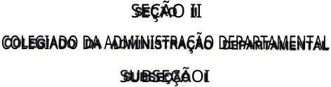

<!-- figure p79-fig1 | described_by: agy | ocr_overlap: 0.75 | needs_review: false -->
1. **Tipo de figura:** Trata-se de um recorte puramente textual contendo um cabeçalho de seção e subseção extraído de um documento (como um regimento ou estatuto), sem elementos gráficos, tabelas ou diagramas. A imagem apresenta o texto duplicado por sobreposição ligeiramente desalinhada de duas camadas (uma camada de fundo mais grossa e ligeiramente menor, com aparência de texto digitalizado, e uma camada frontal em fonte sem serifa mais alta e fina, típica de camada de texto/OCR renderizada sobre a imagem).

2. **Texto visível (verbatim):**
   - Linha 1: `SEÇÃO II`
   - Linha 2: `COLEGIADO DA ADMINISTRAÇÃO DEPARTAMENTAL`
   - Linha 3: `SUBSEÇÃO I` (na camada frontal sobreposta, o espaço antes do `I` é praticamente nulo, aparentando `SUBSEÇÃOI`, enquanto na camada de fundo há espaço visível entre `SUBSEÇÃO` e `I`)

   Não há legendas, rodapés, rótulos de eixos ou outros textos visíveis.

3. **Estrutura:** O conteúdo está organizado em três linhas de texto em letras maiúsculas, centralizadas horizontalmente e empilhadas verticalmente em uma única coluna sobre fundo branco, com espaçamento vertical regular entre elas. Não existem caixas, molduras, setas, linhas, eixos, células ou painéis. Em todas as três linhas, cada palavra aparece duplicada pela sobreposição desalinhada entre a camada de texto frontal (mais estreita no traço e mais alta) e a camada de fundo (mais espessa e ligeiramente deslocada para baixo).

4. **Números e valores de dados:** Os únicos valores numéricos presentes são os algarismos romanos que numeram as divisões do documento:
   - `II` (referente a `SEÇÃO II`)
   - `I` (referente a `SUBSEÇÃO I`)

   Não há outros números, medidas ou valores de dados.

5. **Cores com significado:** Nenhuma cor carrega significado; a imagem é monocromática, composta exclusivamente por texto preto/cinza-escuro sobre fundo branco.

~~~text ocr
SEÇÃO il
COLEGIADO DA ADMINISTRAÇÃO
SUBSEÇÃOL
~~~


<!-- Start of picture text -->
SEÇÃO II<br>COLEGIADO DA ADMINISTRAÇÃO DEPARTAMENTAL<br>SUBSEÇÃOI<br><!-- End of picture text -->

##### CONSELHO TÉCNICO-ADMINISTRATIVO 

ART. 8.º — São atribulções do Conselho Técnlco-Adminlstrativo, como órgão consultivo, normativo e dellberativo de cada Departamento, as seguintes: 


<!-- Start of picture text -->
8<br><!-- End of picture text -->

- a) elaborar o Reglmento do Departamento para ser submetido ao Conselho Universitárlo; 

—63— 


<!-- page 80 -->

- b) aprovar a distribuição das tarefas de ensino, pesqulsa, extensão e outros, entre os docentes que integram as suas áreas de conhecimento, conclllando dentro do possível os Interesses departamentals com as preocupações clentifico-culturals dominantes · dos reféridos docentes; 

- c) aprovar os planos de ensino e a sua Integração nócal  eo en dd leas oaos pronunclamento dos supervisores das áreas de conhecimento a que as mesmas estão vinculadas; 

- d) aprovar, nos líml:es' de sua competêncla, os projetos de pesqulsa ou planos de cursos deespecialização, aper- 

- lo lt o  t especialistas de outro Departamento; 

- e) elaborar o' plano de aplicação de recursos da unldade; f) aprovar as propos:as de alteração do quadro de pessoal docente ou administrativo do Departamen:o, para 

- encaminhamento às autorldades superlores; 

- g) elaborar e aprovar, para o devido e tempestivo encamlnhamento à Pró-Reltoria de Ensino de" Graduação, a lista de disclplinas do Depártamen.o que podem ser oferecidas e minlstradas em cada semestre, com o respectivo número de turmas e de vagas; 

- hne n  o  p o do pessoal docente do Departamento; 

- i) emitir pareceres em assuntos de sua competêncla; I) promover e exercer as atribulções de sua competência. nos concursos para professores e na seleção para auxillares de ensino; 

- I) aprovar a deslgnação dos supervlsores de áreas de conhecimento fel:a pelo Diretor; 

- m) assessorar oDiretor; n) organlzar; em reunião específica, as Ilstas sêxtuplas .para. escolha da nomeação do Dlretor e do Vice-Diretor; 

- o) exercer as demals atribulções que·se Incluam, de manelra expressa ou Implíclta, no âmbito de sua competêncla. CAPÍTULOII 

- FUNCIONAMENTO DOS ÓRGÃOS COLEGIADOS 

ART. 9.º — Os órgãos coleglados, convocados na'forma do 6. art. 10 des.e Regimento Geral, reunlr-se-ão, com a presençada 

—64— 


<!-- page 81 -->

malorla de seus membros,. ordinárla ou extraordinarlamente, ressalvado o disposto no § 4.º do art. 15 do Estatuto. Parágrafo Únlco — A ausêncla de qualsquer represen'antes não Impedirá o funclonamento do coleglado, se estiver presente o quorum exigldo. ART. 10 — As reunlões ordinárlas dos coleglados da Administração Superlor, dos Departamentos e dos Cursos serão reaIlzadas às 17 horas, nos locals próprlos, Independen:es de convocação, de acordo com o seguinte calendárlo: 1— Conselho Universitárlo —primelro(1.º) dla útil de cada mês; I —, Conselho de Ensino, Pesqulsa e Extensão — primelro (1.o) dla útil da segunda (2.a) quinzena de cada mês; IlI — Conselho de Curadores — décimo (10.o) dla útll de cada mês; IV — Camaras do Conselho Universltárlo — 5.º, 6.º e 7.º, dlas útels da segunda (2.a) qulnzena de cada mês; V — Câmaras do Conselho de Enslno, Pesqulsa e Extensão — 5.°, 6.° e 7.° dlas útels de cada mês; VI — Conselho Técnlco-Administrativo  duas vezes por mês em data e hora fixadas semestralmente; Vll — Coleglado de Curso — uma (1) vez por mês, em data e hora escolhldas e fixadas semes:ralmente. 

ART. 11 — Será obrlga:ório, preterindoqualquer outra atlvidade universitárla, o comparecimanto dos membros docentes, mesmo no exercíclo de cargo ou função executiva, às reunlões dos órgãos coleglados e comissões de que façam parte. 

Parágrafo Únlco — As reunlões extraordinárlas dos órgãos coleglados e das comissões especlals devem ser convocadas, de forma a ellminar ou mlnimlzar sua Interferêncla com as atividades docentes normals. ART. 12— O membro de órgão coleglado que, por mo:lvo Justo, não possa comparecer a uma reunlão, deverá comunicá-lo à respectiva secretarla, com antecedêncla mínima de 24 horas para que possa ser convocado o seu suplente. § 1.º — Quando a ausêncla for motivada por emergêncla, surglda nas últimas 24 horas antes da reunlão, poderá ser justificada por escrito. 

10 

11 

12 

—65- 


<!-- page 82 -->

§ 2º — A ausêncla não justificada de docentes ou discentes é passível de punição. ART. 13 — Na falta ou Impedimento do presldente de órgão 13 coleglado a presldêncla será exercida por seu substituto legal e, na fal:a ou Impedimento.deste, pelo membro coleglado mals antigo no magistérlo da Universidade. ART. 14 — As reunlões dos colegiados constarão de: 14 a) leltura, discussão e votação da ata; b) leitura do expediente; c) discussão e votação dos assuntos conslantes da pauta; d) comunicações pessoals. § 1.º— Medlante consulta ao plenárlo, por Inlclativa própria ou a requerimento de membro presente à reunião, o presidente de coleglado poderá modificar a ordem dos trabalhos ao exame e dar preferêncla ou atribulr urgência a determinado assunto. § 2.º — 0reglme de urgêncla exlgirá que, em caso de concessão de vista, se proceda ao exame do processo, no recinto do plenárlo e na própria reunião. ART. 15 — Para cada assunto constante da pauta, have15 rá uma fase de discussão e outra de votação. ART. 16 — As deliberações dos coleglados serão tomadas 16 por malorla de votos dos Conselheiros presentes, a partir do mínimo fixado no art. 9.º deste Regimento. § 1.º —A votação será simbólica, nomlnal ou secreta, adotando-se a primelra forma, sempre que uma das duas outras não seja requerida, nem esteja expressamente prevista. § 2.º — Além do seu voto, o presldente do órgão coleglado terá, também, nos casos de empate, o voto de qualldade. ART. 17 — De cada reunlão de órgão, coleglado lavrar-se-á, 17 em livro próprlo, ata assinada pelo secretário, a qual, depols de lida na reunião segulnte, discutida e aprovada, será subscrita pelo presidente e demals conselhelros presentes. Parágrafo Único — Em casos especlals, a leltura, discussão, aprovação e assinatura da ata poderão ser feitas na próprla reunlão, suspendendo-se os trabalhos pelo tempo necessárlo à lavratura da mesma. —66— 


<!-- page 83 -->

ART. 18— Além de aprovações, autorizações e homologações, que se resolvam em anotações, despachos e comunicações de secretarla, as decisões dos órgãos coleglados poderão revestir a forma de resoluções, a serem balxadas por seus presldentes. 

Parágrafo Único — Os atos referldos nes'e artigo, quando emanados dos coleglados da Administração Superlor, serão encaminhados ao Reltor, Imediatamente após sua aprovação, para os efeltos das medidas previstas no artigo 19 des:e Regimento. ART. 19 — Os atos dos coleglados da Admlnistração Superlor poderão ser vetados pelo Reltor, até cinco (5) dlas depols de sua aprovação. 

#### 18 

#### 19 

Parágrafo Único. — Ultrapassado, na apresentação ao Conselho Universitárlo, o prazo de olto (8) dlas, previsto na alínea p do artigo 5.o, ou quando o veto for rejeltado, ter-se-á por definltivamenie aprovado o ato Impugnado, que será Inedlatamente publlcado para produzir seus efeltos. 

ART. 20 — Da declsão de órgão coleglado departamental ou da Administração Superlor, caberá pedido de reconsideração ao próprlo coleglado, no prazo de clnco (5) dlas, contados de sua dlvulgação e, em úliIma Instâncla, na UFRPE, ao Conselho Unlversltárlo, no prazo de olo (8) dlas, contados da recusa do pedido de reconslderação. 

### 20 

Parágrafo Único — Das declsões do Conselho Unlversitárlo caberá recurso ao Conselho Federal de Educação, nos casos de seleção para preenchimento de cargo ou função de maglstério, por alegação de nulldade e, em todos os casos, por estrita argülção de llegalldade, em prazo nunca superlor a qulnze (15) dias, depols da publicação da decisãorecorrlda. 

ART. 21 — Sem caráter de veto ou recurso, o preslden'e dé coleglado, ou a malorla de seus membros, poderá condicloner a eficácia de uma decisão à ratificação de coleglado Imediatamente superlor. ART. 22 — Os serviços dos Conselhos Técnico-Administratlvos dos Departamentos são aendidos pelas respectivas Secretarlas, enquanto que os dos colegiados da Administração Superlor săo realizados pela Secretarla Geral. Parágrafo Únlco — A Secretarla Geral fará publlcar um boletim semanal, con'endo as resoluções e declsões, eman.do dos coleglados da Admlnistração Superior. 

21 


<!-- Start of picture text -->
22<br><!-- End of picture text -->

—67— 


<!-- page 84 -->


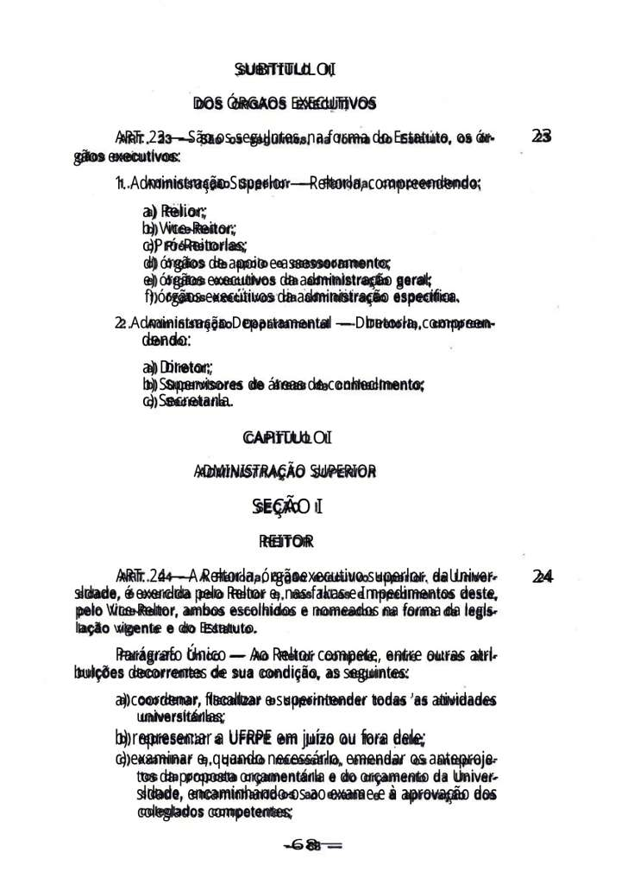

<!-- figure p84-fig1 | described_by: agy | ocr_overlap: 0.83 | needs_review: false -->
1. **Tipo de figura**
Trata-se da página digitalizada de um documento textual normativo/jurídico em português (página 68 de um regimento ou estatuto universitário, referente à UFRPE). Não há gráficos, diagramas, tabelas ou ilustrações. Toda a página apresenta um artefato visual de dupla camada: sobre o texto impresso original digitalizado há uma segunda camada de texto em fonte sem serifa ligeiramente deslocada (efeito de "visão dupla" típico de camada de OCR renderizada de forma visível sobre a imagem), contendo pequenos erros de reconhecimento de caracteres em relação ao impresso subjacente.

2. **Todo o texto visível (verbatim)**

*Cabeçalhos centralizados no topo:*
> SUBTITULO I
> DOS ÓRGÃOS EXECUTIVOS

*(Na camada sobreposta, lê-se sem til: `DOS ÓRGAOS EXECUTIVOS`.)*

*Primeiro bloco normativo (com o número marginal `23` à direita da primeira linha):*
> ART. 23 — São os seguintes, na forma do Estatuto, os ór-
> gãos executivos:
>
> 1. Administração Superior — Reitoria, compreendendo:
> a) Reitor;
> b) Vice-Reitor;
> c) Pró-Reitorias;
> d) órgãos de apoio e assessoramento;
> e) órgãos executivos da administração geral;
> f) órgãos executivos da administração específica.
>
> 2. Administração Departamental — Diretoria, compreen-
> dendo:
> a) Diretor;
> b) Supervisores de áreas de conhecimento;
> c) Secretaria.

*(Discrepâncias claramente visíveis na camada de texto sobreposta desse bloco: `segulntes`, `Superlor`, `Reltorla`, `compreendendo;`, `Pró-Reitorlas`, `especifica.`, `Dlretorla`, `Secretarla.`.)*

*Cabeçalhos centralizados no meio da página:*
> CAPITULO I
> ADMINISTRAÇÃO SUPERIOR
> SEÇÃO I
> REITOR

*Segundo bloco normativo (com o número marginal `24` à direita da primeira linha):*
> ART. 24 — A Reitoria, órgão executivo superior, da Univer-
> sidade, é exercida pelo Reitor e, nas faltas e impedimentos deste,
> pelo Vice-Reitor, ambos escolhidos e nomeados na forma da legis-
> lação vigente e do Estatuto.
>
> Parágrafo Único — Ao Reitor compete, entre outras atri-
> buições decorrentes de sua condição, as seguintes:
>
> a) coordenar, fiscalizar e superintender todas as atividades
> universitárias;
> b) representar a UFRPE em juízo ou fora dele;
> c) examinar e, quando necessário, emendar os anteproje-
> tos da proposta orçamentária e do orçamento da Univer-
> sidade, encaminhando-os ao exame e à aprovação dos
> colegiados competentes;

*(Discrepâncias claramente visíveis na camada de texto sobreposta desse bloco: `Reitorla`, `sldade`, `Impedimentos`, `legls-`, `Reltor`, `ouras`, `atrl-`, `flscallzar`, `'as`, `unlversltárlas;`, `necessárlo`, `orçamentárla`.)*

*Rodapé centralizado:*
> — 68 —

*(O deslocamento vertical da camada sobreposta faz o traço à direita aparecer duplicado como `=`.)*

3. **Estrutura**
A página tem layout de coluna única de texto corrido e listas hierárquicas, sem caixas, bordas, setas, painéis, eixos ou tabelas:
- **Topo:** dois títulos centralizados em letras maiúsculas (`SUBTITULO I` e `DOS ÓRGÃOS EXECUTIVOS`), indicando a divisão superior do documento.
- **Seção do Art. 23:** parágrafo com recuo de primeira linha e texto justificado, acompanhado pelo número `23` isolado na margem direita, alinhado à primeira linha do artigo. Abaixo, uma lista numerada com recuo (`1.` e `2.`), cada qual contendo uma sublista alfabética mais recuada (`a)` a `f)` sob o item `1.`; `a)` a `c)` sob o item `2.`).
- **Divisão intermediária:** quatro títulos centralizados em letras maiúsculas, dispostos verticalmente em ordem hierárquica (`CAPITULO I`, `ADMINISTRAÇÃO SUPERIOR`, `SEÇÃO I`, `REITOR`).
- **Seção do Art. 24:** parágrafo com recuo de primeira linha e texto justificado, acompanhado pelo número `24` isolado na margem direita, alinhado à primeira linha do artigo. Em seguida, o `Parágrafo Único`, também com recuo de primeira linha, introduzindo uma lista alfabética recuada com alíneas `a)`, `b)` e `c)` (a lista termina em ponto e vírgula ao final de `c)`, indicando continuação na página seguinte).
- **Rodapé:** numeração da página centralizada entre travessões (`— 68 —`).

4. **Números e valores de dados**
Não há dados quantitativos, séries numéricas ou medidas; os únicos números presentes são identificadores estruturais e de paginação:
- Algarismos romanos de seção: `I` (em `SUBTITULO I`), `I` (em `CAPITULO I`) e `I` (em `SEÇÃO I`).
- Números de artigos (no corpo do texto e repetidos na margem direita): `23` e `24`.
- Números de itens de lista sob o Art. 23: `1` e `2`.
- Número da página no rodapé: `68`.

5. **Cores**
A imagem é monocromática (texto preto sobre fundo branco); nenhuma cor carrega significado.

~~~text ocr
DOS GRGAOS
ART
gãos executivos:
Chis Cea
e) dim geral;
especifica,
de Chtac
isores de
OL
SUPERIOR
SEÇÃO Il
REITOR
da
é pelo Reitor deste,
pelo ambos escolhidos e nomeados na forma da legis-
lação vigente e dio
Unico — Ao Restair compete, outras
decorrentes de sua condição, as seguintes:
fiscalizar todas ‘as atividades
umiversitáriias;
à UFRPE em juízo ou fora dele;
quando necessário, emendar
e do da Univer-
Saad à aprovação des
colegiados
~~~


<!-- Start of picture text -->
SUBTITULOI<br>DOS ÓRGAOS EXECUTIVOS<br>ART. 23 — São os segulntes, na forma do Estatuto, os ór- 23<br>gãos executivos:<br>1. Administração Superlor — Reltorla, compreendendo:<br>a) Relior;<br>b) Vice-Reitor;<br>c)Pró-Reitorlas;<br>d) órgãos de apoio e assessoramento;<br>e) órgãos executivos da administração geral;<br>f) órgãos execútivos da administração especifica.<br>2. Administração Departamental — Dlretorla, compreen-<br>dendo:<br>a) Diretor;<br>b) Supervisores de áreas de conheclmento;<br>c) Secretarla.<br>CAPITULOI<br>ADMINISTRAÇÃO SUPERIOR<br>SEÇÃO I<br>REITOR<br>ART. 24 — A Reltorla, órgãoexecutivo superlor. daUniver- 24<br>sldade, é exerclda pelo Reltor e, nas fal:as e Impedimentos deste,<br>pelo Vice-Reltor, ambos escolhidos e nomeados na forma da legls-<br>lação vigente e do Estatuto.<br>Parágrafo Único — Ao Reltor compete, entre ouras atrl-<br>bulções decorrentes de sua condição, as seguintes:<br>a) coordenar, flscallzar e superintender todas 'as atividades<br>universitárlas;<br>b) represen:ar a UFRPE em juízo ou fora dele;<br>c) examinar e, quando necessárlo, emendar os anteproje-<br>tos da proposta orçamentárla e do orçamento da Univer-<br>sldade, encaminhando-os ao exame e à aprovação dos<br>coleglados competentes;<br>-68—<br><!-- End of picture text -->


<!-- page 85 -->

- d) administrar as finanças da UFRPE e movimentar as suas con:as bancárlas; 

- e) nomear, contratar, distribulr, remover, · licenciar, afaster temporarlamente, demitir ou dispensar e eposentar servidores da UFRPE, de acordo.com a leglslação vigente; 

- f) balxar as portarias de transferêncla de professores para outras Institulções. de ensino superior mantidas pela União e subscrever as de transferência para a UFRPE; 

- g) exércer o poder discipllnar na Jurisdição de toda a Unlversidade; 

- h) conferlr graus e assinar diplomas, certificados e títulos; l) firmar convênlos e acordos com· enlldades públlcas ou privadas, nacionals, estrangeiras ou internacionals, podendo para tanto delegar poderes, quando necessárlo; 

- j) instituir comissões especlals, de. caráter permanente ou temporárlo, para o estudo de problemas específicos, asslm como a Comissão Parltárla de Acompanhamento do 

###### Processo Eleltoral (CAPE); 

- I) presidir as sessões dos Conselhos Universllárlo e de Ensino; Pesquisa e Extensão e convocar as reuniões extraordInárlas; 

- ma s s  s    a (dna letra anterlor, propondo ou encaminhando os assuntos que devem ser apreclados; 

- n) comparecer, com direito a voz, mas sem direlto a voto,. às reuniões do Conselho de Curadores, estabelecendo em conjunto com o presidente, a oportunidade de convocação e os assuntos prloritárlos; 

- o) vetar deliberações dos Conselhos da Administração Superlor, com as quals não estiver de acordo, submetendo o veto, com as razões que o motivaram, ao exame do Conselho Universitárlo; 

- p) tomar, em casos excepclonals, decisões ad referendum dos coleglados competentes; 

- q) delegar parte de suas atribulções ao Vice-Reltor e aos Pró-Reltores, mediante assentimento do Conselho Universltárlo, podendo revogá-las, total ou parclalmente, quando julgar convenlente; 

- r) balxar resoluções decorrentes de decisões dos ConseIhos Universitárlo e de Ensino, Pesqulsa e Extensão, bem como as portarlas que julgar necessárlas; 

—69— 


<!-- page 86 -->

- s) convocar reunlões conjuntas dos Conselhos Universitárlo, Ensino, Pesqulsa e Extensão e de Curadores, para organização das listas previstas no artigo n.º 18 do Estatuto; 

- t) convocar as elelções para a escolha dos membros do DCE e DAs dos Cursos; 

- u) apresentar ao Conselho Universitário, relatórlo anual das atividades universitárias, no início de cada ano, remetendo cóplas ao Ministérlo da Educação e Cultura e ao Conselho Federal de Educação. 

### SEÇÃO II 

###### VICE-REITOR 

ART. 25 — O Vice-Reltor tem, além da função precípua de substituir o Reitor, em suas faltas e Impedimentos, as segulntes atribulções: 

### 25 

- a) exercer as atividades que Ihe forem delegadas pelo Reitor, de acordo com a letra q do parágrafo único do artigo 24 deste Regimento, especialmente as relacionadas com os Departamen os Administrativos; 

- b) Integrar os coleglados de que fizer parte, como membro nato; 

- c o   s ds  od ddo 

   - Sistema Suplementar; 

- d) cumprir e fazer cumprlr, em toda a Universidade, as disposições do Estatuto, deste Regimento Geral e do Regimento da Reltorla, que se relacionem com a sua área de atuação, bem como as dellberações dos coleglados superlores e as ins:ruções de determinações do Reltor; 

- e) convocar e presidir as elelções previstas no parágrafo 4.º do artigo 11 e no inciso I do artigo 14 do Estatuto; 

- f) convocar e presidir a reunlão conjunta do Conselho Universitário e de Ensino, Pesquisa e Ex.ensão, para escolha da lista de nomes entre os quals será escolhido e nomeado pelo Presldente da República, o novo Reltor, no caso da vacâncla do cargo, dentro do prazo de trinta (30) dias a contar da mesma; 

- g) administrar com plenos poderes a UFRPE, no caso de vacâncla do cargo de Reitor, mantendo-se no exercício desse cargo até a nomeação e posse do novo titular, a quam 

—70- 


<!-- page 87 -->

###### transmitirá o cargo, em solenldade especlalmente convocada para tal fim. 

§ 1.° — 0 Vice-Reltor, exercendo o cargo em regime de quarenta (40) horas semanals, com ou sem dedicação Integral e exclusiva, é dlspensado de suas atividadés didáticas. 

§ 2.° — O Vice-Reltor será substituído em suas faltas e Impedimentos pelo professor-titular, membro do Conselho Universitário, mals antigo no exercíclo do magisério. SEÇÃO III 

PRÓ-REITORIAS 

ART. 26 — Os titulares das Pró-Reltorias, referidos no ar- 

26 

tigo 20 do Estatuto, são escolhidos e 'nomeados pelo Reitor, com o referendo do Conselho Unlversiiário. 

§ 1.º — São atribuições de Pró-Reltor, além de outras decorrentes da próprla condição, as seguintes: 

- a) superintender e coordenar as atividades unlversltárlas, na área respectiva, dentro da competêncla que Ihe for delegada peloReltór; 

- b) comparecer aos coleglados de que fizer parte como membro nato; 

c) cumprir e fazer cumprir as disposlções do Estatuto, deste Regimento Geral e do Regimento da Reltorla, que se relacionem com a sua área de atuação; d) cumprir e fazer cumprir as deliberações dos colegiados superlores e as Instruções ou determinações do Reltor, relaclonadas com a sua área de atuação; e) exercer a coordenação, a distribuição e a fiscallzação operaclonal do pessoal sob sua supervisão; f) apresentar ao Reitor, até o dla 15 de janelro e 15 de julho de cada ano, relatório circunstanciado das ativldades universitárias do semestre anterlor, relativas à sua área específica. 

### SEÇÃO IV 

##### ÓRGÃOS DEAPOIO E ASSESSORAMENTO 

ART. 27 — Súbordinados diretamenteà Reltorla, funcionam entre outros, os seguintes órgãos de apolo e assessoramento: 

27 

—- 


<!-- page 88 -->


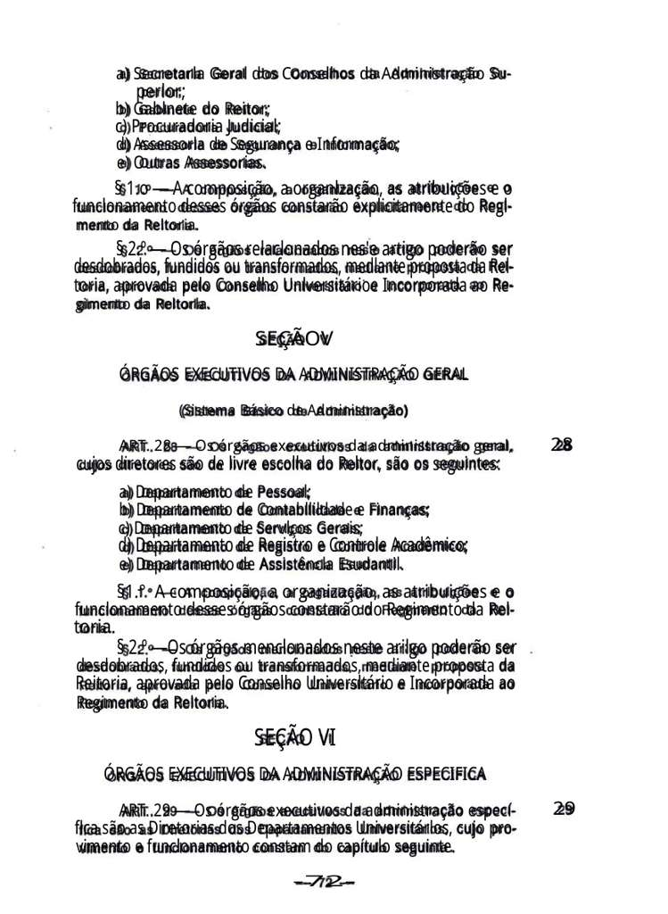

<!-- figure p88-fig1 | described_by: agy | ocr_overlap: 0.73 | needs_review: false -->
### 1. Tipo de figura
Trata-se de uma página digitalizada (em preto e branco) de um documento normativo ou estatutário universitário em língua portuguesa, sem gráficos, tabelas, diagramas ou ilustrações. A imagem apresenta um artefato visual em toda a página: uma camada de texto gerada por OCR (em fonte sem serifa, mais fina) foi renderizada de forma visível e desalinhada diretamente sobre o texto impresso escaneado original (em fonte tipográfica mais escura), gerando um efeito de texto duplicado e parcialmente sobreposto.

---

### 2. Todo o texto visível (transcrição literal)

#### Texto impresso original (camada digitalizada)

```text
        a) Secretaria Geral dos Conselhos da Administração Su-
           perior;
        b) Gabinete do Reitor;
        c) Procuradoria Judicial;
        d) Assessoria de Segurança e Informação;
        e) Outras Assessorias.

        § 1.º — A composição, a organização, as atribuições e o
funcionamento desses órgãos constarão explicitamente do Regi-
mento da Reitoria.

        § 2.º — Os órgãos relacionados neste artigo poderão ser
desdobrados, fundidos ou transformados, mediante proposta da Rei-
toria, aprovada pelo Conselho Universitário e incorporada ao Re-
gimento da Reitoria.

                          SEÇÃO V

          ÓRGÃOS EXECUTIVOS DA ADMINISTRAÇÃO GERAL

              (Sistema Básico de Administração)

        ART. 28 — Os órgãos executivos da administração geral,          28
cujos diretores são de livre escolha do Reitor, são os seguintes:

        a) Departamento de Pessoal;
        b) Departamento de Contabilidade e Finanças;
        c) Departamento de Serviços Gerais;
        d) Departamento de Registro e Controle Acadêmico;
        e) Departamento de Assistência Estudantil.

        § 1.º — A composição, a organização, as atribuições e o
funcionamento desses órgãos constarão do Regimento da Rei-
toria.

        § 2.º — Os órgãos mencionados neste artigo poderão ser
desdobrados, fundidos ou transformados, mediante proposta da
Reitoria, aprovada pelo Conselho Universitário e incorporada ao
Regimento da Reitoria.

                          SEÇÃO VI

        ÓRGÃOS EXECUTIVOS DA ADMINISTRAÇÃO ESPECIFICA

        ART. 29 — Os órgãos executivos da administração especí-         29
fica são as Diretorias dos Departamentos Universitários, cujo pro-
vimento e funcionamento constam do capítulo seguinte.

                          — 12 —
```

#### Divergências literais visíveis na camada de OCR sobreposta
A camada de texto sobreposta repete o conteúdo acima, mas exibe os seguintes erros/variações literais visíveis:
- Alínea `a)` do topo: `Secretarla` e `perlor;` (em vez de `Secretaria` e `perior;`).
- Alínea `b)` do topo: `Reltor;` (em vez de `Reitor;`).
- Alínea `d)` do topo: `Assessorla` (em vez de `Assessoria`).
- `§ 1.º` do topo: `funclonamento`, `Regl-` e `Reltorla.` (em vez de `funcionamento`, `Regi-` e `Reitoria.`).
- `§ 2.º` do topo: `nes'e`, `Rel-`, `Incorporada` e `Reltorla.` (em vez de `neste`, `Rei-`, `incorporada` e `Reitoria.`).
- Título da primeira seção: `SEÇÃOV` (sem espaço entre `SEÇÃO` e `V`).
- `ART. 28`: `Reltor,` (em vez de `Reitor,`).
- Alínea `b)` do Art. 28: `Contabllldade` (em vez de `Contabilidade`).
- Alínea `e)` do Art. 28: `Assistêncla Esudantil.` (em vez de `Assistência Estudantil.`).
- `§ 1.º` do Art. 28: omite o travessão (`§ 1.º A composição...`) e grafa `Rel-` (em vez de `Rei-`).
- `§ 2.º` do Art. 28: `arilgo`, `Incorporada` e `Reltorla.` (em vez de `artigo`, `incorporada` e `Reitoria.`).
- `ART. 29`: `flca` e `Universitárlos,` (em vez de `fica` e `Universitários,`).
- Rodapé: `72` em itálico sobreposto ao `12` (omitindo os travessões laterais).

---

### 3. Estrutura
A figura possui leiaute de página textual em coluna única, sem caixas, setas, eixos, tabelas, linhas divisórias ou painéis:
1. **Bloco superior (continuação de artigo anterior):** lista recuada à esquerda com cinco alíneas (`a)` a `e)`), sendo que a alínea `a)` quebra em duas linhas com recuo pendente; seguida de dois parágrafos justificados com recuo de primeira linha (`§ 1.º` e `§ 2.º`).
2. **Bloco intermediário (`SEÇÃO V`):**
   - Cabeçalho centralizado composto por três linhas separadas por espaço vertical: o identificador da seção (`SEÇÃO V`), o título em caixa alta (`ÓRGÃOS EXECUTIVOS DA ADMINISTRAÇÃO GERAL`) e o subtítulo entre parênteses (`(Sistema Básico de Administração)`).
   - Corpo do `ART. 28` em texto justificado com recuo de primeira linha; na margem direita, alinhado horizontalmente à primeira linha do artigo, figura o número marginal `28`.
   - Lista recuada à esquerda com cinco alíneas (`a)` a `e)`), cada uma ocupando uma linha.
   - Dois parágrafos justificados com recuo de primeira linha (`§ 1.º` e `§ 2.º`).
3. **Bloco inferior (`SEÇÃO VI`):**
   - Cabeçalho centralizado composto por duas linhas: o identificador da seção (`SEÇÃO VI`) e o título em caixa alta (`ÓRGÃOS EXECUTIVOS DA ADMINISTRAÇÃO ESPECIFICA`, sem acento agudo em `ESPECIFICA`).
   - Corpo do `ART. 29` em texto justificado com recuo de primeira linha (três linhas de texto); na margem direita, alinhado horizontalmente à primeira linha do artigo, figura o número marginal `29`.
4. **Rodapé:** numeração de página centralizada (`— 12 —` no original impresso, com `72` sobreposto pela camada de OCR).

---

### 4. Todos os números e valores de dados
Não há dados quantitativos, medições ou estatísticas; todos os numerais visíveis correspondem a numeração estrutural e de página:
- Parágrafos do bloco superior: `1.º` e `2.º`
- Numeração romana de seções: `V` e `VI`
- Numeração do primeiro artigo apresentado: `28` (em `ART. 28` e repetido como número marginal `28` à direita)
- Parágrafos do Art. 28: `1.º` e `2.º`
- Numeração do segundo artigo apresentado: `29` (em `ART. 29` e repetido como número marginal `29` à direita)
- Numeração da página no rodapé: `12` (no texto impresso original) e `72` (na camada de OCR sobreposta)

---

### 5. Cores
A imagem é integralmente em preto e branco (texto preto sobre fundo branco, com discretos pontos de ruído de digitalização). Nenhuma cor é utilizada com valor semântico ou informacional.

~~~text ocr
a) Geral dios COnsellhos din Su-
by ete do Reitor;
@)Precuradonia Judicial;
d) Assessoria de
e) Assessorias.
as o
constarão Regl-
mento da
nesie asti rão ser
toria, aprovada pelo Conselho Universitárioe Incorporatia ao Re-
da Reltoria.
SEGAOV
ÓRGÃOS EXECUTIVOS DA ADMINISTRAÇÃO GERAL
Basico
geral,
cujos diretores são de livre escolha do são os seguintes:
a) Depaitamento die
by de Cantabililtiadee Finanças;
Degantamento die Serulgos
Departamento de Registro e Acadêmico;
e) Departamento de Assistência
A as e o
toria.
neste arilgo poderão ser .
fundidos ou transformados mediante da
Reitoria, pelo e Incorporada ao
Regimento da Reltortia,
SEÇÃO VI
ÓRGÃOS EXECUTIVOS DA ESPECIFICA
.299-— O
as cujo pro-
vimento e funcionamento constam do capítulo
29
~~~


<!-- Start of picture text -->
a) Secretarla Geral dos Conselhos da Administração Su-<br>perlor;<br>b) Gablnete do Reitor;<br>c) Procuradoria Judicial;<br>d) Assessorla de Segurança e Informação;<br>e) Outras Assessorias.<br>§ 1.o — A composição, a organlzação, as atribuições e o<br>funclonamento desses órgãos constarão explicitamente do Regl-<br>mento da Reltoria.<br>§ 2.º — Os órgãos relaclonados nes'e artigo poderão ser<br>desdobrados, fundidos ou transformados, medlante proposta da Rel-<br>toria, aprovada pelo Conselho Unlversitárioe Incorporada ao Re-<br>gimento da Reltorla.<br>SEÇÃOV<br>ÓRGÃOS EXECUTIVOS DA ADMINISTRAÇÃO GERAL<br>(Sistema Básico de Administração)<br>ART. 28 — Os órgãos executivos da administração geral, 28<br>cujos diretores são de livre escolha do Reltor, são os seguintes:<br>a) Departamento de Pessoal;<br>b) Departamento de Contabllildade e Finanças;<br>c) Departamento de Servlços Gerais;<br>d) Departamento de Registro e Controle Acadêmico;<br>e) Departamento de Assistêncla Esudantil.<br>§1.°  A composição, a organização, as atribuições e o<br>funclonamento desses órgãos constarão do Regimento da Rel-<br>toria.<br>§ 2.º —Os órgãos menclonados neste arilgo poderão ser<br>desdobrados, fundidos ou transformados, mediante proposta da<br>Reitoria, aprovada pelo Conselho Universltário e Incorporada ao<br>Regimento da Reltoria.<br>SEÇÃO VI<br>ÓRGÃOS EXECUTIVOS DA ADMINISTRAÇÃO ESPECIFICA<br>ART. 29 — Os órgãos executivos da administração especí- 29<br>flca são as Diretorias dos Departamentos Universitárlos, cujo pro-<br>vimento e funclonamento constam do capítulo seguinte.<br>-72-<br><!-- End of picture text -->


<!-- page 89 -->

##### CAPITULO II 

###### ADMINISTRAÇÃO DEPARTAMENTAL 

#### SEÇÃOI 

###### DIRETORIA 

ART. 30 — Os Diretores dos Departamentos Universitárlos, escolhidos e nomeados na forma do artigo 27 do Estatuto, têm as seguintes atribulções: 

#### 30 

a) adminlstrar e representar o Departamento; 

- b) convocar e presldir as .reunlões do Conselho TécnicoAdministrativo do Departamento; 

- c) cumprir e fazer cumprir as deliberações do Conselho Técnico-Administrativo e dos órgãos deliberativos da Administração Superior, bem como as instruções e determinações do Reitor e dos demals órgãos executivos da esfera administrativa; 

- d) cumprir e fazer cumprir as disposições do Estatuto, deste Regimento Geral e do Regímento do Departamento; 

- e). submeter, na época devida, conforme Instrução dos órgãos superlores, à consideração do Conselho TécnicoAdministrativo, o plano de atividade de cada período letivo, Inclusive a oferta de discipllnas; 

- f) planejar e submeter à aprovação do Conselho TécnicoAdministrativo a distribuição dos encargos de ensino, pesquisa e extensão, respeltando, dentro do possível, as preocupações clentífico-culturals dos docentes; 

- g) dirigir o pessoal técnico a administrativo lotado no Departamento e solicltar as substituições que se fizerem necessárias; 

- h) fiscalizar a observâncla do regime escolar, o cumprìmento dos programas de ensino e a execução dos demals planos de trabalhos; 

- I) fiscalizar a asslduidade dos docentes e do pessoal técnlco e administrativo do Departamento; 

- I) zelar pela ordem no âmbito do Departamento, adotando as medidas necessárlas, Inclusive aplicando as penas disclplinares de sua competêncla e representando ao Reitor, nos demals casos; 

- I) apresentar, no fim de cada período letivo, após aprovação do respectivo Conselho Técnlco-Administrativo, o re- 

-73— 


<!-- page 90 -->

latório das aividades departamentals, sugerindo as providênclas cabíveis para a malor eficlêncla do ensino, da pesqulsa e da extensão; 

- m) adotar, em casos de urgêncla, medidas que se imponham em matéria de competêncla do Conselho TécnicoAdminIstrativo, submetendo-as à ratificação deste, no prazo de cinco (5) dias; 

- n) prorrogar as horas do expedlente, conforme as necessidades do serviço; 

- o) Integrar o Conselho Unlversitário; 

- p) envlar à Reltoria, em tempo hábll, a discriminação da recelta e da despesa do Departamento, como subsídio à elaboração da proposta orçamentárla; 

- q) convocar o Conselho Técnico-Administrativo, em caso de vacâncla do cargo de Vice-Diretor, remetendo de Imediato à Reitoria, a lista sêxtupla de nomes escolhidos pelo Colegiado, em reunlão a realizar-se no máximo trinta (30) dlas após aquela; 

- r) submeter os casos omissos no Regimento do Departamento, ao Conselho Técnico-Administrativo. 

Parágrafo Único — Ao Vice-Diretor do Departamento escoIhido e nomeado na forma do Estatuto e deste Regimento Geral, caberá substituir o Diretor em suas faltas e Impedimentos, podendo encarregar-se de parte das atribuições do Diretor, por delegação do mesmo, aprovada pelo Conselho Técnico-Administrativo. 

### SEÇÃO II 

##### SUPERVISÃO DAS ÁREAS DE CONHECIMENTO 

ART. 31 — São atrlbuições de cada um dos supervlsores das áreas de conhecimento: 

31 

- a) participar, como membro nato, do Conselho TécnicoAdministrativo de seu Departamento; 

- b) coordenar e fiscalizar as atividades dos docentes que Integram a respectiva área de conhecimento, distribuindo com eles as tarefas didáticas, relativas às turmas de alunos Inscritos nas disciplinas; 

- c) supervislonar a elaboração dos planos de ensino das disciplinas, enquadrando-os no calendário escolar aprovado anualmente pelo Conselho de Ensino, Pesquisa e Extensão; 

—44- 


<!-- page 91 -->

d) pronunclar-se sobre a escala anual de férias de seu pessoal, resguardando o andamenlo normal das atlvidades de ensino, pesquisa e extensão da respectiva área; 

e) representar, no Conselho Técnico-Administrativo, os Interesses de sua área de responsabilldade; f) tomar qualsquer outras Iniclailvas de Interesse da área. SEÇÃO III 

SECRETARIA 

ART. 32 — O chefe da Secretaria tem as seguintes atrlbulções: 

32 

a) secretarlar as reunlões do Conselho Técnico-Adminlstivo do Departamento, lavrando as respectivas atas; b) dirigir o pessoal administrativo da Secretarla; c) supervislonar os trabalhos de limpeza e conservação das Instalações do Departamento; d) zelar pela boa ordem da Secretarla, comunicando ao DIretor as anormalldades que possam prejudicá-la; e) exercer outras atividades inerentes à sua condição funclonal. 

Parágrafo Único — O Regimento do Departamento explicltará a organização In'erna da Secretarla, discriminando as atribulções de seus integrantes. 

CAPÍTULO III 


ÓRGÃOS EXECUTIVOS DA ADMINISTRAÇÃO GERAL 

(Órgãos Suplementares) 

ART. 33 — Os órgãos suplementares são administrados por Dire:ores, sem mandato determinado, de livre escolha e nomeação do Reltor. § 1.º — A cada um dos Diretores referidos neste artigo compete: 

a) administrar e representar o órgão; b) elaborar e submeter à aprovação do Rei or. o plano anual de atividades do órgão, bem como projetos Isoados: 

33 

-75- 


<!-- page 92 -->

   - c) zelar pela ordem e eficlêncla dos trabalhos, representando ao Vice-Reltor nos casos de indisciplina que ultrapassem sua competência punitiva; 

   - d).prorrogar o expediente, de modo a atender às necessldades eventuals de serviço; 

   - e) articular-se com os Departamentos Universitários e outros órgãos, cujas atividades sejam suplementadas pelo órgão que dirige; 

   - f) cumprir e fazer cumprir o Regimento do órgão e as disposições estatutárias e regimentos apllcáveis; 

   - g) cumprir e fazer cumprir as Instruções e determinações do Reltor, do Vice-Reltor e do Pró-Reitor a que estiver subordInado; 

   - h) adotar, em casos de urgência, medidas que dependam de aprovação prévia do Reitor, do Vice-Reltor ou do Pró-Reltor competente, submetendo, Imediatamen.e, o ato à ratiflcação; 

   - i) apresentar ao Vice-Reitor, até o dia 15 de janeiro e 15 de julho de caa ano, relatórlo das atividades do Órgão do semestre anterlor; 

- § 2.° — A escolha de Diretores de órgão suplementar de- 

- verá recair em portador de diploma de curso superior, dando-se preferência em área relacionada com as a:lvidades do respectivo órgão. 

ART. 34 — O Colégio de 2.º Grau Dom Agostinho Ikas, além do Diretor, previsto no artigo anterior, tem: 

### 34 

- a) Vice-Diretor; 

- b) Conselho Técnico-Administra:ivo. 

§ 1.º — O Vice-Diretor, escolhido e designado pelo Reltor, substituirá o Diretor em suas faltas e Impedimentos. 

- §.2.º — Com funções delibera:ivas e consultivas o Conse- 

- Iho Técnico-Administrativo é constituído de: 

   - a) Diretor como presldente; 

   - b) Vice-Dlretor como vice-presldente; 

   - c) quatro (4) professores, eleitos por seus pares, sendo dols (2) de cultura geral e dols (2) de cultura técnica, homologados pelo Reitor, com mandato de dcls (2) anos, sem direl.o a recondução; 

-76— 


<!-- page 93 -->

35 

ART. 35 — São atribulções do Conselho Técnlco-Administrativo, além de outras que constem expressaménte do Regimento do Coléglo: 

- a) elaborar o Regimento do Coléglo para ser submeldo à aprovação da Camara de Extensão do Conselho de Ensino e Pesquisa e posterlor homologação do Conselho Universitárlo; 

- b) assessorar o Diretor na elaboração da proposta orçamentárla e dos planos administrativos do Coléglo; 

- c) aprovar os programas de enslno das disclplinas e a distrlbulção das obrigações didáticas entre os professores; 

- d) emitir pronunciamento em processos, que digam respelto ao ensino de 2.º grau; 

- f) assessorar o Diretor, quando solicitado. 

e) aprovar o Regimento do Grêmlo Estudantil do Coléglo; 

ART. 36 — Os Regimentos dos outros órgãos suplementares discrimlnarão a organlzação Interna de todas as suas ativldades. 

36 

#### TITULOII 

DA ORGANIZAÇÃO DIDÁTICO-CIENTIFICA 

CAPÍTULO1 

ENSINO 

### SEÇÃO I 

CURSOS DE GRADUAÇÃO 

ART. 37 — Curso é conjun:o de ativldades pedagóglcas sistematizadas, vlsando a um determinado objetivo de formação acadêmica e/ou habllitação profisslonal. 

37 

§ 1.o — Os cursos de graduação atualmente ministrados pela UFRPE, ou os que venham a ser Implan'ados pela mesma, são classificados para fins pedagógicos e de organização acadêmlca, nas segulntes áreas de conhecimento: 

Area I — Ciênclas Humanas, Letras e Artes; Área Il — Clências Exatas e Tecnologla; Área III — Bloclênclas. 

-77— 


<!-- page 94 -->

§ 2.º — Os cursos de graduação são organlzados de forma a que todos os seus créditos possam ser normalmente obtidos, dentro de um número de períodos letivos previamente estabelecidos, de acordo com a legislação específica. ART. 38 — Os currículos dos cursos de graduação, oferecidos pela UFRPE, cuja discriminação consta do Catálogo Geral da Unilversidade, são constituídos de dols (2) ciclos; 

#### 38 

a) ciclo básico; 

b)ciclo profisslonal. 

§ 1.º — Os ciclos básicos dos cursos terão um currículo nuclear para cada área de conhecimento, constituído de disclpllnas comuns. 

§ 2.º — O Conselho de Ensino, Pesqulsa e Extensão esiabelecerá as normas de integrallzação dos currículos dos cursos de graduação. 

ART. 39 — Cada curso de graduação tem um currículo pleno de acordo com a legislação em vigor e normas baixadas pelos Conselhos Superlores da Universidade, a ser Integralmente cumprido pelo aluno, a fim de que possa qualificar-se para obtenção de grau acadêmico e o exercício da profissão correspondente. SEÇÃO II 

### 39 

CURSOS DE PÓS-GRADUAÇÃO 

ART. 40 — Os cursos de pós-graduação são abertos a candidatos graduados em cursos afins. Parágrafo Único — A admissão aos cursos referidos neste artlgo obedecerá a critérlos estabelecidos nas Normas Gerais de Pós-Graduação da Universidade e no Plano de cada curso. 

ART. 41 — Os cursos de pós-graduação são constituídos de clclos regulares de estudos, Integrados por matérias relativas à respectiva área de concentração e ao domínlo conexo. § 1.o — Como área de concentração entende-se o campo específico de conhecimento que constl.ul o objetivo dos estudos de cada curso, e por domínio conexo, o conjunto de disciplinas não pertencentes àquele campo, mas consideradas necessárlas ou convenlentes para completar a formação do aluno. § 2.º — Os cursos oferecem elenco varlados de disciplinas, para que os candldatos possam exercer opção. 

#### 40 

41 

—- 


<!-- page 95 -->

§ 3.º — A programação dos trabalhos nos cursos caracteriza-se pela flexibilldade, permitindo ao aluno Iiberdade de Iniciativa nos estudos, medlante aconselhamento de docente-orlentador. 

§ 4.º — As atlvidades do curso constam de aulas teóricas e prátlcas, de semlnárlos, de trabalhos de pesquisa, atividade de laboratórloe/ou de campo. 

§ 5.º — A duração dos cursos é a prevista pelo Conselho Federal de Educação, quanto ao mínimo e pelas Normas Gerals de Pós-Graduação e pelo Plano de Curso, quanto ao máximo. 

ART. 42 — As normas gerals de Pós-Graduação e os planos dos cursos de Mesirado fixarão, entre outras, as seguintes exlgênclas para conferlçãc do respectivo grau: 

42 

I — prova de leitura e tradução de textos especlficos, escritos em Idloma esirangelro, previsto no plano do curso; Il— Integralização de, pèlo menos, vinte e quatro (24) créditos em disciplinas de pós-graduação, podendo, quando necessário, serem cursadas disciplinas no nivelamento ou adaptação, sem contar créditos; 

IlI — apresentação de tese, dissertação ou trabalho equlvalente, em que o candidato revele domínlo do tema escolhido, e demonstre capacidade de sis:ematização e de pesquisa blbliográfica; IV — aprovação do trabalho referido no Item anterlor por uma Comissão de três (3) especlallstas, escolhidos pelo Coleglado do Curso. 

Parágrafo Único — A defesa do trabalho menclonado no Inciso Ill deste artigo realizar-se-á em sessão pública. 

ART. 43 — As Normas Gerals de Pós-Graduação e os Planos dos cursos de Doutorado fixarão, entre outras, as segulntes exigênclas para conferição do respectivo grau: 

43 

1 — prova de leltura e tradução de textos específicos escrito em dols (2) Idlomas estrangeiros, previstos no Plano do Curso; I — aprovação em disciplinas de pós-graduação, totallzando no mínimo quarenta e olto (48) crédltos; III — elaboração de tese que constitua contribuição signlficativa para conhecimento do tema escolhido; IV — aprovação na defesa da tese, cl:ada no Item anterlor, por uma Comissão de cinco especlallstas, sendo três 

—- 


<!-- page 96 -->


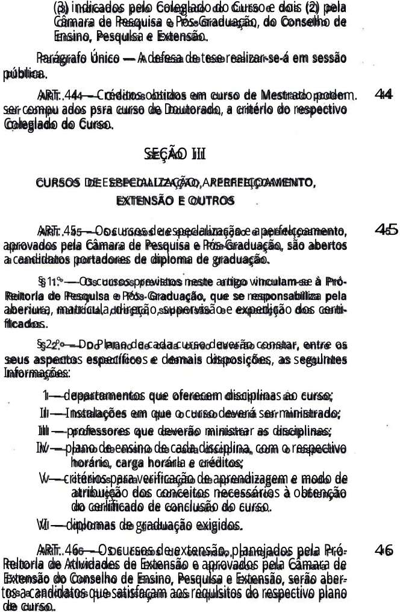

<!-- figure p96-fig1 | described_by: agy | ocr_overlap: 0.78 | needs_review: false -->
### 1. Tipo de figura
Trata-se de uma imagem de texto extraída de uma página digitalizada de um documento normativo ou regimento universitário em língua portuguesa (contendo artigos, parágrafos, incisos e título de seção). A imagem apresenta uma duplicação visual causada pela sobreposição de duas camadas de texto ligeiramente desalinhadas: o texto original impresso/escaneado ao fundo e uma camada de texto digital (proveniente de reconhecimento óptico de caracteres — OCR) renderizada por cima em fonte sem serifa ligeiramente maior, que introduz algumas divergências tipográficas e erros de leitura.

---

### 2. Todo o texto visível (verbatim)

**Texto principal (camada impressa original, acompanhado das marcações da margem direita):**

> (3) indicados pelo Colegiado do Curso e dois (2) pela
> Câmara de Pesquisa e Pós-Graduação, do Conselho de
> Ensino, Pesquisa e Extensão.
>
> Parágrafo Único — A defesa de tese realizar-se-á em sessão
> pública.
>
> ART. 44 — Créditos obtidos em curso de Mestrado podem *(margem direita: 44)*
> ser computados para curso de Doutorado, a critério do respectivo
> Colegiado do Curso.
>
> SEÇÃO III
>
> CURSOS DE ESPECIALIZAÇÃO, APERFEIÇOAMENTO,
> EXTENSÃO E OUTROS
>
> ART. 45 — Os cursos de especialização e aperfeiçoamento, *(margem direita: 45)*
> aprovados pela Câmara de Pesquisa e Pós-Graduação, são abertos
> a candidatos portadores de diploma de graduação.
>
> § 1.º — Os cursos previstos neste artigo vinculam-se à Pró-
> Reitoria de Pesquisa e Pós-Graduação, que se responsabiliza pela
> abertura, matrícula, direção, supervisão e expedição dos certi-
> ficados.
>
> § 2.º — Do Plano de cada curso deverão constar, entre os
> seus aspectos específicos e demais disposições, as seguintes
> informações:
>
> I — departamentos que oferecem disciplinas ao curso;
> II — instalações em que o curso deverá ser ministrado;
> III — professores que deverão ministrar as disciplinas;
> IV — plano de ensino de cada disciplina, com o respectivo
> horário, carga horária e créditos;
> V — critérios para verificação de aprendizagem e modo de
> atribuição dos conceitos necessários à obtenção
> do certificado de conclusão do curso.
> VI — diplomas de graduação exigidos.
>
> ART. 46 — Os cursos de extensão, planejados pela Pró- *(margem direita: 46)*
> Reitoria de Atividades de Extensão e aprovados pela Câmara de
> Extensão do Conselho de Ensino, Pesquisa e Extensão, serão aber-
> tos a candidatos que satisfaçam aos requisitos do respectivo plano
> de curso.

**Divergências visíveis na camada de texto OCR sobreposta:**
- Em `(3) indicados...`: `Coleglado` (em vez de `Colegiado`).
- No `ART. 44`: ponto final extra em `podem.`; `compu ados` (sem o `t`, em vez de `computados`); `psra` (em vez de `para`); `critérlo` (em vez de `critério`); `Coleglado` (em vez de `Colegiado`).
- No `ART. 45`: `especlalização` e `aperfelçoamento` (`l` no lugar de `i`).
- No `§ 1.º`: `Reitorla` (`l` no lugar de `i`) e `aberiura` (em vez de `abertura`).
- No `§ 2.º`: `segulntes` (`l` no lugar de `i`) e `Informações:` (com `I` maiúsculo).
- Nos incisos do `§ 2.º`: `1 —` (algarismo arábico `1` em vez do romano `I`); `Instalações` (com `I` maiúsculo); `horárla` (`l` no lugar de `i`); `cerlificado` (em vez de `certificado`).
- No `ART. 46`: `Reitorla`, `Atlvidades` e `requlsitos` (`l` no lugar de `i`).

---

### 3. Estrutura
Não há caixas, molduras, setas, fluxogramas, eixos, tabelas ou múltiplos painéis. A figura organiza-se como um bloco contínuo de texto legal em coluna principal única, acompanhada de uma coluna estreita na margem direita para referência numérica dos artigos:

- **Bloco superior (continuação de item anterior):** três linhas recuadas à esquerda no mesmo alinhamento do texto dos incisos, sem rótulo inicial visível.
- **Parágrafos e artigos (`Parágrafo Único`, `ART. 44`, `ART. 45`, `§ 1.º`, `§ 2.º`, `ART. 46`):** dispostos verticalmente de cima para baixo, cada um com recuo de primeira linha e demais linhas alinhadas à margem esquerda do bloco principal.
- **Margem direita (números de referência):** os números `44`, `45` e `46` aparecem isolados à direita, alinhados horizontalmente com a primeira linha de `ART. 44`, `ART. 45` e `ART. 46`, respectivamente.
- **Cabeçalho de seção:** entre o `ART. 44` e o `ART. 45`, há maior espaçamento vertical enquadrando o título centralizado `SEÇÃO III` em letras maiúsculas maiores, seguido abaixo pelo subtítulo centralizado em duas linhas e em letras maiúsculas (`CURSOS DE ESPECIALIZAÇÃO, APERFEIÇOAMENTO,` / `EXTENSÃO E OUTROS`).
- **Lista de incisos (`I` a `VI`):** subordinada diretamente ao `§ 2.º` do `ART. 45`, organizada em seis itens verticais recuados à direita em relação à margem esquerda principal, com os algarismos romanos seguidos de travessão (`—`) e recuo deslocado nas linhas de continuação dos incisos `IV` e `V`.
- **Sobreposição de camadas:** cada linha e número marginal apresenta duas renderizações sobrepostas (original impresso e camada OCR), ligeiramente deslocadas entre si tanto horizontal quanto verticalmente.

---

### 4. Todos os números e valores de dados
- `(3)` — número entre parênteses no início da primeira linha (referente a indicados pelo Colegiado do Curso).
- `dois (2)` — número por extenso seguido de algarismo entre parênteses na primeira linha (referente a indicados pela Câmara de Pesquisa e Pós-Graduação).
- `44` — número do artigo (`ART. 44`) e indicador correspondente na margem direita (`44`).
- `III` — algarismo romano identificador da seção (`SEÇÃO III`).
- `45` — número do artigo (`ART. 45`) e indicador correspondente na margem direita (`45`).
- `1.º` — número ordinal do primeiro parágrafo do Art. 45 (`§ 1.º`).
- `2.º` — número ordinal do segundo parágrafo do Art. 45 (`§ 2.º`).
- `I`, `II`, `III`, `IV`, `V`, `VI` — algarismos romanos dos seis incisos do `§ 2.º` do Art. 45 (com `I` grafado como `1` na camada OCR sobreposta).
- `46` — número do artigo (`ART. 46`) e indicador correspondente na margem direita (`46`).

---

### 5. Cores
A imagem é estritamente monocromática (texto preto sobre fundo branco); nenhuma cor é utilizada com valor semântico ou para transmitir informação.

~~~text ocr
pelo Colegiado dais (2) pela
de Resquisa e do Conselho de
Ensino, Pesquisa e Extensão.
Ratágrafo Único — em sessão
em curso de Mestraido
ser Compu ados psra de a critério do respectivo
do
SEÇÃO Hi
CURSOS
EXTENSÃO E
455 a to,
aprovados pela Câmara de Pi Grad
acandidatos portadores de diploma de graduação.
neste à Pró-
Reitoria de e que se pela
dos
entre os
seus e demais disposições, as seguintes
que oferesem ao curse;
em que @ deverá
Ti que deverão nninistear as disciplinas;
IN-—pjano de cam respectivo
horário, carga horánia e créditos;
de aprendizagem e modo de
atribuição dos necessários à
dio de conclusão do curso.
Wi—diplomas de exigidos.
O pela Pró-
Reltorla de de Estensão e pela de
Estensão do Conselho de Ensino, Pesquisa e Extensão, serão aber-
que aos requisitos de respectivo plano
de qurso.
44
46
~~~


<!-- Start of picture text -->
(3) indicados pelo Coleglado do Curso e dois (2) pela<br>Câmara de Pesquisa e Pós-Graduação, do Conselho de<br>Ensino, Pesqulsa e Extensão.<br>Parágrafo Único — A defesa de tese realizar-se-á em sessão<br>pública.<br>ART. 44 — Créditos obtidos em curso de Mestrado podem. 44<br>ser compu ados psra curso de Doutorado, a critérlo do respectivo<br>Coleglado do Curso.<br>SEÇÃO III<br>CURSOS DE ESPECIALIZAÇÃO, APERFEIÇOAMENTO,<br>EXTENSÃO E OUTROS<br>ART. 45 — Os cursos de especlalização e aperfelçoamento, 45<br>aprovados pela Câmara de Pesquisa e Pós-Graduação, são abertos<br>a candidatos portadores de diploma de graduação.<br>§ 1.° — Os cursos previstos neste artigo vinculam-se à Pró-<br>Reitorla de Pesquisa e Pós- Graduação, que se responsabiliza pela<br>aberiura, matrícula, direção, supervisão e expedição dos certi-<br>flcados.<br>§ 2.º — Do Plano de cada curso deverão constar, entre os<br>seus aspectos específicos e demais disposições, as segulntes<br>Informações:<br>1— departamentos que oferecem disciplinas ao curso;<br>Il — Instalações em que o curso deverá ser ministrado;<br>Ill — professores que deverão ministrar as disciplinas;<br>IV — plano de ensino de cada disciplina, com o respectivo<br>horário, carga horárla e créditos;<br>V — critérios para verificação de aprendizagem e modo de<br>atribuição dos conceitos necessários à obtenção<br>do cerlificado de conclusão do curso.<br>VI — diplomas de graduação exigidos.<br>ART. 46 — Os cursos de extensão, planejados pela Pró- 46<br>Reltorla de Atlvidades de Extensão e aprovados pela Câmara de<br>Extensão do Conselho de Ensino, Pesqulsa e Extensão, serão aber-<br>tos a candidatos que satisfaçam aos requlsitos do respectivo plano<br>de curso.<br><!-- End of picture text -->

-08- 


<!-- page 97 -->

Parágrafo Único — Os certificados de conclusão dos cursos previstos neste artigo são concedldos aos alunos que tiverem um mínimo de freqüêncla e de aproveitamento fixado no Plano do Curso. 

ART. 47 — Os cursos de extensão serãoministrados nos "campi" da Universidade e/ou em outros locals, por professores Indicados nos respectivos planos. 

ART. 48 — A Universidade poderá ministrar outras modalidades de cursos que se enquadrem dentro de sua estrutura acadêmica e de sua programação específica, e atendam às peculiarldades do mercado de trabalho regional. 

47 

48 

Parágrafo Único  O. planejamento dos cursos de que trata este artigo, será elaborado pela respeciva Pró-Reltorla e submetido à competente Câmara do Conselho de Ensino, Pesqulsa e Extensão. 

#### SEÇÃO IV 

##### CURSOS DE 2.º GRAU 

ART. 49 — Os cursos de 2.º grau estão aberos a alunos que comprovem haver concluído curso de 1.° grau. 

Parágrafo Único — A parte profissionalizante dos cursos ministrados poderá ser oferecida a alunos de outros estabeleclmentos de ensino de 2.º grau, mediante convênio. ART. 50 — Os cursos de 2.° grau man:ldos pela UFRPE destinam-se principalmente a: 

49 

50 

- 1 — preparação de profisslonals de nível médio na' área das clênclas agrárlas; 

I — trelnamento didático dos alunos dos cursos de licenclatura mantidos pela Universidade. 

ART. 51 — Os cursos previstos nesta Seção serão mlnistrados no Coléglo de 2.° Grau Dom Agostlnho Ikas e em outros cuja criação se torne necessárla. 

51 

Parágrafo Único — A admissão aos cursos previstos neste artigo obedecerá a processo seletivo flxado no Regimento do Coléglo. 

-81— 


<!-- page 98 -->

### SEÇÃOV 

###### COLEGIADOS DE COORDENAÇÃO DIDÁTICA DOS CURSOS 

ART. 52 — Cada curso de graduação ou de pós-graduação é coordenado por um Colegiado de Coordenação Didática, constituído na forma prevista no artigo 54 do Estatuto. 

### 52 

§ 1.º — Os representantes dos Departamentos neste coleglado, indicados pelos Conselhos Técnico-Administrativos, na proporção de um (1) representante para cada cinco (5) ou fração de cinco (5) disciplinas obrigatórlas leclonadas no curso pelo Departamento, são designados pelo Reltor cóm mandato de dols (2) anos. § 2.º — Os componentes das listas tríplices a serem encaminhadas ao Reitor para escolha e designação do Coordenador. e Vice-Coordenador de cada curso, serão eleltos pelos respectivos Colegiados de Coordenação Didática, em votação secreta e uninominal, noventa (90) dlas antes do término do mandato. § 3.º — O Coordenador e o Vice-Coordenador, designados pelo Reitor, terão mandato de dols (2) anos. 

§ 4.º  Os nomes dos representantes dos Departamentos referldos no parágrafo 1.o, serão encaminhados ao Reitor, pelo menos quinze (15) dlas antes do término dos mandatos. 

§ 5.º — A representação estudantil em cada coleglado de Coordenação Didática, será Indicada pelo respectivo DA, na forma da legislação vigente, respeltadas as normas estabelecidas em Resolução do ConselhoUniversltárlo. 

§ 6.º  Os Coordenadores de Curso deverão solicltar aos Departamentos, com a devida antecedência, a Indicação de representantes junto aos respectivosColeglado. ART. 53 — São atribulções dos Colegiados de Coordenação Didática: a) elaborar modificações ao currículo pleno do curso, propondo-as ao Conselho de Ensino, Pesquisa e Extensão; b) propor ao Conselho de Ensino, Pesqulsa e Extensão, o elenco de disciplinas optativas do curso; 

### 53 

c) promoveratravés de propostas devidamente justificadas, ao Conselho de Ensino, Pesqulsa e Extensão, a melhorla contínua do curso; 

-82— 


<!-- page 99 -->

##### d) propor à Câmara competente do Conselho de Ensino, Pesquisa e Extensão, modificações nos planos dos respectivos cursos; 

- e) estudar e anallsar, em cada período letivo, os planos e ensino das disciplinas "do Currículo- Pleno do Curso, flxados pelos respectivos Departamentos, sugerindo a es:es as modificações julgadas necessárlas; 

- f) deliberar acerca do aproveitamento de estudos e adap- 

   - tações, ouvidos os respectivos departamentos; 

- g) eleger as Ilstas tríplilces parà Coordenador e Vice-Coordenador do Curso; 

- h) aprovar o Regimento do Diretórlo Acadêmico do Curso, submetendo-o depois·à homologação do Conselho Unlversitárlo; 

- i) exercer as demals funções que Ihe são, explícita ou Implicitamente, deferldas em lel, no Es:atuto e neste Regimento Geral; 

- j) deliberar sobre os casos omissos na esfera de sua competêncla. 

Parágrafo Únlco — A coordenação didática dos cursos de 2.º grau é exercida pelo Conselho Técnico-Administrativo do respectivo esabelecimento, cuja constituição e atribuições constam, respectivamente, do § 2.º do art. 34 e do art. 35 deste Regimento Geral. 

ART. 54— 0 Coordenador de Curso tem as segulntes atribulções: 

### 54 

a) convocar e presldir as reuniões do respectivo coleglado; b) representar o Coleglado junto aos órgãos deliberativos da Universldade, naforma do Estatu'o e deste Regimento; 

c) submeter ao Coleglado as modificações propostas ao plano ou currículo do curso; 

d) encaminhar expediente e processos aprovados no Cóleglado de Coordenação Didática; 

- e) coordenar e fiscalizar a execução dos planos e a programação do respectivo curso, tomando as medidas adequadas ou propondo-as aos órgãos competentes; 

- f) adotar, em caso de urgêncla, providênclas da competêncla do Coleglado, ad referendum deste, ao qual as submeterá no prazo de 48 (quarenta e ol'o) horas; 

- g) atuar Junto aos departamentos responsávels pelas disciplinas que constituém o currículo pleno, (raçando cóm 

—83— 


<!-- page 100 -->


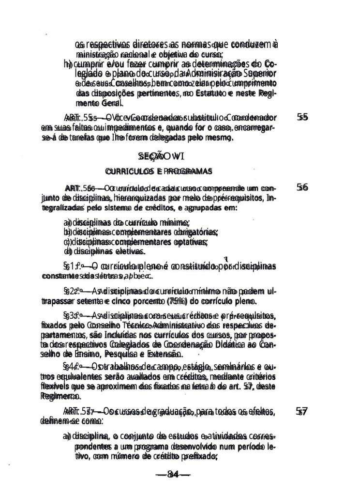

<!-- figure p100-fig1 | described_by: agy | ocr_overlap: 0.7 | needs_review: false -->
### 1. Tipo de figura
Trata-se da imagem digitalizada de uma página inteira de um documento impresso normativo/regimental em português (página 84 de um Regimento Geral universitário), composta exclusivamente por texto corrido estruturado em artigos, parágrafos, alíneas e cabeçalho de seção. A página apresenta um artefato visual de dupla sobreposição de texto em toda a sua extensão: sobre a camada original digitalizada (em fonte serifada) há uma segunda camada visível de texto em fonte sem serifa (típica de camada de OCR renderizada de forma visível e levemente desalinhada), o que gera um efeito de texto duplicado/sombreado ao longo de todas as linhas, além de algumas pequenas marcas de sujeira/poeira de digitalização. Não há gráficos, diagramas, tabelas ou ilustrações.

### 2. Todo o texto visível (transcrição literal)
Abaixo está todo o texto visível da página, na ordem de leitura de cima para baixo, preservando grafias originais (como `CURRICULOS`, `porcento` e `corrículo`), pontuação e quebras de linha com hifenização. Na camada sobreposta em fonte sem serifa, alguns caracteres aparecem levemente deslocados ou com pequenas trocas típicas de OCR (por exemplo, `l` ou `I` no lugar de `i` ou `l`, como `In-` em vez de `in-`, `Ihe` em vez de `lhe`, `melo` em vez de `meio`, `Adminisiraçao` sobre `Administração`, e deslocamento dos dígitos `55`, `56`, `57`, `1.º`, `2.º`, `3.º`, `4.º`), mas o texto original impresso é integralmente legível:

```text
os respectivos diretores as normas que conduzem à
ministração racional e objetiva do curso;
h) cumprir e/ou fazer cumprir as determinações do Co-
legiado e plano de curso, da Administração Superior
e de seus Conselhos, bem como zelar pelo cumprimento
das disposições pertinentes, no Estatuto e neste Regi-
mento Geral.

ART. 55 — O Vice-Coordenador substitui o Coordenador          55
em suas faltas ou impedimentos e, quando for o caso, encarregar-
se-á de tarefas que lhe forem delegadas pelo mesmo.

SEÇÃO VI
CURRICULOS E PROGRAMAS

ART. 56 — O currículo de cada curso compreende um con-        56
junto de disciplinas, hierarquizadas por meio de pré-requisitos, in-
tegralizadas pelo sistema de créditos, e agrupadas em:

a) disciplinas do currículo mínimo;
b) disciplinas complementares obrigatórias;
c) disciplinas complementares optativas;
d) disciplinas eletivas.

§ 1.º — O currículo pleno é constituído por disciplinas
constantes das letras a, b e c.

§ 2.º — As disciplinas do currículo mínimo não podem ul-
trapassar setenta e cinco porcento (75%) do corrículo pleno.

§ 3.º — As disciplinas com seus créditos e pré-requisitos,
fixados pelo Conselho Técnico-Administrativo dos respectivos de-
partamentos, são incluídas nos currículos dos cursos, por propos-
ta dos respectivos Colegiados de Coordenação Didática ao Con-
selho de Ensino, Pesquisa e Extensão.

§ 4.º — Os trabalhos de campo, estágio, seminários e ou-
tros equivalentes serão avaliados em créditos, mediante critérios
flexíveis que se aproximem dos fixados na letra b do art. 57, deste
Regimento.

ART. 57 — Os cursos de graduação, para todos os efeitos,      57
definem-se como:

a) disciplina, o conjunto de estudos e atividades corres-
pondentes a um programa desenvolvido num período le-
tivo, com número de crédito prefixado;

—84—
```

Observações literais adicionais sobre detalhes visíveis no texto:
- Acima da palavra `por`, na primeira linha do `§ 1.º`, há um pequeno algarismo/marca isolado com formato de `1`.
- Na camada original impressa, as letras de remissão `a`, `b`, `c` (em `constantes das letras a, b e c.` no `§ 1.º`) e `b` (em `na letra b do art. 57` no `§ 4.º`) estão em itálico.
- No título `CURRICULOS E PROGRAMAS`, a palavra `CURRICULOS` aparece sem acento agudo.
- No `§ 2.º`, constam literalmente `porcento` (em uma só palavra) e `corrículo` (com a letra `o` em vez de `u`).

### 3. Estrutura e organização espacial
- **Layout geral:** Página vertical em coluna única de texto justificado, sem caixas, bordas, setas, conectores, eixos, painéis ou linhas/colunas de tabela.
- **Topo da página (continuação de alíneas de artigo anterior):** Inicia com duas linhas recuadas (continuação da alínea anterior), seguidas da alínea `h)`, também recuada à esquerda com recuo deslocado para o texto subsequente.
- **Artigos e numeração lateral:** Cada artigo (`ART. 55`, `ART. 56`, `ART. 57`) inicia com recuo de primeira linha seguido de travessão (`—`), com o restante das linhas alinhado à margem esquerda do bloco principal. Na margem direita externa, alinhado horizontalmente à primeira linha de cada artigo, aparece isoladamente o número correspondente (`55`, `56` e `57`).
- **Cabeçalho de seção:** Entre o `ART. 55` e o `ART. 56`, centralizados na largura do bloco principal de texto e separados por espaçamento vertical maior, encontram-se o título `SEÇÃO VI` e, logo abaixo, o subtítulo `CURRICULOS E PROGRAMAS`, ambos em caixa alta.
- **Alíneas:** As alíneas `a)` a `d)` do `ART. 56` e a alínea `a)` do `ART. 57` aparecem em bloco recuado em relação à margem esquerda principal; na alínea `a)` do `ART. 57`, a segunda e a terceira linhas têm recuo adicional alinhado ao início da palavra `disciplina`.
- **Parágrafos:** Os parágrafos `§ 1.º`, `§ 2.º`, `§ 3.º` e `§ 4.º` do `ART. 56` apresentam recuo de primeira linha semelhante ao dos artigos, seguidos de travessão (`—`), com continuação alinhada à margem esquerda principal.
- **Rodapé:** Centralizado na parte inferior da página está o número da página flanqueado por travessões (`—84—`).
- **Sobreposição de camadas:** Em toda a página, a camada de texto sem serifa aparece sobreposta e levemente deslocada em relação à camada serifada original, mantendo a mesma distribuição espacial aproximada de blocos, linhas, margem direita e rodapé.

### 4. Todos os números e valores de dados
- `55` — número do artigo (`ART. 55`) no corpo do texto e repetido isoladamente na margem direita.
- `VI` — algarismo romano da seção (`SEÇÃO VI`).
- `56` — número do artigo (`ART. 56`) no corpo do texto e repetido isoladamente na margem direita.
- `1.º` — número do primeiro parágrafo do art. 56 (`§ 1.º`).
- `1` — pequena marca/algarismo avulso posicionado acima da palavra `por` no `§ 1.º`.
- `2.º` — número do segundo parágrafo do art. 56 (`§ 2.º`).
- `setenta e cinco porcento (75%)` — limite máximo de disciplinas do currículo mínimo em relação ao currículo pleno (`75%`).
- `3.º` — número do terceiro parágrafo do art. 56 (`§ 3.º`).
- `4.º` — número do quarto parágrafo do art. 56 (`§ 4.º`).
- `57` — número referenciado no `§ 4.º` (`art. 57`), número do artigo seguinte (`ART. 57`) no corpo do texto e repetido isoladamente na margem direita.
- `84` — número da página no rodapé (`—84—`).

### 5. Cores com significado
A imagem é monocromática (texto preto sobre fundo branco); nenhuma cor carrega significado informacional ou semântico.

~~~text ocr
as respectivas diretoses as conduzem à
ministração e do curso;
h) e/ou fazer as determimações do Co-
e plano Saperior
dias pertimentes, mo e meste Regl-
mento Geral.
55-—O s o dC
em faltas oruimpedimentos e, quando for o caso,
se-á de tanefas que Ile forem pelo mesmo.
SEÇÃO WI
CURRICULOS E
wim con-
junto de disciplinas, hieranquizadas por melo de ppésrequisitos, lin-
tegralizadas pelo sistema de créditos, e agrupadas em:
a) do mínimo;
optativas;
dy eletivas.
1
apboecc.
não podem ul-
tirapassar setenta e cinco porcento (75%) do corrículo pleno.
fixados pelo alas respeciuas de-
partamentos, são nos currículos dos cursos, por
ta dos de Didática ao Con-
de Ensino, Pesquilsa e
ob e ou-
tros lentes serão em mediante critérios
flexivels que se aproximem dos ma b do art. 57, deste
tades os
definem-se come:
disciplina, o de estudos
pondentes a um programa desenvolvido num períodio le-
tivo, cam múmero de
—34—
56
37
~~~


<!-- Start of picture text -->
os respectivos diretores as normas que conduzem à<br>ministração raclonal e objetiva do curso;<br>h) cumprir e/ou fazer cumprir as determinações do Co-<br>leglado e plano do curso, da Adminisiração Superior<br>e de seus Conselhos, bem como zelar pelo cumprimento<br>das disposições pertinentes, no Estatuto e neste Regi-<br>mento Geral.<br>ART. 55 — OVlce-Coordenador substitul o Coordenador 55<br>em suas faltas ou impedimentos e, quando for o caso, encarregar-<br>se-á de tarefas que Ihe forem delegadas pelo mesmo.<br>SEÇÃO VI<br>CURRICULOS E PROGRAMAS<br>ART. 56 — O currículo de cada curso compreende um con- 56<br>junto de disciplinas, hierarquizadas por melo de pré-requisitos, In-<br>tegralizadas pelo sistema de créditos, e agrupadas em:<br>a) disciplinas do currículo mínimo;<br>b) disciplinas complementares obrigatórias;<br>c) disciplinas complementares optativas;<br>d) disciplinas eletivas.<br>1<br>§ 1.º —O currículo pleno é constituído por disciplinas<br>constantes das letras a, b e c.<br>§ 2.º — As disciplinas do currículo mínlmo não podem ul-<br>trapassar setenta e cinco porcento (75%) do corrículo pleno.<br>§ 3.º — As disciplinas com seus créditos e pré-requlsitos,<br>fixados pelo Conselho Técnlco-Administrativo dos respec:lvos de-<br>partamen:os, são Incluídas nos currículos dos cursos, por propos-<br>ta dos respectivos Coleglados de Coordenação Dldática ao Con-<br>selho de Ensino, Pesqulsa e Extensão.<br>§ 4.º — Os trabalhos de campo, estáglo, semlnárlos e ou-<br>tros equlvalentes serão avallados em créditos, medlante critérios<br>flexívels que se aproximem dos fixados na letra b do art. 57, deste<br>Reglmen:o.<br>ART. 57 — Os cursos de graduação, para todos os efeltos, 57<br>definem-se como:<br>a) disciplina, o conjunto de estudos e atividades corres-<br>pondentes a um programa desenvolvido num período le-<br>tivo, com número de crédito prefixado;<br>—84—<br><!-- End of picture text -->


<!-- page 101 -->

- b) crédito, cada quinze (15) horas de trabalho expositivo, ou trinta (30) horas ou mals de outra natureza; 

- c) pré-requisito, a disciplina cujo es:udo, com o devido 

   - aproveltamento e a necessárla freqüêncla, é exigido para a matrícula em nova disciplina; 

- d) disclplinas do currículo mínimo, as relativas às matérias fixadas pelo Conselho Federal de Educação; 

- e) disclplinas complementares obrigatórias, as que sem constarem do currículo mínimo do curso, são consideradas pela UFRPE Indispensávels à formação profisslonal, a que o curso se destina; 

f) disciplinas complementares optatlvas, as que, escolhldas pelo estudante dentro da relação aprovada pelo Conselho de Ensino, Pesqulsa e Extensão, nos termos da letra c do art. 50, complementem a formação profisslonal, numa determinada área ou sub-área de conheclmento e perfazendo um número mínimo de créditos, permita ao aluno Iniclar-se numa dilversificação do curso; 

- g) disciplinas ele:Ivas, as que, não fazendo parte do currículo pleno do curso, podem ser cursadas em caráter suplementar, pelos Interessados, uma por período letlvo regular e escolhldas dentre as demals oferecidas pelos departamentos. 

Parágrafo Único — As disciplinas constantes das alíneas d e e serão ministradas nos períodos regulares de atividades escolares. 

ART. 58 — Os currículos e os créditos dos cursos de pósgraduação constarão dos respectivos planos. 

ART. 59 — As Ilstas de disclpllnas de graduação, ofertadas pelos departamentos, devem apresentar além da súmula, o nome de cada uma delas vinculado a um código que sintetize as suas características próprias, Inclusive a carga horária e o número de créditos. 

58 

59 

§ 1.º — Os códigos previstos neste artigo obedecerão a sistema elaborado pela Pró-Reltorla competente, aprovado pela Câmara respectiva do Conselho de Enslno, Pesqulsa e Extensão. § 2.º — Nas Iistas currlculares dos Cursos, as disclplinas serão apresentadas por seus nomes e códlgos. 

ART. 60 — Os cursos de cur'a duração que venham a ser 

60 

—85— 


<!-- page 102 -->


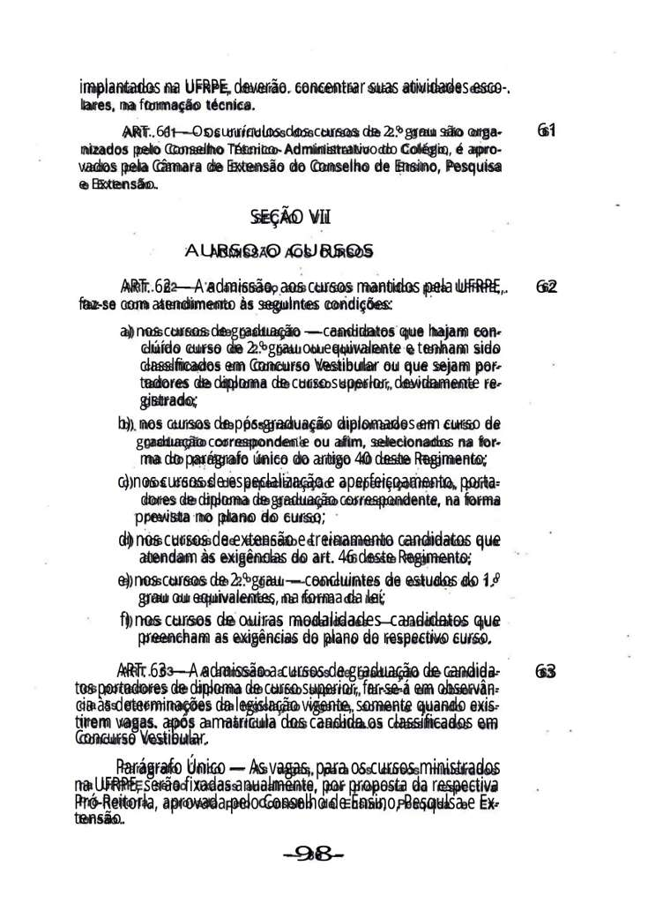

<!-- figure p102-fig1 | described_by: agy | ocr_overlap: 0.82 | needs_review: false -->
### 1. Tipo de figura
Trata-se de uma página digitalizada de um documento normativo impresso (um Regimento da UFRPE — Universidade Federal Rural de Pernambuco), extraída de um PDF em que uma camada digital de texto gerado por reconhecimento óptico de caracteres (OCR), em fonte sem serifa, aparece renderizada de forma visível e levemente deslocada sobre o texto original digitalizado, causando efeito de duplicação/sobreposição em toda a página e expondo alguns erros de reconhecimento na camada superior. Não há gráficos, ilustrações, tabelas nem diagramas.

### 2. Todo o texto visível (transcrição literal)

#### Corpo principal (texto impresso digitalizado, acompanhado das divergências visíveis na camada sobreposta de OCR)

Continuação de parágrafo no topo da página:
> implantados na UFRPE, deverão concentrar suas atividades esco-
> lares, na formação técnica.
*(Na camada sobreposta: `implantados na UFRPE, deverão. concentrar suas atividades esco-.` / `lares, na formação técnica.`)*

Artigo 61 (com o número `61` repetido na margem direita, na altura da primeira linha):
> ART. 61 — Os currículos dos cursos de 2.º grau são orga-
> nizados pelo Conselho Técnico-Administrativo do Colégio, e apro-
> vados pela Câmara de Extensão do Conselho de Ensino, Pesquisa
> e Extensão.
*(Margem direita: `61`. Na camada sobreposta: `Técnico- Administrativo` e `é apro-`.)*

Título de seção centralizado:
> SEÇÃO VII
> ADMISSÃO AOS CURSOS
*(Na camada sobreposta, sobre `ADMISSÃO AOS CURSOS`, lê-se o texto distorcido `AURSO O CURSOS`.)*

Artigo 62 (com o número `62` repetido na margem direita, na altura da primeira linha):
> ART. 62 — A admissão aos cursos mantidos pela UFRPE,
> faz-se com atendimento às seguintes condições:
*(Margem direita: `62`. Na camada sobreposta: `A admissão, aos cursos mantidos pela UFRPE,.`)*

Alíneas do Art. 62:
> a) nos cursos de graduação — candidatos que hajam con-
> cluído curso de 2.º grau ou equivalente e tenham sido
> classificados em Concurso Vestibular ou que sejam por-
> tadores de diploma de curso superior, devidamente re-
> gistrado;

> b) nos cursos de pós-graduação diplomados em curso de
> graduação correspondente ou afim, selecionados na for-
> ma do parágrafo único do artigo 40 deste Regimento;
*(Na camada sobreposta: `corresponden'e`.)*

> c) nos cursos de especialização e aperfeiçoamento, porta-
> dores de diploma de graduação correspondente, na forma
> prevista no plano do curso;
*(Na camada sobreposta: `especlalização`.)*

> d) nos cursos de extensão e treinamento candidatos que
> atendam às exigências do art. 46 deste Regimento;
*(Na camada sobreposta: `exigênclas`.)*

> e) nos cursos de 2.º grau — concluintes de estudos do 1.º
> grau ou equivalentes, na forma da lei;

> f) nos cursos de outras modalidades — candidatos que
> preencham as exigências do plano do respectivo curso.
*(Na camada sobreposta: `ouiras`.)*

Artigo 63 (com o número `63` repetido na margem direita, na altura da primeira linha):
> ART. 63 — A admissão a cursos de graduação de candida-
> tos portadores de diploma de curso superior, far-se-á em observân-
> cia às determinações da legislação vigente, somente quando exis-
> tirem vagas, após a matrícula dos candidatos classificados em
> Concurso Vestibular.
*(Margem direita: `63`. Na camada sobreposta: `candida os`.)*

Parágrafo Único:
> Parágrafo Único — As vagas, para os cursos ministrados
> na UFRPE, serão fixadas anualmente, por proposta da respectiva
> Pró-Reitoria, aprovada pelo Conselho de Ensino, Pesquisa e Ex-
> tensão.
*(Na camada sobreposta: `Pró-Reitorla`.)*

Rodapé centralizado (numeração de página):
> —98—
*(Na camada digitalizada subjacente, os dígitos entre os traços estão parcialmente encobertos pelo texto sobreposto `98`: `—[illegible]—`.)*

### 3. Estrutura e organização visual
- **Layout geral**: página vertical de coluna única de texto corrido justificado, com margens brancas amplas e pequenos pontos escuros de ruído típicos de digitalização. Não há quadros, caixas, setas, eixos, tabelas ou painéis.
- **Hierarquia dos blocos (de cima para baixo)**:
  1. Duas linhas finais de um parágrafo iniciado na página anterior, alinhadas à margem esquerda.
  2. Bloco do `ART. 61`, com recuo na primeira linha e o marcador numérico `61` isolado na margem direita, alinhado à primeira linha do artigo.
  3. Cabeçalho centralizado em duas linhas em caixa alta (`SEÇÃO VII` acima de `ADMISSÃO AOS CURSOS`, este último sobreposto por `AURSO O CURSOS`).
  4. Bloco introdutório do `ART. 62`, com recuo na primeira linha e o marcador `62` isolado na margem direita.
  5. Lista subordinada ao `ART. 62`, composta por seis itens identificados por letras minúsculas com parêntese de fechamento (`a)` a `f)`), posicionados com recuo à esquerda e recuo deslocado (as linhas de continuação de cada item alinham-se à direita do marcador alfabético).
  6. Bloco do `ART. 63`, com recuo na primeira linha e o marcador `63` isolado na margem direita.
  7. Bloco do `Parágrafo Único`, subordinado ao `ART. 63`, com recuo na primeira linha.
  8. Numeração de página centralizada na parte inferior (`—98—`).
- **Sobreposição de camadas**: em toda a página, cada linha do texto impresso digitalizado (em tons de cinza/preto ligeiramente granulados) é sobreposta por uma linha correspondente em fonte vetorial sem serifa preta, deslocada alguns pixels para cima e horizontalmente.

### 4. Todos os números e valores
- `61` — número do artigo (`ART. 61`) e marcador correspondente na margem direita.
- `2.º` — nível de ensino (`2.º grau`), ocorrendo três vezes: no `ART. 61`, na alínea `a)` do `ART. 62` e na alínea `e)` do `ART. 62`.
- `VII` — algarismo romano da seção (`SEÇÃO VII`).
- `62` — número do artigo (`ART. 62`) e marcador correspondente na margem direita.
- `40` — referência cruzada (`artigo 40 deste Regimento`), na alínea `b)` do `ART. 62`.
- `46` — referência cruzada (`art. 46 deste Regimento`), na alínea `d)` do `ART. 62`.
- `1.º` — nível de ensino (`1.º grau`), na alínea `e)` do `ART. 62`.
- `63` — número do artigo (`ART. 63`) e marcador correspondente na margem direita.
- `98` — número de página na camada sobreposta do rodapé (`—98—`); os dígitos subjacentes na imagem digitalizada estão parcialmente obstruídos (`[illegible]`).

### 5. Cores
A imagem é estritamente monocromática (texto em preto e cinza-escuro sobre fundo branco); nenhuma cor carrega significado.

~~~text ocr
na UFRPE, deverão. atividades
lares, ma técnica.
22% são
mizados pelo Colégim, é
vados pela Câmara de Extensão do Canselho de Ensino, Pesquisa
e Extensão.
SEÇÃO Vil
205 cursos mantidos pala
faz-se com às seguintes condições:
que hajam con-
curso de tenham sido
em Comcurse Vestibular ou que sejam por-
tadores die de devidamente re-
gistrado;
nes am curso de
ou afim, na for-
ma do único do 40 deste Regimento;
posta:
dores de di de graduação na forma
prexista mo plano do curso; -
d) nes candidatos —
atendam às do art. Regimento;
de de do 1.º
Gui equivalentes, ira la kat
cursos de ouiras modalidades candidatos que
preencham as exigências do plano de respectivo curso,
683—A de candida-
tes portadores de diplema de em
cimassdetesminações somente quandio exis-
tirem vagas. após dos Candida as classificadas em
(concurso
Ranágrafo Único — As vagas, pasa
por proposta da respectiva
na
Pró Ex-
61
62
~~~


<!-- Start of picture text -->
implantados na UFRPE, deverão. concentrar suas atividades esco-.<br>lares, na formação técnica.<br>ART. 61— Os currículos dos cursos de 2.º grau são orga- 61<br>nizados pelo Conselho Técnico- Administrativo do Colégio, é apro-<br>vados pela Câmara de Extensão do Conselho de Ensino, Pesquisa<br>e Extensão.<br>SEÇÃO VII<br>AURSO O CURSOS<br>ART. 62 — A admissão, aos cursos mantidos pela UFRPE,. 62<br>faz-se com atendimento às segulntes condições:<br>a) nos cursos de graduação — candidatos que hajam con-<br>clúído curso de 2.º grau ou equivalente e tenham sido<br>classlficados em Concurso Vestibular ou que sejam por-<br>tadores de diploma de curso superlor, devidamente re-<br>gistrado;<br>b). nos cursos de pós-graduação diplomados em curso de<br>graduação corresponden'e ou afim, selecionados na for-<br>ma do parágrafo único do artigo 40 deste Regimento;<br>c) nos cursos de especlalização e aperfeiçoamento, porta-<br>dores de diploma de graduação correspondente, na forma<br>prevista no plano do curso;<br>d) nos cursos de extensão e treinamento candidatos que<br>atendam às exigênclas do art. 46 deste Regimento;<br>e) nos cursos de 2.º grau — concluintes de estudos do 1.º<br>grau ou equivalentes, na forma da leí;<br>f) nos cursos de ouiras modalidades  candidatos que<br>preencham as exigências do plano do respectivo curso.<br>ART. 63 — A admissão a cursos de graduação de candida- 63<br>tos portadores de diploma de curso superior, far-se-á em observân-<br>cia às determinações da legislação vigente, somente quando exis-<br>tirem vagas. após a matrícula dos candida.os classificados em<br>Concurso Vestibular.<br>Parágrafo Único — As vagas, para os cursos ministrados<br>na UFRPE, serão fixadas anualmente, por proposta da respectiva<br>Pró-Reitorla, aprovada pelo Conselho de Ensino, Pesqulsa e Ex-<br>tensão.<br>-98-<br><!-- End of picture text -->


<!-- page 103 -->

### SEÇÃO VIII 

##### MATRICULA 

ART. 64 — As matrículas nos cursos serão efetuadas no Departamento de Registro e Controle Acadêmico, excetuadas as dos cursos de 2.º grau. 

### 64 

§ 1.° — Nos cursos de graduação, a matrícula -vincula o aluno à Universidade, devendo cada In:eressado requerê-la, em formulárlo próprlo, ao DRCA, para cada período letivo regular, segundo normas expedldas pelo Conselho de Ensino, Pesquisa e Extensão. 

§ 2.º — Elaborado o plano de estudo, com o aconselhamento do professor orientador, do qual constam as disciplinas escoIhidas, o aluno realiza, nos Departamentos, a sua Inscrição nas disciplinas que val cursar, e em segulda requer sua matrícula no Departamento de Reglstro e Controle Acadêmico. 

§ 3.º — Na Inscrição das disciplinas com período de execução fixado no Calendárlo Escolar e publicado em édital na Imprensa local, pela Pró-Reltorla de Ensino de Graduação, devem ser observados os pré-requisitos referldos na alínea c do art. 57 deste Reglmento. 

§4.° — Exce:uados os casos especlals autorizados pelo Conselho de Ensino, Pesquisa e Extensão, não será permitido ao aluno regular inscrever-se em mais de .olto (8) ou em menos de três (3) disciplinas, no mesmo período letivo regular, nem em mals de três (3) disclplinas, no período especlal Intensivo de atividadesescolares. 

§ 5.º — Para cada período letlvo, as disciplinas serão oferecidas para Inscrição, pelos Departamentos, cabendo ao professor orientador e ao coordenador de cada curso o aconselhamento dos alunos sobre.as respectivas escolhas, obedecidas as normas de Integralizaçãocurrlcular. 

§ 6.º  Se o aluno, ao se matricular, já tenclona requerer o trancamento de sua matrícula nos termos da alínea a do parágrafo 7.º deste ariigo, fica dispensada sua Inscrição em discipllnas, devendo requerer a matrícula e o respectivo trancamento slmultaneamente. 

§ 7.° — O trancamento de matrícula poderá ser requerido no prazo legal, fíxado pelo Calendário Escolar, quando o aluno: 

—87— 


<!-- page 104 -->

##### a) após requerer sua matrícula, não desejar se Inscrever em disciplinas; 

b) depols de matriculado e Inscrito em disciplinas, não desejar mals cursá-la naquele período letivo. 

§ 8.º — Os trancamentos de matrícula a que se rèfere este artigo não serão permitidos em mals de dols (2) semestres consecutlvos. 

ART. 65 — O cancelamento de Inscrição em uma ou mals disciplinas, poderá ser requerido pelo aluno que já tenha nela sido inscrito, obedecido o prazo estabelecido pelo Calendário Escolar e respeltado o disposto no § 4.º do artigo 64, deste Regimento. 

ART.66 — A URFPE cobrará taxas de matrícula ou de Inscrição em disciplina, bem como de trancamento de matrícula ou de cancelamento de inscrição em cada disciplina. Parágrafo Único — O Conselho de Curadores poderá estabelecer critério para cobrança de taxa especial, progressiva, em função do número de repetição de inscrição em disciplina, bem como premlar os discentes que tenham apresentado bom rendimento escolar. 

ART. 67 — Perderá o direito a matrícula o aluno que: a) não renovar sua matrícula em cada período letivo regular, nos prazos flxados em edital; b) não proceder à Inscrição em disciplinas no Departamento de Registro e Controle Acadêmico, no prazo fixado pelo Calendário Escolar, salvo se requerer o trancamento de matrícula referido no art. 64, deste Reglmento. 

### 65 

### 66 

### 67 

c) tiver sido ejetado, de acordo com a leglslação em vigor. 

ART. 68 — A Inscrição nos Cursos de Especlallzação, Aperfelçoamen!o e Extensão é felta de modo global, no total de discipllnas que os constituem, de acordo com as exigênclas do plano de cada curso. 

Parágrafo Únlco — Nos cursos de outras modalldades, que venham a ser Implantadas, a Inscrição ou matrícula será na forma estabeleclda no respectivo plano. ART. 69 — A matrícula nos cursos de 2.º grau será feita no Colégio Dom Agostinho Ikas, ou outro estabelecimento do 

### 68 

69 

—88— 


<!-- page 105 -->

mesmo grau que se venha a instalar, de acordo com normas a serem baixadas pela direção do Coléglo. 

ART. 70 — Para complementação ou atualização de conhecimento, será permitida a .matrícula em disclplinas Isoladas, sem exigêncla de classificação em Concurso Vestibular, a cándidatos que sejam portadores dos pré-requlsitos a critérlo do Departamento, considerando-se os que assim se matricularem, como alunos. especlals. 

### 70 

§ 1.º — Será de dols (2) o número máximo de disciplinas que, na forma disposta neste artigo, poderão ser cursadas por candidato, durante um período letivo, permitida apenas a matrícula em dols semestres, dependendo da existêncla de vaga, e a critérlo da Pró-Reltorla competente. 

§ 2.º — A aprovação em disciplinas Isoladas, conforme dispõe este artigo, não assegura direito a diploma mas, unicamente, a cer.ificado e extrato de crédito correspondente. 

SEÇÃO IX 

TRANSFERENCIAS 

ART. 71 — A Universidade concederá e receberá transferêncla de alunos medlante o atendimento das disposições legals vigentes e de resoluções do Conselho de Ensino, Pesqulsa e Extensão. 

ART. 72 — Acelta a transferência prevista no artigo anterlor, o processo correspondente será submetido ao Coleglado da Coordenação Didática do Curso Interessado, para atendimento do disposto na alínea f do art. 53, deste Reglmento Geral. 

#### 71 

### 72 

§ 1.º — Instrulndo o requerimento de transferêncla, entre os documentos exigidos pelo DRCA, deverão constar os programas das discipllnas cursadas com seus créditos e cargas horárlas. 

§ 2.º — O Coleglado de Coordenação Dldática do Curso poderá decldir pela dispensa de disclplinas complementares constantes do seu currículo, se entender que, as cursadas no estabelecimento de origem, asseguram formação equivalente. 

§ 3.º — As disclplinas cursadas e não constantes do currículo pleno do curso serão conslderadas como eletivas e Incluídas no hlstórico escolar do aluno. 

—89— 


<!-- page 106 -->

§ 4.o — Disciplinas cursadas há mals de·cinco (5) anos não poderão ser objeto de dispensa. ART. 73 — Não estão isentos de.adaptação os. alunos be73 neficlados por lels especlals, com o priviléglo de transferêncla em qualquer época, independontemente da existência de vaga. Parágrafo Único — Quando a transferência ocorrer depols de Iniciado o período letivo e as exigênclas de freqüêncla da Ins'ltuição de que se transfere o aluno forem Inferlores às da UFRPE, prevalecerão, no cômputo da freqüência do período já reallzado, as exigênclas da primeira, se comprovadas por documento hábll. SEÇÃO X 

VERIFICAÇÃO DE APRENDIZAGEM ART. 74 — A verificação de aprendizagem, abrangendo os aspectos de asslduldade e aproveltamento, ambos eliminatórios por si mesmos, será felta: 

I— por disciplina, nos cursos de graduação e pós-graduo Il — global de toda a matéria, nos cursos de aperfelçoamento e especlalização e extensão; III — Nos cursos de 2.º grau, na forma prevista no Reglmento do respectivo Colégio. § 1.º — Entende-se por asslduidade a freqüência às atividades de cada disciplina, considerando-se nela reprovado o aluno que deixar de comparecer a, no mínimo, oitenta por cento (80%) da carga horária da mesma, vedado o abono de faltas. § 2.º — As atividades dos alunos no Projeto Rural e comparecimento às reunlões de Coleglado, são conslderadas como freqüêncla nas disciplinas em que estejam matriculados. § 3.º — Entende-se por aproveltamento o grau de aplicação do aluno aos estúdos, encarado como processo e em função de seus resultados. ART. 75 —A verificação da aprendizagem do aluno abrangerá, em cada disciplina, a assimilação progressiva e cumulativa de conhecimentos, a capacidade de apllcação dos mesmos, em trabalhos Individuals e o domínlo do conjunto da matérla lecionada, devendo o concelto final constituir-se de uma síntese dos 

74 

75 

—06— 


<!-- page 107 -->

resultados ob:ldos em trabalhos escolares, provas e/ou outras tarel  o e  o d o  ao or mas fixadas pelos Departamentos. 

§1.o — Serão realizados em cada período letivo um mínlmo de très (3) trabalhos escolares, sendo um (1) facultativo, e um exame· final; versando sobre toda a matérla lecionada no período. 

§ 2.º — Os Departamentos poderão estabelecer outros crltérlos de verificação deaprendizagem que poderão Influir; nos: resultados dos trabalhos, escolares obrigatórlos. . 

ART. 76  Nos cursos de graduação, a apuração do rendimento do aluno, em cada disciplina, far-se-á por melo de notas te  aor     ico décimos. 

76 

§.1.0 Serão dispensados de exame final e conslderados aproa ma a ma m a ma  motca Igual ou superlor a sete (7,0), na disciplina, no cômputo dos trabalhos escolares realizados durante o período letivo. 

§ 2.º  Ös alunos não aprovados nos termos do parágrafo anterlor, masque alcançarem, na disclplina, médla Igual ou superlor a três (3,0), submeter-se-ão a exame final, considerando-se aprovados se a médla arltmética entre a nota do exame flnal e a médla dos trabalhos escolares for Igual ou superlor a cinco (5,0). 

§ 3.º — Serão conslderados reprovados, na disclplina, os :enb sounje 

a) obtiverem, nos trabalhos escolares realizados no período letivo, médla aritmé;lcà Inferlor a três (3,0); b) obtiverem a médla arl:mética final, referida no parágrafo 2.º deste artigo, Inferiora cinco (5,0); 

c) delxarem de comparecer a mais de vinte por cento (20%) da carga horárla da disciplina; 

d) delxarem .de comparecer a mals de um trabalho escolar ou ao -exame final, se for o caso. 

§ 4.º — Não haverá exame em segunda chamada, nem de segunda época. 

§ 5.o  Em casos de ges:ação adlantada, moléstlas contaglosas ou de acldentes, devidamente comprovados, por médico da Universidade, o exame final poderá ser efetuado no domicillo 

-91— 


<!-- page 108 -->

do aluno requerente, desde que situado no Grande Recife e solicltado com 48 horas de antecedêncla ao dla marcado para a prova. ART. 77 — Nos cursos de pós-graduação, as notas apura77 das serão convertidas e expressas em conceitos, representadas por letras malúsculas, conforme fica convenclonado a seguir: A = Excelente (9,0 a 10,0) B = Bom (7,5 a 8,9) C = Regular (6,0 a 7.4) D = Insuficlente (4,0 a 5,9) E = Sem rendimento ( 0 a 3,9) Parágrafo Único — Os conceltos A, B e C aprovam e os D e E reprovam, sendo que o conceito D permlte ao aluno a repetição da disciplina, por uma vez apenas. ART. 78 — Nos cursos de aperfeiçoamento e de especiall78 zação aplica-se, quando couber, o disposto no caput do artigo. anterior. SEÇÃO XI CALENDÁRIO ESCOLAR ART. 79 — A Pró-Reltoria de Ensino de Graduação orga 79 nizará, anualmente, o Calendário Escolar, que deverá ser submetido ao Conselho de Ensino, Pesquisa e Exensão na segunda quinzena de novembro de cada ano. ART. 80 — O Calendárlo Escolar será organlzado de acordo com o art. 42 do Estatuto e seu parágrafo, observadas as segulntes disposições: a) permitir o cumprimento In'egral das cargas horárlas dos programas das disciplinas e a apllcação dos trabaIhos escolares; b) permitir a prorrogação do período regular das atividades escolares; quando não forem cumpridos os planouee d os c) prever as datas das solenidades de colação de grau. —92— 


<!-- page 109 -->

#### SEÇÃO XII 

##### ORIENTAÇÃO ACADÊMICA 

ART. 81 — Os alunos dos cursos de graduação e de pósgraduação serão orlentados e aconselhados, durante a realização 

de seus estudos, por um docente. 

ART. 82 — Serão orlentadores todos os docentes da UFRPE que' contem mals de dois (2) anos de exercíclo de magistérlo superlor e sejam Indicados por Coordenadores de curso. §-1.º:— Para oexercício. da -função de orlentador, os docentes da UFRPE.que atendam à exlgência deste artigo serão submetidos a trelnamento especifico. § 2.º — Cada orientador será responsável por um grupo de matriculados no curso em que é diplomado. 

81 

82 

§ 3.o— Enquanto a Universldade não contar com docentes que preencham os requisitos do parágrafo anterlor, em número suficlente, o Coordenador. do Curso indicará profisslonals de áreas afins. 

ART. 83 São atribulções doorlentador: 

83 

a) manter entendimento pessoal com cada aluno de seu grupo para conhecer as pecullarldades Individuals dos mesmos; b) solicitar do Setor de OrlentaçãoPslcológlca a -colaboração que se izer necessárla, à solução de problemas psicológicos de seus orlentados; c) aconselhar o aluno transferldo sobre o aproveitamento ou adaptação de disciplinas já·cursadas; d) orlentar a matrícula dos alunos de seu grupo nas disclplinas de cada período letivo, controlando a réspectiva carga horárla; e) acompanhar os estudos de cada aluno, -aconselhando quando necessárlo, .o cancelamento de disclplina(s) ou o trancamento de matrícula; f) motivar o orientado sobre sua futura profissão, Indicando-Ihe as áreas de diversificação profisslonal e aconseIhando-o na escolha das disciplinas optativas que meIhor conduzam às mesmas; 

-93— 


<!-- page 110 -->

g)manter os atendimentos necessários com Professores, Coordenadores de Curso, Diretores de Departamentos, Pró-Reitores, etc. 

#### SEÇÃO XIII 

#### ORIENTAÇÃO PSICOLÓGICA EAPOIODIDÁTICO 

ART. 84 — A Pró-Reltoria de Ensino de Graduação terá 84 um setor de: Orlentação Pślcológica para colaborar com os orléntadores e úm Setor Técnico deEnsino para órlentar e flscallzar a aplicação da metodologla; Parágrafo Único —Haverá na UFRPE cursos"demetódologla do ensino para aperfelçoamento de seus docentes. CAPITULOII PESQUISA 


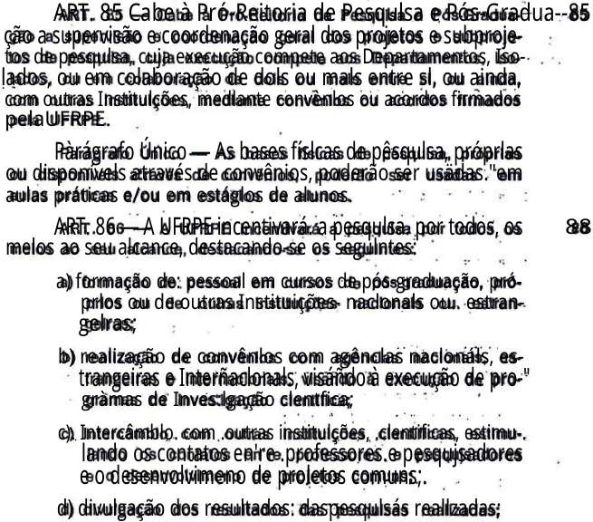

<!-- figure p110-fig1 | described_by: agy | ocr_overlap: 0.84 | needs_review: false -->
1. **Tipo de figura**
   Trata-se de um recorte de página de documento textual normativo/institucional digitalizado (artigos de estatuto ou regimento da UFRPE), sem ilustrações, gráficos ou tabelas. A imagem exibe duas camadas sobrepostas e desalinhadas do mesmo texto: uma camada de fundo correspondente à impressão original digitalizada (mais espessa, borrada e com pontilhado de ruído de escaneamento) e uma camada superior de texto de OCR (reconhecimento óptico de caracteres) renderizada em fonte preta sem serifa mais fina, ligeiramente deslocada para cima e para os lados, produzindo um efeito visual de texto duplicado e contendo diversos erros de reconhecimento (como substituição de `i` por `l`, sinais diacríticos incorretos e pontuação espúria).

2. **Todo o texto visível (verbatim)**

   **Texto original impresso (camada de fundo):**
   > ART. 85 — Cabe à Pró-Reitoria de Pesquisa e Pós-Gradua- `[margem direita: 85]`
   > ção a supervisão e coordenação geral dos projetos e subproje-
   > tos de pesquisa, cuja execução compete aos Departamentos, iso-
   > lados, ou em colaboração de dois ou mais entre si, ou ainda,
   > com outras Instituições, mediante convênios ou acordos firmados
   > pela UFRPE.
   >
   > Parágrafo Único — As bases físicas de pesquisa, próprias
   > ou disponíveis através de convênios, poderão ser usadas em
   > aulas práticas e/ou em estágios de alunos.
   >
   > ART. 86 — A UFRPE incentivará a pesquisa por todos os `[margem direita: 86]`
   > meios ao seu alcance, destacando-se os seguintes:
   >
   > a) formação de pessoal em cursos de pós-graduação, pró-
   > prios ou de outras Instituições nacionais ou estran-
   > geiras;
   >
   > b) realização de convênios com agências nacionais, es-
   > trangeiras e internacionais, visando à execução de pro-
   > gramas de investigação científica;
   >
   > c) intercâmbio com outras instituições científicas, estimu-
   > lando os contatos entre professores e pesquisadores
   > e o desenvolvimento de projetos comuns;
   >
   > d) divulgação dos resultados das pesquisas realizadas;

   **Camada de texto OCR sobreposta (transcrição literal dos caracteres visíveis por cima da imagem original, com seus erros e artefatos):**
   > ART. 85 Cabe à Pró-Reitoria de Pesquisa e Pós-Gradua--85
   > ção a supervisão e coordenação geral dos projetos e subproje-
   > tos de pesqulsa, cuja execução compete aos Departamentos, Iso-
   > lados, ou em colaboração de dols ou mals entre sl, ou ainda,
   > com outras Instituições, mediante convênlos ou acordos firmados
   > pela UFRPE.
   >
   > Pàrágrafo Único — As bases físlcas de pêsqulsa, próprlas
   > ou disponívels através de convênlos, poderão ser usädas."em
   > aulas práticas e/ou em estáglos de alunos.
   >
   > ART. 86 — A UFRPE incentivará a pesquisa por todos, os `[margem direita: 88]`
   > melos ao seu alcance, destacando-se os segulntes:
   >
   > a) formação de: pessoal em cursos de pós-graduação, pró-
   > prlos ou de outras Instituições nacionals ou. estran-
   > gelras;
   >
   > b) realização de convênlos com agênclas naclonáls, es-
   > trangeiras e Internaclonals, visándo à execução de pro-"
   > gràmas de Investlgação clentfica;
   >
   > c) Intercâmblo. com .outras instituições, .clentificas, estimu-.
   > lando os contatos en're .professores.e pesquisadores
   > e o desenvolvimeno de proletos comuns;.
   >
   > d) divulgação dos resultados: das pesqulsás reallzadas;

3. **Estrutura**
   - Não há caixas, molduras, setas, conectores, gráficos, eixos, painéis ou tabelas.
   - O arranjo é o de uma única coluna principal de texto justificado, acompanhada de uma coluna estreita na margem direita onde figuram os números dos artigos alinhados à primeira linha de cada artigo.
   - De cima para baixo, o conteúdo organiza-se em três blocos principais separados por espaçamento vertical em branco:
     1. **Caput do `ART. 85`**: parágrafo de 6 linhas com recuo na primeira linha e o número `85` na margem direita da primeira linha.
     2. **`Parágrafo Único`**: parágrafo de 3 linhas com recuo na primeira linha.
     3. **`ART. 86` e suas alíneas**: parágrafo introdutório de 2 linhas com recuo na primeira linha e o número `86` (sobreposto por `88` na camada de OCR) na margem direita da primeira linha, seguido por uma lista vertical de quatro itens com recuo à esquerda e alinhamento pendente sob o texto após o marcador:
        - `a)` (3 linhas);
        - `b)` (3 linhas);
        - `c)` (3 linhas);
        - `d)` (1 linha, encerrando-se com ponto e vírgula rente à borda inferior do recorte).

4. **Todos os números ou valores de dados**
   - `85`: identificador do artigo (`ART. 85`) e índice numérico na margem direita da primeira linha (na camada de OCR, aparece ligado ao final da linha como `--85`).
   - `86`: identificador do artigo (`ART. 86`) e índice numérico na margem direita da primeira linha desse artigo na camada original impressa.
   - `88`: valor visível na margem direita da linha do `ART. 86` na camada de OCR sobreposta (erro de leitura do `86` original).
   - Não existem outros números ou dados quantitativos na imagem.

5. **Cores com significado**
   Nenhuma cor carrega significado. A imagem é inteiramente monocromática, composta por texto preto e pequenos pontos cinzas de ruído de digitalização sobre fundo branco.

~~~text ocr
ART. 85 de Pesquisa
geral dos projetos
ans
lados, ou em colaboração de dals ou mais entre si, au ainda,
com mediante ou firmados
Único — As próprias
ou | usádias."em
aulas práticas e/ou em estágios de alunos.
por tados, o
melos ao Seu destacando-se os
de: pessoal em cursos pró.
realização de com agências es
trangeiras execução de pro-"
de clermt!
@ Intercâmbio. com
lendo osscontatos professores e pesquisadores
de comuns;.
@) divulgação dos resultados: daspesquisás
~~~


<!-- Start of picture text -->
ART. 85 Cabe à Pró-Reitoria de Pesqulsa e Pós-Gradua--85<br>ção a supervisão e coordenação geral dos projetos e subproje-<br>tos de pesqulsa, cuja execução compete aos Departamentos, Iso-<br>lados, ou em colaboração de dols ou mals entre sl, ou ainda,<br>com outras Institulções, medlante convènlos ou acordos firmados<br>pelaUFRPE.<br>Pàrágrafo Único — As bases físlcas de pêsqulsa, próprlas<br>ou disponívels através de convênios, poderão ser usädas."em<br>aulas práticas e/ou em estáglos de alunos.<br>ART. 86 — A UFRPE incentivará. a pesqulsa. por todos, os 88<br>melos ao seu alcance, destacando-se os segulntes:<br>a) formação de: pessoal em cursos de pós-graduação, pró-<br>prlos ou de outras Instituições- naclonals ou.. estran-<br>gelras;<br>b) realização de convênlos com agênclas naclonáls, es-<br>trangeiras e Interñaclonals, visáñdo à execução de pro-"<br>gràmas de Inves:lgação clentfica;<br>c). Intercâmblo. com .outras institulções, .clentificas, estimu-.<br>lando os contatos en're .professores.e pesqujsadores<br>e o desenvolvimeno de proletos comuns;.<br>d) divulgação dos resultados: daspesqulsás reallzadas;<br><!-- End of picture text -->

—94— 


<!-- page 111 -->

e) promoção de congressos, simpóslos e seminárlos para estudo e debate de temas clentificos, bem como participação em Iniclativas semelhantes de outras Instituições. Parágrafo Único — A Universidade manterá cursos de atualização em métodos, técnicas, planejamento e administração de pesquisa, desiinados preferenclalmente a seus docentes. SEÇÃOI PROGRAMAÇÃO E EXECUÇÃO DE PESQUISA ART. 87 — A programação geral de pesqulsa da UFRPE, elaborada pela Pró-Reltorla de Pesqulsa e Pós-Graduação, terá como prloridade a busca de novos conhecimentos, a serem apllcados ao desenvolvimento econômico e social do setor primárlo da produção regional. ART. 88 —A Pró-Reltorla de Pesquisa e Pós-Graduação publlcará anualmente um catálogo do qual deverão constar: ME a)programação geral de pesqulsa da UFRPE; b) projetos e subprojetos departamentals, Interdepartamentals e Interinstituclonals; c) relação das pesqulsas concluídas no ano anterlor, com a Indicação dos autores, locals de execução e fonte de financiamento; d) relação das pesquisas publicadas no ano anterlor, no periódico de divulgação clenlífica da Universldade ou em outros; ART. 89 — O programa de pesquisas de cada Departaménto poderá ser subdividido em subprogramas, relalivos- às suas áreas de conhecimento. ART. 90 — Os subprogramas Integrados por um ou mals projetos, elaborados de acordo com normas aprovadas pela Camara de Pesqulsa e Pós-Graduação do Conselho de Ensino, Pesqulsa e Extensão, terão sua execução atribuída a um ou mals docentes, denominados autores ou responsávels, co-autores e/ou colaboradores, conforme o grau de particlpação dos mesmos. ART. 91 — Em cada projeto de pesqulsa deverá constar a percentagem de tempo que a ele dedicarão seus execitores, 


<!-- Start of picture text -->
87<br><!-- End of picture text -->


<!-- Start of picture text -->
88<br><!-- End of picture text -->


<!-- Start of picture text -->
89<br><!-- End of picture text -->

#### 90: 

9f 

—95— 


<!-- page 112 -->


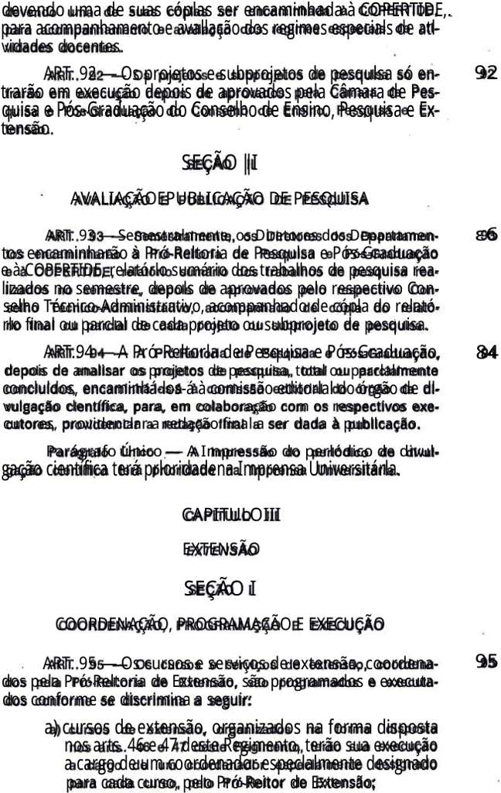

<!-- figure p112-fig1 | described_by: agy | ocr_overlap: 0.73 | needs_review: false -->
1. **Tipo de figura**
   Trata-se de um recorte de página de documento textual normativo (um Regimento universitário) em língua portuguesa, proveniente de um PDF digitalizado no qual duas camadas de texto aparecem visivelmente sobrepostas e levemente desalinhadas: a imagem digitalizada original em fonte mais encorpada ao fundo e uma camada de texto vetorial/OCR em fonte sem serifa mais fina por cima, causando efeito de duplicação visual e pequenos erros de reconhecimento em alguns caracteres e números marginais.

2. **Todo o texto visível (verbatim)**

   *(Continuação de artigo da página anterior)*
   > devendo uma de suas cópias ser encaminhada à COPERTIDE,
   > para acompanhamento e avaliação dos regimes especiais de ati-
   > vidades docentes.

   *(Artigo 92 — número na margem direita: `92`)*
   > ART. 92 — Os projetos e subprojetos de pesquisa só en-
   > trarão em execução depois de aprovados pela Câmara de Pes-
   > quisa e Pós-Graduação do Conselho de Ensino, Pesquisa e Ex-
   > tensão.

   *(Títulos centralizados)*
   > SEÇÃO III *(a camada sobreposta exibe `SEÇÃO ||I`)*
   >
   > AVALIAÇÃO E PUBLICAÇÃO DE PESQUISA

   *(Artigo 93 — número na margem direita: `93` na camada digitalizada original, sobreposto por `86` na camada de texto)*
   > ART. 93 — Semestralmente, os Diretores dos Departamen-
   > tos encaminharão à Pró-Reitoria de Pesquisa e Pós-Graduação
   > e à COPERTIDE, relatório sumário dos trabalhos de pesquisa rea-
   > lizados no semestre, depois de aprovados pelo respectivo Con-
   > selho Técnico-Administrativo, acompanhado de cópia do relató-
   > rio final ou parcial de cada projeto ou subprojeto de pesquisa.

   *(Artigo 94 — número na margem direita: `94` na camada digitalizada original, sobreposto por `84` na camada de texto)*
   > ART. 94 — A Pró-Reitoria de Pesquisa e Pós-Graduação,
   > depois de analisar os projetos de pesquisa, total ou parcialmente
   > concluídos, encaminhá-los-á à comissão editorial do órgão de di-
   > vulgação científica, para, em colaboração com os respectivos exe-
   > cutores, providenciar a redação final a ser dada à publicação.

   *(Parágrafo único do Art. 94)*
   > Parágrafo Único — A impressão do periódico de divul-
   > gação científica terá prioridade na Imprensa Universitária.

   *(Títulos centralizados)*
   > CAPITULO III
   >
   > EXTENSÃO
   >
   > SEÇÃO I
   >
   > COORDENAÇÃO, PROGRAMAÇÃO E EXECUÇÃO

   *(Artigo 95 — número na margem direita: `95`)*
   > ART. 95 — Os cursos e serviços de extensão, coordena-
   > dos pela Pró-Reitoria de Extensão, são programados e executa-
   > dos conforme se discrimina a seguir:

   *(Alínea recuada do Art. 95)*
   > a) cursos de extensão, organizados na forma disposta
   > nos arts. 46 e 47 deste Regimento, terão sua execução
   > a cargo de um coordenador especialmente designado
   > para cada curso, pelo Pró-Reitor de Extensão;

   *Observação sobre artefatos literais na camada de texto sobreposta (OCR):* além das divergências `||I` (sobre `III`), `86` (sobre `93`) e `84` (sobre `94`), a camada sobreposta substitui várias letras `i` minúsculas por `l` ou `I` (por exemplo, `atl-`, `Pró-Reltorla`, `relatórlo`, `dl-`, `clentífica`, `provldenclar`, `Impressão`, `dlvul-`, `prloridade`, `Unlversltárla`) e comprime espaçamentos em `AVALIAÇÃO E PUBLICAÇÃO`.

3. **Estrutura**
   Não há quadros, caixas, setas, gráficos, eixos, tabelas ou múltiplos painéis. A figura consiste em um único bloco de texto corrido em coluna principal justificada, acompanhado por uma coluna estreita na margem direita que repete a numeração dos artigos alinhada à primeira linha de cada artigo. A organização vertical segue a sequência hierárquica de um documento legal:
   - Restante de um parágrafo anterior no topo (3 linhas, sem recuo inicial).
   - Parágrafo do **ART. 92** (com recuo na primeira linha e número `92` na margem direita).
   - Cabeçalho centralizado de seção (**SEÇÃO III** / **AVALIAÇÃO E PUBLICAÇÃO DE PESQUISA**).
   - Parágrafo do **ART. 93** (com recuo na primeira linha e número marginal à direita).
   - Parágrafo do **ART. 94** (com recuo na primeira linha e número marginal à direita), seguido do **Parágrafo Único** (também com recuo na primeira linha).
   - Bloco de títulos centralizados iniciando novo capítulo e nova seção: **CAPITULO III**, **EXTENSÃO** (em itálico na camada digitalizada original e vertical na camada sobreposta), **SEÇÃO I** e **COORDENAÇÃO, PROGRAMAÇÃO E EXECUÇÃO**.
   - Parágrafo do **ART. 95** (com recuo na primeira linha e número `95` na margem direita), seguido pela alínea **a)**, disposta em bloco mais recuado à esquerda (4 linhas).

4. **Todos os números e valores**
   - Artigos principais do texto: `92`, `93`, `94`, `95`.
   - Números na margem direita alinhados aos respectivos artigos:
     - Junto ao Art. 92: `92` (ambas as camadas).
     - Junto ao Art. 93: `93` (camada original digitalizada) / `86` (camada de texto sobreposta).
     - Junto ao Art. 94: `94` (camada original digitalizada) / `84` (camada de texto sobreposta).
     - Junto ao Art. 95: `95` (ambas as camadas).
   - Algarismos romanos de capítulos e seções: `III` (em `SEÇÃO III`, exibido como `||I` na camada sobreposta), `III` (em `CAPITULO III`) e `I` (em `SEÇÃO I`).
   - Artigos referenciados no texto (na alínea `a)` do Art. 95): `46` e `47`.

5. **Cores**
   A imagem é inteiramente monocromática (texto em preto e tons de cinza sobre fundo branco); as cores não carregam significado informacional.

~~~text ocr
die suas cópias ser CORERTIBE,.
para raginaes especiais de att
docentes.
ann jptos de uisa só en-
trarão em q pala de Pes-
quisa @ Ensino, Ex-
tensão.
SEÇÃO
AVALIAÇÃO EP DE
tos à de Pesquisa eoP
@aaC dos de pesquisa rea-
lizados mo semestre, de pelo respectivo Con-
selho acomppanhad do
no fimal ou de de pesquisa.
Pr
depois de amalisar os projetos dis
concluldos, ale dl-
vulgação clentífica, para, em colaboração com os nespectivos exe-
ser dada à
60 único — A do pertódico de
gação Universitária.
EXTENSÃO
SEÇÃO I
COORDENAÇÃO,
-
dos pela PrósReltoria de Extensão, e
dos camforme se a seguir:
a) de extensão, Gi na forma
nas dt terão stia execução
para cada curso, peito Pró-Reitor de
92
95
~~~


<!-- Start of picture text -->
devendo uma de suas cóplas ser encaminhada à COPERTIDE,.<br>para acompanhamento e avallação dos regimes especials de atl-<br>vidades docentes.<br>ART. 92 — Os projetos e subprojetos de pesqulsa só en- 92<br>trarão em execução depois de aprovados pela Câmara de Pes-<br>quisa e Pós-Graduação do Conselho de Ensino, Pesquisa e Ex-<br>tensão.<br>SEÇÃO ∥I<br>AVALIAÇÃOEPUBLICAÇÃO DE PESQUISA<br>ART. 93 — Semestralmente, os Diretores dos Departamen- ε6<br>tos encaminharão à Pró-Reltoria de Pesqulsa e Pós-Graduação<br>e à COPERTIDE, relatórlo sumário dos trabalhos de pesquisa rea-<br>lizados no semestre, depols de aprovados pelo respectivo Con-<br>selho Técnico-Administrativo, acompanhado de cópla do relató-<br>rlo final ou parclal de cada projeto ou subprojeto de pesquisa.<br>ART.94 — A Pró-Reltorla de Pesquisa e Pós-Graduação, 84<br>depois de analisar os projetos de pesquisa, total ou parclalmente<br>concluldos, encaminhá-los-á à comissão editorlal do órgão de dl-<br>vulgação clentífica, para, em colaboração com os respectivos exe-<br>cutores, providenclar a redação final a ser dada à publlcação.<br>Parágrafo Único — A Impressão do perlódico de divul-<br>gação científica terá prloridadena Imprensa Universitárla.<br>CAPITULOIII<br>EXTENSÃO<br>SEÇÃO I<br>COORDENAÇÃO, PROGRAMAÇÃO E EXECUÇÃO<br>ART. 95 — Os cursos e serviços de extensão, coordena- 95<br>dos pela Pró-Reltoria de Extensão, são programados e executa-<br>dos conforme se discrimina a seguir:<br>a) cursos de extensão, organizados na forma disposta<br>nos arts. 46 e 47 deste Regimento, terão sua execução<br>a cargo de um coordenador especlalmente designado<br>para cada curso, pelo Pró-Reitor de Extensão;<br><!-- End of picture text -->

-96- 


<!-- page 113 -->


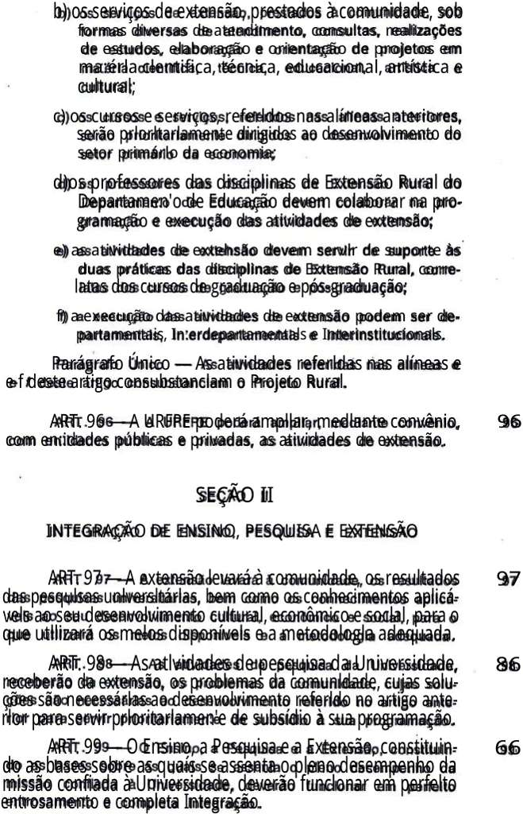

<!-- figure p113-fig1 | described_by: agy | ocr_overlap: 0.8 | needs_review: false -->
### 1. Tipo de figura
Trata-se da imagem de uma página (ou recorte de página) de texto normativo/estatutário em língua portuguesa, extraída de um arquivo PDF digitalizado. A imagem não contém gráficos, ilustrações ou tabelas, mas apresenta um artefato visual marcante em toda a sua extensão: há **duas camadas de texto sobrepostas e desalinhadas entre si** — uma camada inferior correspondente à impressão original escaneada (em fonte menor e mais escura) e uma camada superior em fonte maior sem serifa (típica de camada de texto gerada por OCR renderizada de forma visível), deslocada sobre o texto original e contendo diversos erros de reconhecimento de caracteres.

---

### 2. Todo o texto visível (verbatim)

#### Camada impressa original (texto-base escaneado)
> b) os serviços de extensão, prestados à comunidade, sob
> formas diversas de atendimento, consultas, realizações
> de estudos, elaboração e orientação de projetos em
> matéria científica, técnica, educacional, artística e
> cultural;
>
> c) os cursos e serviços, referidos nas alíneas anteriores,
> serão prioritariamente dirigidos ao desenvolvimento do
> setor primário da economia;
>
> d) os professores das disciplinas de Extensão Rural do
> Departamento de Educação devem colaborar na pro-
> gramação e execução das atividades de extensão;
>
> e) as atividades de extensão devem servir de suporte às
> duas práticas das disciplinas de Extensão Rural, corre-
> latas dos cursos de graduação e pós-graduação;
>
> f) a execução das atividades de extensão podem ser de-
> partamentais, Interdepartamentais e Interinstitucionais.
>
> Parágrafo Único — As atividades referidas nas alíneas e
> e f deste artigo consubstanciam o Projeto Rural.
>
> ART. 96 — A U[illegible]PE poderá ampliar, mediante convênio, &nbsp;&nbsp;&nbsp;&nbsp; 96
> com entidades públicas e privadas, as atividades de extensão.
>
> SEÇÃO II
>
> INTEGRAÇÃO DE ENSINO, PESQUISA E EXTENSÃO
>
> ART. 97 — A extensão levará à comunidade, os resultados &nbsp;&nbsp;&nbsp;&nbsp; 97
> das pesquisas universitárias, bem como os conhecimentos aplicá-
> veis ao seu desenvolvimento cultural, econômico e social, para o
> que utilizará os meios disponíveis e a metodologia adequada.
>
> ART. 98 — As atividades de pesquisa da Universidade, &nbsp;&nbsp;&nbsp;&nbsp; 98
> receberão da extensão, os problemas da comunidade, cujas solu-
> ções são necessárias ao desenvolvimento referido no artigo ante-
> rior para servir prioritariamente de subsídio à sua programação.
>
> ART. 99 — O Ensino, a Pesquisa e a Extensão, constituin- &nbsp;&nbsp;&nbsp;&nbsp; 99
> do as bases sobre as quais se assenta o pleno desempenho da
> missão confiada à Universidade, deverão funcionar em perfeito
> entrosamento e completa integração.

*(Nota sobre `ART. 96`: na camada impressa original, a sigla após "A" tem o início `U` e o final `PE` visíveis, mas as letras intermediárias ficam encobertas pela sobreposição densa da camada superior.)*

#### Camada sobreposta (texto desalinhado / OCR)
Reproduz o mesmo conteúdo deslocado sobre a camada original, apresentando as seguintes grafias literais divergentes claramente visíveis:
- Alínea `b)`: `ma:érla clentífica` (em vez de `matéria científica`).
- Alínea `c)`: `referldos`, `prlorltarlamente`, `prlmárlo` (com `l` no lugar de `i`).
- Alínea `d)`: `Departamen'o` (apóstrofo no lugar de `t`), `atlvldades`.
- Alínea `e)`: `servlr`, `duas práticas` (grafado `duas práticas` em ambas as camadas).
- Alínea `f)`: `In:erdepartamentais` (dois-pontos no lugar de `t`).
- `Parágrafo Único`: `referldas`, `consubstanclam`.
- `ART. 96`: `URFRE` (no lugar da sigla parcialmente encoberta da camada original), `ampllar`; margem direita: `96`.
- `SEÇÃO II` / `INTEGRAÇÃO DE ENSINO, PESQUISA E EXTENSÃO`: mesmas letras, apenas deslocadas em relação à camada inferior.
- `ART. 97`: `unlversltárlas`, `vels`, `soclal`, `utlllzará`, `melos`, `dlsponívels`, `metodologla`; margem direita: `97`.
- `ART. 98`: `atlvldades`, `necessárlas`, `rlor`, `prlorltarlamen'e`; margem direita: `86` (sobreposto ao `98` original).
- `ART. 99`: `constltuln-`, `perfelto`, `Integração.`; margem direita: `66` (sobreposto ao `99` original).

---

### 3. Estrutura
Não existem caixas, setas, conectores, eixos, linhas/colunas de tabela ou múltiplos painéis. A figura consiste em uma única coluna principal de texto corrido, com uma faixa estreita à direita reservada aos números dos artigos, disposta verticalmente de cima para baixo na seguinte organização:

1. **Lista de alíneas (`b)` a `f)`)**: cinco blocos de texto com recuo à esquerda, identificados pelas letras `b)`, `c)`, `d)`, `e)` e `f)` (continuação de um artigo anterior que não aparece na figura). As linhas subsequentes de cada alínea alinham-se verticalmente sob o início do texto logo após o identificador.
2. **Parágrafo Único**: bloco textual com recuo de primeira linha (`Parágrafo Único — ...`), cuja segunda linha retorna à margem esquerda principal.
3. **Artigo 96**: bloco de duas linhas com recuo na primeira linha (`ART. 96 — ...`) e segunda linha alinhada à margem esquerda principal, acompanhado de seu número (`96`) isolado na margem direita, na altura da primeira linha.
4. **Cabeçalho de seção**: separado dos blocos anterior e posterior por espaçamento vertical maior, centralizado em duas linhas em letras maiúsculas (`SEÇÃO II` acima de `INTEGRAÇÃO DE ENSINO, PESQUISA E EXTENSÃO`).
5. **Artigos 97, 98 e 99**: três blocos consecutivos de quatro linhas cada, com a mesma estrutura tipográfica do Artigo 96 (recuo na primeira linha, demais linhas alinhadas à margem esquerda principal e numeração correspondente posicionada isoladamente na margem direita, na altura da primeira linha de cada artigo).

Em toda a estrutura, a camada sobreposta aparece ligeiramente maior e deslocada (principalmente para a esquerda e um pouco para cima) sobre a camada impressa original.

---

### 4. Todos os números e valores
- **No corpo do texto**:
  - `duas` (numeral por extenso na alínea `e)`: "duas práticas")
  - `96` (em `ART. 96`)
  - `II` (algarismo romano em `SEÇÃO II`)
  - `97` (em `ART. 97`)
  - `98` (em `ART. 98`)
  - `99` (em `ART. 99`)
- **Na margem direita (alinhados à primeira linha de cada artigo)**:
  - Camada impressa original: `96`, `97`, `98`, `99`
  - Camada sobreposta (OCR): `96`, `97`, `86` (sobre `98`), `66` (sobre `99`)

---

### 5. Cores
A imagem é totalmente monocromática (texto preto e tons de cinza sobre fundo branco); nenhuma cor carrega significado.

~~~text ocr
xtensão, prestados acomunidade, sob
formas diversas dk» camsultas,
de estudos, elaboração e de projetos em
artística e
cultural;
serão ao desenvolvimento de
setor da
das disciplinas de Extensão Rural do
Educação devem ma pro-
gramação e execução das de extensão;
e) die devem serulr de suponte às
duas práticas das disciplinas de Rural, camre-
latas dos
ff) di» podem ser die-
partamenttais, e Interinstitucionals.
Único — Assatividades nefenidas nas alíneas e
ef o Rural.
mediante convênio,
com públicas e as atividades de extensão.
SEÇÃO Il
INTEGRAÇÃO DE ENSINO, E EXTENSÃO
as:
bem como as conhecimentos aplicá-
vels pata 6
que disponívels
esp ad)
da extensão, os problemas da comunidade, cujas solu-
referido no antigo ante:
nor de subsídio à
a
do da
missão confiada deverão funcionar em
entrosamento e completa Integração.
96
97
36
66
~~~


<!-- Start of picture text -->
b) os serviços de extensão, prestados à comunidade, sob<br>formas diversas de atendimento, consultas, realizações<br>de estudos, elaboração e orientação de projetos em<br>ma:érla clentifica, técnica, educacional, artística e<br>cultural;<br>c) os cursos e serviços, referldos nas alíneas anteriores,<br>serão prlorltarlamente dirigidos ao desenvolvimento do<br>setor primárlo da economia;<br>d)os professores das disciplinas de Extensão Rural do<br>Departamen'o de Educação devem colaborar na pro-<br>gramação e execução das atividades de extensão;<br>e) as atividades de extehsão devem servlr de suporte às<br>duas práticas das disciplinas de Extensão Rural, corre-<br>latas dos cursos de graduação e pós-graduação;<br>f) a execução das atividades de extensão podem ser de-<br>partamentais, In:erdepartamentals e Interinstitucionals.<br>Parágrafo Único — As atividades referldas nas alíneas e<br>e f deste artigo consubstanclam o Projeto Rural.<br>ART. 96 — A URFPE poderá ampllar, medlante convênio, 96<br>com en:idades públicas e privadas, as atividades de extensão.<br>SEÇÃO II<br>INTEGRAÇÃO DE ENSINO, PESQUISA E EXTENSÃO<br>ART. 97 — A extensão levará à comunidade, os resultados 97<br>das pesqulsas unlversltárlas, bem como os conhecimentos aplicá-<br>vels ao seu desenvolvimento cultural, econômico e soclal, para o<br>que utllizará os melos disponívels e a metodologla adequada.<br>ART. 98 — As atlvidades de pesquisa da Universidade, 86<br>receberão da extensão, os problemas da comunldade, cujas solu-<br>ções são necessárlas ao desenvolvimento referldo no artigo ante-<br>rlor para servir prloritarlamen'e de subsídio à sua programação.<br>ART. 99 — O Ensino, a Pesquisa e a Extensão, constituin- 66<br>do as bases sobre as quaís se assenta o pleno desempenho da<br>missão confiada à Universidade, deverão funclonar em perfelto<br>entrosamento e completa Integração.<br><!-- End of picture text -->

-97— 


<!-- page 114 -->

#### TÍTULO III 

###### DA COMUNIDADE UNIVERSITÁRIA 

##### CAPITULO I 

###### DISPOSIÇÕES COMUNS 

|ART. 100 — A comunidade universitárla é constl:uída na<br>forma do art. 64 do Estatuto.|100|
|---|---|
|ART. 101 — A Investidura em qualquer cargo, emprego<br>ou função da UFRPE Importa no compromisso formal de respelto<br>à lel, ao Estatuto, a este Regimento Geral, aos Reglmentos das<br>Unidades e às autorldades que deles emanam.|101|
|ART. 102 — Os atos de qualquer membro da comunidade<br>universitárla, quando praticados fora dos limites espaclals e fun-<br>clonals da Universldade, são da estrita responsabilidade de seu<br>autor.|102|
|ART. 103 — Não será permitida admissão ou promoção<br>para cargo ou emprego na UFRPE, sem prévia e formal compell-<br>ção de méritos.<br>§ 1.º — Quando se tratar de docentes, a competição de<br>mérito, prevista neste artigo, será reallzada no respectivo Depar-<br>tamento, na forma prevista na legislação pertinente e neste Regi-<br>mento.|103|
|§ 2.º — Observada a legislação vigente, excetuam-se do<br>disposto neste artigo, os contratos de professores colaboradores<br>ou visltantes.||
|ART, 104 — As atribuições do pessoal, não fixadas em lel<br>ou no Estatuto, são estabelecidas neste Regimento Geral e nos Re-<br>gimentos dosórgãos universltárlos.|104|
|ART. 105 -- A UFRPE procederá, através do Departamen-<br>to de Pessoal, ao recrutamento, trelnamento e aperfelçoamento do<br>seu pessoal não docente.|105|
|ART. 106 — Os servidores não docentes só poderão prestar<br>colaboração ou serem postos à disposição de órgãos de adminis-<br>tração federal, direta ou Indireta, nos casos definidos em lel.<br>—98—|106|


<!-- page 115 -->

##### CAPÍTULO II 

###### DO CORPO DOCENTE 

ART. 107 — Os Integrantes do Corpo Docente, definidos na forma dos artigos 67 e 68 do Estatuto, têm, além de suas atlvidades ligadas ao ensino, à pesqulsa e à extensão, as relativas à administração, privativa de professores, constantes do artigo 82 do mesmo diploma. 

ART. 108 — Os docentes são admitidos pelo Reitor de acordo com a legislação vigente. 

##### 107 

##### 108 

§ 1.o — A admissão de auxillares de ensino será felta em caráter probatórlo, para Iniclação nas atividades de enslno superior, por período de dols (2) anos, com posslbllidade de renovação por Igual prazo, por Indlcação do Conselho Técnico-Adminlstratlvo do Departamento Interessado. 

§ 2.º — A prorrogação do contrato de auxiliar de ensino, Inclusive com os Incentivos funclonals de lel, após a renovação previs:a no parágrafo anterior, só será permitida se o candidato houver concluído curso de pós-graduação (Mestrado ou Doutorado), relaclonado com a área de conhecimento do Departamento, apresentando o competente diploma, expedldo ou revalidado por institulção credenciada, e enquanto a UFRPE não puder oferecer-Ihe a oportunldade de Ingresso na carrelra do magistérlo superior. 

### SEÇÃO I 

###### COMPETIÇÃO DE MÉRITO PARA ADMISSÃO DE DOCENTES 

ART. 109 — A competição de mérito entre os candidatos a auxllíares de ensino proceder-se-á na forma de "Provas de Seleção", organizadas e dirigidas pelo Departamento competente, obedecendo às seguintes diretrizes: 

109 

I — a abertura de Inscrições à “Prova de Seleção", para preenchimento de vaga exlstente na lotação Ideal do Departamento, será au'orlzada pelo Reltor, após pronunciamento favorável do Conselho de Ensino, Pesqulsae Extensão; 

ll — o período de Inscrição será de trinta (30) dias, divulgado através de edital publlcado na Imprensa lo- 

—66— 


<!-- page 116 -->

cal, em três (3) dlas não consecutivos, contendo Indicação clara do número de vagas a preencher; 

- IlI — o título básico para Inscrição será o de graduação em curso de nível superior que sailsfaça o requisito do artigo 74 do Estatuto; 

- IV — a seleção deverá ser reallzada dentro de 15 (quinze) dias, a contar do encerramento das inscrições e ficará a cargo de uma Comissão Examinadora, constituída por três (3) professores escolhidos pelo Conselho Técnico-Administrativo e designados em porìaria do Diretor do Departamento; 

- V — os documentos e demals exigênclas a serem feltas aos candidatos às Provas de Seleção constarão de Normas Especials a serem baixadas pela Câmara de Ensino de Graduação do Conselho de Ensino, Pes- 

- quisa e Extensão e fornecidas aos candidatos antes da inscrlção; 

##### VI — a seleção compreenderá as segulntes provas: 

- a) prova escrita e prova prática ou didática, versando sobre conhecimentos de uma ou mals disclpllnas do Departamento, a critério de seu Conselho Técnico-Administrativo; 

- b) prova de títulos, relativa ao hístórlco escolar, à formação universitárla e a outros mérl:os dos candiddados 

c) prova de aptidão docente, apurada através de entrevista sigilosa entre a Comlssão Examinadora e cada um dos candidatos, em que serão questionados sucessiva e separadamente, sobre o mesmo conjunto de perguntas, previamente elaborado pela Comissão, abrangendo não somente matérla das disciplinas em exame, como também assuntos gerals, tals como método de ensino, aspirações vocacionals, mercado de trabalho, etc.; 

VIl — serão Indicados à admissão os candldatos classificados que obtiverem as malores médlas finals, em ordem decrescente, até o llmite das vagas ofertadas; VIll — constituirão elementos preferenclais no julgamento dos títulos, diplomas ou certificados de pós-gra- 

—100— 


<!-- page 117 -->

duação e em segundo lugar o exercício de monitorla ou de funções de auxillar acadêmico, crltérlo este que deve também prevalecer na declsão dos casos de empate. 

ART. 110 — A admissão de professor assisten'e será felta medlante concurso público de títulos e provas, na forma prevista no artigo 69 do Estatuto, observadas as normas gerals do artigo 115 deste Regimento e as seguin'es exlgênclas: 

### 110 

- I— o concurso será aberto medlante edital publicado por três (3) dlas não consecutivos em jornal local de grande tiragem, com período de inscrição de sessenta (60) dlas, a contar da primeira publicação. 

- Il — poderão candidatar-se os portadores de dip!omas de Mestre ou Doutor, em matérla de área de conheclmento do Departamento, diplomas esses expedidos ou revalidados por Institulções credencladas; 

- Ill —o concurso constará das provas abalxo enumeradas, que abrangerão uma área de conheclmento do Departamento: 

atlu  d(ds: 

   - b) defesa oral de uma dissertação previamente apresentada; 

   - c) escrita sobre conjunto de assuntos sorteados entre . os constantes dos programas das disciplinás da área em concurso; 

   - d) prá:lca ou prático-oral, a critérlo da Comissão Examinadora e de acordo com a natureza das disciplinas referldas na alínea anterlor; 

   - e) didática ou prova de aula, na qual cada candldato proferirá aula teórica sobre assunto, prevlamente sorteado para todos, nas dimensões e com as características aproprladas às dlsciplinas em concurso; 

- IV — cons'Ituirão elementos preferencials no julgamento dos títulos o diploma de Doutor e, em segundo lugar, o estáglo probatórlo como auxillar de ensino, critérlo este que deve também prevalecer nos casos. de empate; 

- V — a Comissão Examinadora será desianada em portarla do Diretor e Integrada por -três (3) professores tl- 

-101— 


<!-- page 118 -->

tulares e/ou adjuntos, escolhidos pelo Conselho Técnico-Administrativo do Departamento Interessado, dos quals somente um (1) poderá ser da Unidade; 

VI — feito o julgamento, na forma do Inciso V do ar'igo 115 deste Regimento, serão Indicados à admissão nos cargos ou empregos ofertados, os candidatos classificados, na ordem decrescente desuas médlas finals. 

ART. 111 — A admissão de professor adjunto será felta nos termos do artigo 70 do Es:atuto. 

111 

§ 1.o — A progressão funclonal, prevista no referido artigo 70, será promovida mediante competição de merecimento entre todos os assistentes da Unidade. portadores do diploma de Doutor. 

§ 2.º — A competição de merecimento será Julgada por uma Comissão Especlal, Indicada pelo Conselho Técnlco-Adminlstrativo, designada pelo Diretor e constituída por três (3) professores titulares e/ou adjuntos, dos quals apenas um (1) pertencente ao Departamento. 

§ 3.º — A Comissão prevista no parágrafo anterior julgará o merecimento, cotejando toda a documentação apresentada pelos candidatos e os classificará na ordem decrescente de seus mérltos, sem necessarlamente atribuir-Ihes notas de classlficação, apresentando relatórlo do julgamento efetuado. 

§ 4.º — O Diretor do Departamento submeterá o relatórlo da Comissão Especlal à apreclação do Conselho Técnlco-Administrativo e, uma vez aprovado por este Conselho, encaminhará à Adminis:ração Superior, o necessárlo pedido de progressão funclonal. 

ART. 112 — A Inscrição para o. concurso público previsto no artigo 70 do Estatuto será aberta por um prazo de noventa (90) dias, a portadores de título de Doutor ou Docente-Livre em matérla correlata, através de editał publicado por três (3) dias não consecutivos, em jornal local de grande circulação. 

112 

Parágrafo Único — Além das normas gerals previstas no artigo 115, desde Reglmento, o concurso obedecerá às segulntes disposições: 

I — constituirá elemento preferenclal, no julgamento dos títulos, a comprovação do exercíclo de maglstérlo em cargo ou função de professor asslstente, na área de 


<!-- page 119 -->

conhecimento sob concurso, critérlo este que deve também prevalecer nos casos de empate; 

- II — a Comlssão Examlnadora do concurso será constltuída por três (3) professores titulares ou adjuntos, deslgnados em portaria do Diretor do Departamento, por Indicação do respectivo Conselho Técnico-Admlnistrativo, sendo apenas um do corpo docente da Unldade; 

- Ill— o concurso constará das segulntes provas, que deverão abranger os programas də uma área de conhecimento do Departamento, conforme conste do edital de convocação: 

#### tuut los (e 

b) defesa de tese; 

- c) escrita, sobre assuntos sorteados de um conjunto de proposições referentes à área de conhecimento·em concurso; 

- d) prátlca ou prático-oral, a crltérlo da Comissão Examinadora e em consonâncla com a natureza das disclplinas da área em concurso; 

- e) didática, em que cada candidato deverá minlstrar uma aula de cinqüenta (50) minutos sobre assunto prevlamente sorteado para todos, do programa das disciplinas da área em concurso; 

IV — felto o julgamento na forma do Inciso V do artigo 115, deste Regimento, serão Indicados, ao aproveltamento nos cargos óu empregos ofertados, os candldatos classlficados na ordem decrescente de suas médlas. 

ART. 113 — A admissão de professor titular será felta medlante concurso público de títulos e provas em que serão observadas as normas gerals do artigo 115, deste Regimento, e as seguintesprescrições especlficas: 

113. 

- 1 — o concurso será aberto por edital, publlcado no Dlárlo Oficlal do Estado e em Jornal local de grande circulação, durante três (3) dias não consecutivos, com período de Inscrição de cento e oltenta (180) dlas, a contar da prlmelra publicação; 

Il — aos cargos ou empregos de professor titular poderão concorrer os professores adjuntos ou pessoas de 

—103— 


<!-- page 120 -->

alta qualificação, nos termos do artigo 71 do Estatuto; 

- III — o concusso abrangerá as seguines provas: a) títulos; 

   - b) defesa de tese; 

c)escrita: 

   - d) prático-oral; e)didática. 

- IV — o tema da tese será de livre escolha dos candidatos, dentro da área de conhecimento objeto do concurso; 

- V — cada membro da Comissão Examinadora deverá apreciar a tese, sob o duplo ponto de vista de seu conteúdo e de sua defesa, atribuindo-Ihe uma só nota; 

- VI — a prova didática deverá versar sobre assunto dos programas das disciplinas da área de conhacimento em concurso, sorteado vinte e quatro (24) horas antes, de uma lista de dez, organizada com antecedêncla pela Comissão Examlnadora; 

- Vll — a Comlssão Examlnadora do concurso, escolhida pelo Conselho Técnico-Administrativo e designado em portarla do Diretor, será Integrada por cinco (5) professores que possuam o grau de Doutor em curso credenclado ou título equlvalente, preferentemente titulares dos quais, no máximo, dols (2) poderão ser do Departamento e os demals de outras Instituições; 

- Vlll — realizado o julgamento do concurso, na forma do Inciso V do artigo 115 deste Regimento, será encaminhado à nomeação o candidato melhor classificado e que obtiver indlcação de .três (3) ou mals examlnadores. 

ART. 114 — O concurso para Docêncla-Livre, cujas Inscrições serão abertas de acordo com o artigo 112 do Estatuto, obedecerão às normas previstas no artigo anterior, exceto as previstas no Ínciso VIII, bem como nos Incisos III, IV, V e VI do art. 115 deste Regimento. 

#### 114 

§ 1.º — Os concursos serão anunciados em edital publicado em dols jornals de grande circulação de Pernambuco, abrindo-se as Inscrições sels meses após essa publicação; 

—104— 


<!-- page 121 -->

§ 2.º  Todos os candidatos classlficados farão jus ao título de Docente-Livre. 

ART. 115 — Na seleção ou concurso para preenchimento de cargos ou empregos de docentes observar-se-ão as seguin'es normas gerals: 

#### 115 

- 1— a abertura do processo de seleção far-se-á por Inlclativa do Departamento interessado, no prazo máximo de noventa (90) dlas a contar da vacâncla ou crlação do cargo ou emprego; 

- Il  a Inscrição à seleção ou concurso será aberta mediante edital, autorizado pelo Reltor, assinado pelo Diretor da Universidade e dlvulgado através da imprensa dlárla e de outros melos; 

- Ill — além do edital, haverá um conjunto de Instruções complementares, elaborado pelo Departamento Interessado, Incluindo os programas das disciplinas exlgidas e outras Informações pertinentes à realização das provas, devidamente aprovado pelo ConseIho Técnlco-Administra'Ivo e posto à disposlção dos candidatos, durante o perlodo das Inscrições; 

- IV — a prova didática e a de defesa de tese, bem como a apuração do Julgamento, serão públicas, cabendo à Comissão Examinadora decidir por votação secreta os empates ocorridos na classificação dos candidatos; 

- V — os membros da Comissão Examinadora atribulrão, sigilosamente, aos candidatos Individualmente, uma nota de zero (0) a dez (10), em cada uma das provas e, após a apuráção flna!, redigirão relatórlo com o quadro geral das notas e a Indlcação dos vencedores, sendo desclassificados os candldatos a auxiliar de enslno que receberem de mals de um (1) examinador nota média final Inferlor a sels (6), os candidatos a professor assistente ou adjunto que receberem de mals de um (1) examinador' nota médla final Inferlor a sete (7), e os candidatos a professor titular ou docente-ivre que receberem de mals de dols (2) examinadores notas médias flnals Inferlores a sete (7); 

- VI — a Indicação contIda no relatórlo da Comissão Examinadora deverá ser aprovada elo Conselho Técnl- 

—105— 


<!-- page 122 -->

co-Administrativo do Departamento e homologada. pelo Conselho de Ensino, Pesquisa e Extensão, antes que o Diretor da Unidade proponha ao Reitor a nomeação ou a contratação do candidato escolhido, ou a outorga do título no caso de Docêncla-Livre; 

- Vll — o parecer final e a Indlcação da Comissão Examinadora só poderão ser rejeltados, em caso de manlfesta irregularidade, por dols terços (2/3) dos membros do Conselho Técnico-Administrativo, ou do Conselho de Ensino, Pesquisa e Extensão. 

Parágrafo Único — No julgamento da prova de títulos, serão consideradas a formação universitária, a produção cientifica e a experlêncla didática e técnico-profisslonal do candidato, sempre relaclonadas com a área de conhecimento, objeto do concurso ou seleção, com a devida comprovação dos seguintes elementos: 

- a) na formação unlversitária, os cursos de especlalização, 

   - aperfelçoamento, estáglo e extensão; 

- b) na produção científica, os trabalhos de pesqulsa pura ou aplicada, publicada em lilvros, periódicos ou em outras formas de divulgação; 

c) na experiêncla didática e técnico-profissional, as atividades exercidas no magistérlo, sobretudo de grau superlor, o desempenho de cargos, empregos, funções ou comissões e as realizações técnico-profisslonals dentro da especlallzação. 

### SEÇÃO II 

##### REGIME DE TRABALHO 

ART. 116 — O pessoal docenteda UFRPE prestará serviço em regime de vinte (20) ou quarenta (40) horas semanals de trabalho, com ou sem dedicação exclusiva. 

#### 116 

§ 1.º — É da competêncla da Comissão Permanente do Regime de Tempo In'egral e Dedicação Exclusiva (COPERTIDE), referida no § 1.° do artigo 10 do Estatuto ou do órgão que a substitulr: 

- a) aprovar, de acordo com as normas vigentes, o Ingresso de docentes no regime de quarenta (40) horas semanals 

—106— 


<!-- page 123 -->

de trabalho e a percepção dos Incentivos funclonals previstos em lel; b) transmlilr as Instruções -emanadas dos órgãos competentes sobre regimes de atividades dos docentes; c) manter reglstro, permanentemente atuallzado, das disponibilidades de carga horária dos Departamentos; 

d) avallar as atlvidades do pessoal dos Departamentos em regime de quarenta (40) horas semanals de trabalho, através de Informes recebldos, fazendo relatórlo conclusivo semesiral ao Reltor, e à Comissão Coordenadora do Tempo Integral e Dedicação Excluslva — COMCRETIDE. 

§ 2.º — A composlção, as atribulções e o funcionamento regular da COPERTIDE, previstos na legislação especifica, conslderam-se Incorporados ao presente Regimento. 

§ 3.º — C docenie admitido ou readmitido em reglme de trabalho de quarenta (40) horas semanals com ou sem dedicação Integral e exclusiva, assinará termo de compromisso especial, sobrc  s es   ac  m SEÇÃO III 

REGIME DISCIPLINAR 

ART. 117 — O pessoal docente da UFRPE está sujelto às seguintes penas disciplinares: 

117 

a) advertêncla; b) repreensão; c) suspensão; 

d) demissão ou dispensa. 

§ 1.º — Na apllcação das penas previstas neste artigo são observadas as segulntesprescrições: 

- I — a advertêncla será felta oralmente e em partlcular, não se apllcando em casos de relncidêncla; 

Il  a repreensão será llda em reunlão reservada de todos os docentes do Departamento, vedada a presença de funclonárlos ou'ros ou discentes; 

Ill — a suspensão implicará no afastamento do docente de seu cargo ou emprego, sem percepção de vencimento, salárlo e/ou gratificação, por um perlodò de três (3)a noventa (90) dias; 

—107— 


<!-- page 124 -->

IV — as penas de repreensão, suspensão e demissão ou dispensa, serão cominadas medlante portarla·e anotadas nos assentamentos do docente; V  na apllcação das penas constantes do inciso anterior, serão considerados não somente a gravidade das faltas cometidas, como também os antecedentes do docente. §2.º — Ao docente acusado de comportamento passível da sanção disciplinar será sempre assegurado pleno direl:o de defesa. ART. 118 — Será passível de suspensão o docente que, sem 116 motivo justo, delxar de cumprir programa ou horário de trabalho a que esteja obrigado. § 1.o — A reincidência na falta prevista neste artigo pode constl:uir motivo bastante para demissão ou dispensa. § 2.º — A aplicação do disposto no parágrafo anterlor farse-á por representação da unidade respectiva. ART. 119 — A aplicação de pena de demissão ou dispensa, 119 somente decorrerá de conclusões de Inquérito administrativo, felto por comlssão de professores, cons:Ituída por ato do Reltor. Parágrafo Único — No caso de professores que gozem do direito constitucional de vitalicidade, a demissão somente poderá ocorrer por sentença Judicial. ART. 120 — A cominação das penas disciplinares a pessoal 120 docente será felta pelo Diretor da Unldade,"nos casos de advertêncla, repreensão e suspensão até cinco (5) dlas, e pelo Reitor nos demals casos. SEÇÃO IV FÉRIAS, LICENÇAS E AFASTAMENTOS 

ART. 121 — O pessoal docente, de nível superior, da 121 UFRPE tem dlrelto ao gozo de quarenta e cinco (45) dias de férlas anuals, de acordo com escalas, elaboradas de modo a permitir o funclonamento regular das atividades docentes, duran'e o ano letivo. 

—108— 


<!-- page 125 -->

ART. 122 — Os docentes têm Igualmente direlto a Iicenças, inclusive a título de prêmlo, na forma que determine a legislação pertinente ao regime jurídico em que foram admitidos. ART. 123 — Os docentes da UFRPE poderão afastar-se de suas atividades regulares, nos casos previstos em lel, ou quando devidamente autorizados, para atender, em outros centros naclonals ou es:rangeiros, aos seguintes objetivos: a) seguir cursos de pós-graduação; b) seguir cursos de especialização ou aperfeiçoamento ou realizar estáglos; c) participar de congressos e outras reuniões de natureza clentífica, técnica, ou cultural, relaclonados com sua atividade docente; d) exercer (emporarlamente atividades de ensino e pesquisa em outras instituições congêneres; e) cooperar em programas de assistêncla técnica. § 1.º — Nas hipóteses das letras a, b e c, o docente terá dlrelto, além da bolsa ou auxílio que eventualmente Ihe seja concedido, a perceber a remuneração Integral do regime de trabalho em que se encontre. 

§ 2.º  Nas hipóteses das letras d e e, o afastamento é privativo de professor, podendo ser remunerado na forma do parágrafo anterlor, quando a Institulção beneficlada for mantida pelo Governo Federal ou quando o programa a ser desenvolvido seja de Interesse da UFRPE e resulte de compromisso por esta assumido. S          on cedido afastamento terá direlto à contagem de tempo de serviço para todos os efeltos. ART. 124 — 0 afastamento será requerldo pelo docen'e nas hipóteses das alíneas a, b'e c, requlsitado pela Instituição Interessada na da alínea d e de Inlclativa da próprla UFRPE, na da alínea e do artigo anterlor, flcando sempre condicionado à aqulescênciado docente. 


<!-- Start of picture text -->
122<br><!-- End of picture text -->

123 


<!-- Start of picture text -->
124<br><!-- End of picture text -->

§ 1.º — O afastamento far-se-á por período não superlor a três (3) anos, podendo, excepclonalmente, ser prorrogado até quatro (4) anos. 

§2.º — O afastamento será concedido medlante portarla balxada pelo Reltor, após pronunclamento favorável do Conselho Técnlco-Administrativo do Departamento Interessado.. 

—109— 


<!-- page 126 -->


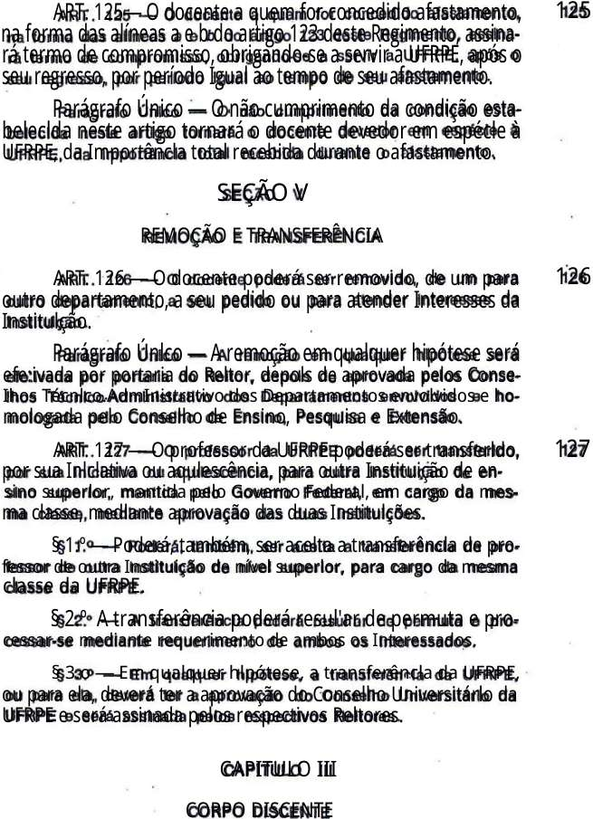

<!-- figure p126-fig1 | described_by: None | ocr_overlap: None | needs_review: true -->
[no description]

~~~text ocr
das alíneas a assina-
de compromisso, 0
seu regresso, por Igual tempo de sew afastamento.
Unico — da condição esta-
neste artigo o docente espétie à
dad mppsténcia durante
SEÇÃO W
REMOÇÃO E TRANSFERÊNCIA
de um para
Quitro departamento seu pedido ou para atender Interesses da
Ranágrafo Único — esm F hipótese será
efierivada portaria do Reltor, depals Conse-
lhos ho-
mologatia pelo de Ensina, Pesquisa e Extensão.
O
por sia para Instituição de en-
sino superior, pato em cargo da mes-
ma Chasse, das duas
ser aceita de pro-
fessor Instituição de mível para cargo dia mesma
classe da UFRPE.
é
cessar-se mediante ae ambos os
a dia UFRPE,
ou para ela, ter Universitário da
UFRPE Reitores.
Hi
CORPO DISGENTE
126
127
~~~


<!-- Start of picture text -->
ART. 125— O docente a quem for concedido afastamento, 125<br>na forma das alíneas a e b do artigo 123 deste Regimento, assina-<br>rá termo de compromisso, obrigando-se a servir a UFRPE, após o<br>seu regresso, por período Igual ao tempo de seu afastamento.<br>Parágrafo Único — O não cumprimento da condição esta-<br>beleclda neste artigo tornará o docente devedor em espécle à<br>UFRPE, da Importâncla total recebida durante o afastamento.<br>SEÇÃO V<br>REMOÇÃO E TRANSFERÊNCIA<br>ART. 126 — O docente poderá ser removido, de um para 126<br>outro departamento, a seu pedido ou para atender Interesses da<br>Institulção.<br>Parágrafo Únlco — A remoção em qualquer hipótese será<br>efe:ivada por portaria do Reltor, depols de aprovada pelos Conse-<br>Ihos Técnlco.AdmInistrativo dos Departamentos envolvidos e ho-<br>mologada pelo Conselho de Ensino, Pesquisa e Extensão.<br>ART. 127 — O professor da UFRPE poderá ser transferldo, 127<br>por sua Inlclativa ou aqulescência, para outra Instituição de en-<br>sino superlor, məntida pelo Governo Federal, em cargo da mes-<br>ma classe, medlante aprovação das duas Institulções.<br>§ 1.º — Poderá, também, ser acelta a transferêncla de pro-<br>fessor de outra Instituição de nível superlor, para cargo da mesma<br>classe da UFRPE.<br>§ 2.º  A transferência poderá resul'ar de permuta e pro-<br>cessar-se mediante requerimento de ambos os Interessados.<br>§ 3.o — Em qualquer hlpótese, a transferêncla da UFRPE,<br>ou para ela, deverá ter a aprovação do Conselho Universitárlo da<br>UFRPE e será assinada pelos respectivos Reltores.<br>CAPITULO III<br>CORPO DISCENTE<br><!-- End of picture text -->


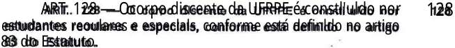

<!-- figure p126-fig2 | described_by: agy | ocr_overlap: 0.86 | needs_review: false -->
1. **Tipo de figura:** Recorte horizontal de texto extraído de um documento digitalizado em português (um artigo de norma ou regimento), sem gráficos, diagramas, tabelas ou ilustrações. A imagem exibe duas camadas de texto sobrepostas e ligeiramente desalinhadas entre si: ao fundo, o texto impresso original digitalizado; por cima, uma camada de texto digital (resultado visível de OCR em fonte sem serifa mais alta e estreita), deslocada levemente para cima e com alguns erros de reconhecimento de caracteres.

2. **Texto visível (verbatim):**
   - **Camada de texto impresso original (ao fundo):**
     - Linha 1 (com recuo à esquerda): `ART. 128 — O corpo discente da UFRPE é constituído por`
     - Extremidade direita da linha 1: `128`
     - Linha 2: `estudantes regulares e especiais, conforme está definido no artigo`
     - Linha 3: `83 do Estatuto.`
   - **Camada de texto sobreposta (OCR visível, exatamente como renderizada):**
     - Linha 1 (com recuo à esquerda): `ART. 128 — O corpo discente da UFRPE é constl'uldo nor`
     - Extremidade direita da linha 1: `128`
     - Linha 2: `estudantes reoulares e especlals, conforme está definldo no artigo`
     - Linha 3: `83 do Estatuto.`

3. **Estrutura:** O conteúdo está organizado como um único parágrafo de três linhas sem molduras, caixas, setas, eixos, tabelas ou painéis. A primeira linha possui recuo à esquerda e, separada do final do texto por um amplo espaço em branco à direita, traz o número marginal `128` alinhado na mesma altura. A segunda e a terceira linhas começam alinhadas à margem esquerda, sendo a terceira linha curta (ocupando apenas o início da largura). Toda a composição aparece duplicada pela sobreposição da camada de texto digital sobre a camada digitalizada original. Há ainda pequenas marcas pontuais de ruído de digitalização no espaço em branco inferior direito, abaixo da região de `definido no`.

4. **Números e valores:**
   - `128` (no identificador `ART. 128`, no início da primeira linha)
   - `128` (isolado na margem direita da primeira linha)
   - `83` (no início da terceira linha, em `83 do Estatuto.`)
   Não existem outros números ou valores quantitativos.

5. **Cores:** Nenhuma cor carrega significado; a imagem é inteiramente monocromática (caracteres em preto e cinza-escuro sobre fundo branco).

~~~text ocr
da nor
estudantes reoulares e conforme está definido no artigo
83 dt Statute.
~~~


<!-- Start of picture text -->
ART. 128 — Ocorpo discente da UFRPE é constl'uldo nor 128<br>estudantes reoulares e especlals, conforme está definldo no artigo<br>83 do Estatuto.<br><!-- End of picture text -->

—110— 


<!-- page 127 -->

Parágrafo Único — Cada estudante regular terá um cartão de Identidade, visado pelo respectivo Coordenador de Curso, ou pelo Dlretor do Colégio de 2.º Grau em que esiiver matriculado. 

ART. 129 Os alunos regulares terão os direltos Inerentes à sua condição e, especlalmente, os de representação e participação nos órgãos colegiados, conforme consta do Estatuto, bem como os de receber a assistêncla e os benefíclos que lhes forem destinados pela UFRPE, além do direlto de candidatar-se às vagas de monltoria, dé auxillar acadêmico e a qualquer bolsa estudantll. 

ART. 130 — Os alunos terão os deveres Inerentes à sua condição, sujeltando-se às obrigações e ao regime disciplinar previsto no Estatuto e neste Regimento Geral. 

### 129 

#### 130 

### SEÇÃO I 

REPRESENTAÇÃO 

ART. 131 — A representação estudantl nos órgãos coleglados, privativa dos alunos regulares de nível superlor, prevista no artigo 90 do Estatuto, será Indicada pelo DCE, aos coleglados superiores, comlssões permanentes e CTAs dos Departamentos e, pelos DAs de cada curso de nível superlor aos CCDs dos mesmos. 

#### 131 

- I— Para ser Indicado como representante estudantll em órgão coleglado deve o aluno: 

   - a) ser regularmente matriculado em curso de graduação ou de pós-graduação; 

- b) não estar cursando o último período letivo do seu curso; 

- It — 0 ConselhoUnlversltárlo completará, em Resolução, as normas referldas no item anterlor; 

- III — As elelções para membros e respectivos suplentes. das Diretorlas do DCE e DAs dos Cursos, serão realizadas em um só dia, no horárlo das atividades escolares, que ficarão suspensas nesta data; 

IV — São garantidos o slgllo do voto, a Inviolabllidade das urnas e a apuração Imediata por Comissão Eleltoral deslgnada pelo DCE, com fiscallzação dos candidatos, sendo o Processo Eleltoral acompanhado por Comlssão Paritárla (CAPE). designada pelo Reltor: 

-111— 


<!-- page 128 -->

V — Salvo motivo de força malor ou doença, comprovado por escrito perante à Comissão de Acompanhamento do Processo Eleltoral (CAPE), dentro de cinco (5) dlas após a elelção, e a critérlo desta, o estudante faltoso terá anotada uma (1) falta em cada uma das disciplinas em que estiver Inscrito no dia em que se realizarem as eleições; 

VI — Será de um (1) ano o mandato dos membros das Diretorlas dos Diretórios e dos representantes estudantís nos Coleglados e Comissões Permanentes, assim como o de seus suplentes, sendo permitida uma recondução; 

Vll — será de um (1) ano o mandato dos representantes do corpo discente, sendo vedada a reelelção, ao mesmo órgão Colegiado, para período Imedlatamente subseqüente; 

Vlll  a conclusão do curso Implicará na perda automática do mandato, ascendendo, de Imedlato, o suplente, à condição de titular. 

ART. 132 — Os suplentes referldos no Item VI, do artigo anterior, substituirão os titulares em suas faltas e Impedimentos, completando os seus mandatos quando Indicados. 

ART. 133 — As normas a que se refere o Item Il do artigo 131 deste Regimento, serão baixadas pelo Conselho Universltárlo sessenta (60) dlas antes das elelções. 

132 

133 

### SEÇÃO∥I 

ASSISTÊNCIA 

ART. 134 — A assistêncla ao corpo discente é prestada por Intermédlo do Departamento de Assistêncla Estudantil. 

134 

§ 1.º — A assistência referlda neste artigo é prestada Indlvldual e coletivamente, e compreende, além da prevista no artigo 85 do Estatuto, os programas de alojamento, alimentação, saúde eoutros. § 2.º — A prestação de serviço referida no artigo 88 do Estatuto é programada e supervisionada pelo Banco de Mão-de-Obra Estudantll, subordinado diretamente à Pró-Reitorla de Extensão. 

—112— 


<!-- page 129 -->

§ 3.º — O Banco de Mão-de Obra referido no parágrafo anterior é regido por normas baixadas pelos Conselhos Unlversitário e de Curadores. 

ART. 135— O programa de saúde compreenderá a trlagem e tratamento médico e odontológico dos casos clínicos simples, apresen:ados por estudantes, bem como os exames médicos. para as Justificações regularmente admissívels. 

135 

#### SEÇÃO III 

MONITORIA 

ART. 136 — Os estudantes monltores, a que se refere o artigo 89 do Estatuto e seu parágrafo únlco, são admltidos por disciplina, cabendo-lhes baslcamente as seguintes funções: 

- a) auxililar os professores em tarefas passívels de serem executadas por estudantes que já tenham sldo aprovados nas respectivas disciplinas; 

- b) auxiliar os alunos, orlentando-os em trabalhos de laboratório, de biblioteca, de campo e outros compatívels com o seu nível de conhecimento e experlêncla nas dlscipllnas; 

- c) constitulr um elo entre professores e alunos, visando a melhor ajustamento entre a execução dos programas e o desenvolvimento natural da aprendizagem. 

ART. 137 — A seleção, a admissão e o exercíclo das atlvldades de monltores obedecem a programa nacional, de responsabilidade da Comissão Coordenadora do Regime de Tempo Integral e Dedicação Exclusiva (COMCRETIDE) e são orlentados e fiscallzados, no âmbito da UFRPE, pela Comissão Permanente do Regime de Tempo Integral e Dedicação Exclusiva (COPERTIDE), ou pelo órgão que a substitua. 

136 

137 

Parágrafo Únlco — Cabe à COPERTIDE ou ao órgão que a substitua a distribulção, pelos Departamentos, do número de vagas que Ihe for deferldo anualmente, bem como fixar normas específicas sobre a seleção, a admlssão e as atividades dos monitores. 

SEÇÃO IV REGIME DISCIPLIÑAR 

ART. 138 — A disciplina é o cumprimento dos deveres universltárlos de cada um em todos os setores, através da colabo- 

138 

—113— 


<!-- page 130 -->

ração efetiva dos discentes e da consclentização dos seus direltos e deveres. 

§ 1.º — Constitui Indisciplina a vlolação das normas legals, estatutárias e regimentais em vigor. 

- §.2.º — São deveres, dos discentes: 

- 1— asslduldade; 

II — pontualidade; 

- Ill — atendimento à instruções e sollcitações dos docentes e das autoridades universitárias e de seus agentes; 

IV — urbanldade. 

- § 3.º — Ao discente é prolbido: 

- 1— referir-se de modo depreclativo em trabalho escolar às autoridades e a atos da Administração Universitárla; 

- Il — promover manifestações de apreço ou desapreço no recinto da Universidade; 

- Ill — aliciar ou Incltar a deflagração de movimento que tenha por finalldade a paralização de atividade universitária; 

- IV — praticar atos destinados à organização de movimentos subversivos, passeatas, desflles ou comícios não autorizados, ou dele participar; 

- V — conduzir, realizar, confeccionar; Imprimir, ter em depósito ou distribuir material subversivo de qualquer natureza; 

- VI — sequestrar ou manter em cárcere privado, diretor, membro do corpo docente, funcionárlo ou servidor da Unlversidade, agente da autoridade ou aluno; 

- VIl — usar dependêncla ou recinto da Universidade para fins de subversão ou para a prática de ato contrário à moral ou à ordem pública; 

- Vill — Ingerir, ter em depósito, conduzir ou traficar qualquer bebida alcoólica ou entorpecente nas dependências universitárlas; 

—114— 


<!-- page 131 -->

IX— portar armas branca ou de fogo, mesmo legalmente autorlzado, nos "campi" da Universldade; 

- X — travar disputa, rlxa ou luta corporal nos “campl". universitárlo com docente, discente, servidor ou particular, mesmo que a ação respectiva não seja, na forma da lel, enquadrada como crime. 

ART. 139 — Para as Infrações disciplinares, são aplicadas as segulntes penas: 

#### 139 

a)advertêncla; b) repreensão; c) suspensão; d)desligamento. 

§ 1.º — As penas disciplinares de que tratam as le'ras b, c e d serão apllcadas por escrito, sendo prolbida a publlcação dos atos punitivos na Imprensa, exceto os casos previstos em lel. 

§ 2.º — A pena de advertêncla será apllcada verbəlmente, por motivo de Infrações leves, não cabendo em casos de relncidêncla. 

§ 3.º  A pena de repreensão será aplicada nas Infrações médlas. 

§ 4.o — A pena de suspensão, que não excederá de noventa (90) dlas, será aplicada em caso de falta grave ou de reincidêncla. 

§ 5.º — A pena de desligamento será aplicada nos casos de: 

1 — crime contra a administração universitária; 

Il — Incontinêncla pública e escandalosa, vício de Jogos prolbldos e embrlaguezhabitual; 

Ill — Insubordinação grave contra docente, diretor ou autorldadeuniversitárla; 

IV — ofensa física contra funclonárlo, servidor, estudante ou particular, salvo legftima defesa; 

V — aplicação Irregular de recursos financeiros concedldos aos responsávels pelo Diretório Central dos Estudantes ou órgão estudantil legalmente constiturdo; 

Ví — lesão aos cofres do Diretórlo Centrl dos Estudantes ou órgão estudan'll e dilapidação do patrimônio unlversitárlo; 

—115— 


<!-- page 132 -->

VII — transgressão de qualquer dos Itens IIl a VIl do § 3.º do art. 138, deste Regimento. § 6.º — Serão levados em conta, no julgamento das Infrações disciplinares, as circunstâncias atenuantes ou agravantes, conforme o caso: |— Circunstâncias atenuantes: a) bom comportamento; b) aplicação nos estudos; c) ter sido cometida a Infração em defesa próprla de seus direltos ou dos de outrem. II — Circuristânclas agravantes: a) mau comportamento; b) reincidência; c) concurso de dols ou mals elementos; d) ser pra:lcada a Infração durante as aulas ou em presença de professor ou autoridade universitária; e) ter sido praticada a infração com premeditação. § 7.º — Ao estudante especial aplicar-se-á somente a pena de adver:ência, procedendo-se ao seu desligamento na relncidêncla ou na ocorrêncla de outra falta. § 8.o — Para imposição de pena disciplinar. são competentes: I — os docentes, no caso de advertêncla em classe; Il — os Coordenadores de Curso nos casos de advertêncla e repreensão; IIl — os Pró-Reltores e Diretores de Unidades Unlversitárias, responsáveis pelo amblen'e onde ocorrer a Indisciplina, no caso de suspensão até quinze (15) dlas, bem como, as demais cominações previstas no "caput" deste artigo le'ras a e b; IV — 0Vice-Reltor, nas penas de advartêncla repreensão e suspensão até quinze (15) dlas, quando as ocorrênclas tiverem lugar em Unidades Adminis:rativas; V — O Reitor nos demals casos. § 9.º — O professor no exercíclo dos seus deveres, poderá representar contra membro do corpo discente, propondo a aplicação de penalldades, de conformldade com a gravidade da falta. 

—116— 


<!-- page 133 -->

ART. 140 — Quando a falta do discente. merecer análise por uma Comissão de Inquérito, esta deve ser consituída por dols (2) docentes e um (1) discente, designados pelo Reltor, por sollcitação da autoridade competente. 

#### 140 

§ 1.º — O presidente da comissão designará servidor para os encargos de secretárlo. 

§ 2.° — O prazo para o Inquérito será de trinta (30) dlas, prorrogável por mals quinze (15) dlas, nos casos de força malor. § 3.º — Ultimada a Instrução, cltar-se-á o Indiclado para, no prazo de cinco (5) dias, apresentar defesa, sendo-Ihe facultada vista do processo na Universidade. 

§ 4.º — Achando-se o Indiclado em lugar Incerto e não sabldo, será citado por edital com o prazo de dez (10) dias.. § 5.° — No caso de revella, será designado defensor “exofficio" para defender o Indiclado. 

§ 6.º — Concluída a defesa, a comissão remeterá o processo à autorldade competente, acompanhado de relatórlo concluslvo pela Inocência ou responsabilidade do acusado, Indicando, se a hipótese for a última a dlsposlção legal transgredida. 

§ 7.º — Recebido o processo, a autoridade julgadora proferirá decisão no prazo de dez (10) dias. 

§ 8.º — Tratando-se de crlme, a autoridade competente soIlcitará a Instauração de Inquérlto pollclal. 

§ 9.º — Em qualquer fase do processo será assegurada ao acusado ampla defesa, por si ou por seu advogado legalmente constitufdo. 

§ 10 — O prazo para Interposlção de recursos, no caso de desllgamento, é de vinte (20) dlas, e dez (10) dlas nos demals casos, sendo a contagem Iniciada a partlr da data da afixação do ato punitivo em quadro de avisos do órgão competente. ART. 141 — Transcorrldos, um (1) ano no caso da le'ra a e dols (2) anos no caso da letra c do art. 139, deste Regimento, poderá ser cancelada do reglstro acadêmico, a respectiva anotação, desde que requerido pelo discente punido e comprovado o seu bom comportamento posterlor à punlção. § 1.º O requerimento de que trata o presente artigo será dirigldo ao Reltor, que decidirá dentro de trin'a (30) dlas. 

##### 141 

— 117 – 


<!-- page 134 -->

§ 2.º — 0 discente que estiver sujeito a Inquérito nos termos do art. 140, deste Regimento, só poderá ter pedido. de transferêncla ou də -trancamento de matrícula deferldo, após' a conclusão do processo a que responde e desde que reconhecida a sua Inocêncla. CAPITULO IV CORPO TÉCNICO E ADMINISTRATIVO ART. 142 — Os servidores da UFRPE são atendidos por ser142 vidores técnicos e administrativos, admitidos e regidos na forma da legislação pertinente do Estatuto e deste Regimento Geral. ART. 143 — A admissão de servidores no regime jurídico 143 do Serviço Público está condicionada à aprovação e classificação prévias, ressalvados os casos previstos em lel. § 1.o  Prescindirá da aprovação a que se refere este artigo, o provimento de cargos em comissão. § 2.º .- Os servidores referldos neste artigo terão a sua vida funcional regulada pelo Estatuto dos Funclonários Públicos Civis da Unlão, que, para este efeito, se Incorpora ao presen'e Regimento Geral, com a legislação que o complete ou o modifique. ART. 144 —- O contrato de servidor no regime jurídico da 144 leglslação do trabalho, far-se-á medlante seleção, conforme critérios estabelecidos em resolução. ·pelo Conselho Unlversitárlo, com observâncla das seguintes prescrições básicas: a) ampla divulgação da seleção, para conhecimento dos Interessados, fixando-se prazo de inscrição; b) seleção por meio de títulos, quando estes, obtidos em cursos regulares, sejam condições para o exercíclo da função; c) seleção por melo de provas, nos demals casos, levandose em conta a experlêncla do candidato no tipo de trabalho que Ihe, será destinado; d) fixação de resultados mínimos, abaixo dos quais não poderá o candldato ser admitido; e) critérios para ordenação decrescente e .aproveitamento pela ordem de classlficação, até o limi'e de vagas previstas; f)designação, para cada processo də seleção, de uma Comlssão Examinadora especialmente constituída. 

—118— 


<!-- page 135 -->

ART. 145 — A Universidade promoverá, diretamente ou através de outras Instiiuições, cursos, estágios, conferênclas e qualsquer outras modalidades de treinamento, visando ao aperfelçoamento e a atualização de seus servidores técnlcos e administratlvos. 

ART. 146 — Os servidores contratados de acordo com o artigo 144 deste Reglmento, terão a sua vida funcional regulada pela leglslação do trabalho que, para este efelto, se Incorpora ao presente Reglmento Geral. 

#### 145 

146 

##### TITULO IV 

DOS DIPLOMAS, CERTIFICADOS, TITULOS E MEDALHAS 

#### CAPITULO1 

DIPLOMAS 

ART. 147 — A URFPE, nos termos do seu Estatuto e da legislação em vigor, outorgará graus e expedirá diplomas de: 

147 

a) Graduação, a estudantes que concluírem, na forma estatutárla e regimen:al, qualquer dos seus cursos deste nível; 

b) Mestre, aos que concluírem curso de Mestrado; c) Doutor, aos que concluírem curso de Doutorado; d) Docente-Livre, aos que forem aprovados em concurso especifico. 

ART. 148 — A outorga de graus aos que concluírem cursos de graduação, constante da letra a do artigo anterlor, será felta publlcamente, em solenidade denominada de Colação de Grau, com a presença dos Conselhos Universitárlo e de Ensino, Pesqulsa e Extensão, sob a presidência do Reitor, na segunda quinzena de julho e na segunda quinzena de dezembro, após o encerramento do respectivo período letivo, em data prefixada no Calendárlo Escolar. 

148 

§ 1.º — A colação de grau, referida neste artigo, será conJunta para todos os cursos da UFRPE, cabendo ao Reltor a outorga dos respectlvos graus. 

§ 2.º — Após o encerramento do perfodo especlal Ińtensivo, ou em casos especlals devidamente justlficados, a requerimento dos Interessados, poderá o ato de Colação de Grau reallzar- 

—119— 


<!-- page 136 -->

se, Individualmente ou por grupos, em dia e hora determinados pelo Reitor e na presença de três (3 professores. § 3.º — A critérlo do Reitor e por sugestão da Pró-Reitoria de Ensino de Graduação, poderá haver na primeira semana de março, após o encerramento do periodo letivo especial in.ensivo, solenidade de Colação de Grau, quando o número elevado de concluintes ojustificar. § 4.º — Caberá à Reltoria determinar o local, o horário e a pauta da solenidade, bem como as providências necessárias ao ato. ART. 149 — A Pró-Reltoria de Ensino de Graduação, le-. vantará, ao menos oito (8) dias antes da colação de grau, a relação dos alunos de cada curso em condição de receber grau, com as notas obtidas e sua classificação, enviando-as aos respectivos Coordenadores de Curso. Parágrafo Único — Cada Coordenador submeterá a relação referida neste artigo ao respectivo Colegiado de Coordenação Didática que, após a aprovação será encaminhada ac Reltor, a'é quarenta e olto (48) horas antes do início da solenidade, acompanhada de cópla da ata da reunião de aprovação. ART. 150 — Os diplomas expedidos pela UFRPE, conforme estabelece o artigo 147 deste Regimento, terão forma, dimensões e dizeres uniformes, aprovados pelo Conselho de Ensino, Pesquisa e Extensão e homologados pelo Conselho Universitário. ART. 151 — Outorgado o grau, o DRCA preencherá os dlplomas que, assinados pelo diplomado, pelo Coordenador do Curso e pelo Reitor, serão encaminhados para registro na forma da lel. ART. 152 — 0 diplomado, mediante pagamento da taxa fixado pelo Conselho de Curadores, receberá do DRCA o diploma devidamente registrado, acompanhado do seu histórico escolar e do extrato de crédito. Parágrafo Único — A UFRPE, a requerimento dos Interessados, poderá fornecer atestado ou declaração de conclusão de curso, a partir do dia seguinte ao da colação de grau. ART. 153 — Os graus referidos nas alíneas a, b, c e d do artigo 147, serão outorgados pelo Reltor em reuniões solenes. Parágrafo Único — Os diplomas referidos neste artigo serão assinados pelo diplomado, pelo dirigente do órgão responsável e pelo Reltor, sendo em seguida registrado em livro próprio. 

149 

#### 150 

151 

152 

153 

—120— 


<!-- page 137 -->

#### CAPITULO II 

###### CERTIFICADOS 

ART. 154 — Os certificados de conclusão de disclplinas Isoladas serão assinados pelo respectivo Pró-Reitor e expedidos com os extratos de créditos. 

ART. 155 — Os cerilficados de conclusão de Curso de Especlalização ou de Aperfelçoamento serão expedidos pela Pró-Reltorla de Pesquisa e Pós-Graduação. 

154 

#### 155 

Parágrafo Único — Os certificados referidos neste artigo serão assinados pelos conclulntes, pelo Coordenador do Curso e pelo Pró-Reitor de Pesqulsa e Pós-Graduação e deverão conter, no verso, os nomes e a qualificação dos professores que o leclonaram. 

ART. 156 — Os certificados de conclusão da curso de extensão serão expedidos pelo Pró-Relior de Atividades de Extensão. 

#### 156 

##### CAPITULO III 

##### TITULOS 

ART. 157 — a concessão dos Títulos Honoríficos, previstos no § 1.° do artigo 97 do Estatuto, serão exigidos os seguintes requisltos: 

#### 157 

- a) paraDoulor "Honorls Causa" — que seja personalldade de reconhecido saber e se tenha distinguldo por sua atuação no campo das Ciênclas, da Filosofia, das Artes, das Letras ou do melhor entendimento entre os povos; 

- b) para Professor "Honoris Causa"— que, não pertencendo aos quadros da UFRPE, seja professor de renome, com relevantes serviços prestados à Institulção e à humanldade; 

- c) para Professor Emérito — que seja professor aposentado da Unlversldade e tenha alcançado poslção de especlal destaque. 

ART. 158 — Os títulos relaclonados no artigo anterior serão concedidos por proposta justificada do Reltor, ou do Conselho Técnico-Admlnistrativo de qualquer Departamento, aprovada. pelo Conselho de Ensino, Pesquisa e Extensão e homologada pelo ConselhoUnlversitárlo. 

158 

— 121 — 


<!-- page 138 -->

ART. 159 — Os diplomas, correspondentes aos lítulos ho159 noríficos, serão assinados pelos homenageados e pelo Reitor. ART. 160 — A outorga de Titulos Honoríficos será felta 160 em solenidade pública com a presença dos coleglados superlores e dos corpos docentes e administrativo. § 1.º — Na solenidade referida neste artigo, o Relor, o Vice-Reitor, os Pró-Reitores e os Professores, bem como os homenageados, usarão as vestes talares adotadas pela UFRPE, devendo as cltadas autoridades universitárlas usarem lambém as Insígnias dos cargos que ocupam. § 2.º — O ritual da solenidade de conferição do títulos será programado por uma Comissão Especial de professores, designada pelo Reltor, aprovado pelo Conselho Universitário e Incorporado ao Regimento dos Coleglados da Administração Superlor. CAPITULO IV MEDALHAS DE MÉRITO ART. 161— As medalhas de mérito, previstas nas alíneas 161 a e b do § 2.º do artigo 97 do Estatuto, serão entregues anualmente, em solenldade pública, com a presença dos coleglados superlores e dos corpos docente, discente e administrativo, a ser realizada no dla 3 de novembro — data comemorativa da fundação da célula mater da Universldade. § 1.º — A Medalha Dom Pedro Roeser, uma por ano, será concedida a pessoa físlca ou jurídica, que tenha prestado relèvante serviço a esta Unlversldade ou à Educação no País. § 2.º — A Medalha Prof. Manoel Rodrlgues Fllho será concedida em número não superior a cinco (5), por ano, a servidores aposentados da Unlversldade, que, no exercíclo das suas funções, tenham cumprido, com dedlcação e zelo, os deveres Inerentes a seu cargo ou emprego. § 3.º — As características das medalhas serão estabelecldas pelo Conselho Unlversitárlo. ART. 162 — A medalha referida no § 1.º do artigo anterlor, 162 será conferida por proposta do Reitor, de qualquer membro dos coleglados superlores ou do Conselho Técnlco-Administrativo dos Departamentos e as previstas no § 2.º do mesmo artigo, pelo Reltor, ou por qualquer dirlgente dos órgãos desta Universidade. 


<!-- Start of picture text -->
161<br><!-- End of picture text -->

162 

—122— 


<!-- page 139 -->


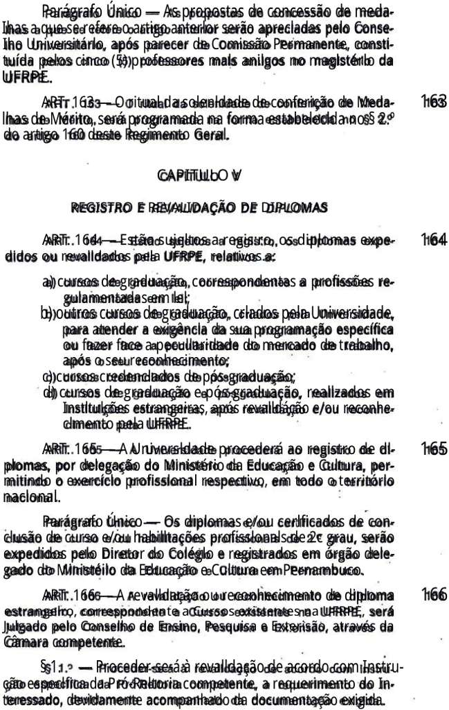

<!-- figure p139-fig1 | described_by: None | ocr_overlap: None | needs_review: true -->
[no description]

~~~text ocr
Unico — de concessão de meda-
lhas serão aprecladas pelo Gonse-
Tho após parecer consti-
tuída pelos cinco mais anilgos mo magistério da
UFRPE.
ART de Meda-
las será ma forma nnoss 2°
do artigo Geral.
REGISTRO E DE
644—E stétacs aa expe-
didos ou UFRPE,
a) a profissões re-
gulamentada seam
cursos pele Universidade,
para atender a exigência da sum específica
ou fazer face aapeeullasitiade dm mercado de
após
ep ão,
reval e/ou neconhe-
Cimento UMRRE.
ART. AJ procederá ao registro de di-
plomas, por delegação do Ministétio dia Educação e (Cultura, per-
em todo
naclonal.
único — Os diplomas cerificadas de con-
de Ze grau, serão
expedidos pelo Diretor do Colégio e registrados em órgão dele-
gado Ministéilo dia esCaltura
de
UMRRE, será
Julgado pelo Conselho de Ensino, Pesquisa e através da
Câmara competente.
—
es a reguerimento do In-
teressado, aconyparthaido dia documentação
164
165
166
~~~


<!-- Start of picture text -->
Parágrafo Único — As propostas de concessão de meda-<br>Ihas a que se refere o artigo anterlor serão aprecladas pelo Conse-<br>Iho Universitárlo, após parecer de Comissão Permanente, consti-<br>tuída pelos cinco (5) professores mals anilgos no maglstérlo da<br>UFRPE.<br>ART. 163 — O ritual da solenldade de conferição de Meda- 163<br>lhas de Mérito, será programada na forma estabeleclda no § 2.º<br>do artigo 160 deste Regimento Geral.<br>CAPITULO V<br>REGISTRO E REVALIDAÇÃO DE DIPLOMAS<br>ART. 164 — Estão sujeltos a regis:ro, os diplomas expe- 164<br>didos ou revalldados pela UFRPE, relativos.a:<br>a) cursos de graduação, correspondentəs a profissões re-<br>gulamentadas em lel;<br>b) outros cursos de graduação, crlados pela Universidade,<br>para atender a exigêncla da sua programação específica<br>ou fazer face a pecullaridade do mercado de trabalho,<br>após o seu reconhecimento;<br>c) cursos credenclados de pós-graduação;<br>d) cursos de graduação e pós-graduação, reallzados em<br>Instltulções estrangeiras, após revalldáção e/ou reconhe-<br>clmento pela UFRPE.<br>ART. 165 — A Universldade procederá ao registro de dl- 165<br>plomas, por delegação do Ministério da Educação e Cultura, per-<br>mitindo o exercíclo profisslonal respectivo, em todo o territórlo<br>naclonal.<br>Parágrafo Único — Os diplomas e/ou cerlficados de con-<br>clusão de curso e/ou habilltações profisslonals de 2c grau, serão<br>expedidos pelo Diretor do Coléglo e registrados em órgão dele-<br>gado do Ministéilo da Educação e Cultura em Pernambuco.<br>ART. 166 — A revalldação ou reconhecimento de diploma 166<br>estrangelro, correspondente a Cursos existentes na UFRPE, será<br>Julgado pelo Conselho de Ensino, Pesquisa e Exterisão, através da<br>Câmara competente.<br>§ 1. — Proceder-se-á à revalldação de acordo com Instru-<br>ção especlfica da Pró-Reltoria competente, a requerimento do In-<br>teressado, devidamente acompanhado da documentação exigida.<br><!-- End of picture text -->

—123.— 


<!-- page 140 -->

§ 2.º — Considerada pela Pró-Relioria competente, hábil e completa a documentação apresentada, o processo correspondente será encaminhado com parecer, ao Coleglado de Coordenação Didática do Curso referen'e ao Diploma. 

§ 3.º — O Coleglado de Coordenação Dldática do Curso designará um relator, que examinará o diploma e demals documentos que Instruem o processo e emitará parecer técnico, considerando a equivalêncla do diploma e das discipllnas cursadas, ou sugerindo que o requerente seja submetido aos exames que julgar necessários ou curse disciplinas, quando os estudos feitos pelo requerente não satisfaçam ao mínimo necessário para a obtenção do diploma no Brasil. § 4.º — Comprovado o cumprlmento das formalidades determinadas no processo, o Coleglado de Coordenação Didática aprovará a revalidação solicitada e a submeterá à Câmara competente do Conselho de Ensino, Pesqulsa e Extensão. § 5.º — Após aprovada a revalldação pelo Conselho de Ensino, Pesquisa e Extensão, o diploma será apostilado, devendo ser o respectivo termo assinado pelo Reitor. 

§ 6.º — Será exigida a Integrallzação das disciplinas relativas aos Estudos de Problemas Brasilelros, na revalldação de diplomas estrangelros, somente quando o seu portador for brasilelro, o mesmo acontecendo em relação ao cumprimento da obrigatoriedade da Educação Física. 

### TITULO V 

###### DOS RECURSOS FINANCEIROS 

ART. 167 — Os recursos financelros da UFRPE constarão de seu orçamento anual, em que es'ão consignados como Recelta as dotações orlundas do Poder Público e outros recursos, Incluindo as rendas próprias, conforme dispõe o artigo 102 do Estatuto. 

167 

Parágrafo Único — Constarão alnda do orçamento os fundos especlals, Instituídos para custelo de atividades extraordinárlas, com recursos próprlos ou orlundos de doações ou legados, na forma do artigo 103 do Estatuto. 

ART. 168 — O orçamento será uno, colncidindo o exercíclo financelro com o ano civil. 

168 

-124— 


<!-- page 141 -->

- Parágrafo Único — A elaboração anual do orçamento obe- 

- dece às seguintes etapas: 

   - 1— em prazo fixado pelo Reltor, com vistas ao atendlmento dos demais Incisos deste artigo, serão encaminhadas à Pró-Reltoria de Planejamento, pelos respectivos responsávels, as previsões de recelta e despesa para o ano segulnte, de cada órgão da Unlversldade; 

   - 1l — de posse dos elementos Informativos, colhidos na torma do Inciso anterior, a alundida Pró-Reltoria organizará, dentro de quinze (15) dias, um anteprojeto da Froposta Orçamentárla, que seiá encaminhado ao Conselho de Curadores para oxame, retiflcação ou aprovação, dentro do prazo de dez (10) dlas; 

Ill -— o anteprojeto referldo no Inciso anterior será, em segulda, examinado pelo Conselho Universltárlo, no prazo de clnco (5) dlas, para recusa ou homologação, transformando-o, neste caso, na Propos:a Orçamentárla a ser encaminhada ao Ministérlo da Educação e Cultura. 

ART. 169 — As quotas de particlpação da UFRPE nos saldos verificados na execução dos Concursos Vestibulares serão utllizadas, exclusivamente, em bolsas para estudantes carentes de recursos que apresentem melhor aproveltamento escolar. 

ART. 170 — O Conselho de Curadores balxará, semestral ou anualmente, resolução, fixando ou reajustando os valores das taxas e emolumentos cobrados pela Universldade. 

ART. 171 — Será concedido ao aluno classlficado em prlmelro lugar, no Concurso Vestibular anual, para cada um dos cursos mantidos pela UFRPE, o prêmlo de Isenção das taxas correspondentes à sua matrícula Inicial. ART. 172 — Igualmen:e, na matrícula de cada pérlodo letivo regular, haveiá prêmlo de Isenção das respectivas taxas, para os estudantes que forem aprovados por média, em todas as disclpllnas em que tenham sido matriculados no período letivo regular anterlor. 

ART. 173 — Os alunos conclulntes, quo lograrem aprovaao          dsa do, serão premiados com a Isenção das taxas de expedição e registro de d!piome. 

169 

170 

171 

172 

173 


<!-- page 142 -->

ART. 174 — Ao aluno concluinte de curso de graduação 174 que obtenha a melhor classificação de cada um dos cursos mantidos pela UFRPE, será concedido como prêmlo, um Diploma de Honra ao Mérlo, sem prejuízo de outros prêmlos que já tenha conquistado ou venha a conquistar. 175 — Os alunos que receberem reprovação e/ou Inabl175 lilação em seu histórico escolar, não terão dlreito a candidatar-se aos prêmlos instituídos nos artigos 172 a 174 deste Regimento. ART. 176 — A escrituração da Receita e da Despesa será 176 centralizada em Departamento especializado da Reltoria, sendo vedada a retenção, sob qualquer preiexto, de rendas auferldas. ART. 177 — Para realização de planos, cuja execução 177 possa exceder um exercício, as despesas serão aprovadas globalmente, consignando-se nos orçamentos enuais as respectivas dotações parciais. 

##### TITULO VI 

DAS DISPOSIÇÕES GERAIS E TRANSITÓRIAS 

##### CAPITULO I 

###### DISPOSIÇÕES GERAIS 

ART. 178 — O Reglmento de cada Departamento definirá as disciplinas que Integram o seu elenco e as distribuirá em áreas de conhecimento de duas (2) a cinco (5), de acordc com o grau de relaclonamen'o existente entre elas. 

ART. 179 — É prolbido aos membros dos corpos docente, discente, técnico e edministrativo, promover qualquer manifestação de natureza político-partidária no âmbito da UFRPE ou dela parilcipar. 

ART. 180 — Nenhuma publicação que envolva o nome da UFRPE ou das Unidades e órgãos que a integram, poderá ser felta sem prévia autorização doReltor. 

ART. 181 — A Estação Eco.ógica do Tapacurá, o Hospital Veterinário e ou.ros órgãos técnico-administrativos, de natureza semelhanto, que venham a ser crlados pcr necessldades peculiares ao ensino, à pesqulsa e/ou à extersão, terão as suas atribuições e funclonamento definidos nos regimen'os das unidades ou órgãos a que estejam vinculados, complementados, quando for o caso, por normas balxadas pelos coleglados competentes. 

#### 178 

179 

#### 180 

181 

—126— 


<!-- page 143 -->

ART. 182 — Exclulda a hipótese de exigêncla legal, o presente Regimento Geral só poderá ser modificado por Iniclativa do Reltor ou por proposta de um terço (1/3, no mínimo, dos membros do Conselho Universitárlo, devendo  a alteração ser aprovada em reunião deste Coleglado, especlalmente convocada para tal fim, pelo voto de dols terços (2/3), pelo menos, de seus membros, ouvido previamente, o Conselho dc Ensino, Pesqulisa e Extensão, no que for de sua competêncla, antes de ser submetido à aprovação final do Conselho Federal de Educação. 

ART. 183 — As alterações do presente Regimento Gerai, sempre que envolverem matéria pedagógica ou de algum modo Iigada ao ensino, só entrarão em vigor no período letivo regular seguinte ao de sua aprovação. 

#### 182 

183 

CAPÍTULO II DAS DISPOSIÇÕES TRANSITÓRIAS E FINAIS 

ART. 184 — Serão submetidos aos órgãos competentes para sua aprovação: 

184 

- a) no prazo máximo de trinta (30) dlas, a contar da vigêncla do presente Regimento Geral, os regimentos dos Departamentos Unlversitárlos, das Coordenadorias dos Cursos e dos ÓrgãosSuplementares; 

- b) no prazo máximo de sessanta (60) dlas, o Regimento da Reitorla Incluindo as Pró-Rel:orias, os Órgãos de Apolo e Assessoramento e as Dire:orias do Sistema Administrativo; 

- c) no prazo máximo de noventa (90) dias, os regímentos dos Coleglados da Administração Superlor. 

ART. 185 — As disposições do presente Reglmento Geral serão complementadas, quando necessárlo, por Resoluções dos Colegiados da Administração Superior, nos limites das respectivas atribulções. 

ART. 186 — Os casos omissos neste Regimento Geral serão resolvidos pelo Conselho Universitárlo. 

ART. 187 — Revogadas as disposições em contrário, o presente Regimento Geral, depols de aprovade pelo Conselho Federal de Educação em parecer homologado pelo Senhor Minlstro da Educação e Cultura, entrará em vigor na data de sua publicação. 

185 

186 

187 

—127— 


<!-- page 144 -->


<!-- page 145 -->

ANEXOS 


<!-- page 146 -->


<!-- page 147 -->

### MODIFICAÇÕES NO ESTATUTO E REGIMENTO GERAL 

RESOLUÇÃO N.° 04/80 — Conselho Universitário 

Aprova as modificaões do Estatulo e Regimento Geral da UFRPE, decorrentes da adaptação dos mesmos, aos atuais textos legais sobre eleição estudantil e representação do Corpo Discente na Administração Universitárla. 

RESOLUÇÃO N.° 05/80 — Conselho Universitário 

Aprova Normas para a escolha dos membros dos Diretórios Acadêmicos e representação do Corpo Discente, nos Örgãos Coleglados da UFRPE. 


<!-- page 148 -->
