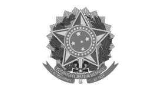

<!-- page 1 -->

<!-- figure p01-fig1 | described_by: agy | ocr_overlap: None | needs_review: false -->
1. **Tipo de figura:** Ilustração heráldica / emblema oficial (Brasão de Armas da República Federativa do Brasil) em escala de cinza sobre fundo branco, sem título externo, legenda, moldura ou elementos de gráfico.

2. **Todo o texto visível (verbatim):**
   - Arco central do listel (faixa inferior), em letras maiúsculas: `REPÚBLICA FEDERATIVA DO BRASIL` *(o acento agudo no "U" é pouco nítido devido à baixa resolução da imagem)*
   - Parte inferior esquerda do listel: `15 de Novembro`
   - Parte inferior direita do listel: `de 1889`
   - Não há outros textos, títulos, rótulos, legendas ou notas.

3. **Estrutura:**
   - A figura não possui caixas, setas, eixos, linhas, colunas ou painéis; trata-se de uma composição heráldica única, simétrica em relação ao eixo vertical e centralizada sobre fundo branco liso:
   - **Resplendor ao fundo:** halo estrelado com pontas triangulares estriadas posicionado atrás de todo o conjunto, com 14 pontas visíveis (7 à esquerda e 7 à direita) emergindo por trás dos ramos.
   - **Ramos laterais (guirlanda):** dois ramos curvados que abraçam a estrela central, unidos na base atrás da espada e do listel — à esquerda, um ramo de café com folhas e frutos escuros; à direita, um ramo de fumo (tabaco) com folhas e pequenas flores claras na extremidade superior direita.
   - **Estrela grande de cinco pontas:** centralizada sobre os ramos, com uma ponta voltada para cima, duas laterais e duas inferiores. Cada ponta é dividida ao meio no sentido do comprimento em duas faces triangulares (uma escura e uma clara) e contornada por uma borda dupla clara.
   - **Escudo circular central:** sobreposto ao centro da estrela de cinco pontas, composto por:
     - Um anel externo delimitado por linhas finas claras contendo 27 pequenas estrelas claras de cinco pontas distribuídas uniformemente em círculo (1 exatamente no topo central, 13 na metade direita e 13 na metade esquerda).
     - Um disco interno contendo 5 estrelas claras de cinco pontas dispostas na forma da constelação do Cruzeiro do Sul (4 estrelas maiores formando uma cruz ligeiramente inclinada e 1 estrela menor próxima ao centro).
   - **Espada vertical na base:** posicionada no eixo central inferior, por trás da estrela grande e da faixa; a base da lâmina aparece entre as duas pontas inferiores da estrela, o punho desce por trás do listel terminando em um pomo abaixo dele, e na guarda (cruzeta) escura há 1 pequena estrela clara de cinco pontas no centro.
   - **Listel (faixa curva inferior):** fita ondulada com extremidades recortadas em "V" voltadas para cima nas pontas laterais; possui uma dobra central elevada que cruza a base da espada e dos ramos (onde está escrito `REPÚBLICA FEDERATIVA DO BRASIL`) e duas abas inferiores estendidas para a esquerda (`15 de Novembro`) e para a direita (`de 1889`).

4. **Números e valores de dados:**
   - Valores numéricos escritos na imagem: `15` e `1889` (compondo a data `15 de Novembro de 1889`).
   - Não há outros números, escalas ou dados quantitativos na figura.

5. **Cores com significado:**
   - A imagem é inteiramente monocromática (tons de cinza sobre fundo branco). Não há codificação de significado por cor; as variações de cinza e branco são usadas exclusivamente para contraste e distinção visual entre os elementos gráficos (como as duas metades de cada ponta da estrela, as estrelas claras sobre o escudo cinza e as letras claras sobre o listel cinza-escuro).

# **UNIVERSIDADE FEDERAL RURAL DE PERNAMBUCO PRÓ-REITORIA DE PÓS-GRADUAÇÃO** 

**Coordenação de Internacionalização dos Programas de Pós-Graduação** **_Stricto sensu_** 

INSTRUÇÃO NORMATIVA UFRPE/PRPG Nº 01, de 09 de abril de 2025 

Estabelece o fluxo de coleta de informações das atividades de internacionalização realizadas pelos Programas de Pós-Graduação _stricto sensu_ da UFRPE. 

A PRÓ-REITORIA DE PÓS-GRADUAÇÃO (PRPG), no uso de suas competências e 

CONSIDERANDO que compete à Coordenação de Internacionalização dos Programas de Pós-Graduação _stricto sensu_ - CIPPG definir, gerenciar e fortalecer políticas de internacionalização para os Programas de Pós-Graduação da UFRPE; 

CONSIDERANDO que cabe à CIPPG gerenciar os Programas de Internacionalização de agências de fomento à pesquisa Nacionais (CNPq e CAPES), da Fundação de Amparo à Ciência e Tecnologia do Estado de Pernambuco (FACEPE) e demais agências que possam fomentar ações de internacionalização de interesse da UFRPE; 

CONSIDERANDO que não existe um fluxo estabelecido de coleta de informações de atividades de internacionalização na pós-graduação em virtude da diversidade de possibilidades de captação de editais pelos docentes e discentes por agências/órgãos externos; 

CONSIDERANDO que é de responsabilidade da CIPPG ter conhecimento das ações de internacionalização nos Programas de Pós-Graduação para subsidiar políticas institucionais de internacionalização e, também, da necessidade de institucionalizar as ações de internacionalização realizadas pela Comunidade Acadêmica, por meio de sua tramitação junto ao Núcleo de Internacionalização (NINTER) da UFRPE, tais como mobilidade acadêmica de discentes, docentes e técnicos, eventos científicos, tecnológicos extensionistas internacionais ou outras atividades; 

1 

<!-- page 2 -->

CONSIDERANDO que é necessário o estabelecimento de um protocolo de comunicação padronizado das ações de internacionalização desenvolvidos pelos Programas de Pós-Graduação - PPG. 

RESOLVE: 

Art. 1º Padronizar o fluxo de informações sobre as ações de internacionalização no âmbito dos Programas de Pós-graduação da Universidade Federal Rural de Pernambuco. 

Art. 2º Fica estabelecido o fluxo de informações sobre as ações de internacionalização envolvendo mobilidade acadêmica _in (entrada no Brasil)_ e _out (saída do Brasil)_ de discentes, docentes e técnicos; aprovação de projeto de pesquisa internacional, oferta de disciplinas ministradas em língua estrangeira e realização de eventos internacionais no âmbito dos Programas de Pós-Graduação da Universidade Federal Rural de Pernambuco. 

Art. 3º Os docentes vinculados aos PPG deverão informar as ações de internacionalização descritas no artigo 2º às Coordenações dos PPG, por meio de ofício seguindo o modelo disponibilizado no <u>Anexo I. Após o recebimento das informações caberá às Coordenações</u> dos PPG realizar o encaminhamento para a CIPPG/UFRPE por meio de correio eletrônico (e-mail: <u>cippg.prpg@ufrpe.br). Esse envio de informação deve ser de fluxo contínuo após a</u> realização da ação de internacionalização de modo a manter o acompanhamento das mesmas atualizado. 

Parágrafo único. No título do e-mail, a Coordenação deverá fazer menção a “Ação de Internacionalização do Programa de Pós-Graduação (especificar o Programa)” a fim de facilitar a identificação pela CIPPG/UFRPE. 

Art. 4º Para as ações de internacionalização de mobilidade acadêmica **_OUT_** de discentes (estágios sanduíche), técnicos e docentes (missões, pós-doutoramento/sabático/professor visitante) no exterior, deverão constar as seguintes informações: 

- I. nome e contato de e-mail do docente/discente; 

- II. país e instituição de destino; 

- III. período da mobilidade; 

- IV. agência de financiamento; (quando houver) 

- V. tipo de atividade: estágio, missão, pós-doutorado (sabático/professor visitante); 

Art. 5º Para as ações de internacionalização de mobilidade acadêmica **_IN_** de discentes (estágio, dupla titulação/co-tutela) e docente (missões, pós-doutoramento/sabático/professor visitante) no Brasil, deverão constar as seguintes informações: 

2 

<!-- page 3 -->

- I. nome e e-mail do discente/docente estrangeiro; 

- II. nome e contatos dos responsáveis por recepcionar no Programa de PG da UFRPE; 

- III. país e instituição de origem; 

- IV. período da mobilidade; 

- V. tipo de atividade: estágio, missão, dupla titulação/cotutela, pós-doutorado (sabático/professor visitante); 

Art. 6º No caso de oferta de disciplina em língua estrangeira deverá informar: 

- I. nome da disciplina; 

- II. carga horária/semestre; 

- III. Ementário; 

- IV. idioma da disciplina; 

- V. docente que ministra a disciplina. 

Art. 7º Aprovação de projetos de pesquisa internacional com as informações abaixo: 

- I. identificação do Coordenador do Projeto 

- II. título do Projeto 

- III. universidade/Instituto/Centro de Pesquisa e País (es)  estrangeiro (s) da parceria; 

- IV. vigência do projeto; 

- V. órgão de fomento; 

- VI. valor do financiamento em reais (caso seja financiado). 

Art. 8º Realização de eventos internacionais, com as informações abaixo: 

- I. Nome do Evento; 

- II. Local e Período; 

- III. Número de participantes 

Art. 9º Os docentes interessados (as) em estabelecer parcerias e colaborações com instituições estrangeiras devem consultar o NINTER via endereço eletrônico: international@ufrpe ou chamado.ipe@ufrpe.br para um direcionamento quanto aos documentos institucionais e modelo dos acordos adotados pela instituição ou consultar a RESOLUÇÃO CONSU/UFRPE Nº 371, DE 4 DE Setembro DE 2023, referente a parcerias nacionais e internacionais. Este procedimento é importante para o mapeamento da rede de instituições internacionais parceiras da UFRPE. 

Esta Instrução Normativa entra em vigor em 09 de abril de 2025. 

3 

<!-- page 4 -->

Recife, 09 de abril  de 2025 

Documento assinado digitalmente EDIVAN RODRIGUES DE SOUZA Data: 09/04/2025 15:56:53-0300 gov.brVerifique em https://validar.iti.gov.br 

**Prof. Edivan Rodrigues de Souza** Coordenador de Internacionalização dos Programas de Pós-Graduação _stricto sensu_ 

Documento assinado digitalmente RINALDO APARECIDO MOTA Data: 09/04/2025 15:07:49-0300 gov.brVerifique em https://validar.iti.gov.br 

**Prof. Rinaldo Aparecido Mota** Pró-Reitor de Pós-Graduação 

4 

<!-- page 5 -->

<!-- figure p05-fig1 | described_by: agy | ocr_overlap: None | needs_review: false -->
1. **Tipo de figura:** Ilustração heráldica/emblema institucional em escala de cinza sobre fundo branco — especificamente o Brasão de Armas da República Federativa do Brasil. Não se trata de gráfico, tabela ou diagrama técnico.

2. **Texto visível (ipsis litteris):**
   Todo o texto aparece inscrito na faixa curva localizada na base do brasão, em letras claras sobre fundo cinza-escuro:
   - Na parte central/superior da faixa, em letras maiúsculas: `REPUBLICA FEDERATIVA DO BRASIL` *(sem acento agudo discernível sobre a letra "U" na resolução da imagem)*
   - Na extremidade inferior esquerda da faixa: `15 de Novembro`
   - Na extremidade inferior direita da faixa: `de 1889`

   Não há títulos externos, legendas, rótulos adicionais, eixos ou células.

3. **Estrutura:**
   A figura é um emblema único, simétrico em relação ao eixo vertical central, composto por camadas sobrepostas do centro para a periferia:
   - **Disco central:** Um círculo cinza contendo 5 estrelas claras de cinco pontas dispostas na forma da constelação do Cruzeiro do Sul (uma superior, uma inferior, uma à esquerda, uma à direita e uma menor próxima ao centro).
   - **Bordadura circular:** Um anel cinza-médio contornado por linhas claras ao redor do disco central, contendo 27 pequenas estrelas claras uniformemente distribuídas em círculo.
   - **Estrela grande de cinco pontas:** Posicionada atrás do disco central, com uma ponta voltada para cima, duas laterais e duas inferiores. Cada ponta é dividida longitudinalmente ao meio em duas metades contrastantes (uma clara e uma escura) e contornada por borda dupla.
   - **Espada vertical:** Disposta no eixo central, parcialmente oculta pela estrela; apenas o terço inferior da lâmina e o punho (com guarda-mão escuro adornado por uma pequena estrela clara ao centro e pomo na extremidade inferior) aparecem visíveis na parte de baixo, atravessando verticalmente por trás da faixa.
   - **Ramos vegetais:** Dois ramos curvos dispostos lateralmente ao redor da estrela grande, unidos na base atrás da espada e da faixa — à esquerda, um ramo de café frutificado (folhas escuras com frutos redondos); à direita, um ramo de fumo florido (folhas escuras com pequenas flores claras na extremidade superior).
   - **Resplendor de fundo:** Uma aura raiada composta por pontas triangulares com listras radiais claras e cinza-médias, formando o contorno mais externo atrás da estrela e dos ramos.
   - **Faixa inferior:** Uma fita curva dobrada com extremidades fendidas em "V" voltadas para cima nas laterais esquerda e direita, passando horizontalmente pela base do conjunto (sobre os ramos e sobre a parte inferior da espada) e contendo as inscrições textuais.

   Não existem caixas, setas, conectores, eixos, linhas, colunas ou painéis múltiplos.

4. **Números e valores de dados:**
   - Números presentes no texto: `15` e `1889` (compondo a data `15 de Novembro de 1889`).
   - Elementos contáveis do emblema: 1 estrela grande de 5 pontas; 5 estrelas no disco interno; 27 pequenas estrelas no anel circular; 1 pequena estrela no centro do guarda-mão da espada.
   - Não há valores de dados quantitativos, medidas ou escalas.

5. **Cores com significado:**
   A imagem está inteiramente em tons de cinza sobre fundo branco; não há cores cromáticas nem codificação de dados por cor. As variações de claro e escuro em escala de cinza servem apenas para delimitar os elementos heráldicos, criar contraste entre as metades das pontas da estrela e garantir a legibilidade do texto claro sobre a faixa escura.

# **UNIVERSIDADE FEDERAL RURAL DE PERNAMBUCO PRÓ-REITORIA DE PÓS-GRADUAÇÃO Coordenação de Internacionalização dos Programas de Pós-Graduação** **_Stricto sensu_** 

# **ANEXO I** 

Recife, xx de xxx de xxxx 

À Coordenação do Programa de Pós-Graduação (informar o PPG) 

**Assunto:** (descrever a ação de internação: mobilidade acadêmica; oferta de disciplina, etc) 

Prezado(a) Coordenador(a), 

Considerando o que consta na Instrução Normativa XX, encaminho as informações referentes à ação de internacionalização. 

**Tipo de Ação:** (descrever a ação de internação: mobilidade acadêmica; oferta de disciplina, etc) 

Art. 4º: **Mobilidade Acadêmica** **_OUT_** . 

**Especificar vínculo:** (   ) Docente (   ) Técnico (   ) Discente 

Nome: 

E-mail: 

País e Instituição de Destino: 

Período da Mobilidade: 

Agência de Fomento (se houver): Tipo de atividade: 

Art. 5º: **Mobilidade Acadêmica** **_IN_** . 

Nome do discente estrangeiro: E-mail: 

5 

<!-- page 6 -->

Nome e contato do responsável no PPG: País e Instituição de origem: Período da mobilidade: Tipo de atividade: 

Art. 6º: **Oferta de disciplina em língua estrangeira** 

Nome da Disciplina: Carga horária/semestre; Ementário: Idioma da Disciplina: Docente da disciplina: 

Art. 7º: **Aprovação de projetos de pesquisa internacional** Identificação do Coordenador do Projeto: Título do Projeto: Instituição de Pesquisa e País(es) estrangeiro(s) da parceria: Vigência do projeto: Órgão de fomento (se houver): Valor do financiamento (se houver): 

Art. 8º: **Realização de eventos internacionais** 

Nome do Evento Local e período de realização: Número de participantes: 

________________________________ [docente/técnico] [PPG vinculado/Lotação] 

6
