<!-- page 1 -->

<!-- figure p01-fig1 | described_by: none | why: known decoration -->

UNIVERSIDADE FEDERAL RURAL DE PERNAMBUCO 

**Plano de Desenvolvimento Institucional da UFRPE 2021 – 2030** 

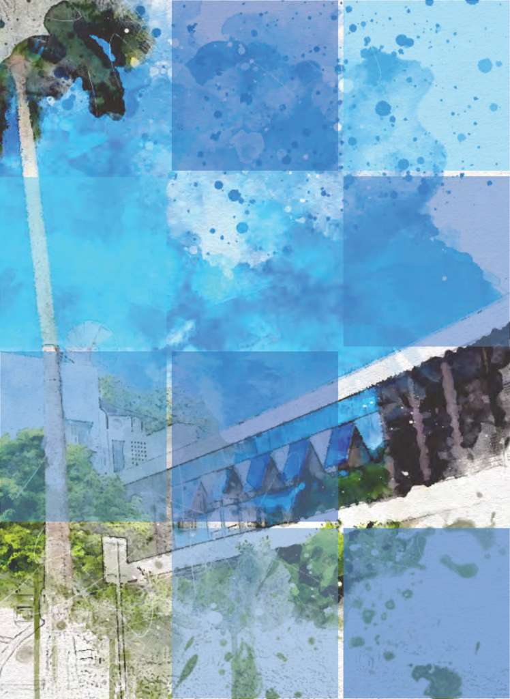

<!-- figure p01-fig2 | described_by: agy | ocr_overlap: None | needs_review: false -->
1. **Figure type:** A portrait-oriented decorative illustration created from a photograph styled with watercolor washes, ink-like line contours, and paint-splatter textures, overlaid with a translucent geometric patchwork grid. It is purely decorative artwork (such as a cover, section divider, or background graphic) rather than a data visualization or technical diagram.

2. **Visible text:** None. There are no titles, labels, legends, captions, axis ticks, or cell values anywhere in the image.

3. **Structure:**
   - **Grid overlay:** The image is divided into a 3-column by 4-row grid of equal-sized rectangular tiles (12 panels total), distinguished by alternating levels of translucent blue tinting and narrow light-colored seams between some tiles rather than drawn borders. There are no diagrams, flow boxes, arrows, connectors, or axes.
     - *Row 1 (top):* Left panel shows the top of a palm tree without a solid rectangular tint; center panel has a medium-dark blue-violet translucent overlay with watercolor splatters; right panel has a pale sky-blue translucent overlay with splatters.
     - *Row 2:* Left panel has a bright cyan-blue tint over the sky and palm trunk; center panel shows lighter sky and cloud washes with splatters; right panel has a medium blue translucent overlay.
     - *Row 3:* Left panel has a light blue translucent overlay over background buildings and trees; center panel has a medium blue translucent overlay over the sky and building windows; right panel is untinted over the darker shaded portion of the building.
     - *Row 4 (bottom):* Left panel is untinted, showing foreground foliage, the base of the palm trunk, and a vertical pole with a small rectangular sign outline; center panel has a muted pale blue-grey overlay over foliage and splatters; right panel has a muted slate-blue translucent overlay with green-tinted splatters.
   - **Underlying scene (continuous across all 12 tiles):** A low-angle outdoor architectural view looking upward at a bright sky:
     - On the left, a tall, slender palm tree trunk extends vertically from the bottom-left edge to a dark cluster of palm fronds at the top-left corner.
     - Behind the palm tree on the lower-left side are light-colored multi-story buildings with rectangular openings, a faint circular dish/antenna silhouette on the roofline, green trees below, and a thin pole with a small rectangular sign near the bottom left.
     - Stretching diagonally upward from lower-center toward the mid-right edge is a low modern building wing with a light horizontal roofline, a row of blue-reflective angled/awning-style windows along its facade, and a darker shadowed vertical section on the right, bordered below by green foliage.
     - The upper half and center consist of an open sky rendered with blue watercolor clouds and scattered paint droplets.

4. **Numbers and data values:** None.

5. **Meaningful colours:** None. Colour is used solely for artistic and decorative effect (blues and cyans for the sky, glass reflections, and translucent grid tiles; greens for foliage; whites, greys, and dark charcoal/browns for architecture and shadows) and does not encode data or semantic categories.

<!-- page 2 -->

## **Plano de Desenvolvimento Institucional da UFRPE  •  2021** _–_ **2030** 

Recife  •  2021 

<!-- page 3 -->

<!-- figure p03-fig1 | described_by: agy | ocr_overlap: None | needs_review: false -->
1. **Type of figure**: A very small, low-resolution (19 × 8 pixels) decorative graphic, icon, or logo fragment (not a chart, diagram, or table).
2. **Visible text**: None. There are no titles, labels, legends, captions, axis ticks, cell values, or other visible text.
3. **Structure**: A single, horizontally symmetric geometric graphic on a white background with no boxes, arrows, axes, rows, columns, or panels. It consists of:
   - An upper horizontal band spanning nearly the full width of the image with softened/tapered left and right edges and an upward-pointing triangular cutout in its bottom center.
   - A centered, upward-pointing triangle at the bottom of the image, nested inside the cutout of the upper band and separated from it by a thin light/white diagonal gap along its left and right sloped edges.
4. **Numbers or data values**: None.
5. **Colours**: The upper band is orange/amber and the bottom centered triangle is dark navy blue against a white background. Because there is no text or legend, no data meaning is indicated by the colours; they appear purely decorative or part of a logo/accent element.

<!-- figure p03-fig2 | described_by: agy | ocr_overlap: None | needs_review: false -->
1. **Type of figure:** A tiny, very low-resolution (18 × 11 pixel) decorative graphic or cropped raster element (such as a small logo fragment, icon, or page-design accent) rather than an informational chart, diagram, or table.

2. **Visible text:** None. There are no titles, labels, legends, captions, axis ticks, or cell values in the image.

3. **Structure:** The image contains no boxes, arrows, axes, rows, columns, or panels. It consists solely of three abstract, soft-edged coloured shapes on a white background:
   - A small horizontal streak along the top-left edge that fades toward the top centre.
   - A prominent central block roughly shaped like an angled, thick "T" or anvil tilted slightly upward from left to right, occupying most of the middle of the frame.
   - A diagonal wedge or stripe running across the lower-right corner beneath the central shape.

4. **Numbers and data values:** None.

5. **Colours:** Colours appear purely decorative and do not encode any legend, scale, or data values: the top-left streak is dark red fading to white, the central shape is warm orange/amber, and the lower-right diagonal stripe is dark navy blue, all set against a white background.

<!-- figure p03-fig3 | described_by: agy | ocr_overlap: None | needs_review: false -->
1. **Kind of figure:** A tiny, very low-resolution (17 × 11 pixels) abstract raster graphic fragment or decorative element extracted from a PDF, rather than a chart, table, diagram, or photograph.

2. **Visible text:** None. There are no titles, labels, legends, captions, axis ticks, or cell values.

3. **Structure:** There are no boxes, arrows, connections, axes, rows, columns, or panels. The image consists solely of three soft-edged colored regions arranged against a white background:
   - A large central orange-amber polygonal/block-like shape occupying most of the frame, tilted slightly downward from left to right, with a stepped indentation on the lower-left and lower-right sides.
   - A narrow dark-red horizontal strip along the top-right edge that fades into white toward the top left.
   - A dark navy-blue diagonal band in the bottom-left corner sloping downward from left to right and fading into white near the bottom center.
   - White space filling the remaining corners (left middle-bottom above the blue band, bottom right, and top left) and forming thin transitions between the colored regions.

4. **Numbers or data values:** None.

5. **Meaningful colours:** No colours carry an identifiable data or semantic meaning within the image itself, as there is no legend or accompanying context; the visual content consists solely of orange-amber, dark red, and dark navy-blue shapes on white.

# 1 

<!-- figure p03-fig4 | described_by: agy | ocr_overlap: None | needs_review: false -->
1. **Type of figure:** A tiny, low-resolution decorative graphic or icon fragment (11 × 13 pixels) extracted from a PDF, rather than a data chart, diagram, or table.

2. **Visible text:** None.

3. **Structure:** On a white background, the graphic consists of two main visual regions with no boxes, arrows, axes, rows, columns, or panels:
   - A solid orange-yellow wedge/trapezoidal shape occupying the lower-left and central-lower portion of the image, with an approximately vertical left edge, a flat horizontal bottom edge, a blunt right end, and a diagonal top-right edge sloping downward from upper-left to mid-right.
   - Across the upper-right region, a diagonal dark navy-blue stripe runs roughly parallel to the sloped upper edge of the orange shape, separated by a narrow white/light-grey gap from a second dark navy-blue patch in the top-right corner.

4. **Numbers and data values:** None.

5. **Meaningful colours:** None; the orange-yellow and dark navy-blue fills appear purely decorative/stylistic, with no legend or semantic encoding visible.

<!-- figure p03-fig5 | described_by: agy | ocr_overlap: None | needs_review: false -->
1. **Type of figure:** A very small, low-resolution decorative graphic or icon/logo fragment (10 × 13 pixels), not a chart, table, diagram, or photograph with readable detail.

2. **Visible text:** None. There is no text, title, label, legend, caption, axis tick, or cell value anywhere in the image.

3. **Structure:** The image contains no boxes, arrows, axes, rows, columns, or panels. It consists solely of abstract colored regions on a white background:
   - **Upper-left region:** A dark navy-blue diagonal band sloping upward from the middle-left edge toward the top-right, with smaller white and light-gray patches above it in the top-left corner.
   - **Diagonal separation:** A narrow white/pale gap running diagonally from the middle-left toward the upper-right, separating the upper-left dark blue region from the lower-right orange region.
   - **Lower-center / right region:** A rounded, wedge-like orange/amber block extending from the middle-left and upper-right down toward the bottom edge, bordered by white along the bottom and lower-right edges.

4. **Numbers and data values:** None.

5. **Colours:** The image uses dark navy blue, orange/amber, and white/light gray; however, with no legend, labels, or surrounding context, no specific semantic meaning can be attributed to these colours beyond visually distinguishing the upper-left and lower-right shapes of the graphic fragment.

<!-- figure p03-fig7 | described_by: none | why: known decoration -->

###### **SERVIÇO PÚBLICO FEDERAL UNIVERSIDADE FEDERAL RURAL DE PERNAMBUCO ADMINISTRAÇÃO SUPERIOR** 

Marcelo Brito Carneiro Leão _– Reitor_ 

Gabriel Rivas _– Vice-Reitor_ 

Maria do Socorro de Lima Oliveira _– Pró-Reitora de Ensino de Graduação_ Maria Madalena Pessoa Guerra _– Pró-Reitora de Pós-Graduação_ Severino Mendes de Azevedo Júnior _– Pró-Reitor de Gestão Estudantil e Inclusão_ Moisés de Melo Santana _– Pró-Reitor de Extensão, Cultura e Cidadania_ 

Carolina Guimarães Raposo _– Pró-Reitora de Planejamento e Desenvolvimento Institucional_ Mozart Alexandre Melo de Oliveira _– Pró-Reitor de Administração_ Patrícia Gadelha Xavier Monteiro _– Pró-Reitora de Gestão de Pessoas_ 

###### **Coordenação** 

Carolina Guimarães Raposo _– Pró-Reitora de Planejamento e Desenvolvimento Institucional_ Rafael Rodrigues Carvalho _– Coordenador de Planejamento e Desenvolvimento Institucional_ Joana dos Santos Silva _– Chefe da Seção de Articulação e Inovação_ 

_Projeto Gráfico e Diagramação –_ Bruno de Souza Leão (Ascom/UFRPE) _Infográficos –_ Equipe de produção de material didático UAEADTec 

_Imagem da capa e das aberturas dos capítulos –_ arte digital sobre fotos de Fernando Azevedo (Ascom/UFRPE) 

<!-- figure p03-fig8 | described_by: none | why: known decoration -->

~~~text ocr
u:
~~~

Dados Internacionais de Catalogação na Publicação (CIP) Sistema Integrado de Bibliotecas da UFRPE Biblioteca Central, Recife-PE, Brasil 

<!-- figure p03-fig9 | described_by: none | why: known decoration -->

<!-- figure p03-fig10 | described_by: none | why: known decoration -->

U58p Universidade Federal Rural de Pernambuco. Pró-Reitoria de Planejamento e Desenvolvimento Institucional Plano de Desenvolvimento Institucional – UFRPE: 2021-2030 / UFRPE. Proplan.  -  Recife: EDUFRPE, 2021. 

409 p. 

Inclui bibliografia. 

1. Universidade Federal Rural de Pernambuco - Planejamento  2. Gestão da qualidade total na educação 3. Universidades e  faculdades – Planejamento - Pernambuco 4. Planejamento educacional 5. Planejamento estratégico 6. Ensino 7. Pesquisa educacional 8. Extensão universitária 9. Inovações educacionais 10. Ensino superior – Finalidades e objetivos I. Título . 

CDD 378.8134 

<!-- page 4 -->

## **Apresentação** 

Ocada por desafios os mais complexos, em que se futuro nunca foi tão incógnito. Em uma época marquestionam princípios científicos básicos e mecanismos democráticos conquistados após muitos anos de estudos, aprendizados, enfrentamentos e maturação de um Brasil tão desigual quanto rico em potenciais diversos, vislumbrar horizontes para as universidades é, no mínimo, desafiador. Por outro lado, esses mesmos desafios que tornam nebulosos os tempos vindouros nos chamam, com mais atenção e vigor, para a necessidade de planejar, prever, nortear e organizar esse futuro, nas mais diversas esferas, mas principalmente no que se refere às Instituições Federais de Ensino Superior (IFES) deste País. 

O Plano de Desenvolvimento Institucional da UFRPE _–_ PDI 2021 _–_ 2030 – surge como projeto complexo, num presente tão desafiador e duro para a população – ao enfrentar uma tragédia sanitária sem precedentes e a desvalorização cruel da ciência, da pesquisa, da educação, da tecnologia e da inovação – exige atitude responsável, ética, comprometida e corajosa de líderes, gestores e gestoras, agentes público(a)s e servidore(a)s da educação. 

Foi com esse sentimento de responsabilidade pública e democrática que a UFRPE construiu, desde o segundo semestre de 2020, o PDI mais participativo de sua história secular. Foram mais de 100 pessoas envolvidas no processo, dentro de seis comissões temáticas e uma Comissão Executiva, que enfrentaram as barreiras do isolamento para se reunir em plataformas virtuais, pensar coletivamente – mesmo em seus espaços individuais – pesquisar, estudar, ponderar, escrever, revisar e repensar toda a complexidade da UFRPE. 

Estudantes, docentes e técnico(a)s-administrativo(a)s foram todo(a)s convidado(a)s a integrar as comissões e, portanto, participar diretamente desse processo. Ou, em momento posterior, durante a fase de consulta pública, contribuir com o documento inicialmente proposto. Desta vez, permeados, de maneira ainda mais forte, pelas Tecnologias Digitais da Informação e Comunicação (TDIC), que permitiram não apenas novas dinâmicas de reuniões e grupos de trabalho, como também a coleta e o tratamento das informações. Por meio da Central PDI, no portal da UFRPE, de eventos e chamamentos por meio de 

<!-- page 5 -->

formulários para participação nas comissões temáticas e processos coletivos de escrita e revisão, chegamos a um documento rico, coeso e complexo, como é a UFRPE. 

Toda essa caminhada nos trouxe uma certeza num período nada linear: a UFRPE não é de tijolo e concreto, e sim feita de pessoas, de atores diversos, com olhares diferentes, mas unidos em torno da luta por uma Universidade cada vez mais plural, transparente e participativa, na perspectiva da educação pública de qualidade, gratuita, inclusiva e voltada para as demandas da sociedade. 

O futuro permanece incógnito, mas os próximos passos da Instituição estão aqui traçados, a fim de que a UFRPE esteja preparada, fortalecida, versátil e unida para os desafios vindouros, comprometida com a formação de cidadãos e cidadãs, a sustentabilidade ambiental, o desenvolvimento socioeconômico, o avanço científico e tecnológico, a inovação e principalmente a qualidade de vida das pessoas. 

###### **_Marcelo Brito Carneiro Leão_** 

_Reitor da UFRPE_ 

<!-- page 6 -->

### **Lista de Siglas** 

###### **A3P** – Agenda Ambiental na Administração Pública 

**AACR2** – Código de Catalogação Anglo-Americano 

**ABNT** – Associação Brasileira de Normas Técnicas 

**Acep** – Assessoria de Cerimonial e Projetos Sociais 

**ACI** – Assessoria de Cooperação 

###### Internacional 

**ACG** – Avaliação dos Cursos de Graduação **AEID** – Auxílio Emergencial de Inclusão 

###### Digital 

**AFD** – Assentamento Funcional Digital **Andifes** – Associação Nacional dos Dirigentes das Instituições Federais de Ensino Superior 

**Aneel** – Agência Nacional de Energia Elétrica 

**APCN** – Apresentação de Propostas de Cursos Novos 

**ASI** – Assessoria de Segurança da 

###### Informação 

**Ascom** – Assessoria de Comunicação **Audin** – Auditoria Interna **Ava** – Ambiente Virtual de Aprendizagem **AVALIES** – Avaliação das Instituições de Educação Superior 

###### **BA** – Bahia 

**BDTD** – Biblioteca Digital de Teses e Dissertações 

**Bext** – Programa Institucional de Bolsa de Extensão universitária 

**Bia** – Bolsa de Incentivo Acadêmico **Biopa** – Laboratório de Biologia Molecular Aplicada à Produção Animal 

**BNCC** – Base Nacional Comum Curricular **BSC** – _Balanced Scorecard_ 

**BSMCA** – Biblioteca Setorial Manuel Correia deAndrade 

**B-UAST** – Biblioteca Vanete Almeida da Unidade Acadêmica de Serra Talhada **B-UACSA** – Biblioteca Esmeraldina Pereira da Silva da Unidade Acadêmica do Cabo de Santo Agostinho 

**B-UABJ** – Biblioteca da Unidade Acadêmica de Belo Jardim 

**B–Codai** – Biblioteca Roldão de Siqueira Campos do Colégio Agrícola Dom Agostinho Ikas 

**Caap** – Coordenadoria de Ações Afirmativas de Permanência **CADM** – Coordenação Administrativa **CAFe** – Comunidade Acadêmica Federada 

**Cafis** – Coordenadoria de Acompanhamento e Fiscalização **Came** – Coordenação de Acompanhamento e Monitoramento de Egressos 

**Capes** – Coordenação de Aperfeiçoamento de Pessoal de Nível Superior **CBO** – Classificação Brasileira de Ocupações 

**CC** – Conselho de Curadores 

**CCD** – Colegiado de Coordenação Didática **CDD** – Classificação Decimal de Dewey **CDHGB** – Comissão de Direitos Humanos Gregório Bezerra 

**CE** – Conceito Enade 

**Ceagri** – Centro de Ensino de Ciências Agrárias 

**Cegoe** – Centro de Ensino de Graduação Obra–Escola 

**Celpa** – Coordenadoria de Celebração de Parcerias 

**Cempre** – Coordenadoria de Fomento e Apoio ao Empreendedorismo **Cenapesq** – Coordenadoria do Centro de Apoio à Pesquisa 

**Cepe** – Conselho de Ensino, Pesquisa e Extensão 

**CEPSH** – Comitê de Ética em Pesquisa com Seres Humanos 

<!-- page 7 -->

**Ceua** – Comissão de Ética no Uso de Animais 

**CF** – Constituição Federal 

**CGARU** – Coordenadoria de Gestão de Alimentos e Restaurante Universitário **CGCL** – Coordenação Geral dos Cursos de Licenciatura 

**CGD** – Comitê de Governança Digital **CGPROD** – Coordenadoria de Gestão de Programas de Pesquisa e da Produção Científica e Tecnológica 

**CGR** – Coordenadoria de Gestão de Risco **CGU** – Controladoria Geral da União **CI** – Conceito Institucional **Cic** – Congresso de Iniciação Científica **Cic-EM** – Congresso de Iniciação Científica - Ensino Médio 

**CID** – Coordenadoria de Inclusão Digital **Cinova** – Coordenadoria de Fomento e Apoio à Inovação e à Propriedade Intelectual 

**Cis** – Comissão Interna de Supervisão **Citi** – Congresso de Iniciação em Tecnologia e Inovação 

**Clase** – Coordenação Geral dos Cursos _Lato sensu_ 

**CMAN** – Coordenação de Manutenção **CMEI** – Centro Municipal de Educação Infantil 

**CNCT** – Catálogo Nacional dos Cursos Técnicos **CNE** – Conselho Nacional de Educação 

**CNPq** – Conselho Nacional de Desenvolvimento Científico e Tecnológico **COAA** – Comissão de Orientação e Acompanhamento Acadêmico 

**Coapi** – Colegiado para Acompanhamento da Política Institucional de Formação Inicial e Continuada de Profissionais do Magistério para a Educação Básica da 

###### UFRPE 

**Codai** – Colégio Agrícola Dom Agostinho Ikas da UFRPE 

**COF** – Coordenadoria de Orçamento e Finanças 

**Cogesti** – Coordenação de Gestão Estudantil e Inclusão 

**COGER** – Coordenação Geral dos Cursos de Graduação nas Unidades Acadêmicas **Compesa** – Companhia Pernambucana de Saneamento 

**COMUT** – Comutação bibliográfica **Conad** – Congresso Nacional da Docência **Conaes** – Comissão Nacional de Educação da Avaliação Superior 

**Conama** – Conselho Nacional do Meio Ambiente 

**Conarq** – Conselho Nacional de Arquivos **Conbia** – Congresso de Iniciação Acadêmica **Condetuf** – Conselho Nacional dos Diretores de Escolas Técnicas vinculadas às Universidades Federais 

**Conex** – Congresso de Extensão **Conid** – Congresso de Iniciação à Docência 

**Consea** – Conselho Nacional de Experimentação Animal **Consu** – Conselho Universitário **Coopac** – Comissão Permanente de Acompanhamento de Acúmulos de Cargos, Empregos e Funções 

**Copesq** – Coordenadoria de Fomento e Apoio à Pesquisa 

**CPA** – Comissão Própria de Avaliação **CPAC** – Comissão Própria de Avaliação do 

###### Codai 

**CPAD** – Comissão Permanente de Avaliação 

###### Documental 

**CPC** – Conceito Preliminar de Curso 

**CPCD** – Comissão Permanente de Concurso 

###### Docente 

**CPCONT** – Coordenadoria de Prestação de Contas 

**CPDI** – Coordenadoria de Planejamento e Desenvolvimento Institucional **CpopMar** – Coordenação da Base de Piscicultura Ornamental e Pesquisa Marinha 

**CPPD** – Comissão Permanente de Pessoal Docente 

**CSIC** – Comitê de Segurança e Privacidade da Informação e Comunicação **CSIND** – Comissão de Sindicância **CT** – Comissão Temática **CTA** – Conselho Técnico Administrativo **CTDA** – Comitê de Transparência e Dados Abertos 

<!-- page 8 -->

**CTPPI** – Centro de Treinamento e Pesquisa em Pequena Irrigação **CT&I** – Ciência, Tecnologia e Inovação **CURA** – Conselho de Curadores 

**DA** – Diretório Acadêmico **DAVV** – Divisão de Áreas Verdes e Vias **DBTA** – Dicionário Brasileiro de Terminologia Arquivística 

**DCC** – Departamento de Ciências do Consumo 

**DCE** – Diretório Central dos Estudantes **Deinfo** – Departamento de Estatística e Informática 

**Delogs** – Departamento de Logística e Serviços 

**Dirad** – Direção Administrativa **DLCH** – Departamento de Letras e Ciências Humanas 

**DOI** – _Digital Object Identifier_ **Dops** – Departamento de Ordem Política e Social 

**DRCA** – Departamento de Registro e Controle Acadêmico 

**DS** – Desenvolvimento Sustentável **DS** – Programa de Demanda Social **DSI** – Divisão de Segurança e Informação **DSU** – Divisão de Segurança Universitária **DQV** – Departamento de Qualidade de Vida **DTR** – Departamento de Tecnologia Rural **DTRANS** – Divisão de Transporte 

**EAD** – Educação a Distância **EAII** Ibimirim – Estação de Agricultura Irrigada de Ibimirim 

**EAIP** – Estação de Agricultura Irrigada de Parnamirim 

**EBTT** – Ensino Básico, Técnico e Tecnológico 

**ECTI** – Educação, Ciência, Tecnologia e Inovação 

**EECAC** – Estação Experimental de Cana-deAçúcar do Carpina 

**EdUFRPE** – Editora Universitária da UFRPE **EEPAC** – Estação Experimental de Pequenos Animais de Carpina 

**EM** – Ensino Médio 

**Enade** – Exame Nacional de Desempenho dos Estudantes 

**Epet** – Encontro do Programa de Educação Tutorial 

**Esap** – Escola Superior de Agricultura de Pernambuco 

**Eso** – Estágio Supervisionado Obrigatório **ETFVUF** – Escolas Técnicas Vinculadas às Universidades Federais 

**Facepe** – Fundação de Amparo à Ciência e Tecnologia do Estado de Pernambuco **Faubai** – Associação Brasileira de Educação Internacional 

**FNTEC** – Fundação de Apoio à Escola Técnica 

**FIC** – Formação Inicial e Continuada 

**Fofa** – Forças, oportunidades, fraquezas e ameaças 

**FORDHOV** – Fórum dos Dirigentes de Hospitais Veterinários Universitários **Forpexc** – Fórum Permanente de Extensão, Cultura e Cidadania 

**Forplad** – Fórum de Pró–Reitores de Planejamento e Administração **Forproexc** – Fórum de Pró-Reitores de Extensão das Instituições Públicas de Educação Superior Brasileiras 

**GRI** – _Global Reporting Initiative_ 

**Hela** – _Hub_ de Empresas Juniores e Ligas Acadêmicas 

**IBICT** – Instituto Brasileiro de Informação em Ciência e Tecnologia 

**IES** – Instituição de Ensino Superior **Ifes** – Instituições Federais de Ensino Superior 

**IGC** – Índice Geral de Cursos 

**IGG** – Índice de Gestão de Governança Pública 

**IIA** – _Institute of International Auditors_ **IMM** – Instituto Menino Miguel **Incubatec** – Incubadora de Empresas da UFRPE 

**Inep** – Instituto Nacional de Estudos e Pesquisas Educacionais Anísio Teixeira 

<!-- page 9 -->

**Inmetro** – Instituto Nacional de Metrologia, Qualidade e Tecnologia 

**Iot** – Internet das Coisas 

**Ipa** – Instituto de Pesquisas Agronômicas **Ipê** – Instituto de Inovação, Pesquisa, Empreendedorismo, Internacionalização e Relações Institucionais 

**IPV** – Instituto de Pesquisas Veterinárias **IPZ** – Instituto de Pesquisas Zootécnicas **IRRD** – Instituto para Redução de Riscos e Desastres 

**IsF** – Idiomas sem fronteiras **ISO** – _International Organization for Standardization_ 

**Jepex** – Jornada de Ensino, Pesquisa e Extensão 

**Labeg** – Laboratório de Expressão Gênica **Lamarsu** – Laboratório de Maricultura Sustentável 

**Lameve** – Laboratório de Melhoramento Vegetal 

**Lapave** – Laboratório de Pesquisa com Aves 

**LDB** – Lei de Diretrizes e Bases da Educação Nacional 

**LDO** – Lei de Diretrizes Orçamentárias **LGBTQIA+** – Lésbicas, Gays, Bissexuais, Travestis, Transexuais, Intersexuais, _Queer_ e mais 

**LGPD** – Lei Geral de Proteção de Dados Pessoais 

**LMS** – _Learning Management System_ **LOA** – Lei Orçamentária Anual 

**MBA** – _Master Business Administration_ **ME** – Ministério da Economia **MEC** – Ministério da Educação **Mei** – Microempreendedor Individual 

**Naces** – Núcleo de Acessibilidade 

**Naps** – Núcleos de Atenção e Promoção à Saúde 

**NCH** – Núcleo do Cuidado Humano **NDE** – Núcleo Docente Estruturante **NEaD** – Núcleo de Educação a Distância **NEBTI** – Número de Empresas com Base Tecnológica Incubada 

**NEI** – Núcleo de Empreendedorismo e Inovação 

**Nemam** – Núcleo de Engenharia e Meio Ambiente 

**Nevi** – Núcleo do Envelhecimento, Velhice e Idosos 

**Nid** – Núcleo de Idiomas **Ninter** – Núcleo de Internacionalização **Nit** – Núcleo de Inovação Tecnológica **Noss** – Norma Operacional de Saúde do Servidor 

**NPCTInt** – Número de Parcerias– Convênios–Termos de Cooperação com instituições internacionais de ensino e de pesquisa 

**NPPD** – Número de Pedidos de Patentes Depositados (INPI ou Instituições Internacionais) 

**NPV** – Número de Patentes Vigentes **Nupesq** – Núcleo de Pesquisa **Nuri** – Núcleo de Relações Institucionais **Nuric** – Núcleo de Relações Institucionais e Convênios 

**OCC** – Outros Custeios e Capital **OCDE** – Organização para a Cooperação e Desenvolvimento Econômico **ODG** – Observatório de Dados da Graduação 

**ODM** – Objetivos de Desenvolvimento do Milênio 

**ODS** – Objetivos de Desenvolvimento Sustentável 

**OJS** – _Open Journal System_ **OMS** – Organização Mundial da Saúde **ONG** – Organização não governamental **Onu** – Organização das Nações Unidas 

###### **PAAV** – Plano Anual de Aquisição de Veículos 

**Pad** – Processo Administrativo Disciplinar **Pad** (PNAES) – Programa de Apoio ao(à) Discente 

**Pag** – Programa de Apoio à Gestante. **Pai** – Programa de Apoio ao Ingressante **Parfor** – Plano Nacional de Formação de Professores da Educação Básica 

<!-- page 10 -->

**PASS** – Política de Atenção à Saúde e Segurança do Trabalho do Servidor Público Federal 

**Pavi** – Programa de Atividades de Vivências Interdisciplinares 

**PBTAC** – Programa Bolsa de Trabalho Aluno Colaborador 

**PCCTAE** – Plano de Carreira dos Cargos Técnico–Administrativos em Educação **PCD** – Pessoa com Deficiência **PCEADIS** – Pesquisa Científica em Educação a Distância 

**PDA** – Plano de Dados Abertos **PDCA** – _Plan_ , _do_ , _check_ e _act_ 

**PDI** – Plano de Desenvolvimento Institucional 

**PDIZ** – Programa de Doutorado Integrado em Zootecnia 

**PDP** – Plano de Desenvolvimento de 

###### Pessoas 

**PDTI** – Plano Diretor de Tecnologia da Informação 

**PE** – Pernambuco **PE** – Planejamento Estratégico **PEI** – Planejamento Estratégico Institucional 

**PEC-G** – Programa de Estudantes-Convênio de Graduação 

**PEH** – Plano de Eficiência Hídrica **PEPG** – Programa de Excelência em Pós–Graduação 

**Peri** – Programa de Ensino Remoto em Idiomas 

**Pestel** – Político, econômico, social, tecnológico, ambiental e jurídico **Pet** – Programa de Educação Tutorial **PFDA** – Política de Formação e Desenvolvimento de Acervos **PGRiscos** – Política de Gestão de Riscos **PGRS** – Plano de Gerenciamento de Resíduos Sólidos 

**PI** – Planos Internos 

**PI** – Propriedade Industrial 

**Pibic** – Programa Institucional de Bolsas de Iniciação Científica 

**Pibic-AF** – Programa Institucional de Bolsas de Iniciação Científica de Ações Afirmativas **Pibic-EM** – Programa Institucional de Bolsas de Iniciação Científica para o Ensino Médio 

**Pibid** – Programa Institucional de Bolsas de Incentivo Acadêmico 

**Pibiti** – Programa Institucional de Bolsas de Iniciação em Desenvolvimento Tecnológico e Inovação 

**Pic** – Pesquisas de Intenção de Capacitação **Pic** – Programa de Incentivo à Cultura **Pic** – Programa de Iniciação Científica **PICV** – Programa de Iniciação Científica Voluntária 

**Piemp** – Programa de Iniciação ao Empreendedorismo **PLS** – Plano de Logística Sustentável 

**PNAES** – Programa Nacional de Assistência Estudantil 

**Pnap** – Programa Nacional de Formação em Administração Pública 

**PNDP** – Política Nacional de Desenvolvimento de Pessoas **PNE** – Plano Nacional da Educação **PNMA** – Política Nacional do Meio Ambiente 

**PNRS** – Política Nacional de Resíduos Sólidos 

**Posic** – Política de Segurança da Informação e Comunicação **PPC** – Projeto Pedagógico de Curso **PPE** – Programa de Promoção ao Esporte **PPG** – Programa de Pós–Graduação **PPI** – Projeto Pedagógico Institucional **PPM** – Programa Pesquisa em Movimento **PREG** – Pró–Reitoria de Ensino de 

Graduação 

**Proad** – Pró–Reitoria de Administração **Proap** – Programa de Apoio à 

Pós-graduação 

**Proex** – Programa de Excelência Acadêmica **PROExC** – Pró–Reitoria de Extensão, Cultura e Cidadania 

**Proffis** – Programa Nacional de Mestrado Profissional em Ensino de Física **Profiap** – Mestrado Profissional em Administração Pública em Rede Nacional **Profletras** – Mestrado Profissional em Letras em Rede Nacional 

<!-- page 11 -->

**Profmat** – Mestrado Profissional em Matemática em Rede Nacional **Profqui** – Mestrado Profissional em Química em Rede Nacional **Progepe** – Pró–Reitoria de Gestão de Pessoas 

**Progesti** – Pró–Reitoria de Gestão Estudantil e Inclusão 

**Proplan** – Pró–Reitoria de Planejamento e Desenvolvimento Institucional **PRPG** – Pró–Reitoria de Pós–Graduação **Prug** – Programa de Residência Universitária para a graduação 

**PTCPqInt** – Índice das publicações técnico– científicas em coautoria com pesquisadores de instituições internacionais 

**REA** – Recursos Educacionais Abertos **Remt** – Regime Especial de Movimentação Temporária 

**Renafor** – Rede Nacional de Formação Inicial e Continuada de Profissionais da Educação Básica 

**Renoen** – Rede Nordeste de Ensino **Renorbio** – Programa de Doutorado em Biotecnologia - Rede Nordeste de Biotecnologia 

**Reuni** – Reestruturação e Expansão das Universidades Federais **RFEPCT** – Rede Federal Educação Profissional, Científica e Tecnológica **RP** – Programa Residência Pedagógica 

###### **RU** – Restaurante Universitário 

**Saas** – Sistema de Acompanhamento e Avaliação dos Cursos e-Tec Brasil **SCMV** – Seção de Conservação e Manutenção de Veículos 

**SEDUC/PE** – Secretaria de Educação e Esporte do Estado de Pernambuco **Seed** – Secretaria de Educação a Distância **Seer** – Sistema Eletrônico de Editoração de Revistas 

**Seg** – Secretaria Geral dos Conselhos da Administração Superior 

**Sesu** – Secretaria de Educação Superior **Setec** – Secretaria de Educação Profissional e Tecnológica do Ministério da Educação **Siass** – Subsistema Integrado de Atenção à Saúde do Servidor 

**SIB** – Sistemas Integrados de Bibliotecas **Sic** – Serviço de Informações ao Cidadão **Sig** – Sistema Integrado de Gestão **SIGAA** – Sistema Integrado de Gestão de Atividades Acadêmicas 

**SigRH** – Sistema Integrado de Gestão de Recursos Humanos 

**Simec** – Sistema Integrado de Monitoramento, Execução e Controle **Simpós** – Simpósio de Pós-Graduação **Sinaes** – Sistema Nacional de Avaliação da Educação Superior 

**Siorg** – Sistema de Organização e Inovação Institucional do Governo Federal 

**Sipac** – Sistema Integrado de Patrimônio, Administração e Contratos 

**Sistec** – Sistema Nacional de Informações da Educação Profissional e Tecnológica **SISU** – Sistema de Seleção Unificada **SisUAB** – Sistema UAB 

**SMA** – Serviço de Monitoramento Aéreo **SPO** – Secretaria de Planejamento, Orçamento e Finanças 

**STD** – Secretaria de Tecnologias Digitais **SVOP** – Seção de Vigilância Ostensiva e Patrimonial 

**SWOT** – _Strengths_ , _weaknesses_ , _opportunities_ e _threats_ 

**TAE** – Técnico-Administrativo **TCC** – Trabalho de conclusão de curso **TCU** – Tribunal de Contas da União **TDIC** – Tecnologias Digitais de Informação e Comunicação 

**TEA** – Transtorno do Espectro Autista **TI** – Tecnologia da Informação **TIC** – Tecnologias de Informação e Comunicação 

**TPMCEGTEECC** – Taxa de Participação dos Membros das Comissões de Extensão da UFRPE nos Grupos de Trabalho de Elaboração das Políticas e Programas Estratégicos de Extensão, Cultura e Cidadania 

**TRCEGTEECC** – Taxa de Representatividade das Comissões de Extensão da UFRPE 

<!-- page 12 -->

nos Grupos de Trabalho de Elaboração das Políticas e Programas Estratégicos de Extensão, Cultura e Cidadania **TSG** – Taxa de Sucesso da Graduação **TSG-AE** – Taxa de Sucesso da Graduação da Assistência Estudantil. 

**UAB** – Universidade Aberta do Brasil **UABJ** – Unidade Acadêmica de Belo Jardim **UACSA** – Unidade Acadêmica do Cabo de Santo Agostinho 

**UAEADTec** – Unidade Acadêmica de Educação a Distância e Tecnologia **UAG** – Unidade Acadêmica de Garanhuns **UAIGs** – Unidades de Auditorias Internas Governamentais 

**UAST** – Unidade Acadêmica de Serra Talhada 

**Ufape** – Universidade Federal do Agreste de Pernambuco 

**UFPE** – Universidade Federal de 

Pernambuco 

**UFRN** – Universidade Federal do Rio Grande do Norte 

**UFRPE** – Universidade Federal Rural de Pernambuco 

**UFSC** – Universidade Federal de Santa Catarina 

**UGR** – Unidades Gestoras de Recursos **UPS** – _Uninterruptible Power Supply_ **URP** – Universidade Rural de Pernambuco 

**VA** – Verificação de Aprendizagem 

<!-- page 13 -->

### **Índice das Figuras** 

|Figura 1 –Comissão Executiva e Comissões Temáticas-- -- -- -- -- -- --**28**|UFRPE de 2013 a 2019- -- -- -- -- -- -- -- -- -- -- -- -- -- -- -- -- -- -- -- -- -- -- -- -- -- -- -- -- -- **168**|
|---|---|
|Figura 2 –Presença Regional da UFRPE- -- -- -- -- -- -- -- -- -- -- -- -- -- -- -- -- -- -- **37**|Figura 13 –Evolução da taxa de evasão da UFRPE de 2013 a 2019,|
|Figura 3 –Quantidade de Depósito Patente/ano-- -- -- -- -- -- -- -- -- -- --**54**|contextualizada no cenário nacional- -- -- -- -- -- -- -- -- -- -- -- -- -- -- -- -- -- -- **168**|
|Figura 4 –Organograma UFRPE | 2020-- -- -- -- -- -- -- -- -- -- -- -- -- -- -- -- -- -- -- **67** Figura 5 –Mecanismos, Princípios e Pilares da Governança praticada na UFRPE-- -- -- -- -- -- -- -- -- -- -- -- -- -- -- -- -- -- -- -- -- -- -- -- -- -- -- -- -- -- -- -- **75** Figura 6 –Base para adoção de práticas relacionadas aos|Figura 14 –Polos com oferta de Cursos de Graduação EAD- UAEADTec/UFRPE-- -- -- -- -- -- -- -- -- -- -- -- -- -- -- -- -- -- -- -- -- -- -- -- -- -- -- -- -- -- -- -- **178** Figura 15 –Trajetória das propostas de criação de novos cursos de pós-graduação_stricto sensu_da UFRPE. Recife, 2021-- -- -- -- -- -- -- **198** |
|mecanismos de Governança Organizacional pública na UFRPE- -- **76** Figura 7 –Stakeholders- -- -- -- -- -- -- -- -- -- -- -- -- -- -- -- -- -- -- -- -- -- -- -- -- -- -- -- -- -- **122**|Figura 16 –Periódicos da UFRPE que integram os periódicos da Capes- -- -- -- -- -- -- -- -- -- -- -- -- -- -- -- -- -- -- -- -- -- -- -- -- -- -- -- -- -- -- -- -- -- -- -- -- -- -- -- -- -- -**213**|
|Figura 8 –SWOT-- -- -- -- -- -- -- -- -- -- -- -- -- -- -- -- -- -- -- -- -- -- -- -- -- -- -- -- -- -- -- -- -- -- -- **126**|Figura 17 –Gestão de documentos-- -- -- -- -- -- -- -- -- -- -- -- -- -- -- -- -- -- -- -- -- -**277** i|
|Figura 9 –Mapa estratégico da UFRPE | 2021 – 2030-- -- -- -- -- -- -- -- **128**|Figura 18 –Perfil da Força de Trabalho-- -- -- -- -- -- -- -- -- -- -- -- -- -- -- -- -- -- -**311** |
|Figura 10 –Evolução da taxa de evasão da UFRPE de 2013 a 2019- -- -- -- -- -- -- -- -- -- -- -- -- -- -- -- -- -- -- -- -- -- -- -- -- -- -- -- -- -- -- -- -- -- -- -- -- -- -- -- -- -- -- -**167**|Figura 19 –Docentes e Técnico(a)s capacitado(a)s por titulação e nível de qualificação- -- -- -- -- -- -- -- -- -- -- -- -- -- -- -- -- -- -- -- -- -- -- -- -- -- -- -- -- -- -- -**312**|
|Figura 11 –Evolução da taxa de evasão por unidade acadêmica da UFRPE de 2013 a 2019-- -- -- -- -- -- -- -- -- -- -- -- -- -- -- -- -- -- -- -- -- -- -- -- -- -- -- -- -- -**167**|Figura 20 –Processo de monitoramento dos resultados do PDI _2021 – 2030_- -- -- -- -- -- -- -- -- -- -- -- -- -- -- -- -- -- -- -- -- -- -- -- -- -- -- -- -- -- -- -- -- -- -- -- -- -- **370**|
|Figura 12 –Evolução da taxa de evasão por grau acadêmico da||

<!-- page 14 -->

### **Índice dos quadros** 

|Quadro 1.Área de Conhecimento x Curso de Graduação- -- -- -- -- --**40**|Quadro 16.Cursos de Graduação EAD_–_UAEADTec/UFRPE por|
|---|---|
|Quadro 2.Programas de Pós-Graduação da UFRPE-- -- -- -- -- -- -- -- -- --**42**|polos-- -- -- -- -- -- -- -- -- -- -- -- -- -- -- -- -- -- -- -- -- -- -- -- -- -- -- -- -- -- -- -- -- -- -- -- -- -- -- -- -- -- **178**|
|Quadro 3.Boas práticas de liderança na UFRPE- -- -- -- -- -- -- -- -- -- -- -- --**77** Quadro 4.Boas práticas de estratégia na UFRPE- -- -- -- -- -- -- -- -- -- -- --**78** Quadro 5.Boas práticas de controle na UFRPE-- -- -- -- -- -- -- -- -- -- -- -- --**80**|Quadro 17.Dados do Relatório da CPA (2020)_–_Cursos de graduação UAEADTec/UFRPE- -- -- -- -- -- -- -- -- -- -- -- -- -- -- -- -- -- -- -- -- -- -- -- **183** Quadro 18.Cursos de pós-graduação_stricto sensu_oferecidos pela UFRPE com respectivos conceitos/notas, de acordo com a última|
|Quadro 6.Eixos de avaliação, dimensões e pesos atribuídos-- -- **105**|avaliação quadrienal da Capes (2017), por modalidade. Recife,|
|Quadro 7.Dimensões da política de autoavaliação dos cursos de|2021- -- -- -- -- -- -- -- -- -- -- -- -- -- -- -- -- -- -- -- -- -- -- -- -- -- -- -- -- -- -- -- -- -- -- -- -- -- -- -- -- -- -- **196**|
|graduação-- -- -- -- -- -- -- -- -- -- -- -- -- -- -- -- -- -- -- -- -- -- -- -- -- -- -- -- -- -- -- -- -- -- -- -- -- -- **109**|Quadro 19.Quantitativo de beneficiário(a)s durante o PLE.-- -- **243**|
|Quadro 8.Eixos, dimensões e objetivos da autoavaliação na pós-|Quadro 20.Programas vinculados à PREG- -- -- -- -- -- -- -- -- -- -- -- -- -- -- --**250**|
|graduação-- -- -- -- -- -- -- -- -- -- -- -- -- -- -- -- -- -- -- -- -- -- -- -- -- -- -- -- -- -- -- -- -- -- -- -- -- -- -**112**|Quadro 21.Programas vinculados à PRPG- -- -- -- -- -- -- -- -- -- -- -- -- -- -- -- **252**|
|Quadro 9.Dimensões da política de autoavaliação dos cursos básicos, técnicos e tecnológicos do Codai- -- -- -- -- -- -- -- -- -- -- -- -- -- -- -**114** Quadro 10.Cursos de licenciatura da UFRPE por área de conhecimento, modalidade e localização-- -- -- -- -- -- -- -- -- -- -- -- -- -- -- **146**| Quadro 22.Programas vinculados à PROExC- -- -- -- -- -- -- -- -- -- -- -- -- -- **252** Quadro 23.Programas vinculados à Progesti-- -- -- -- -- -- -- -- -- -- -- -- -- **253** Quadro 24.Auxílios coordenados pela Progesti-- -- -- -- -- -- -- -- -- -- --**254**|
|Quadro 11.Cursos regularmente oferecidos pelo Codai-- -- -- -- -- **154**|Quadro 25.Agenda de Intervenções Nemam 2021_–_2030-- -- -- -- -**331**|
|Quadro 12.Cursos FIC ofertados pelo NEaD/ Codai e respectivas|Quadro 26.Orçamento de pessoal-- -- -- -- -- -- -- -- -- -- -- -- -- -- -- -- -- -- -- -- -- -**361**|
|cargas horárias- -- -- -- -- -- -- -- -- -- -- -- -- -- -- -- -- -- -- -- -- -- -- -- -- -- -- -- -- -- -- -- -- -- -- -**157**|Quadro 27.Receita Própria, exceto associações-- -- -- -- -- -- -- -- -- -- -- **363**|
|Quadro 13.Relação de cursos de graduação_–_modalidade|Quadro 28.Receita própria associações-- -- -- -- -- -- -- -- -- -- -- -- -- -- -- -- --**364**|
|presencial- -- -- -- -- -- -- -- -- -- -- -- -- -- -- -- -- -- -- -- -- -- -- -- -- -- -- -- -- -- -- -- -- -- -- -- -- -- -- **165**|Quadro 29.Discricionário Despesas Correntes com fonte tesouro **364**|
|Quadro 14.Histórico dos Cursos de Graduação EAD – UAEADTec/|Quadro 30.Discricionário Investimentos com fonte tesouro-- -- **365**|
|UFRPE-- -- -- -- -- -- -- -- -- -- -- -- -- -- -- -- -- -- -- -- -- -- -- -- -- -- -- -- -- -- -- -- -- -- -- -- -- -- -- -- -- -**174**|Quadro 31.Cronograma Revisão de PDI 2021_–_2030- -- -- -- -- -- -- -- -**371**|
|Quadro 15.Cursos de Graduação EAD ativos na UAEADTec/||
|UFRPE-- -- -- -- -- -- -- -- -- -- -- -- -- -- -- -- -- -- -- -- -- -- -- -- -- -- -- -- -- -- -- -- -- -- -- -- -- -- -- -- -- -**175**||

<!-- page 15 -->

### **Índice dos objetivos estratégicos** 

Objetivo estratégico 1. Elevar a qualidade da formação orientada para o enfrentamento dos desafios complexos, plurais e diversos da sociedade contemporânea - -- -- -- -- -- -- -- -- -- -- -- -- -- -- -- -- -- -- -- -- -- -- -- **130** Objetivo estratégico 2. Mitigar riscos específicos de retenção e evasão em cada curso - -- -- -- -- -- -- -- -- -- -- -- -- -- -- -- -- -- -- -- -- -- -- -- -- -- -- -- -- -- **130** Objetivo estratégico 3. Promover a adoção de metodologias inovadoras e inclusivas em favor do melhor uso de novas tecnologias para a formação - -- -- -- -- -- -- -- -- -- -- -- -- -- -- -- -- -- -- -- -- -- -- -- -- - **131** Objetivo estratégico 4. Desenvolver a produção científica e a inovação de alto impacto -- -- -- -- -- -- -- -- -- -- -- -- -- -- -- -- -- -- -- -- -- -- -- -- -- -- -- **132** Objetivo estratégico 5. Envolver membros de comunidades externas locais, regionais e internacionais na priorização de demandas contextualizadas por produção científica e inovação - -- -- -- -- -- -- -- -- -- -- -- -- -- -- -- -- -- -- -- -- -- -- -- -- -- -- -- -- -- -- -- -- -- -- -- -- -- -- -- **132** Objetivo estratégico 6. Fortalecer a extensão como relação dialógica, transformadora e integradora entre a universidade e a sociedade - -- -- -- -- -- -- -- -- -- -- -- -- -- -- -- -- -- -- -- -- -- -- -- -- -- -- -- -- -- -- -- -- -- -- -- -- -- -- **133** Objetivo estratégico 7. Aperfeiçoar a política de assistência estudantil considerando as atuais demandas sociais (de saúde, digitais, habitacionais e alimentares) -- -- -- -- -- -- -- -- -- -- -- -- -- -- -- -- -- -- **134** Objetivo estratégico 8. Promover e disseminar ações concretas para a melhoria da governança - -- -- -- -- -- -- -- -- -- -- -- -- -- -- -- -- -- -- -- -- -- -- **135** 

Objetivo estratégico 9. Consolidar iniciativas de inovação organizacional -- -- -- -- -- -- -- -- -- -- -- -- -- -- -- -- -- -- -- -- -- -- -- -- -- -- -- -- -- -- -- -- -- -- -- **135** Objetivo estratégico 10. Aprimorar os fluxos de comunicação institucional - -- -- -- -- -- -- -- -- -- -- -- -- -- -- -- -- -- -- -- -- -- -- -- -- -- -- -- -- -- -- -- -- -- -- -- -- **136** Objetivo estratégico 11. Efetivar a logística sustentável - -- -- -- -- -- **136** Objetivo estratégico 12. Fortalecer o caráter estratégico no desenvolvimento do capital humano na UFRPE - -- -- -- -- -- -- -- -- -- -- - **137** Objetivo estratégico 13. Qualificar dialogicamente as ações de atenção à saúde, segurança no trabalho e qualidade de vida - - **137** Objetivo estratégico 14. Implementar a gestão integrada da infraestrutura física da UFRPE -- -- -- -- -- -- -- -- -- -- -- -- -- -- -- -- -- -- -- -- -- -- -- **138** Objetivo estratégico 15. Assegurar e gerir os recursos tecnológicos necessários para uma melhor eficiência das atividades da UFRPE. - -- -- -- -- -- -- -- -- -- -- -- -- -- -- -- -- -- -- -- -- -- -- -- -- -- -- -- -- -- -- -- -- -- -- -- -- -- -- -- -- **138** Objetivo estratégico 16. Conhecer e adotar as melhores práticas do sistema de IFES na ampliação de parcerias com entes públicos e privados para captação de recursos financeiros -- -- -- -- -- -- -- -- -- -- **139** Objetivo estratégico 17. Envolver todos os níveis de gestão nos esforços por eficiência e sustentabilidade -- -- -- -- -- -- -- -- -- -- -- -- -- -- **139** 

<!-- page 16 -->

### **Índice dos objetivos específicos** 

|Objetivo 1.Gestão de risco- -- -- -- -- -- -- -- -- -- -- -- -- -- -- -- -- -- -- -- -- -- -- -- -- -- -- --**84**|Objetivo 15.Detalhamento da Diretriz 2_–_Transição para o modelo|
|---|---|
|Objetivo 2.Integridade institucional-- -- -- -- -- -- -- -- -- -- -- -- -- -- -- -- -- -- -- --**85** |de Ensino Híbrido pela adoção de ferramentas tecnológicas de informação- -- -- -- -- -- -- -- -- -- -- -- -- -- -- -- -- -- -- -- -- -- -- -- -- -- -- -- -- -- -- -- -- -- -- -- -- -- **162**|
|Objetivo 3.Integridade institucional – transparência organizacional-- -- -- -- -- -- -- -- -- -- -- -- -- -- -- -- -- -- -- -- -- -- -- -- -- -- -- -- -- -- -- -- -- -- -- --**86** Objetivo 4.Avaliação Institucional_–_Ações de planejamento-- -**116**|Objetivo 16.Detalhamento da Diretriz 3_–_Atualizar e implantar Planos de Cursos de Educação Profissional, presenciais e a distância- -- -- -- -- -- -- -- -- -- -- -- -- -- -- -- -- -- -- -- -- -- -- -- -- -- -- -- -- -- -- -- -- -- -- -- -- -- -- -- **163**|
|Objetivo 5.Avaliação Institucional_–_Programas de pós- graduação-- -- -- -- -- -- -- -- -- -- -- -- -- -- -- -- -- -- -- -- -- -- -- -- -- -- -- -- -- -- -- -- -- -- -- -- -- -- -**117** |Objetivo 17.Detalhamento da Diretriz 4_–_Ampliar a participação do Codai junto às demais Unidades Acadêmicas e administrativas|
|Objetivo 6.Avaliação institucional_–_cursos de graduação- -- -- -- -**118**|da UFRPE-- -- -- -- -- -- -- -- -- -- -- -- -- -- -- -- -- -- -- -- -- -- -- -- -- -- -- -- -- -- -- -- -- -- -- -- -- -- -- **163**|
|Objetivo 7.Avaliação Institucional_–_Ensino Básico, Técnico e|Objetivo 18.Política de Estágios- -- -- -- -- -- -- -- -- -- -- -- -- -- -- -- -- -- -- -- -- -- -- -**171**|
|Tecnológico-- -- -- -- -- -- -- -- -- -- -- -- -- -- -- -- -- -- -- -- -- -- -- -- -- -- -- -- -- -- -- -- -- -- -- -- -- -**119**|Objetivo 19.Redução da Evasão-- -- -- -- -- -- -- -- -- -- -- -- -- -- -- -- -- -- -- -- -- -- -- **172**|
|Objetivo 8.Licenciatura e formação continuada-- -- -- -- -- -- -- -- -- -- -- **150**|Objetivo 20.Acompanhamento de Discente e Apoio|
|Objetivo 9.Interação Escola X Universidade-- -- -- -- -- -- -- -- -- -- -- -- -- -- -**151**|Pedagógico-- -- -- -- -- -- -- -- -- -- -- -- -- -- -- -- -- -- -- -- -- -- -- -- -- -- -- -- -- -- -- -- -- -- -- -- -- **172**|
|Objetivo 10.Projeto Pedagógico Curricular (PPC) das|Objetivo 21.Graduação EAD_–_Eixo Ensino-- -- -- -- -- -- -- -- -- -- -- -- -- -- -- -**191**|
|Licenciaturas-- -- -- -- -- -- -- -- -- -- -- -- -- -- -- -- -- -- -- -- -- -- -- -- -- -- -- -- -- -- -- -- -- -- -- -- -**151**|Objetivo 22.Graduação EAD_–_Eixo Pesquisa- -- -- -- -- -- -- -- -- -- -- -- -- --**192**|
|Objetivo 11.Matrícula nas licenciaturas-- -- -- -- -- -- -- -- -- -- -- -- -- -- -- -- -- **152**|Objetivo 23.Graduação EAD_–_Eixo Extensão-- -- -- -- -- -- -- -- -- -- -- -- -- **193**|
|Objetivo 12.TSG cursos de licenciatura- -- -- -- -- -- -- -- -- -- -- -- -- -- -- -- -- -- **152** |Objetivo 24.Graduação EAD_–_Formação docente/tutorial e|
|Objetivo 13.Práticas extensionistas na educação básica- -- -- -- -- **152**|formação discente-- -- -- -- -- -- -- -- -- -- -- -- -- -- -- -- -- -- -- -- -- -- -- -- -- -- -- -- -- -- -- -- **194**|
|Objetivo 14.Detalhamento da Diretriz 1_–_Revisão periódica do|Objetivo 25.Graduação EAD_–_Infraestrutura física, tecnológica e|
|Projeto Político-Pedagógico do Colégio, cuja última versão,|Inovação- -- -- -- -- -- -- -- -- -- -- -- -- -- -- -- -- -- -- -- -- -- -- -- -- -- -- -- -- -- -- -- -- -- -- -- -- -- -- -- **195**|
|datada de 2004- -- -- -- -- -- -- -- -- -- -- -- -- -- -- -- -- -- -- -- -- -- -- -- -- -- -- -- -- -- -- -- -- -- -- **162**|Objetivo 26.Pós-graduação_–_infraestrutura- -- -- -- -- -- -- -- -- -- -- -- -- --**200**|

<!-- page 17 -->

|Objetivo 27.Pós-graduação_–_Internacionalização- -- -- -- -- -- -- -- -- -- -**201**|Objetivo 47.Políticas de apoio à permanência- -- -- -- -- -- -- -- -- -- -- -- --**248**|
|---|---|
|Objetivo 28.Pós-graduação_–_Inovação e Empreendedorismo- **202**|Objetivo 48.Assistência Estudantil_–_Inclusão Digital-- -- -- -- -- -- --**249**|
|Objetivo 29.Pós-graduação_–_Dissertações e teses-- -- -- -- -- -- -- -- -- **203**|Objetivo 49.Estrutura para atender pessoa com deficiência-- --**249**|
|Objetivo 30.Pós-graduação_–_conceito Capes-- -- -- -- -- -- -- -- -- -- -- -- --**204**|Objetivo 50.Programa de Atividade de Vivência Multidisciplinar|
|Objetivo 31.Pós-graduação_–_Saúde mental-- -- -- -- -- -- -- -- -- -- -- -- -- -- **205**|(PAVI)- -- -- -- -- -- -- -- -- -- -- -- -- -- -- -- -- -- -- -- -- -- -- -- -- -- -- -- -- -- -- -- -- -- -- -- -- -- -- -- -- -- **255**|
|Objetivo 32.Pós-graduação_–_Contexto pós-pandêmico-- -- -- -- --**206**|Objetivo 51.Programas de Monitoria-- -- -- -- -- -- -- -- -- -- -- -- -- -- -- -- -- -- -- **255**|
|Objetivo 33.Pós-graduação_–_Especializações- -- -- -- -- -- -- -- -- -- -- -- --**208**|Objetivo 52.Bolsa de Incentivo Acadêmico (BIA)-- -- -- -- -- -- -- -- -- -- **255**|
|Objetivo 34.Pesquisa científica na graduação e pós-graduação **214**|Objetivo 53.Estágio de Discentes- -- -- -- -- -- -- -- -- -- -- -- -- -- -- -- -- -- -- -- -- -- **256**|
|Objetivo 35.Política de Publicação- -- -- -- -- -- -- -- -- -- -- -- -- -- -- -- -- -- -- -- -- -**215**|Objetivo 54.Residência Pedagógica-- -- -- -- -- -- -- -- -- -- -- -- -- -- -- -- -- -- -- -- **256**|
|Objetivo 36.Valorizar a pesquisa e as atividades inovadoras- -- -**215**|Objetivo 55.Programa de Iniciação à Docência-- -- -- -- -- -- -- -- -- -- -- -- **256**|
|Objetivo 37.Integração atividades de pesquisa e os_campi_|Objetivo 56.Bolsas de Extensão- -- -- -- -- -- -- -- -- -- -- -- -- -- -- -- -- -- -- -- -- -- -- -**257**|
|avançados-- -- -- -- -- -- -- -- -- -- -- -- -- -- -- -- -- -- -- -- -- -- -- -- -- -- -- -- -- -- -- -- -- -- -- -- -- -- **216**|Objetivo 57.Restaurante Universitário (RU)-- -- -- -- -- -- -- -- -- -- -- -- -- -- -**257**|
|Objetivo 38.Extensão_–_Curricularização/creditação- -- -- -- -- -- -- -- **225**|Objetivo 58.Residência Estudantil-- -- -- -- -- -- -- -- -- -- -- -- -- -- -- -- -- -- -- -- -- -**257**|
|Objetivo 39.Extensão_–_comunicação, arte, cultura e cidadania **226**|Objetivo 59.Monitoramento dos objetivos do PDI-- -- -- -- -- -- -- -- -- **263**|
|Objetivo 40.Direitos humanos e diversidade-- -- -- -- -- -- -- -- -- -- -- -- -- -**227**|Objetivo 60.Planejamento participativo- -- -- -- -- -- -- -- -- -- -- -- -- -- -- -- -- **263**|
|Objetivo 41.Extensão_–_Política de Extensão-- -- -- -- -- -- -- -- -- -- -- -- --**228**|Objetivo 61.Cultura do Planejamento- -- -- -- -- -- -- -- -- -- -- -- -- -- -- -- -- -- --**264**|
|Objetivo 42.Política de Acessibilidade Institucional-- -- -- -- -- -- -- -- **232**|Objetivo 62.Estrutura Organizacional-- -- -- -- -- -- -- -- -- -- -- -- -- -- -- -- -- --**264**|
|Objetivo 43.Formação de servidore(a)s em Acessibilidade-- -- -- **232**|Objetivo 63.Gestão de Processos- -- -- -- -- -- -- -- -- -- -- -- -- -- -- -- -- -- -- -- -- -- **265**|
|Objetivo 44.Acompanhamento de Egresso(a)s-- -- -- -- -- -- -- -- -- -- -- -- **236**|Objetivo 64.Política de Comunicação- -- -- -- -- -- -- -- -- -- -- -- -- -- -- -- -- -- --**268**|
|Objetivo 45.Assistência Estudantil_–_Taxa de Sucesso, Taxa de|Objetivo 65.Gestão da imagem institucional-- -- -- -- -- -- -- -- -- -- -- -- -- **269**|
|retenção e evasão de Estudantes Assistido(a)s- -- -- -- -- -- -- -- -- -- -- -**247**|Objetivo 66.Comunicação Interna-- -- -- -- -- -- -- -- -- -- -- -- -- -- -- -- -- -- -- -- -- **270**|
|Objetivo 46.Assistência Estudantil – Acompanhamento de|Objetivo 67.Diálogo com a sociedade- -- -- -- -- -- -- -- -- -- -- -- -- -- -- -- -- -- -- -**271**|
|Discentes Assistido(a)s- -- -- -- -- -- -- -- -- -- -- -- -- -- -- -- -- -- -- -- -- -- -- -- -- -- -- -- -- -**247**| Objetivo 68.Gestão da informação- -- -- -- -- -- -- -- -- -- -- -- -- -- -- -- -- -- -- -- -- **273**|

<!-- page 18 -->

|Objetivo 69.Trâmites informacionais e documentais_–_|Objetivo 89.Sistema único de gestão de serviços-- -- -- -- -- -- -- -- -- -- **292**|
|---|---|
|Capacitação-- -- -- -- -- -- -- -- -- -- -- -- -- -- -- -- -- -- -- -- -- -- -- -- -- -- -- -- -- -- -- -- -- -- -- --|-- **274** Objetivo 90.Governança em TI-- -- -- -- -- -- -- -- -- -- -- -- -- -- -- -- -- -- -- -- -- -- -- -- **293**|
|Objetivo 70.Gestão da estrutura intelectual e tecnológica- --|-- **275** Objetivo 91.Plano orçamentário em TI-- -- -- -- -- -- -- -- -- -- -- -- -- -- -- -- -- -- **293**|
|Objetivo 71.Acesso a informações e documentos-- -- -- -- -- -- -- -- --|-- **276** Objetivo 92.Gestão de recursos hídricos-- -- -- -- -- -- -- -- -- -- -- -- -- -- -- --**298**|
|Objetivo 72.Política de gestão de documentos- -- -- -- -- -- -- -- -- -- --|-- **278** Objetivo 93.Energia limpa e acessível- -- -- -- -- -- -- -- -- -- -- -- -- -- -- -- -- -- --**299**|
|Objetivo 73.Ciclo Documental-- -- -- -- -- -- -- -- -- -- -- -- -- -- -- -- -- -- -- -- -- -- --|-- **279** Objetivo 94.Conscientização ambiental-- -- -- -- -- -- -- -- -- -- -- -- -- -- -- -- --**300**|
|Objetivo 74.Gestão dos periódicos eletrônicos- -- -- -- -- -- -- -- -- -- --|-- -**281** Objetivo 95.Resíduos sólidos-- -- -- -- -- -- -- -- -- -- -- -- -- -- -- -- -- -- -- -- -- -- -- -- -- -**301**|
|Objetivo 75.Gestão das publicações de livros- -- -- -- -- -- -- -- -- -- -- --|-- **282** Objetivo 96.Trabalho Social-- -- -- -- -- -- -- -- -- -- -- -- -- -- -- -- -- -- -- -- -- -- -- -- -- -- **302**|
|Objetivo 76.Política de Gestão da Memória-- -- -- -- -- -- -- -- -- -- -- -- --|--**284** Objetivo 97.Cultura empreendedora-- -- -- -- -- -- -- -- -- -- -- -- -- -- -- -- -- -- --**304**|
|Objetivo 77.Memorial da UFRPE- -- -- -- -- -- -- -- -- -- -- -- -- -- -- -- -- -- -- -- -- --|-- **285** Objetivo 98.Inovações Sociais e econômicas- -- -- -- -- -- -- -- -- -- -- -- -- --**304**|
|Objetivo 78.Adequação à LGPD-- -- -- -- -- -- -- -- -- -- -- -- -- -- -- -- -- -- -- -- -- --|-- -**287** Objetivo 99.Internacionalização capacitação-- -- -- -- -- -- -- -- -- -- -- -- -- **305**|
|Objetivo 79.:Capacitação em Segurança da Informação-- -- -- --|-- -**287** Objetivo 100.Cooperação Internacional-- -- -- -- -- -- -- -- -- -- -- -- -- -- -- -- --**306**|
|Objetivo 80.Segurança de Dados e Serviços Digitais- -- -- -- -- -- --|--**288** Objetivo 101.Confeccionar Projetos de Desenvolvimento|
|Objetivo 81.Segurança da informação-- -- -- -- -- -- -- -- -- -- -- -- -- -- -- -- --|--**288** Institucional com recursos externos-- -- -- -- -- -- -- -- -- -- -- -- -- -- -- -- -- -- -- -**307**|
|Objetivo 82.Dados Abertos-- -- -- -- -- -- -- -- -- -- -- -- -- -- -- -- -- -- -- -- -- -- -- -- --|--**289** Objetivo 102.Prospecção e formalização de projetos|
|Objetivo 83.Sistemas de informação de acordo com as diretr|izes acadêmicos-- -- -- -- -- -- -- -- -- -- -- -- -- -- -- -- -- -- -- -- -- -- -- -- -- -- -- -- -- -- -- -- -- -- -- -- --**308**|
|do Governo Digital-- -- -- -- -- -- -- -- -- -- -- -- -- -- -- -- -- -- -- -- -- -- -- -- -- -- -- -- -- -- --|--**289** Objetivo 103.Cultura de realização de parcerias institucionais **309**|
|Objetivo 84.:Processos de negócio transformados|Objetivo 104.Capacitação e qualificação dos servidore(a)s- -- -- **318**|
|digitalmente- -- -- -- -- -- -- -- -- -- -- -- -- -- -- -- -- -- -- -- -- -- -- -- -- -- -- -- -- -- -- -- -- -- -- --|--**290** Objetivo 105.Sistemas e processos em gestão de pessoas-- -- -- **319**|
|Objetivo 85.Infraestrutura tecnológica-- -- -- -- -- -- -- -- -- -- -- -- -- -- -- --|--**290** Objetivo 106.Gerenciamento do capital humano-- -- -- -- -- -- -- -- -- -- **320**|
|Objetivo 86.Datacenter backup-- -- -- -- -- -- -- -- -- -- -- -- -- -- -- -- -- -- -- -- -- --|-- -**291** Objetivo 107.Ações de Atenção à Saúde do(a) Servidor(a)- -- -- -- -**321**|
|Objetivo 87.Gerir ativos de TIC- -- -- -- -- -- -- -- -- -- -- -- -- -- -- -- -- -- -- -- -- -- --|-- -**291** Objetivo 108.Ações de saúde e segurança do trabalho do(a)|
|Objetivo 88.Programa de_Campus_Inteligente-- -- -- -- -- -- -- -- -- -- --|-- **292** servidor(a)-- -- -- -- -- -- -- -- -- -- -- -- -- -- -- -- -- -- -- -- -- -- -- -- -- -- -- -- -- -- -- -- -- -- -- -- -- -- **322**|

<!-- page 19 -->

|Objetivo 109.Serviços terceirizados-- -- -- -- -- -- -- -- -- -- -- -- -- -- -- -- -- -- -- --|**323** Objetivo 114.Preservação e conservação dos Acervos-- -- -- -- -- -- **353**|
|---|---|
|Objetivo 110.Transporte e Gestão da Frota- -- -- -- -- -- -- -- -- -- -- -- -- -- --|**344** Objetivo 115.Repositório Institucional-- -- -- -- -- -- -- -- -- -- -- -- -- -- -- -- -- -- **354**|
|Objetivo 111.Segurança Patrimonial e de Pessoas-- -- -- -- -- -- -- -- --|**345** Objetivo 116.Laboratórios-- -- -- -- -- -- -- -- -- -- -- -- -- -- -- -- -- -- -- -- -- -- -- -- -- -- -- -**357**|
|Objetivo 112.Gestão de Espaços de Uso Comum e Centros de|Objetivo 117.Gestão Orçamentária e Financeira-- -- -- -- -- -- -- -- -- -- -- -**367**|
|Ensino-- -- -- -- -- -- -- -- -- -- -- -- -- -- -- -- -- -- -- -- -- -- -- -- -- -- -- -- -- -- -- -- -- -- -- -- -- -- -- -- --|**346** Objetivo 118.Transparência do Orçamento da UFRPE-- -- -- -- -- -- -- -**367**|
|Objetivo 113.Formação e Desenvolvimento do Acervo||
|Bibliográfico- -- -- -- -- -- -- -- -- -- -- -- -- -- -- -- -- -- -- -- -- -- -- -- -- -- -- -- -- -- -- -- -- -- -- -- --|**352**|

<!-- page 20 -->

### **Sumário** 

|Introdução-- -- -- -- -- -- -- -- -- -- -- -- -- -- -- -- -- -- -- -- -- -- -- -- -- -- -- -- -- -- -- -- -- -- -- -- -- -- --**26**|_humanos e diversidades_-- -- -- -- -- -- -- -- -- -- -- -- -- -- -- -- -- -- -- -- -- -- -- -- -- -- -- -- -- -- -- -- -- -- -- -- -56|
|---|---|
|_Metodologia de elaboração do PDI 2021 – 2030_- -- -- -- -- -- -- -- -- -- -- -- -- -- -- -- --27|_Proposições e Diretrizes – Relações Humanas_- -- -- -- -- -- -- -- -- -- -- -- -- -- -- -- -- -- -58|
|_Principais resultados do PDI 2013 – 2020_- -- -- -- -- -- -- -- -- -- -- -- -- -- -- -- -- -- -- -- -- -- -29|Organização administrativa-- -- -- -- -- -- -- -- -- -- -- -- -- -- -- -- -- -- -- -- -- -- -- -- -- --**62**|
|Perfil institucional-- -- -- -- -- -- -- -- -- -- -- -- -- -- -- -- -- -- -- -- -- -- -- -- -- -- -- -- -- -- -- -- -- **33**|_Órgãos colegiados deliberativos da administração superior_- -- -- -- -- -- -62|
|_Histórico da UFRPE_- -- -- -- -- -- -- -- -- -- -- -- -- -- -- -- -- -- -- -- -- -- -- -- -- -- -- -- -- -- -- -- -- -- -- -- -- -- -- -- -- -33|_Órgãos colegiados deliberativos da administração departamental_ 64|
|_Áreas de Atuação Acadêmica_-- -- -- -- -- -- -- -- -- -- -- -- -- -- -- -- -- -- -- -- -- -- -- -- -- -- -- -- -- -- -- -- -36|_Órgãos executivos da administração superior_-- -- -- -- -- -- -- -- -- -- -- -- -- -- -- -- -- -- -64|
|_Ensino_- -- -- -- -- -- -- -- -- -- -- -- -- -- -- -- -- -- -- -- -- -- -- -- -- -- -- -- -- -- -- -- -- -- -- -- -- -- -- -- -- -- -- -- -- -- -- -- -- -- -- -- -38|_Órgãos de apoio e assessoramento_-- -- -- -- -- -- -- -- -- -- -- -- -- -- -- -- -- -- -- -- -- -- -- -- -- -- -- -64|
|_Educação Básica, Técnica e Tecnológica_- -- -- -- -- -- -- -- -- -- -- -- -- -- -- -- -- -- -- -- -- -- -- -38|_Pró-Reitorias_-- -- -- -- -- -- -- -- -- -- -- -- -- -- -- -- -- -- -- -- -- -- -- -- -- -- -- -- -- -- -- -- -- -- -- -- -- -- -- -- -- -- -- -- -- -- -68|
|_Educação Superior – Graduação_- -- -- -- -- -- -- -- -- -- -- -- -- -- -- -- -- -- -- -- -- -- -- -- -- -- -- -- -- -- -39|_Órgãos Executivos da Administração Geral_-- -- -- -- -- -- -- -- -- -- -- -- -- -- -- -- -- -- -- -- -69|
|_Educação Superior – Pós-graduação_-- -- -- -- -- -- -- -- -- -- -- -- -- -- -- -- -- -- -- -- -- -- -- -- -- -- -42|_Unidades Acadêmicas_-- -- -- -- -- -- -- -- -- -- -- -- -- -- -- -- -- -- -- -- -- -- -- -- -- -- -- -- -- -- -- -- -- -- -- -- -- -- -70|
|_Políticas de inclusão, acessibilidade e ações afirmativas na pós-_|_Administração Departamental_- -- -- -- -- -- -- -- -- -- -- -- -- -- -- -- -- -- -- -- -- -- -- -- -- -- -- -- -- -- -- -70|
|_graduação_-- -- -- -- -- -- -- -- -- -- -- -- -- -- -- -- -- -- -- -- -- -- -- -- -- -- -- -- -- -- -- -- -- -- -- -- -- -- -- -- -- -- -- -- -- -- -- -- -45|_Órgãos Executivos Suplementares_- -- -- -- -- -- -- -- -- -- -- -- -- -- -- -- -- -- -- -- -- -- -- -- -- -- -- -- --71|
|_Pesquisa_- -- -- -- -- -- -- -- -- -- -- -- -- -- -- -- -- -- -- -- -- -- -- -- -- -- -- -- -- -- -- -- -- -- -- -- -- -- -- -- -- -- -- -- -- -- -- -- -- -- -46|_Reflexões sobre estrutura organizacional_-- -- -- -- -- -- -- -- -- -- -- -- -- -- -- -- -- -- -- -- -- -72|
|_Extensão_-- -- -- -- -- -- -- -- -- -- -- -- -- -- -- -- -- -- -- -- -- -- -- -- -- -- -- -- -- -- -- -- -- -- -- -- -- -- -- -- -- -- -- -- -- -- -- -- -- -48|Governança-- -- -- -- -- -- -- -- -- -- -- -- -- -- -- -- -- -- -- -- -- -- -- -- -- -- -- -- -- -- -- -- -- -- -- -- -- -- **74**|
|_Gestão_-- -- -- -- -- -- -- -- -- -- -- -- -- -- -- -- -- -- -- -- -- -- -- -- -- -- -- -- -- -- -- -- -- -- -- -- -- -- -- -- -- -- -- -- -- -- -- -- -- -- -- -49|_Governança na UFRPE_:_estrutura, práticas e ações_- -- -- -- -- -- -- -- -- -- -- -- -- -- -74|
|_Inovação_- -- -- -- -- -- -- -- -- -- -- -- -- -- -- -- -- -- -- -- -- -- -- -- -- -- -- -- -- -- -- -- -- -- -- -- -- -- -- -- -- -- -- -- -- -- -- -- -- -- -50|_Reflexões sobre a governança na UFRPE_-- -- -- -- -- -- -- -- -- -- -- -- -- -- -- -- -- -- -- -- -- -- -82|
|_Relações e parcerias com comunidade, instituições governamentais,_|_Objetivos, metas e ações_- -- -- -- -- -- -- -- -- -- -- -- -- -- -- -- -- -- -- -- -- -- -- -- -- -- -- -- -- -- -- -- -- -- -- -- -84|
|_não governamentais e privadas_-- -- -- -- -- -- -- -- -- -- -- -- -- -- -- -- -- -- -- -- -- -- -- -- -- -- -- -- -- -- -52|Análise de cenários e tendências contemporâneas-- -- -- -- -- -- -- -- --**88**|
|_Relações e parcerias internacionais_- -- -- -- -- -- -- -- -- -- -- -- -- -- -- -- -- -- -- -- -- -- -- -- -- -- -- -53|_Político-legal_- -- -- -- -- -- -- -- -- -- -- -- -- -- -- -- -- -- -- -- -- -- -- -- -- -- -- -- -- -- -- -- -- -- -- -- -- -- -- -- -- -- -- -- -- -- -88|
|_Relações humanas_:_valorização da vida, saúde emocional, direitos_|_Econômico_-- -- -- -- -- -- -- -- -- -- -- -- -- -- -- -- -- -- -- -- -- -- -- -- -- -- -- -- -- -- -- -- -- -- -- -- -- -- -- -- -- -- -- -- -- -- -- -- -89|

<!-- page 21 -->

|_Social_-- -- -- -- -- -- -- -- -- -- -- -- -- -- -- -- -- -- -- -- -- -- -- -- -- -- -- -- -- -- -- -- -- -- -- -- -- -- -- -- -- -- -- -- -- -- -- --|-- -- -- -- -90 _Objetivos estratégicos_-- -- -- -- -- -- -- -- -- -- -- -- -- -- -- -- -- -- -- -- -- -- -- -- -- -- -- -- -- -- -- -- -- -- -- -- -- -129|
|---|---|
|_Tecnológico_-- -- -- -- -- -- -- -- -- -- -- -- -- -- -- -- -- -- -- -- -- -- -- -- -- -- -- -- -- -- -- -- -- -- -- -- -- -- -- -- -- -- --|-- -- -- -- --91 Projeto Pedagógico Institucional (PPI)-- -- -- -- -- -- -- -- -- -- -- -- -- -- -- -- -- -**141**|
|_Ambiental_- -- -- -- -- -- -- -- -- -- -- -- -- -- -- -- -- -- -- -- -- -- -- -- -- -- -- -- -- -- -- -- -- -- -- -- -- -- -- -- -- -- -- -- --|-- -- -- -- -93 _Inserção regional, nacional e internacional_-- -- -- -- -- -- -- -- -- -- -- -- -- -- -- -- -- -- -- -142|
|_Desafios e perspectivas do ensino universitário_-- -- -- -- -- -- -- -- -- -- -- --|-- -- -- -- -96 _Princípios filosóficos_-- -- -- -- -- -- -- -- -- -- -- -- -- -- -- -- -- -- -- -- -- -- -- -- -- -- -- -- -- -- -- -- -- -- -- -- -- -- -143|
|Avaliação e acompanhamento- -- -- -- -- -- -- -- -- -- -- -- -- -- -- -- -- -- -- -- -- --|-- --**100** _Políticas institucionais_-- -- -- -- -- -- -- -- -- -- -- -- -- -- -- -- -- -- -- -- -- -- -- -- -- -- -- -- -- -- -- -- -- -- -- -- -144|
|_Órgãos de gestão e controle_- -- -- -- -- -- -- -- -- -- -- -- -- -- -- -- -- -- -- -- -- -- -- -- -- -- -- -- --|-- -- -- -100 _Política de formação inicial e de formação continuada de_|
|_Avaliação institucional_- -- -- -- -- -- -- -- -- -- -- -- -- -- -- -- -- -- -- -- -- -- -- -- -- -- -- -- -- -- -- -- -- --|-- -- -- -102 _profissionais da educação para a educação básica_- -- -- -- -- -- -- -- -- -- -- -- -- -144|
|_Autoavaliação Institucional na UFRPE_-- -- -- -- -- -- -- -- -- -- -- -- -- -- -- -- -- -- -- --|-- -- -- -103 _Objetivos e Metas – Formação Inicial e Formação Continuada de_ _i_|
|_Avaliação e planejamento institucional_-- -- -- -- -- -- -- -- -- -- -- -- -- -- -- -- -- -- -- _Diretrizes para a autoavaliação_-- -- -- -- -- -- -- -- -- -- -- -- -- -- -- -- -- -- -- -- -- -- -- -- -- --|-- -- -- -106 -- -- -- -108 _Profissionais da Educação para Educação Básica_-- -- -- -- -- -- -- -- -- -- -- -- -- -- -150 _Políticas de Ensino da Educação Básica, Técnica e Tecnológica (Codai_ _e UACSA/UFRPE)_-- -- -- -- -- -- -- -- -- -- -- -- -- -- -- -- -- -- -- -- -- -- -- -- -- -- -- -- -- -- -- -- -- -- -- -- -- -- -- -- -- -153|
|_A autoavaliação nos cursos de graduação_-- -- -- -- -- -- -- -- -- -- -- -- -- -- -- -- --|-- -- -- -108 _Cursos na Modalidade Presencial_-- -- -- -- -- -- -- -- -- -- -- -- -- -- -- -- -- -- -- -- -- -- -- -- -- -- -- -154|
|_A Autoavaliação na pós-graduação_-- -- -- -- -- -- -- -- -- -- -- -- -- -- -- -- -- -- -- -- -- -- -- |-- -- -- -110  _Educação Profissional_-- -- -- -- -- -- -- -- -- -- -- -- -- -- -- -- -- -- -- -- -- -- -- -- -- -- -- -- -- -- -- -- -- -- -- -- -- -154|
|_A autoavaliação do ensino básico, técnico e tecnológico_- -- -- -- --|-- -- -- --113 _Cursos na modalidade de Educação a Distância_-- -- -- -- -- -- -- -- -- -- -- -- -- -- -- -156|
|_Objetivos, metas e ações_- -- -- -- -- -- -- -- -- -- -- -- -- -- -- -- -- -- -- -- -- -- -- -- -- -- -- -- -- -- -- -- |-- -- -- --116  _Criação da Rede e-Tec Brasil_-- -- -- -- -- -- -- -- -- -- -- -- -- -- -- -- -- -- -- -- -- -- -- -- -- -- -- -- -- -- -- -- -156|
|Planejamento Estratégico Institucional-- -- -- -- -- -- -- -- -- -- -- -- -- --|-- -- -**121** _Cursos técnicos e de formação inicial e continuada a distância no_|
|_Identidade organizacional_- -- -- -- -- -- -- -- -- -- -- -- -- -- -- -- -- -- -- -- -- -- -- -- -- -- -- -- -- -- --|-- -- -- --121 _Codai_- -- -- -- -- -- -- -- -- -- -- -- -- -- -- -- -- -- -- -- -- -- -- -- -- -- -- -- -- -- -- -- -- -- -- -- -- -- -- -- -- -- -- -- -- -- -- -- -- -- -- -- -156|
|_Missão_-- -- -- -- -- -- -- -- -- -- -- -- -- -- -- -- -- -- -- -- -- -- -- -- -- -- -- -- -- -- -- -- -- -- -- -- -- -- -- -- -- -- -- -- -- -- --|-- -- -- -122 _Gestão operacional do NEaD/Codai_- -- -- -- -- -- -- -- -- -- -- -- -- -- -- -- -- -- -- -- -- -- -- -- -- -- -158|
|_Visão_- -- -- -- -- -- -- -- -- -- -- -- -- -- -- -- -- -- -- -- -- -- -- -- -- -- -- -- -- -- -- -- -- -- -- -- -- -- -- -- -- -- -- -- -- -- -- -- --|-- -- -- -123 _Gestão administrativa e financeira_-- -- -- -- -- -- -- -- -- -- -- -- -- -- -- -- -- -- -- -- -- -- -- -- -- -- -158|
|_Valores_-- -- -- -- -- -- -- -- -- -- -- -- -- -- -- -- -- -- -- -- -- -- -- -- -- -- -- -- -- -- -- -- -- -- -- -- -- -- -- -- -- -- -- -- -- -- --|-- -- -- -123 _Gestão de polos presenciais NEaD/Codai_-- -- -- -- -- -- -- -- -- -- -- -- -- -- -- -- -- -- -- -- -- -159|
|_Análise ambiental_- -- -- -- -- -- -- -- -- -- -- -- -- -- -- -- -- -- -- -- -- -- -- -- -- -- -- -- -- -- -- -- -- -- -- -- -- --|-- -- -- -124 _Gestão pedagógica_- -- -- -- -- -- -- -- -- -- -- -- -- -- -- -- -- -- -- -- -- -- -- -- -- -- -- -- -- -- -- -- -- -- -- -- -- -- -- -- -159|
|_Mapa estratégico_-- -- -- -- -- -- -- -- -- -- -- -- -- -- -- -- -- -- -- -- -- -- -- -- -- -- -- -- -- -- -- -- -- -- -- -- -- --|-- -- -- --127 _Produção de Material Didático_- -- -- -- -- -- -- -- -- -- -- -- -- -- -- -- -- -- -- -- -- -- -- -- -- -- -- -- -- -- -160|
|_Eixos estratégicos_- -- -- -- -- -- -- -- -- -- -- -- -- -- -- -- -- -- -- -- -- -- -- -- -- -- -- -- -- -- -- -- -- -- -- -- -- --|-- -- -- -129 _Diretrizes para Educação Básica, Técnica e Tecnológica no Codai_--161|

<!-- page 22 -->

|_Políticas de Ensino de Graduação_-- -- -- -- -- -- -- -- -- -- -- -- -- -- -- -- -- -- -- -- -- -- -- -- -- -- -- -164|_Profissionais vinculados à EAD_- -- -- -- -- -- -- -- -- -- -- -- -- -- -- -- -- -- -- -- -- -- -- -- -- -- -- -- -- -- -184|
|---|---|
|_Cursos de graduação – modalidade presencial_-- -- -- -- -- -- -- -- -- -- -- -- -- -- -- -- -164|_Política de capacitação e formação continuada para docentes e_|
|_Controle de Evasão e Retenção nos cursos de graduação: ações,_|_corpo tutorial_-- -- -- -- -- -- -- -- -- -- -- -- -- -- -- -- -- -- -- -- -- -- -- -- -- -- -- -- -- -- -- -- -- -- -- -- -- -- -- -- -- -- -- -- -185|
|_diagnóstico e acompanhamento de indicadores_-- -- -- -- -- -- -- -- -- -- -- -- -- -- -- -166|_Formação discente EAD_- -- -- -- -- -- -- -- -- -- -- -- -- -- -- -- -- -- -- -- -- -- -- -- -- -- -- -- -- -- -- -- -- -- -- -- -185|
|_Observatório de dados da Graduação da UFRPE – ODG_- -- -- -- -- -- -- -- -- -169|_Tecnologias e recursos educacionais na EAD_- -- -- -- -- -- -- -- -- -- -- -- -- -- -- -- -- -- -186|
|_Objetivos específicos e metas para o Ensino de Graduação_|_Ambiente Virtual de Aprendizagem – AVA_-- -- -- -- -- -- -- -- -- -- -- -- -- -- -- -- -- -- -- -- -186|
|_Presencial_-- -- -- -- -- -- -- -- -- -- -- -- -- -- -- -- -- -- -- -- -- -- -- -- -- -- -- -- -- -- -- -- -- -- -- -- -- -- -- -- -- -- -- -- -- -- -- -170|_Sistema de controle e distribuição de materiais didáticos para_|
|_Cursos de graduação – modalidade Educação a Distância (EAD)_-- -173|_EAD_- -- -- -- -- -- -- -- -- -- -- -- -- -- -- -- -- -- -- -- -- -- -- -- -- -- -- -- -- -- -- -- -- -- -- -- -- -- -- -- -- -- -- -- -- -- -- -- -- -- -- -- -- -186|
|_Implantação dos cursos de graduação – modalidade EAD_-- -- -- -- -- -- -173|_Acessibilidade no contexto dos Cursos de Graduação EAD_-- -- -- -- -- -- --187|
|_A EAD como política estratégica para expansão da educação_|_Objetivos específicos e metas para Ensino de Graduação EAD_- -- -- -189|
|_superior e articulações com o sistema híbrido_- -- -- -- -- -- -- -- -- -- -- -- -- -- -- -- -- --175|_Planejamento estratégico para cursos de graduação EAD –_|
|_Política Institucional para modalidade EAD – cursos de graduação_ 176|_Infraestrutura física, tecnológica e inovação_- -- -- -- -- -- -- -- -- -- -- -- -- -- -- -- -- -- -195|
|_Gestão dos cursos de graduação EAD_- -- -- -- -- -- -- -- -- -- -- -- -- -- -- -- -- -- -- -- -- -- -- -- --176|_Políticas de ensino de pós-graduação_-- -- -- -- -- -- -- -- -- -- -- -- -- -- -- -- -- -- -- -- -- -- -- -- -196|
|_A importância dos polos na graduação EAD_- -- -- -- -- -- -- -- -- -- -- -- -- -- -- -- -- -- -- --177|_Programas de pós-graduação_**_stricto sensu_**-- -- -- -- -- -- -- -- -- -- -- -- -- -- -- -- -- -- -196|
|_Polos de apoio presencial_:_expansão da graduação EAD e inserção_|_Políticas de criação de cursos de pós-graduação_**_stricto sensu_**- -- -198|
|_regional da UFRPE_-- -- -- -- -- -- -- -- -- -- -- -- -- -- -- -- -- -- -- -- -- -- -- -- -- -- -- -- -- -- -- -- -- -- -- -- -- -- -- -- --177|_Programa de abertura de cursos de Pós-graduação_-- -- -- -- -- -- -- -- -- -- -- -- -199|
|_Estudo diagnóstico para implantação de polos EAD – UFRPE_- -- -- -- -179|_Objetivos específicos e metas para pós-graduação_**_stricto sensu_** 199|
|_Processo de seleção e implantação dos polos EAD– UFRPE/_|_Cursos de pós-graduação_**_lato sensu_**-- -- -- -- -- -- -- -- -- -- -- -- -- -- -- -- -- -- -- -- -- -- -- -- -206|
|_UAEADTec_-- -- -- -- -- -- -- -- -- -- -- -- -- -- -- -- -- -- -- -- -- -- -- -- -- -- -- -- -- -- -- -- -- -- -- -- -- -- -- -- -- -- -- -- -- -- -- -180|_Políticas de criação de cursos de pós-graduação_**_lato sensu_**-- -- -- -- -207|
|_Dinâmica de encontros presenciais nos polos EAD_-- -- -- -- -- -- -- -- -- -- -- -- -- --181|_Objetivos específicos e metas para a pós-graduação_**_lato sensu_**- -207|
|_Metodologias utilizadas na EAD_-- -- -- -- -- -- -- -- -- -- -- -- -- -- -- -- -- -- -- -- -- -- -- -- -- -- -- -- --181|_Políticas de Pesquisa_-- -- -- -- -- -- -- -- -- -- -- -- -- -- -- -- -- -- -- -- -- -- -- -- -- -- -- -- -- -- -- -- -- -- -- -- -- -- -209|
|_Avaliação e acompanhamento da aprendizagem_- -- -- -- -- -- -- -- -- -- -- -- -- -- -182|_Objetivos e metas para a pesquisa_-- -- -- -- -- -- -- -- -- -- -- -- -- -- -- -- -- -- -- -- -- -- -- -- -- -- -212|
|_Políticas de avaliação de cursos de graduação EAD – UFRPE_-- -- -- -- -182| _Formação continuada_-- -- -- -- -- -- -- -- -- -- -- -- -- -- -- -- -- -- -- -- -- -- -- -- -- -- -- -- -- -- -- -- -- -- -- -- -- --217|

<!-- page 23 -->

|_Diálogo permanente_-- -- -- -- -- -- -- -- -- -- -- -- -- -- -- -- -- -- -- -- -- -- -- -- -- -- -- -- -- -- -- -- -- -- -- -- -- -|- --217 _Objetivos Específicos e Metas para Atendimento ao(à) Discente_- --247|
|---|---|
|_Indissociabilidade com ensino e pesquisa_- -- -- -- -- -- -- -- -- -- -- -- -- -- -- -- -- -- -- -- -|- --217 _Programas e ações de incentivo à vivência acadêmica_- -- -- -- -- -- -- -- -- -- -250|
|_Projetos de desenvolvimento institucional_- -- -- -- -- -- -- -- -- -- -- -- -- -- -- -- -- -- -- -|- -222 _Organização Estudantil_-- -- -- -- -- -- -- -- -- -- -- -- -- -- -- -- -- -- -- -- -- -- -- -- -- -- -- -- -- -- -- -- -- -- -- -- -254|
|_Objetivos específicos e metas para atividades de Extensão_-- -- -- -- -|- -222 _Objetivos e Metas_- -- -- -- -- -- -- -- -- -- -- -- -- -- -- -- -- -- -- -- -- -- -- -- -- -- -- -- -- -- -- -- -- -- -- -- -- -- -- -- -- -255|
|_Indicadores de desempenho da extensão_-- -- -- -- -- -- -- -- -- -- -- -- -- -- -- -- -- -- -- -- -|- -224 Gestão Institucional-- -- -- -- -- -- -- -- -- -- -- -- -- -- -- -- -- -- -- -- -- -- -- -- -- -- -- -- -- -- -- **259**|
|_Acessibilidade Pedagógica e Educação Inclusiva_- -- -- -- -- -- -- -- -- -- -- -- -- -- -|- -229 _Políticas de planejamento e de organização administrativa_- -- -- -- -- -260|
|_O Núcleo de Acessibilidade_-- -- -- -- -- -- -- -- -- -- -- -- -- -- -- -- -- -- -- -- -- -- -- -- -- -- -- -- -- -- -- -- -|- -229 _Justificativa_-- -- -- -- -- -- -- -- -- -- -- -- -- -- -- -- -- -- -- -- -- -- -- -- -- -- -- -- -- -- -- -- -- -- -- -- -- -- -- -- -- -- -- -- -- -- -260|
|_Acessibilidade Pedagógica_-- -- -- -- -- -- -- -- -- -- -- -- -- -- -- -- -- -- -- -- -- -- -- -- -- -- -- -- -- -- -- -- -|- -230 _Planejamento e Organização Administrativa_:_Objetivos, indicadores_|
|_Objetivos específicos e metas para Acessibilidade Pedagógica e_|_i_ _e metas_- -- -- -- -- -- -- -- -- -- -- -- -- -- -- -- -- -- -- -- -- -- -- -- -- -- -- -- -- -- -- -- -- -- -- -- -- -- -- -- -- -- -- -- -- -- -- -- -- -- -262|
|_Educação Inclusiva_-- -- -- -- -- -- -- -- -- -- -- -- -- -- -- -- -- -- -- -- -- -- -- -- -- -- -- -- -- -- -- -- -- -- -- -- -- -- -- -|- -231 _Gestão da comunicação_-- -- -- -- -- -- -- -- -- -- -- -- -- -- -- -- -- -- -- -- -- -- -- -- -- -- -- -- -- -- -- -- -- -- -- -265|
|_Coordenadoria de Acompanhamento e Monitoramento de Egres_|_sos_ _Justificativa_-- -- -- -- -- -- -- -- -- -- -- -- -- -- -- -- -- -- -- -- -- -- -- -- -- -- -- -- -- -- -- -- -- -- -- -- -- -- -- -- -- -- -- -- -- -265|
|_(Came)_-- -- -- -- -- -- -- -- -- -- -- -- -- -- -- -- -- -- -- -- -- -- -- -- -- -- -- -- -- -- -- -- -- -- -- -- -- -- -- -- -- -- -- -- -- -- -- -- -- -|- -233 _Objetivos específicos e metas para a Comunicação_- -- -- -- -- -- -- -- -- -- -- -- -268|
|_Perfil do(a) egresso(a)_-- -- -- -- -- -- -- -- -- -- -- -- -- -- -- -- -- -- -- -- -- -- -- -- -- -- -- -- -- -- -- -- -- -- -- -- -|- -233 _Gestão da Informação_- -- -- -- -- -- -- -- -- -- -- -- -- -- -- -- -- -- -- -- -- -- -- -- -- -- -- -- -- -- -- -- -- -- -- -- -- -272|
|Políticas de atendimento ao(à) discente (presencial e a|_Justificativa_-- -- -- -- -- -- -- -- -- -- -- -- -- -- -- -- -- -- -- -- -- -- -- -- -- -- -- -- -- -- -- -- -- -- -- -- -- -- -- -- -- -- -- -- -- -- -272|
|distância)-- -- -- -- -- -- -- -- -- -- -- -- -- -- -- -- -- -- -- -- -- -- -- -- -- -- -- -- -- -- -- -- -- -- -- -- -- -- --|**238** _Objetivos, indicadores e metas_- -- -- -- -- -- -- -- -- -- -- -- -- -- -- -- -- -- -- -- -- -- -- -- -- -- -- -- -- -- -272|
|_Acesso_- -- -- -- -- -- -- -- -- -- -- -- -- -- -- -- -- -- -- -- -- -- -- -- -- -- -- -- -- -- -- -- -- -- -- -- -- -- -- -- -- -- -- -- -- -- -- -- -- -- -|- -239 _Gestão Documental_- -- -- -- -- -- -- -- -- -- -- -- -- -- -- -- -- -- -- -- -- -- -- -- -- -- -- -- -- -- -- -- -- -- -- -- -- -- -- -277|
|_Permanência e êxito acadêmico_- -- -- -- -- -- -- -- -- -- -- -- -- -- -- -- -- -- -- -- -- -- -- -- -- -- -- -- -|- -240 _Justificativa_-- -- -- -- -- -- -- -- -- -- -- -- -- -- -- -- -- -- -- -- -- -- -- -- -- -- -- -- -- -- -- -- -- -- -- -- -- -- -- -- -- -- -- -- -- -- -277|
|_Assistência estudantil durante a pandemia de Covid-19 para a_ _permanência do(a) discente_-- -- -- -- -- -- -- -- -- -- -- -- -- -- -- -- -- -- -- -- -- -- -- -- -- -- -- -- -- -- -- -|- -242 _Objetivos, indicadores e metas_-- -- -- -- -- -- -- -- -- -- -- -- -- -- -- -- -- -- -- -- -- -- -- -- -- -- -- -- -- -278|
|_Políticas de Assistência Estudantil_- -- -- -- -- -- -- -- -- -- -- -- -- -- -- -- -- -- -- -- -- -- -- -- -- -- -|- -243 _Gestão editorial_-- -- -- -- -- -- -- -- -- -- -- -- -- -- -- -- -- -- -- -- -- -- -- -- -- -- -- -- -- -- -- -- -- -- -- -- -- -- -- -- -- -- -279 _i_|
|_Programas de Assistência Estudantil_-- -- -- -- -- -- -- -- -- -- -- -- -- -- -- -- -- -- -- -- -- -- -- -|- -244 _Justificativa_-- -- -- -- -- -- -- -- -- -- -- -- -- -- -- -- -- -- -- -- -- -- -- -- -- -- -- -- -- -- -- -- -- -- -- -- -- -- -- -- -- -- -- -- -- -- -279|
|_Auxílios de Fluxo Contínuo_-- -- -- -- -- -- -- -- -- -- -- -- -- -- -- -- -- -- -- -- -- -- -- -- -- -- -- -- -- -- -- -- -|- -245 _Editora Universitária_-- -- -- -- -- -- -- -- -- -- -- -- -- -- -- -- -- -- -- -- -- -- -- -- -- -- -- -- -- -- -- -- -- -- -- -- -- -- -279|
||_Política Editorial_-- -- -- -- -- -- -- -- -- -- -- -- -- -- -- -- -- -- -- -- -- -- -- -- -- -- -- -- -- -- -- -- -- -- -- -- -- -- -- -- -- -280|
|_Restaurante Universitário_- -- -- -- -- -- -- -- -- -- -- -- -- -- -- -- -- -- -- -- -- -- -- -- -- -- -- -- -- -- -- -- -- -|- -245|
||_Portal de Periódicos_-- -- -- -- -- -- -- -- -- -- -- -- -- -- -- -- -- -- -- -- -- -- -- -- -- -- -- -- -- -- -- -- -- -- -- -- -- -- -- -280|

<!-- page 24 -->

|_Objetivos, indicadores e metas_- -- -- -- -- -- -- -- -- -- -- -- -- -- -- -- -- -- -- -- -- -- -- -- -- -- -- -- -- -|- -281 _Qualidade de vida, promoção à saúde e segurança no trabalho_-- --315|
|---|---|
|_Gestão da memória institucional_-- -- -- -- -- -- -- -- -- -- -- -- -- -- -- -- -- -- -- -- -- -- -- -- -- -- -|- -283 _Outras perspectivas em gestão de pessoas_-- -- -- -- -- -- -- -- -- -- -- -- -- -- -- -- -- -- -- --317|
|_Justificativa_-- -- -- -- -- -- -- -- -- -- -- -- -- -- -- -- -- -- -- -- -- -- -- -- -- -- -- -- -- -- -- -- -- -- -- -- -- -- -- -- -- -- -- -- -- -|- -283 _Gestão de serviços terceirizados_- -- -- -- -- -- -- -- -- -- -- -- -- -- -- -- -- -- -- -- -- -- -- -- -- -- -- -- -- --317|
|_Objetivos, indicadores e metas_- -- -- -- -- -- -- -- -- -- -- -- -- -- -- -- -- -- -- -- -- -- -- -- -- -- -- -- -- -|- -284 _Objetivos específicos e metas de gestão de pessoas_- -- -- -- -- -- -- -- -- -- -- -- -318|
|_Gestão das Tecnologias Digitais de Informação e Comunicação_- -|- -285 Infraestrutura, instalações acadêmicas e acessibilidade-- -- -- -- **325**|
|_Justificativa_-- -- -- -- -- -- -- -- -- -- -- -- -- -- -- -- -- -- -- -- -- -- -- -- -- -- -- -- -- -- -- -- -- -- -- -- -- -- -- -- -- -- -- -- -- -|- -285 _Infraestrutura física – cenário atual_-- -- -- -- -- -- -- -- -- -- -- -- -- -- -- -- -- -- -- -- -- -- -- -- -- -326|
|_Objetivos específicos e metas para a Gestão da Tecnologia da_|_Recursos tecnológicos e de audiovisual_-- -- -- -- -- -- -- -- -- -- -- -- -- -- -- -- -- -- -- -- -- -- -327|
|_Informação e Comunicação_- -- -- -- -- -- -- -- -- -- -- -- -- -- -- -- -- -- -- -- -- -- -- -- -- -- -- -- -- -- -- -- -|- -286 _Promoção de acessibilidade física_-- -- -- -- -- -- -- -- -- -- -- -- -- -- -- -- -- -- -- -- -- -- -- -- -- -- -- -328|
|_Gestão socioambiental_-- -- -- -- -- -- -- -- -- -- -- -- -- -- -- -- -- -- -- -- -- -- -- -- -- -- -- -- -- -- -- -- -- -- -- -|- -294 _Agenda de Intervenções_-- -- -- -- -- -- -- -- -- -- -- -- -- -- -- -- -- -- -- -- -- -- -- -- -- -- -- -- -- -- -- -- -- -- -- -330|
|_Responsabilidade Socioambiental_-- -- -- -- -- -- -- -- -- -- -- -- -- -- -- -- -- -- -- -- -- -- -- -- -- -|- -294 _Ações de acessibilidade planejadas para 2021 – 2030_-- -- -- -- -- -- -- -- -- -- -335|
|_Justificativa_-- -- -- -- -- -- -- -- -- -- -- -- -- -- -- -- -- -- -- -- -- -- -- -- -- -- -- -- -- -- -- -- -- -- -- -- -- -- -- -- -- -- -- -- -- -|- -294 _Logística e Serviços_-- -- -- -- -- -- -- -- -- -- -- -- -- -- -- -- -- -- -- -- -- -- -- -- -- -- -- -- -- -- -- -- -- -- -- -- -- -- -- -338|
|_Responsabilidade Socioambiental: objetivos, indicadores e meta_|_s_ 297 _Serviços de manutenção predial e elétrica_-- -- -- -- -- -- -- -- -- -- -- -- -- -- -- -- -- -- -- -- -338|
|_Gestão da Inovação e Empreendedorismo_-- -- -- -- -- -- -- -- -- -- -- -- -- -- -- -- -- -- -- -|- -302 _Áreas verdes_-- -- -- -- -- -- -- -- -- -- -- -- -- -- -- -- -- -- -- -- -- -- -- -- -- -- -- -- -- -- -- -- -- -- -- -- -- -- -- -- -- -- -- -- -- -338|
|_Justificativa_-- -- -- -- -- -- -- -- -- -- -- -- -- -- -- -- -- -- -- -- -- -- -- -- -- -- -- -- -- -- -- -- -- -- -- -- -- -- -- -- -- -- -- -- -- -|- -302 _Elaborar projeto paisagístico em conformidade com o plano de_|
|_Objetivos, indicadores e metas_-- -- -- -- -- -- -- -- -- -- -- -- -- -- -- -- -- -- -- -- -- -- -- -- -- -- -- -- -|- -303 _Gestão e Logística Sustentável_- -- -- -- -- -- -- -- -- -- -- -- -- -- -- -- -- -- -- -- -- -- -- -- -- -- -- -- -- -- -339|
|_Gestão da internacionalização e cooperação internacional_-- -- -- -- -|- -305 _Elaborar projetos de irrigação para áreas verdes para utilizar a água_|
|_Parceria com outras entidades_- -- -- -- -- -- -- -- -- -- -- -- -- -- -- -- -- -- -- -- -- -- -- -- -- -- -- -- -- -|- -306 _de forma mais racional_-- -- -- -- -- -- -- -- -- -- -- -- -- -- -- -- -- -- -- -- -- -- -- -- -- -- -- -- -- -- -- -- -- -- -- -- -340|
|_Justificativa_-- -- -- -- -- -- -- -- -- -- -- -- -- -- -- -- -- -- -- -- -- -- -- -- -- -- -- -- -- -- -- -- -- -- -- -- -- -- -- -- -- -- -- -- -- -|- -306 _Objetivos, Indicadores e Metas_-- -- -- -- -- -- -- -- -- -- -- -- -- -- -- -- -- -- -- -- -- -- -- -- -- -- -- -- -- -344|
|_Objetivos, indicadores e metas_- -- -- -- -- -- -- -- -- -- -- -- -- -- -- -- -- -- -- -- -- -- -- -- -- -- -- -- -- -|- -307 _Sistema Integrado de Bibliotecas (SIB)_-- -- -- -- -- -- -- -- -- -- -- -- -- -- -- -- -- -- -- -- -- -- -- -347|
|Gestão de Pessoas-- -- -- -- -- -- -- -- -- -- -- -- -- -- -- -- -- -- -- -- -- -- -- -- -- -- -- -- -- -- -- --|-**311** _Horário de funcionamento_-- -- -- -- -- -- -- -- -- -- -- -- -- -- -- -- -- -- -- -- -- -- -- -- -- -- -- -- -- -- -- -- -- -347|
|_Perfil da força de trabalho_-- -- -- -- -- -- -- -- -- -- -- -- -- -- -- -- -- -- -- -- -- -- -- -- -- -- -- -- -- -- -- -- -|- --311 _Atividades técnicas_- -- -- -- -- -- -- -- -- -- -- -- -- -- -- -- -- -- -- -- -- -- -- -- -- -- -- -- -- -- -- -- -- -- -- -- -- -- -- -- -347|
|_Estratégia da gestão de pessoas na UFRPE_-- -- -- -- -- -- -- -- -- -- -- -- -- -- -- -- -- -- -|- -312 _Serviços oferecidos_- -- -- -- -- -- -- -- -- -- -- -- -- -- -- -- -- -- -- -- -- -- -- -- -- -- -- -- -- -- -- -- -- -- -- -- -- -- -- -- -348|
|_Desenvolvimento, valorização e tecnologia_- -- -- -- -- -- -- -- -- -- -- -- -- -- -- -- -- -- -|- -313 _Espaço físico para estudos_-- -- -- -- -- -- -- -- -- -- -- -- -- -- -- -- -- -- -- -- -- -- -- -- -- -- -- -- -- -- -- -- -- -349|

<!-- page 25 -->

|_Recursos humanos_-- -- -- -- -- -- -- -- -- -- -- -- -- -- -- -- -- -- -- -- -- -- -- -- -- -- -- -- -- -- -- -- -- -- -- -- -- -- -- -- -349|
|---|
|_Acervo do SIB–UFRPE_-- -- -- -- -- -- -- -- -- -- -- -- -- -- -- -- -- -- -- -- -- -- -- -- -- -- -- -- -- -- -- -- -- -- -- -- -- -349|
|_Acervo físico_-- -- -- -- -- -- -- -- -- -- -- -- -- -- -- -- -- -- -- -- -- -- -- -- -- -- -- -- -- -- -- -- -- -- -- -- -- -- -- -- -- -- -- -- -- -349|
|_Acervo digital_-- -- -- -- -- -- -- -- -- -- -- -- -- -- -- -- -- -- -- -- -- -- -- -- -- -- -- -- -- -- -- -- -- -- -- -- -- -- -- -- -- -- -- -- -349|
|_Plataformas de acesso livre com conteúdo da UFRPE_-- -- -- -- -- -- -- -- -- -- -350|
|_Bases de dados de acesso restrito à comunidade da UFRPE_-- -- -- -- -- -350|
|_Expansão dos acervos_-- -- -- -- -- -- -- -- -- -- -- -- -- -- -- -- -- -- -- -- -- -- -- -- -- -- -- -- -- -- -- -- -- -- -- -- -- --351|
|_Objetivos, Indicadores e Metas para o Sistema Integrado de_|
|_Bibliotecas (SIB)_-- -- -- -- -- -- -- -- -- -- -- -- -- -- -- -- -- -- -- -- -- -- -- -- -- -- -- -- -- -- -- -- -- -- -- -- -- -- -- -- -- -- -352|
|_Laboratórios_-- -- -- -- -- -- -- -- -- -- -- -- -- -- -- -- -- -- -- -- -- -- -- -- -- -- -- -- -- -- -- -- -- -- -- -- -- -- -- -- -- -- -- -- -- -355|
|Aspectos financeiros e orçamentários- -- -- -- -- -- -- -- -- -- -- -- -- -- -- -- -- --**359**|
|_Gestão orçamentária e financeira_-- -- -- -- -- -- -- -- -- -- -- -- -- -- -- -- -- -- -- -- -- -- -- -- -- -- -- -359|
|_Sustentabilidade financeira_-- -- -- -- -- -- -- -- -- -- -- -- -- -- -- -- -- -- -- -- -- -- -- -- -- -- -- -- -- -- -- -- -360|

|_Evolução do orçamento da UFRPE_- -- -- -- -- -- -- -- -- -- -- -- -- -- -- -- -- -- -- -- -- -- -- -- -- -- -- -360|
|---|
|_Evolução do orçamento com pessoal_- -- -- -- -- -- -- -- -- -- -- -- -- -- -- -- -- -- -- -- -- -- -- -- -- --361|
|_Evolução do orçamento discricionário com recursos próprios_- -- -- -- -362|
|_Evolução do orçamento discricionário com recursos do tesouro_- -- -364|
|_Matriz Andifes_- -- -- -- -- -- -- -- -- -- -- -- -- -- -- -- -- -- -- -- -- -- -- -- -- -- -- -- -- -- -- -- -- -- -- -- -- -- -- -- -- -- -- -- -366|
|_Objetivos, Indicadores e Metas para Aspectos Financeiros e_ _Orçamentários_-- -- -- -- -- -- -- -- -- -- -- -- -- -- -- -- -- -- -- -- -- -- -- -- -- -- -- -- -- -- -- -- -- -- -- -- -- -- -- -- -- -- -- -367|
|Processo de monitoramento, controle e revisão do PDI 2021– 2030- -- -- -- -- -- -- -- -- -- -- -- -- -- -- -- -- -- -- -- -- -- -- -- -- -- -- -- -- -- -- -- -- -- -- -- -- -- -- -- -- -- -- **369**|
|_Processo de monitoramento e controle do PDI 2021 – 2030_-- -- -- -- -- -369|
|_Processo de revisão do PDI 2021 – 2030_- -- -- -- -- -- -- -- -- -- -- -- -- -- -- -- -- -- -- -- -- -- -370|
|Equipe Técnica-- -- -- -- -- -- -- -- -- -- -- -- -- -- -- -- -- -- -- -- -- -- -- -- -- -- -- -- -- -- -- -- -- -- -- **372**|
|Referências-- -- -- -- -- -- -- -- -- -- -- -- -- -- -- -- -- -- -- -- -- -- -- -- -- -- -- -- -- -- -- -- -- -- -- -- -- **375**|

<!-- page 26 -->

**1** FRPE 

<!-- figure p26-fig1 | described_by: agy | ocr_overlap: None | needs_review: false -->
1. **Tipo de figura:** Banner/cabeçalho decorativo de título de seção, composto por texto sobreposto a uma ilustração abstrata de fundo em estilo aquarela.

2. **Texto visível (verbatim):**
   - `Introdução`
   - Não há outros títulos, subtítulos, rótulos, legendas, eixos ou células de texto na imagem.

3. **Estrutura:**
   - A figura consiste em um único painel retangular horizontal, sem caixas, setas, conexões, eixos, tabelas ou subdivisões.
   - A palavra `Introdução` aparece em fonte grande, encorpada e de traço semisserifa/caligráfico, alinhada à esquerda e posicionada na metade superior da imagem.
   - O fundo apresenta textura clara semelhante a papel, decorada principalmente nos dois terços à esquerda com manchas, respingos translúcidos em estilo aquarela e finas linhas curvas irregulares; o terço direito é majoritariamente claro e vazio, com poucas marcas sutis.

4. **Números ou valores de dados:**
   - Nenhum. A imagem não contém números, medições ou dados quantitativos.

5. **Cores com significado:**
   - Nenhuma cor carrega significado semântico ou codificação de dados; as cores têm função apenas estética e de contraste de leitura (texto escuro sobre fundo claro decorado em tons suaves de verde, cinza e azul).

~~~text ocr
| Introdução
~~~

<!-- Start of picture text -->
Introdução 25 <!-- End of picture text -->

<!-- page 27 -->

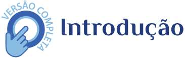

<!-- figure p27-fig1 | described_by: agy | ocr_overlap: None | needs_review: false -->
1. **Tipo de figura:** Cabeçalho gráfico de seção composto por um ícone/selo ilustrativo à esquerda acompanhado de um título de seção à direita.

2. **Todo o texto visível (literal):**
   - Ao redor do ícone circular (em maiúsculas): `VERSÃO COMPLETA`
   - Título principal à direita: `Introdução`

3. **Estrutura:** Layout horizontal composto por dois elementos lado a lado, sem caixas, setas, eixos, linhas/colunas ou painéis:
   - **À esquerda:** Um ícone circular formado por dois anéis concêntricos (um anel externo mais espesso e um anel interno mais fino) ao redor de um centro circular vazio. Na parte inferior esquerda, sobrepondo os anéis, há o desenho de uma mão com o dedo indicador estendido na diagonal para cima e para a direita, apontando para o centro do círculo (simulando um gesto de clique ou toque em um botão/alvo). Contornando a borda externa do círculo em arco, no sentido horário (do quadrante superior esquerdo até o quadrante inferior direito), encontra-se a inscrição `VERSÃO COMPLETA`.
   - **À direita:** A palavra `Introdução` em tipografia grande e em negrito, alinhada horizontalmente ao centro do ícone.

4. **Números ou valores de dados:** Não há nenhum número ou valor de dado na figura.

5. **Cores com significado:** As cores presentes (diferentes tons de azul sobre fundo branco/transparente) têm função apenas visual e decorativa, não carregando significado informacional ou codificação de dados.

<!-- Start of picture text -->
Introdução VERSÃOCO M P L E T A <!-- End of picture text -->

Planejar o futuro organizacional é, antes de mais nada, uma necessidade para a sustentabilidade de qualquer instituição, seja pública ou privada. Às universidades, apresenta-se o Plano de Desenvolvimento Institucional (PDI) como instrumento capaz de evidenciar à sociedade como se organiza e atua. 

O Plano de Desenvolvimento Institucional representa a materialização do processo de planejamento participativo na UFRPE. Este planejamento reúne elementos importantes para a consecução dos objetivos institucionais e prestação do serviço de educação. Nesse sentido, a sociedade e a comunidade têm em mãos um instrumento que deixa evidente a forma como a UFRPE atua, os objetivos que almeja e suas intenções de futuro. Apresenta-se, dentre outras, missão, visão e os valores organizacionais; bem como sua estrutura, áreas de atuação, objetivos, indicadores e metas. 

Este PDI 2021 _–_ 2030 nasce de um processo participativo e coletivo, em um contexto de desenvolvimento de maturidade institucional no estabelecimento de planejamento estratégico: a UFRPE define, com clareza, seus objetivos, indicadores a monitorar e metas a alcançar. Importante destacar que este Plano 

se dirige ao futuro, à década que se apresenta. O planejamento, porém, deve levar sempre em consideração as condições ambientais vigentes, de modo que revisões estão previstas, como apresentadas no capítulo 14. 

O planejamento é, dessa forma, direcionado para as mais amplas formas de atuação universitária, que não se limitam ao ensino, à pesquisa e à extensão, mas alcançam também a gestão e inovação. 

E, em se tratando de inovação, com vistas a tornar a interação entre a comunidade universitária, sociedade e o PDI cada vez mais próxima, existe agora um **portal** **_on-line_ Plano de Desenvolvimento Institucional UFRPE 2021** _–_ **2030** . Lá, é possível encontrar informações contidas neste documento e outros conteúdos complementares. Ao longo do texto, o(a) usuário(a) terá a oportunidade de visualizar diversos _links_ e ícones que, em apenas um clique, possibilitam visualizar o PDI de uma nova forma. 

A intenção é tornar agradável, amigável e fluida a experiência de quem lê o Plano de Desenvolvimento Institucional, de 

**26** 

<!-- page 28 -->

forma a aprimorar os processos de transparência e governança institucional. O presente e o futuro apresentam, como premissa, uma maior interatividade entre conteúdo, mídias e mensagens, de modo que apresentar o PDI em formatos digital e _on-line_ representa mais um avanço para a UFRPE no sentido de comunicar-se e interagir com o meio que a cerca. 

**Metodologia de elaboração do PDI 2021** _–_ **2030** O processo de elaboração do Plano de Desenvolvimento Institucional da UFRPE 2021 _–_ 2030 teve início com a emissão da Portaria nº 908/2019 _–_ GR, de 25 de julho de 2019, posteriormente atualizada pela Portaria nº 996/2020 _–_ GR, de 19 de novembro de 2020, nomeando uma Comissão Executiva para elaboração do PDI. Essa comissão foi criada com a finalidade de coordenar, com apoio da Pró-Reitoria de Planejamento e Desenvolvimento Institucional (Proplan/UFRPE), os trabalhos direcionados para a consecução desta nova peça de planejamento institucional. 

Ainda em 2019, essa Comissão se reuniu, a fim de iniciar os trabalhos e definir os princípios de atuação, como a necessidade de garantir participação coletiva da comunidade universitária, a vigência do novo documento _–_ entre 2021 e 2030 _–_ e o projeto de elaboração do PDI, detalhando as formas de atuação e o escopo do planejamento. 

Até então, todo o trabalho havia sido planejado para ser realizado em reuniões e audiências públicas presenciais, no _campus_ Dois Irmãos, no Recife, e em todas as unidades acadêmicas: 

Belo Jardim, Cabo de Santo Agostinho, Garanhuns _–_ à época _–_ e Serra Talhada. Porém, na transição entre 2019 e 2020, a epidemia de Covid-19 se alastrou ao redor do globo, configurando uma pandemia, o que impôs grandes desafios a todas as organizações e impediu, em primeiro momento, o contato presencial e aproximado entre as pessoas. O distanciamento social passou a ser norma de convivência e saúde pública, fato que influenciou o processo de elaboração coletiva do PDI UFRPE _2021 – 2030_ . 

Nesse sentido, o primeiro semestre de 2020 foi de grande aprendizado institucional sobre como direcionar muitas de suas áreas de atuação de forma virtual, com o apoio das tecnologias, de modo que o projeto para elaboração do PDI precisou ser ajustado para contemplar as novas possibilidades. Com esses desafios, a própria vigência do PDI UFRPE 2013 _–_ 2020 precisou ser ampliada para o mês de setembro de 2021. 

O projeto de elaboração do PDI _2021 – 2030_ , portanto, foi ajustado, aprovado no Conselho Universitário da Universidade e pode ser acessado por este **_link_** . Nesse documento, há a previsão de atuação coletiva da Instituição por meio de seis Comissões Temáticas, além de uma Comissão Executiva (Figura 1). 

Após aprovação do projeto, a Comissão Executiva iniciou umasérie de encontros virtuais, a partir de 15 de setembro de 2020. Todos foram realizados com apoio da ferramenta virtual _Google Meet_ , o que possibilitou a participação de diversos 

**27** 

<!-- page 29 -->

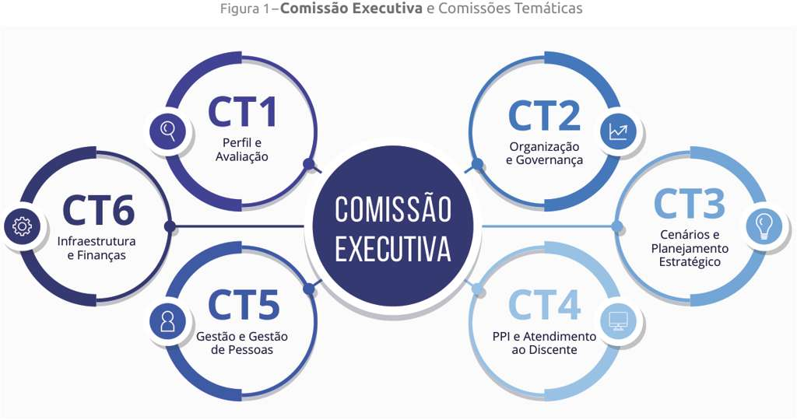

<!-- figure p29-fig1 | described_by: agy | ocr_overlap: 1.0 | needs_review: false -->
1. **Tipo de figura:** Diagrama radial (esquema organizacional circular de eixo central e nós periféricos) que representa a relação entre uma Comissão Executiva central e seis Comissões Temáticas (CT1 a CT6).

2. **Todo o texto visível (literal):**
   - **Título superior:** `Figura 1–Comissão Executiva e Comissões Temáticas` (com `Comissão Executiva` em negrito).
   - **Círculo central:** `COMISSÃO EXECUTIVA` (em duas linhas: `COMISSÃO` / `EXECUTIVA`).
   - **Círculo superior esquerdo:** `CT1` / `Perfil e` / `Avaliação`
   - **Círculo superior direito:** `CT2` / `Organização` / `e Governança`
   - **Círculo central direito:** `CT3` / `Cenários e` / `Planejamento` / `Estratégico`
   - **Círculo inferior direito:** `CT4` / `PPI e Atendimento` / `ao Discente`
   - **Círculo inferior esquerdo:** `CT5` / `Gestão e Gestão` / `de Pessoas`
   - **Círculo central esquerdo:** `CT6` / `Infraestrutura` / `e Finanças`
   - Não há legendas, eixos, rótulos de escala ou notas de rodapé adicionais.

3. **Estrutura:**
   - **Nó central:** Um círculo grande central contendo `COMISSÃO EXECUTIVA`, circundado por uma borda branca com leve sombra.
   - **Nós periféricos:** Seis círculos menores, de fundo branco e borda circular (metade externa mais espessa e metade interna mais fina), dispostos simetricamente em anel ao redor do círculo central — três à esquerda (superior: `CT1`; meio: `CT6`; inferior: `CT5`) e três à direita (superior: `CT2`; meio: `CT3`; inferior: `CT4`). A numeração `CT1` a `CT6` segue o sentido horário, começando no canto superior esquerdo.
   - **Ícones associados:** Na borda externa de cada círculo periférico há um pequeno círculo preenchido com contorno branco contendo um ícone linear branco:
     - `CT1`: lupa (à esquerda do círculo);
     - `CT2`: gráfico de linha com seta ascendente (à direita do círculo);
     - `CT3`: lâmpada (à direita do círculo);
     - `CT4`: monitor de computador (à direita do círculo);
     - `CT5`: silhueta de pessoa (à esquerda do círculo);
     - `CT6`: engrenagem (à esquerda do círculo).
   - **Conexões:** Seis linhas retas sem setas partem diretamente da borda do círculo central `COMISSÃO EXECUTIVA` e terminam em um pequeno ponto circular preenchido na borda interna de cada uma das seis comissões temáticas:
     - `COMISSÃO EXECUTIVA` conecta-se a `CT1` (linha diagonal superior esquerda);
     - `COMISSÃO EXECUTIVA` conecta-se a `CT2` (linha diagonal superior direita);
     - `COMISSÃO EXECUTIVA` conecta-se a `CT3` (linha horizontal à direita);
     - `COMISSÃO EXECUTIVA` conecta-se a `CT4` (linha diagonal inferior direita);
     - `COMISSÃO EXECUTIVA` conecta-se a `CT5` (linha diagonal inferior esquerda);
     - `COMISSÃO EXECUTIVA` conecta-se a `CT6` (linha horizontal à esquerda).
   - Não há conexões diretas entre as comissões temáticas entre si, nem eixos, tabelas ou painéis múltiplos.

4. **Números e valores de dados:**
   - A figura não contém dados numéricos, medidas ou valores quantitativos.
   - Os únicos números presentes são identificadores sequenciais: `1` (em `Figura 1`) e `1`, `2`, `3`, `4`, `5`, `6` (nas siglas `CT1`, `CT2`, `CT3`, `CT4`, `CT5` e `CT6`).

5. **Cores com significado:**
   - O círculo central `COMISSÃO EXECUTIVA` é totalmente preenchido em azul-marinho escuro com texto branco, contrastando com o fundo branco dos seis círculos periféricos para indicar sua posição central e hierárquica.
   - Cada comissão temática utiliza um tom distinto de azul/anil aplicado de forma consistente à sua sigla (`CT1`–`CT6`), à borda do círculo, ao círculo do ícone, ao ponto de conexão e à linha que a liga ao centro, diferenciando visualmente cada comissão (tons mais escuros à esquerda — azul-marinho em `CT6`, anil/roxo-azulado em `CT1` e azul-royal em `CT5` — e tons mais claros à direita — azul médio em `CT2`, azul médio-claro em `CT3` e azul-claro em `CT4`). Não há legenda de cores nem significado quantitativo associado à variação de tonalidade.

~~~text ocr
CT6
Infraestrutura
e Finanças
O )
Figura 1-Comissão Executiva e Comissões Temáticas
CT1
Perfil e
Avaliação
CT2
Organização
e Governança
COMISSÃO
EXECUTIVA
CT5
“Gestão e Gestão
de Pessoas
CT4
PPI e Atendimento
ao Discente
\
© j
\
|
O |
CT3
Cenários e
Planejamento
Estratégico
~~~

<!-- Start of picture text -->
Figura 1 –  Comissão Executiva  e Comissões Temáticas CT1 CT2 Perfil e Organização Avaliação e Governança CT6 COMISSÃO CT3 Cenários e Infraestrutura Planejamento e Finanças EXECUTIVA Estratégico CT5 CT4 Gestão e Gestão PPI e Atendimento de Pessoas ao Discente <!-- End of picture text -->

integrantes de comissões, bem como a gravação dos encontros, para memória e registro. 

Todos os registros de reuniões, incluindo relatos e pautas de discussão, bem como _links_ para acesso às gravações, podem ser acessados pelo **portal da UFRPE e Proplan** . A esse respeito, a Comissão Executiva do PDI UFRPE _2021 – 2030_ intensificou a comunicação e a transparência do 

processo de elaboração do planejamento, por considerar um importante mecanismo para qualificação, validação, respeito e legitimação. Ainda no contexto de Comissão Executiva, foi desenvolvida uma série de produtos e guias, a fim de orientar a atuação das Comissões Temáticas na construção do PDI. Destacam-se, nesse quesito, o **Guia para Comissões Temáticas** e **Guia para Elaboração de Indicadores** . 

**28** 

<!-- page 30 -->

A Comissão Executiva, desde setembro de 2020, realizou cerca de 20 encontros virtuais, com aproximadamente 50 horas de discussão síncrona, e contou com a participação de cerca de 27 membros, entre docentes, técnico(a)s e discentes. Afora os momentos síncronos de Comissão Executiva, cada membro teve atuação em Comissões Temáticas. 

As seis Comissões Temáticas se reuniram separadamente para discutir temas específicos e realizaram atividades síncronas e assíncronas para o desenvolvimento dos trabalhos. O escopo de atuação de cada Comissão Temática pode ser encontrado neste **link** . Desde o início dos trabalhos, as Comissões Temáticas realizaram, ao menos, 79 reuniões síncronas, com mais de 250 horas em reuniões de discussões, debate e planejamento. Esses seis grupos reuniram mais de 140 pessoas, envolvendo docentes, discentes e técnico(a)s-administrativo(a)s da UFRPE. 

A metodologia de elaboração do PDI 2021 – 2030, dentro do contexto pandêmico vivenciado a partir de 2020, possibilitou a reestruturação de processos de discussão e planejamento institucionais. Comparativamente com o processo de elaboração do PDI UFRPE 2013 _–_ 2020, ganhos e avanços significativos em termos de eficiência e eficácia foram atingidos, já que o processo de reuniões a distância possibilitou a aproximação entre os setores e as unidades da Universidade. Reuniões virtuais permitiram economizar recursos logísticos e energéticos para a realização do planejamento. Ademais, 

diversos avanços em termos de participação coletiva e transparência foram alcançados. 

Ainda, a UFRPE avança em maturidade de planejamento institucional ao estabelecer maior precisão na definição de objetivos, indicadores e metas – **conforme** **_link_** – para todos os eixos de atuação da Universidade: ensino, pesquisa, extensão, gestão e inovação. Nesse sentido, toda a comunidade assumiu o compromisso de pensar o futuro da Instituição de forma associada ao alcance de resultados precisos e mensuráveis. 

Em relação à participação coletiva, este foi o Plano de Desenvolvimento Institucional da UFRPE que contou com a participação mais ampla, efetiva e diversa de sua comunidade. De modo que este PDI UFRPE _2021 – 2030_ consegue captar, com mais precisão, a realidade vivenciada por toda a Universidade, do litoral ao sertão, do presencial à distância, do agora ao futuro. 

**Principais resultados do PDI 2013** _–_ **2020** Durante o período de vigência do último PDI, a UFRPE se fortaleceu, tanto no crescimento de sua estrutura física e acadêmica quanto no alcance de seu papel social. Destacaram-se a criação de duas novas unidades acadêmicas _–_ a do Cabo de Santo Agostinho (UACSA), com cinco cursos de bacharelado em Engenharia, integrados com cursos tecnológicos, e uma pós-graduação; e a de Belo Jardim (UABJ), responsável por quatro cursos de bacharelado integrados com cursos 

**29** 

<!-- page 31 -->

tecnológicos. Ao todo, com a criação e oferta de novos cursos entre os anos de 2013 e 2020, a UFRPE oferece 55 cursos de graduação presenciais e oito na modalidade EAD, 59 cursos de pós-graduação _stricto sensu_ e sete _lato sensu_ , bem como cinco cursos presenciais de Ensino Médio, Técnico e Tecnológico, além de quatro, na mesma categoria, na modalidade EAD. No intervalo de tempo em questão, a UFRPE manteve o conceito 4, de 1 a 5, no Índice Geral de Cursos (IGC), indicador de qualidade que avalia as instituições de educação superior, tendo 26% de seus cursos de graduação obtido melhorias no Conceito Preliminar de Curso (CPC) e 67% dos cursos mantido os resultados. Ao avaliar o desempenho do(a)s discentes no Exame Nacional de Desempenho dos Estudantes (Enade), entre os anos de 2013 e 2019, a UFRPE obteve o conceito melhorado ou mantido em 76% dos cursos de graduação. Dos cursos de pós-graduação, 30% elevaram o conceito Capes, até o ano 2019, e 61% mantiveram o conceito. (INEP, 2021b; PLATAFORMA SUCUPIRA, 2021). 

No eixo da pesquisa, a UFRPE fortaleceu sua estrutura, impulsionada pela criação do Instituto de Inovação, Pesquisa, Empreendedorismo, Internacionalização e Relações Institucionais (Instituto Ipê). A nova estrutura abarcou setores da Instituição, formando ecossistema voltado para a inovação e a formação de parcerias. O Ipê consolidou as ações de estimular, facilitar e viabilizar parcerias nacionais e internacionais, a transferência de conhecimentos científicos e tecnológicos, a cultura de inovação e do empreendedorismo e a captação de recursos para financiamento de projetos acadêmicos. 

No eixo da Extensão, a UFRPE avança na construção da Política de Extensão, Cultura e Cidadania, de modo participativo e descentralizado, criando mais organicidade e transversalidade nas ações. A Pró-Reitoria de Extensão, Cultura e Cidadania passou por processos de reestruturação e criou as coordenações de Gestão de Programas, Projetos e Eventos e a de Direitos Humanos, Ações Afirmativas e Diversidades, e incorporou os termos Cultura e Cidadania em seu nome. Estimulou a criação do Fórum Permanente de Extensão, Cultura e Cidadania e a elaboração de propostas de programas estratégicos de extensão, articulados às oito áreas da Política Nacional de Extensão. Além disso, coordena junto com a Pró-Reitoria de Ensino 

de Graduação a Curricularização das Ações de Extensão em todos os cursos de graduação, em conformidade com o que Estabelece as Diretrizes para a Extensão na Educação Superior Brasileira e regimenta o disposto na Meta 12.7 da Lei nº 13.005/2014, que aprova o Plano Nacional de Educação (PNE) 2014 _–_ 2024. Essas ações têm proporcionado o desabrochar criativo e inovador de uma nova arquitetura formativa, em que as relações entre ensino, pesquisa e extensão assumirão novas possibilidades de interação e desenvolvimento. 

Junto à criação de unidades acadêmicas em diferentes regiões do Estado, ampliação de vagas e da oferta de cursos, multiplicaram-se as inovações pedagógicas, ações afirmativas, políticas de cotas e mecanismos de transparência e cidadania dentro do propósito nacional de diminuição das desigualdades sociais. 

**30** 

<!-- page 32 -->

Pensando nisso, a UFRPE garantiu benefícios, ampliou a divulgação de informações sobre programas da assistência estudantil nas mídias sociais e envolveu profissionais de Pedagogia, Psicologia, Serviço Social e Educação Física no acolhimento inicial. A partir disso, o(a)s estudantes assistido(a)s foram acompanhados, e verifica-se que 70% apresentaram alto ou médio desempenho acadêmico, com baixa taxa de retenção/evasão. Em relação à pandemia de Covid-19, os benefícios foram priorizados, nos primeiros meses, e mantidos. Também houve a criação do Auxílio Emergencial de Inclusão Digital para estudantes de recorte social, no valor de R$1.380, contribuindo na aquisição de equipamentos de informática, assim como foi firmado convênio com a Rede Nacional de Ensino e Pesquisa para distribuição de _chips_ de dados de forma gratuita, possibilitando o acesso remoto. 

Destaca-se a criação de novas estruturas na Universidade, como o Instituto Menino Miguel, que tem a finalidade de desenvolver ações de pesquisa, ensino e extensão nas áreas sociais, voltadas para a comunidade acadêmica e para sociedade. Esse instituto abriga a Escola de Conselhos de Pernambuco, o Núcleo do Cuidado Humano, o Núcleo do Envelhecimento e o Observatório da Família. 

A partir do desenho do novo perfil institucional e, em consonância com a voz participativa de docentes, discentes e técnico(a)s-administrativo(a)s, nas reuniões de construção do planejamento estratégico, buscou-se a reorganização 

administrativa como elemento essencial para este novo momento da Instituição, no esforço pelo avanço na melhoria da qualidade do ensino, da pesquisa, da extensão e da própria gestão. Isso tem possibilitado à UFRPE alcançar excelentes resultados quanto ao aprimoramento de sua gestão: a UFRPE tem sido apontada como destaque no Índice Integrado de Governança e Gestão Pública, calculado pelo Tribunal de Contas da União. Nesse índice, figura entre as primeiras colocadas, regional e nacionalmente, no segmento de instituições de ensino. Outra iniciativa de destaque no aprimoramento da gestão estratégica é demonstrada pela criação da Pró-Reitoria de Gestão de Pessoas, antes superintendência. A nova estrutura permite atuar de forma mais estratégica e holística. Esse novo modelo de gestão contribuiu com o alcance da Visão para 2020, especificada no último PDI: “ **_consolidar-se como universidade pública de excelência, fundamentada em uma gestão participativa_** ”. 

Resultados das diretrizes propostas pelo PDI 2013 – 2020 podem ser encontrados, ano a ano, detalhadamente nos **Relatórios de Gestão, publicados no portal da UFRPE** . 

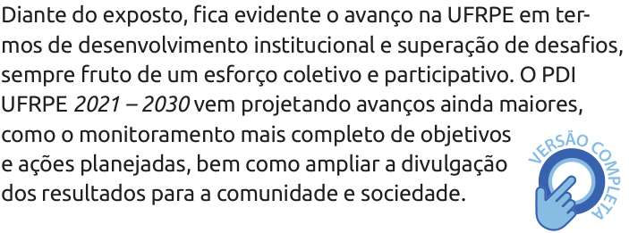

<!-- figure p32-fig1 | described_by: agy | ocr_overlap: 1.0 | needs_review: false -->
1. **Tipo de figura:** Recorte de página de documento contendo um parágrafo de texto acompanhado de um ícone gráfico (selo/botão indicativo de link ou acesso) no canto inferior direito.

2. **Texto visível (ipsis litteris):**
   - Parágrafo principal (em sete linhas, com o trecho "2021 – 2030" em itálico):
     > Diante do exposto, fica evidente o avanço na UFRPE em ter-
     > mos de desenvolvimento institucional e superação de desafios,
     > sempre fruto de um esforço coletivo e participativo. O PDI
     > UFRPE *2021 – 2030* vem projetando avanços
1. **Tipo de figura:** Recorte de um parágrafo de texto corrido acompanhado por um ícone gráfico/botão ilustrativo no canto inferior direito.

2. **Texto visível (na íntegra):**
   - **Bloco de texto principal (7 linhas):**
     - Linha 1: «Diante do exposto, fica evidente o avanço na UFRPE em ter-»
     - Linha 2: «mos de desenvolvimento institucional e superação de desafios,»
     - Linha 3: «sempre fruto de um esforço coletivo e participativo. O PDI»
     - Linha 4: «UFRPE *2021 – 2030* vem projetando avanços ainda maiores,» *(com o trecho «2021 – 2030» em itálico)*
     - Linha 5: «como o monitoramento mais completo de objetivos»
     - Linha 6: «e ações planejadas, bem como ampliar a divulgação»
     - Linha 7: «dos resultados para a comunidade e sociedade.»
   - **Texto do ícone (canto inferior direito, disposto em arco em letras maiúsculas):**
     - «VERSÃO COMPLETA»

3. **Estrutura:** A imagem apresenta um único bloco de texto em fonte sem serifa, alinhado à esquerda sobre fundo branco, sem caixas, setas, eixos, tabelas ou múltiplos painéis. As quatro primeiras linhas ocupam toda a largura da imagem, enquanto as linhas 5 a 7 terminam mais cedo à direita para dar espaço ao ícone posicionado no canto inferior direito. Esse ícone consiste em círculos/anéis concêntricos (alvo/botão), sobreposto no lado inferior esquerdo por uma mão estilizada cujo dedo indicador aponta para o centro branco do círculo (representando um clique/acesso); acompanhando a curvatura externa do círculo, do topo até o lado direito, lê-se o rótulo «VERSÃO COMPLETA».

4. **Números e valores de dados:** Os únicos valores numéricos presentes são os anos **2021** e **2030**, apresentados como o intervalo *2021 – 2030* (referente ao período do PDI UFRPE). Não há outros dados quantitativos.

5. **Cores com significado:** O texto principal está em preto sobre fundo branco (padrão de leitura). O ícone no canto inferior direito utiliza tons de azul — azul-escuro no anel externo e no contorno da mão; azul-claro no anel interno, no preenchimento da mão e nas letras de «VERSÃO COMPLETA» — criando destaque visual em relação ao texto preto para indicar um elemento interativo ou chamada de acesso à versão completa do documento.

~~~text ocr
Diante do exposto, fica evidente o avanço na UFRPE em ter-
mos de desenvolvimento institucional e superação de desafios,
sempre fruto de um esforço coletivo e participativo. O PDI
UFRPE 2021 - 2030 vem projetando avanços ainda maiores,
como o monitoramento mais completo de objetivos
e ações planejadas, bem como ampliar a divulgação
dos resultados para a comunidade e sociedade.
SÃO
~~~

**31** 

<!-- page 33 -->

**2** 

UFRPE 

**<mark>Perfil institucional</mark>** 

**32** 

<!-- page 34 -->

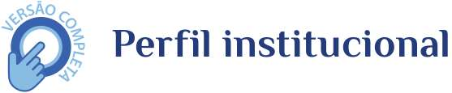

<!-- figure p34-fig1 | described_by: agy | ocr_overlap: None | needs_review: false -->
1. **Tipo de figura:** Trata-se de um cabeçalho gráfico de seção (banner/título com ícone indicativo de link ou conteúdo clicável), disposto horizontalmente sobre fundo branco/transparente.

2. **Texto visível (na íntegra):**
   - Ao redor do ícone circular, em letras maiúsculas: `VERSÃO COMPLETA`
   - À direita do ícone, como título principal: `Perfil institucional`

3. **Estrutura:** A figura possui composição horizontal simples em dois elementos lado a lado, sem caixas, setas, eixos, tabelas ou múltiplos painéis:
   - **À esquerda:** Um ícone circular composto por um anel externo mais espesso, um anel interno mais fino e centro branco vazio. Sobreposta à parte inferior esquerda do círculo, há a ilustração de uma mão com o dedo indicador estendido apontando na diagonal para cima e para a direita, em direção ao centro do círculo, representando o gesto de clique ou toque. Acompanhando a curvatura externa do anel, da parte superior esquerda até a parte inferior direita (no sentido horário), está disposto o texto curvo `VERSÃO COMPLETA`.
   - **À direita:** O título `Perfil institucional`, em fonte serifada grande, centralizado verticalmente em relação ao ícone circular.

4. **Números ou valores de dados:** Não há números nem valores de dados na figura.

5. **Cores com significado:** As cores não codificam dados ou categorias específicas; toda a figura utiliza tons de azul apenas para identidade visual e contraste (azul-escuro no título principal, azul médio no anel externo e no contorno da mão, e azul-claro no preenchimento da mão, no anel interno e no texto curvo `VERSÃO COMPLETA`).

~~~text ocr
A
(O
\N
Perfil institucional
ld
~~~

<!-- Start of picture text -->
Perfil institucional VERSÃOCO M P L E T A <!-- End of picture text -->

##### **Histórico da UFRPE** 

A Universidade Federal Rural de Pernambuco (UFRPE) é uma instituição centenária, cuja história se inicia com a criação das Escolas Superiores de Agricultura e Medicina Veterinária do Mosteiro de São Bento, em Olinda, em 3 de novembro de 1912. Em prédio anexo ao Mosteiro, essas escolas contaram inicialmente com a direção do abade alemão D. Pedro Roeser. Em dezembro de 1914, foi instalado o Hospital Veterinário, o primeiro do país, segundo Melo (2010). Tendo em vista as limitações de espaço para as aulas práticas do curso de Agronomia, os beneditinos adquiriram, em 1915, o Engenho São Bento, localizado no distrito de Tapera, em São Lourenço da Mata. Nessa propriedade, os monges construíram as novas instalações da Escola Superior de Agricultura, em março de 1917. O curso de Medicina Veterinária, porém, permaneceu em Olinda até 1926, quando teve as atividades encerradas. 

Em 9 de dezembro de 1936, a Escola Superior de Agricultura de São Bento passou à administração do Estado, com a denominação de Escola Superior de Agricultura de Pernambuco (ESAP). Em 12 de março de 1938, foi 

transferida para o Bairro de Dois Irmãos, no Recife, onde ocupou o prédio que originalmente seria destinado a um Reformatório de Menores (MIRANDA, 2008). O referido edifício, que fora projetado pelo arquiteto Luiz Nunes e até hoje abriga a Reitoria da UFRPE, tornou-se um dos ícones da arquitetura moderna dos anos 1930 em Pernambuco (MARTINS; LEITÃO, 2009). 

Em 24 de julho de 1947, o curso de Medicina Veterinária é retomado. No mesmo ano, a ESAP, o então Instituto de Pesquisas Agronômicas (IPA), o Instituto de Pesquisas Zootécnicas (IPZ) e o Instituto de Pesquisas Veterinárias (IPV) são reunidos, constituindo a Universidade Rural de Pernambuco (URP). Em 1955, a Universidade passou a fazer parte do Sistema Federal de Ensino Agrícola Superior, vinculado ao Ministério da Agricultura. O estatuto da URP, de 1964, representou a primeira mudança mais significativa na estrutura administrativa e acadêmica da Instituição, ainda que apresentasse alguma continuidade em relação ao modelo da antiga ESAP (SANTOS; PACHECO, 2013). Nesse estatuto, o Colégio Agrícola de São Lourenço da Mata aparece como órgão integrante da Universidade. 

**33** 

<!-- page 35 -->

A origem desse Colégio remonta a 1936, na cidade de Vitória de Santo Antão, quando era denominado de Aprendizado Agrícola de Pacas, vinculado à Secretaria Estadual de Agricultura, Indústria e Comércio. Em 1938, foi transferido para São Bento, em São Lourenço da Mata, passando a utilizar as estruturas da antiga ESAP, mudando a denominação para Aprendizado Agrícola São Bento. Em 1957, a Instituição foi incorporada à Universidade sob o nome de Escola Agro técnica do Nordeste. Em 1964, era denominada Colégio Agrícola de São Lourenço da Mata, mas foi em 1968 que adotou o 

nome Colégio Agrícola Dom Agostinho Ikas (Codai) (SOUZA, 2000). No início dos anos 1970, em virtude da construção da Barragem do Tapacurá, o Codai foi transferido para a área urbana de São Lourenço da Mata. Atualmente, o Colégio Agrícola Dom Agostinho Ikas da UFRPE também conta com instalações em Tiúma e oferece cursos técnicos integrados ou não ao Ensino Médio, cursos na modalidade EAD e de qualificação profissional. 

Com a instauração da Ditadura Militar, em 1964, a Universidade passou por algumas mudanças. Em 1967, os órgãos de ensino vinculados ao Ministério da Agricultura foram transferidos para o Ministério da Educação. Como consequência, a Universidade Rural de Pernambuco passou a denominar-se oficialmente Universidade Federal Rural de Pernambuco (UFRPE). Com a Reforma Universitária de 1968, a UFRPE promoveu alterações mais profundas em sua estrutura administrativa e acadêmica, através de dois novos estatutos, em 1969 

e em 1975. Esses dispositivos, por exemplo, incorporaram o modelo de administração departamental e o regime de créditos. Foram também criados novos cursos durante a década de 1970. A UFRPE também passou a ofertar cursos de pós-graduação _stricto sensu_ , com a criação do Mestrado em Botânica, em 1973, por meio de um convênio firmado com a Universidade Federal de Pernambuco (UFPE). 

Em 1975, por iniciativa do professor José Vasconcelos Sobrinho, foi criada a Estação Ecológica de Tapacurá, nas terras remanescentes do Engenho São Bento, em São Lourenço da Mata. A partir do desenvolvimento de pesquisas em Botânica, Zoologia e Ecologia, a Estação tornou-se referência nacional no tema da preservação e reflorestamento de espécies da flora brasileira, como o pau-brasil. 

Em 1979, a cidade de Garanhuns, no agreste pernambucano, viu nascer a Clínica de Bovinos, graças a uma parceria com a Secretaria de Agricultura do Estado de Pernambuco. Desde então, a Clínica desenvolve ações nas áreas de clínica médica e cirúrgica, análises laboratoriais em ruminantes e equinos, bem como atuando na pesquisa e na formação inicial e continuada de médico(a)s veterinário(a)s de Pernambuco e do Brasil, além de receber pesquisadore(a)s de outros países. 

No entanto, ao mesmo tempo em que expandia seus cursos, a UFRPE também sofria as consequências do momento político que o país atravessava. Por exemplo, em 1975, a estrutura 

**34** 

<!-- page 36 -->

administrativa da Universidade continha a Assessoria de Segurança e Informação (ASI), órgão que se reportava à Divisão de Segurança e Informação do Ministério da Educação (DSI/ MEC), notificando qualquer ocorrência relativa à “segurança nacional” (UFRPE, 1975, p. 7). Isso significava, na prática, monitorar docentes, técnico(a)s e discentes por meio de escutas clandestinas, intervenção na escolha de gestore(a)s, seleção bibliográfica, vigilância de eventos, interceptação de correspondência, dentre outras práticas utilizadas pelo Estado de exceção (MOTTA, 2008). Sanções eram aplicadas a quem participasse de atos ou distribuísse materiais considerados _subversivos_ (UFRPE, 1985; BRASIL, 1969). Foi em função desse contexto político de vigilância e repressão que o estudante do curso de Agronomia, Odijas Carvalho de Souza, então com 26 anos de idade, foi preso e torturado por 17 horas entre os dias 30 e 31 de janeiro de 1971 nas dependências do Departamento de Ordem Política e Social (DOPS/ PE). Como decorrência das torturas, faleceu no Hospital da Polícia Militar no dia 8 de fevereiro (PERNAMBUCO, 2017, p. 176). Como forma de homenageá-lo, a UFRPE o _rematriculou_ em 2012, durante as comemorações do centenário dos primeiros cursos da Instituição. Odijas também se tornou o patrono do Diretório Central dos Estudantes (DCE). 

Na década de 1980, reformulou-se o curso de Licenciatura em Ciências com suas habilitações, surgindo quatro novos cursos de Licenciatura Plena: Física, Química, Matemática e Ciências Biológicas. Em 1990, surgiram os cursos de 

Licenciatura em História, Bacharelado em Ciências Sociais e Bacharelado em Ciências Econômicas. Em 1993, a UFRPE abre o seu primeiro curso de Doutorado, em Botânica. A primeira tese defendida na Universidade ocorreu em 1995. 

Nos anos 2000, a UFRPE vivenciou uma expansão de suas atividades, com a criação de cursos de graduação na Sede e em novas Unidades Acadêmicas, através do Programa de Reestruturação e Expansão das Universidades Federais (REUNI). A primeira dessas Unidades – tendo sido também o primeiro _campus_ do Programa de Expansão e Interiorização da Educação Superior do Governo Lula – foi instalada na cidade de Garanhuns. Tendo iniciado suas atividades no segundo semestre de 2005, a Unidade Acadêmica de Garanhuns (UAG) passou a ofertar cursos de Agronomia, Licenciatura em Pedagogia, Licenciatura em Letras, Ciência da Computação, Engenharia de Alimentos, Medicina Veterinária e Zootecnia. Em 2019, a UAG se tornou autônoma, constituindo a Universidade Federal do Agreste de Pernambuco (Ufape). 

Ainda em 2005, o Conselho Universitário da UFRPE aprovou a criação de outra Unidade Acadêmica, dessa vez no sertão do Estado, na cidade de Serra Talhada, onde a UFRPE dispunha do Centro de Treinamento e Pesquisa em Pequena Irrigação (CTPPI), instalado na Fazenda Saco. A Unidade Acadêmica de Serra Talhada (UAST) iniciou suas atividades em 2006. 

**35** 

<!-- page 37 -->

Ao mesmo tempo em que expandia a oferta de cursos de graduação presenciais no interior, a UFRPE, em consonância, inicialmente, com o Programa Pró-licenciatura, em 2005, e, posteriormente, em 2006, com o Programa Universidade Aberta do Brasil (UAB), também implementou a modalidade Educação a Distância (EAD). O primeiro curso EAD ofertado foi Licenciatura em Física, com a adesão ao Pró-licenciatura em 2005. Em 2010, foi criada a Unidade Acadêmica de Educação a Distância e Tecnologia (UAEADTec), que possui 8 cursos de graduação e 3 cursos de pós-graduação _lato sensu_ em polos nos estados de Pernambuco e Bahia, além de 2 programas de pós-graduação _stricto sensu_ – PPGTEG e Progel. Sua sede administrativa fica no _campus_ Dois Irmãos, no Recife. 

Sempre aliando tradição e vanguarda, a UFRPE implantou, em 2014, a Unidade Acadêmica do Cabo de Santo Agostinho (UACSA), com o objetivo de fortalecer o desenvolvimento dos polos industriais da região e do país, por meio da formação de recursos humanos qualificados, da realização de pesquisas de ponta e projetos de inovação tecnológica com a formação de parcerias institucionais. A Unidade oferece 10 cursos, entre bacharelados em Engenharia e superiores em Tecnologia. Atualmente, a UACSA funciona em prédio provisório. 

Em 2017, o Conselho Universitário, com a Resolução Consu/ UFRPE nº 098/2017 (UFRPE, 2017g), aprovou a criação da 

Unidade Acadêmica de Belo Jardim (UABJ), para atender às demandas de qualificação profissional nas áreas de Engenharia da região. De forma semelhante ao projeto da UACSA, a UABJ oferta cursos superiores em Tecnologia (Eletrônica Industrial, Redes de Computadores, Processos Químicos, Gestão de Recursos Hídricos) e bacharelados em Engenharia (Controle e Automação, Computação, Química e Hídrica). Está instalada em prédio provisório. 

##### **Áreas de Atuação Acadêmica** 

A UFRPE dispõe de infraestrutura acadêmica e administrativa composta por mais de 1.200 docentes, mais de mil técnico(a)s-administrativo(a)s e mais de 500 trabalhadore(a)s terceirizado(a)s, além de cerca de 17 mil discentes. Oferta cursos de graduação, pós-graduação e de educação básica, técnica e tecnológica, além de desenvolver projetos de ensino, pesquisa, extensão e inovação em leque variado de áreas. A Instituição está presente em todas as regiões do estado de Pernambuco, além de parte da Bahia, por meio de Unidades Acadêmicas, Estações de Pesquisa e Polos de Educação a Distância (EAD). Isso representa um universo de 31 municípios que contam com uma ou mais ações da Universidade. 

A atuação da UFRPE pode ser sucintamente apresentada por meio de sua Identidade Organizacional, a saber: Missão, Visão de Futuro e Valores Organizacionais. 

**36** 

<!-- page 38 -->

###### Figura 2 – **Presença Regional** da UFRPE 

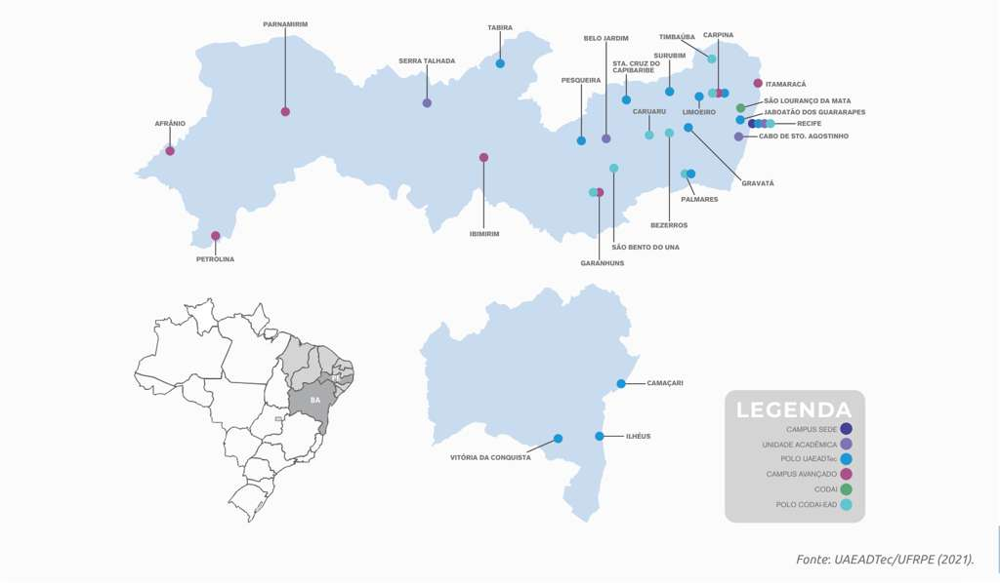

<!-- figure p38-fig1 | described_by: agy | ocr_overlap: 1.0 | needs_review: false -->
**(1) Tipo de figura**
Mapa geográfico temático composto por três mapas sem escala numérica nem rosa dos ventos, acompanhados de uma caixa de legenda e indicação de fonte. Representa a distribuição geográfica dos campi, unidades acadêmicas e polos de educação a distância (UAEADTec e CODAI) da UFRPE nos estados de Pernambuco e da Bahia, com um mapa de localização do Brasil destacando esses dois estados.

**(2) Todo o texto visível (transcrição literal)**
- **Rótulos no mapa de Pernambuco (parte superior):**
  - `AFRÂNIO`
  - `PARNAMIRIM`
  - `PETROLINA`
  - `SERRA TALHADA`
  - `TABIRA`
  - `IBIMIRIM`
  - `PESQUEIRA`
  - `BELO JARDIM`
  - `STA. CRUZ DO` / `CAPIBARIBE` (em duas linhas)
  - `SURUBIM`
  - `TIMBAÚBA`
  - `CARPINA`
  - `CARUARU`
  - `LIMOEIRO`
  - `ITAMARACÁ`
  - `SÃO LOURANÇO DA MATA` (grafado literalmente com "A" em "LOURANÇO")
  - `JABOATÃO DOS GUARARAPES`
  - `RECIFE`
  - `CABO DE STO. AGOSTINHO`
  - `GRAVATÁ`
  - `PALMARES`
  - `BEZERROS`
  - `SÃO BENTO DO UNA`
  - `GARANHUNS`
- **Rótulos no mapa de localização do Brasil (parte inferior esquerda):**
  - `PE`
  - `BA`
- **Rótulos no mapa da Bahia (parte inferior central):**
  - `CAMAÇARI`
  - `ILHÉUS`
  - `VITÓRIA DA CONQUISTA`
- **Caixa de legenda (parte inferior direita):**
  - Título: `LEGENDA`
  - Itens (de cima para baixo):
    - `CAMPUS SEDE`
    - `UNIDADE ACADÊMICA`
    - `POLO UAEADTec`
    - `CAMPUS AVANÇADO`
    - `CODAI`
    - `POLO CODAI-EAD`
- **Fonte (canto inferior direito, em itálico):**
  - `Fonte: UAEADTec/UFRPE (2021).`

**(3) Estrutura da figura**
A figura organiza-se em quatro elementos principais sobre fundo branco, sem eixos, tabelas ou setas direcionais (apenas linhas retas de chamada ligando marcadores circulares aos nomes dos municípios):
- **Painel superior — Mapa de Pernambuco:** Silhueta ampliada do estado de Pernambuco ocupando a metade superior da figura, com 24 municípios sinalizados por círculos coloridos. Quando um município possui mais de uma unidade/polo, seus círculos aparecem lado a lado, parcialmente sobrepostos na horizontal. Linhas retas finas conectam cada ponto (ou grupo de pontos) ao respectivo nome:
  - Linhas verticais para cima ligam seus marcadores a `AFRÂNIO`, `PARNAMIRIM`, `SERRA TALHADA`, `TABIRA`, `PESQUEIRA`, `BELO JARDIM`, `STA. CRUZ DO CAPIBARIBE`, `SURUBIM`, `CARUARU` e `CARPINA` (esta última partindo do círculo central do trio).
  - Linhas verticais para baixo ligam seus marcadores a `PETROLINA`, `IBIMIRIM`, `GARANHUNS` (partindo do círculo direito da dupla), `SÃO BENTO DO UNA`, `BEZERROS` e `LIMOEIRO`.
  - Linha diagonal para cima e à esquerda liga seu marcador a `TIMBAÚBA`.
  - Linhas diagonais para baixo e à direita ligam seus marcadores a `GRAVATÁ` e `PALMARES` (partindo da borda inferior do círculo esquerdo da dupla).
  - Sem linha de chamada: o rótulo `ITAMARACÁ` está posicionado diretamente à direita de seu marcador na costa nordeste.
  - Linhas diagonais curtas para cima e à direita ligam seus marcadores a `SÃO LOURANÇO DA MATA` e `JABOATÃO DOS GUARARAPES`.
  - Linhas horizontais para a direita ligam seus marcadores a `RECIFE` (partindo do círculo mais à direita do quarteto) e `CABO DE STO. AGOSTINHO`.
- **Painel inferior esquerdo — Mapa de localização do Brasil:** Contorno do Brasil com divisão estadual. Os estados da Região Nordeste estão destacados em dois tons de cinza, com `PE` e `BA` no tom mais escuro e identificados por suas siglas em branco. O Distrito Federal aparece preenchido em cinza-claro, enquanto os demais estados fora do Nordeste estão em branco.
- **Painel inferior central — Mapa da Bahia:** Silhueta ampliada do estado da Bahia com 3 marcadores circulares ligados por linhas retas: linhas horizontais para a direita em `CAMAÇARI` e `ILHÉUS`, e linha diagonal para baixo e à esquerda em `VITÓRIA DA CONQUISTA`.
- **Painel inferior direito — Caixa de legenda e fonte:** Retângulo cinza-claro de cantos arredondados contendo o cabeçalho `LEGENDA` em letras brancas no topo e 6 linhas empilhadas verticalmente, cada uma com o texto alinhado à direita ao lado de um círculo colorido correspondente. Abaixo e à direita da legenda encontra-se o texto `Fonte: UAEADTec/UFRPE (2021).`.

**(4) Todos os números e valores de dados**
- **Único numeral explícito na imagem:** `2021` (ano na referência da fonte).
- **Dados codificados pelos marcadores por município e estado (27 municípios no total, somando 34 marcadores):**
  - **Pernambuco (24 municípios; 31 marcadores):**
    - `AFRÂNIO`: 1 — `CAMPUS AVANÇADO`
    - `PETROLINA`: 1 — `CAMPUS AVANÇADO`
    - `PARNAMIRIM`: 1 — `CAMPUS AVANÇADO`
    - `SERRA TALHADA`: 1 — `UNIDADE ACADÊMICA`
    - `IBIMIRIM`: 1 — `CAMPUS AVANÇADO`
    - `TABIRA`: 1 — `POLO UAEADTec`
    - `PESQUEIRA`: 1 — `POLO UAEADTec`
    - `BELO JARDIM`: 1 — `UNIDADE ACADÊMICA`
    - `STA. CRUZ DO CAPIBARIBE`: 1 — `POLO UAEADTec`
    - `GARANHUNS`: 2 (da esquerda para a direita) — `POLO CODAI-EAD` e `CAMPUS AVANÇADO`
    - `SÃO BENTO DO UNA`: 1 — `POLO CODAI-EAD`
    - `CARUARU`: 1 — `POLO CODAI-EAD`
    - `SURUBIM`: 1 — `POLO UAEADTec`
    - `BEZERROS`: 1 — `POLO CODAI-EAD`
    - `LIMOEIRO`: 1 — `POLO UAEADTec`
    - `GRAVATÁ`: 1 — `POLO UAEADTec`
    - `PALMARES`: 2 (da esquerda para a direita) — `POLO CODAI-EAD` e `POLO UAEADTec`
    - `TIMBAÚBA`: 1 — `POLO CODAI-EAD`
    - `CARPINA`: 3 (da esquerda para a direita) — `POLO CODAI-EAD`, `CAMPUS AVANÇADO` e `POLO UAEADTec`
    - `ITAMARACÁ`: 1 — `CAMPUS AVANÇADO`
    - `SÃO LOURANÇO DA MATA`: 1 — `CODAI`
    - `JABOATÃO DOS GUARARAPES`: 1 — `POLO UAEADTec`
    - `RECIFE`: 4 (da esquerda para a direita) — `CAMPUS SEDE`, `POLO UAEADTec`, `UNIDADE ACADÊMICA` e `POLO CODAI-EAD`
    - `CABO DE STO. AGOSTINHO`: 1 — `UNIDADE ACADÊMICA`
  - **Bahia (3 municípios; 3 marcadores):**
    - `CAMAÇARI`: 1 — `POLO UAEADTec`
    - `ILHÉUS`: 1 — `POLO UAEADTec`
    - `VITÓRIA DA CONQUISTA`: 1 — `POLO UAEADTec`
- **Totais por categoria (somando Pernambuco e Bahia):**
  - `CAMPUS SEDE`: 1 (Recife)
  - `UNIDADE ACADÊMICA`: 4 (Serra Talhada, Belo Jardim, Recife, Cabo de Sto. Agostinho)
  - `POLO UAEADTec`: 13 (10 em Pernambuco: Tabira, Pesqueira, Sta. Cruz do Capibaribe, Surubim, Limoeiro, Gravatá, Palmares, Carpina, Jaboatão dos Guararapes, Recife; e 3 na Bahia: Camaçari, Ilhéus, Vitória da Conquista)
  - `CAMPUS AVANÇADO`: 7 (Afrânio, Petrolina, Parnamirim, Ibimirim, Garanhuns, Carpina, Itamaracá)
  - `CODAI`: 1 (São Louranço da Mata)
  - `POLO CODAI-EAD`: 8 (Garanhuns, São Bento do Una, Caruaru, Bezerros, Palmares, Timbaúba, Carpina, Recife)

**(5) Cores com significado**
- **Nos marcadores dos mapas e na legenda:**
  - **Azul-escuro (índigo):** `CAMPUS SEDE`
  - **Roxo (violeta médio):** `UNIDADE ACADÊMICA`
  - **Azul médio:** `POLO UAEADTec`
  - **Magenta (rosa-escuro/vinho):** `CAMPUS AVANÇADO`
  - **Verde:** `CODAI`
  - **Ciano (azul-turquesa):** `POLO CODAI-EAD`
- **No mapa de localização do Brasil:**
  - **Cinza-médio:** destaca os dois estados detalhados na figura (`PE` e `BA`).
  - **Cinza-claro:** destaca os demais estados da Região Nordeste (e também preenche o retângulo do Distrito Federal).
  - **Branco:** demais estados brasileiros fora da Região Nordeste.

~~~text ocr
LEGENDA
Fonte: UAEADTec/UFRPE (2021).
~~~

<!-- Start of picture text -->
PARNAMIRIM TABIRA BELO JARDIM TIMBAÚBA CARPINA SURUBIM SERRA TALHADA STA. CRUZ DO CAPIBARIBE PESQUEIRA ITAMARACÁ SÃO LOURANÇO DA MATA CARUARU LIMOEIRO JABOATÃO DOS GUARARAPES AFRÂNIO RECIFE CABO DE STO. AGOSTINHO GRAVATÁ PALMARES BEZERROS IBIMIRIM SÃO BENTO DO UNA PETROLINA GARANHUNS PE CAMAÇARI BA LEGENDA CAMPUS SEDE ILHÉUS UNIDADE ACADÊMICA VITÓRIA DA CONQUISTA POLO UAEADTec CAMPUS AVANÇADO CODAI POLO CODAI-EAD Fonte :  UAEADTec/UFRPE (2021). <!-- End of picture text -->

**37** 

<!-- page 39 -->

<!-- figure p39-fig1 | described_by: agy | ocr_overlap: None | needs_review: false -->
1. **Figure type:** A circular icon / pictogram depicting a target or crosshair (reticle).

2. **Visible text:** None. There are no titles, labels, legends, captions, axis ticks, or cell values in the image.

3. **Structure:** A single centered circular emblem composed of concentric geometric elements, from outermost to innermost:
   - A thick outer circular ring.
   - A thinner concentric ring immediately inside and flush against the outer ring.
   - A circular blank interior area.
   - Centered inside the interior area is a crosshair symbol consisting of:
     - A solid circular dot at the center.
     - A thin circular outline concentric with the center dot.
     - Four straight lines radiating from the center dot at 90° intervals (up, down, left, and right), passing through the thin circular outline and extending slightly past it into the blank interior without reaching the surrounding ring.
   - There are no boxes, arrows, axes, tables, or multiple panels.

4. **Numbers and data values:** None.

5. **Colours:** Colours do not encode data; they serve only for visual contrast and decoration (dark navy blue for the thick outer ring and the central crosshair symbol, light blue for the inner concentric ring, and white for the interior circular field).

#### MISSÃO 

<!-- figure p39-fig2 | described_by: agy | ocr_overlap: None | needs_review: false -->
1. **Type of figure**: A standalone circular icon (pictogram) depicting a stylized eye.

2. **Visible text**: None. There are no titles, labels, legends, captions, axis ticks, or other text elements in the image.

3. **Structure**: The graphic is composed of concentric circular elements centered on a plain background:
   - An outer thick circular ring.
   - An inner, thinner circular ring directly adjacent to the inside edge of the outer ring.
   - A solid circular central field enclosing a horizontally oriented, almond-shaped stylized eye icon.
   - The eye consists of two pointed outer corner segments (left and right) framing a white ring around a solid circular iris/pupil in the center. Inside the upper-left portion of the iris/pupil is a smaller circular white cutout representing a light reflection (catchlight).
   - There are no boxes, arrows, axes, tables, rows, columns, or multiple panels.

4. **Numbers and data values**: None.

5. **Colours**: Colours do not carry data or legend meaning in this figure; they are purely stylistic for the icon (a medium-dark blue outer ring and eye shape, a light blue inner ring, and a white interior background and eye highlight).

#### VISÃO 

<!-- figure p39-fig3 | described_by: agy | ocr_overlap: None | needs_review: false -->
1. **Type of figure:** A circular flat icon / emblem (a decorative symbol or badge rather than a chart or diagram).

2. **Visible text:** None. There is no text, title, label, legend, caption, or tick mark anywhere in the image.

3. **Structure:** The figure consists of concentric geometric shapes centered on a single point (with no boxes, arrows, axes, rows, columns, or panels):
   - An outermost thick circular ring.
   - Immediately inside it, a thinner concentric circular ring touching the inner edge of the outer ring.
   - A circular central field inside the inner ring.
   - Centered in that field, an upright five-pointed star made of two concentric layers: an outer five-pointed star outline with slightly rounded tips, separated by a narrow gap from a smaller solid five-pointed star inside it.

4. **Numbers and data values:** None.

5. **Colours:** The image uses medium blue (outer ring, star outline, and inner solid star), light blue (inner ring), and white (central field and the narrow gap inside the star) purely for visual distinction and styling; no colour carries encoded data meaning.

#### VALORES 

**_Semear conhecimento, inovação e inclusão, por meio de atividades de ensino, pesquisa, extensão e gestão, atenta à complexidade, pluralidade e diversidade dos anseios da sociedade_** 

**_Destacar-se, nacional e internacionalmente, pelo protagonismo e pela responsabilidade no enfrentamento dos desafios e diante das transformações da universidade pública_** 

**_Autonomia_** _|  Integridade  |_ **_Diálogo_** _Transparência  |_ **_Inovação_** _|  Inclusão  |_ **_Respeito à diversidade e aos saberes populares_** _|  Equidade_ **_Ética_** _|  Sustentabilidade_ 

##### **Ensino** 

##### **Educação Básica, Técnica e Tecnológica** 

O Colégio Agrícola Dom Agostinho Ikas da UFRPE (Codai), unidade de ensino da UFRPE, oferta cursos de educação profissional técnica de nível médio, ensino médio propedêutico e de cursos de formação inicial e continuada, em suas respectivas áreas de atuação. Sua missão é promover educação profissional e tecnológica de qualidade, alinhada às demandas da sociedade, integrando ensino, pesquisa, extensão e gestão na formação de cidadãos e cidadãs e profissionais ético(a)s. 

O Codai integra o sistema federal de ensino vinculado ao Ministério da Educação, criado pela Lei nº 11.892, de 29 de dezembro de 2008 (BRASIL,2008b) , que configurou um contexto de aumento, interiorização e diversificação da educação profissional e tecnológica do Brasil. Por integrar a rede, possui autonomia administrativa, patrimonial, financeira, didático-pedagógica e disciplinar. 

No colégio, são realizadas ofertas regulares de processo de seleção de cursos nas modalidades presencial e a distância. Os cursos presenciais são de Ensino Médio propedêutico, Curso Técnico em Agropecuária Integrado ao Ensino Médio e os cursos técnicos subsequentes de Agropecuária, Alimentos e Administração. Na oferta de cursos a distância, possui os cursos técnicos subsequentes em Alimentos, Administração, Meio Ambiente e Açúcar e Álcool e, no conjunto do Programa Novos Caminhos do Ministério 

**38** 

<!-- page 40 -->

da Educação, a oferta de cursos de formação inicial: Produtor de derivados do leite, Agente de alimentação escolar, Auxiliar de fiscalização ambiental, Microempreendedor Individual (MEI), Assistente administrativo e Assistente de recursos humanos. 

Atualmente, também oferta cursos de qualificação profissional destinados a mulheres em situação de vulnerabilidade social, em parceria com o Ministério da Mulher, da Família e dos Direitos Humanos, através da Secretaria de Políticas para as Mulheres. 

O(a)s estudantes da Educação Profissional, Científica e Tecnológica da UFRPE contam com o Programa Bolsa de Trabalho Aluno Colaborador (PBTAC), instituído pela Resolução nº 102/2003 do Conselho de Ensino, Pesquisa e Extensão (Cepe), de 18/03/2003 (UFRPE, 2003), que tem como objetivo a concessão de bolsas a estudantes do Codai, dando-lhes a oportunidade de vivenciar a iniciação ao mundo do trabalho e ao exercício da cidadania, através da colaboração ativa e responsável para o melhor funcionamento de setores ligados ao ensino do colégio. 

##### **Educação Superior – Graduação** 

A UFRPE oferta anualmente mais de 3.780 vagas em 55 cursos de graduação. O _campus_ Sede, em Dois Irmãos, possui 28 cursos, concentrando 52% dos cursos; a UAST oferta nove, representando 17%; a UACSA, com oferta de cinco cursos, representa 9%; e a UABJ oferta quatro cursos, 7% 

do total. Na UAEADTec, são ofertados oito cursos de graduação na modalidade a distância, correspondendo a 15% das graduações, sendo dois bacharelados e seis licenciaturas, em 14 polos, sendo 11 em Pernambuco e três na Bahia. Cabe destacar que, no último Índice Geral de Cursos (IGC) da UFRPE, de 2018, apresentou o conceito 4. 

Em 2019, houve a criação da nova Unidade Acadêmica da UFRPE, a Unidade Acadêmica de Belo Jardim (UABJ), com a publicação da Portaria nº 178, de 5 de março de 2018, que homologa o Parecer CNE/CES nº 12/2018, da Câmara de Educação Superior do Conselho Nacional de Educação (BRASIL, 2018f). Localizada no município de Belo Jardim-PE, e com Resolução nº 98, aprovada pelo Conselho Universitário em 7 de dezembro de 2017 (UFRPE, 2017g), a nova unidade oferta quatro cursos de Engenharias: Hídrica, Química, Computação e de Controle e Automação. A UABJ oferece a possibilidade de diplomação intermediária de tecnólogo, assim como os cursos de Engenharia da UACSA. 

Os cursos de graduação da UFRPE estão classificados, no quadro seguinte, de acordo com as Áreas de Conhecimento da Coordenação de Aperfeiçoamento de Pessoal de Nível Superior (Capes). Vale salientar o caráter inovador de cursos como Agroecologia, Ciências do Consumo e Aquicultura, distribuídos a partir do perfil da maioria das disciplinas ofertadas pela Matriz Formativa. Observa-se a porcentagem de oferta nas informações apresentadas a seguir: 

**39** 

<!-- page 41 -->

###### Quadro 1. **Área de Conhecimento** x Curso de Graduação 

|**GRANDE ÁREA DE** **CONHECIMENTO**|**CURSOS DE GRADUAÇÃO**|
|---|---|
|**CIÊNCIAS AGRÁRIAS** **13 cursos** 23% da oferta|Agroecologia Sede. Agronomia Sede. Agronomia UAST. Ciências Agrícolas Lic. Sede. Engenharia Agrícola e Ambiental Sede. Engenharia Ambiental Sede. Engenharia Florestal Sede. Medicina Veterinária Sede. Zootecnia Sede. Zootecnia UAST. Aquicultura Tecnológico Sede. Engenharia de Pesca Sede. Engenharia de Pesca UAST.|
|**CIÊNCIAS EXATAS** **E DA TERRA** **12 cursos** 22% da oferta|Ciência da Computação Sede. Computação Sede. Computação Lic. Sede. Computação Lic. EAD. Física Lic. Sede. Física Lic. EAD. Matemática Lic. Sede. Química Lic. Sede. Química Lic. UAST. Sistemas de Informação Sede. Sistemas de Informação EAD.|
||Sistemas de Informação UAST.|

|**GRANDE ÁREA DE** **CONHECIMENTO**|**CURSOS DE GRADUAÇÃO**|
|---|---|
|**CIÊNCIAS HUMANAS** **05 cursos** 9% da oferta|Ciências Sociais Sede. História Lic. Sede. História Lic. EAD. Pedagogia Lic. Sede. Pedagogia Lic. EAD.|
|**CIÊNCIAS SOCIAIS** **APLICADAS** **08 cursos** 15% da oferta|Administração Sede. Administração UAST. Administração Pública EAD. Ciências Econômicas Sede. Ciências Econômicas UAST. Economia Doméstica Sede. Gastronomia Sede. Ciências do Consumo Sede.|
|**CIÊNCIAS** **BIOLÓGICAS** **03 cursos** 5% da oferta|Ciências Biológicas Sede. Ciências Biológicas UAST. Ciências Biológicas Lic. Sede.|
|**CIÊNCIAS DA SAÚDE** **01 cursos** 2% da oferta|Educação Física Lic. Sede.|

**40** 

<!-- page 42 -->

|**GRANDE ÁREA DE** **CONHECIMENTO**|**CURSOS DE GRADUAÇÃO**|
|---|---|
||Engenharia Civil UACSA. Engenharia de Computação UABJ.|
|**ENGENHARIAS /** **TECNOLOGIA**|Engenharia de Controle e Automação UABJ. Engenharia de Materiais UACSA. Engenharia Elétrica UACSA.|
|**09 cursos** 17% da oferta|Engenharia Eletrônica UACSA. Engenharia Hídrica UABJ. Engenharia Mecânica UACSA. EngenhariaQuímica UABJ.|
|**LINGUÍSTICA,** **LETRAS E ARTES**|Artes Visuais Lic. EAD. Letras – Português e Espanhol Lic. Sede. Letras – Português Lic. EAD.|
|**04 cursos** 7% da oferta|Letras – Português e Inglês Lic. UAST.|

Com o intuito de garantir uma formação acadêmico-profissional de qualidade, a UFRPE vem fortalecendo os programas acadêmicos para os estudantes de graduação. Entre esses programas estão: 

###### **_1._** Monitoria acadêmica; 

**_2._** Programa de Atividades de Vivências Interdisciplinares (PAVI); 

**_3._** Programa Institucional de Bolsas de Incentivo Acadêmico (PIBID); 

**_4._** Programa de Educação Tutorial (PET); 

**_5._** Regime Especial de Movimentação Temporária (REMT); 

**_6._** Programa de Estudantes-Convênio de Graduação (PEC-G); **_7._** Mobilidade Nacional da Andifes. 

O(a)s discentes têm, ainda, a oportunidade de apresentar os resultados de suas vivências e projetos no maior evento da UFRPE, a Jornada de Ensino, Pesquisa e Extensão (Jepex). A Jornada reúne uma série de eventos relacionados a cada uma das três grandes áreas de atuação da Universidade. A PróReitoria de Ensino de Graduação (PREG) coordena os seguintes eventos: 

- **Congresso de Iniciação Acadêmica (Conbia)** para estudantes vinculados às atividades da Bolsa de Iniciação Acadêmica (BIA). 

- **Encontro do Programa de Educação Tutorial (Epet)** para estudantes vinculados ao programa. 

- **Congresso Nacional da Docência (Conad)** , que contempla os programas Parfor (Plano Nacional de Formação de Professores da Educação Básica), Pavi (Programa de Atividades de Vivência Interdisciplinar) e Renafor (Rede Nacional de Formação Inicial e Continuada de Profissionais da Educação Básica). 

- **Congresso de Iniciação à Docência (Conid)** , que se destaca como evento dedicado a atividades de docência durante a graduação, principalmente por meio das monitorias e os bolsistas do Programa Institucional de 

**41** 

<!-- page 43 -->

Bolsa de Iniciação à Docência (Pibid) e do programa de Residência Pedagógica. 

##### **Educação Superior – Pós-graduação** 

Há mais de 40 anos, a UFRPE criou os primeiros cursos de Pós-Graduação _stricto sensu_ e vem crescendo em quantidade e qualidade para chegar aos atuais 42 programas. Na última avaliação dos Programas de Pós-Graduação (PPG) da Instituição, promovida pela Capes, em 2017, a UFRPE conseguiu obter nota 6/Excelência) em dois dos seus PPG _stricto sensu_ : Engenharia Agrícola e Entomologia. Vários outros PPG têm nota 5 e 4, indicando a maturidade da UFRPE na qualidade da pós-graduação. 

A Pró-Reitoria de Pós-Graduação (PRPG) tem por finalidade assessorar a Reitoria nas atividades de pós-graduação, cuja missão está orientada abaixo: 

- Propor e acompanhar o desenvolvimento de políticas, programas, projetos e ações de articulação e cooperação, internas e externas, com vistas ao aprimoramento da pós-graduação. 

- Promover, coordenar, supervisionar e apoiar o ensino de pós-graduação, visando ao crescimento, à disseminação e à internacionalização da pós-graduação. 

- Coordenar o atendimento às demandas da Coordenação de Aperfeiçoamento de Pessoal de Nível 

Superior (Capes) e de outros órgãos externos, no limite de suas competências. 

- Subsidiar o aprimoramento dos resultados institucionais a partir de indicadores de desempenho. 

- Impulsionar parcerias intra e interinstitucionais. 

A UFRPE possui 42 programas de pós-graduação, conforme Quadro 2, abaixo: 

###### <u>Quadro 2.</u> **Programas de Pós-Graduação** da UFRPE 

|**PROGRAMA** **DE PÓS-** **GRADUAÇÃO**|**COLÉGIOS**|**GRANDE ÁREA**|**ÁREAS**|
|---|---|---|---|
|Agronomia (Melhoramento Genético de Plantas)|Ciências da Vida|Ciências Agrárias|Agrárias I|
|Ciência do Solo|Ciências da Vida|Ciências Agrárias|Agrárias I|
|Entomologia|Ciências da Vida|Ciências Agrárias|Agrárias I|
|Fitopatologia|Ciências da Vida|Ciências Agrárias|Agrárias I|
|Biometria e Estatística Aplicada|Ciências da Vida|Ciências Agrárias|Agrárias I|
|Ciências Florestais|Ciências da Vida|Ciências Agrárias|Agrárias I|
|Engenharia Agrícola|Ciências da Vida|Ciências Agrárias|Agrárias I|

**42** 

<!-- page 44 -->

|**PROGRAMA** **DE PÓS-** **GRADUAÇÃO**|**COLÉGIOS**|**GRANDE ÁREA**|**ÁREAS**|
|---|---|---|---|
|Produção Agrícola|Ciências da Vida|Ciências Agrárias|Agrárias I|
|Produção Vegetal|Ciências da Vida|Ciências Agrárias|Agrárias I|
|Desenvolvimento e Inovação Tecnológica em Medicamentos|Ciências da Vida|Ciências da Saúde|Farmácia|
|Biodiversidade|Ciências da Vida|Ciências Biológicas|Biodiversidade|
|Etnobiologia e Conservação da Natureza|Ciências da Vida|Ciências Biológicas|Biodiversidade|
|Biodiversidade e Conservação|Ciências da Vida|Ciências Biológicas|Biodiversidade|
|Biociência Animal|Ciências da Vida|Ciências Agrárias|Medicina Veterinária|
|Medicina Veterinária|Ciências da Vida|Ciências Agrárias|Medicina Veterinária|
|Saúde Única|Ciências da Vida|Ciências Agrárias|Medicina Veterinária|
|Sanidade e Reprodução de Animais de Produção|Ciências da Vida|Ciências Agrárias|Medicina Veterinária|
|Recursos Pesqueiros e Aquicultura|Ciências da Vida|Ciências Agrárias|Zootecnia / Recursos Pesqueiros|
|Zootecnia|Ciências da Vida|Ciências Agrárias|Zootecnia / Recursos Pesqueiros|

|**PROGRAMA** **DE PÓS-** **GRADUAÇÃO**|**COLÉGIOS**|**GRANDE ÁREA**|**ÁREAS**|
|---|---|---|---|
|Ciência Animal e Pastagens|Ciências da Vida|Ciências Agrárias|Zootecnia / Recursos Pesqueiros|
|Ciência e Tecnologia de Alimentos|Ciências da Vida|Ciências Agrárias|Ciência do Alimento|
|Ciências Ambientais|Ciências Exatas, Tecnológicas e Multidisciplinar|Multidisciplinar|Ciências Ambientais|
|Ensino das Ciências|Ciências Exatas, Tecnológicas e Multidisciplinar|Multidisciplinar|Ensino|
|Rede Nordeste de Ensino – RENOEN|Ciências Exatas, Tecnológicas e Multidisciplinar|Multidisciplinar|Ensino|
|Biotecnologia – RENORBIO|Ciências Exatas, Tecnológicas e Multidisciplinar|Multidisciplinar|Biotecnologia|
|Agroecologia e Desenvolvimento Territorial|Ciências Exatas, Tecnológicas e Multidisciplinar|Multidisciplinar|Interdisciplinar|
|Física Aplicada|Ciências Exatas, Tecnológicas e Multidisciplinar|Ciências Exatas e da Terra|Astronomia / Física|

**43** 

<!-- page 45 -->

|**PROGRAMA** **DE PÓS-** **GRADUAÇÃO**|**COLÉGIOS**|**GRANDE ÁREA**|**ÁREAS**|
|---|---|---|---|
|Ensino de Física – PROFFIS|Ciências Exatas, Tecnológicas e Multidisciplinar|Ciências Exatas e da Terra|Astronomia / Física|
|Informática Aplicada|Ciências Exatas, Tecnológicas e Multidisciplinar|Ciências Exatas e da Terra|Ciência da Computação|
|Engenharia Ambiental|Ciências Exatas, Tecnológicas e Multidisciplinar|Engenharias|Engenharia I|
|Engenharia Física|Ciências Exatas, Tecnológicas e Multidisciplinar|Multidisciplinar|Materiais|
|Química|Ciências Exatas, Tecnológicas e Multidisciplinar|Ciências Exatas e da Terra|Química|
|Química em Rede Nacional – PROFQUI|Ciências Exatas, Tecnológicas e Multidisciplinar|Ciências Exatas e da Terra|Química|
|Matemática em Rede Nacional – PROFMAT|Ciências Exatas, Tecnológicas e Multidisciplinar|Ciências Exatas e da Terra|Matemática / Probabilidade e Estatística|

|**PROGRAMA** **DE PÓS-** **GRADUAÇÃO**|**COLÉGIOS**|**GRANDE ÁREA**|**ÁREAS**|
|---|---|---|---|
|Administração e Desenvolvimento Rural|Humanidades|Ciências Sociais Aplicadas|Administração Pública e de Empresas, Ciências Contábeis e Turismo|
|Controladoria|Humanidades|Ciências Sociais Aplicadas|Administração Pública e de Empresas, Ciências Contábeis e Turismo|
|Administração Pública em Rede Nacional – PROFIAP|Humanidades|Ciências Sociais Aplicadas|Administração Pública e de Empresas, Ciências Contábeis e Turismo|
|Educação, Cultura e Identidades|Humanidades|Ciências Humanas|Educação|
|Tecnologia e Gestão em Educação a Distância|Humanidades|Ciências Humanas|Educação|
|Estudos da Linguagem|Humanidades|Linguística, Letras e Artes|Linguística e Literatura|
|Letras – PROFLETRAS|Humanidades|Linguística, Letras e Artes|Linguística e Literatura|
|História|Humanidades|Ciências Humanas|História|

**44** 

<!-- page 46 -->

Ressalte-se o caráter interinstitucional de alguns dos PPG listados anteriormente, cujas coordenações estão em outras instituições. Outros são de natureza profissional, sendo ofertados em grandes redes nacionais; e há outros destinados essencialmente a professore(a)s da Educação Básica, principalmente da rede pública de ensino, a fim de aumentar a qualificação em sala de aula. Do(a)s estudantes, espera-se que seus produtos finais sejam prioritariamente ferramentas de uso didático direto. 

A UFRPE ainda participa do Mestrado Profissional em Administração Pública (PROFIAP), coordenado pela Associação Nacional dos Dirigentes das Instituições Federais de Ensino Superior (Andifes), cujo público-alvo prioritário são servidore(a)s técnico(a)s-administrativo(a)s, principalmente das universidades federais. 

Pelo elevado padrão agrário no perfil da pós-graduação da UFRPE, o resultado das pesquisas realizadas na Instituição, a partir da conclusão dos cursos, tem forte impacto econômico e social. Destacam-se, também, resultados voltados à inovação tecnológica, na esteira do conhecimento, que estão na base de vários PPG. Vale destacar que a UFRPE vem contribuindo também com o desenvolvimento socioeconômico do estado e do país a partir das pesquisas das Humanidades, que tratam de questões sociais, educação básica e qualificação de recursos humanos. 

A Universidade também oferta cursos de pós-graduação _lato sensu_ regularmente, com papel relevante na formação de profissionais atuantes nas diferentes áreas de conhecimento no nível de especialização. A primeira pós-graduação nessa modalidade, o curso de Especialização em Fruticultura, foi realizada, inicialmente, em 1974. Novos projetos de especialização foram aprovados, e cursos nas áreas de ciências agrícolas, biológicas, humanas, sociais, exatas e da terra vêm sendo ofertados. 

Adicionalmente, a Universidade, através de seus departamentos, desenvolve cursos voltados à comunidade externa, bem como a servidore(a)s federais interessado(a)s em aperfeiçoar sua atuação através da discussão e apreensão de novos aportes teóricos e práticos. 

##### **Políticas de inclusão, acessibilidade e ações afirmativas na pós-graduação** 

A Universidade está alerta à política de inclusão, acessibilidade e ações afirmativas para estudantes de pós-graduação, a partir de ações de incentivo para o acesso de minorias, tanto na concessão de bolsas de estudo quanto na acessibilidade aos locais do _campus_ . Foi publicada, no ano de 2018, a Resolução nº 048/2018 – Cepe/UFRPE (UFRPE, 2018d), que dispõe sobre política de ações afirmativas para negro(a)s – preto(a)s e pardo(a)s, indígenas, pessoas com deficiência ou pessoas trans na pós-graduação _stricto sensu_ na UFRPE, amparadas na norma constitucional e na 

**45** 

<!-- page 47 -->

legislação federal. São medidas legais que se fundamentam em princípios de reparação e compensação das desigualdades sociais históricas no Brasil. 

As ações afirmativas, na UFRPE, notabilizam a visão e a missão desta IFES, no que diz respeito aos objetivos gerais do ensino superior brasileiro, previstos na LDB nº 9394/1996 (BRASIL, 1996b), evidenciando o quanto a UFRPE, nos âmbitos do ensino, da extensão e da pesquisa, tem demonstrado preocupação sobremaneira com a formação inicial e continuada de profissionais crítico(a)s, criativo(a)s e cuidadoso(a)s, conscientes de direitos e deveres nas instâncias individuais e coletivas. 

##### **Pesquisa** 

Em 2020, foi criado o Núcleo de Pesquisa (Nupesq), vinculado ao Instituto de Inovação, Pesquisa e Empreendedorismo (Ipê), com a finalidade de gerenciar a pesquisa na UFRPE. A integração da área de pesquisa às áreas correlatas vem contribuindo com o alcance da visão estratégica institucional. Define como objetivo estratégico para a pesquisa: fortalecer e diversificar as atividades de pesquisa através de parcerias no âmbito público e privado; e prescreve como diretriz: estimular o intercâmbio e a cooperação nacional e internacional, como forma de melhoria da qualidade da produção científica. O Nupesq é responsável pelo planejamento, proposição, coordenação e avaliação das políticas de pesquisa científica e tecnológica da UFRPE; pelo estabelecimento de vínculos necessários 

junto aos agentes externos, como agências governamentais de apoio à pesquisa, outras instituições de pesquisa e demais organismos nacionais e internacionais para ampliar as ações de cooperação científica e de financiamento à pesquisa; e pela supervisão dos projetos de infraestrutura em pesquisa e o cadastramento e acompanhamento dos projetos e das bases de pesquisa da UFRPE e do Diretório de Grupos de Pesquisa do CNPq. 

O Nupesq é dividido em três coordenadorias: **Coordenadoria de Fomento e Apoio à Pesquisa** (Copesq), **Coordenadoria do Centro de Apoio à Pesquisa** (Cenapesq), e **Coordenadoria de Gestão de Programas de Pesquisa e da Produção Científica e Tecnológica** (CGPROD). À Copesq compete: procurar, divulgar, articular e apoiar a participação institucional em oportunidades externas – editais, chamadas, auxílios, projetos, programas – de fomento à pesquisa; coordenar e apoiar as ações institucionais de captação de recursos externos de origem pública e privada, nacional ou internacional, para financiamento de projetos de pesquisa; estimular, articular a criação e apoiar as redes colaborativas de pesquisa intrainstitucional e interinstitucional; controlar o processo de formalização de grupos de pesquisa institucionais; controlar e apoiar projetos e grupos de pesquisa. 

A Cenapesq tem a missão de: controlar a manutenção – acesso, limpeza, segurança, serviços terceirizados – do espaço 

**46** 

<!-- page 48 -->

físico do Cenapesq; controlar as manutenções preventivas e corretivas de equipamentos instalados no setor; controlar a prestação de serviços de pesquisa no âmbito do Cenapesq. 

Os principais programas gerenciados pela Coordenadoria de Gestão de Programas de Pesquisa e da Produção Científica e Tecnológica (CGPROD) são: 

O Programa de Iniciação Científica (PIC) tem por principal objetivo despertar a vocação científica e incentivar talentos potenciais entre estudantes de graduação universitária, mediante participação em projetos de pesquisa orientados por pesquisador(a) qualificado(a), bem como estimular maior articulação entre a graduação e a pós-graduação. O programa é apoiado pelo CNPq, por meio do Programa Institucional de Bolsas de Iniciação Científica (Pibic/CNPq/UFRPE), e conta também com o suporte financeiro do Instituto Ipê/UFRPE, que concede bolsas custeadas com recursos da própria Universidade. Além disso, docentes da UFRPE podem concorrer a cotas, que são concedidas pela Fundação de Amparo à Pesquisa do Estado de Pernambuco (Facepe). Essas modalidades de bolsas são concedidas por um período de 12 meses. Adicionalmente, a UFRPE criou o Programa de Iniciação Científica Voluntária (PICV), em que são concedidas cotas de orientação a docentes/pesquisadore(a)s sem concessão de bolsas a discentes. 

O Programa Institucional de Bolsas de Iniciação Científica de Ações Afirmativas (Pibic–AF) tem por missão complementar 

as ações afirmativas já existentes na Universidade, possibilitando ao(à)s estudantes beneficiado(a)s pelas políticas afirmativas a participação em atividades acadêmicas de iniciação científica, através da oferta de cotas de bolsa específicas. 

O Programa Institucional de Bolsas de Iniciação Científica para o Ensino Médio (Pibic–EM) objetiva despertar a vocação científica e incentivar talentos potenciais entre estudantes dos Ensinos Médio e Profissional da rede pública, mediante sua participação em atividades de pesquisa científica ou tecnológica, orientadas por docente/pesquisador(a) qualificado(a), em instituições de ensino superior ou institutos e centros de pesquisas. O Pibic–EM recebe apoio financeiro do CNPq e visa ainda a estimular o(a) estudante ao desenvolvimento do pensamento científico, tecnológico e artístico-cultural, com o aprimoramento do espírito crítico e a aprendizagem de técnicas e métodos científicos. 

O(a)s estudantes vinculados a esses programas apresentam os resultados de seus trabalhos nos eventos específicos da área de pesquisa na Jornada de Ensino, Pesquisa e Extensão (Jepex/UFRPE): Congresso de Iniciação Científica (CIC), para discentes do Pibic/PIC; Congresso de Iniciação Científica – Ensino Médio (CIC–EM), para discentes do Pibic–EM; e o Congresso de Iniciação em Tecnologia e Inovação (CITI), para discentes do Pibiti. Para discentes de mestrado e doutorado da UFRPE, o Simpósio de Pós-Graduação (Simpós) representa o espaço de divulgação dos resultados parciais ou finais de 

**47** 

<!-- page 49 -->

suas pesquisas. O Simpós também é aberto a pesquisadore(a)s interno(a)s e externo(a)s à Instituição. 

A Universidade conta com 218 grupos de pesquisa, além de programas institucionais de fomento e de infraestrutura, como o Centro de Apoio à Pesquisa (Cenapesq). Também se destacam os _campi_ avançados, como a Clínica de Bovinos e as Estações Ecológica de Tapacurá, de Agricultura Irrigada de Parnamirim, de Agricultura Irrigada de Ibimirim e Experimentais de Cana-de-açúcar do Carpina e de Pequenos Animais do Carpina, onde são desenvolvidas pesquisas e ações com impacto no desenvolvimento socioeconômico e ambiental, desde a Zona da Mata até o sertão de Pernambuco. 

##### **Extensão** 

Concebe-se a extensão universitária como atividade que integra a formação acadêmica por intermédio da articulação com pesquisa e ensino, em uma perspectiva inter e transdisciplinar, mediada por processos culturais, científicos e tecnológicos, que promovem interações transformadoras entre instituições de ensino superior e outros setores da sociedade. Particularmente, os segmentos em condições de maior vulnerabilidade social e cultural, pelas desigualdades estruturais presentes na sociedade. 

Acredita-se que as ações transformadoras devem ser desenvolvidas por meio da produção, do compartilhamento e do diálogo entre saberes, em articulação criativa 

permanente entre a extensão, o ensino, a pesquisa e os conhecimentos culturais tradicionais. 

Nessa perspectiva, a extensão, na UFRPE, passou por transformações importantes, nos últimos anos, a partir de modificações no regimento e estrutura organizacional do órgão responsável, que passou a ser denominado Pró-Reitoria de Extensão, Cultura e Cidadania (PROExC), antiga PróReitoria de Extensão. Foram criados, por meio da Resolução nº 059/2020 – Consu/UFRPE, dois setores: Coordenação de Gestão de Programas, Projetos e Eventos e Coordenação de Direitos Humanos, Ações Afirmativas e Diversidades (UFRPE, 2020j). Essas coordenações visam a aperfeiçoar os procedimentos de gestão das ações de extensão e coordenar, de modo transversal amplo, um Programa de Ações Afirmativas que desenvolva atividades diversificadas nas ações de pesquisa, ensino, extensão e gestão. Essas ações transversais são desenvolvidas junto à comunidade acadêmica e à sociedade. 

Foi criado, em 2021, o Fórum Permanente de Extensão, Cultura e Cidadania (Forpexc), com o objetivo de ampliar os processos participativos nessas atividades. Trata-se de espaço de interlocução democrática fundamental para articular e contribuir com os processos de formulação, sistematização, implementação e avaliação das ações de extensão, cultura e cidadania. Esses espaços de participação ativa da comunidade acadêmica e da sociedade vêm trazendo maior 

**48** 

<!-- page 50 -->

organicidade entre as atividades transformadoras da extensão universitária. 

Por meio da PROExC, a UFRPE integra diferentes redes de articulação transinstitucionais. Participa do Fórum de PróReitores de Extensão das Instituições Públicas de Educação Superior Brasileiras (Forproex), que articula as gestões de extensão das IFES e, em Pernambuco, prioriza a integração e o fortalecimento da iniciativa inédita de cooperação interuniversitária entre as principais instituições de ensino superior do estado, o Consórcio Pernambuco Universitas. 

A Política de Extensão, Cultura e Cidadania da UFRPE vem se consolidando a partir de processo que conta com a participação de discentes, servidore(a)s técnico(a)s e docentes, em 16 grupos de trabalho instituídos a partir das oito áreas temáticas da Política Nacional de Extensão. Os programas de extensão contribuem com a articulação das ações de extensão – projetos, cursos, eventos, prestação de serviços – voltadas a um objetivo comum, organicamente integrado às políticas de pesquisa e ensino da Universidade. Eles se conectam com as oito áreas temáticas definidas pela Política Nacional de Extensão Universitária do Fórum de PróReitores de Extensão das Instituições Públicas de Educação Superior Brasileiras. 

A formulação, a concepção e a implementação da política, na UFRPE, são guiadas por abordagem transversal que 

incorpora os fundamentos do feminismo, de uma educação antirracista, da sustentabilidade ecológica, da diversidade sociocultural e da participação dialógica. 

##### **Gestão** 

A gestão democrática, de acordo com a Lei de Diretrizes e Bases da Educação Brasileira – Lei nº 9.394/1996 (BRASIL,1996b), é considerada o principal elemento de integração entre a educação e a sociedade. As instituições de natureza educacional, portanto, devem aproximar-se da comunidade, integrando-se de maneira participativa e dialógica. As IFES, em cenário de constantes e rápidas transformações sociais, econômicas e políticas, enfrentam o desafio de repensar a gestão institucional de maneira democrática e estratégica, adequando-se aos novos rumos globais e aos princípios de participação social, transparência e coerência com as demandas sociais contemporâneas. 

Dessa forma, a gestão democrática e inclusiva, aliada ao princípio da autonomia, marca o perfil da gestão da UFRPE, que busca a excelência por meio do estreitamento dos canais de diálogo e da atenção às principais questões da comunidade universitária e da sociedade. Esse perfil, que vem sendo desenhado e aprimorado, baseia-se na participação dos principais segmentos que compõem a Universidade – docentes, discentes e técnico(a)s-administrativo(a)s – em processos de gestão, tomada de decisões e descentralização de ações. 

**49** 

<!-- page 51 -->

O cenário de consolidação do processo de expansão de vagas e a criação de novos cursos e das Unidades Acadêmica de Belo Jardim (UABJ), de Serra Talhada (UAST), de Educação a Distância e Tecnologia (UAEADTec), do Cabo de Santo Agostinho (UACSA) e do _campus_ do Colégio Agrícola Dom Agostinho Ikas (Codai) trazem desafios para a gestão, tanto do ponto de vista acadêmico quanto do administrativo. 

Desde o ano de 2004, com a implantação do Programa de Expansão e Interiorização do Ensino Superior e do Programa de Reestruturação e Expansão das Universidades Federais (Reuni) pelo Governo Federal, a UFRPE se fortaleceu no crescimento de sua estrutura física e acadêmica e também no alcance de seu papel social. Junto à criação de unidades acadêmicas em diferentes regiões do Estado, da ampliação de vagas e da oferta de cursos, multiplicaram-se as inovações pedagógicas, ações afirmativas, políticas de cotas e mecanismos de transparência e cidadania dentro do propósito nacional de diminuição das desigualdades sociais, apoiado por modelos de gestão que valorizam a inovação, modernização e eficiência. 

A partir do desenho do novo perfil institucional e em consonância com a voz participativa de docentes, discentes e técnico(a)s, nas reuniões de construção do planejamento estratégico, busca-se a reorganização administrativa como elemento essencial para esse novo momento da Instituição, no esforço pelo avanço na melhoria da qualidade do ensino, 

da pesquisa, da extensão e da própria gestão. Esse novo modelo de gestão contribuiu para o desempenho da missão organizacional da UFRPE, bem como para o alcance da visão 2020 – consolidar-se como universidade pública de excelência, fundamentada na gestão participativa – e para alcançar a nova visão de futuro 2030 – destacar-se nacional e internacionalmente pelo protagonismo e pela responsabilidade no enfrentamento dos desafios e diante das transformações da universidade pública. Para tanto, projeta-se, nesse caminho, continuar privilegiando os valores: autonomia, integridade, diálogo, transparência, inovação, inclusão, respeito à diversidade e aos saberes populares, equidade, ética e sustentabilidade, sem perder de vista os objetivos estratégicos definidos. 

##### **Inovação** 

As ações de empreendedorismo e inovação na UFRPE eram gerenciadas pelo Núcleo de Inovação Tecnológica (NIT/ UFRPE), instituído mediante Resolução n° 456/2008 – Cepe/ UFRPE (UFRPE. 2008). O trabalho desse núcleo foi embasado na legislação vigente: Lei da Propriedade Industrial nº 9.279, de 14 de maio de 1996 (BRASIL, 1996a), que regula direitos e obrigações relativos à Propriedade Industrial (PI); Lei do _Software_ nº 9.609, de 19 de fevereiro de 1998 (BRASIL, 1998); Lei de Inovação Tecnológica, nº 10.973, de 2 de dezembro de 2004 (BRASIL, 2004c); e o Marco Legal de Ciência, Tecnologia e Inovação nº 13.243, de 11 de janeiro de 2016 (BRASIL, 2016f). 

**50** 

<!-- page 52 -->

Seguindo esses preceitos e baseado nos mesmos pilares do NIT, foi proposto novo arranjo organizacional para a UFRPE, com a criação do Núcleo de Empreendedorismo e Inovação (NEI), em 2020, unidade organizacional do Instituto Ipê responsável pelo fomento e apoio à inovação e ao empreendedorismo e pelo fortalecimento da cultura empreendedora, envolvendo a transferência tecnológica. A atuação do NEI já vem alinhada com a estratégia institucional indicada no PDI anterior – 2013-2020 (UFRPE, 2018l), que define a promoção da cultura da inovação, por meio de mecanismos de estímulo, orientação e apoio à comunidade, da divulgação das ofertas internas e do estímulo ao empreendedorismo, em prol das atividades-fim da universidade, fomentando ainda mais a inovação e o empreendedorismo. Esse incentivo se dá através da promoção da propriedade intelectual de produtos criados na Instituição, criação de eventos relacionados à inovação e ao empreendedorismo e modificação de grades curriculares com a finalidade de atender a tal propósito. 

Para colaborar com essas ações, o NEI conta com a Coordenadoria de Fomento e Apoio ao Empreendedorismo (Cempre) e a Coordenadoria de Fomento e Apoio à Inovação e à Propriedade Intelectual (Cinova). A partir da sua criação, a Cempre vem executando programas como o Programa de Iniciação ao Empreendedorismo (Piemp); Rede de Mentores, Maratona de Empreendedorismo, Hub de Empresas Juniores e Ligas Acadêmicas (Hela), Capacitação ao Empreendedorismo, Balcão de Ideias, Empreendedorismo 

Feminino e Social, Empreenda sua Aula, Empreendedor na Empresa, além de contar com a Incubadora de Empresas da UFRPE (Incubatec), que está ligada a programas da Cempre e da Cinova. Além dos programas supracitados, a Cempre ainda atua mapeando, acompanhando e apoiando as disciplinas relacionadas ao empreendedorismo em nível de graduação e pós-graduação da UFRPE. 

Já a Cinova vem atuando em programas/ações como os Postos Avançados de Inovação e Pesquisa Aplicada, Vitrine Tecnológica, Balcão de Propriedade Intelectual, Matchday, Gestão da Propriedade Intelectual e Transferência de Tecnologia. A coordenadoria ainda é responsável pelo Programa Institucional de Bolsas de Iniciação em Desenvolvimento Tecnológico e Inovação (Pibiti), voltado para discentes de graduação da Universidade. Ademais, mapeia, acompanha e presta apoio às disciplinas relacionadas à inovação em nível de graduação e pós-graduação, visando a instrumentalizar o desenvolvimento tecnológico e a inovação. 

Em 12 de junho de 2017, foi aprovada a Resolução nº 034/2017 –Consu/UFRPE (UFRPE, 2017d), que dispõe sobre a Política de Propriedade Intelectual, a transferência de tecnologia e os direitos da propriedade resultantes da produção intelectual da UFRPE e dá outras providências, que foi elaborada a partir da legislação vigente. Um dos marcos dessa política é a possibilidade do desenvolvimento de 

**51** 

<!-- page 53 -->

projetos conjuntos entre a Universidade e o setor produtivo, a fim de trazer nova ótica para a tríade ensino-pesquisa-extensão da Universidade. No entanto, para atender às demandas e aos progressos da Ciência, Tecnologia e Inovação, o Instituto Ipê tem como diretriz uma reestruturação dessa política. 

Com relação a um dos indicadores da Cinova, que é um aumento das Propriedades Intelectuais da UFRPE como titular, destacam-se o depósito de patentes (Figura 3) e os registros de programa de computador, que vêm crescendo nos últimos anos. Até 2020, foram 159 pedidos de patentes e 91 programas de computador. Entre os projetos inovadores, estão o desenvolvimento de jogos educacionais, aplicativos, soluções tecnológicas em diversas áreas – como a agroindústria e a biotecnologia – e diversos projetos relacionados tanto ao ambiente educacional quanto a questões sociais e tecnológicas. 

Dentre as ações elencadas, o NEI adotou como indicadores o Número de Empresas com Base Tecnológica Incubadas, os Pedidos de Patentes Depositados, as Empresas Juniores certificadas pela Confederação Brasileira de Empresas 

Juniores, as Disciplinas de Empreendedorismo e/ou voltadas à competência empreendedora e os Projetos de PD&I apoiados por instituições públicas ou privadas. Tais indicadores são fundamentais para impulsionar a inovação e o empreendedorismo na UFRPE. 

##### **Relações e parcerias com comunidade, instituições governamentais, não governamentais e privadas** 

Uma das formas de interação entre instituições ocorre por meio de parcerias institucionais, celebradas com instrumento jurídico próprio para realização de atividades de interesse recíproco e em mútua cooperação. Na universidade, também são oportunidades para executar projetos com outros atores da sociedade, com ou sem repasse financeiro. Uma parceria institucional pode ser segmentada em três fases: celebração, execução e prestação de contas. Em cada etapa, há preceitos legais estabelecidos por atos normativos a serem seguidos, especialmente quando há, ao menos, uma entidade pública como partícipe. 

Diante da necessidade de um setor especializado no tema, em 2013, a UFRPE criou, por meio da Resolução nº 90/2013 – Consu/UFRPE (UFRPE, 2013a), o Núcleo de Relações Institucionais e Convênios (Nuric), para dar suporte técnico nas diferentes fases de parceria institucional. Nos primeiros anos de existência, priorizou-se a criação de procedimentos e normativas para convênios com fundação de apoio financiados com recursos públicos, um dos mais complexos tipos de parceria. A UFRPE foi uma das primeiras universidades a adotar a Plataforma +Brasil, sistema de gestão de convênios do Governo Federal, o que proporcionou transparência e controle nas parcerias, que movimentaram mais de dez milhões de reais em 2014. Entre 2017 e 2020, com a redução do financiamento de projetos 

**52** 

<!-- page 54 -->

com recursos públicos, o Nuric desenvolveu, junto com outros setores, instrumentos para captar recursos privados. Foram celebrados então os primeiros convênios de Educação, Ciência, Tecnologia e Inovação (ECTI) e Acordos de Cooperação Técnica Administrativa e Financeira com Autorização para Captação Direta de Recursos. 

Com corpo técnico especializado e mais de 10 tipos de instrumentos mapeados e pré-definidos, em 2020, a UFRPE deu novo passo, integrando o Nuric – agora Núcleo de Relações Institucionais (Nuri), ao Instituto Ipê. O intuito foi ampliar a captação de recursos para projetos em parceria por meio da divulgação das capacidades da instituição entre potenciais parceiros e a consolidação dessa cultura entre docentes e técnico(a)s. A aprovação da Resolução nº 88/2021 – Consu/UFRPE (UFRPE, 2021b) unificou e atualizou as normas das parcerias entre a UFRPE e pessoas jurídicas, públicas ou privadas, nacionais ou internacionais, para projetos acadêmicos, e possibilitou a prestação de serviços técnicos especializados. 

Outra forma de relacionamento com a comunidade externa se dá através das ações de extensão universitária – programas, projetos, eventos, que conectam a universidade com as comunidades do campo e de cidades, por meio de relações de parcerias baseadas na horizontalidade e na dialogicidade. Nessa perspectiva, a inserção de discentes, técnico(a)s e docentes em diversas realidades é vital para geração de novos aprendizados, que retroalimentam a formação universitária. Ao se estabelecerem 

parcerias com organizações governamentais, não governamentais e movimentos sociais, a Universidade contribui para a formação profissional socialmente referenciada na realidade das comunidades localizadas no entorno da UFRPE. As relações de parcerias estabelecidas com as comunidades constituem um processo vivo e de mão dupla, que retroalimenta o ensino, a pesquisa e, ao mesmo tempo, contribui para apoiar as comunidades nas suas lutas por mudanças e melhor qualidade de vida. 

##### **Relações e parcerias internacionais** 

O Brasil tem sido parte do processo intenso de integração cultural, política e econômica mundial, que se caracteriza pelo constante contato além de suas fronteiras. Esse processo é fortemente refletido no setor educacional, uma vez que, além da necessidade de desenvolvimento de competências interculturais, há a necessidade de capacitação para a troca de conhecimentos, visando ao aperfeiçoamento e maior alcance de desenvolvimento local. Dessa forma, as universidades se depararam com inúmeros desafios para preparar e se capacitar dentro das realidades criadas a partir desse movimento mundial de internacionalização. 

A UFRPE vem se dedicando a esse propósito desde meados de 2007, com a criação da Assessoria de Cooperação Internacional (ACI), e participou ativamente do Programa de Mobilidade Discente, o Ciência sem Fronteiras do Governo Federal do Brasil, a partir de 2011. Mas, foi em janeiro de 2018 que o Plano para Implantação de uma 

**53** 

<!-- page 55 -->

Figura 3 – **Quantidade de Depósito** Patente/ano 

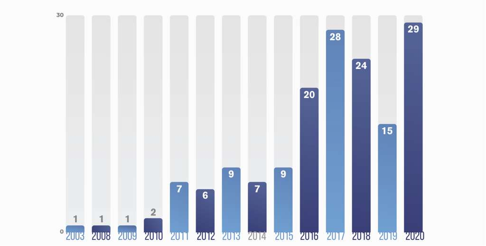

<!-- figure p55-fig1 | described_by: agy | ocr_overlap: None | needs_review: false -->
1. **Type of figure:** A single-panel vertical bar chart with full-height background tracks behind each bar.

2. **All visible text (verbatim):**
   - **Title, axis titles, legend, and caption:** None present.
   - **Vertical (y-axis) tick labels (top to bottom):** `30`, `0`
   - **Horizontal (x-axis) labels (left to right):** `2003`, `2008`, `2009`, `2010`, `2011`, `2012`, `2013`, `2014`, `2015`, `2016`, `2017`, `2018`, `2019`, `2020`
   - **Data labels on/above bars (left to right):** `1`, `1`, `1`, `2`, `7`, `6`, `9`, `7`, `9`, `20`, `28`, `24`, `15`, `29`

3. **Structure:**
   - The chart consists of a single panel containing 14 evenly spaced vertical columns arranged from left to right.
   - **Vertical axis:** Implicit (no axis line, tick marks, or horizontal gridlines). Two numeric scale labels sit to the left of the first column: `0` aligned with the bottom baseline of the bars and `30` aligned with the top of the background tracks.
   - **Horizontal axis:** Implicit (no axis line). Each column is labeled directly beneath its base with a four-digit year. Note that the sequence skips 2004–2007 (jumping directly from `2003` to `2008`), then advances consecutively by one year from `2008` through `2020`.
   - **Bars and tracks:** Each column has a uniform-height light-grey background track with slightly rounded top corners spanning the full vertical range from `0` to `30`. A coloured data bar with slightly rounded top corners rises from the `0` baseline inside each track to a height proportional to its value.
   - **Value label placement:** For the four lowest bars (`2003`, `2008`, `2009`, `2010`), the numeric value is centered directly above the top edge of the coloured bar (within the background track). For the remaining ten taller bars (`2011` through `2020`), the numeric value is centered inside the top portion of the coloured bar.

4. **Numbers and data values:**
   - **Y-axis range:** `0` to `30`
   - **Bar values by year:**
     - `2003`: `1`
     - `2008`: `1`
     - `2009`: `1`
     - `2010`: `2`
     - `2011`: `7`
     - `2012`: `6`
     - `2013`: `9`
     - `2014`: `7`
     - `2015`: `9`
     - `2016`: `20`
     - `2017`: `28`
     - `2018`: `24`
     - `2019`: `15`
     - `2020`: `29`

5. **Meaningful use of colour:**
   - **Background tracks vs. data bars:** Light grey indicates the unfilled portion of each column up to the maximum scale value of `30`, contrasting with the filled coloured data bars that represent the actual values.
   - **Alternating bar colours:** No legend is provided, and colour does not encode a separate labeled category. The data bars strictly alternate left to right between medium blue (odd-numbered years: `2003`, `2009`, `2011`, `2013`, `2015`, `2017`, `2019`) and dark blue/navy (even-numbered years: `2008`, `2010`, `2012`, `2014`, `2016`, `2018`, `2020`) to visually distinguish adjacent bars. Each year label matches its bar colour, except `2014`, which is rendered in grey rather than dark blue (no explanation is given in the figure).

~~~text ocr
30
7 7
1 1 1 2 '
mm
~~~

<!-- Start of picture text -->
30 29 28 24 20 15 9 9 7 7 6 2 1 1 1 0 2003 2008 2009 2010 2011 2012 2013 2014 2015 2016 2017 2018 2019 2020 <!-- End of picture text -->

Política de Internacionalização foi aprovado no colegiado da UFRPE, compilado em prol de atender às várias necessidades crescentes e a prever necessidades futuras dentro desse mesmo contexto. Esse trabalho constante culminou com a criação da Resolução nº 089, em abril de 2018 (UFRPE, 2018e), 

oficializando o Plano de Implantação de uma Política de Internacionalização com alcance de 2018 a 2023. Em 2020, a assessoria se tornou Núcleo de Internacionalização (Ninter), vinculado ao Instituto Ipê, de acordo com a Resolução nº 027/2020 – Cepe/UFRPE (UFRPE, 2020e). 

**54** 

<!-- page 56 -->

O Ninter tem o objetivo de garantir visibilidade internacional à UFRPE, trazendo benefícios para a participação efetiva de pesquisadore(a)s, educadore(a)s e extensionistas em editais de fomento e integração com órgãos internacionais, facilitando a captação e a alocação desses recursos dentro da Instituição. Com intuito de formar redes de colaboração, pesquisa com geração de produtos, patentes e _royalties_ , como forma de internacionalização ativa, além de subsidiar a internacionalização em casa e passiva como meios de obtenção de melhores resultados para o desenvolvimento acadêmico e tecnológico da UFRPE. A cooperação científica internacional também é essencial, de modo a mobilizar competências, no Brasil e no exterior, contribuindo para a qualificação de pessoas e para a promoção de PD&I (BRASIL, 2016h). 

É interessante observar que, dentro do processo de internacionalização, os muitos componentes estão interconectados e não podem ser desvinculados. Por exemplo, a internacionalização passiva depende fortemente da mobilidade, tanto discente quanto docente e/ou técnica, mas, sem a construção de uma política linguística da Universidade, um exemplo de Internacionalização em Casa, não é possível aumentar os índices de mobilidade, uma vez que a língua é fator preponderante para o deslocamento e a aquisição de competências interculturais, vitais às relações internacionais. Portanto, para se estabelecerem relações em redes de pesquisa, ensino ou extensão, com geração de produtos, 

patentes e _royalties_ , é necessário reconhecer a importância da Internacionalização em casa e passiva como partes de construção e base do processo total. 

Nessa perspectiva, a internacionalização tem potencial inequívoco dentro da UFRPE em promover e ampliar parcerias e integração da comunidade acadêmica com instituições estrangeiras. Tais parcerias são capazes de promover, além da troca de conhecimentos, a ampliação da troca de tecnologias e de recursos voltados ao desenvolvimento de produtos, além da geração de capital próprio. 

O Ninter, com suas coordenações, é responsável por promover a ampliação da internacionalização da UFRPE. 

O planejamento da internacionalização da UFRPE é estruturado em quatro eixos: 

**Cooperação internacional de pesquisas** : apoiar as pesquisas internacionais, propondo formalização das parcerias para fortalecer as relações institucionais externas e incentivando a vinda de pesquisadore(a)s para enriquecimento bilateral. 

**Ensino multicultural e internacionalizado** : capacitar discentes de graduação e pós-graduação, docentes e técnico(a)s-administrativo(a)s em línguas estrangeiras, em parceria com o Núcleo de Idiomas (NID) e a Rede 

**55** 

<!-- page 57 -->

Andifes–IsF – Idiomas sem Fronteiras, para estarem preparados a oportunidades internacionais, com a oferta de cursos de idiomas e atividades de caráter linguístico e cultural que favoreçam as ações de internacionalização da Universidade, através do Programa de Ensino Remoto em Idiomas (Peri). 

**Colaborações internacionais** : fomentar redes de Pesquisa, Desenvolvimento e Inovação nacionais e internacionais, com a captação de recursos externos. Atua-se na mediação e no diálogo com as instituições internacionais e a UFRPE, com apoio em tradução de documentos oficiais, orientação das normativas e fortalecimento do relacionamento institucional no mundo. 

**Mobilidade internacional** : prospecção e divulgação das parcerias e do programa de mobilidade internacionais para discentes, docentes e técnico(a)s-administrativo(a)s da UFRPE, bem como recepcionar estrangeiros com o objetivo voltado para a troca de experiência de estudantes e professore(a)s de diferentes nacionalidades. 

**Relações humanas** : **valorização da vida, saúde emocional, direitos humanos e diversidades** Além da trajetória e expertise na condução de atividades acadêmicas e administrativas, a UFRPE vem fortalecendo seu perfil holístico, a partir de políticas e ações conectadas com as questões contemporâneas de valorização da vida e cuidado humano, bem como no enfrentamento às desigualdades, 

direitos humanos e diversidades. O caráter humanista institucional ganhou força tanto na formação de estudante quanto na atenção às demandas socioemocionais, dentro do contexto acadêmico e de seus principais entes, além de posturas sintonizadas com as discussões acerca de identidade, gênero, etnia, acessibilidade e diversidades em geral. 

Na última década, as iniciativas implementadas na Universidade se constituíram em teias de ações que agregam potencialidades para formulação de propostas e diretrizes apontadas nesta seção. Entre essas iniciativas, destacam-se: 

- Criação da disciplina Libras/Língua Brasileira de Sinais, como componente curricular obrigatório nos Cursos de Licenciatura e optativo para os de Bacharelado, em 2010; 

- Inclusão da disciplina Educação das Relações Étnicoraciais como obrigatória para os cursos de Licenciatura e eletiva para os de Bacharelado, em 2012; 

- Adesão integralmente à Lei nº 12.711/2012 – Lei de Cotas (BRASIL, 2012f).– a partir do ingresso de 2013; 

- Criação do Núcleo de Acessibilidade (Naces), em 2013; 

- Criação da Comissão de Direitos Humanos Gregório Bezerra, em 2013; 

- Aprovação de resolução que dispõe sobre a utilização do nome social de transgênero nos registros acadêmicos e funcionais, em 2013; 

**56** 

<!-- page 58 -->

- Aprovação de resolução sobre política de ações afirmativas para negro(a)s – preto(a)s e pardo(a)s, indígenas, pessoas com deficiência ou pessoas trans na pós-graduação _stricto sensu_ , em 2018; 

- Criação, dentro da Pró-Reitoria de Gestão Estudantil e Inclusão, da Coordenadoria de Ações Afirmativas de Permanência (CAAP); 

- Criação, no âmbito da Pró-Reitoria de Extensão Cultura e Cidadania, da Coordenação de Direitos Humanos, Ações Afirmativas e Diversidades, com potencialidade de transversalizar políticas institucionais de ensino, pesquisa e extensão, em 2020; 

- Criação do Instituto Menino Miguel, que agrega Escola de Conselhos de Pernambuco, Núcleo do Cuidado Humano, Núcleo do Envelhecimento, Velhice e Idosos e Observatório da Família, em 2020; 

- Criação da Comissão de Heteroidentificação para questões referentes às políticas de ação afirmativa na graduação, pós-graduação e concursos públicos, em 2021. 

O reconhecimento dessas iniciativas torna-se oportuno para adensar o planejamento estratégico no fortalecimento das instâncias institucionais – Reitoria e Pró-Reitorias, como suas estruturas organizacionais – além de otimizar processos decisórios, com a definição de princípios, diretrizes e soluções para articular, implementar e desenvolver programas e projetos de redimensionamento institucional. 

Embora algumas discussões tenham surgido a partir do cenário da pandemia de Covid-19 e seus impactos, num caráter emergencial de planejamento, almeja-se, a partir das diretrizes e horizontes, promover coerência e sincronia ao conjunto das providências a serem tomadas no âmbito das políticas de gestão, a fim de dar transparência a ações de enfrentamento às formas de preconceito, discriminação, racismo, homofobia, machismo, idadismo, capacitismo e outras intolerâncias. 

Todas essas ações, bem articuladas, podem proporcionar qualidade das políticas de acesso democrático, permanência e sucesso na conclusão do(a)s estudantes na graduação e nos cursos de pós-graduação, como também favorecer o acompanhamento institucional de egresso(a)s e sua inserção no mundo do trabalho. 

As políticas de ação afirmativa, de direitos humanos e das diversidades, que agregam as dimensões étnico-racial, geracional, de gênero e LGBTQIA+ – Lésbicas, Gays, Bissexuais, Travestis, Transexuais, Intersexuais, Queer e mais – e inclusão de pessoas com deficiência, vêm se constituindo em importantes iniciativas, na UFRPE, sintonizadas com uma agenda contemporânea de reconhecimento, afirmação, implementação e consolidação de direitos em diferentes perspectivas. 

As ações estão fundamentadas em marcos legais, políticas de gestão governamental ou em consonância, direta ou indireta, com planos, pactos, estatutos e políticas públicas voltadas 

**57** 

<!-- page 59 -->

a essa agenda. Exemplo: Pacto Nacional Universitário pela Promoção do Respeito à Diversidade, da Cultura de Paz e dos Direitos Humanos, Estatuto da Igualdade Racial, Programa Brasil sem Homofobia, que compõem o Programa Nacional de Direitos Humanos, Estatuto da Pessoa com Deficiência e no Estatuto da Criança e do Adolescente. 

- _Diálogo com a Proplan_ : valorização da vida, direitos humanos e enfrentamento às desigualdades sociais – objetivos do desenvolvimento sustentável da UFRPE. 

_Responsáveis_ : Coordenadoria Escola de Conselhos de Pernambuco; Coordenadoria da Família; Coordenadoria do Cuidado Humano; Coordenadoria do Envelhecimento, Velhice e Idosos. 

##### **Proposições e Diretrizes – Relações Humanas** 

###### **Pró-Reitoria de Extensão, Cultura e Cidadania (PROExC)** 

###### **Instituto Menino Miguel (IMM)** 

- Atividade de extensão _É tempo de Esperançar_ – Estatuto da Criança e do Adolescente em Pernambuco 

- – Coordenadoria da Escola de Conselhos de Pernambuco. 

- Pós-Graduação para operadore(a)s do Estatuto da Criança e do Adolescente em Pernambuco. 

- Atividades de saúde mental voltadas para a comunidade universitária – Coordenadoria do Cuidado Humano. 

- Campanha anual de enfrentamento às violências e violação dos direitos humanos, _Faça Bonito UFRPE_ ! 

- Disciplina Direitos Humanos e Transdisciplinaridade. 

- Projeto _Diálogos_ – Coordenadoria Observatório da Família. 

- Ações de formação com o Conselho Municipal do Idoso (Recife) – Coordenadoria Núcleo do Envelhecimento, Velhice e Idosos. 

- Projeto _Marca da Liberdade_ – _Observatório da Família_ . 

- Constituir indicadores institucionais com o objetivo de implementação de iniciativas políticas institucionais de ação afirmativa, diversidades e inclusões. 

- Instituir Programa de Ações Afirmativas e Diversidades, com caráter participativo e democrático, que estabeleça princípios, diretrizes e metas a serem almejadas por diferentes instâncias – pró-reitorias, departamentos acadêmicos, departamentos administrativos e órgãos suplementares, programas e projetos – considerando, de forma indissociável, as dimensões de gestão, de pesquisa, de ensino e extensão. 

- Articular diálogos transversais e parcerias internas/ setoriais com outras instituições universitárias (IES), organizações da sociedade civil e órgãos governamentais, a fim de definir estratégias e experiências institucionais exitosas. 

- Adotar, nas iniciativas de comunicação, informação e documentos oficiais, linguagem de gênero, como 

**58** 

<!-- page 60 -->

estratégia para dar visibilidade à luta pela equidade de direitos entre mulheres e homens. 

- Inserir questões associadas à ação afirmativa, de gênero e LGBTQIA+ e acessibilidade no planejamento e execução orçamentária da instituição. 

- Estabelecer política para manter esses temas presentes nos espaços institucionais, físicos e virtuais, nas políticas de informação e comunicação, no uso das Tecnologias Digitais da Informação e Comunicação (TDIC) voltadas para recursos pedagógicos e formativos, bem como em outros serviços e instalações abertos ao público ou de uso público no espaço acadêmico. 

- Constituir rede de diálogo de escuta com outras instituições universitárias e organizações da sociedade civil para a formulação de proposições a serem implementação na universidade. 

- Definir política de produção de repertórios pedagógicos e gestão e disponibilização em diferentes formatos de acessibilidade. 

- Definir a Política dos Editais de Extensão, Cultura e Cidadania, considerando o estabelecimento dos Programas Estratégicos da PROExC, os ODS e a transversalidade das Políticas de Ações Afirmativas. 

- Estimular a criação e o fortalecimento de ações – integradas com as das instâncias governamentais da educação básica – na formação continuada de professore(a)s, gestore(a)s e técnico(a)s que atuam 

nas escolas da rede pública federal, estadual e municipal, em perspectiva inclusiva, democrática e emancipatória. 

- Reforçar ações de promoção dos valores democráticos, da justiça social e da liberdade, da garantia de direitos sociais e individuais e do combate a toda forma de discriminação: étnica, de gênero, geracional, social, sexual, religiosa, entre outras. 

- Desenvolver e acolher propostas que promovam iniciativas de reflexões, planejamento e ações institucionais coordenadas sobre direitos humanos, ações afirmativas e diversidade, como forma de combate ao preconceito e à intolerância, à violência de gênero, à homofobia e à transfobia, em parceria com Progesti, PREG, Proplan, PRPG, Progepe, Instituto Ipê, Instituto Menino Miguel, DQV, Comissão de Direitos Humanos Gregório Bezerra e núcleos/grupos de pesquisa. 

###### **Núcleo de Acessibilidade (Naces)** 

- Elaborar banco de dados de estudantes com deficiência ou necessidades educacionais especiais para monitorar a sua trajetória. 

- Ofertar capacitação a docentes para desenvolvimento de práticas pedagógicas inclusivas nas diferentes plataformas e possibilidades de interação professor-estudante. 

**59** 

<!-- page 61 -->

- Identificar possível enfrentamento acerca da violência sexual praticada contra as pessoas com deficiência ou necessidades educacionais especiais. 

- Dialogar com a Proplan para implementação de política inclusiva na UFRPE. 

- Desenvolver ações e inciativas para a garantia de acessibilidade em diversos âmbitos, incluindo os segmentos discente, docente e técnico-administrativo. 

###### **Departamento de Qualidade de Vida (DQV)** 

- Manter a realização regular de atividades de informação e educação em saúde por meio da utilização de Tecnologias Digitais de Informação e Comunicação. 

- Aprofundar parceria intersetorial, no campo da saúde, entre o DQV e as outras unidades acadêmicas fora da Sede/UFRPE. 

- Intensificar o desenvolvimento de ações de prevenção e promoção no campo da saúde mental. 

- Manter o serviço de acolhimento, por meio digital e presencial, e o trabalho de orientação psicológica. 

- Participar do desenvolvimento de ações de acolhimento, cuidado e educativas em saúde mental, fortalecendo parceria com o Núcleo do Cuidado Humano/Instituto Menino Miguel. 

- Desenvolver ações que abordem temas relacionados à família, maternidade, paternidade, filhos, educação, saúde e trabalho. 

- Construir parceria com o Observatório da Família/ Instituto Menino Miguel para ações de promoção da saúde e qualidade de vida. 

- Fomentar a abordagem transversal das temáticas de gênero, raça/etnia, orientação sexual, infância, juventude, envelhecimento e intergeracionalidade. 

- Redesenhar Programa de Preparação para a Aposentadoria, bem como realizar ações no campo do envelhecimento, em parceria com o Núcleo do Envelhecimento, Velhice e Idosos/Instituto Menino Miguel. 

- Fortalecer a campanha Orgulho de Envelhecer – Pelo fim do idadismo, parceria entre o setor de geriatria do DQV e o Núcleo do Envelhecimento, Velhice e Idosos (Nevi/IMM). 

- Fortalecer parceria com o Núcleo de Acessibilidade (Naces) promovendo ações de inclusão e acessibilidade das pessoas com deficiências ou necessidades específicas. 

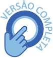

<!-- figure p61-fig1 | described_by: agy | ocr_overlap: None | needs_review: false -->
1. **Tipo de figura:** Ícone gráfico / selo ilustrativo de botão interativo (sinalizando acesso à versão completa de um documento ou conteúdo).

2. **Texto visível (literal):**
   - `VERSÃO COMPLETA`

3. **Estrutura:**
   - **Elemento central:** Um ícone circular formado por dois anéis concêntricos com o centro vazio (branco/transparente): um anel externo mais espesso e um anel interno mais fino.
   - **Ícone de interação:** No quadrante inferior esquerdo, sobrepondo-se parcialmente aos anéis, há uma ilustração estilizada de uma mão com o dedo indicador estendido diagonalmente para cima e para a direita, apontando para o centro dos anéis (representando o gesto de clicar ou tocar). O polegar está voltado para cima à esquerda e os outros três dedos estão dobrados.
   - **Disposição do texto:** A expressão `VERSÃO COMPLETA`, em letras maiúsculas, acompanha externamente a curvatura do anel circular, começando na parte superior esquerda (`VERSÃO`), contornando o topo e descendo pelo lado direito até a parte inferior direita (`COMPLETA`).
   - Não há caixas, setas, eixos, tabelas, gráficos ou painéis adicionais.

4. **Números ou valores de dados:** Nenhum.

5. **Cores com significado:** As cores (dois tons de azul — azul-escuro no anel externo e no contorno da mão; azul-claro no anel interno, no preenchimento da mão e no texto) têm função meramente visual/decorativa e de contraste, não carregando significado de dados ou categorias.

<!-- Start of picture text -->
VERSÃOCO M P L E T A <!-- End of picture text -->

**60** 

<!-- page 62 -->

**3** 

**Organização administrativa** 

**61** 

<!-- page 63 -->

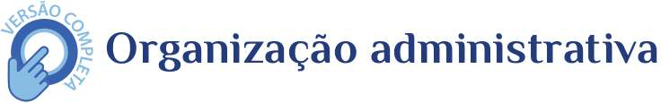

<!-- figure p63-fig1 | described_by: agy | ocr_overlap: None | needs_review: false -->
**1. Tipo de figura**
Trata-se de um cabeçalho gráfico de seção (ou título ilustrado), composto por um ícone/selo à esquerda seguido de um título principal em texto à direita.

**2. Texto visível (verbatim)**
- No arco externo ao redor do ícone circular à esquerda: `VERSÃO COMPLETA`
- À direita do ícone, como título principal: `Organização administrativa`

**3. Estrutura**
A figura tem disposição horizontal em uma única faixa, sem caixas, setas, eixos, linhas/colunas de tabela ou múltiplos painéis, composta por dois elementos lado a lado:
- **À esquerda (ícone/selo):** um símbolo circular formado por dois anéis concêntricos (um anel externo mais espesso e um anel interno mais fino) em torno de um centro branco. Sobreposto à parte inferior esquerda do círculo há o desenho estilizado de uma mão com o dedo indicador estendido apontando/tocando o centro do círculo (representando ação de clique ou toque). A inscrição `VERSÃO COMPLETA` acompanha em arco o contorno externo do círculo, indo do topo à esquerda, passando pela parte superior até a lateral inferior direita.
- **À direita (título):** o texto `Organização administrativa` em fonte serifada grande, posicionado imediatamente à direita do ícone e alinhado horizontalmente ao centro do conjunto.

**4. Números ou valores de dados**
Não há números nem valores de dados na figura.

**5. Cores com significado**
Não há cores codificando dados, categorias ou legendas. Toda a composição utiliza apenas tons de azul (azul-marinho no título principal, azul médio no anel externo e no contorno da mão, e azul-claro no preenchimento da mão, no anel interno e no texto `VERSÃO COMPLETA`) com função puramente visual e de hierarquia estética entre o selo e o título.

~~~text ocr
SÃO
Organização administrativa
~~~

<!-- Start of picture text -->
Organização administrativa VERSÃOCO M P L E T A <!-- End of picture text -->

A organização administrativa compreende a estrutura organizacional da UFRPE, a maneira com a qual o trabalho é dividido em tarefas distintas, realizadas por diferentes unidades da organização. Dispõe sobre relação hierárquica, divisão dos setores, atribuições dos responsáveis de cada unidade e relação de subordinação entre elas. 

Administrativo. As unidades colegiadas são importantes elementos para discussão e participação nas decisões no âmbito da gestão da UFRPE. 

##### **Órgãos colegiados deliberativos da administração superior** 

A estrutura organizacional da UFRPE é dinâmica e complexa, sendo essas características evidenciadas nos diversos níveis hierárquicos e tipos de órgãos do seu organograma. Em linhas gerais, a administração universitária pode ser diferenciada em duas áreas: atividades de ensino, pesquisa e extensão, que representam a área fim, e atividades administrativas e de infraestrutura, representantes da área meio. Cada área possui características diversas e complexas, exigindo habilidades e competências específicas e coordenação do(a)s gestore(a)s. 

Além das unidades administrativas, compõem a estrutura da UFRPE os órgãos colegiados deliberativos da administração superior – Conselho Universitário, Conselho de Ensino, Pesquisa e Extensão e Conselho de Curadores – e da administração departamental, Conselho Técnico 

###### **Conselho Universitário (Consu)** 

É o órgão deliberativo, normativo e consultivo em assuntos de política e de planejamento universitário, funcionando como última instância de recurso no âmbito da Universidade. Consoante disposto no artigo 11º do Estatuto da UFRPE, nas Resoluções nº 041/1986 (UFRPE, 1986) e nº 216/2013 – Consu/UFRPE (UFRPE, 2013b), o Consu é integrado por gestore(a)s, representantes dos corpos docente, discente e técnico, além de representantes da comunidade. Dentre as competências do Conselho Universitário, elencadas no art. 5º do Regimento Geral da UFRPE, destacam-se: 

**_1._** Fixar a política geral da universidade e orientar seu planejamento; 

**_2._** Homologar decisões do Conselho de Curadores; 

**62** 

<!-- page 64 -->

**_3._** Aprovar o regimento interno das unidades acadêmicas, pró-reitorias, departamentos acadêmicos, diretórios estudantis e diretórios acadêmicos; 

**_4._** Deliberar sobre administração do patrimônio; 

**_5._** Autorizar concessão de prêmios, medalhas e títulos honoríficos; 

**_6._** Homologar criação, modificação e extinção de cursos e disciplinas; 

   **_2._** Aprovar planos de novos cursos de graduação e as modificações nos planos já existentes; 

   **_3._** Aprovar os programas e projetos de pesquisa elaborados pelos departamentos; 

   **_4._** Aprovar os novos planos ou alterações de cursos ou serviços de extensão; 

   **_5._** Homologar resultados de concursos ou provas de seleção para docentes. 

**_7._** Aprovar alterações do Estatuto e Regimento Geral. 

###### **Conselho de Curadores** 

**Conselho de Ensino, Pesquisa e Extensão (Cepe)** É o órgão deliberativo, normativo e consultivo da Universidade para assuntos ligados às atividades de ensino, pesquisa e extensão. Conforme artigo 13º do Estatuto da UFRPE (UFRPE, 1975) e Resolução nº 041/1986 – Consu/ UFRPE (UFRPE, 1986), o Cepe é integrado por gestore(a)s, coordenadore(a)s de cursos de graduação e pós-graduação, representantes dos corpos docente, discente e técnico e representante do Ensino Básico, Técnico e Tecnológico, entre outros. 

No rol de competências do Conselho de Ensino Pesquisa e Extensão, dispostos no art.6º do Regimento Geral da UFRPE, destacam-se: 

Órgão deliberativo, normativo e consultivo para assuntos pertinentes à discriminação, disciplinação e fiscalização econômico-financeira da Universidade. Consoante disposto no art. 16 do Estatuto da UFRPE e na Resolução nº 041/1986 – Consu/ UFRPE, o Conselho de Curadores será integrado por gestore(a)s, docentes, discentes, técnico(a)s e representantes do Ministério da Educação, do Governo de Pernambuco, entre outros. 

Dentre as competências do Conselho Curadores, dispostas no art. 7º do Regimento Geral da UFRPE, destacam-se: 

   **_1._** Fiscalizar a execução econômico-financeira; 

   **_2._** Aprovar, no âmbito da Universidade, as contas relativas a cada exercício financeiro. 

**_1._** Deliberar, em nível superior, sobre atividades universitárias de ensino, pesquisa e extensão; 

**63** 

<!-- page 65 -->

##### **Órgãos colegiados deliberativos da administração departamental** 

substitui em faltas e impedimentos. O(a) vice-reitor(a) também tem atribuições em atividades acadêmicas e administrativas delegadas pelo(a) reitor(a). 

###### **Conselho Técnico Administrativo (CTA)** 

Órgão deliberativo, normativo e consultivo de cada Departamento (Artigo 8º do Regimento Geral da UFRPE). Consoante disposto no artigo 29 do Estatuto da UFRPE (UFRPE, 1975) e na Resolução nº 79/2007 – Consu/UFRPE, o CTA possui a seguinte constituição: gestore(a)s, supervisore(a)s de áreas, docentes de cada categoria e discentes. 

As competências primordiais do Conselho Técnico Administrativo são: 

**_1._** Aprovar a distribuição de tarefas de ensino, pesquisa, extensão e outros entre docentes que integram as suas áreas de conhecimento; 

**_2._** Aprovar planos de ensino; 

**_3._** Elaborar e aprovar a lista de disciplinas que serão ofertadas em cada semestre. 

**Órgãos executivos da administração superior** 

Conforme disposto no Artigo 17 do Estatuto da UFRPE (UFRPE, 1975), a Reitoria é o órgão executivo superior que coordena, fiscaliza e superintende todas as atividades universitárias. É exercida pelo(a) reitor(a), com a cooperação direta e efetiva do(a) vice-reitor(a), que também o(a) 

De acordo com o Artigo 5º do Regimento da UFRPE, estão diretamente ligados à Reitoria: o Gabinete do(a) Reitor(a), as pró-reitorias, os órgãos de apoio e assessoramento, os órgãos executivos da administração geral e os órgãos executivos da administração específica, quais sejam os departamentos acadêmicos. 

##### **Órgãos de apoio e assessoramento** 

Conforme o artigo 27 do Regimento da UFRPE, são subordinados diretamente à Reitoria e responsáveis por assessorar a mesma em suas atividades. A competência dessas unidades está disposta na Resolução nº 18/2020 – Consu/UFRPE (UFRPE, 2020d), que aprovou o regimento interno das unidades que compõem essa classificação regimental. São órgãos de apoio e assessoramento da UFRPE: 

**Assessoria de Cerimonial e Projetos Sociais (Acep)** : responsável por planejar, organizar e executar eventos oficiais da Universidade. 

**Assessoria de Comunicação Social (Ascom)** : planeja ações de comunicação estratégicas, além de produzir material gráfico e audiovisual, divulga informações institucionais e gerencia as mídias digitais da UFRPE. 

**64** 

<!-- page 66 -->

**Coordenação de Acompanhamento e Monitoramento de Egressos (Came)** : atende e fornece suporte ao(à)s egresso(a)s, bem como gerencia seus dados e acompanha sua inserção no mundo do trabalho. 

**Comissão de Direitos Humanos Gregório Bezerra (CDHGB)** : coordena e executa ações em defesa dos direitos humanos, contemplando atividades de ensino, pesquisa e extensão da UFRPE. 

**Comissão de Ética no Uso de Animais (Ceua)** : possui atribuição de cumprir e fazer cumprir o disposto na Lei nº 11.794/2008 (BRASIL, 2008a) e demais normas aplicáveis à utilização de animais para ensino e pesquisa, especialmente nas Resoluções do Conselho Nacional de Experimentação Animal (Concea). 

**Comissão Interna de Supervisão (CIS)** : acompanha, orienta, fiscaliza e avalia a implementação do Plano de Carreira dos Cargos Técnico-Administrativos em Educação (PCCTAE), no âmbito da UFRPE, e propõe à Comissão Nacional de Supervisão as alterações necessárias ao seu aprimoramento. 

**Comissão Permanente de Acompanhamento de Acúmulos de Cargos, Empregos e Funções (Coopac)** : responsável por julgar questões referentes a possíveis irregularidades de cargos, empregos e funções de servidore(a)s integrantes do quadro da UFRPE. 

**Comissão Permanente de Avaliação Documental (CPAD)** : responsável por orientar e realizar o processo de análise, avaliação e seleção da documentação produzida e acumulada na Universidade. 

**Comissão Permanente de Pessoal Docente (CPPD)** : avalia solicitação de alteração de regime de trabalho, solicitação de afastamento e avaliações do(a)s docentes. 

**Comissão de Sindicância (CSIND)** : avalia e conduz ações em Processos Administrativos Disciplinares (PAD) /Sindicâncias. 

**Coordenação da Base de Piscicultura Ornamental e Pesquisa Marinha (CPopMar)** : sedia e coordena a logística das aulas práticas das disciplinas de mar ofertadas nos cursos de graduação e desenvolve projetos de ensino, pesquisa e extensão com peixes ornamentais. 

###### **Coordenações de estações experimentais** 

A UFRPE possui unidades, em diversos municípios de Pernambuco, responsáveis por realizar atividades de ensino, pesquisa e extensão nas áreas de irrigação, criação de pequenos animais, reflorestamento, desenvolvimento do setor sucroalcooleiro, melhoramento genético, silvicultura, botânica, zoologia e ecologia. São elas: 

- Coordenação da Estação de Agricultura Irrigada de Ibimirim; 

**65** 

<!-- page 67 -->

- Coordenação da Estação de Agricultura Irrigada de Parnamirim; 

desastres com base em ciências naturais, sociais, exatas e da saúde. 

- Coordenação da Estação Ecológica de Tapacurá; 

- Coordenação da Estação Experimental de Cana-de-Açúcar; 

- Coordenação da Estação Experimental de pequenos animais de Carpina; 

- Coordenação da Fazenda Didática de Garanhuns. 

**Comitê de Ética em Pesquisa com Seres Humanos (CEPSH)** : avalia os protocolos de pesquisa envolvendo seres humanos, inclusive os multicêntricos, de modo a garantir e resguardar a integridade e os direitos do(a)s voluntário(a)s participantes nas referidas pesquisas. 

**Gabinete do(a) Reitor(a)** : responsável por assessorar a Reitoria, realizar a triagem de processos administrativos que tramitam no setor e gerenciar o trabalho das demais unidades – Secretaria de Gabinete do(a) Reitor(a), Secretaria do(a) Reitor(a), Secretaria Executiva da Comissão de Ética, Setor de Transporte Executivo. 

**Instituto para Redução de Riscos e Desastres (IRRD)** : tem como objetivo promover o aprimoramento dos princípios de redução de risco, natural ou provocado, promovendo o bem-estar da sociedade no âmbito local, nacional e internacional, gerando, desenvolvendo e difundindo conhecimentos e tecnologias integradas para a redução de perda de 

**Núcleo de Acessibilidade (Naces)** : propõe ações institucionais de acessibilidade que visem à eliminação de barreiras físicas/ arquitetônicas, pedagógicas, atitudinais e comunicacionais na UFRPE, além de oferecer apoio pedagógico a discentes com necessidades educacionais especiais. 

**Ouvidoria** : possui a competência de ouvir e compreender as diferentes formas de manifestação de cidadão(ã)s. 

**Procuradoria Federal junto à UFRPE** : realiza consultoria e assessoramento inerentes ao cargo de Procurador(a) Federal, nos termos do art. 131 da Constituição da República, da Lei nº 10.480/2002 (BRASIL, 2002d), bem como da Portaria AGU n.º 1.399/2009 (AGU, 2009), e as atividades relativas à gestão da Procuradoria e assessoramento da administração superior da UFRPE. 

**Secretaria Geral dos Conselhos da Administração Superior (SEG)** : assessora o Gabinete do(a) Reitor(a) e unidades da UFRPE nos assuntos pertinentes aos Conselhos Superiores e ao Estatuto e Regimento da Universidade. 

**Serviço de Informações ao Cidadão (SIC)** : recebe pedido de acesso e, sempre que possível, fornece informação solicitada pelo(a) cidadão(ã). 

**66** 

<!-- page 68 -->

###### Figura 4 – **Organograma UFRPE** | 2020 

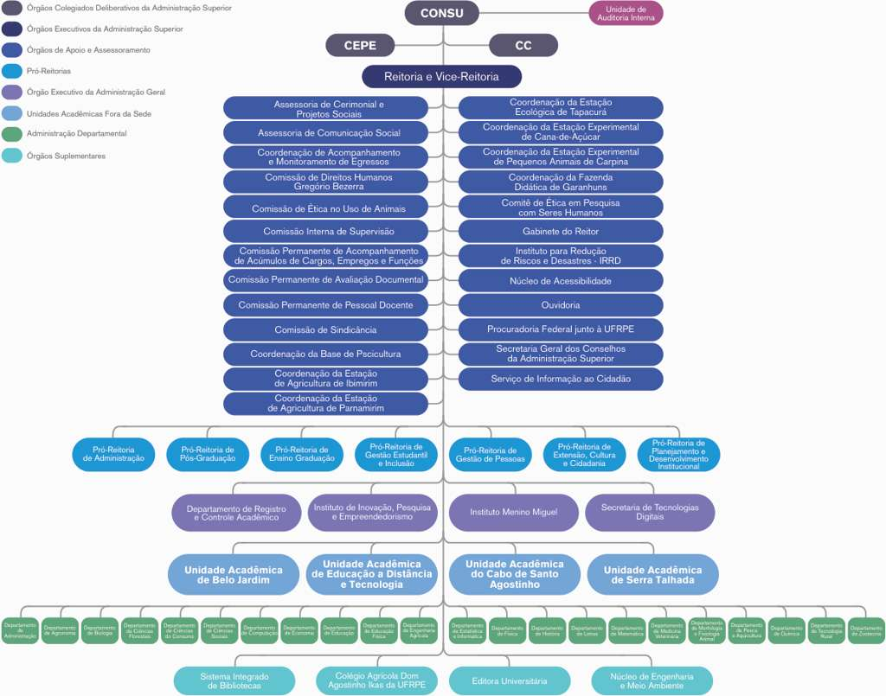

<!-- figure p68-fig1 | described_by: agy | ocr_overlap: 0.99 | needs_review: false -->
### 1. Tipo de figura
Trata-se de um **organograma institucional hierárquico** (estrutura organizacional da UFRPE — Universidade Federal Rural de Pernambuco), com legenda de cores no canto superior esquerdo e caixas arredondadas conectadas por linhas cinzas, sem setas, distribuídas vertical e horizontalmente a partir de um eixo central. A imagem não possui título geral nem legenda descritiva (caption).

---

### 2. Todo o texto visível (verbatim)

#### Legenda (canto superior esquerdo, de cima para baixo)
- Órgãos Colegiados Deliberativos da Administração Superior
- Órgãos Executivos da Administração Superior
- Órgãos de Apoio e Assessoramento
- Pró-Reitorias
- Órgão Executivo da Administração Geral
- Unidades Acadêmicas Fora da Sede
- Administração Departamental
- Órgãos Suplementares

#### Nível superior (Administração Superior e Auditoria)
- **Topo central:** CONSU
- **Topo à direita:** Unidade de Auditoria Interna
- **Segundo nível, à esquerda:** CEPE
- **Segundo nível, à direita:** CC
- **Terceiro nível, central:** Reitoria e Vice-Reitoria

#### Bloco em duas colunas — Órgãos de Apoio e Assessoramento
**Coluna da esquerda (de cima para baixo):**
1. Assessoria de Cerimonial e Projetos Sociais
2. Assessoria de Comunicação Social
3. Coordenação de Acompanhamento e Monitoramento de Egressos
4. Comissão de Direitos Humanos Gregório Bezerra
5. Comissão de Ética no Uso de Animais
6. Comissão Interna de Supervisão
7. Comissão Permanente de Acompanhamento de Acúmulos de Cargos, Empregos e Funções
8. Comissão Permanente de Avaliação Documental
9. Comissão Permanente de Pessoal Docente
10. Comissão de Sindicância
11. Coordenação da Base de Pscicultura
12. Coordenação da Estação de Agricultura de Ibimirim
13. Coordenação da Estação de Agricultura de Parnamirim

**Coluna da direita (de cima para baixo):**
1. Coordenação da Estação Ecológica de Tapacurá
2. Coordenação da Estação Experimental de Cana-de-Açúcar
3. Coordenação da Estação Experimental de Pequenos Animais de Carpina
4. Coordenação da Fazenda Didática de Garanhuns
5. Comitê de Ética em Pesquisa com Seres Humanos
6. Gabinete do Reitor
7. Instituto para Redução de Riscos e Desastres - IRRD
8. Núcleo de Acessibilidade
9. Ouvidoria
10. Procuradoria Federal junto à UFRPE
11. Secretaria Geral dos Conselhos da Administração Superior
12. Serviço de Informação ao Cidadão

#### Fileira de Pró-Reitorias (da esquerda para a direita)
1. Pró-Reitoria de Administração
2. Pró-Reitoria de Pós-Graduação
3. Pró-Reitoria de Ensino Graduação
4. Pró-Reitoria de Gestão Estudantil e Inclusão
5. Pró-Reitoria de Gestão de Pessoas
6. Pró-Reitoria de Extensão, Cultura e Cidadania
7. Pró-Reitoria de Planejamento e Desenvolvimento Institucional

#### Fileira de Órgão Executivo da Administração Geral (da esquerda para a direita)
1. Departamento de Registro e Controle Acadêmico
2. Instituto de Inovação, Pesquisa e Empreendedorismo
3. Instituto Menino Miguel
4. Secretaria de Tecnologias Digitais

#### Fileira de Unidades Acadêmicas Fora da Sede (da esquerda para a direita)
1. Unidade Acadêmica de Belo Jardim
2. Unidade Acadêmica de Educação a Distância e Tecnologia
3. Unidade Acadêmica do Cabo de Santo Agostinho
4. Unidade Acadêmica de Serra Talhada

#### Fileira de Administração Departamental (da esquerda para a direita)
1. Departamento de Administração
2. Departamento de Agronomia
3. Departamento de Biologia
4. Departamento de Ciências Florestais
5. Departamento de Ciências do Consumo
6. Departamento de Ciências Sociais
7. Departamento de Computação
8. Departamento de Economia
9. Departamento de Educação
10. Departamento de Educação Física
11. Departamento de Engenharia Agrícola
12. Departamento de Estatística e Informática
13. Departamento de Física
14. Departamento de História
15. Departamento de Letras
16. Departamento de Matemática
17. Departamento de Medicina Veterinária
18. Departamento de Morfologia e Fisiologia Animal
19. Departamento de Pesca e Aquicultura
20. Departamento de Química
21. Departamento de Tecnologia Rural
22. Departamento de Zootecnia

#### Fileira inferior — Órgãos Suplementares (da esquerda para a direita)
1. Sistema Integrado de Bibliotecas
2. Colégio Agrícola Dom Agostinho Ikas da UFRPE
3. Editora Universitária
4. Núcleo de Engenharia e Meio Ambiente

---

### 3. Estrutura (caixas, conexões, linhas e colunas)
- **Painéis e disposição geral:** A figura possui um único painel de fundo branco/cinza muito claro. No canto superior esquerdo encontra-se a legenda vertical com 8 marcadores em formato de pílula curta ao lado de seus respectivos rótulos. Todo o restante do espaço é ocupado pelo organograma centralizado.
- **Formato das caixas:** Todas as 71 caixas do organograma têm formato retangular com bordas fortemente arredondadas (formato de pílula na maioria dos níveis e quadrados com cantos arredondados na fileira de Administração Departamental). Não há setas em nenhuma conexão; todas as ligações são feitas por linhas cinzas contínuas com curvas suaves de 90 graus.
- **Conexões no topo:**
  - `CONSU` ocupa o topo central. Uma linha horizontal reta parte de sua lateral direita e liga-se diretamente à lateral esquerda de `Unidade de Auditoria Interna`.
  - Uma linha vertical central desce da base de `CONSU`. Antes de chegar ao nível seguinte, dela partem duas ramificações horizontais curtas com cantos curvos: uma à esquerda ligada à lateral direita de `CEPE` e outra à direita ligada à lateral esquerda de `CC`.
  - A linha vertical central segue reta até o topo de `Reitoria e Vice-Reitoria`.
- **Eixo vertical principal abaixo da Reitoria e Vice-Reitoria:**
  - Da base de `Reitoria e Vice-Reitoria` desce um único tronco vertical contínuo pelo centro exato do diagrama, do qual se ramificam todos os seis blocos subordinados abaixo, sem conexões diretas entre os blocos:
  1. **Órgãos de Apoio e Assessoramento (2 colunas verticais paralelas ao tronco):** 13 caixas empilhadas à esquerda e 12 caixas empilhadas à direita. Cada caixa liga-se ao tronco central por uma pequena ramificação horizontal curva em sua borda interna (borda direita das caixas da esquerda; borda esquerda das caixas da direita). Como a coluna esquerda tem 13 itens e a direita tem 12, a última caixa à esquerda (`Coordenação da Estação de Agricultura de Parnamirim`) fica sem par à direita.
  2. **Pró-Reitorias (1 fileira horizontal de 7 caixas):** O tronco central bifurca-se em duas barras horizontais (esquerda e direita) das quais descem ramos curvos para o topo de cada caixa: 4 caixas à esquerda do tronco (de `Pró-Reitoria de Administração` a `Pró-Reitoria de Gestão Estudantil e Inclusão`) e 3 caixas à direita (de `Pró-Reitoria de Gestão de Pessoas` a `Pró-Reitoria de Planejamento e Desenvolvimento Institucional`). O tronco central continua descendo entre a 4ª e a 5ª caixas.
  3. **Órgão Executivo da Administração Geral (1 fileira horizontal de 4 caixas):** Nova bifurcação horizontal ligando o topo de 2 caixas à esquerda e 2 caixas à direita do tronco central, que continua descendo entre a 2ª e a 3ª caixas.
  4. **Unidades Acadêmicas Fora da Sede (1 fileira horizontal de 4 caixas):** Nova bifurcação horizontal ligando o topo de 2 caixas à esquerda e 2 caixas à direita do tronco central, que continua descendo entre a 2ª e a 3ª caixas. Os rótulos dessas 4 caixas estão em fonte em negrito, visualmente mais espessa que nas fileiras vizinhas.
  5. **Administração Departamental (1 fileira horizontal de 22 caixas pequenas):** Nova bifurcação horizontal que se estende por quase toda a largura da imagem, com 11 ramos descendo ao topo das 11 caixas à esquerda (de `Departamento de Administração` a `Departamento de Engenharia Agrícola`) e 11 ramos descendo ao topo das 11 caixas à direita (de `Departamento de Estatística e Informática` a `Departamento de Zootecnia`). O tronco central passa entre a 11ª e a 12ª caixas.
  6. **Órgãos Suplementares (1 fileira horizontal de 4 caixas na base):** O tronco central encerra-se dividindo-se horizontalmente para a esquerda e para a direita, descendo ao topo de 2 caixas à esquerda (`Sistema Integrado de Bibliotecas` e `Colégio Agrícola Dom Agostinho Ikas da UFRPE`) e 2 caixas à direita (`Editora Universitária` e `Núcleo de Engenharia e Meio Ambiente`).

---

### 4. Números e valores de dados
Não há números, percentuais, datas, escalas, eixos ou valores quantitativos escritos na figura. Em termos puramente estruturais (contagem de elementos representados), o organograma contém **71 caixas** no total e **8 entradas na legenda**, assim distribuídas:
- Órgãos Colegiados Deliberativos da Administração Superior: 3 caixas (`CONSU`, `CEPE`, `CC`)
- Unidade de Auditoria Interna (cor fora da legenda): 1 caixa
- Órgãos Executivos da Administração Superior: 1 caixa (`Reitoria e Vice-Reitoria`)
- Órgãos de Apoio e Assessoramento: 25 caixas (13 à esquerda + 12 à direita)
- Pró-Reitorias: 7 caixas (4 à esquerda + 3 à direita)
- Órgão Executivo da Administração Geral: 4 caixas (2 à esquerda + 2 à direita)
- Unidades Acadêmicas Fora da Sede: 4 caixas (2 à esquerda + 2 à direita)
- Administração Departamental: 22 caixas (11 à esquerda + 11 à direita)
- Órgãos Suplementares: 4 caixas (2 à esquerda + 2 à direita)

---

### 5. Cores com significado
As cores preenchidas nas caixas classificam cada órgão segundo a categoria institucional indicada na legenda:
- **Cinza-arroxeado escuro:** `Órgãos Colegiados Deliberativos da Administração Superior` (`CONSU`, `CEPE`, `CC`).
- **Azul-marinho escuro:** `Órgãos Executivos da Administração Superior` (`Reitoria e Vice-Reitoria`).
- **Azul médio-escuro (azul-royal):** `Órgãos de Apoio e Assessoramento` (as 25 caixas em duas colunas).
- **Azul médio vivo (azul-celeste forte):** `Pró-Reitorias` (as 7 caixas da primeira fileira horizontal).
- **Roxo/lilás médio:** `Órgão Executivo da Administração Geral` (as 4 caixas da segunda fileira horizontal).
- **Azul-claro:** `Unidades Acadêmicas Fora da Sede` (as 4 caixas da terceira fileira horizontal).
- **Verde médio:** `Administração Departamental` (as 22 caixas de departamentos acadêmicos).
- **Turquesa (azul-esverdeado claro):** `Órgãos Suplementares` (as 4 caixas da fileira inferior).
- **Magenta/rosa-arroxeado (ausente na legenda):** aplicado exclusivamente à caixa `Unidade de Auditoria Interna`, diferenciando-a visualmente das categorias listadas na legenda.

~~~text ocr
Órgãos Colegiados Deliberativos da Administração Superior
@ Órgãos Executivos da Administração Superior
@ Órgãos de Apoio e Assessoramento
Pró-Reitorias
Reitoria e Vice-Reitoria
@ Órgão Executivo da Administração Geral
Assessoria de Cerimonial e Coordenação da Estação
Unidades Acadêmicas Fora da Sede Projetos Sociais Ecológica de Tapacurá
Coordenação da Estação Experimental
@ Administração Departamental Assessoria de Comunicação Social de Cana-de-Açúcar
Coordenação de Acompanhamento Coordenação da Estação Experimental
( Orga lementa! E
rgãos e Monitoramento de Egressos de Pequenos Animais de Carpina
Comissão de Direitos Humanos Coordenação da Fazenda
Gregório Bezerra Didática de Garanhuns
Comitê de Ética em Pesquisa
Comissão de Etica no Uso de Animais
Comissão Interna de Supervisão Gabinete do Reitor
Comissão Permanente de Acompanhamento Instituto para Redução
de Acúmulos de Cargos, Empregos e Funções de Riscos e Desastres - IRRD
Comissão Permanente de Avaliação Documental Núcleo de Acessibilidade
Comissão Permanente de Pessoal Docente Ouvidoria
Comissão de Sindicância Procuradoria Federal junto à UFRPE
Secretaria Geral dos Conselhos
Coordenação da Base de Pscicultura da Administração Superior
Coordenação da Estação
de Agricultura de Ibimirim Serviço de Informação ao Cidadão
Coordenação da Estação
de Agricultura de Parnamirim
Secretaria de Tecnologias
Departamento de Registro Instituto de Inovação, Pesquisa
Digitais
e Controle Acadêmico e Empreendedorismo Instituto Menino Miguel
a
ária
~~~

<!-- Start of picture text -->
Órgãos Colegiados Deliberativos da Administração Superior Unidade de CONSU Auditoria Interna Órgãos Executivos da Administração Superior CEPE CC Órgãos de Apoio e Assessoramento Pró-Reitorias Reitoria e Vice-Reitoria Órgão Executivo da Administração Geral Assessoria de Cerimonial e Coordenação da Estação Unidades Acadêmicas Fora da Sede Projetos Sociais Ecológica de Tapacurá Coordenação da Estação Experimental Administração Departamental Assessoria de Comunicação Social de Cana-de-Açúcar Órgãos Suplementares Coordenação de Acompanhamento Coordenação da Estação Experimental e Monitoramento de Egressos de Pequenos Animais de Carpina Comissão de Direitos Humanos Coordenação da Fazenda Gregório Bezerra Didática de Garanhuns Comissão de Ética no Uso de Animais Comitê de Ética em Pesquisacom Seres Humanos Comissão Interna de Supervisão Gabinete do Reitor Comissão Permanente de Acompanhamento Instituto para Redução de Acúmulos de Cargos, Empregos e Funções de Riscos e Desastres - IRRD Comissão Permanente de Avaliação Documental Núcleo de Acessibilidade Comissão Permanente de Pessoal Docente Ouvidoria Comissão de Sindicância Procuradoria Federal junto à UFRPE Secretaria Geral dos Conselhos Coordenação da Base de Pscicultura da Administração Superior Coordenação da Estação Serviço de Informação ao Cidadão de Agricultura de Ibimirim Coordenação da Estação de Agricultura de Parnamirim de AdministraçãoPró-Reitoria Pós-GraduaçãoPró-Reitoria de Ensino GraduaçãoPró-Reitoria de Gestão EstudantilPró-Reitoria dee Inclusão Gestão de PessoasPró-Reitoria de Extensão, CulturaPró-Reitoria dee Cidadania DesenvolvimentoPlanejamento ePró-Reitoria deInstitucional Departamento de Registroe Controle Acadêmico Instituto de Inovação, Pesquisae Empreendedorismo Instituto Menino Miguel Secretaria de TecnologiasDigitais Unidade Acadêmica Unidade Acadêmica Unidade Acadêmicade Belo Jardim de Educação a Distânciae Tecnologia do Cabo de SantoAgostinho Unidade Acadêmicade Serra Talhada AdministraçãoDepartamentode Departamentode Agronomia Departamentode Biologia Departamentode CiênciasFlorestais Departamentodo Consumo de Ciências Departamentode CiênciasSociais  de ComputaçãoDepartamento Departamentode Economia Departamentode Educação Departamentode EducaçãoFísica de EngenhariaDepartamentoAgrícola Departamentode Estatísticae Informática Departamentode Física Departamentode História Departamentode Letras de MatemáticaDepartamento Departamentode MedicinaVeterinária Departamentode Morfologiae FisiologiaAnimal Departamentoe Aquiculturade Pesca Departamentode Química Departamentode TecnologiaRural Departamentode Zootecnia Sistema Integradode Bibliotecas Agostinho Ikas da UFRPEColégio Agrícola Dom Editora Universitária Núcleo de Engenhariae Meio Ambiente <!-- End of picture text -->

*Comitês da UFRPE: Comitê de Governança Digital - CGD, Comitê de Governança, Gestão de Riscos e Controle Interno - CGRIC, Comitê de Sustentabilidade - CSUST 

**67** 

<!-- page 69 -->

##### **Pró-Reitorias** 

**Pró-Reitoria de Administração (PROAD)** Tem como finalidade realizar a gestão orçamentária, patrimonial, documental, de aquisições e contratações, fazendo interface com todos os ambientes organizacionais da Universidade Federal Rural de Pernambuco, viabilizando as ações de suporte à gestão, para que as missões finalísticas voltadas ao ensino, à pesquisa e à extensão sejam realizadas com qualidade. É a pró-reitoria com estrutura organizacional mais complexa e robusta, com diferentes tipos de unidades organizacionais – seções, coordenadorias, divisões, departamentos e gerência – e muitos níveis hierárquicos. 

###### **Pró-Reitoria de Pós-Graduação (PRPG)** 

Promove, coordena, supervisiona e apoia o ensino de pós-graduação, além de atuar na proposição e desenvolvimento de políticas, programas, e ações de articulação e cooperação, internas e externas, e na internacionalização da pós-graduação. 

###### **Pró-Reitoria de Ensino de Graduação (PREG)** 

Pró-reitoria responsável pelo planejamento, coordenação, supervisão e avaliação das atividades de ensino da UFRPE. Responde institucionalmente pelas questões relacionadas à graduação nos conselhos superiores, em entidades representativas e órgãos do Ministério da Educação (MEC). 

**Pró-Reitoria de Gestão Estudantil e Inclusão (Progesti)** Tem como finalidade contribuir para permanência de estudantes de vulnerabilidade socioeconômica matriculado(a)s em cursos de graduação presencial da UFRPE, como também incentivar, apoiar, orientar e acompanhar, de forma articulada com outros setores, o(a) estudante, em suas múltiplas demandas, no decorrer de sua trajetória acadêmica. 

**Pró-Reitoria de Gestão de Pessoas (Progepe)** 

Unidade que tem como finalidade planejar, gerenciar, desenvolver, acompanhar e avaliar a implementação das políticas de gestão de pessoas e seus resultados por meio da implementação de planos, programas e projetos de redimensionamento organizacional, avaliação de desempenho, desenvolvimento de competências para o trabalho, apoio psicossocial, saúde ocupacional, controle remuneratório e movimentação de pessoas. 

**Pró-Reitoria de Extensão, Cultura e Cidadania (PROExC)** Responsável pelas atividades relacionadas à Extensão Universitária nos processos: educativo, científico, tecnológico, social, esportivo, cultural e artístico, considerando as demandas da sociedade e estabelecendo mecanismos que relacionem o saber acadêmico ao saber popular. 

**68** 

<!-- page 70 -->

###### **Pró-Reitoria de Planejamento e Desenvolvimento Institucional (Proplan)** 

Responsável pelo desenvolvimento, coordenação, supervisão e avaliação das atividades de planejamento estratégico em todos os níveis; controle e organização das informações institucionais e indicadores; gestão da estrutura organizacional, por meio da análise regimental e gestão dos sistemas estruturantes; gestão de processos organizacionais, em conformidade com a Política de Gestão de Processos; gestão de riscos, a partir da Política de Gestão de Riscos; monitoramento do plano de integridade e coordenação de projetos relacionados à gestão sustentável. 

##### **Órgãos Executivos da Administração Geral** 

São unidades vinculadas diretamente à Reitoria que atuam para o fortalecimento e melhor desempenho das atividades da Universidade. 

**Departamento de Registro e Controle Acadêmico (DRCA)** Tem por finalidade programar e coordenar a execução de registros e controles acadêmicos das atividades discentes, desde a matrícula à conclusão do curso, com a emissão de certificados de conclusão, expedição e registros de diplomas e outros documentos pertinentes. 

**Instituto de Inovação, Pesquisa, Empreendedorismo, Internacionalização e Relações Institucionais (Ipê)** Promove o direcionamento estratégico das áreas de pesquisa, inovação e empreendedorismo. Impulsiona o 

desenvolvimento social e econômico, através do estímulo e suporte ao desenvolvimento de inovações; formação da cultura empreendedora; captação de recursos externos e prospecção, formalização, execução e encerramento de projetos acadêmicos. 

###### **Instituto Integrado do Cuidado da Família, da Infância, do Envelhecimento, da Velhice e da Pessoa Idosa (Instituto Menino Miguel – IMM)** 

Responsável pelo desenvolvimento de ações nas áreas de cuidado humano, família, infância, adolescência, processo de envelhecimento, velhice e pessoa idosa, voltados para a comunidade da UFRPE e para a sociedade, além de salvaguardar a memória do menino Miguel Otávio e sua família, contribuindo com o fortalecimento de uma sociedade justa, democrática e cidadã e com os direitos humanos. 

**Secretaria de Tecnologias Digitais (STD)** 

Compete a essa unidade direcionar, planejar, executar, manter, evoluir e gerenciar estratégias, projetos e ações corporativas que promovam a transformação digital, através de soluções de tecnologias digitais, visando sempre ao aprimoramento do ensino, da pesquisa, da extensão e da qualidade de vida no _campus_ . Além da transformação digital, compete a essa unidade prover serviços pertinentes a: redes de comunicação, serviços computacionais, segurança da informação digital, soluções digitais para promover o _Campus_ Inteligente, sistemas de informação, 

**69** 

<!-- page 71 -->

processos de Tecnologia da Informação e Comunicação (TIC) e governança digital. 

##### **Unidades Acadêmicas** 

###### **Unidade Acadêmica de Belo Jardim (UABJ)** 

Unidade mais recente da UFRPE, compõe o plano de expansão e interiorização impulsionado pelo Plano de Reestruturação e Expansão das Universidades Federais (Reuni), posteriormente incorporado aos objetivos estratégicos da Instituição. Localizada no agreste pernambucano, é responsável pelas atividades didático-administrativas e extensionistas, respeitando os limites da sua competência. Na unidade, são ofertados cursos de graduação nas áreas de Engenharia da Computação, Engenharia de Controle e Automação, Engenharia Hídrica e Engenharia Química. 

###### **Unidade Acadêmica de Educação a Distância e Tecnologia (UAEADTec)** 

Criada com o objetivo de fortalecer a educação a distância, modalidade de educação que possibilita adaptação ao contexto social do(a) estudante. A unidade possui polos nos estados de Pernambuco e Bahia e oferta cursos de graduação em Administração Pública, Sistemas de Informação, Licenciatura em Artes Visuais, Licenciatura em Computação, Licenciatura em Física, Licenciatura em História, Licenciatura em Letras, Licenciatura em Pedagogia. Além de graduação, oferece cursos de 

aperfeiçoamento, extensão e especialização e dois mestrados. 

###### **Unidade Acadêmica de Serra Talhada (UAST)** 

Localizada no município de Serra Talhada, além de contribuir para o desenvolvimento da região, visa a atender a demanda de conhecimento e trabalho dos municípios do Sertão do Pajeú. Oferece os cursos de Administração, Agronomia, Ciências Biológicas, Ciências Econômicas, Engenharia de Pesca, Licenciatura em Letras, Licenciatura em Química, Sistema da Informação e Zootecnia. Além da graduação, oferta cursos de pós-graduação nas áreas de Produção Vegetal e Biodiversidade. 

###### **Unidade Acadêmica do Cabo de Santo Agostinho (UACSA)** 

Localizada no município do Cabo de Santo Agostinho, Região Metropolitana do Recife, tem por objetivo promover a formação que associe a aprendizagem à prática profissional, através da integração com as empresas da região, particularmente do Polo Industrial de Suape. Oferece cursos de Engenharia Civil; de Materiais; Elétrica; Eletrônica e Mecânica; e pós-graduação em Engenharia Física. 

##### **Administração Departamental** 

Os departamentos são unidades vinculadas à Reitoria que congregam disciplinas afins, servidore(a)s e discentes para atividades de ensino, pesquisa e extensão nas suas 

**70** 

<!-- page 72 -->

áreas de conhecimento. A administração é exercida pelos órgãos executivos da administração departamental denominados Diretorias Departamentais. A UFRPE possui 22 departamentos acadêmicos, que compõem o Sistema Comum de Ensino e Pesquisa básicos e Sistema de Ensino Profissional e Pesquisa Aplicada. São eles: Administração; Agronomia; Biologia; Ciências Florestais; Ciências do Consumo; Ciências Sociais; Computação; Economia; Educação; Educação Física; Engenharia Agrícola; Estatística e Informática; Física; História; Letras; Matemática; Medicina Veterinária; Morfologia e Fisiologia Animal; Pesca e Aquicultura; Química; Tecnologia Rural; e Zootecnia. 

##### **Órgãos Executivos Suplementares** 

###### **Sistema Integrado de Bibliotecas (SIB)** 

Tem como objetivo dar suporte informacional às atividades de ensino, pesquisa e extensão; zelar e garantir a contínua atualização dos acervos bibliográficos das bibliotecas; gerir, preservar e difundir a produção intelectual e memorial da UFRPE em repositórios digitais de acesso aberto com alcance nacional e internacional; oferecer produtos e serviços de biblioteca de qualidade ao(à)s usuário(a)s. 

**Colégio Agrícola Dom Agostinho Ikas da UFRPE (Codai)** Responsável por oferecer educação profissional integrada às diferentes formas de educação, ao trabalho, à cidadania 

e à tecnologia, conduzindo ao permanente desenvolvimento de aptidões para a vida produtiva. Localizado no município de São Lourenço da Mata, oferece cursos de formação básica, técnica e tecnológica nas áreas de Agricultura; Zootecnia; Comunicação e Expressão; Tecnologia; Ciências Sociais; Ciências Biológicas, Gestão, Ciência e Tecnologia dos Alimentos. 

###### **Editora Universitária (EDUFRPE)** 

Responsável pela política editorial da UFRPE e pela prestação de serviços de impressão e publicação. Atua também na área de criação e consultoria em _design_ gráfico, tais como: criação de marcas, projetos gráficos de livros, criação de capas e identidade visual de eventos. 

###### **Núcleo de Engenharia e Meio Ambiente (NEMAM)** 

Responsável por: planejamento físico e execução de obras, elaboração de projetos de engenharia, arquitetura e infraestrutura, fiscalização de obras e serviços de engenharia. Elabora pareceres e laudos técnicos relativos à área de competência e atua no controle do uso dos espaços em razão da sua utilidade, como reserva para construção e destinação de outros usos, em conformidade com o Plano Diretor da Universidade. 

Para acessar demais organogramas da UFRPE, acesse: **http://www.proplan.ufrpe.br/br/node/452** 

**71** 

<!-- page 73 -->

##### **Reflexões sobre estrutura organizacional** 

A organização administrativa compreende a estrutura organizacional da Instituição, a maneira pela qual o trabalho é dividido em tarefas distintas, realizadas por diferentes unidades da organização. Conforme evidenciado no organograma, a estrutura organizacional da UFRPE é complexa, com diferentes tipos de órgãos e muitos níveis hierárquicos. 

A partir de 2019, por iniciativa da Pró-Reitoria de Planejamento e Desenvolvimento Institucional (Proplan), foi iniciada a organização da estrutura da UFRPE, através da elaboração ou adequação dos regimentos internos das unidades da Universidade, além da adequação e construção dos seus organogramas. Nesse período, o Conselho Universitário aprovou 36 regimentos internos e organogramas das diversas unidades da Instituição, e, após a formalização dessas estruturas, foi possível atualizar 

as informações exigidas pelo Sistema de Informações Organizacionais do Governo Federal (Siorg), sistema que trata as informações sobre as estruturas, competências, finalidades, jurisdição, histórico legal e titulares dos órgãos da administração federal. 

O próximo passo relacionado à organização administrativa é a atualização do Estatuto e Regimento Geral da UFRPE, documentos que norteiam o funcionamento da Instituição. A aprovação de um novo estatuto será possível com a instalação da estatuinte, instância onde irão ocorrer discussões e proposição de mudanças, com participação ampla da comunidade universitária. Em 2018, foi formalizada a Comissão Organizadora da Estatuinte, responsável pela coordenação das assembleias temáticas, acompanhamento das assembleias livres, organização da eleição dos delegados e fiscalização das ações do Congresso Estatuinte. 

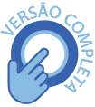

<!-- figure p73-fig1 | described_by: agy | ocr_overlap: None | needs_review: false -->
1. **Tipo de figura:** Ícone gráfico / selo interativo (botão ilustrativo) que indica um link ou chamada de ação para acessar a versão completa de um documento ou conteúdo.

2. **Texto visível (literal):**
   - `VERSÃO COMPLETA`

   Não há outros títulos, rótulos, legendas, eixos ou valores textuais.

3. **Estrutura:**
   - **Elemento central:** Dois anéis circulares concêntricos (um anel externo mais espesso e um anel interno mais fino) em torno de um centro circular vazio, com aparência de alvo ou ponto de toque/clique.
   - **Disposição do texto:** O texto `VERSÃO COMPLETA` aparece em letras maiúsculas, curvado em arco pelo lado externo dos anéis, iniciando no quadrante superior esquerdo (`VERSÃO`), passando pelo topo e descendo por toda a lateral direita até o quadrante inferior direito (`COMPLETA`).
   - **Ícone de interação:** No quadrante inferior esquerdo, sobreposto aos anéis, há uma ilustração estilizada de uma mão com o dedo indicador estendido na diagonal, apontando para cima e para a direita em direção ao centro do círculo, com o polegar voltado para cima e os outros três dedos dobrados, representando o gesto de clicar ou tocar.
   - Não há caixas, setas, eixos, linhas, colunas ou múltiplos painéis.

4. **Números ou valores de dados:** Não há nenhum número ou valor quantitativo na figura.

5. **Cores com significado:** As cores presentes (dois tons de azul — azul-escuro e azul-claro — sobre fundo claro) têm função apenas visual e de contraste para destacar os elementos do ícone (anel externo e contorno da mão em azul-escuro; anel interno, preenchimento da mão e texto em azul-claro), não carregando significado semântico ou codificação de dados.

<!-- Start of picture text -->
VERSÃOCO M P L E T A <!-- End of picture text -->

**72** 

<!-- page 74 -->

**4** 

**<mark>Governança</mark>** 

**73** 

<!-- page 75 -->

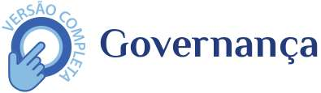

<!-- figure p75-fig1 | described_by: agy | ocr_overlap: None | needs_review: false -->
1. **Tipo de figura:** Trata-se de um cabeçalho ilustrativo de seção (banner/rótulo gráfico) composto por um ícone circular interativo (indicando acesso ou clique) acompanhado de um título.

2. **Texto visível (literal):**
   - Em arco ao redor do ícone circular: `VERSÃO COMPLETA`
   - À direita do ícone, em fonte serifada grande: `Governança`

3. **Estrutura:** A imagem tem disposição horizontal simples, sem quadros, setas, eixos, tabelas ou múltiplos painéis, dividida em dois elementos lado a lado sobre fundo claro/transparente:
   - **À esquerda:** um ícone circular formado por dois anéis concêntricos (um externo mais espesso e um interno mais fino) em volta de um centro circular branco. Sobreposta à parte inferior esquerda dos anéis, há a ilustração de uma mão apontando na diagonal para cima e para a direita, com a ponta do dedo indicador posicionada no centro do círculo, sugerindo a ação de clicar ou tocar. Contornando a borda externa do anel, da posição aproximada de 10 horas até cerca de 5 horas no sentido horário, aparece o texto curvado em letras maiúsculas `VERSÃO COMPLETA`.
   - **À direita:** alinhado verticalmente ao centro do ícone, encontra-se o título `Governança`.

4. **Números ou valores de dados:** Não há números nem valores de dados na imagem.

5. **Cores com significado:** As cores presentes (diferentes tons de azul) são apenas estilísticas/de identidade visual e não carregam significado informacional ou de categorização de dados.

~~~text ocr
C
N (9)
Governança
~~~

<!-- Start of picture text -->
Governança VERSÃOCO M P L E T A <!-- End of picture text -->

##### **Governança na UFRPE** : **estrutura, práticas e ações** 

A governança, na UFRPE, envolve a forma com que a Universidade é estruturada internamente, suas políticas, operacionalização das estratégias e maneira com que estabelece as relações com entidades e atores externos, visando ao alcance dos objetivos. Para isso, comporta elementos associados à autonomia universitária, à organização e gestão econômica e financeira, a estruturas acadêmicas e a relações institucionais e internacionais. 

O modelo de governança adotado é norteado tanto pelo conjunto normativo que rege o setor público quanto pelas regras de tomada de decisão coletiva já instituídas e que estão de acordo com os preceitos da gestão democrática, colegiada e participativa, presente na Lei de Diretrizes e Bases da Educação Nacional. 

Com estrutura que abrange diferentes processos entrelaçados e instâncias colegiadas, a UFRPE garante, em seu processo decisório, a representatividade docente, técnica-administrativa e discente, na integração de diferentes atores, 

lotados em diversas áreas do saber, que exercem funções com especificidade técnica distintas e produzem grande variedade de produtos institucionais. Por se tratar de uma Instituição igualitária e democrática, há ênfase no consenso, no poder compartilhado, na liderança consultiva e nas responsabilidades coletivas. 

Quanto à responsabilidade de ações e à necessidade de transparência na prestação de contas dos recursos públicos utilizados, a UFRPE segue as orientações do Tribunal de Contas da União e compreende que a governança precisa ser operacionalizada a partir da adoção de mecanismos de _liderança_ , _estratégia_ e _controle_ , que devem ser postos em prática para _avaliar, direcionar e monitorar a atuação da gestão_ , com vistas à condução de políticas públicas e à prestação de serviços de interesse da sociedade. 

Para que essa prestação de serviços seja efetiva, a UFRPE tem trabalhado fortemente os mecanismos de liderança, estratégia e controle. Em termos de liderança, a Instituição tem se preocupado em ocupar as suas instâncias de governança com profissionais íntegro(a)s, capacitado(a)s, competentes 

**74** 

<!-- page 76 -->

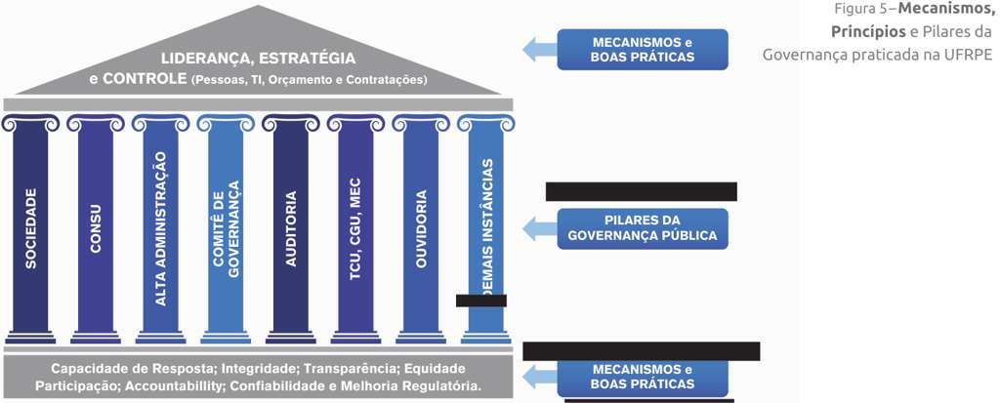

<!-- figure p76-fig1 | described_by: agy | ocr_overlap: 0.79 | needs_review: false -->
**1. Tipo de figura**
Diagrama conceitual/esquemático em formato de templo clássico (composto por frontão triangular, oito colunas verticais e base retangular), acompanhado à direita por três caixas de rótulo com setas explicativas e uma legenda no canto superior direito.

**2. Todo o texto visível (transcrição literal)**
- **Legenda (canto superior direito):**
  `Figura 5–Mecanismos,`
  `Princípios e Pilares da`
  `Governança praticada na UFRPE`
- **Frontão triangular (topo do templo):**
  `LIDERANÇA, ESTRATÉGIA`
  `e CONTROLE (Pessoas, TI, Orçamento e Contratações)`
- **Oito colunas verticais (da esquerda para a direita, texto orientado verticalmente de baixo para cima):**
  1. `SOCIEDADE`
  2. `CONSU`
  3. `ALTA ADMINISTRAÇÃO`
  4. `COMITÊ DE` / `GOVERNANÇA`
  5. `AUDITORIA`
  6. `TCU, CGU, MEC`
  7. `OUVIDORIA`
  8. `DEMAIS INSTÂNCIAS`
- **Base retangular (parte inferior do templo):**
  `Capacidade de Resposta; Integridade; Transparência; Equidade`
  `Participação; Accountabillity; Confiabilidade e Melhoria Regulatória.`
- **Caixas de rótulo à direita (de cima para baixo):**
  - Caixa superior: `MECANISMOS e` / `BOAS PRÁTICAS`
  - Caixa intermediária: `PILARES DA` / `GOVERNANÇA PÚBLICA`
  - Caixa inferior: `MECANISMOS e` / `BOAS PRÁTICAS`

**3. Estrutura**
A figura organiza-se em três regiões: o diagrama do templo ocupando a metade esquerda, uma coluna vertical com três caixas retangulares de cantos arredondados à direita do templo e o texto da legenda alinhado à direita no canto superior direito. Não há eixos, tabelas, gráficos ou painéis separados.

O templo é formado por três camadas empilhadas verticalmente:
- **Camada superior (frontão):** um triângulo contendo o texto centralizado em duas linhas, apoiado sobre uma barra horizontal estreita que o separa das colunas.
- **Camada intermediária (pilares):** oito colunas jônicas (com capitéis em voluta no topo e bases com frisos na parte inferior) dispostas lado a lado em uma única fileira horizontal, sustentando a barra superior e apoiadas sobre a camada de base. Cada coluna traz seu rótulo em texto vertical, lido de baixo para cima.
- **Camada inferior (base):** uma barra horizontal fina logo abaixo das colunas, seguida por um retângulo largo contendo o texto centralizado em duas linhas.

À direita de cada camada do templo há uma caixa retangular de cantos arredondados com uma seta larga à sua esquerda apontando horizontalmente para a esquerda:
- A seta da caixa superior (`MECANISMOS e BOAS PRÁTICAS`) aponta para o frontão triangular (`LIDERANÇA, ESTRATÉGIA e CONTROLE (Pessoas, TI, Orçamento e Contratações)`).
- A seta da caixa intermediária (`PILARES DA GOVERNANÇA PÚBLICA`) aponta para o conjunto das oito colunas verticais.
- A seta da caixa inferior (`MECANISMOS e BOAS PRÁTICAS`) aponta para a base retangular (`Capacidade de Resposta; Integridade; Transparência; Equidade Participação; Accountabillity; Confiabilidade e Melhoria Regulatória.`).

Há ainda quatro tarjas retangulares pretas sólidas sobrepostas à imagem (sem texto visível sob ou sobre elas):
- Uma tarja pequena atravessando a parte inferior da oitava coluna (`DEMAIS INSTÂNCIAS`), imediatamente abaixo da letra "D".
- Uma tarja horizontal posicionada logo acima da caixa intermediária (`PILARES DA GOVERNANÇA PÚBLICA`).
- Uma tarja horizontal mais larga posicionada logo acima da caixa inferior (`MECANISMOS e BOAS PRÁTICAS`) e de sua seta.
- Uma tarja horizontal estreita na borda inferior da imagem, logo abaixo da caixa inferior.

**4. Números e valores de dados**
- Único número presente no texto: `5` (em `Figura 5`).
- Não há dados quantitativos, medidas ou valores estatísticos; em termos de contagem estrutural, o esquema contém 3 camadas horizontais no templo, 8 colunas/pilares e 3 caixas laterais com setas.

**5. Cores com significado**
- **Cinza:** utilizado no frontão, nas barras horizontais divisórias e na base inferior, agrupando visualmente os elementos horizontais do templo e separando-os das colunas verticais.
- **Tons de azul nas colunas:** as oito colunas seguem um padrão repetido de quatro tonalidades de azul (do mais escuro ao mais claro), diferenciando colunas adjacentes: o 1.º tom (azul-marinho escuro) aparece em `SOCIEDADE` e `AUDITORIA`; o 2.º tom (azul-índigo) em `CONSU` e `TCU, CGU, MEC`; o 3.º tom (azul médio-escuro) em `ALTA ADMINISTRAÇÃO` e `OUVIDORIA`; e o 4.º tom (azul médio-claro) em `COMITÊ DE GOVERNANÇA` e `DEMAIS INSTÂNCIAS`. Não há legenda que atribua um significado categórico explícito a cada tonalidade.
- **Azul médio e azul-claro nas caixas e setas laterais:** unificam visualmente os três rótulos externos e suas respectivas setas de indicação.

~~~text ocr
Figura 5- Mecanismos,
Princípios e Pilares da
MECANISMOS e
LIDERANÇA, ESTRATEGIA BOAS PRÁTICAS Governança praticada na UFRPE
e CONTROLE (Pessoas, TI, Orçamento e Contratações)
PILARES DA
”
GOVERNANÇA PUBLICA
ES
COMITE DE
GOVERNANÇA
AUDITORIA
OUVIDORIA
Q
<
—
ALTA ADMINISTRACAO
JEMAIS INSTANCIAS
Capacidade de Resposta; Integridade; Transparência; Equidade MECANISMOS e
Participação; Accountabillity; Confiabilidade e Melhoria Regulatória. BOAS PRATICAS
~~~

<!-- Start of picture text -->
Figura 5 –  Mecanismos, Princípios  e Pilares da MECANISMOS e LIDERANÇA, ESTRATÉGIA BOAS PRÁTICAS Governança praticada na UFRPE e CONTROLE (Pessoas, TI, Orçamento e Contratações) PILARES DA GOVERNANÇA PÚBLICA _  Capacidade de Resposta; Integridade; Transparência; Equidade  MECANISMOS e Participação; Accountabillity; Confiabilidade e Melhoria Regulatória. BOAS PRÁTICAS _ CONSU SOCIEDADE COMITÊ DE  AUDITORIA OUVIDORIA GOVERNANÇA TCU, CGU, MEC DEMAIS INSTÂNCIAS ALTA ADMINISTRAÇÃO <!-- End of picture text -->

_Fonte: UFRPE, 2020h_ 

e motivado(a)s, capazes de colocar em prática o segundo mecanismo de governança, que consiste na elaboração e na implementação das estratégias institucionais. Trata-se de atividade que envolve a escuta ativa das demandas dos atores universitários; a análise dos ambientes interno e externo da Instituição; a criação e análise de cenários; a escolha da melhor estratégia e a previsão do alcance; a definição de como 

cada estratégia será implementada e monitorada; o mapeamento de processos; e o início do levantamento e gerenciamento de riscos. Ao escolher um caminho, colocando em prática sua estratégia, a UFRPE usa o mecanismo de controle para avaliar e tratar os riscos associados, levando em conta a transparência e _accountability_ , com a prestação de contas das ações e a responsabilização pelos atos praticados. 

**75** 

<!-- page 77 -->

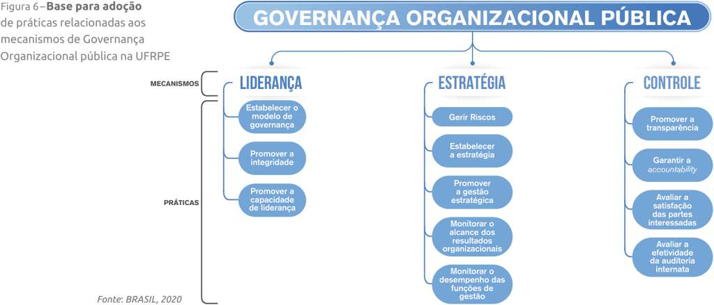

<!-- figure p77-fig1 | described_by: agy | ocr_overlap: 1.0 | needs_review: false -->
**1. Tipo de figura**
Trata-se de um diagrama hierárquico (organograma conceitual) disposto na horizontal, que apresenta a estrutura de mecanismos e práticas de governança organizacional pública na UFRPE.

**2. Todo o texto visível (transcrição literal)**
- **Legenda (canto superior esquerdo):**
  `Figura 6–Base para adoção de práticas relacionadas aos mecanismos de Governança Organizacional pública na UFRPE` (com `Base para adoção` em negrito)
- **Título principal (caixa superior):**
  `GOVERNANÇA ORGANIZACIONAL PÚBLICA`
- **Rótulos de agrupamento (lado esquerdo):**
  - `MECANISMOS`
  - `PRÁTICAS`
- **Coluna 1 — cabeçalho e caixas:**
  - Cabeçalho: `LIDERANÇA`
  - Prática 1: `Estabelecer o modelo de governança`
  - Prática 2: `Promover a integridade`
  - Prática 3: `Promover a capacidade de liderança`
- **Coluna 2 — cabeçalho e caixas:**
  - Cabeçalho: `ESTRATÉGIA`
  - Prática 1: `Gerir Riscos`
  - Prática 2: `Estabelecer a estratégia`
  - Prática 3: `Promover a gestão estratégica`
  - Prática 4: `Monitorar o alcance dos resultados organizacionais`
  - Prática 5: `Monitorar o desempenho das funções de gestão`
- **Coluna 3 — cabeçalho e caixas:**
  - Cabeçalho: `CONTROLE`
  - Prática 1: `Promover a transparência`
  - Prática 2: `Garantir a accountability` (com `accountability` em itálico)
  - Prática 3: `Avaliar a satisfação das partes interessadas`
  - Prática 4: `Avaliar a efetividade da auditoria internata` (grafado exatamente como `internata` na imagem)
- **Fonte (canto inferior esquerdo, em itálico):**
  `Fonte: BRASIL, 2020`

**3. Estrutura**
O diagrama organiza-se em três níveis hierárquicos de cima para baixo, sem eixos ou painéis múltiplos:
- **Nível superior (conceito central):** Uma caixa horizontal larga com cantos totalmente arredondados (formato de cápsula) e borda externa fina contém `GOVERNANÇA ORGANIZACIONAL PÚBLICA`, abrangendo a largura das três colunas abaixo.
- **Conexão do nível superior aos mecanismos:** Do centro inferior dessa caixa parte uma linha vertical que se ramifica com cantos arredondados em três ramos (esquerda, centro reto para baixo e direita). Cada ramo termina em um pequeno ponto circular sólido posicionado imediatamente acima do cabeçalho de uma coluna. Não há pontas de seta.
- **Agrupamento lateral esquerdo:** À esquerda da primeira coluna há dois colchetes verticais abertos para a direita, que delimitam as faixas horizontais do diagrama:
  - O colchete superior, rotulado `MECANISMOS`, abrange a linha dos três cabeçalhos (`LIDERANÇA`, `ESTRATÉGIA`, `CONTROLE`).
  - O colchete inferior, rotulado `PRÁTICAS`, estende-se verticalmente do topo da primeira linha de caixas de práticas até a base da quinta e última caixa de práticas (sob `ESTRATÉGIA`).
- **Três colunas (mecanismos e respectivas práticas):** Em cada coluna, uma linha vertical parte da lateral esquerda do cabeçalho do mecanismo, desce ao longo da margem esquerda das suas práticas e emite ramificações horizontais curtas (com cantos arredondados) que se conectam à borda esquerda de cada caixa em formato de cápsula:
  - `LIDERANÇA` conecta-se verticalmente a 3 caixas, de cima para baixo: `Estabelecer o modelo de governança`, `Promover a integridade` e `Promover a capacidade de liderança`.
  - `ESTRATÉGIA` conecta-se verticalmente a 5 caixas, de cima para baixo: `Gerir Riscos`, `Estabelecer a estratégia`, `Promover a gestão estratégica`, `Monitorar o alcance dos resultados organizacionais` e `Monitorar o desempenho das funções de gestão`.
  - `CONTROLE` conecta-se verticalmente a 4 caixas, de cima para baixo: `Promover a transparência`, `Garantir a accountability`, `Avaliar a satisfação das partes interessadas` e `Avaliar a efetividade da auditoria internata`.
- **Metadados externos:** A legenda ocupa o canto superior esquerdo, fora do diagrama, e a indicação de fonte situa-se no canto inferior esquerdo, abaixo dos colchetes.

**4. Números e valores de dados**
A figura não apresenta dados quantitativos, escalas, percentuais ou métricas. Os únicos números presentes no texto são:
- `6` (numeração da figura em `Figura 6`)
- `2020` (ano da referência em `Fonte: BRASIL, 2020`)

Estruturalmente, o diagrama contém 1 conceito principal, 3 mecanismos e 12 práticas no total (3 em `LIDERANÇA`, 5 em `ESTRATÉGIA` e 4 em `CONTROLE`).

**5. Cores com significado**
As cores não diferenciam os três mecanismos entre si (as três colunas compartilham o mesmo esquema cromático), mas distinguem o diagrama principal dos elementos auxiliares e reforçam a hierarquia:
- **Tons de azul (com texto branco nas caixas):** Aplicados exclusivamente ao modelo de governança — um degradê horizontal de azul-claro a azul-escuro com borda azul-escura destaca o bloco principal do topo (`GOVERNANÇA ORGANIZACIONAL PÚBLICA`), enquanto um azul médio uniforme identifica os cabeçalhos dos mecanismos, as linhas conectoras e as cápsulas das práticas.
- **Cinza-escuro/preto:** Utilizado nos colchetes laterais, nos rótulos estruturais (`MECANISMOS` e `PRÁTICAS`), na legenda e na fonte, separando visualmente anotações e metadados do conteúdo principal do diagrama.

~~~text ocr
Figura 6-Base para adoção
de práticas relacionadas aos
mecanismos de Governança
Organizacional pública na UFRPE
GOVERNANÇA ORGANIZACIONAL PÚBLICA
PRÁTICAS
Fonte: BRASIL, 2020
LIDERANÇA
Estabelecer o
modelo de
governança
Promover a
integridade
Promover a
capacidade
de liderança
ESTRATÉGIA
Gerir Riscos
Estabelecer
a estratégia
Promover
a gestão
estratégica
Monitorar o
alcance dos
resultados
organizacionais
Monitorar o
desempenho das
funções de
gestão
CONTROLE
Promover a
transparência
Garantir a
accountability
Avaliar a
satisfação
das partes
interessadas
Avaliar a
efetividade
da auditoria
internata
~~~

<!-- Start of picture text -->
Figura 6 –  Base para adoção de práticas relacionadas aos  GOVERNANÇA ORGANIZACIONAL PÚBLICA mecanismos de Governança Organizacional pública na UFRPE MECANISMOS LIDERANÇA ESTRATÉGIA CONTROLE Estabelecer o modelo de  Gerir Riscos Promover a governança transparência Estabelecer Promover a a estratégia integridade Garantir a Promover Promover a  a gestão PRÁTICAS capacidade  estratégica Avaliar a de liderança satisfação das partes Monitorar o interessadas alcance dos resultados Avaliar a organizacionais efetividade da auditoria Monitorar o internata desempenho das funções de Fonte :  BRASIL, 2020 gestão accountability <!-- End of picture text -->

Para atender aos mecanismos de liderança, estratégia e controle, a UFRPE se baseou em princípios como capacidade de resposta; integridade; transparência; equidade e participação; _accountability_ ; confiabilidade; e melhoria regulatória. Tais princípios são responsáveis por guiar os pilares da governança organizacional pública. A Figura 5 ilustra toda a base de governança praticada na UFRPE. 

Para a construção de instrumentos, ferramentas e ações que coloquem em prática os princípios e pilares da governança organizacional pública, a Universidade trabalha os mecanismos de liderança, estratégia e controle, conforme a Figura 6. 

Sendo assim, a UFRPE formalizou seu modelo de governança, composto por diversas instâncias institucionais e 

**76** 

<!-- page 78 -->

da sociedade, e faz uma intersecção com as áreas de gestão, ensino, pesquisa, extensão e inovação. Considerando esse modelo, são desenvolvidos os processos de trabalho, os instrumentos – ferramentas, documentos, o fluxo de informações e o comportamento de pessoas envolvidas na avaliação, no direcionamento e no monitoramento da Instituição. O modelo foi definido para apoiar a Instituição no alcance de seus objetivos, alinhado ao planejamento estratégico, e suas atividades meio e fim são implementadas, avaliadas e mensuradas pelas instâncias competentes com o apoio da unidade de auditoria interna. 

O modelo de governança da UFRPE foi estruturado considerando seu sistema dual de gestão, que inclui serviços administrativos e acadêmicos, por ser uma instituição dedicada à geração e disseminação do conhecimento para a sociedade. Possui caráter interdisciplinar, estabelece relação entre ramos do conhecimento, interage com numerosos segmentos da sociedade, mais do que qualquer outro tipo de instituição. No entorno do _campus_ , há expectativa sobre os serviços prestados, pois estrutura-se para atender o mundo do trabalho, o científico e o acadêmico. Com base no modelo, boas práticas estão sendo implementadas pela UFRPE, considerando os mecanismos de _liderança, estratégia e controle_ . No tocante às práticas de liderança, têm-se: 

Quadro 3. **Boas práticas** de liderança na UFRPE 

|**PRÁTICAS**|**LIDERANÇA** **AÇÕES**|
|---|---|
|ESTABELECER|**_•_**Instituição do Comitê de Governança, Gestão de|
|O MODELO DE|Riscos e Controle Interno, por meio da Portaria nº|
|GOVERNANÇA|185/2017–GR, de 14 de fevereiro de 2017 (UFRPE, 2017h), com complementação da Portaria nº 212/2019–GR, de 19 de fevereiro de 2019 (UFRPE, 2019l), e da Portaria nº 38/2021–GR, de 20 de janei- ro de 2021 (UFRPE, 2021c), cujos membros são for- mados pelos gestore(a)s da Instituição. **_•_**Formalização do modelo e estrutura de Governança, publicizado apartir do Relatório de Gestão de 2019.|
|PROMOVER A INTEGRIDADE|**_•_**Conforme determinado pela Portaria n° 1.089, de 25 de abril de 2018 (UFRPE, 2018h), do Ministério da Transparência e Controladoria–Geral da União, a UFRPE elaborou o seu Plano de Integridade, sen- do aprovado pelo Conselho Universitário (Consu) e publicado em dezembro de 2018, de acordo com a Portaria nº 1485/2018–GR de 05/12/2018 (UFRPE, 2018k). O Plano de Integridade foi mais uma importante ação da UFRPE, visando a um melhor alinhamento aos princípios de governança pública. O Plano de Integridade contempla ins- trumentos legais internos e estruturas de gestão relativas à área da integridade, abordando temas como: Comissão de Ética e regras de conduta para servidore(a)s; Transparência ativa e acesso à informação; Tratamento de conflito de inte- resses; Nepotismo; Contexto e funcionamento da Ouvidoria interna; Comissão Permanente de Processo Administrativo Disciplinar; Comissão Permanente de Sindicância; Controles internos e cumprimento de recomendações de auditoria; Riscos de integridade e medidas de tratamento.|

**77** 

<!-- page 79 -->

||**LIDERANÇA**|
|---|---|
|**PRÁTICAS**|**AÇÕES**|
|PROMOVER A INTEGRIDADE (Cont.)|**_•_**O Comitê de Governança, Gestão de Riscos e Controle Interno agregou também as funções de coordenação, estruturação, execução e monito- ramento do Programa de Integridade no âmbito da Universidade Federal Rural de Pernambuco, de acordo com a Portaria nº 561/2018–GR, de 09 de maio de 2018(UFRPE,2018j).|
|PROMOVER A CAPACIDADE DE LIDERANÇA|**_•_**A UFRPE, por meio do Plano de Desenvolvimento de Pessoas (PDP), atende à Política Nacional de Desenvolvimento de Pessoas (PNDP), que tem como objetivo promover a qualificação dos servidore(a)s da instituição, alinhados ao Decreto nº 9.991 de 28 de agosto de 2019 (UFRPE, 2019b) e à Instrução Normativa nº 201 de 11 de setembro de 2019(UFRPE,2019d).|

_Fonte_ : _UFRPE, 2021_ 

Em relação ao mecanismo estratégia, aplicam-se as seguintes práticas: 

###### Quadro 4. **Boas práticas** de estratégia na UFRPE 

|PRÁTICAS|ESTRATÉGIA AÇÕES|
|---|---|
|GERIR RISCOS|**_•_**Formulação da Política de Gestão de Riscos da UFRPE, aprovada pelo Conselho Universitário, por meio da Resolução nº 022/2017–Consu, de 04 de abril de 2017 (UFRPE, 2017b); atualizada pela Resolução nº 037/2019–Consu, de 11 de abril de 2019(UFRPE,2019e).|

||ESTRATÉGIA|
|---|---|
|PRÁTICAS|AÇÕES|
|GERIR RISCOS (Cont.)|**_•_**A UFRPE, em maio de 2018, instituiu a Coordenadoria de Gestão de Riscos, vin- culada à Pró-Reitoria de Planejamento e Desenvolvimento Institucional (Proplan). A CGR tem como um dos objetivos articular-se com as demais instâncias de governança e o Comitê de Governança Gestão de Riscos e Controle Interno para fomentar a cultura do gerenciamento de riscos dos principais processos nas unidades organizacionais da Instituição.|
||**_•_**O Plano de Gestão de Riscos aprovado pelo Comitê de Governança, Gestão de Riscos e Controle Interno explica detalhadamente como aplicar a metodologia de gestão de riscos em uma unidade organizacional. Esse documento foi criado e publicado em 2020, tendo como base a ISO 31000 e o COSO ERM. **_•_**Criação de uma planilha de Gerenciamento de Riscos e do_kanban_de Gestão de Riscos – sis- tema ágil e visual que resume as etapas do gerenciamento de riscos. **_•_**Durante o ano de 2020, foi realizado o geren- ciamento de riscos de oito processos operacio- nais da Instituição.|

**78** 

<!-- page 80 -->

||ESTRATÉGIA|
|---|---|
|PRÁTICAS|AÇÕES|
|ESTABELECER A ESTRATÉGIA|**_•_**As estratégias da UFRPE são definidas no pla- nejamento estratégico e comunicadas no seu PDI, documento que apresenta a missão, visão e valores institucionais, além de diagnósticos, políticas, objetivos e metas. Toda a comunida- de acadêmica e representantes da sociedade civil são convidados a participar da elaboração do PDI.|
|PROMOVER A GESTÃO ESTRATÉGICA|**_•_**Criação da Secretaria de Tecnologias Digitais, com o objetivo de promover a transformação digital da Instituição e direcionar, planejar e executar estratégias e ações voltadas a so- luções para as demandas da comunidade. A transformação digital envolve o ensino, a pes- quisa, a extensão, a inovação e a convivência no_campus_. **_•_**Criação do Instituto de Pesquisa, Inovação e Empreendedorismo (Ipê), que visa a fortalecer a autonomia da UFRPE. Instituído e pensado com a finalidade de ampliar parcerias e finan- ciamentos de projetos acadêmicos, por meio da otimização de processos existentes e inte- gração entre áreas complementares, respei- tando a identidade institucional de universida- depública e dequalidade.|
||O Instituto Ipê busca fomentar a inovação, o empreendedorismo, a pesquisa científica, a internacionalização e as relações da UFRPE com diversas outras instituições.|

||ESTRATÉGIA|
|---|---|
|PRÁTICAS|AÇÕES|
|MONITORAR O ALCANCE DOS RESULTADOS|**_•_**Elaboração anual do Relatório de Gestão, for- matado através de relato integrado, documen- to exigido pelo TCU a todos os órgãos públicos.|
|ORGANIZACIONAIS|O instrumento atende às boas práticas de transparência e_accountability_, demonstra o monitoramento dos resultados da UFRPE e o desempenho das instâncias internas de governança.|
||**_•_**No Relatório de Gestão, estão presentes os indicadores definidos pelo TCU, que tratam do custo corrente sem Hospital Universitário; do número de professore(a)s equivalentes; do total de estudantes regularmente matricula- do(a)s na graduação, do total de estudantes na pós-graduação_stricto sensu_, do número de alu- no(a)s equivalentes da graduação, do número de discentes da graduação em tempo integral e do número de estudantes da pós-graduação em tempo integral.|
||**_•_**Acompanhamento das taxas de evasão e de re- tenção de discentes de graduação, já que essa interfere na Taxa de Sucesso na Graduação (TSG), indicador usado pelo Ministério da Educação na construção da matriz Andifes (OCC).|
||**_•_**Realização do Censo da Educação Superior, coleta de dados obrigatória, desenvolvida anualmente pelas IFES do Brasil.|

**79** 

<!-- page 81 -->

||ESTRATÉGIA|
|---|---|
|PRÁTICAS|AÇÕES|
|MONITORAR O ALCANCE DOS RESULTADOS|**_•_**Monitoramento do rendimento dos con- cluintes dos cursos de graduação no Exame Nacional de Desempenho de Estudantes|
|ORGANIZACIONAIS (Cont.)|(Enade) e acompanhamento dos resultados das avaliações de cursos e da avaliação institu- cional. Esses são os três indicadores que for- mam o tripé avaliativo, que permite conhecer a qualidade dos cursos e instituições de edu- cação superior, no Brasil, e integram o Sistema Nacional de Avaliação da Educação Superior (Sinaes).|

_Fonte_ : _Elaboração própria, UFRPE, 2021_ 

E, por fim, há as práticas de controle, descritas no quadro a seguir: 

###### Quadro 5. **Boas práticas** de controle na UFRPE 

|PRÁTICAS|CONTROLE AÇÕES|
|---|---|
|PROMOVER A TRANSPARÊNCIA E PROMOVER A _ACCOUNTABILITY_|**_•_**A UFRPE realizou aprimoramento do Relatório de Gestão, importante instrumento de presta- ção de contas da alta administração ao TCU e principalmente à sociedade. A apresentação do documento passou a ter um modelo de relato integrado, que disponibiliza todas as informa- ções da gestão referentes a determinado exer- cício financeiro, com metodologia moderna e de fácil compreensão, tanto para os órgãos de controle, quanto para cidadão(ã)s.|

||CONTROLE|
|---|---|
|PRÁTICAS|AÇÕES|
|PROMOVER A TRANSPARÊNCIA E PROMOVER A _ACCOUNTABILITY_ (Cont.)|**_•_**Implementação do Sistema Integrado de Gestão (SIG), desenvolvido pela Universidade Federal do Rio Grande do Norte (UFRN). Atualmente em funcionamento o Sistema Integrado de Patrimônio, Administração e Contratos (Sipac) e, em fase de implementa- ção o Sistema Integrado de Gestão Acadêmica (SIGAA) e o Sistema Integrado de Gestão de Recursos Humanos (SIGRH). **_•_**Criação do Comitê de Prevenção ao Coronavírus (Covid-19), com a finalidade de criar ações para o enfrentamento da pandemia, iniciativa na prestação de contas à comunidade universitária e sociedade. **_•_**Aprovação do Plano de Funcionamento da UFRPE, propondo inicialmente o sistema re- moto como regra e o presencial como exceção, respeitando-se os protocolos de biossegurança de Pernambuco e do Comitê de Prevenção ao Coronavírus (Covid-19) da Instituição. Contém informações a respeito do funcionamen- to a partir de eixos norteadores: Ensino de Graduação; Ensino de Pós-Graduação; Pesquisa; Internacionalização; Extensão e Cultura; Assistência Estudantil; Gestão de Pessoas; Logística e Infraestrutura; e Valorização da vida, direitos humanos, diversidades e enfrentamen- to às desigualdades. **_•_**Publicização das ações da UFRPE através das páginas na internet e redes sociais digitais institucionais.|

**80** 

<!-- page 82 -->

||CONTROLE|
|---|---|
|PRÁTICAS|AÇÕES|
|PROMOVER A TRANSPARÊNCIA E PROMOVER A _ACCOUNTABILITY_ (Cont.)|**_•_**Acesso à informação pelo Serviço de Informação ao Cidadão (SIC), que objetiva atender e orientar o público sobre a tramitação de documentos nas unidades e a respeito dos pedidos de acesso à informação. **_•_**Construção da Carta de Serviços ao Usuário, que disponibiliza para a sociedade informações referentes aos diversos serviços prestados pela Instituição.|
|AVALIAR A SATISFAÇÃO DAS PARTES INTERESSADAS|**_•_**Realização de avaliação institucional, que envolve os eixos de ensino, pesqui- sa, extensão, gestão e inovação, com a participação de docentes, discentes e técnico(a)s-administrativo(a)s.|
||**_•_**A avaliação interna do grau de satisfação de ci- dadão(ã)s e usuário(a)s, por enquanto, limita-se aos mecanismos legais da autoavaliação, por meio dos instrumentos da Comissão Própria de Avaliação e pela Ouvidoria. Em relação à avaliação externa, os usuários da Plataforma FALA BR podem expressar sua opinião sobre os serviços, mediante instrumento disponível no próprio sistema.|
||**_•_**Dentre as ações do Comitê de Transparência e Dados Abertos (CTDA), está prevista a dis- ponibilização de instrumento de pesquisa de satisfação, através de formulário_on-line_com disponibilidade permanente, o qual permitirá a avaliação da qualidade dos serviços prestados pela Instituição.|

||CONTROLE|
|---|---|
|PRÁTICAS|AÇÕES|
|AVALIAR A SATISFAÇÃO DAS PARTES|**_•_**A UFRPE possui uma Ouvidoria, formalmente implementada em 2005, sendo um canal ativo de comunicação aberto entre a sociedade, a co-|
|INTERESSADAS (Cont.)|munidade universitária e sua administração, em defesa de princípios fundamentais que devem prevalecer na administração pública, ou seja, garantia democrática do direito à informação, à transparência e à participação cidadã. Com essa proposta, a Ouvidoria se disponibiliza a re- ceber e encaminhar manifestações através de reclamações,denúncias,sugestões e elogios.|
|AVALIAR A EFETIVIDADE DA AUDITORIA INTERNA (AUDIN)|**_•_**A UFRPE utiliza a ferramenta denominada e-Aud, sistema desenvolvido pela Secretaria Federal de Controle Interno da Controladoria- Geral da União (CGU) para gestão da atividade de auditoria interna governamental. O sistema integra, em única plataforma eletrônica, todo o processo de auditoria, desde o planejamento das ações de controle até o monitoramento das recomendações emitidas e o registro dos benefícios. **_•_**A Audin apresenta sistematicamente relatórios ao Consu, com recomendações que podem ser utilizadas para subsidiar decisões estratégicas da Instituição.|

_Fonte: UFRPE, 2021_ 

**81** 

<!-- page 83 -->

##### **Reflexões sobre a governança na UFRPE** 

A governança é um tema que vem sendo trabalhado nas organizações federais desde 2016, mais especificamente em virtude das exigências constantes na Instrução Normativa Conjunta nº 1, de 10 de maio de 2016 (BRASIL, 2016e), da CGU, no Decreto nº 9.203, de 22 de novembro de 2017 (BRASIL, 2017b), e nos parâmetros de eficiência, eficácia e efetividade emitidos pelo Tribunal de Contas da União. No que diz respeito à UFRPE, é possível afirmar que a Instituição encontra-se no estágio inicial da implementação de ações, tendo como base esses documentos norteadores e as orientações do TCU. Em função disso, foram criados: 

**_1._** Comitê de Governança, Gestão de Riscos e Controles Internos; 

**_2._** Coordenadoria de Gestão de Riscos (CGR), vinculada à Proplan. 

Nesse contexto, o modelo de governança foi formalizado nos Relatórios de Gestão de 2019 e 2020; o Plano de Integridade foi efetivado e publicado; realizou-se mapeamento de alguns processos organizacionais; elaboraram-se e regularizaram-se os regimentos internos das unidades organizacionais; e priorizou-se o questionário do Índice de Gestão de Governança Pública (IGG) do TCU. 

Planejando-se para o futuro e entendendo que a governança vai além do atendimento aos requisitos da legislação e dos 

órgãos controladores, a UFRPE apresenta novo modelo de governança com formato híbrido, que expõe sua pluralidade e suas especificidades. Trata-se do compromisso em mostrar sua dinâmica, seus atores, sua complexidade e seu estilo de agir e de tomar decisões, que inclui consenso, ações compartilhadas, liderança consultiva e as responsabilidades coletivas. 

Considerando essas questões e a necessidade de amadurecer o entendimento sobre governança na UFRPE, é importante propor as seguintes reflexões, que podem ser guias para os próximos anos: 

- Criar uma Unidade Organizacional de Governança; 

- Formalizar e comunicar os papéis e responsabilidades das instâncias de governança e criar mecanismos para que sejam bem desempenhados; 

- Difundir, na comunidade acadêmica, o Plano de Integridade, para que todos saibam de sua relevância; 

- Fortalecer o comprometimento da alta gestão com os programas e as políticas de integridade pública, incluindo o suporte às ações de detecção, investigação e sanção a vio lações dos padrões de integridade; 

- Publicizar as competências desejáveis da liderança e seus critérios de seleção, principalmente para funções de gestão, assegurando que os processos sejam executados de for ma transparente e pautados pelos critérios e competências previa mente definidos; 

**82** 

<!-- page 84 -->

- Ampliar os programas de desenvolvimento de competências do(a)s servidore(a)s, a fim de reter e desenvolver um quadro de pessoas com capacidades técnicas, em conformidade com os objetivos e as metas da Instituição; 

- Estabelecer os procedimentos para a gestão da informação e do conheci mento, no momento da sucessão das funções e cargos de liderança, assegurando qualidade na continuidade da missão e dos objetivos da Instituição; 

- Divulgar, de maneira contínua, os resultados e os benefícios que a Instituição gera à sociedade, contribuindo para o fortalecimento da imagem da Universidade; 

- Fortalecer a disponibilidade dos dados da Instituição, considerando os princípios de dados abertos. 

- Ampliar a utilização de ferramentas digitais para aprimorar a prestação dos serviços à sociedade. 

- Realizar diagnósticos periódicos dos objetivos e das metas apresentados no PDI para mitigar riscos em possíveis alterações durante sua execução, implementação e controle. 

- Refletir sobre as ações de monitoramento do desempenho das funções de gestão, com o estabelecimento de rotinas de controle do alcance das metas. 

Tais reflexões têm como objetivo ressaltar a importância das questões normativas da governança, aliadas aos princípios da gestão universitária, permitindo enxergar a UFRPE como sistema diverso, complexo e dinâmico. Pretende-se tornar mais flexíveis e ágeis processos decisórios, coordenando políticas e estratégias para formação de um sistema de ensino superior coerente para todos os seus atores. 

**83** 

<!-- page 85 -->

##### **Objetivos, metas e ações** 

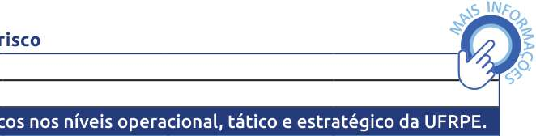

<!-- figure p85-fig1 | described_by: agy | ocr_overlap: 1.0 | needs_review: false -->
**1. Tipo de figura**
Trata-se de um recorte parcial (fragmento cortado na margem esquerda) de um quadro ou tabela extraído de um documento em PDF, acompanhado de um ícone ilustrativo/interativo de chamada para informações adicionais no canto superior direito.

**2. Todo o texto visível (literal)**
- Acima do quadro, à esquerda (cortado junto à borda esquerda da imagem): `risco`
- No ícone circular no canto superior direito, disposto em arco ao redor do círculo (em sentido horário): `MAIS INFORMAÇÕES`
- Na faixa inferior do quadro (cortado junto à borda esquerda da imagem): `cos nos níveis operacional, tático e estratégico da UFRPE.`

**3. Estrutura**
- **Texto superior:** A palavra `risco` aparece isolada sobre fundo branco, alinhada à margem esquerda da imagem, logo acima da borda superior do quadro.
- **Quadro/tabela principal:** Estrutura retangular aberta/cortada na borda esquerda e delimitada por uma linha fina à direita e no topo, dividida verticalmente em três linhas (faixas horizontais) empilhadas, sem divisões verticais internas visíveis:
  - **Primeira linha (superior):** Faixa horizontal branca e vazia, limitada acima pela borda superior azul-escura do quadro e abaixo por uma linha horizontal preta.
  - **Segunda linha (intermediária):** Faixa horizontal branca e vazia, limitada acima pela linha horizontal preta e abaixo pela borda superior da terceira faixa.
  - **Terceira linha (inferior):** Faixa horizontal preenchida em azul-escuro contendo o texto branco `cos nos níveis operacional, tático e estratégico da UFRPE.`.
- **Ícone de chamada (canto superior direito):** Sobreposto ao canto superior direito do quadro (invadindo a área acima da borda superior, a borda direita e a extremidade direita das duas primeiras linhas), composto por:
  - Um alvo circular formado por dois anéis concêntricos (anel externo azul-escuro, anel interno azul-claro e centro branco).
  - Uma mão estilizada branca com contorno azul-escuro, com o dedo indicador estendido para cima e para a direita apontando/clicando no centro branco dos círculos.
  - O texto `MAIS INFORMAÇÕES` curvado ao longo da borda externa do círculo, da posição aproximada de 10 horas até 5 horas no sentido horário.
- Não há setas, eixos ou múltiplos painéis.

**4. Números ou valores de dados**
Não há números, medições ou valores de dados presentes na imagem.

**5. Cores com significado**
- O fundo azul-escuro com texto em branco na faixa inferior destaca visualmente essa linha em relação às duas linhas superiores em branco.
- Os tons de azul (azul-escuro nos anéis externos/contornos e azul-claro no anel interno e na legenda `MAIS INFORMAÇÕES`) diferenciam o ícone de chamada informativa do restante da estrutura tabular.

~~~text ocr
os nos níveis operacional, tático e estratégico da UFRPE.
~~~

<!-- Start of picture text -->
lementar o Gerenciamento de Riscos nos níveis operacional, tático e estratégico da UFRPE. MAIS INFOR M A Ç Õ SE <!-- End of picture text -->

###### Objetivo 1. **Gestão de risco** 

###### EIXO (Mapa estratégico) PROCESSOS INTERNOS 

###### TEMA GESTÃO DE RISCOS 

|OBJETIVO|Implementar o Ge|renciamento de Risc|os nos níveis opera|cional, tático e estr|atégico da UFRPE.|
|---|---|---|---|---|---|
|INDICADOR(ES)|META 2021|META 2022|META 2023|META 2024|META 2025|
|1 – Quantidade de processos em nível operacional/tático com gerenciamento de riscos efetivado.||||||
|2 – Quantidade de processos em nível operacional/tático com gerenciamento de riscos monitorado. 3 – Quantidade de processos em nível estratégico com gerenciamento de riscos efetivado.|1 – 4|1 – 5 2 – 4|1 – 5 2 – 9|1 – 5 2 – 14 3 – 1|1 – 5 2 – 19 3 – 1|
|UNIDADE(S)RESPONSÁVEL(IS)||||||
|Unidades organizacionais com apoio da Proplan(CGR)||||||

**84** 

<!-- page 86 -->

||Ob|jetivo 2.**Int**|**egridade in**|**stitucional**||||**M** **A** **I** **S**     **I** **N** **F** **O** **R** **M** |
|---|---|---|---|---|---|---|---|---|
|EIXO (MAPA ESTRATÉGICO)|PROCESSOS|INTERNOS||||||**A** **Ç** **Õ**  |
|TEMA|INTEGRIDAD|E INSTITUCI|ONAL|||||**E** **S**|
|OBJETIVO  |Revisar,mo META|nitorar e ef 2022|etuar melho META|rias no Plano 2023|de Integri META|dade da UFR 2024|PE META|2025|
|INDICADOR(ES)|1º Sem.|2º Sem.|1º Sem.|2º Sem.|1º Sem.|2º Sem.|1º Sem.|2º Sem|
|1 – Quantidade de monitoramento do Plano de Integridade vigente.|||||||||
|2 – Quantidade de atualizações realiza- das ao Plano de Integridade da UFRPE.|||||||1 – 1||
|3 – Quantidade de apresentações realiza- das sobre o Plano de Integridade aprova- do à comunidade acadêmica da UFRPE.|1 – 1|2 – 1|1 – 1 3 – 1|2 – 1|1 – 1 3 – 1|2 – 1| 3 – 1|2 – 1|
|UNIDADE(S)RESPONSÁVEL(IS)|||||||||
|Unidades organizacionais/Comitê de Governança/Proplan|||||||||

**85** 

<!-- page 87 -->

|Objetivo 3|.**Integridade ins**|**titucional – transp**|**arência organizac**|**ional**|**M** **A** **I** **S**     **I** **N** **F** **O** **R** **M** **A**|
|---|---|---|---|---|---|
|EIXO (MAPA ESTRATÉGICO)|PROCESSOS INTER|NOS|||**Ç** **Õ**  |
|TEMA OBJETIVO|INTEGRIDADE INS Promover a tran|TITUCIONAL sparência organizac|ional.||**E** **S**|
|INDICADOR(ES)|META 2021|META 2022|META 2023|META 2024|META 2025|
|1 – Informações atualizadas sobre a presta- ção de contas, conforme determinação dos órgãos de controle/ Total de informações solicitadas pelos órgãos de controle para prestação de contas. 2 – Quantidade de Informações – grupos – publicadas no portal de dados abertos/ to- tal degrupos de informaçõespropostos. UNIDADE(S)RESPONSÁVEL(IS) Unidades organizacionais/Comitê de Governança/ Comitê de Transparência e Dados Abertos(CTDA)|1. Manter 100% das informações atualizadas 2.Implementar até 30% das informações no portal de da- dos abertos da UFRPE|1. Manter 100% das informações atualizadas 2.Implementar 50% das informa- ções no portal de dados abertos da UFRPE|1.Manter 100% das informações atualizadas 2.Implementar 100% das informa- ções no portal de dados abertos da UFRPE|1.Manter 100% das informações atualizadas 2.Implementar 100% das infor- mações no portal de dados abertos da UFRPE|1.Manter 100% das informações atualizadas 2.Implementar 100% das informa- ções no portal de dados abertos da UFRPE|

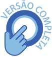

<!-- figure p87-fig1 | described_by: agy | ocr_overlap: None | needs_review: false -->
1. **Tipo de figura:** Ícone gráfico (selo ilustrativo de botão clicável), utilizado para indicar um link ou acesso a um conteúdo na íntegra.

2. **Texto visível (literal):** `VERSÃO COMPLETA` (em letras maiúsculas, disposto em arco acompanhando a borda externa superior e direita da figura, iniciando no quadrante superior esquerdo e terminando no quadrante inferior direito). Não há títulos adicionais, legendas, rótulos de eixos ou células.

3. **Estrutura:** A figura é composta por um único elemento central sem caixas, setas, eixos, tabelas ou múltiplos painéis. Ao centro há dois anéis circulares concêntricos — um anel externo mais espesso envolvendo um anel interno mais fino — com o interior circular vazio, formando a imagem de um alvo ou botão. Sobreposta à parte inferior esquerda desses anéis está a ilustração de uma mão estilizada em gesto de clique/toque, com o polegar erguido à esquerda, três dedos dobrados na parte inferior direita da mão e o dedo indicador estendido na diagonal, apontando de baixo para cima e da esquerda para a direita diretamente para o centro vazio dos círculos. O texto `VERSÃO COMPLETA` contorna externamente a metade superior e direita do anel externo.

4. **Números ou valores de dados:** Não há nenhum número ou valor de dado na imagem.

5. **Cores com significado:** As cores (dois tons de azul sobre fundo branco/transparente) têm função apenas estética e de contraste visual entre o contorno, o preenchimento e o texto, não carregando significado semântico ou codificação de dados.

<!-- Start of picture text -->
VERSÃOCO M P L E T A <!-- End of picture text -->

**86** 

<!-- page 88 -->

**5** 

**Análise de cenários e tendências contemporâneas** 

**87** 

<!-- page 89 -->

<!-- figure p89-fig1 | described_by: agy | ocr_overlap: None | needs_review: false -->
**1. Tipo de figura**
Ícone ou selo gráfico ilustrativo (emblema/botão clicável) utilizado para sinalizar o acesso à versão completa de um conteúdo.

**2. Texto visível (literal)**
- `VERSÃO COMPLETA`

**3. Estrutura**
- A figura é composta por um único elemento gráfico sem caixas, setas, eixos, tabelas ou múltiplos painéis.
- No centro, há dois anéis concêntricos com miolo vazio (branco), formando um símbolo semelhante a um botão circular ou alvo: um anel externo mais espesso e um anel interno mais fino.
- Acompanhando a curvatura externa da parte superior e lateral direita dos anéis (aproximadamente da posição de 10 horas até 5 horas em um relógio), encontra-se o texto em letras maiúsculas disposto em arco.
- Na parte inferior esquerda, sobrepondo-se à borda dos anéis, há o desenho estilizado de uma mão com o dedo indicador estendido apontando diagonalmente para cima e para a direita, diretamente para o centro dos círculos, representando o gesto de tocar ou clicar.

**4. Números ou valores de dados**
Não há números nem valores de dados na figura.

**5. Cores com significado**
As cores presentes (tons de azul-escuro e azul-claro sobre fundo branco) têm função puramente visual e de contraste, sem carregar significado semântico ou codificação de dados.

<!-- Start of picture text -->
VERSÃOCO M P L E T A <!-- End of picture text -->

## **Análise de cenários e tendências contemporâneas** 

##### **Político-legal** 

Uma avaliação do cenário político-legal desenvolve-se a partir da análise dos fatores relacionados a mudanças de governo ou alterações na legislação, na esfera nacional e internacional, que afetam e são afetados pelos ambientes econômicos, sociais e tecnológicos. No cenário político nacional atual, as principais tendências percebidas, destacam-se a seguir: 

**Cenário político em turbulência** : as lideranças e o sistema político brasileiro lidam com diversos desafios ao responder às demandas sociais, tecnológicas e educacionais, contexto em que se inserem as IFES. A população, ciente do cenário, tende a ampliar o envolvimento político. Porém, as tecnologias digitais e mídias sociais envolvem as pessoas, cada vez mais inseridas em grupos de afinidades, frequentemente denominadas _bolhas_ , o que gera aumento das demandas por grupos de distintos interesses; busca-se pouco o diálogo e mais o combate. 

As divergências entre poderes executivo, legislativo e judiciário se multiplicam, com o aumento de tensões, revelando agendas diferentes e conflitantes. As demandas reprimidas no espaço político são, com frequência, enviadas para que o 

poder judiciário tome decisões que afetam as esferas de atuação próprias dos poderes executivo e legislativo. 

**Autonomia universitária em xeque** : em função de ser a autonomia condição inegociável para o desenvolvimento científico, pelas possibilidades de geração de vieses sobre pesquisa e ciência, a atuação das universidades deve respeitar essa prerrogativa. A autonomia universitária funciona como proteção ao fazer científico, possibilitando a escolha das problemáticas, o ambiente institucional e a liberdade de expressão, que permite a troca de conhecimentos e os debates livres sobre problemáticas de interesse da comunidade (LEHER, 2019). No entanto, ataques contra o conhecimento, a ciência, a cultura e a liberdade de expressão têm aumentado significativamente. 

**Ampliação dos mecanismos de controle gerencial da atividade docente** : tende a aumentar a pressão, por parte dos órgãos de controle, pela implementação de mais mecanismos que normatizam atividades docentes em instituições federais de ensino superior. Essa condição deverá levar a aumento de tensões. A gestão buscará atender às demandas exigidas e viabilizar as atividades, e a categoria docente questionará a 

**88** 

<!-- page 90 -->

precarização das condições de trabalho e carreira, além do aumento da burocratização na avaliação de suas atividades. 

**Estabelecimento e monitoramento de excessiva quantidade de indicadores sobre o desempenho da universidade** : ainda que no intuito de melhorar a qualidade da gestão, observa-se a multiplicidade de plataformas – com certa redundância – e aumento intenso no número de indicadores que buscam retratar a realidade dos aspectos de ensino, pesquisa, extensão, inovação, desempenho de discentes, gestão da instituição, pós-graduação, corpo docente e infraestrutura. Sem diretrizes claras de governança, o excesso de indicadores e a burocracia na reunião e submissão das informações podem onerar a liderança. 

**Redução e seletividade no acesso a recursos financeiros para a pesquisa, a extensão e os programas de apoio/permanência** : a tendência é de agravamento do cenário econômico, com depreciação dos recursos permanentes, sem perspectivas de renovação ou manutenção, e limitação do acesso a recursos para desenvolvimento de atividades de ensino, pesquisa, extensão e programas de assistência estudantil. 

**Promoção das produções de propriedade intelectual e de natureza técnica-tecnológica, com maior interação da universidade com empresas e organizações sociais** : a percepção equivocada de relativo distanciamento entre academia e setor privado e a limitação de aporte dos recursos financeiros 

para as universidades parecem exigir reformulação de diversas dinâmicas. Se espera-se interação maior da Universidade com a sociedade, para aplicabilidade ao conhecimento produzido, e mesmo tornando-a coprodutora de conhecimento; por outro lado, registra-se desconhecimento sobre áreas específicas, que contribuem para o desenvolvimento do país, em aspectos muito além da produtização, como o pensamento crítico e a formação cidadã. 

##### **Econômico** 

É possível identificar cinco tendências econômicas com fortes impactos negativos sobre o ensino superior público, no horizonte até 2030. 

**Esgotamento dos modelos orçamentário e fiscal da União** : sistema tributário oneroso e regressivo; conjunto disfuncional de processos orçamentários incrementalistas e despesas excessivas ilustram quadro dificilmente sustentável da captura do Estado por agendas e grupos de interesse. As sucessivas falhas na promoção de equidade e eficiência revelam – em última instância – uma sociedade pouco inclinada ao diálogo, tornando improvável a realização de pactos duradouros de desenvolvimento nacional. Reformas que partem de diagnósticos tendenciosos ou incompletos tendem a não gerar resultados prometidos. 

**Incerteza regulatória, baixo investimento e deterioração da infraestrutura** : os elementos que caracterizam um dos 

**89** 

<!-- page 91 -->

piores ambientes de negócios do mundo, além do ônus tributário acima mencionado, são legislações anacrônicas, burocracia excessiva, barreiras à concorrência e formas de favorecimento político/jurisdicional. O Estado é sócio e participa direta e indiretamente – via crédito e subsídios – da manutenção dos maiores oligopólios, em setores-chave da economia: financeiro, comunicação, mineração, petróleo e energia elétrica. Investe-se pouco, e o custo de vida é alto; faltam visões sistêmicas e de longo prazo. Ambiente desfavorável a instituições sustentáveis e inovadoras. 

**Expansão dos setores primário-exportador e de serviços** : os setores menos alcançados pelo fiscalismo brasileiro – tributação e regulação – tendem a prosperar na medida em que se articulam, ora para atender às demandas internacionais, ora para explorar mercados nacionais de concorrência restrita. Assim, tendem a conviver, lado a lado, duas economias: a de milhões de pequenos comércios para subsistência com a de um número reduzido de operações – e tecnologias – sofisticadas. 

reflexo direto do sustento informal. Às dificuldades da primeira infância, com impacto sobre o desenvolvimento cognitivo pessoal, somam-se experiências frustrantes nos Ensinos Básico e Fundamental, tornando o acesso às qualificações profissionais do futuro praticamente impossível, senão para pequena minoria dos jovens. Sem formação cidadã ou qualificação profissional, a mobilidade social segue no sentido oposto ao que se espera de um país em desenvolvimento, e o desemprego estrutural se reproduz. 

**Concentração de renda e assistencialismo** : como consequência quase inevitável das tendências mencionadas, o quadro social brasileiro não apenas se reproduz, mas pode se agravar pela redução do emprego formal, sobretudo diante de eventuais episódios de revolta e protesto. Embora a concentração de renda possa diferir regionalmente, tende a crescer a dependência econômica do indivíduo ao Estado. 

##### **Social** 

**Desemprego estrutural e informalidade** : as fortes transformações tecnológicas redesenham rapidamente o cenário do trabalho, eliminando milhares de empregos formais em determinados setores e criando centenas de oportunidades em outros – constituindo quadro de desemprego estrutural dos mais desafiadores. Grande parte da população nasce e vive os primeiros cinco anos em condições precárias de habitação, segurança e alimentação, como 

**Aprimoramento do perfil assistencialista das instituições no pós-pandemia** : com os anos de pandemia de Covid-19, a universidade estará em contexto de elevada desigualdade social e precisará criar alternativas de reestruturação que visem a minimizar os impactos sociais gerados durante a crise sanitária. Em consequência desta nova dinâmica social, as universidades precisarão desenvolver um perfil assistencialista mais abrangente para atender a uma sociedade fragilizada. 

**90** 

<!-- page 92 -->

**Ampliação do envolvimento com pautas e necessidades sociais** : o cenário que se apresenta indica necessidade de ampliação do envolvimento entre universidade e setores públicos, privados e não governamentais, com intuito de executar projetos de políticas públicas que atenderão à demanda social. A universidade, portanto, deverá ser importante fator promocional de mudança e desenvolvimento. 

**Vulnerabilidade social** : pela crise sanitária, o ambiente econômico ficou instável, e o aumento do desemprego conjuntural e estrutural cresce exponencialmente, elevando a desigualdade, tornando a sociedade vulnerável socioeconômica e psicologicamente, impactando no ambiente social, que exige ações governamentais. 

**Adoecimento populacional físico e psíquico** : a pandemia que ora persiste tem afetado contingente populacional de proporções mundiais para além dos efeitos diretos provocados pelo Coronavírus. Ainda são motivos de estudos os efeitos prolongados e as sequelas advindas da infecção, porém já se verifica tendência global no desenvolvimento de vulnerabilidade e adoecimento físico e psíquico. No contexto social brasileiro, em que os efeitos negativos da pandemia atingem fortemente o país, há expectativa de uma fragilidade persistente em termos de saúde coletiva. Esse fato impõe maiores desafios no relacionamento entre universidades e sociedade, como as novas formas de interação a distância e uma ainda maior relevância da assistência estudantil. 

##### **Tecnológico** 

Pela natureza das universidades, os cenários científicos, tecnológicos e de inovações destacam-se por influenciar – e serem influenciados – pelo desenvolvimento do saber nelas fomentados. No horizonte até 2030, o cenário tecnológico, no âmbito do ensino superior público, deve ser norteado pelas áreas de educação, sustentabilidade, comunicação, sociedade em rede, escassez de recursos e saúde, abordadas nas cinco tendências apresentadas a seguir. 

**Ampliação e consolidação de tecnologias para suporte à educação a distância e a metodologias ativas de ensino** : amplificado durante a pandemia, com o distanciamento social, o ensino remoto trouxe à tona a necessidade de atualização das formas de ensino e aprendizagem, em virtude das grandes mudanças culturais, sociais e tecnológicas, pelas quais a sociedade passou no último século. Essa atualização não foi acompanhada pelas metodologias tradicionais de ensino. Nesse contexto, o ensino híbrido tem se consolidado, junto com as metodologias ativas, como uma das principais formas de ensino, incentivando o protagonismo, a autonomia, a personalização da aprendizagem e a construção do saber no ritmo e estilo do(a) estudante, com a exploração dos conteúdos em diversos formatos e ferramentas. Para a próxima década, tecnologias educacionais com o uso de realidade virtual e aumentada e inteligência artificial – proporcionando análises e experiências cada vez mais realistas – irão se consolidar, ao lado de novas técnicas de ensino como gamificação, ensino baseado em 

**91** 

<!-- page 93 -->

problemas e/ou projetos e salas de aulas invertidas, tendo o suporte de plataformas _Learning Management System_ (LMS). 

**Uso de tecnologias com foco na sustentabilidade, reciclagem, energia limpa e tratamento de resíduos** : seguindo o compromisso firmado pelos países membros da ONU para a execução de um “plano de ação para as pessoas, o planeta e para a prosperidade” até 2030 – e diante da iminente escassez de recursos apontada por cientistas e pesquisadore(a)s – há um ambiente propício ao desenvolvimento de tecnologias inovadoras para tornar os espaços urbanos mais sustentáveis. Os 17 Objetivos de Desenvolvimento Sustentável (ODS) da ONU auxiliam na identificação dos problemas mais necessitados de soluções imediatas, como a transformação dos materiais descartados em matéria-prima; o aprimoramento de técnicas de produção e utilização de energia limpa e a custos mais baixos e viáveis social e economicamente; a prevenção e redução da geração de resíduos; a produção de recursos biológicos renováveis e sua conversão em produtos e bioenergia; e a consolidação de uma economia circular, que consiste em eliminar ou minimizar a geração de resíduos e prolongar a vida útil dos produtos, podendo ser aplicada desde a agricultura e ativos da biodiversidade até a produção de equipamentos eletrônicos e indústria de construção. 

**Integração digital da sociedade, equipamentos e serviços** : a crescente modificação estrutural da sociedade – impulsionada pela tecnologia e comunicação – levou ao alto grau de 

conectividade através de aplicativos, serviços e dispositivos. Objetos passam a ser parte integrante dessa rede através da Internet das Coisas (IoT), em que dispositivos de todos os tipos estão conectados e compartilhando informações digitalmente, auxiliando o trabalho, comércio, saúde, bem-estar e gestão. Todas essas aplicações compartilhando informações permitem a criação de cidades inteligentes, que utilizam os recursos de forma eficiente e sustentável para o bem-estar de cidadãos e cidadãs, e foram incentivadas, no contexto nacional, pela **Estratégia Brasileira para a Transformação digital** e **PPA 2020 – 2023** . Em espaço mais restrito, tem-se investido no _campus_ inteligente para a criação de soluções inovadoras, contribuindo para a melhor utilização dos recursos e serviços do _campus_ , através da identificação dos padrões de uso para planejamento mais eficiente e com ações estratégicas de respostas e emergências. Essa alta conectividade também desperta a necessidade de investimento em segurança de dados e informações. 

**Transformações crescentes na área de saúde impulsionadas pela tecnologia** : desde a telemedicina à ajuda domiciliar automatizada, a área de saúde continuará a ter sua forma de execução alterada pela tecnologia no período pós-pandemia, com o desenvolvimento de melhores técnicas e tecnologias para avaliação, diagnóstico e tratamento _on-line_ e remoto de pacientes. No tocante a essas soluções digitais, as principais tendências estão relacionadas à IoT, inteligência artificial, realidade virtual e aumentada e robótica para auxiliar os 

**92** 

<!-- page 94 -->

tratamentos. Esses serão aprimorados com o uso da biotecnologia, na qual vem ganhando espaço a biomimética – com inspirações na natureza para dar formas e melhorar a usabilidade das tecnologias – a nanotecnologia e a bioimpressão. 

**Gap crescente entre demanda – número de pesquisadores e necessidade de pesquisas – e recursos financeiros** : o cenário atual revelou a inegável importância da ciência para a sobrevivência e o bem-estar da população, apresentando ambiente propício e sedento de inovações para solucionar problemas antigos, potencializados na pandemia, e novos gerados por uma mudança profunda e rápida da sociedade. Todo este ambiente de mudanças requer alto investimento em pesquisa e desenvolvimento, mas o cenário nacional atual apresenta, apesar de expressivo aumento no número de laboratórios e pesquisadore(a)s, reduções constantes nos recursos para educação e pesquisa, através dos cortes orçamentários, falência de órgãos de fomento federais e reduções significativas na isenção de impostos para importação de insumos de P&D ( **SBPC, 2021** ). Como meio alternativo para suprir parte da deficiência dos recursos, há movimento para ampliar as parcerias público-privadas, nacionais e internacionais, e incentivar a inovação como fonte de geração de renda através de _royalties_ , ambos estimulados pelo Novo Marco de Ciência, Tecnologia e Inovação (CT&I), ao qual a UFRPE tem criado suporte institucional através do Instituto Ipê. 

##### **Ambiental** 

As universidades vêm se dedicando à formatação de cursos nos diversos níveis acadêmicos que deem suporte à formação de pessoas para atuarem no mercado, implementando projetos e ações focadas na elevação da sustentabilidade setorial. Tal realidade é vista pela diversidade de cursos de graduação e pós-graduação que apresentam interface com a temática socioambiental, buscando compreender a realidade de maneira holística e articulada. A questão ambiental vem sendo absorvida, de modo transversal, por diversas áreas do conhecimento, ofertando formação em uma interface que busca compreender as conexões entre diversas ciências e a temática ambiental. 

**Sinergia entre a academia e temas emergentes da governança socioambiental** **_glocal_****1** : a consciência ecocidadã global se estrutura há duas décadas, tendo o ambiente acadêmico como propulsor na formação de tal compreensão entre docentes e discentes; mas, com o fortalecimento do processo de empoderamento das comunidades locais, processo que tem na universidade terreno fértil para a multiplicação de tais práticas, emerge o conceito da governança _glocal_ . As IFES apresentam pró-atividade nessa construção, estreitando laços e parcerias com comunidades tradicionais e entidades do terceiro setor, em todas as dimensões das atividades acadêmicas. Tradicionalmente vinculada a temáticas agrárias, a UFRPE vem 

> _1 . A junção entre os termos global e local, indicando fatores locais ou regionais têm impacto globalmente, e vice-versa._ 

**93** 

<!-- page 95 -->

avançando em temas contemporâneos, alargando o espectro temático e incorporando saberes e fazeres de áreas emergentes, como a Engenharia Ambiental e o tratamento da questão socioambiental como tema transversal nos diversos cursos presentes na academia. O aprofundamento de tal realidade será a direção para que essa Instituição de Ensino Superior se mantenha alinhada à governança _glocal_ e aos diversos acordos assumidos pelo país. 

**Fortalecimento do compromisso socioambiental** : a articulação da academia com os atores sociais que interagem com temas emergentes, além das temáticas tradicionalmente relevantes para a elevação da qualidade de vida dos diversos grupos sociais, tem sido direcionada para o fortalecimento de parcerias e de atividades que elevam a compreensão, por parte da academia, de demandas relevantes, aprofundando o sentimento do compromisso socioambiental da comunidade acadêmica, de forma multidirecional e politemática. Exercitar tal compromisso também se mostra relevante na construção da consciência cidadã, necessária para que possa ser parte das modificações socioambientais necessárias para a elevação dos indicadores de desenvolvimento humano e da conservação dos ecossistemas. Posicionar-se pela vida, nas mais diversas formas de expressão, faz com que as universidades estejam alinhadas aos anseios socioambientais atuais. Na UFRPE, existe direcionamento claro de envidar esforços no sentido de internalizar compromissos socioambientais na execução das políticas norteadoras das práticas acadêmicas, por meio de 

gestão dialógica e construção de políticas de ensino, pesquisa e extensão de forma plural e participativa. O compromisso socioambiental está presente fortemente nesses diálogos, o que resultará em políticas institucionais mais alinhadas com tal temática. 

**Enfrentamento dos problemas ambientais globais** : as universidades são seguidoras de políticas protecionistas da vida e das condições necessárias para a melhoria da qualidade ambiental dos biomas, buscando desenvolver tecnologias inovadoras visando à diminuição dos impactos processuais das atividades humanas. Esse compromisso as coloca como _players_ relevantes, com local de fala por meio do corpo docente, com inserção temática relevante, como representantes do pensamento científico nacional em fóruns globais, buscando reposicionar o país nos espaços de discussão dos temas globais _–_ entre esses, inação diante da maior frequência de eventos climáticos extremos, ocupação irregular e destruição de áreas silvestres, transbordamento de zoonoses, perda da biodiversidade, ampliação de centros urbanos insustentáveis. Entretanto, também há direcionamento claro para que a infraestrutura presente na academia se aproxime dos parâmetros sustentáveis, com o uso de energia limpa, reaproveitamento de águas, elevação da cobertura verde e outras tantas tecnologias que diminuem o impacto ao meio ambiente. A UFRPE deverá realizar ajustes para melhor alinhamento aos Objetivos do Desenvolvimento Sustentável e ao enfrentamento das problemáticas ambientais locais _–_ seja através da 

**94** 

<!-- page 96 -->

promoção de compras sustentáveis, na tentativa de incorporação de tecnologias de baixo potencial impactante e/ou na inserção de questões ambientais emergentes nas linhas de pesquisa e extensão induzidas pela Instituição. 

**Redução na produção de resíduos devido à desmaterialização** : o processo de desmaterialização das atividades acadêmicas vem provocando o decaimento na geração de resíduos sólidos tradicionais, o que provoca diminuição significativa na geração de resíduos comuns, recicláveis nos _campi_ universitários. Entretanto, observa-se tendência à elevação na geração de resíduos de equipamentos eletroeletrônicos, fato que será um desafio a ser enfrentado, fazendo com que parcerias institucionais com entidades responsáveis nos acordos setoriais tenham papel ativo na rota tecnológica desses resíduos. Tal realidade deve ser encarada pela gestão das universidades, traçando estratégias para o descarte sustentável de todos os possíveis resíduos eletroeletrônicos, alinhando-se às entidades responsáveis, assim como elevando o sentimento de corresponsabilidade pela total conformidade técnica e legal. A UFRPE pode melhorar a rota tecnológica dentro e fora dos _campi_ com a instalação de lógica de gerenciamento, adotando as melhores práticas já identificadas. Por outro lado, o avanço da virtualização dos processos há de provocar a elevação do uso de equipamentos eletroeletrônicos, em particular os vinculados à informática, que, num segundo momento, serão descartados por meio dos processos de desfazimento de patrimônio. Ajustes deverão ter lugar para que a rota 

tecnológica estabelecida incorpore a logística reversa e a responsabilidade compartilhada junto aos acordos setoriais e às normativas nacionais. 

**Elevação da sustentabilidade** : com a implantação do Plano de Logística Sustentável, fortalecendo o monitoramento de indicadores de entrada, processuais e de saída, dando instrumental prático para ajustes na gestão universitária de insumos e descartes, as universidades estão formatando modelo gerencial para o setor, assim como delineando processos que elevem a sustentabilidade no serviço público. Com a incorporação de tais modelos na práxis diária, a formação de pessoas que tenham como base tais preceitos será fortalecida, auxiliando a sociedade a internalizar os indicadores de sustentabilidade como forma operacional regular nos diversos segmentos econômicos que têm interface com esta IFES. Adicionalmente, o alinhamento à Agenda 2030, buscando absorver todos os objetivos que tenham aderência à prática no mundo acadêmico, auxiliará o país a atingir o compromisso firmado com a ONU. Para além de tais espaços de atuação, projetos de pesquisa e extensão apresentam, como tema focal, diversos aspectos da sustentabilidade, realizando a disseminação dos conhecimentos acadêmicos e o diálogo desses com o conhecimento coloquial e popular, além do apoio a iniciativas empresariais emergentes por meio de programa de incubadoras. A implantação do Plano de Logística Sustentável nos _campi_ da UFRPE traz um desafio inicial, ter indicadores mensuráveis e desagregados que possam ser monitorados 

**95** 

<!-- page 97 -->

e que facilitem o estabelecimento de estratégias por unidade acadêmica, setor ou prédio, visando a ajustes e à incorporação de melhores práticas operacionais. Tal direção aponta para alocação de recursos, com vistas a gastos mais racionalizados e parcimoniosos, elevando a eficiência operacional. 

**O desafio da efetividade nas políticas públicas ambientais** : a compreensão da relevância da base legal nacional é imprescindível para que o Estado brasileiro avance na normatização de processos e diminuição de potenciais impactos ambientais. Tanto as políticas públicas nacionais como os acordos internacionais são discutidos e operacionalizados dentro dos _campi_ , buscando a plena compreensão pelo grupo discente, em face do quadro de servidore(a)s bem qualificado(a)s, assim como das parcerias entre diversas instituições e a academia, fazendo com que essas sirvam de estudo de caso para a implantação de tecnologias sustentáveis na gestão. A internalização das políticas públicas socioambientais, nas práticas acadêmicas, tem avançado bastante, sendo a inserção dessa temática nas atividades de docência, pesquisa e extensão imperativa para melhor alinhamento da Universidade à realidade observada em diversos países e em unidades do ensino superior nacionais que são referências. Tal processo poderá contribuir com a formação de consciência crítica para o aperfeiçoamento da base legal nacional e o enfrentamento das tentativas de desmonte institucional. 

**Desafios e perspectivas do ensino universitário** Uma questão central, neste debate, trata da importância de não desvincular dessa discussão as questões políticas, econômicas, sociais, tecnológicas e ambientais. Apesar de grande parte desses pontos serem dissertados separadamente, na educação eles se tornam tão transversais que seu cenário, por vezes, não se consegue distinguir. 

**Desigualdades regionais** : nosso país é vasto e de dimensões continentais, nas quais ressoa um primeiro e grande desafio: promover educação de qualidade, respeitando todas as diversidades e adversidades da nação. Há uma disparidade entre regiões _–_ sendo o acesso a recursos muito distinto _–_ que amplifica os desafios educacionais, do acesso à manutenção, e a desigualdade social. Apesar do forte investimento em políticas de expansão e interiorização do Ensino Superior, nas duas últimas décadas, ter contribuído para o início de uma democratização do acesso ao ensino superior público e para o desenvolvimento regional, ainda existe déficit significativo, que pode ser comprometido com as recentes políticas de redução de investimentos na educação. A utilização do ensino a distância _–_ já configurada como tendência para esta década, como meio de descentralização da educação e de atendimento um público maior _–_ foi potencializada durante a pandemia, alterando o modelo educacional utilizado pelas universidades públicas de forma abrupta, sinalizando, mais uma vez, as grandes desigualdades sociais e de infraestrutura tecnológica existentes nas diversas regiões do país. 

**96** 

<!-- page 98 -->

**Respeito à territorialidade** : a imersão nas culturas locais é importante para se saber quais são suas reais necessidades. À Universidade, apresenta-se o desafio de atuar nos espaços, capilarizar-se, ampliar seu alcance e atingir positivamente quem mais precisa. A extensão, nesse sentido mais _lato_ , de estender a universidade para quem está além dos seus muros, não deve ser negligenciada, assim como, num cenário futuro, há necessidade, cada vez maior, de ações mais integradas em todas as áreas do conhecimento. É preciso compartilhar espaços, tecnologias, boas práticas, valorizar a arte e os saberes populares e ter compromisso com o bem-estar coletivo. A perspectiva é que, além da riqueza da cultura da região metropolitana, haja mais espaços para culturas do interior em projetos que ressaltem as riquezas do Agreste e do Sertão. 

**Fortalecer a tríade universitária** : o ensino também precisa transcender o entendimento de transmitir conhecimento para construir conhecimento, o papel da universidade como única fonte. Isto é, facilitando o processo de ensino e aprendizagem, superando o domínio do conhecimento para o compartilhamento de saberes entre a comunidade e a universidade. Tudo o que é ensino, antes foi pesquisa, fonte de conhecimento prévio, em que a investigação de objetos distintos, em diferentes áreas do saber, foi possível por meio de um grupo de pesquisadore(a)s, que se dedicaram a trazer as descobertas necessárias ao desenvolvimento humano. A pesquisa contribui para a formação e também não pode estar limitada a um grupo de interesse, ao financiamento de certas áreas em 

detrimento de outras, porque o ser humano não é formado só por aspectos de trabalho; a formação deve ser ampla em seus aspectos, filosóficos e técnicos, incluindo a relação de si com os outros e com a natureza. A tríade universitária, formada por ensino, pesquisa e extensão, faz-se cada vez mais una, na medida em que se indissocia na promoção do serviço público de educação. 

**Enfrentar os desafios interpostos pelo agravamento das restrições orçamentárias** : a pandemia trouxe uma reflexão, cada vez mais nítida, de que a solução para muitos problemas está não apenas na ciência, mas na importância da solidariedade, da colaboração, do conhecimento, da investigação, da ética, do pensamento coletivo, da avaliação de impacto, do reconhecimento do próximo e da necessidade de uma visão transdisciplinar, entre outras questões. Apesar de todos os dados apontarem a importância da pesquisa da universidade na produção de ciência em todos os níveis, a crise fiscal compromete recursos para a universidade pública, instituição promotora de eficiência e equidade indispensáveis ao país. A perspectiva é que os aspectos legais hoje disponíveis possam reverter em oportunidades para captação de recursos, parcerias e outras formas de manter as universidades muito mais conectadas com os entes ao seu redor, de modo que haja reconhecimento do valor da instituição para a sociedade. Seja financiamento, cessão, convênios ou qualquer benefício que possa _–_ de forma ética e no interesse público _–_ trazendo apoio à situação desafiadora que está sendo vivida. 

**97** 

<!-- page 99 -->

**Formar profissionais promotores da sustentabilidade** : eis um grande desafio a uma instituição de ensino neste país. A formação dos profissionais tem sido dificultada por um modelo estanque de educação, que vem, há muito, expressa tanto no _layout_ de salas, nos currículos pouco flexíveis, nas interações raras com o mercado, com o ambiente e com as comunidades locais. Reflete-se sobre como 

educadore(a)s e pesquisadore(a)s formado(a)s atuam e podem atuar no sentido de contribuir com a sustentabilidade em uma perspectiva muito mais ampla que a comumente lembrada, a sustentabilidade ambiental. Assim como ela, formam tripé a sustentabilidade social e a econômica, que trazem condições essenciais para o exercício profissional em diversas áreas. 

<!-- figure p99-fig1 | described_by: agy | ocr_overlap: None | needs_review: false -->
1. **Tipo de figura:** Ícone/selo gráfico interativo (indicador de botão ou link clicável).

2. **Texto visível (literal):**
   - `VERSÃO COMPLETA`

3. **Estrutura:**
   - A figura é composta por dois anéis concêntricos formando um círculo vazado no centro: um anel externo mais espesso e um anel interno mais fino.
   - Sobreposta à parte inferior esquerda dos anéis, há uma ilustração estilizada de uma mão em gesto de clique/toque (com o polegar levantado à esquerda e os demais dedos recolhidos), cujo dedo indicador aponta na diagonal para cima e para a direita, alcançando o centro do círculo.
   - Acompanhando em arco a borda externa superior e direita do círculo (no sentido horário, da parte superior esquerda até a parte inferior direita), encontra-se o texto `VERSÃO COMPLETA` em letras maiúsculas.
   - Não há caixas, setas, eixos, linhas, colunas ou painéis.

4. **Números ou valores de dados:** Não há números nem valores de dados na imagem.

5. **Cores com significado:** As cores não codificam dados; a paleta monocromática em dois tons de azul (azul-escuro para o anel externo e contorno da mão; azul-claro para o anel interno, preenchimento da mão e texto) cumpre apenas função de contraste visual e destaque de elemento clicável.

<!-- Start of picture text -->
VERSÃOCO M P L E T A <!-- End of picture text -->

**98** 

<!-- page 100 -->

**6** 

**Avaliação e acompanhamento** 

**99** 

<!-- page 101 -->

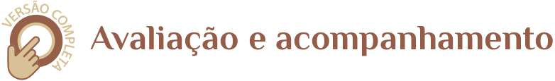

<!-- figure p101-fig1 | described_by: agy | ocr_overlap: None | needs_review: false -->
1. **Tipo de figura:** Cabeçalho gráfico de seção (título ilustrado com selo/ícone indicador de interação ou versão) sobre fundo branco/transparente.

2. **Texto visível (literal):**
   - Texto em arco ao redor do ícone (à esquerda): `VERSÃO COMPLETA`
   - Título principal (à direita): `Avaliação e acompanhamento`

3. **Estrutura:**
   A figura possui disposição horizontal simples composta por dois elementos lado a lado, sem caixas, setas, eixos, tabelas ou painéis:
   - **À esquerda:** um selo circular formado por um anel externo espesso, um anel interno fino e um centro circular branco. Acompanhando a curvatura externa do círculo no sentido horário (da parte superior esquerda até a parte inferior direita), encontra-se o texto `VERSÃO COMPLETA`. Sobreposto ao quadrante inferior esquerdo do anel, há o ícone estilizado de uma mão com o dedo indicador apontando em diagonal para cima e para a direita, em direção ao centro do círculo, sugerindo um gesto de clique ou toque.
   - **À direita:** alinhado verticalmente ao centro do ícone circular, aparece o texto `Avaliação e acompanhamento` em uma única linha, grafado em fonte serifada.

4. **Números ou valores de dados:**
   Não há números nem valores de dados na figura.

5. **Cores com significado:**
   As cores utilizadas (marrom/terracota no título, no contorno da mão e no anel externo; bege claro no preenchimento da mão, no anel interno e no texto `VERSÃO COMPLETA`) exercem apenas função estética e de identidade visual, não representando categorias de dados ou codificação de valores.

~~~text ocr
SÃO
= Avaliação e acompanhamento
AY
~~~

<!-- Start of picture text -->
Avaliação e acompanhamento VERSÃOCO M P L E T A <!-- End of picture text -->

Este capítulo está dividido em duas seções: a primeira apresenta o acompanhamento da Instituição feito por órgãos de controle, como CGU e TCU; por sua vez, a segunda discute a avaliação institucional no contexto do Sistema Nacional de Avaliação da Educação Superior (Sinaes). 

##### **Órgãos de gestão e controle** 

Como qualquer instituição pública que recebe recursos federais, as Instituições Federais de Ensino Superior (IFES) prestam contas para órgãos de controle, a exemplo da Controladoria Geral da União (CGU) e do Tribunal de Contas da União (TCU). A CGU é responsável por realizar atividades relacionadas à defesa do patrimônio público e ao incremento da transparência da gestão, por meio de ações de auditoria pública, correição, prevenção e combate à corrupção e ouvidoria. Já o TCU é o órgão de controle externo do Governo Federal que auxilia o Congresso Nacional na missão de acompanhar a execução orçamentária e financeira do país e contribuir com o aperfeiçoamento da administração pública em benefício da sociedade. A UFRPE observa as instâncias de controle definidas na Constituição Federal, bem como na legislação e nos 

normativos esparsos emitidos pelos órgãos competentes de controle interno e externo. 

Na perspectiva do TCU, o conceito de Governança Pública Organizacional compreende, essencialmente, os mecanismos de liderança, estratégia e controle postos em prática para avaliar, direcionar e monitorar a atuação da gestão, com vistas à condução de políticas públicas e à prestação de serviços de interesse da sociedade. Para isso, é importante ressaltar a diferença entre governança e gestão, uma vez que esses dois conceitos são interdependentes e têm o que podemos chamar de correlação, ou seja, a governança apresenta a função direcionadora, enquanto que a gestão apresenta a função realizadora (BRASIL, 2020h). 

Na execução dos objetivos definidos no Plano de Desenvolvimento Institucional (PDI) e articulando-se de modo a atingir resultados que gerem valores públicos e efetivos à sociedade, a UFRPE se guia por princípios básicos de governança pública, conforme determina o Decreto nº 9.203/2017 (BRASIL, 2017b). Com base nesses princípios, foram definidos os pilares da governança organizacional pública da Instituição. 

**100** 

<!-- page 102 -->

Em atendimento à legislação, bem como buscando o fortalecimento da gestão institucional, a UFRPE formalizou o seu modelo e estrutura de governança, já apresentado neste documento. 

Não obstante a regulação por órgãos de controle externos, a UFRPE possui uma Unidade de Auditoria Interna (Audin), estruturada de acordo com os Arts. 14 e 15, e res pectivos incisos, do Decreto nº 3.591/2000 (BRASIL, 2000a), atualizado pelos Decretos nº. 4.304 e 4.440 de 2002 (BRASIL, 2002b; BRASIL, 2002c), bem como com a Instrução Normativa CGU nº 3/2017 (BRASIL, 2017d) e demais atos normativos emitidos pela CGU. 

Em sua estrutura organizacional de controles internos, a UFRPE mantém três linhas de defesa, com responsabilidades definidas, visando a executar ações coordenadas de controle. Na primeira linha, os controles primários são contemplados, visando a identificar, avaliar, controlar e mitigar riscos, a fim de contribuir para o alcance de objetivos da Instituição. Na segunda, atividades de supervisão e monitoramento das ações dos controles primários são realizadas, tais como: verificações de conformidade e qualidade, controles financeiros, gestão de riscos, orientações, treinamentos e outras. Na terceira linha, a Audin presta serviços de avaliação e consultoria, visando a assessorar, de forma independente, a gestão superior para o aprimoramento das políticas públicas executadas pela Universidade. 

Em estrita observância ao § 3.º, do Decreto nº 3.591/2000 (BRASIL, 2000a), atualizado pelo Decreto nº 4.304/2002 (BRASIL, 2002b), e aos Inc. II, do Art. 4.º, e Art. 11 da Instrução Normativa CGU nº 13/2020 (BRASIL, 2020d), a Audin encontra-se vinculada ao Conselho Universitário (Consu) da UFRPE e realiza duplo reporte funcional e administrativo através de acesso direto e irrestrito do auditor supervisor a esse Conselho e à Reitoria. 

Em suas ações, a Audin preza pela observância, também, das Normas Internacionais para a Prática Profissional de Auditoria Interna, emitidas pelo _Institute of Internal Auditors_ (IIA), além das melhores práticas discutidas e publicadas por outras unidades de auditoria interna governamentais brasileiras. 

Visando a fortalecer o desenvolvimento das linhas de defesa em seus controles internos, a UFRPE pretende analisar, durante a vigência do presente PDI, em acordo com a viabilidade orçamentária e de infraestrutura, a possibilidade de implementação de uma Controladoria Interna, com o objetivo de fortalecer as ações de controle dos atos realizados pela própria gestão. Esse setor pode vir a reforçar a segunda linha de defesa, de modo que lhe competirá implantar e revisar controles internos, a fim de assessorar a gestão a alcançar seus objetivos e metas organizacionais. 

Não obstante, com sua atual estrutura de controles, a UFRPE atende aos preceitos legais de transparência ativa e 

**101** 

<!-- page 103 -->

passiva, bem como aos princípios da publicidade e da transparência, favorecendo o desenvolvimento do controle social. 

##### **Avaliação institucional** 

Ao longo do tempo, a avaliação institucional tem se tornado inerente ao processo de desenvolvimento contínuo das Instituições de Ensino Superior, convertendo-se em poderoso instrumento que subsidia o encaminhamento das decisões estratégicas da Instituição e a consequente promoção de ações que visem à melhoria contínua das IES. 

A avaliação institucional tem como principal abordagem o diálogo coletivo, com a participação paritária de todos os segmentos que fazem a universidade _–_ docentes, discentes, técnico(a)s e sociedade civil, de modo a garantir a participação e a transparência em todos os momentos do processo avaliativo. Também tem como princípio a busca pelo crescimento e consolidação da instituição como de excelência acadêmica. Para isso, é indispensável a articulação entre a avaliação e os documentos que norteiam a gestão, a exemplo do Plano de Desenvolvimento Institucional. É a partir desse documento que as políticas institucionais são projetadas para uma situação futura e os resultados da avaliação fornecem indicadores que podem auxiliar na definição dos caminhos a serem seguidos para que o desenvolvimento institucional seja alcançado. 

O modelo atual de avaliação das IES passou por reestruturação em 2004, com a criação do Sistema Nacional de 

Avaliação da Educação Superior (Sinaes) _–_ (BRASIL, 2004). O Sinaes é composto por três modalidades avaliativas: a Avaliação das Instituições de Educação Superior (Avalies), a Avaliação dos Cursos de Graduação (ACG) e o Exame Nacional de Desempenho dos Estudantes (Enade). A Avalies se subdivide em avaliação externa e avaliação interna. A avaliação externa é realizada por comissão técnica indicada pelo Instituto Nacional de Estudos e Pesquisas Educacionais Anísio Teixeira (Inep), que procede visita _in loco_ para avaliar a instituição no intuito de credenciá-la ou recredenciá-la. A avaliação interna, por sua vez, é realizada pelas Comissões Próprias de Avaliação (CPAs) de cada instituição, seguindo as notas técnicas publicadas pelo Inep e as diretrizes da Comissão Nacional de Educação da Avaliação Superior (Conaes). No âmbito da ACG, também envolve a atuação de comissões externas, que realizam visitas _in loco,_ visando a avaliar os cursos de graduação para fins de autorização, reconhecimento e renovação de reconhecimento. O Enade, por sua vez, é realizado pelo(a)s estudantes ao final do primeiro e do último ano de sua graduação. 

Essas modalidades de avaliação devem dialogar entre si, de modo a constituir um sistema que integre as diversas dimensões da realidade avaliada. Destaque-se, ainda, que esse sistema adota alguns indicadores de qualidade calculados a partir dos processos avaliativos, tais como o Conceito Institucional (CI), o Conceito Preliminar de 

**102** 

<!-- page 104 -->

Curso (CPC) e o Índice Geral de Cursos (IGC). Uma importante fonte de informações para o Sistema é o Censo da Educação Superior, elaborado anualmente a partir do envio de dados pelas instituições. 

Essas avaliações apresentam função reguladora. Seus resultados devem atender aos dispositivos normativos que regem a organização da Educação Superior em nosso país. Por outro lado, possibilitam à universidade entender sua evolução perante o PDI. Seus resultados podem servir para diagnosticar fragilidades e potencialidades, bem como acompanhar a execução de ações, projetos ou políticas, possibilitando, assim, identificar os problemas e realizar os ajustes necessários. Nesse sentido, a avaliação institucional pode ser compreendida como uma busca pela qualidade da educação superior, prezando pela eficácia institucional, por sua efetividade acadêmica e social, bem como por sua missão pública, buscando promover os valores democráticos, o respeito à diferença e à diversidade, além da afirmação da autonomia e da identidade institucional (BRASIL, 2004). 

##### **Autoavaliação Institucional na UFRPE** 

A autoavaliação propicia um momento em que a instituição volta-se para a sua própria realidade, gerando dados e informações a partir de instrumentos e metodologias que possam conduzir análises sobre a sua estrutura e organização institucional. Essa avaliação precisa ser compreendida 

de forma multidimensional, como uma espécie de “rede de relações” (NUNES, 2006) que envolve pessoas, processos, metodologias e práticas em diferentes fluxos avaliativos. 

Cada instituição deve organizar modelos e metodologias para orientar os processos de avaliação institucional, reconhecendo percursos autoavaliativos e metarreflexivos que poderão apoiar a gestão e o planejamento estratégico das universidades. A constituição de uma Comissão Própria de Avaliação (CPA) em todas as IES brasileiras, sejam públicas ou privadas, tornou-se obrigatória com a promulgação da Lei nº 10.861/2004 (Art. 11), contemplando a educação superior por meio dos seus cursos de graduação (Art. 1º) _–_ (BRASIL, 2004b). 

Na UFRPE, a CPA foi instituída pela Portaria nº 313/2004 _–_ GR (UFRPE, 2004). Seu regimento vigente foi aprovado pelo Conselho Universitário, através da Resolução nº 114/2018 – Consu/UFRPE. (UFRPE, 2018f). 

De acordo com o Artigo 3º da referida resolução: 

a CPA _–_ UFRPE tem por atribuição elaborar e desenvolver, conjuntamente à comunidade acadêmica, Administração Superior e Conselhos Superiores, uma proposta de autoavaliação institucional, coordenando e articulando os processos internos de avaliação da UFRPE, de acordo com princípios 

**103** 

<!-- page 105 -->

e diretrizes do Sistema Nacional de Avaliação da Educação Superior (Sinaes) . 

A CPA tem a participação de 32 membros com _representação paritária_ de docentes, técnico(a)s, discentes e representantes da sociedade civil referentes a: Sede da Instituição ( _campus_ Dois Irmãos); Unidade Acadêmica de Serra Talhada (UAST); Unidade Acadêmica de Educação a Distância e Tecnologia (UAEADTec), Unidade Acadêmica do Cabo de Santo Agostinho (UACSA) e Unidade Acadêmica de Belo Jardim (UABJ). Na estrutura organizacional, um(a) docente atua como presidente e um(a) técnico(a) como substituto eventual. 

Um dos princípios da CPA da UFRPE diz respeito à autoavaliação institucional como um _direito_ que toda comunidade universitária tem em ser partícipe do seu processo de planejamento e desenvolvimento institucional, e esse processo se inicia com a sua autoavaliação, espaço em que docentes, discentes e técnico(a)s podem apontar as potencialidades e fragilidades da universidade. Além de ser um direito, a participação da comunidade universitária no instrumento de autoavaliação da UFRPE é _democrática_ e _voluntária_ . Tal opção reflete a ideia de que a comunidade universitária assuma a responsabilidade conjunta de contribuir para a melhoria contínua e desenvolvimento institucional da Universidade. 

A avaliação interna da UFRPE efetiva-se dentro de um processo democrático, participativo, contínuo, cíclico e transparente, que permite à Instituição maior conhecimento sobre sua própria realidade, buscando compreender os significados do conjunto de suas atividades para melhorar a qualidade educativa e alcançar maior relevância social. Importante ressaltar que a UFRPE foi uma das primeiras instituições de ensino superior a garantir que a autoavaliação institucional alcançasse não apenas a modalidade presencial, mas também a modalidade de educação a distância (EAD), através de questões específicas para essa modalidade no instrumento de autoavaliação a partir do ano de 2014. Desde então, tanto os instrumentos de autoavaliação como os relatórios gerados com os resultados têm se aprimorado e garantido o protagonismo da UAEADTec no processo de autoavaliação da Universidade. 

A avaliação das IES no âmbito do Sinaes está estruturada por meio de eixos avaliativos que, por sua vez, correspondem a campos ou temas globais que reúnem uma ou mais dimensões definidas pela Lei nº 10.861/2004 (BRASIL, 2004b), e reorganizadas conforme a Nota Técnica nº 14/2014 _–_ CGACGIES/DAES/Inep/MEC (INEP, 2014). O Quadro 6 apresenta os cinco eixos e suas respectivas dimensões de avaliação. Além disso, contempla os pesos atribuídos no instrumento de avaliação institucional externa (INEP, 2017). 

**104** 

<!-- page 106 -->

Quadro 6. **Eixos de avaliação** <u>, dimensões e pesos atribuídos</u> 

|**Eixo**|**Dimensão**|**Pesos atribuídos**|
|---|---|---|
|**Avaliação e Planejamento** **Institucional**|Relato institucional; Planejamento e avaliação, especialmente os processos, resultados e eficácia da autoavalia- ção institucional.|10|
|**Desenvolvimento** **Institucional**|A missão e o plano de desenvolvimento institucional; A responsabilidade social da instituição.|30|
|**Políticas Acadêmicas**|A política para o ensino, a pesquisa, a pós-graduação, a extensão; A comunicação com a sociedade; A política de atendimento aos estudantes.|10|
|**Políticas de Gestão**|As políticas de pessoal; A organização e a gestão da instituição; A sustentabilidade financeira.|20|
|**Infraestrutura**|Infraestrutura|30|

_Fonte: Nota Técnica nº 14/2014 (INEP, 2014)._ 

Para atender ao roteiro da avaliação institucional definido pela Conaes, os dados são recolhidos anualmente, a partir de amostra estatisticamente selecionada, de forma a descrever a população em determinado período de tempo. De acordo com o cronograma definido pelo Inep, o recolhimento dos dados é feito, preferencialmente, no primeiro semestre de cada ano letivo. Esse período é definido anualmente e disponibilizado no calendário acadêmico da Universidade. 

O principal instrumento utilizado para a coleta de informações é o questionário, com perguntas fechadas, com a inclusão de um campo para sugestões, e disponibilizado no site da CPA ( **www.cpa.ufrpe.br** ) ou no Sistema Integrado de Gestão de Atividades Acadêmicas (SIGAA). Qualquer que seja o sistema de avaliação onde o instrumento deva ser inserido, a UFRPE deverá garantir os meios para que a avaliação seja acessível e alcance toda a comunidade universitária, como preconiza a Conaes (2004, p. 24): a CPA coordena e articula 

**105** 

<!-- page 107 -->

o processo interno de avaliação, mas “sua responsabilidade transversal precisa ter visibilidade e suporte operacional das instâncias dirigentes da Instituição de Ensino Superior”. 

A opção pelo questionário como principal instrumento de avaliação se deve ao fato de esse instrumento atingir grande número de pessoas, mesmo que estejam geograficamente distantes _–_ sede e unidades acadêmicas, garantir o anonimato das respostas e permitir que a comunidade universitária responda na hora que julgar mais conveniente, além de apresentar baixo custo operacional. 

Na análise dos dados dos relatórios, as avaliações feitas pela comunidade universitária são classificadas de acordo com os critérios dos instrumentos de avaliação externa do Inep (INEP,2014). Além disso, são feitas análises à luz dos relatórios de gestão da universidade e dos setores. 

Vale ressaltar que os questionários passaram por reformulações para atender aos instrumentos de avaliação do Inep, ao PDI (UFRPE, 2018l) e às necessidades institucionais, podendo os mesmos sofrerem alterações em qualquer momento para atender às novas demandas. Nessas reformulações, a comunidade universitária, assim como o(a)s gestore(a)s acadêmico(a)s e administrativo(a)s participam com sugestões de melhorias de enunciados, assim como incluindo ou excluindo questões para melhor adequação ao eixo avaliativo. Tais contribuições _–_ sugestões, inclusões 

e exclusões _–_ passam pela CPA, de modo a garantir que a avaliação tenha o caráter institucional _–_ avaliação de políticas. As reformulações são anuais, de acordo com o eixo a ser avaliado, para atender às demandas institucionais e/ou exigências legais. 

##### **Avaliação e planejamento institucional** 

O processo de acompanhamento do PDI constitui oportunidade para que a comunidade universitária reflita e avalie os objetivos, as políticas e as estratégias institucionais propostas. É uma janela de oportunidade para analisar criticamente os rumos do que foi delineado e planejado, possibilitando, assim, medidas para o aperfeiçoamento institucional, com vistas à melhoria da qualidade da educação da IES. 

A análise do cenário atual de uma instituição é a base do planejamento, assim como avaliar seus resultados, indicando potencialidades e fragilidades, de modo a nortear as próximas ações. Logo, os relatórios da CPA fornecem dados que serão processados na elaboração do planejamento, ratificando a relevância dessa comissão como instrumento estratégico da instituição. Nesse sentido, observa-se que a autoavaliação institucional conduzida pela CPA constitui um “importante mecanismo de autorregulação, onde as instituições conhecem a sua própria realidade e poderão utilizar mecanismos de controle interno, visando à qualidade e pertinência dos objetivos e metas institucionais” (TENÓRIO; ANDRADE, 2009, p.45). 

**106** 

<!-- page 108 -->

Anualmente, a CPA publica, nos _sites_ institucionais, os relatórios de autoavaliação, classificados em Relatório Sintético e Relatório Analítico ( **www.cpa.ufrpe.br/br/relatorio-de-autoavaliacao-institucional** ). Os relatórios sintéticos apresentam apenas os resultados das avaliações da comunidade universitária, classificados em Relatório Geral, Relatório das Unidades Acadêmicas, Relatório dos Departamentos Acadêmicos e Relatório dos Cursos. Tais documentos contribuem para que as especificidades sejam consideradas nas análises do(a)s gestore(a)s, fornecendo subsídios para o planejamento em todos os níveis. 

Os relatórios analíticos, por sua vez, são produzidos tendo por base os resultados da autoavaliação da UFRPE de modo geral e são analisados à luz dos Relatórios de Gestão da Universidade e dos setores, apontando estratégias de fortalecimento e sugestões de melhorias. No Relatório Integral, construído ao final do ciclo avaliativo, o qual ocorre ao longo de três anos, são apresentados planos de ação com base nos resultados da autoavaliação do ciclo. A versão impressa do Relatório Analítico é entregue à Reitoria, pró-reitorias e unidades acadêmicas. 

Deve-se destacar, também, a publicação do Boletim CPA, com dados oriundos da avaliação das políticas acadêmicas. O documento visa a auxiliar as coordenações de curso, o Colegiado de Coordenação Didática (CCD), o Núcleo Docente Estruturante (NDE), juntamente com discentes e 

docentes, nos processos de autoavaliação e planejamento do curso. 

Para discutir os resultados da autoavaliação junto aos cursos, são realizados os Encontros de Autoavaliação, em que são apresentados e discutidos os dados do Boletim CPA, a partir da sistematização dos resultados e interlocução com documentos e indicadores dos cursos, tais como o Relatório do Enade e o Projeto Pedagógico do Curso (PPC). Os encontros também são realizados com a Reitoria, pró-reitorias, unidades acadêmicas, polos da UAEADTec e demais setores da Universidade. Nesse sentido, possibilita que os resultados sejam analisados à luz das especificidades de cada órgão da Instituição, propiciando um planejamento direcionado para o que for prioritário para a Universidade. 

Os dados sistematizados e apresentados, tanto nos relatórios de autoavaliação institucional quanto nos boletins, buscam fornecer subsídios para colocar em prática o caráter transformador da avaliação, efetivando os resultados obtidos como ferramentas que deve embasar o planejamento institucional. 

A fim de consolidar o ciclo entre a avaliação e o uso dos seus resultados na cultura do planejamento, todas as pró-reitorias, órgãos e setores da Universidade deverão considerar os relatórios de autoavaliação em seus 

**107** 

<!-- page 109 -->

processos de planejamento. Além disso, os planos com ações desenvolvidas, em desenvolvimento ou planejadas deverão alimentar um sistema de acompanhamento do desenvolvimento institucional, a fim de que sejam apresentados à comunidade universitária e ao Inep como estratégia de fortalecimento da cultura da autoavaliação e de seus impactos na melhoria contínua da instituição. 

##### **Diretrizes para a autoavaliação** 

Com o intuito de consolidar uma cultura de autoavaliação e planejamento na UFRPE e também atender às exigências em relação aos parâmetros de avaliação externa no âmbito da graduação e da pós-graduação (INEP, 2017; BRASIL, 2019f), são apresentadas, nesta seção, diretrizes que nortearão os caminhos da autoavaliação nessas instâncias. Além disso, embora não haja legislação de orientação nesse sentido, a UFRPE propõe diretrizes para que a autoavaliação também seja utilizada nos Ensinos Básico, Técnico e Tecnológico, através do Colégio Agrícola Dom Agostinho Ikas da UFRPE (Codai). 

##### **A autoavaliação nos cursos de graduação** 

O instrumento de avaliação de cursos de graduação (INEP, 2017) é o documento que orienta as avaliações externas para fins de reconhecimento e renovação de reconhecimento, com o objetivo de garantir a melhoria da qualidade da educação nos cursos de graduação. Dentre os indicadores avaliativos presentes nesse instrumento, destaca-se 

a prática de autoavaliação nos cursos de graduação da instituição, nas modalidades presencial e a distância, considerando-se as especificidades da EAD no procedimento avaliativo. 

No processo de autoconhecimento dos cursos de graduação, a autoavaliação torna-se instrumento norteador das mudanças organizacionais e operativas na melhoria dos processos educacionais. Para a assertividade desse processo, é indispensável considerar uma metodologia que possibilite diagnóstico e reflexão dos cursos, visando a nortear a tomada de decisão na busca de melhorias do processo educativo. Para tanto, é fundamental a oportunidade de manifestação de percepções convergentes e divergentes, por meio de uma interatividade democrática, através da participação individual e coletiva, como também de espaço para elucidação de aspectos, que, de outro modo, não seria possível. Nesse sentido, a autoavaliação dos cursos de graduação deverá fundamentar-se nas seguintes diretrizes: 

- Efetivação contínua e participativa da mobilização dos sujeitos e setores responsáveis na definição dos instrumentos avaliativos; 

- Sistematização, interpretação e divulgação das informações, considerando os dados dos resultados das avaliações internas e externas da instituição; 

- Promoção da participação de discentes, docentes, técnico(a)s-administrativo(a)s e dos órgãos 

**108** 

<!-- page 110 -->

vinculados à coordenação do curso, como o CCD, a Comissão de Orientação e Acompanhamento Acadêmico (COAA), a Comissão de Ensino dos Departamentos e das Unidades Acadêmicas, bem como o NDE, durante as análises, discussões e proposições; 

- Análise da realidade para identificar os avanços e os desafios; 

- Potencialização e efetividade na melhoria dos processos acadêmicos por meio da elaboração e execução de planos de melhoria definindo sua periodicidade; 

- Acompanhamento, reavaliação e divulgação das práticas e resultados como exercício da gestão do curso. 

Com base na análise atual de práticas exitosas de alguns cursos da Instituição, e considerando a necessidade dessa prática autoavaliativa nas graduações, a UFRPE estabelece quatro dimensões com seus respectivos objetivos, de forma que possam ser incorporados e adaptados aos processos autoavaliativos sem que desconsiderem as realidades e a autonomia de cada curso (Quadro 7). Tais dimensões também estão baseadas no instrumento de avaliação dos cursos de graduação (INEP, 2017), que orienta o reconhecimento e a renovação do reconhecimento de cursos nas avaliações _in loco_ , podendo essas ocorrerem presencial ou virtualmente, conforme Portaria nº 165 de 20 de abril de 2021 (INEP, 2021). 

Quadro 7. **Dimensões da política** de autoavaliação dos cursos de graduação 

|**Dimensão**|**Objetivo**|
|---|---|
|Organização didático-pedagógica|Identificar a coerência das propostas do PPC referentes aos objetivos do curso; perfil do(a) egresso(a); estru- tura curricular; metodologia e processos de avaliação com a formação profissional proposta pela organização curricular.|
|Corpo docente e tutorial|Avaliar a atuação pedagógica no desenvolvimento dos conteúdos, adequação e eficácia das metodologias à proposta de formação do PPC, à realidade do(a) discente e do mundo do trabalho, bem como no desen- volvimento do pensamento crítico e científico, considerando a importância das relações no processo de ensino-aprendizagem.|

**109** 

<!-- page 111 -->

|**Dimensão**|**Objetivo**|
|---|---|
|Corpo discente|Avaliar a existência, os efeitos e os impactos das políticas de apoio ao desempenho acadêmico e permanência no curso. Observar o número de discentes por turma com um comparativo do número de ingressantes. Identificar número de discentes retido(a)s, reprovado(a)s, que abandonaram, e o desempenho acadêmico do(a)s estudantes acompanhado(a)s, elaborando estratégias para solucionar ou minimizar esse contingente.|
|Estrutura e funcionamento institucional|Observar estrutura quanto a salas de aula, de reunião, recursos tecnológicos, bibliografia básica e complemen- tar atendendo aos programas das unidades curriculares em número suficiente ao(à)s discentes, laboratórios com regulamento de uso atendendo às demandas do curso. Avaliar a gestão e os processos dos programas e políticas institucionais de apoio e atendimento acadêmico.|

Dessa forma, as práticas do processo autoavaliativo adotadas por cada curso deverão constar e estar alinhadas com o seu respectivo projeto pedagógico. É importante destacar que o processo de autoconhecimento do curso deve ser construído de forma coletiva, valorizando as negociações, concessões e respeitando tempos e ritmos de cada curso. Os resultados da autoavaliação nos cursos, juntamente com os resultados da autoavaliação institucional _–_ conduzida pela CPA _–_ e os indicadores das avaliações externas _–_ CPC, IGC e Enade _–_ deverão ser utilizados como insumos para nortear o planejamento e o aprimoramento contínuo dos cursos de graduação. Além de evidenciar à comunidade um diagnóstico sobre os cursos de graduação, a autoavaliação servirá de base para o planejamento de ações estratégicas das políticas acadêmicas da UFRPE. 

##### **A Autoavaliação na pós-graduação** 

A necessidade de propor um processo de autoavaliação nos programas de pós-graduação (PPG) surgiu como demanda para o amadurecimento e fortalecimento dos PPG, a partir de experiências bem sucedidas nos sistemas no exterior e do processo de autoavaliação do ensino de graduação existente no Brasil. Com essa finalidade, em 2013, a UFRPE implementou o Programa de Excelência da Pós-Graduação (PEPG), que teve como base promover a avaliação e o planejamento estratégico da pesquisa e da pós-graduação, por meio de seus objetivos: 

**_1._** Apoiar os PPG _stricto sensu_ na busca pela consolidação de suas atividades de pesquisa e ensino; 

**_2._** Contribuir para a formação de recursos humanos altamente qualificados para o país; 

**110** 

<!-- page 112 -->

**_3._** Ajudar a promover a inserção internacional dos PPG; 

**_4._** Aumentar a inserção nacional dos PPG. 

**_5._** Ampliar a representatividade da UFRPE nos conselhos decisórios da educação, ciência e tecnologia do país. 

Desde então, as ações visando a promover a excelência dos PPG têm sido realizadas pela Pró-Reitoria de PósGraduação (PRPG), em conjunto com as coordenações dos respectivos programas. 

Um novo processo de autoavaliação na pós-graduação começou a ser pensado e elaborado por uma comissão específica, designada pela Coordenação de Aperfeiçoamento de Pessoal de Nível Superior (Capes). O intuito dessa comissão foi estabelecer critérios de autoavaliação, de forma sistemática, entre os PPG, de forma que auxiliasse a avaliação externa e subsidiasse o planejamento estratégico dos programas. 

A proposta da Capes em relação à autoavaliação dos PPG está dividida em cinco ações necessárias para uma avaliação qualitativa e contextualizada: 1) planejar; 2) conduzir; 3) implementar; 4) analisar; e 5) reavaliar, a partir de uma sistemática que envolva a IES, a Pró-Reitoria de Pós-Graduação ou equivalentes, a coordenação do PPG e todo o corpo docente, discente e técnico-administrativo, tomando o processo de autoavaliação um exercício de autonomia responsável, de modo a construir reflexão sobre 

o contexto e políticas adotadas para o reconhecimento e fortalecimento da pós-graduação no Brasil. 

Nesse sentido, o processo de autoavaliação na pós-graduação pode trazer mais subsídios para o desenvolvimento do sistema com qualidade, uma vez que o processo de autoavaliação visa a favorecer a construção da identidade, heterogeneidade e envolvimento dos programas avaliados, para além dos padrões mínimos garantidos pela avaliação externa. 

Com o objetivo de ampliar a discussão da implementação da autoavaliação e do planejamento estratégico nos PPG da UFRPE, a Comissão Própria de Avaliação (CPA) promoveu o II Simpósio de Avaliação Institucional, com o tema: _A autoavaliação na ordem do dia_ : _Graduação e Pós-Graduação_ , em novembro de 2019. O principal objetivo do Simpósio foi dividir experiências no uso da autoavaliação em cursos de graduação e da pós-graduação. 

Como encaminhamento das sugestões propostas pelos participantes do Simpósio, durante a mesa-redonda sobre _A autoavaliação e planejamento nos Programas de Pós-Graduação_ , realizou-se reunião com os participantes da CPA, PRPG e Pró-Reitoria de Planejamento e Desenvolvimento Institucional (Proplan), a fim de traçar estratégias de ações para o desenvolvimento de um 

**111** 

<!-- page 113 -->

processo de autoavaliação e planejamento estratégico nos PPG da UFRPE. 

Assim, em dezembro de 2019, visando a iniciar o processo de autoavaliação nos PPG da UFRPE, a PRPG constituiu uma comissão formada por docentes e discentes vinculados à pós-graduação, assim como por membros da CPA da UFRPE, para elaboração das Normas de Autoavaliação dos Programas de Pós-Graduação da UFRPE. Em fevereiro de 2020, os questionários adaptados às particularidades da UFRPE foram encaminhados para as coordenações dos PPG, para análise e proposição de sugestões. Após realizadas as adequações propostas, a PRPG transformou os questionários em formulários eletrônicos e os enviou para que as coordenações passassem aos seus discentes e docentes (fase de execução). Em seguida, o resultado de cada PPG foi encaminhado, separadamente, para cada coordenação, com vistas com o objetivo de realizarem às análises e à divulgação de seus dados pelos programas e pela PRPG (fase de análise e divulgação). Da mesma forma, a PRPG realizou a análise dos dados obtidos de todos os PPG, resultando na publicação do I Relatório de Autoavaliação dos Programas de Pós-Graduação ( **www.prppg.ufrpe.br/ legislacao** ). 

A fim de institucionalizar uma política de autoavaliação para a pós-graduação de maneira contínua e que essa possa subsidiar planos de ação futuros, a Pró-Reitoria de 

Pós-Graduação (PRPG) conduzirá a autoavaliação institucional, de acordo com as diretrizes propostas pela Capes (BRASIL, 2019f) (Quadro 8). 

Quadro 8. **Eixos, dimensões** e objetivos 

da autoavaliação na pós-graduação 

|**Eixo**|**Dimensão**|**Objetivos**|
|---|---|---|
|Capes / PRPG|Planejamento estraté- gico e gestão|Avaliar a gestão e a implemen- tação do planejamento estra- tégico no PPG.|
||Pesquisa e Inovação|Avaliar a qualidade da pesquisa e a capacidade de inovação dos PPGs.|
||Internacionalização e inserção social do Programa|Avaliar a internacionalização e o impacto da inserção social dos PPGs.|
|Programas de Pós- Graduação|Infraestrutura|Avaliar a infraestrutura física, tecnológica, comunicacional e laboratorial dos PPGs.|
||Autoavaliação da orientação docente – segmento discente Avaliação da elabo- ração do trabalho científico (segmento docente)|Avaliar a relação interpessoal na orientação, apoio docente, qualidade do trabalho acadê- mico e publicações.|
||Autoavaliação do segmento|Identificar outros pontos relevantes na percepção dos servidore(a)s e discentes que possam contribuir para a me- lhoria do PPG.|

**112** 

<!-- page 114 -->

Os resultados da autoavaliação produzirão informações que poderão conduzir à elaboração de planos de melhorias para a Política de Pós-Graduação da Universidade, à melhoria da qualidade do ensino da pós-graduação e à melhoria da qualidade dos programas, de forma a atender às suas especificidades. Com a publicação do referido relatório, a apropriação dos resultados obtidos permite aos dirigentes institucionais da pós-graduação _–_ PRPG e Coordenações dos Programas, bem como os atores envolvidos _–_ docentes, discentes e técnico(a)s, conhecer melhor o programa e, baseando-se nessas informações, planejar ações para o aprimoramento do ensino, da pesquisa, da divulgação do conhecimento, do desenvolvimento científico e tecnológico e dos impactos sociais e econômicos desejados pela Instituição, no nível da sua pós-graduação. 

##### **A autoavaliação do ensino básico, técnico e tecnológico** 

Considerando-se o Ensino Básico, Técnico e Tecnológico (EBTT), até o momento, não há legislação que exija a avaliação institucional para essa modalidade de ensino nas instituições públicas e privadas. A qualidade das instituições que participam da Rede Federal de Educação Profissional e Tecnológica é medida apenas pelos indicadores de resultados, conforme o item 9.3.2 do Acórdão n.º 2.267/2005 _–_ TCU/Plenário: 

9.3. Recomendar à Secretaria de Educação Tecnológica do Ministério da Educação (SETEC/MEC) que: 

(...) 

9.3.2. inclua, no relatório de gestão das contas anuais, apreciação crítica sobre a evolução dos dados (indicadores e componentes) constantes do subitem 9.1.1 deste Acórdão, com base em análise consolidada das informações apresentadas pelas Ifets, destacando aspectos positivos e oportunidades de melhoria do sistema de rede de instituições federais de ensino tecnológico (...) (BRASIL, 2005a). 

Porém, em cumprimento ao estabelecido no item 9.3.2 do Acórdão 2.267/2005 _–_ TCU, a análise dos indicadores de gestão limita-se a realizar a análise consolidada das informações dos Institutos Federais, Cefet e Colégio Pedro II, uma vez que a Universidade Federal Tecnológica do Paraná e as Escolas Técnicas Vinculadas às universidades federais estão administrativamente vinculadas à Secretaria de Educação Superior do Ministério da Educação (Sesu/MEC). 

A fim de identificar as potencialidades, assim como as fragilidades desse nível de ensino e, entendendo que o ato de avaliar contribui para alinhar políticas e diretrizes institucionais para a busca da melhoria contínua, o Colégio Dom Agostinho Ikas da UFRPE (Codai) decidiu, em 2020, instituir um processo de autoavaliação institucional, sendo essa iniciativa um marco entre as Escolas Técnicas Vinculadas às IFES. Para isso, foi necessária a criação de uma Comissão Própria de Avaliação do Codai (CPAC). Essa comissão tem por objetivo estudar e buscar estratégias e mecanismos para avaliar essa modalidade de ensino, considerando-se as suas especificidades, mas também 

**113** 

<!-- page 115 -->

considerando-se as especificidades dos cursos básicos, técnicos e tecnológicos ofertados pelo Codai. 

Para garantir a participação paritária dos segmentos do Codai, a Comissão é composta por dois(duas) docentes, dois(duas) técnico(a)s-administrativo(a)s e dois(duas) discentes, inicialmente indicados pela Direção e, posteriormente, após construção do seu regimento interno, a equipe definirá a escolha dos seus representantes. A CPA da UFRPE tem atuado como assessora e interlocutora na construção e na orientação de um modelo de avaliação institucional que atenda às especificidades do Codai. 

Com a primeira fase de implantação do SIGAA já realizada, em que se encontram três dos cinco cursos já implantados e os demais em implantação, em 2021, para o Ensino Básico, Técnico e Tecnológico, a expectativa é que o instrumento de avaliação institucional proposto para o Codai também seja inserido no sistema acadêmico, e, em caso 

de impossibilidade, a UFRPE, por meio da Secretaria de Tecnologias Digitais (STD), deverá buscar outros meios para a aplicação do instrumento, resguardando-se a segurança dos dados e a efetiva participação da comunidade que faz parte da instituição. 

Outra diretriz fundamental para a efetiva implementação do modelo de avaliação é que ele permita a participação de toda a comunidade acadêmica do Codai, tanto na construção do instrumento, quanto na devolutiva dos resultados, considerando as modalidades presencial e a distância, para que esses sejam promotores de mudanças e melhorias institucionais. 

O modelo de avaliação institucional para o Codai também segue a mesma proposta de eixos e dimensões pensados para a graduação. Mudam-se os objetivos para cada dimensão, pois precisam considerar a realidade e as especificidades dessa modalidade de ensino (Quadro 9) 

Quadro 9. **Dimensões da política** de autoavaliação dos cursos básicos, técnicos e tecnológicos do Codai 

|**Dimensão**|**Objetivo**|
|---|---|
|Organização didático-pedagógica|Identificar a coerência das propostas dos PPCs referentes aos objetivos dos cursos do EBTT; Delinear o perfil do(a)s egresso(a)s dos cursos oferecidos pelo Codai nas modalidades presencial e a distância; Atualizar e adequar a estrutura curricular à formação de cidadãos e cidadãs crítico(a)s e participativo(a)s. Metodologia e processos de avaliação, considerando as especificidades da formação profissional pro- postas nas organizações curriculares das diferentes modalidades de ensino, adequando ao perfil do(a) egresso(a) do curso.|

**114** 

<!-- page 116 -->

|**Dimensão**|**Objetivo**|
|---|---|
|Corpo docente e tutorial|Avaliar a atuação pedagógica no desenvolvimento dos conteúdos, adequação e eficácia das metodolo- gias à proposta de formação do PPC à realidade do(a) discente e do mundo de trabalho, bem como no desenvolvimento do pensamento crítico e científico, considerando a importância das relações no pro- cesso de ensino-aprendizagem, tendo em vista as demandas da sociedade, bem como a integração entre ensino, pesquisa e extensão. Fortalecer a política de atendimento a estudantes. Avaliar ograu de titulação do corpo docente.|
|Corpo discente|Avaliar a existência, efeitos e impactos das políticas de apoio ao desenvolvimento acadêmico e perma- nência no curso. Acompanhar qualitativamente o grupo de discentes por curso com um comparativo do número de ingressos. Identificar a eficiência acadêmica do(a)s concluintes, relação ingressantes por matrículas e retenção do fluxo escolar do(a)s estudantes acompanhado(a)s, elaborando estratégias para solucionar ou minimizar esse contingente.|
|Estrutura e funcionamento institucional|Observar estrutura quanto a salas de aula, de reunião, recursos tecnológicos, bibliografias básica e com- plementar, atendendo aos programas das unidades curriculares em número suficiente aos discentes, laboratórios com regulamento de uso, com base nas demandas do curso. Avaliar a gestão e os processos dos programas e políticas institucionais de apoio e atendimento acadêmi- co nas modalidades presencial e a distância.|

Com a consolidação da CPAC e da construção dos instrumentos e implementação desses em um sistema de avaliação, o Codai conseguirá produzir seu relatório de avaliação institucional, que deverá ser amplamente divulgado entre a comunidade acadêmica e gestore(a)s, a fim de que subsidiem planos de ação que promovam melhorias e mudanças de acordo com as reais necessidade da comunidade Codai e dos cursos. 

Para isso, a avaliação institucional do Codai deverá ser contínua, ocorrendo anualmente, nas modalidades presencial e a distância, havendo a necessidade de espaço físico, apoio tecnológico e de um/a servidor(a) para a realização de suas atividades e ações. 

**115** 

<!-- page 117 -->

##### **Objetivos, metas e ações** 

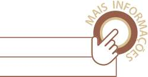

<!-- figure p117-fig1 | described_by: agy | ocr_overlap: None | needs_review: false -->
1. **Tipo de figura:** Elemento gráfico ilustrativo de cabeçalho ou caixa de destaque (ícone/banner de chamada para seção informativa), em estilo vetorial plano, sem dados quantitativos.

2. **Texto visível (verbatim):**
   - `MAIS INFORMAÇÕES` (em letras maiúsculas, disposto em arco ao longo da parte superior e direita do elemento circular).
   - Não há outros textos, títulos, legendas, rótulos ou valores visíveis.

3. **Estrutura:**
   - **À esquerda:** Duas faixas retangulares horizontais empilhadas, vazias (sem preenchimento de texto ou elementos internos) e abertas na extremidade esquerda da imagem, delimitadas por linhas horizontais finas. A linha superior estende-se da borda esquerda até encontrar o lado esquerdo do polegar da mão; a linha central divide as duas faixas e vai da borda esquerda até a lateral inferior esquerda da mão; a linha inferior vai da borda esquerda até encontrar uma linha vertical na extremidade direita, que sobe e se conecta à parte inferior direita da mão, fechando a faixa de baixo.
   - **À direita:** Um conjunto circular composto por um anel externo espesso, um anel interno fino e um círculo central branco, lembrando um botão ou alvo. O texto `MAIS INFORMAÇÕES` curva-se externamente ao redor desse círculo, no sentido horário, aproximadamente da posição de 10 horas até 5 horas.
   - **Elemento de conexão/interação:** Sobreposta à junção entre a extremidade direita das faixas horizontais e o quadrante inferior esquerdo do círculo, há a ilustração de uma mão estilizada em contorno, com o polegar erguido para cima, três dedos dobrados e o dedo indicador estendido para a diagonal superior direita, apontando/tocando o centro do círculo. Não há setas, eixos ou painéis adicionais.

4. **Números e valores de dados:** Não há nenhum número ou valor de dado na imagem.

5. **Cores com significado:** As cores presentes (marrom nos contornos e no anel externo, bege/dourado claro no anel interno e no texto, e branco no preenchimento da mão, do centro do círculo e das faixas) têm função puramente visual/decorativa e de contraste, sem codificar dados ou categorias.

<!-- Start of picture text -->
MAIS INFOR M A Ç Õ SE <!-- End of picture text -->

###### Objetivo 4. Avaliação Institucional _–_ Ações de planejamento 

|EIXO (MAPA ESTRATÉGICO)|PROCESSOS INTER|NOS||||
|---|---|---|---|---|---|
|TEMA|AVALIAÇÃO INSTIT|UCIONAL||||
|OBJETIVO|Integrar os result Universidade.|ados da autoavalia|ção institucional c|om as ações de pla|nejamento na|
|INDICADOR (ES)|META 2021|META 2022|META 2023|META 2024|META 2025|
|1 – Percentual de unidades organizacionais nas quais foram realizados encontros de autoavaliação.|1. 20% dos encon-|1. 30% dos encon-|1. 40% dos encon-|1. 50% dos encon-|1. 60% dos encon-|
|2 – Percentual de unidades organizacionais que usaram os resultados da autoavaliação |tros de autoavalia- ção realizados|tros de autoavalia- ção realizados|tros de autoavalia- ção realizados|tros de autoavalia- ção realizados|tros de autoavalia- ção realizados|
|noplanejamento. |2. 10% das unida-|2. 20% das unida-|2. 30% das unida-|2. 40% das unida-|2. 50% das unida-|
|UNIDADE(S)RESPONSÁVEL(IS)|des organizacio-|des organizacio-|des organizacio-|des organizacio-|des organizacio-|
|CPA/ Reitoria/Pró-Reitorias/Unidades Acadêmicas/ Departamentos Acadêmicos/ Polos da EAD/Demais setores da Universidade|nais com planeja- mento realizados|nais com planeja- mento realizados|nais com planeja- mento realizados|nais com planeja- mento realizados|nais com planeja- mento realizados|

**116** 

<!-- page 118 -->

|Objet |ivo 5.Avaliação Ins|titucional_–_Progra|mas depós-gradua|ção|**M** **A** **I** **S**     **I** **N** **F** **O** **R** **M** **A** |
|---|---|---|---|---|---|
|EIXO (MAPA ESTRATÉGICO)|PROCESSOS INTERN|OS|||**Ç** **Õ** **E** |
|TEMA|AVALIAÇÃO INSTITU|CIONAL|||**S**|
|OBJETIVO  |Fortalecer apolíti |ca de autoavaliação |nos programas de |pós-graduação. ||
|INDICADOR (ES)|META 2021|META 2022|META 2023|META 2024|META 2025|
|1 – Número de eventos realizados por ano.||1. Realizar evento|1. Realizar evento anual para devolu- |1. Realizar evento anual para devolu- ||
|2 – Número de reuniões para o aprimora- mento do instrumento de autoavaliação. 3 – Percentual de PPGs com planos de melhorias.|1. Realizar evento anual para devolu- ção dos resultados da autoavaliação|anual para devolu- ção dos resultados da autoavaliação 2. Aprimorar o |ção dos resultados da autoavaliação 2. Aprimorar o instrumento de |ção dos resultados da autoavaliação 2. Aprimorar o instrumento de |1. Realizar evento anual para devolu- ção dos resultados da autoavaliação|
|4 – Resolução para orientação da autoa- valiação na pós-graduação. 5 – Sistema de autoavaliação no SIGAA por curso de pós-graduação. 6 – Sistema de autoavaliação desenvolvido. UNIDADE(S)RESPONSÁVEL(IS)|2. Aprimorar o instrumento de autoavaliação da pós-graduação 3. 10% dos PPGs com planos de melhorias a partir dos resultados da|instrumento de autoavaliação da pós-graduação 4. Aprovar resolu- ção de orientação da autoavaliação na pós-graduação 3. 20% dos PPGs|autoavaliação da pós-graduação 5. Apresentar uma proposta de autoa- valiação para os cursos de pós-gra- duação no SIGAA 3. 30% dos PPGs |autoavaliação da pós-graduação 6. Desenvolver o sistema de autoa- valiação dos cur- sos de graduação no SIGAA 3. 40% dos PPGs |2. Aprimorar o instrumento de autoavaliação da pós-graduação 3. 50% dos PPGs com planos de melhorias a partir dos resultados da|
|PRPG/Coordenações dos Programa de Pós-Graduação/Docentes/Discentes/ Técnico(a)s/ STD/CPA|autoavaliação|com planos de melhorias a partir dos resultados da autoavaliação|com planos de melhorias a partir dos resultados da autoavaliação|com planos de melhorias a partir dos resultados da autoavaliação|autoavaliação|

**117** 

<!-- page 119 -->

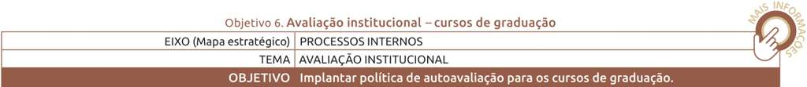

<!-- figure p119-fig1 | described_by: agy | ocr_overlap: 1.0 | needs_review: false -->
1. **Tipo de figura:** Tabela de cabeçalho/resumo de planejamento estratégico com título centralizado acima e um ícone circular informativo sobreposto ao canto superior direito.

2. **Todo o texto visível (transcrição literal):**
   - **Título (acima da tabela):** `Objetivo 6. Avaliação institucional – cursos de graduação`
   - **Ícone circular (canto superior direito, em arco):** `MAIS INFORMAÇÕES`
   - **Linha 1, coluna 1:** `EIXO (Mapa estratégico)`
   - **Linha 1, coluna 2:** `PROCESSOS INTERNOS`
   - **Linha 2, coluna 1:** `TEMA`
   - **Linha 2, coluna 2:** `AVALIAÇÃO INSTITUCIONAL`
   - **Linha 3, coluna 1:** `OBJETIVO`
   - **Linha 3, coluna 2:** `Implantar política de autoavaliação para os cursos de graduação.`

3. **Estrutura:**
   - No topo, centralizado horizontalmente acima do quadro, encontra-se o título, com `Objetivo 6.` em fonte regular e `Avaliação institucional – cursos de graduação` em negrito.
   - Abaixo do título há uma tabela retangular composta por 3 linhas e 2 colunas em formato de rótulo e valor:
     - A coluna da esquerda (mais estreita, cerca de um terço da largura total) contém os rótulos alinhados à direita.
     - A coluna da direita (mais larga, cerca de dois terços da largura total) contém os respectivos valores alinhados à esquerda.
     - As linhas 1 e 2 possuem bordas externas e linhas divisórias internas (horizontal entre as linhas e vertical entre as colunas).
     - A linha 3 forma uma faixa contínua preenchida de ponta a ponta, sem linha vertical visível dividindo as colunas, mantendo o mesmo alinhamento vertical entre o rótulo (`OBJETIVO`) e o texto descritivo à direita, ambos em negrito.
   - Sobreposto ao canto superior direito da tabela (ultrapassando a borda superior e cobrindo parcialmente a extremidade direita das linhas 1 e 2) há um ícone circular composto por anéis concêntricos, sobre o qual se projeta, a partir da parte inferior esquerda, o desenho de uma mão com o dedo indicador apontando para o centro do círculo; ao redor da borda superior e direita externa do círculo dispõe-se, em formato curvo no sentido horário, o texto `MAIS INFORMAÇÕES`.

4. **Números e valores de dados:**
   - `6` (número identificador do objetivo no título `Objetivo 6.`). Não há outros números, indicadores ou dados quantitativos na imagem.

5. **Cores com significado:**
   - **Marrom (tom terroso):** atua como cor temática e de destaque estrutural, sendo usada no título, nas bordas da tabela, no contorno da mão e no anel externo do ícone, e como fundo sólido da terceira linha (`OBJETIVO`), conferindo destaque visual ao enunciado principal do objetivo em relação às linhas de classificação acima.
   - **Branco sobre fundo marrom:** destaca o rótulo e o texto da linha `OBJETIVO`, diferenciando-os das linhas de metadados (`EIXO (Mapa estratégico)` e `TEMA`), que utilizam texto **preto sobre fundo branco**.
   - **Bege claro:** usado no anel interno e nas letras curvas de `MAIS INFORMAÇÕES`, diferenciando o selo informativo/interativo do restante da tabela.

~~~text ocr
Objetivo 6. Avaliação institucional — cursos de graduação 2)
EIXO (Mapa estratégico) | PROCESSOS INTERNOS é
TEMA | AVALIAÇÃO INSTITUCIONAL
OBJETIVO Implantar política de autoavaliação para os cursos de graduação.
~~~

<!-- Start of picture text -->
Objetivo 6. Avaliação institucional  –  cursos de graduação EIXO (Mapa estratégico) PROCESSOS INTERNOS TEMA AVALIAÇÃO INSTITUCIONAL OBJETIVO Implantar política de autoavaliação para os cursos de graduação. MAIS INFOR M A Ç Õ SE <!-- End of picture text -->

|OBJETIVO|Implantar política d|e autoavaliação para|os cursos de graduaç|ão.|
|---|---|---|---|---|
|INDICADOR(ES)|META 2022|META 2023|META 2024|META 2025|
|1 – Minuta de resolução sobre autoavaliação nos cur- sos de graduação.|||||
|2 – Resolução para orientação dos cursos de graduação. 3 – Projeto para o desenvolvimento de um sistema de avaliação dos cursos de graduação. 4 – Sistema de autoavaliação no SIGAA por curso de graduação. 5 – Percentual de PPCs de cursos de graduação atualizados. 6 – Percentual de cursos de graduação que fizeram a autoavaliação. 7 – Percentual planos de melhorias a partir dos resulta- dos da autoavaliação.|1. Desenvolver minu- ta de resolução sobre autoavaliação dos cursos de graduação 2. Aprovar resolu- ção para orientar a autoavaliação nos cursos de graduação|3. Apresentar uma proposta de autoava- liação para os cursos de graduação|4. Desenvolver o sistema de autoava- liação dos cursos de graduação no SIGAA|5. 20% dos cursos de graduação com PPCs atualizados 6. 20% dos cursos de graduação com a au- toavaliação realizada 7. Desenvolver pla- nos de melhorias nos cursos a partir dos resultados da autoavaliação|
|UNIDADE(S)RESPONSÁVEL(IS)|||||
|PREG/Coordenações de Curso/ODG/STD/CPA|||||

**118** 

<!-- page 120 -->

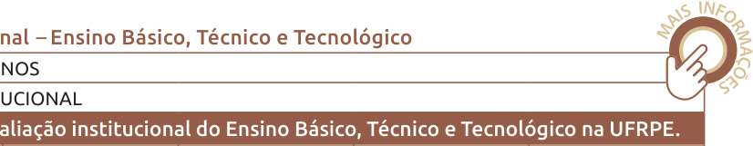

<!-- figure p120-fig1 | described_by: agy | ocr_overlap: 1.0 | needs_review: false -->
1. **Tipo de figura:** Recorte parcial (cortado à esquerda e na extremidade inferior) do cabeçalho e das primeiras linhas de um quadro/tabela informativo institucional extraído de um documento, contendo um selo/ícone gráfico de chamada para mais informações no canto superior direito.

2. **Todo o texto visível (literalmente, conforme aparece no recorte):**
   - **Título acima do quadro (cortado à esquerda):** `nal – Ensino Básico, Técnico e Tecnológico`
   - **Texto em arco no selo/ícone circular à direita:** `MAIS INFORMAÇÕES`
   - **Célula da 1ª linha do quadro (cortada à esquerda):** `NOS`
   - **Célula da 2ª linha do quadro (cortada à esquerda):** `UCIONAL`
   - **Faixa/célula da 3ª linha do quadro (cortada à esquerda):** `aliação institucional do Ensino Básico, Técnico e Tecnológico na UFRPE.`

3. **Estrutura:**
   - **Título superior:** posicionado fora e logo acima da borda superior do quadro, alinhado à esquerda do recorte.
   - **Quadro/tabela:** apresenta apenas uma área de coluna visível (aberta/cortada na margem esquerda e fechada por uma borda vertical fina à direita), dividida horizontalmente em três linhas empilhadas:
     - **Linha 1:** caixa retangular de fundo branco, limitada por bordas horizontais superior e inferior, contendo `NOS` alinhado à esquerda.
     - **Linha 2:** caixa retangular de fundo branco abaixo da linha 1, contendo `UCIONAL` alinhado à esquerda.
     - **Linha 3:** faixa retangular preenchida sem bordas internas visíveis, contendo `aliação institucional do Ensino Básico, Técnico e Tecnológico na UFRPE.` em negrito; na borda inferior da imagem, logo abaixo dessa faixa, há uma linha fina clara indicando a continuação do quadro.
   - **Selo/ícone no canto superior direito:** sobreposto ao canto superior direito do quadro (cruzando a borda superior e as linhas 1 e 2). Consiste em dois anéis concêntricos ao redor de um círculo central branco, cercados no arco externo superior e direito (no sentido horário) pelo texto `MAIS INFORMAÇÕES`, com uma ilustração estilizada de uma mão com o dedo indicador apontando diagonalmente para cima e para a direita, em direção ao centro do círculo (símbolo de clique/interação).

4. **Números ou valores de dados:** Não há números nem valores numéricos visíveis na figura.

5. **Cores com significado:**
   - **Marrom:** usado para estruturar e destacar elementos hierárquicos — aparece no título superior, nas linhas de grade/borda do quadro, no preenchimento da 3ª faixa (onde o contraste com o **texto branco** enfatiza o conteúdo dessa linha em relação às células comuns de **fundo branco com texto preto**) e no anel externo e contorno da mão do selo interativo.
   - **Bege/dourado-claro:** usado no texto `MAIS INFORMAÇÕES` e no anel interno do selo circular, diferenciando visualmente o elemento de chamada/ação do restante da tabela.

~~~text ocr
nal - Ensino Básico, Técnico e Tecnológico A
NOS
UCIONAL
aliação institucional do Ensino Básico, Técnico e Tecnológico na UFRPE.
~~~

<!-- Start of picture text -->
–  Ensino Básico, Técnico e Tecnológico, Técnico e Tecnológico Técnico e Tecnológicogicoico Instituir a autoavaliação institucional do Ensino Básico, Técnico e Tecnológico na UFRPE.gico na UFRPE.ico na UFRPE. MAIS INFOR M A Ç Õ SE <!-- End of picture text -->

###### Objetivo 7. Avaliação Institucional _–_ Ensino Básico, Técnico e Tecnológico, Técnico e Tecnológico Técnico e Tecnológicogicoico 

###### EIXO (Mapa estratégico) PROCESSOS INTERNOS 

###### TEMA AVALIAÇÃO INSTITUCIONAL 

###### OBJETIVO Instituir a autoavaliação institucional do Ensino Básico, Técnico e Tecnológico na UFRPE.gico na UFRPE.ico na UFRPE. 

|INDICADOR(ES)|META 2021|META 2022|META 2023|META 2024|META 2025|
|---|---|---|---|---|---|
|1 – Número de reuniões realizadas.||||||
|2 – Minuta de resolução sobre autoavaliação para o EBTT.||||||
|3 – Resolução para orientação da autoavalia- ção no EBTT. 4 – Projeto de autoavaliação para o EBTT. 5 – Sistema de avaliação para o EBTT no SIGAA. 6 – Autoavaliação nos cursos técnicos e subsequente.|1. Retomar as reu- niões da CPAC|2. Desenvolver mi- nuta de resolução sobre autoavalia- ção para o EBTT 3. Aprovar resolu- ção para orienta- ção da autoavalia- ção no EBTT|5. Desenvolver o sistema de autoa- valiação para o EBTT no SIGAA|6. Realizar a autoavaliação institucional nos cursos técnicos e subsequente|7. Apresentar 1º relatório de autoavaliação institucional 8. Realizar a autoavaliação institucional nos cursos técnicos|
|7 – Relatório de autoavaliação institucional.||4. Apresentar pro-|||integrados ao|
|8 – Autoavaliação institucional nos cursos técnicos integrados ao Ensino Médio e Ensino Médio.|| jeto de autoavalia- ção para o EBTT|||Ensino Médio e Ensino Médio|
|UNIDADE(S)RESPONSÁVEL(IS)||||||
|CPAC/Gestão do Codai/STD/CPA||||||

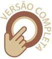

<!-- figure p120-fig2 | described_by: agy | ocr_overlap: None | needs_review: false -->
1. **Tipo de figura:** Ícone gráfico / selo interativo (indicador visual de clique ou toque para acesso a conteúdo completo).

2. **Texto visível (literal):**
   - `VERSÃO COMPLETA` (em letras maiúsculas, disposto em arco ao longo da borda externa superior e direita do ícone).

3. **Estrutura:**
   - A figura é composta por um único elemento gráfico sem caixas, tabelas, eixos ou painéis.
   - No centro, há dois anéis concêntricos que formam um alvo circular com interior vazio/branco: um anel externo mais espesso e um anel interno mais fino encostado à sua borda interior.
   - No canto inferior esquerdo, sobreposta à borda inferior esquerda dos anéis, há uma ilustração estilizada de uma mão com o dedo indicador estendido apontando diagonalmente para cima e para a direita, em direção ao centro do círculo (gesto de clicar ou tocar), com o polegar voltado para cima e os demais dedos recolhidos.
   - O texto `VERSÃO COMPLETA` contorna a parte externa do anel maior no sentido horário, começando aproximadamente na posição das 10 horas, passando pelo topo e descendo pelo lado direito até aproximadamente a posição das 5 horas.

4. **Números ou valores de dados:**
   - Nenhum.

5. **Cores com significado:**
   - As cores (tons de marrom e bege/areia sobre fundo branco/transparente) não codificam dados nem categorias; têm apenas função visual e de contraste para delimitar o contorno dos anéis, o texto e a mão indicadora de clique.

<!-- Start of picture text -->
VERSÃOCO M P L E T A <!-- End of picture text -->

**119** 

<!-- page 121 -->

**7** 

**Planejamento Estratégico Institucional** 

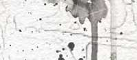

<!-- figure p121-fig1 | described_by: agy | ocr_overlap: None | needs_review: false -->
1. **Type of figure:** A monochrome (grayscale) abstract ink-and-watercolor wash texture with scattered splatters, appearing to be a decorative background strip or cropped artistic/paper texture fragment rather than a data visualization, diagram, or photograph.

2. **Visible text:** None. There are no titles, labels, legends, captions, axis ticks, or text of any kind.

3. **Structure:** There are no boxes, arrows, axes, grids, rows, columns, or panels. Visually, the rectangular horizontal image consists of:
   - A light, off-white textured background resembling rough paper, crossed by faint, irregular light-gray wavy lines and horizontal/vertical creases.
   - An irregular medium-gray organic wash blotch near the top right-of-center with scalloped, downward-hanging lobes and faint thin pale diagonal/crisscrossing scratches across it.
   - A straight, narrow vertical medium-gray drip or band descending from the bottom of that wash blotch all the way to the bottom edge of the image.
   - A parallel, softer light-gray vertical band immediately to the right of the vertical drip, running from top to bottom.
   - Numerous dark charcoal/black ink speckles and splatters scattered primarily across the left and lower-center areas, including one prominently larger circular dark drop below the center and a small cluster of dark spots touching the bottom-center edge.

4. **Numbers or data values:** None.

5. **Colours carrying meaning:** None; the image is purely grayscale (off-white, light gray, medium gray, and black/dark charcoal) with no colour-coded data or semantic distinctions.

**120** 

<!-- page 122 -->

<!-- figure p122-fig1 | described_by: agy | ocr_overlap: None | needs_review: false -->
1. **Tipo de figura:** Ícone/selo gráfico circular (emblema de botão ou chamada visual para acesso/clique).

2. **Texto visível (literal):**
   - `VERSÃO COMPLETA` (em letras maiúsculas sem serifa, disposto em arco ao longo da borda externa, indo aproximadamente da posição de 10 horas até 5 horas no sentido horário). Não há outros títulos, legendas, rótulos, eixos ou células.

3. **Estrutura:**
   - A figura é composta por um único painel sem caixas, setas, eixos, linhas ou colunas.
   - Ao centro há dois anéis concêntricos colados entre si (um anel externo mais espesso e um anel interno mais fino), circundando um miolo circular vazio.
   - Sobreposta à parte inferior esquerda dos anéis, há uma ilustração estilizada de uma mão humana (semelhante a um cursor de clique) com o polegar erguido à esquerda, três dedos dobrados e o dedo indicador estendido na diagonal para cima e para a direita, apontando diretamente para o centro vazio dos anéis.
   - O texto `VERSÃO COMPLETA` acompanha externamente a curvatura do anel externo na metade superior e direita.

4. **Números e valores de dados:** Nenhum.

5. **Cores com significado:** Nenhuma cor carrega significado semântico ou de dados; a paleta em dois tons (marrom e bege/dourado claro sobre fundo vazio) é apenas estilística e de contraste entre o contorno, o preenchimento, os anéis e o texto.

<!-- Start of picture text -->
VERSÃOCO M P L E T A <!-- End of picture text -->

## **Planejamento Estratégico Institucional** 

A Universidade Federal Rural de Pernambuco tem se destacado na institucionalização de práticas de planejamento que aprimoram seu modelo de gestão. O planejamento estratégico da UFRPE é materializado no seu PDI, que, como documento estratégico, é mais abrangente em termos de amplitude e alcance, englobando as áreas de atuação da universidade: ensino, pesquisa, extensão, gestão e inovação. O PDI, como documento que direciona a ação universitária, apresenta como funciona a instituição e como pode funcionar, a fim de atuar na solução de desafios que se apresentam a todo momento. Como norte, o planejamento estratégico indica onde se quer chegar e que resultados alcançar, ao mesmo tempo em que indica o caminho que deve ser trilhado. O Plano de Desenvolvimento Institucional traz e apresenta à sociedade diversos elementos de planejamento estratégico que direcionam a sua atuação e a conduzem a universidade para resultados efetivos e mudanças positivas. Esses elementos são, além de outros: missão, visão e valores organizacionais, forças, fraquezas, oportunidades, ameaças, objetivos, planos e estratégias. 

##### **Identidade organizacional** 

A identidade organizacional representa um conjunto de elementos que visa a caracterizar e individualizar uma organização ou instituição. De modo geral, a identidade de uma organização é composta pelo conjunto de declarações de missão, visão e valores organizacionais. Essas declarações, em conjunto, apresentam para a sociedade e para os _stakeholders__2_ _,_ que interagem com a organização, aspectos de cultura organizacional que orientam como a instituição se comporta e atua, que tipo de produto ou serviço presta à sociedade. 

Estabelecer a identidade de uma organização deve ser a base e o ponto de partida para qualquer processo de planejamento estratégico, visto estabelecer as bases de atuação da organização. No caso das IFES, é fundamental definir uma identidade que represente a realidade plural da instituição e que demonstre as formas pelas quais a entidade presta o serviço público de educação para a sociedade. A seguir, apresentar-se-ão as declarações de missão, visão e valores organizacionais coletivamente discutidos no contexto da UFRPE. 

> _2 . Stakeholder significa Partes Interessadas, isto é, todos aqueles indivíduos e instituições que interagem e detém interesse e podem ser afetadas, positiva ou negativamente, pelas ações e projetos desempenhados pela organização._ 

**121** 

<!-- page 123 -->

###### Figura 7 – **_Stakeholders_** 

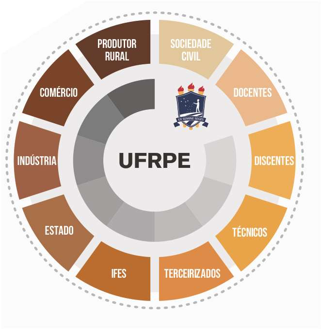

<!-- figure p123-fig1 | described_by: agy | ocr_overlap: None | needs_review: false -->
**(1) Tipo de figura**
Diagrama radial circular (infográfico em anéis concêntricos) que representa a UFRPE no centro rodeada por dez segmentos correspondentes a diferentes públicos/partes interessadas (comunidade acadêmica, instituições e setores da sociedade). Não há título, legenda ou fonte visíveis na imagem.

**(2) Todo o texto visível (transcrição literal)**
- No círculo central: `UFRPE`
- Na faixa do brasão no quadrante superior direito do anel interno: `EX SEMINE SEGES`
- Nos dez setores do anel externo, em sentido horário a partir do topo à direita (posição equivalente a 12h):
  1. `SOCIEDADE CIVIL` (em duas linhas: `SOCIEDADE` / `CIVIL`)
  2. `DOCENTES`
  3. `DISCENTES`
  4. `TÉCNICOS`
  5. `TERCEIRIZADOS`
  6. `IFES`
  7. `ESTADO`
  8. `INDÚSTRIA`
  9. `COMÉRCIO`
  10. `PRODUTOR RURAL` (em duas linhas: `PRODUTOR` / `RURAL`)

**(3) Estrutura**
A figura é composta por um único painel circular concêntrico, sem setas, eixos, linhas de conexão, tabelas ou subpainéis, organizado do exterior para o interior da seguinte forma:
- **Contorno externo:** um círculo tracejado/pontilhado cinza que envolve toda a composição.
- **Anel externo (10 setores iguais):** formado por dez blocos em formato de setor de anel circular, separados entre si por estreitos espaçamentos radiais claros sobre um fundo circular cinza-claro contínuo. Cada setor contém um dos dez rótulos listados acima, em letras maiúsculas brancas centralizadas.
- **Anel interno (8 setores sombreados + brasão):** concêntrico ao anel externo e alinhado radialmente às mesmas dez divisões angulares. Oito posições são preenchidas por blocos contíguos em arco (sem espaço entre eles), correspondendo, no sentido horário, aos setores `DISCENTES`, `TÉCNICOS`, `TERCEIRIZADOS`, `IFES`, `ESTADO`, `INDÚSTRIA`, `COMÉRCIO` e `PRODUTOR RURAL`. As duas posições restantes no quadrante superior direito — alinhadas a `SOCIEDADE CIVIL` e `DOCENTES` — são deixadas abertas, e nesse espaço está inserido o brasão da UFRPE (um escudo contendo a silhueta de um semeador espalhando sementes/estrelas sobre sulcos, encimado por três tochas acesas e atravessado na parte inferior por uma faixa com o lema `EX SEMINE SEGES`).
- **Núcleo central:** círculo cinza-claro no centro do diagrama contendo exclusivamente a sigla `UFRPE` em destaque.

**(4) Números ou valores de dados**
Não há nenhum número, percentual, escala ou dado quantitativo exibido na figura. (Em termos estritamente estruturais, a figura divide-se em 10 categorias no anel externo e 8 segmentos sombreados no anel interno.)

**(5) Cores com significado**
Não há legenda de cores, mas a figura utiliza dois gradientes graduais e paralelos no sentido horário que diferenciam os setores adjacentes e sugerem uma progressão visual contínua (aproximando visualmente os públicos mais internos à direita/baixo-direita dos setores externos/produtivos à esquerda/topo-esquerda):
- **Anel externo:** progride no sentido horário de tons claros e quentes para tons escuros — bege-claro (`SOCIEDADE CIVIL`), pêssego (`DOCENTES`), amarelo-ocre/dourado (`DISCENTES` e `TÉCNICOS`), laranja-acastanhado (`TERCEIRIZADOS`), caramelo/marrom-alaranjado (`IFES`), marrom-médio (`ESTADO` e `INDÚSTRIA`) até marrom-escuro (`COMÉRCIO` e `PRODUTOR RURAL`).
- **Anel interno:** acompanha a mesma progressão em escala de cinza no sentido horário, do cinza mais claro (alinhado a `DISCENTES`) escurecendo gradualmente a cada setor até o cinza mais escuro (alinhado a `PRODUTOR RURAL`).
- **Brasão da UFRPE:** utiliza suas cores institucionais (escudo e faixa em azul-marinho, detalhes e texto em branco, chamas vermelhas e hastes das tochas em amarelo-alaranjado).

~~~text ocr
o
o
e
= a
as
am
a.
~~~

<!-- Start of picture text -->
rs PRODUTOR SOCIEDADE RURAL CIVIL COMÉRCIO DOCENTES INDÚSTRIA DIsCENTES UFRPE ESTADO TÉCNICOS IFES TERCEIRIZADOS <!-- End of picture text -->

##### **Missão** 

A declaração de missão organizacional deve indicar, de forma precisa e sucinta, a razão de ser da organização, isto é, de que forma atua e que tipo de serviço se propõe a prestar. Essa declaração, geralmente, possui atemporalidade, de modo que tenta transmitir estabilidade institucional para a organização, vigendo por anos ou décadas. No caso da UFRPE, instituição 

de ensino superior inserida em um ambiente dinâmico, a declaração de missão organizacional passou por processo de revisão e modernização, a fim de melhor refletir a realidade da universidade. 

Assim, a UFRPE tem como missão organizacional: “Semear conhecimento, inovação e inclusão, por meio de atividades 

**122** 

<!-- page 124 -->

de ensino, pesquisa, extensão e gestão, atenta à complexidade, pluralidade e diversidade dos anseios da sociedade”. Esse enunciado apresenta sucintamente qual a razão de existência da UFRPE, para que e por que ela existe, bem como a forma como atua em relação à sociedade. Nessa esteira, novos elementos foram agregados a essa construção, como o termo _semear_ , na medida em que está consoante com o lema institucional _ex semine seges_ , significando “como semeares colherás”, e que traduz, com fidedignidade, a intenção de tratar o conhecimento científico como semente capaz de gerar produtos frutíferos para a sociedade. Além da inovação, elemento perseguido e incentivado pela universidade, adiciona-se a questão da inclusão, importante valor reconhecido pela UFRPE. Fundamental descrever, na declaração de missão, o tripé da atuação universitária, ou seja, o ensino, a pesquisa e a extensão, que, em conjunto com a gestão e a inovação, devem cooperar para a consecução dos fins e atingimento dos objetivos da organização. Por fim, reconhece-se a importância de atuar com atenção aos anseios sociais em um contexto complexo de pluralidade e rica diversidade. 

##### **Visão** 

A visão organizacional, por sua vez, indica uma declaração de intenções para o futuro da organização. Esse elemento de planejamento, tal qual a missão, deve ser apresentado de forma sucinta, clara e objetiva, indicando qual a condição futura almejada pela Instituição. A visão, porém, de modo diferente à missão, possui temporalidade bem definida, visto que 

representa um resultado a ser alcançado em um limite temporal. Isso ocorre pois, ao longo do tempo, a instituição age para alcançar tal situação e, à medida que o resultado é atingido, a declaração de visão precisa passar por processo de revisão. A UFRPE, revisando seu planejamento estratégico no contexto do PDI, apresenta, para a comunidade universitária e sociedade, a sua visão organizacional para 2030, a saber: **“** Destacarse, nacional e internacionalmente, pelo protagonismo e pela responsabilidade no enfrentamento dos desafios e diante das transformações da universidade pública”. 

A UFRPE sempre esteve na vanguarda ao assumir desafios e responsabilidades propostos pela sociedade em um contexto dinâmico. Nesse sentido, a declaração de visão da UFRPE deixa claro o compromisso da instituição em lidar com desafios que se impõem para as IFES, como a capacidade de garantir inclusão e transformação social, bem como assumir o protagonismo na produção e semeadura de ciência. A UFRPE, portanto, direciona seus esforços e recursos para atuar com protagonismo frente aos obstáculos imperativos à universidade pública. 

##### **Valores** 

Os valores organizacionais _–_ conjunto de princípios norteadores de conduta _–_ completam a definição da identidade organizacional da UFRPE. Trata-se dos pilares de orientação sobre como é esperado que se comportem os indivíduos e organizações que interagem internamente no contexto da instituição. Esse elemento de identidade reforça o caráter de 

**123** 

<!-- page 125 -->

alinhamento entre as pessoas que fazem a UFRPE, de modo a compartilhar, cultivar e incentivar comportamentos na busca pela consecução dos objetivos institucionais e prestação de serviços à sociedade. Nesse momento, apresentam-se valores que não estão limitados a características já presentes no contexto da universidade, mas também aqueles que precisam ser desenvolvidos com maior intensidade e amplitude. São valores organizacionais da UFRPE: “Autonomia, integridade, diálogo, transparência, inovação, inclusão, respeito à diversidade e aos saberes populares, equidade, ética e sustentabilidade”. Esses valores não significam as únicas formas de comportamento almejadas pela UFRPE e seus membros, mas direcionam e possibilitam a riqueza dialógica e a pluralidade de ideias na condição de universidade pública. Os valores, assim, funcionam como norte e orientação. 

fim de mapear as condições ambientais e operacionais, de modo que, em conjunto com a análise da própria evolução da organização, sirva de base para o estabelecimento de objetivos estratégicos e que as metas reflitam as reais capacidades da instituição. Para a análise do ambiente da UFRPE, foram utilizadas as seguintes metodologias: 

A metodologia de _Análise PESTEL__4_ permitiu investigar o ambiente externo à UFRPE, a partir de tendências nas perspectivas: política, econômica, social, tecnológica, ambiental/ ecológica e jurídica/legal. Essa metodologia foi utilizada de forma integrada com a _Análise SWOT_ , de modo que os elementos do ambiente externo foram também identificados como oportunidades ou ameaças para a atuação da Universidade. 

##### **Análise ambiental** 

A UFRPE está envolta em um ambiente complexo e em constante mudança. É a partir do ambiente que as organizações conseguem seus meios de sobrevivência e é para o ambiente que as organizações atuam. Dessa forma, no planejamento estratégico, a análise do ambiente proporciona diagnóstico do _macroambiente e do microambiente__3_ da organização, a 

A análise _SWOT_ , também conhecida como FOFA, cuja sigla contempla Forças ( _Strengths_ ), Fraquezas ( _Weaknesses_ ), Oportunidades ( _Opportunities_ ) e Ameaças ( _Threats_ ), trata-se de ferramenta de diagnóstico organizacional para análise do ambiente, permitindo visão da entidade tanto do seu aspecto interno quanto externo. Essa ferramenta é conhecida como uma das mais acessíveis na gestão de organizações, 

> _3 . O Microambiente é composto por fatores próximos à organização. Dentro do conceito de microambiente, há a divisão entre microambiente interno, composto de variáveis internas controláveis e que afetam diretamente a organização e microambiente externo, formado por variáveis não controláveis pela organização, a exemplo de concorrentes e fornecedores. O macroambiente é a camada mais externa. Consiste no conjunto de fatores do ambiente externo que, não são controláveis pela organização mas que influenciam no microambiente empresarial. Importante destacar que o fato de serem fatores não controláveis não significa que não devem ser monitorados_ 

> _4 . PESTEL é o acrônimo de Political, Economic, Social, Technological, Environmental and Legal (Político, Econômico, Social, Tecnológico, Ambiental e Jurídico). A política ressalta o papel dos governos, a economia indica fatores macroeconômicos, as influências sociais incluem mudanças culturais e demográficas, as influências tecnológicas se referem a inovações, o meio ambiente diz respeito especialmente a questões “ecológicas” e, a legislação abrange impedimentos ou mudanças legislativas. (JOHNSON, SCHOLES, WHITTINGTON, 2011)_ 

**124** 

<!-- page 126 -->

visto que apresenta facilidade no uso, possibilita análise apurada e pode ser aplicada em diversos âmbitos. 

A análise interna refere-se ao que chamamos de forças e fraquezas, ou seja, elementos, em geral, internos e com os quais a organização possui maior possibilidade de interferência e gerência. Dessa forma, para entender o que é força para uma organização é preciso saber quais aspectos são tidos como destaques em termos de políticas, estratégias e ações que produzem resultados positivos. Do modo oposto, as fraquezas são resultados ou características negativas observados a partir de deficiências encontradas nessas mesmas estruturas observadas na instituição e que, por ação da gestão, podem até se tornar forças no futuro. 

No entanto, a análise organizacional não pode se resumir ao ambiente interno, posto que os acontecimentos além da universidade possuem fatores que vão impactar o seu desempenho. Trata-se aqui da análise do ambiente externo, visto que diversos elementos, independentes se favoráveis 

ou desfavoráveis, são oferecidos à organização. Esses fatores, quando têm o potencial de impactar positivamente para a gestão universitária, podem ser considerados como oportunidades, enquanto os que impactam negativamente podem ser considerados como ameaças. 

Na análise do ambiente interno, proposta pela SWOT, foram identificados os pontos de força e os pontos a serem aprimorados pela UFRPE. Nesse contexto, levaram-se em consideração as perspectivas do ensino, da pesquisa, da extensão, da gestão universitária e da inovação. Procurou-se, nessa análise ambiental, ir além do levantamento dos aspectos positivos e negativos, realizando o cruzamento dos elementos considerados estratégicos nos eixos de forças, fraquezas, oportunidades e ameaças, em busca de tendências positivas, negativas e de neutralização. 

A partir da análise ambiental do PDI 2013 _–_ 2020, e das análises integradas das metodologias relatadas anteriormente, construiu-se coletivamente o seguinte quadro: 

**125** 

<!-- page 127 -->

**Insuficiência na Gestão por Competências Insuficiência de capacitação pedagógica contínua Fragilidade na gestão de resíduos sólidos Reduzida visibilidade internacional Políticas de incentivo ao acolhimento e à diversidade Alocação e mudança de rubricas na compra de materiais permanentes e de custeio (rigidez na gestão orçamentária) Ampliação e institucionalização da defesa dos Direitos Humanos Gestão da informação fragmentada e morosidade nos processos Bons níveis de Governança e Gestão Organizacional, acima da média  nacional (índice TCU) Necessidade de integração de sistemas com excesso de formulários repetitivos Subutilização de sistemas que auxiliem na gestão das Capital intelectual em áreas e grupos de pesquisa diversos pesquisas e sua publicização para a sociedade Pioneirismo na criação das Unidades Acadêmicas Oferta insuficiente de cursos de graduação noturnos Cursos de graduação bem avaliados pelo MEC Disponibilidade e acesso a recursos para programas de mestrado e doutorado profissionais Diversidade dos cursos de graduação e pós-graduação Comunicação da Sede com as Unidades Acadêmicas Engajamento e articulação de ações e projetos com a sociedade civil Insuficiência na criação de projetos interdisciplinares Valorização da cultura do empreendedorismo e inovação Inexperiência em projetos de extensão não-presenciais Fortalecimento das linhas de atuação dos projetos de extensão Dimensionamento de pessoal e escassez de quadros técnicos em áreas específicas de gestão Elevado índice de produção científica nacional Sobrecarga de funções administrativas e acadêmicas para o(a) Priorização de políticas voltadas à assistência estudantil docente-gestor(a) (coordenação e direção departamental) Quadro de servidores docentes e técnicos qualificado Insuficiência na digitalização de processos institucionais Políticas voltadas à inclusão social Serviços e estrutura para assistência médica (prontidão e emergência) da comunidade Tradição e credibilidade na prestação de serviços educacionais Estrutura insuficiente de apoio à adoção e uso das tecnologias digitais Valorização do planejamento estratégico Centralização excessiva na gestão (procedimentos internos administrativos)** 

###### Figura 8 – **SWOT** 

<!-- figure p127-fig1 | described_by: agy | ocr_overlap: None | needs_review: false -->
1. **Type of figure:** A very small (32 × 28 px), low-resolution decorative graphic or cropped icon fragment on a plain white background, depicting an upward-pointing triangular spike or pointer emerging from the top of a gently curved arc.

2. **Visible text:** None. There are no titles, labels, legends, captions, axis ticks, or cell values in the image.

3. **Structure:** A single symmetrical upward-pointing isosceles triangle centered horizontally in the frame, with its base meeting a horizontal, slightly arched band along the bottom edge of the image. Directly beneath the center of the arch along the very bottom edge, a small white area is partially visible, suggesting the shape is the upper rim and pointer of a circular or curved ring/callout element cropped from a larger graphic. There are no boxes, arrows, axes, rows, columns, or multiple panels.

4. **Numbers or data values:** None.

5. **Colours:** The triangular pointer and curved base are filled in a muted warm tan / light brown gradient (slightly darker along the left lower slope and lighter toward the apex and right side) against a white background; no colour-coded meaning is present.

**FORÇAS FRAQUEZAS OPORTUNIDADES** **AMEAÇAS** 

<!-- figure p127-fig2 | described_by: agy | ocr_overlap: None | needs_review: false -->
1. **Type of figure:** A small, low-resolution (32 × 28 px) decorative graphic or icon—specifically a downward-pointing triangular pointer, arrow, or callout tail—extracted from a PDF, rather than a data chart, diagram, or table.

2. **Visible text:** None. There are no titles, labels, legends, captions, axis ticks, or cell values in the image.

3. **Structure:** Set against a plain white background, a narrow, gently curved horizontal band runs across the entire top edge of the image. Centered directly beneath and joined to the underside of this band is a single inverted (downward-pointing) isosceles triangle whose apex points straight down toward the bottom center, ending just above the lower edge. There are no boxes, connecting lines, axes, rows, columns, or multiple panels.

4. **Numbers or data values:** None.

5. **Colours:** The graphic uses a warm brown-to-tan gradient (darker reddish-brown at the top band fading to lighter tan toward the lower tip) over a white background; the colouring is purely visual/decorative and carries no data meaning.

**Adoção de metas dos ODS como norteadoras da transformação Disposição e esforços favoráveis à articulação internacional do ensino e pesquisa Ampliação de parcerias públicas e privadas para acesso a recursos adicionais Demanda crescente por qualificação para inovação** 

**Articulação regional de universidades públicas Aproximação entre universidade e organizações da sociedade civil Marcos regulatórios de transparência e disponibilidade de dados (autoconhecimento, formação de parcerias etc.) Expansão e reformulação da base nacional curricular Receptividade e viabilidade de** **_campus_ inteligente (** **_smart campus_ ) Mobilização parlamentar para ampliação e acesso a recursos orçamentários Possibilidade de captação de recursos nacionais e internacionais Desenvolvimento de tecnologias sociais Acesso, receptividade e atualização das tecnologias para atuação universitária em regime híbrido** 

**Escassez de recursos orçamentários destinados à educação superior Instabilidade e escassez de recursos para execução de políticas públicas socioambientais** 

**Aumento da demanda por assistência médica (prontidão e emergência) pela comunidade Fatores de evasão de cursos de graduação presenciais Hiperconcorrência de ensino** **_on-line_ Propostas de reestruturação na carreira de docentes e de técnico(a)s-administrativo(a)s** 

**Marcos regulatórios que impactam na limitação de investimentos, contratações, custeio e ampliação de infraestrutura Contradição entre crescente pressão para expansão e as restrições impostas por aportes orçamentários Incertezas referentes aos impactos socioeconômicos pós-pandemia Aumento da vulnerabilidade socioeconômica e emocional do corpo discente Fatores externos que influenciam na Taxa de Sucesso da Graduação (TSG)** 

<!-- page 128 -->

Essa matriz apresenta elementos potencializadores e limitadores da atuação universitária, assim como evidencia suas características mais relevantes na prestação da educação superior. Destacam-se como forças características de excelência do seu corpo de servidore(a)s, refletindo na qualidade com que a UFRPE atua nos eixos de ensino, pesquisa, extensão, gestão e inovação. Além disso, a universidade atinge níveis de governança organizacional superiores à média nacional em relação às IFES e a outros órgãos públicos. O planejamento estratégico, nesse sentido, contribuiu para o alcance de resultados em todas as áreas de atuação. Ainda como força, é importante destacar a coragem e o pioneirismo da UFRPE ao interiorizar sua atuação no estado de Pernambuco, assumindo diversos desafios e oportunidades regionais como a implantação do polo de engenharias centrado na UACSA, ainda na Região Metropolitana do Recife, mas também atuando no Sertão, com a UAST, e no Agreste, com a UABJ, bem como nos polos EAD da UAEADTec, localizados em diferentes municípios. 

Analisando-se os elementos apresentados como fraquezas, mas entendidos como pontos de melhoria, visto que não são estanques e podem ser transformados, a SWOT apresenta, como desafios a necessidade aprimorar continuamente os processos de gestão e comunicação entre Sede e unidades acadêmicas, além de garantir maior equilíbrio a distribuição de profissionais como resultado de 

um processo de dimensionamento e redimensionamento. Além disso, é necessário atuar permanentemente na busca por melhores e mais amplas soluções digitais para otimizar a tramitação de processos organizacionais e garantir maior fluidez na atividade administrativa. 

Quanto à avaliação do ambiente externo, a UFRPE está contida em contexto complexo em que se apresentam oportunidades de atuação, porém limitada por restrições, cortes e contingenciamentos de recursos para a universidade. O contexto de pandemia de Covid-19 também surge como entrave, visto que acentua vulnerabilidades socioeconômicas brasileiras e regionais, com potencial de prejudicar o alcance de resultados. 

##### **Mapa estratégico** 

O Mapa Estratégico indica a representação gráfica da estratégia organizacional. É, além disso, elemento que primeiro surgiu com a metodologia do _Balanced Scorecard_ (BSC). Essa metodologia foi desenvolvida, em 1992, por Robert Kaplan e David Norton (KAPLAN; NORTON, 1992), professores e consultores atuantes na _Harvard Business School_ , trazendo organização gráfica em eixos/perspectivas estratégicas, nas quais as organizações estabelecerão objetivos estratégicos em um lógica de encadeamento e em áreas mais amplas que apenas a financeira. Dessa forma, os autores apresentaram avanço na teoria e prática de planejamento estratégico ao sistematizarem planejamentos em processos, gestão, 

**127** 

<!-- page 129 -->

###### Figura 9 – **Mapa estratégico** da UFRPE | 2021 – 2030 

**Missão** “Semear conhecimento, inovação e inclusão, por meio de atividades de ensino, pesquisa, extensão e gestão, atenta à complexidade, pluralidade e diversidade dos anseios da sociedade **Sociedade** 

<!-- figure p129-fig2 | described_by: agy | ocr_overlap: None | needs_review: false -->
1. **Type of figure:** A minimalist circular icon (pictogram/emblem) depicting a stylized human eye.

2. **Visible text:** None. There are no titles, labels, legends, captions, axis ticks, or other text anywhere in the image.

3. **Structure:**
   - **Outer frame:** Two concentric circular rings—a dark brown outer border immediately surrounding a slightly thicker orange/amber inner ring—enclosing a solid white circular interior.
   - **Central symbol:** Centered horizontally and vertically inside the white circle is a stylized eye formed from three dark brown shapes:
     - Two symmetrical, pointed curved shapes on the left and right forming the outer corners of an almond-shaped eye, separated from the center by a white ring.
     - A solid circular pupil/iris in the middle with a smaller circular white notch (specular highlight) cut into its upper-left edge.
   - There are no boxes, arrows, axes, rows, columns, or sub-panels.

4. **Numbers and data values:** None.

5. **Meaningful colours:** Colours are used purely for visual contrast and iconographic styling rather than data encoding: dark brown for the outer ring and eye silhouette, warm orange/amber for the inner ring, and white for the circular background, iris outline, and eye highlight.

###### **~~Objetivos Estratégicos~~** 

**Visão** “Destacar-se, nacional e internacionalmente, pelo protagonismo e pela responsabilidade no enfrentamento dos desafios e diante das transformações da universidade pública” 

<!-- figure p129-fig3 | described_by: agy | ocr_overlap: 1.0 | needs_review: false -->
1. **Tipo de figura:** Elemento gráfico horizontal de item de lista numerado (cabeçalho ou rótulo de objetivo/diretriz numerado).

2. **Texto visível (literal):**
   - `11`
   - `Efetivar a logística sustentável.`

3. **Estrutura:** A imagem consiste em uma única faixa retangular horizontal sem bordas visíveis, contendo dois elementos alinhados em uma só linha da esquerda para a direita: à esquerda, um círculo sólido que abriga o número `11` centralizado; imediatamente à direita do círculo, o texto `Efetivar a logística sustentável.`. Não há setas, conexões, eixos, linhas, colunas ou outros painéis.

4. **Números e valores de dados:**
   - `11` (identificador numérico do item).

5. **Cores com significado:** O marcador circular marrom-avermelhado com o número em branco destaca o índice numérico do item em contraste com o fundo bege-claro da faixa e o texto em cinza-escuro; o par de tons terrosos (marrom-avermelhado e bege) funciona como codificação visual para destacar e possivelmente categorizar o item dentro do documento original (sem legenda de cores presente na imagem).

~~~text ocr
@ Efetivar a logística sustentável.
~~~

- **01** Elevar a qualidade da formação orientada para o **04** Desenvolver a produção científica e a inovação **06** Fortalecer a extensão como relação dialógica, enfrentamento dos desafios complexos, plurais de alto impacto. transformadora e integradora entre a universie diversos da sociedade contemporânea. dade e a sociedade. **05** Envolver membros de comunidades externas 

- **02** Mitigar riscos específicos de retenção e evasão (locais, regionais e internacionais) na priorização **07** Aperfeiçoar a política de assistência estudantil em cada curso. de demandas contextualizadas para a produção considerando as atuais demandas sociais (de científica e inovação. saúde, digitais, habitacionais e alimentares). 

- **02** Mitigar riscos específicos de retenção e evasão em cada curso. 

- **03** Promover a adoção de metodologias inovadoras e inclusivas em favor do melhor uso de novas tecnologias para a formação. 

###### **Processos Internos** 

- **08** Promover e disseminar ações concretas para a melhoria da governança. 

- **09** Consolidar iniciativas de inovação organizacional. 

- **10** Aprimorar os fluxos de comunicação institucional. 

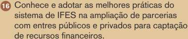

<!-- figure p129-fig4 | described_by: agy | ocr_overlap: 0.93 | needs_review: false -->
1. **Tipo de figura:** Bloco de texto correspondente a um item numerado de lista (sem gráficos, tabelas ou diagramas).

2. **Texto visível (verbatim):**
   - No marcador circular à esquerda: `16`
   - No texto principal (distribuído em quatro linhas):
     `Conhece e adotar as melhores práticas do`
     `sistema de IFES na ampliação de parcerias`
     `com entres públicos e privados para captação`
     `de recursos financeiros.`

3. **Estrutura:** A imagem consiste em um único bloco retangular sem caixas internas, setas, conectores, eixos, linhas de grade ou subdivisões em painéis. À esquerda, alinhado à altura da primeira linha, há um pequeno círculo contendo o número do item. À direita do círculo, encontra-se o parágrafo de texto alinhado à esquerda, disposto em quatro linhas.

4. **Números e valores de dados:** O único número presente é `16` (identificador ordinal do item). Não há outros números ou valores quantitativos.

5. **Cores com significado:** O número `16` é exibido em branco dentro de um círculo marrom-avermelhado para destacar visualmente o marcador do item em relação ao corpo do texto (em cinza-escuro/preto). Todo o bloco repousa sobre um fundo bege uniforme, característico de agrupamento temático ou categorização visual de itens no documento de origem.

~~~text ocr
© Conhece e adotar as melhores praticas do
sistema de IFES na ampliação de parcerias
com entres públicos e privados para captação
de recursos financeiros.
~~~

<!-- Start of picture text -->
11 Efetivar a logística sustentável. <!-- End of picture text -->

###### **Aprendizagem e Crescimento** 

###### **Orçamento** 

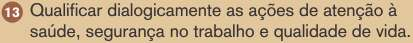

<!-- figure p129-fig5 | described_by: agy | ocr_overlap: 1.0 | needs_review: false -->
1. **Tipo de figura:** Item de lista numerado (bloco textual extraído de uma lista ou documento) composto por um marcador circular numerado e um texto em duas linhas sobre fundo retangular sólido.

2. **Texto visível (verbatim):**
   - Marcador circular à esquerda: `13`
   - Texto à direita:
     `Qualificar dialogicamente as ações de atenção à`
     `saúde, segurança no trabalho e qualidade de vida.`

3. **Estrutura:** Composição horizontal simples dentro de um único retângulo de fundo contínuo, sem setas, divisórias, eixos, colunas, linhas de tabela ou painéis adicionais. À esquerda, alinhado à primeira linha de texto, encontra-se um círculo sólido contendo o número do item; imediatamente à sua direita, alinhado à esquerda, está o enunciado em duas linhas.

4. **Números e valores de dados:** Apenas o número `13`, que atua como índice/numeração do item. Não há outros números ou dados quantitativos.

5. **Cores com significado:** O círculo em tom marrom-terracota com o número em branco contrasta com o fundo bege-claro e o texto em cinza-escuro para destacar visualmente o indicador numérico em relação ao texto do item; não há legenda ou indicação de outro valor semântico associado às cores.

~~~text ocr
(13) Qualificar dialogicamente as ações de atenção à
saúde, segurança no trabalho e qualidade de vida.
~~~

<!-- Start of picture text -->
16 Conhece e adotar as melhores práticas do sistema de IFES na ampliação de parcerias com entres públicos e privados para captação de recursos financeiros. <!-- End of picture text -->

- **12** Fortalecer o caráter estratégicos no desenvolvi- **14** Implementar a gestão integrada da infraestrutura mento do capital humano na  UFRPE. física da UFRPE. 

<!-- figure p129-fig6 | described_by: none | why: score 0.10 -->

<!-- Start of picture text -->
13 Qualificar dialogicamente as ações de atenção à saúde, segurança no trabalho e qualidade de vida. <!-- End of picture text -->

- **15** Assegurar e gerir os recursos tecnológicos de recursos financeiros. necessários para uma melhor eficiência das atividades da UFRPE. **17** Envolver todos os níveis de gestão nos esforços por eficiência e sustentabilidade. 

**Valores** 

Autonomia | Integridade | Diálogo | Transparência | Inovação | Inclusão Respeito à diversidade e aos saberes populares | Equidade | Ética | Sustentabilidade 

**128** 

<!-- page 130 -->

recursos, pessoal, comunicação, dentre outras, além das medidas de lucro, receita e custos. 

Essa metodologia aplica-se, com efetividade, no contexto de organizações públicas e universidades federais, na medida em que contribui para o estabelecimento de estratégia holística e permite às IFES planejar ensino, pesquisa, extensão, gestão e inovação de forma integrada. A UFRPE, nesse sentido, aplica o BSC em seu Mapa Estratégico, com seus quatro eixos estratégicos, abaixo explicitados. 

##### **Eixos estratégicos** 

A partir de processo participativo e reflexivo na UFRPE de análise estratégica, observou-se uma necessidade de arranjo institucional próprio composto pelos eixos: Sociedade, Processos Internos, Aprendizagem/Crescimento e Orçamento. Apesar da indicação de quatro eixos de trabalho, não significa que os eixos não estejam integrados e alinhados. Dessa forma, vamos entender como eles interagem e se encadeiam. Primeiro, é preciso compreender que a sociedade é o foco de todo o trabalho desenvolvido por uma universidade pública. Nesse sentido, todos os seus processos internos devem focar em atender ao primórdio de sua missão e devem estar voltados para o atendimento às demandas da sociedade a partir do objeto de negócio da universidade: ensino, pesquisa e extensão. 

Todos esses processos impactam em todos os segmentos envolvidos, de modo a criar uma aprendizagem bidirecional, seja para quem está no papel de semear o conhecimento como a terra fértil que lhes é absorvida. Contudo, salienta-se que todo o processo seja de execução da missão e exige uma estrutura que dê suporte às atividades seja em termos de recursos materiais, patrimoniais, tecnológicos e capital intelectual. Assim, além desses, o orçamento é onde se enxerga a origem de aplicação de recursos em instituições aos quais precisam ter transparência em sua gestão. 

##### **Objetivos estratégicos** 

Os objetivos estratégicos estão interligados aos objetivos específicos apresentados ao longo deste PDI em relação a diversas áreas de atuação da universidade. As declarações de objetivos expressam os resultados que a UFRPE almeja alcançar, sendo detalhados em metas ( anuais ou semestrais). As metas representam resultados esperados de forma mais específica, delimitados na temporalidade e em formato quantificado. No detalhamento dos objetivos específicos são apresentadas as principais ações estratégicas, ou seja, as iniciativas centrais que serão colocadas em prática, e demonstram como a UFRPE planeja alcançar os resultados almejados. A seguir apresentam-se os objetivos estratégicos da UFRPE: 

**129** 

<!-- page 131 -->

Objetivo estratégico 1. Elevar a qualidade da formação orientada para o enfrentamento 

|Objetivo estr dos di EIXO (Mapa estratégico) TEMA OBJETIVO |atégico 1.Elevar a qualid esafios complexos, plur SOCIEDADE FORMAÇÃO Elevar a qualidade da fo      i e diversos da sociedade |ade da formação orient ais e diversos da socied rmação orientada para o   i contemporânea. |ada para o enfrentamen ade contemporânea enfrentamento dos desai |o fios complexos, plurais   **M** **A** **I** **S**     **I** **N** **F** **O** **R** **M** **A** **Ç** **Õ** **E** **S**|
|---|---|---|---|---|
|INDICADOR(ES)|META 2021|META 2022|META 2023|META 2024|
|1 – Conceito Enade. 2 – CPC. 3 – Quantidade de PPG_Strictu Sensu_ consolidados (CAPES ≥ 5). 4 – Eficiência acadêmica de con- cluintes do ensino básico, técnico e tecnológico.|1. Ampliar em 5% a quan- tidade de cursos com conceito 5 2. Ampliar em 5% a quan- tidade de cursos com conceito 5|1. Ampliar em 5% a quan- tidade de cursos com conceito 5 2. Ampliar em 5% a quan- tidade de cursos com conceito 5 3. 14|1. Ampliar em 5% a quan- tidade de cursos com conceito 5 2. Ampliar em 5% a quan- tidade de cursos com conceito 5 3. 14|1. Ampliar em 5% a quan- tidade de cursos com conceito 5 2. Ampliar em 5% a quan- tidade de cursos com conceito 5 3. 14|
|UNIDADE(S)RESPONSÁVEL(IS)|3. 11|4. Manter índice acima de|4. Manter índice acima de|4. Manter índice acima de|
|PREG,PRPG,Codai||60%|65%|65%|

###### Objetivo estratégico 2. Mitigar riscos específicos de retenção e evasão em cada curso 

|EIXO(Mapa estratégico)|i SOCIEDADE|**M** **A** **I** **S**     **I** **N** **F** **O** **R** |
|---|---|---|
|TEMA|RETENÇÃO E EVASÃO|**M** **A** **Ç** |
|OBJETIVO   i|Mitigar riscos específicos de retenção e evasão em cada curso.|**Õ** **E** **S**|
|INDICADOR(ES)|META 2023|META 2025|
|1 – Índice de Evasão.|||
|2 – Índice de Retenção.|1.Reduzir em 2%;|1.Reduzir em 2%;|
|UNIDADE(S)RESPONSÁVEL(IS)|2.Reduzir em 2%|2.Reduzir em 2%|
|PREG,PRPG,Proplan|||

**130** 

<!-- page 132 -->

###### Objetivo estratégico 3. Promover a adoção de metodologias inovadoras e inclusivas 

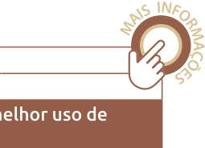

<!-- figure p132-fig1 | described_by: agy | ocr_overlap: None | needs_review: false -->
**1. Tipo de figura**
Recorte parcial (canto superior direito) de um elemento gráfico de diagrama/layout de documento (caixa informativa ou cabeçalho de quadro) contendo um ícone ilustrativo de clique/toque para chamada de "mais informações". A imagem está cortada nas bordas esquerda e inferior.

**2. Todo o texto visível (literal)**
- Em arco ao redor do ícone circular no canto superior direito: `MAIS INFORMAÇÕES`
- Na faixa retangular escura na parte inferior esquerda (texto cortado na margem esquerda da imagem, restando apenas parte de um caractere inicial `[ilegível]`): `[ilegível]elhor uso de`

**3. Estrutura**
- **Ícone superior direito:** Círculo formado por anéis concêntricos (anel externo mais largo, anel interno mais fino e centro circular vazio) posicionado exatamente sobre o canto superior direito da caixa. Sobreposto à parte inferior esquerda desse círculo, há o desenho de uma mão com o dedo indicador apontando para o centro do círculo (símbolo de clique ou toque). O texto `MAIS INFORMAÇÕES` acompanha a borda externa do círculo em arco, da parte superior esquerda até a parte inferior direita no sentido horário.
- **Caixa e faixas à esquerda/abaixo do ícone:**
  - Duas linhas horizontais paralelas partem do lado esquerdo do ícone/mão até a borda esquerda da imagem, delimitando uma faixa horizontal superior vazia (fundo branco).
  - Abaixo da segunda linha horizontal, há um espaço branco estreito delimitado à direita por uma linha vertical que desce a partir da base da mão até o canto inferior direito da caixa.
  - Na parte inferior, abaixo desse espaço branco e alinhado à mesma borda vertical direita, há um bloco retangular preenchido (cortado nas margens esquerda e inferior) que contém o texto `...elhor uso de`.
- Não há setas, conectores adicionais, eixos, linhas/colunas de dados completas ou outros painéis visíveis.

**4. Números e valores de dados**
Nenhum número ou valor de dado está presente na imagem.

**5. Cores com significado**
As cores atuam apenas na organização visual e destaque dos elementos gráficos: o marrom demarca a estrutura da caixa (bordas), o anel principal do ícone e o fundo do bloco inferior para dar contraste ao texto em branco; o bege/dourado claro destaca o anel interno do ícone e o rótulo curvo `MAIS INFORMAÇÕES`.

~~~text ocr
2
elhor uso de
~~~

<!-- Start of picture text -->
MAIS INFOR M A Ç Õ SE <!-- End of picture text -->

em favor do melhor uso de novas tecnologias para a formação 

|EIXO(Mapa estratégico)|SOCIEDADE|||||
|---|---|---|---|---|---|
|TEMA|FORMAÇÃO|||||
|OBJETIVO|Promover a adoçã novas tecnologias|o de metodologias para a formação.|inovadoras e inclus|ivas em favor do m|elhor uso de|
|INDICADOR(ES)|META 2021|META 2022|META 2023|META 2024|META 2025|
|1 – Número de oportunidades formativas promovidas pela UFRPE voltadas a ado- ção de metodologias inovadoras e novas tecnologias.||1. Ampliar em 5%|1. Ampliar em 5%|1. Ampliar em 5%|1. Ampliar em 5%|
|2 – Número de vagas ofertadas nas formações. 3 – Índice de curricularização de novas me- todologias pedagógicas (porcentagem dos PPC com referência direta a metodologias inovadoras e novas tecnologias).|1. Ampliar em 5% 2. Ampliar em 5%|2. Ampliar em 5% 3. 50% dos PPC com adoção de metodologias inovadoras|2. Ampliar em 5% 3. 60% dos PPC com adoção de metodologias inovadoras|2. Ampliar em 5% 3. 70% dos PPC com adoção de metodologias inovadoras|2. Ampliar em 5% 3. 80% dos PPC com adoção de metodologias inovadoras|
|UNIDADE(S)RESPONSÁVEL(IS)||||||
|Progepe,CCD’s dos Cursos,diretorias||||||

**131** 

<!-- page 133 -->

|Objetivo estratég EIXO(Mapa estratégico)|ico 4.Desenvolver SOCIEDADE|aprodução cientíi|fica e a inovação d|e alto impacto|**M** **A** **I** **S**     | **I** **N** **F** **O** **R** **M** **A** **Ç** **Õ** **E** **S**|
|---|---|---|---|---|---|---|
|TEMA OBJETIVO|PRODUÇÃO CIENTÍ Desenvolver apro i|FICA E INOVAÇÃO dução científica e|i  a inovação de alto|i      impacto.|||
|INDICADOR(ES)|META 2021|META 2022|META 2023|META 2024|META 2025||
|1 – Número de pedidos de patentes depositadas. 2 – Número de patentes vigentes. 3 – Número de proteções de conhecimen- to requeridas.|1.Ampliar em 2% 2.Ampliar em 1%|1.Ampliar em 5% 2.Ampliar em 2% 3.Ampliar em 2% |1.Ampliar em 10% 2.Ampliar em 5% 3.Ampliar em 1%|1.Ampliar em 10% 2.Ampliar em 5% 3.Ampliar em 2%|1.Ampliar em 10% 2.Ampliar em 5% 3.Ampliar em 2%||
|4 – Número de proteções de conhecimen- to transferidaspara empresas-sociedade. UNIDADE(S)RESPONSÁVEL(IS)|3.Ampliar em 2%|4.realizar 1 transferência de conhecimento|4.realizar 2 trans- ferências de conhecimento|4.realizar 2 trans- ferências de conhecimento|4.realizar 2 transferên- cias de conhecimento||
|PRPG,Ipê|||||||

Objetivo estratégico 5. Envolver membros de comunidades externas locais, regionais e internacionais na priorização de demandas contextualizadas por produção científica e inovação 

| EIXO(Mapa estratégico) TEMA OBJETIVO | SOCIEDADE PRODUÇÃO CIENTÍFICA Envolver membros de priorização de demand     i |i E INOVAÇÃO comunidades externas ( as contextualizadas pa   i |i locais, regionais e inter ra a produção científica |nacionais) na i e inovação.   **M** **A** **I** **S**   | **I** **N** **F** **O** **R** **M** **A** **Ç** **Õ** **E** **S**|
|---|---|---|---|---|---|
|INDICADOR(ES)|META 2022|META 2023|META 2024|META 2025||
|Participação de membros externos à UFRPE em comitês de planejamento (Porcentagem das comissões de planeja- mento estratégico em PPG que contam com membros externos).|1. 30% das comissões com membros externos|1. 40% das comissões com membros externos|1. 60% das comissões com membros externos|1. 80% das comissões com membros externos||
|UNIDADE(S)RESPONSÁVEL(IS)||||||
|Ipê,PRPG,PROExC||||||

**132** 

<!-- page 134 -->

###### Objetivo estratégico 6. Fortalecer a extensão como relação dialógica, transformadora 

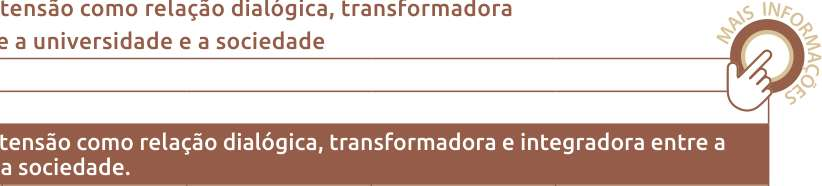

<!-- figure p134-fig1 | described_by: agy | ocr_overlap: 1.0 | needs_review: false -->
1. **Tipo de figura:** Trata-se de um recorte (fragmento cortado na margem esquerda e na base) da parte superior de uma tabela ou quadro informativo extraído de um documento em PDF, contendo cabeçalhos textuais e um ícone gráfico indicativo de link/ação ("MAIS INFORMAÇÕES") no canto superior direito.

2. **Todo o texto visível (literalmente):**
   - **Bloco superior (cortado na margem esquerda):**
     - Linha 1: `tensão como relação dialógica, transformadora`
     - Linha 2: `e a universidade e a sociedade`
   - **Ícone circular no canto superior direito (texto disposto em arco no sentido horário):**
     - `MAIS INFORMAÇÕES`
   - **Faixa retangular inferior (cortada na margem esquerda):**
     - Linha 1: `tensão como relação dialógica, transformadora e integradora entre a`
     - Linha 2: `a sociedade.`

3. **Estrutura:**
   - **Margens recortadas:** Toda a lateral esquerda do quadro está cortada, truncando o início de todas as linhas de texto. A borda inferior também está cortada imediatamente abaixo da faixa escura.
   - **Cabeçalho superior:** Ocupa a parte superior esquerda em duas linhas de texto sobre fundo branco, sem moldura ao redor.
   - **Ícone interativo (canto superior direito):** Consiste em um alvo circular formado por dois anéis concêntricos ao redor de um centro branco, contornado externamente pelo texto curvo `MAIS INFORMAÇÕES`. Sobreposto à parte inferior esquerda do círculo há o desenho de uma mão estilizada com o dedo indicador apontando para o centro do círculo. Esse ícone sobrepõe-se à extremidade superior direita das linhas da tabela.
   - **Linhas vazias intermediárias:** Abaixo do cabeçalho superior, a estrutura apresenta duas linhas horizontais retangulares vazias, delimitadas por traços horizontais finos (uma linha superior, uma divisória intermediária e o topo da faixa inferior) e fechadas à direita por uma borda vertical alinhada sob o ícone da mão.
   - **Faixa de subtítulo/seção inferior:** Logo abaixo das duas linhas vazias há uma faixa retangular horizontal preenchida de cor sólida, com a mesma largura do quadro (da borda esquerda cortada até a borda vertical direita), contendo as duas linhas de texto em branco.
   - **Início da grade inferior:** Na extremidade mais baixa da imagem, logo abaixo da faixa preenchida, aparece uma margem de poucos pixels mostrando o começo de linhas verticais divisórias de colunas (visíveis em três posições intermediárias além da borda direita), indicando a continuação de uma tabela com múltiplas colunas cujo conteúdo não está incluído no recorte.

4. **Números ou valores de dados:**
   - Não há nenhum número ou valor de dado visível na imagem.

5. **Cores com significado:**
   - **Marrom (castanho):** Define a identidade visual e a hierarquia estrutural — é usado no texto do título principal superior, nas linhas divisórias da tabela, no preenchimento de destaque da faixa inferior (diferenciando-a como barra de cabeçalho/seção) e no anel externo e contorno do ícone da mão.
   - **Branco:** Garante contraste de leitura para o texto sobre a faixa marrom de destaque, além de compor o fundo das linhas vazias, o centro do alvo e o preenchimento do ícone da mão.
   - **Bege/dourado claro:** Destaca o elemento de chamada à ação no anel interno do ícone circular e no texto em arco `MAIS INFORMAÇÕES`.

~~~text ocr
tensão como relação dialógica, transformadora
2 a universidade e a sociedade A
ensão como relação dialógica, transformadora e integradora entre a
a sociedade.
~~~

<!-- Start of picture text -->
Fortalecer a extensão como relação dialógica, transformadora radora entre a universidade e a sociedade Fortalecer a extensão como relação dialógica, transformadora e integradora entre a MAIS INFOR M A Ç Õ SE <!-- End of picture text -->

e integradora entre a universidade e a sociedade 

EIXO (Mapa estratégico) SOCIEDADE 

TEMA EXTENSÃO 

OBJETIVOFortalecer a extensão como relação dialógica, transformadora e integradora entre a universidade e a sociedade. 

|INDICADOR(ES)|META 2021|META 2022|META 2023|META 2024|META 2025|
|---|---|---|---|---|---|
|1 – Taxa de Inclusão de população vulnerável às ações extensionistas – TIVEx.||||||
|2 – Público (diretamente) beneficiado pelos pro- gramas-projetos – PBPP. 3 – Quantidade de avaliações realizadas so- bre efetividade e impactos dos programas estratégicos. UNIDADE(S)RESPONSÁVEL(IS)|1.30% 2.Ampliar em 10%|1.35% 2.Ampliar em 10% 3. Avaliar 10% dos programas|1.40% 2.Ampliar em 10% 3. Avaliar 20% dos programas|1.45% 2.Ampliar em 10% 3. Avaliar 30% dos programas|1.50% 2.Ampliar em 10% 3. Avaliar 40% dos programas|
|PROExC||||||

**133** 

<!-- page 135 -->

###### Objetivo estratégico 7. Aperfeiçoar a política de assistência estudantil considerando as 

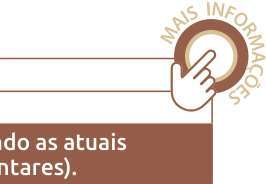

<!-- figure p135-fig1 | described_by: agy | ocr_overlap: None | needs_review: false -->
(1) **Tipo de figura:** Fragmento recortado de um elemento gráfico/caixa de destaque (callout ou botão informativo) extraído de um PDF, mostrando o canto superior direito de uma moldura retangular com um ícone ilustrativo de mão clicando/apontando para um botão circular.

(2) **Todo o texto visível (verbatim):**
- Ao redor do botão circular (em arco, sentido horário): `MAIS INFORMAÇÕES`
- Na faixa inferior da caixa (texto cortado na margem esquerda da imagem, em duas linhas):
  - Linha 1: `[illegible]do as atuais` *(há um fragmento mínimo de caractere cortado na borda esquerda antes de `do`)*
  - Linha 2: `ntares).` *(texto cortado na borda esquerda, com a borda esquerda da letra `n` tocando o limite da imagem)*

(3) **Estrutura:**
- **Moldura/faixas horizontais (à esquerda e abaixo):** Exibe a extremidade direita de uma caixa retangular cortada à esquerda, composta por três faixas horizontais empilhadas:
  - *Faixa superior:* retângulo vazio de fundo branco, delimitado por duas linhas horizontais finas (superior e inferior) que se estendem da margem esquerda até a lateral esquerda do ícone circular/da mão.
  - *Faixa intermediária:* retângulo vazio de fundo branco situado abaixo da faixa superior, fechado à direita por uma linha vertical que sobe até a base do ícone da mão.
  - *Faixa inferior:* retângulo preenchido de cor sólida, alinhado à mesma borda direita das faixas acima e cortado na borda esquerda, contendo as duas linhas de texto parcialmente visíveis.
- **Ícone de destaque (canto superior direito):** Sobreposto ao canto superior direito da caixa, consiste em:
  - Um botão/alvo formado por círculos concêntricos (anel externo mais espesso, anel intermediário fino e círculo central vazio).
  - O texto `MAIS INFORMAÇÕES` curvado ao longo do contorno externo do círculo, aproximadamente da posição de 10 horas até 5 horas.
  - O desenho em contorno de uma mão estilizada (polegar à esquerda, dedo indicador estendido e três dedos dobrados à direita) apontando diagonalmente para cima e para a direita, com a ponta do indicador no centro do círculo.
- Não há setas, conectores entre nós, eixos, linhas/colunas de tabela ou múltiplos painéis.

(4) **Números ou valores de dados:** Nenhum número ou valor de dado está presente na imagem.

(5) **Cores com significado:** As cores não codificam dados nem legenda; exercem apenas função visual de hierarquia e contraste — o preenchimento marrom na faixa inferior diferencia o bloco de texto (em branco) das faixas vazias acima (em branco com linhas marrons), e os tons de marrom e bege no botão circular e no texto em arco destacam o ícone de chamada para informações adicionais.

~~~text ocr
do as atuais
tares).
~~~

<!-- Start of picture text -->
). MAIS INFOR M A Ç Õ SE <!-- End of picture text -->

###### atuais demandas sociais (de saúde, digitais, habitacionais e alimentares) 

|EIXO(Mapa estratégico)|SOCIEDADE||||
|---|---|---|---|---|
|TEMA|ASSISTÊNCIA ESTUDA|NTIL|||
|OBJETIVO|Aperfeiçoar a políti demandas sociais (d|ca de assistência es e saúde, digitais, h|tudantil, consideran abitacionais e alime|do as atuais ntares).|
|INDICADOR(ES)|META 2022|META 2023|META 2024|META 2025|
|1 – Índice de discentes atendido(a)s em relação ao total de discentes com perfil socioeconômico preconizado pelo PNAES.|||||
|2 – Número de discentes atendido(a)s por novos progra- mas de assistência estudantil.|1.Ampliar em 5%|1.Ampliar em 5%|1.Ampliar em 5%|1.Ampliar em 5%|
|3 – Quantidade de ações de comunicação para divulgação|2.Ampliar em 5%|2.Ampliar em 5%|2.Ampliar em 5%|2.Ampliar em 5%|
|de editais.|3. Ampliar em 10%|3. Ampliar em 10%|3. Ampliar em 10%|3. Ampliar em 10%|
|4 – Índice de discentes assistido(a)s com políticas de inclu- são digital (discentes com perfil socioeconômico preconi- |as ações de divulga- ção de editais|as ações de divulga- ção de editais|as ações de divulga- ção de editais|as ações de divulga- ção de editais|
|zado pelo PNAES, atendido(a)s pelas políticas de inclusão digital /total de discentes com perfil socioeconômico pre- conizadopelo PNAES).|4. Ampliar em 5%|4. Ampliar em 5%|4. Ampliar em 5%|4. Ampliar em 5%|
|UNIDADE(S)RESPONSÁVEL(IS)|||||
|Progesti|||||

**134** 

<!-- page 136 -->

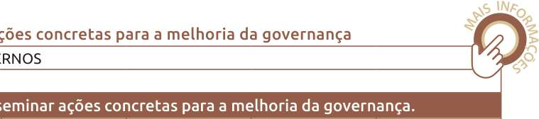

<!-- figure p136-fig1 | described_by: agy | ocr_overlap: 1.0 | needs_review: false -->
1. **Tipo de figura:** Trata-se de um recorte parcial (cortado à esquerda e na parte inferior) do cabeçalho e das linhas superiores de uma tabela ou quadro estruturado extraído de um documento, acompanhado por um ícone circular interativo/informativo no canto superior direito.

2. **Todo o texto visível (literalmente):**
   - **Título superior (cortado na borda esquerda):** `ções concretas para a melhoria da governança`
   - **Texto curvo ao redor do ícone circular no canto superior direito:** `MAIS INFORMAÇÕES`
   - **Primeira linha visível da tabela (cortado na borda esquerda):** `ERNOS`
   - **Faixa/linha destacada abaixo (cortado na borda esquerda):** `seminar ações concretas para a melhoria da governança.`

3. **Estrutura:**
   - No topo, fora da grade da tabela, há uma linha de título alinhada horizontalmente (cortada à esquerda).
   - No canto superior direito, sobrepondo-se ao canto superior direito da borda da tabela, há um ícone circular composto por anéis concêntricos com um desenho de mão apontando o dedo indicador para o centro do círculo (como um botão clicável), circundado no sentido horário (do topo esquerdo até a parte inferior direita) pelo texto `MAIS INFORMAÇÕES`.
   - Abaixo do título, inicia-se uma estrutura tabular com bordas horizontais e uma borda vertical fechando o lado direito (o lado esquerdo e a continuação inferior estão cortados):
     - **Linha 1:** Uma célula horizontal visível contendo apenas o fragmento de texto `ERNOS` junto à borda esquerda, com o restante da linha vazio até o ícone da mão no lado direito.
     - **Linha 2:** Uma faixa horizontal totalmente vazia na área visível, delimitada acima pela borda inferior da Linha 1, à direita pela borda vertical da tabela e abaixo pela faixa preenchida da Linha 3.
     - **Linha 3:** Uma faixa horizontal contínua preenchida (sem divisórias verticais visíveis na parte preenchida), contendo o texto cortado à esquerda `seminar ações concretas para a melhoria da governança.`.
     - **Parte inferior (recorte da Linha 4):** Na extremidade inferior da imagem aparece apenas uma estreita tira horizontal do início de uma nova linha sombreada, na qual se veem três pequenas marcas de linhas divisórias verticais, indicando a subdivisão em quatro colunas visíveis nesse trecho (além da borda direita).
   - Não há setas, eixos ou painéis adicionais.

4. **Números ou valores de dados:**
   - Não há nenhum número ou valor numérico visível na imagem.

5. **Cores com significado:**
   - **Marrom:** Usado para estabelecer hierarquia visual e delimitação estrutural — aparece no título superior, nas bordas da tabela, no preenchimento sólido da faixa de destaque (Linha 3, com texto em **branco** para contraste), no anel externo do ícone circular e no contorno da mão apontadora.
   - **Bege / marrom-claro:** Usado como destaque secundário no texto `MAIS INFORMAÇÕES`, no anel interno do ícone circular e no preenchimento da tira de linha cortada na borda inferior, diferenciando-a tanto da faixa marrom escura quanto das linhas de fundo branco.
   - **Preto sobre fundo branco:** Usado para o texto de conteúdo comum (`ERNOS`) na primeira linha da tabela.

~~~text ocr
concretas para a melhoria da governança
eminar ações concretas para a melhoria da governança.
~~~

<!-- Start of picture text -->
ções concretas para a melhoria da governançaões concretas para a melhoria da governançapara a melhoria da governançaara a melhoria da governançagovernançaovernançaçaa OBJETIVO Promover e disseminar ações concretas para a melhoria da governança.ça.a. MAIS INFOR M A Ç Õ SE <!-- End of picture text -->

###### Objetivo estratégico 8. Promover e disseminar ações concretas para a melhoria da governançaões concretas para a melhoria da governançapara a melhoria da governançaara a melhoria da governançagovernançaovernançaçaa 

###### EIXO (Mapa estratégico) PROCESSOS INTERNOS TEMA GESTÃO 

###### OBJETIVO Promover e disseminar ações concretas para a melhoria da governança.ça.a. 

|INDICADOR(ES)|META 2021|META 2022|META 2023|META 2024|META 2025|
|---|---|---|---|---|---|
|1 – Índice de Governança e Gestão (IGG/TCU). 2 – Participação efetiva de gestore(a)s em fórum insti- tucional (a ser criado). 3 – Número de iniciativas anuais para simplificação e desburocratização dagestão.|1.Ampliar em 5% 3.Ampliar em |1.Ampliar em 5% 2.Definir o for- mato do Fórum de Gestores da UFRPE|1.Ampliar em 5% 2. Obter 80% de participação de gestore(a)s nos encontros do|1.Ampliar em 5% 2.Obter 80% de participação de gestore(a)s nos encontros do|1.Ampliar em 5% 2.Obter 80% de participação de gestore(a)s nos encontros do|
|UNIDADE(S)RESPONSÁVEL(IS) Comitê de Governança, Gestão de Riscos e Controles Internos|5%|3.Ampliar em 5%|Fórum 3.Ampliar em 5%|Fórum 3.Ampliar em 5%|Fórum 3.Ampliar em 5%|

###### Objetivo estratégico 9. Consolidar iniciativas de inovação organizacional 

###### EIXO (Mapa estratégico) PROCESSOS INTERNOS TEMA INOVAÇÃO OBJETIVO Consolidar iniciativas de inovação organizacional. 

|INDICADOR(ES)|META 2022|META 2023|META 2024|META 2025|
|---|---|---|---|---|
|1 – Quantidade de relatórios técnicos publicados sobre gestão de estrutura organizacional. 2 – Pesquisas realizadas nas unidades que foram reestruturadas para avaliar impactos das mudanças na execução das atividades. UNIDADE(S)RESPONSÁVEL(IS) Proplan,Ipê,Reitoria.|1. Relatório técnico so- bre estratégia e metodo- logia utilizada para mo- dernização da estrutura organizacional 2. 2 Pró-Reitorias|1. Relatório técnico de avaliação da atualização dos documentos legais internos_–_resoluções (2018_–_2022) 2. 6 Departamentos acadêmicos|1. Relatório técnico de avaliação da gestão dos sistemas estruturantes SIORG e SIAPE. 2. 8 Órgãos executivos da administração geral e órgãos de assessora- mento a departamentos acadêmicos|1. Relatório com resul- tados da pesquisa de impacto (produto indica- dor 2) 2. Consolidar pesquisa|

**135** 

<!-- page 137 -->

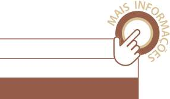

<!-- figure p137-fig1 | described_by: agy | ocr_overlap: None | needs_review: false -->
1. **Tipo de figura:** Elemento gráfico decorativo / ícone de destaque (em formato de caixa ou faixa com botão clicável), utilizado em documentos para sinalizar uma seção ou link de informações adicionais.

2. **Todo o texto visível (literal):**
   - `MAIS INFORMAÇÕES` (em letras maiúsculas, disposto em arco ao redor da parte superior e direita do círculo).

3. **Estrutura:**
   - **Faixa/caixa horizontal à esquerda e na parte inferior:** Um bloco retangular aberto na borda esquerda e fechado à direita por uma linha vertical fina, dividido horizontalmente em três faixas empilhadas:
     - Faixa superior: retângulo vazio (fundo branco) delimitado acima e abaixo por linhas horizontais finas, terminando à direita onde encontra o ícone da mão.
     - Faixa intermediária: retângulo vazio (fundo branco) delimitado acima pela linha divisória com a faixa superior, à direita por uma linha vertical fina abaixo da mão e abaixo pela faixa preenchida.
     - Faixa inferior: barra horizontal sólida preenchida, alinhada à direita com a faixa intermediária.
   - **Botão circular no canto superior direito:** Composto por círculos concêntricos — um anel externo mais espesso, um anel interno mais fino encostado ao externo e um centro circular vazio.
   - **Texto em arco:** O texto `MAIS INFORMAÇÕES` contorna externamente o botão circular no sentido horário, aproximadamente da posição de 10 horas até a posição de 5 horas.
   - **Ícone de mão:** Sobreposto à junção entre o canto superior direito da caixa retangular e o quadrante inferior esquerdo do botão circular, há o desenho de uma mão estilizada inclinada para cima e para a direita, com o dedo indicador estendido apontando para o centro do círculo (representando o gesto de clicar ou tocar no botão).
   - Não há setas, eixos, legendas ou painéis adicionais.

4. **Números ou valores de dados:** Não há nenhum número ou valor de dados na figura.

5. **Cores com significado:** As cores presentes (marrom, bege/dourado-claro e branco) têm função apenas visual e estética — para diferenciar os anéis concêntricos, o texto em arco, os contornos e a faixa inferior —, não carregando significado semântico ou de codificação de dados.

~~~text ocr
—
~~~

<!-- Start of picture text -->
MAIS INFOR M A Ç Õ SE <!-- End of picture text -->

###### Objetivo estratégico 10. Aprimorar os fluxos de comunicação institucional 

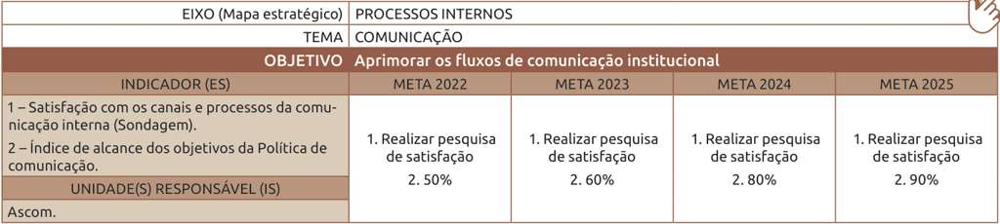

<!-- figure p137-fig2 | described_by: agy | ocr_overlap: 1.0 | needs_review: false -->
**1. Tipo de figura**
Tabela estruturada de planejamento estratégico (ficha de objetivo estratégico com indicadores, unidade responsável e metas anuais de 2022 a 2025).

**2. Todo o texto visível (literal)**
- `EIXO (Mapa estratégico)` | `PROCESSOS INTERNOS`
- `TEMA` | `COMUNICAÇÃO`
- `OBJETIVO` | `Aprimorar os fluxos de comunicação institucional`
- `INDICADOR (ES)` | `META 2022` | `META 2023` | `META 2024` | `META 2025`
- `1 – Satisfação com os canais e processos da comunicação interna (Sondagem).` *(quebrado no original como `comu-` / `nicação`)*
- `2 – Índice de alcance dos objetivos da Política de comunicação.`
- `UNIDADE(S) RESPONSÁVEL (IS)`
- `Ascom.`
- Coluna `META 2022`:
  - `1. Realizar pesquisa de satisfação`
  - `2. 50%`
- Coluna `META 2023`:
  - `1. Realizar pesquisa de satisfação`
  - `2. 60%`
- Coluna `META 2024`:
  - `1. Realizar pesquisa de satisfação`
  - `2. 80%`
- Coluna `META 2025`:
  - `1. Realizar pesquisa de satisfação`
  - `2. 90%`

**3. Estrutura**
A figura é uma grade retangular com bordas finas, organizada em 5 colunas verticais e 7 linhas horizontais com células mescladas, sem setas ou eixos gráficos:
- **Linha 1 (2 células):** A coluna 1 contém `EIXO (Mapa estratégico)` (alinhado à direita) e as colunas 2 a 5 estão mescladas em uma única célula contendo `PROCESSOS INTERNOS` (alinhado à esquerda). No canto superior direito, sobrepondo parcialmente a borda desta linha e o topo da linha seguinte, aparece parte de um ícone ilustrativo de mão apontando, cortado nas bordas superior e direita da imagem.
- **Linha 2 (2 células):** A coluna 1 contém `TEMA` (alinhado à direita) e as colunas 2 a 5 estão mescladas contendo `COMUNICAÇÃO` (alinhado à esquerda).
- **Linha 3 (faixa contínua sem linha divisória vertical):** Exibe `OBJETIVO` alinhado à direita dentro da largura da coluna 1 e `Aprimorar os fluxos de comunicação institucional` alinhado à esquerda a partir da coluna 2, estendendo-se pelas colunas 2 a 5.
- **Linha 4 (5 colunas, cabeçalho):** Divide a tabela em 5 colunas independentes com títulos centralizados: coluna 1 (`INDICADOR (ES)`), coluna 2 (`META 2022`), coluna 3 (`META 2023`), coluna 4 (`META 2024`) e coluna 5 (`META 2025`). A coluna 1 é mais larga que as quatro colunas de metas, que possuem larguras equivalentes entre si.
- **Linhas 5 a 7 (corpo inferior):**
  - Na **coluna 1**, há 3 células empilhadas verticalmente:
    - Linha 5: lista numerada dos dois indicadores (`1 – ...` e `2 – ...`), alinhada à esquerda.
    - Linha 6: subtítulo centralizado `UNIDADE(S) RESPONSÁVEL (IS)`.
    - Linha 7: célula com `Ascom.`, alinhada à esquerda.
  - Nas **colunas 2, 3, 4 e 5**, cada coluna forma uma única célula mesclada verticalmente abrangendo toda a altura das linhas 5 a 7. Cada célula contém os itens `1.` e `2.` centralizados vertical e horizontalmente, correspondendo respectivamente aos indicadores 1 e 2 da coluna 1 para cada ano.

**4. Todos os números e valores de dados**
- Anos das metas: `2022`, `2023`, `2024`, `2025`.
- Numeração dos indicadores: `1` e `2` (identificados como `1 –` e `2 –` na coluna de indicadores, e `1.` e `2.` nas colunas de metas).
- Valores das metas por indicador e ano:
  - **Indicador 1** (`Satisfação com os canais e processos da comunicação interna (Sondagem).`):
    - 2022: `Realizar pesquisa de satisfação`
    - 2023: `Realizar pesquisa de satisfação`
    - 2024: `Realizar pesquisa de satisfação`
    - 2025: `Realizar pesquisa de satisfação`
  - **Indicador 2** (`Índice de alcance dos objetivos da Política de comunicação.`):
    - 2022: `50%`
    - 2023: `60%`
    - 2024: `80%`
    - 2025: `90%`

**5. Cores com significado**
- **Fundo marrom-escuro com texto branco em negrito:** destaca a faixa do `OBJETIVO`, estabelecendo hierarquia visual entre a identificação superior (`EIXO` e `TEMA`) e o detalhamento operacional abaixo.
- **Fundo marrom-médio/castanho com texto preto:** diferencia as células de cabeçalho de seção e de colunas (`INDICADOR (ES)`, `META 2022` a `META 2025` e `UNIDADE(S) RESPONSÁVEL (IS)`).
- **Fundo bege-claro com texto preto:** distingue os conteúdos descritivos da coluna lateral esquerda (os indicadores e a unidade responsável `Ascom.`) das células de fundo branco que contêm os valores das metas anuais e os campos superiores (`EIXO` e `TEMA`).

~~~text ocr
EIXO (Mapa estratégico) | PROCESSOS INTERNOS
TEMA | COMUNICAÇÃO
OBJETIVO Aprimorar os fluxos de comunicação institucional
1 — Satisfação com os canais e processos da comu-
nicação interna (Sondagem).
2 - Índice de alcance dos objetivos da Política de
comunicação.
1. Realizar pesquisa 1. Realizar pesquisa 1. Realizar pesquisa 1. Realizar pesquisa
de satisfação de satisfação de satisfação de satisfação
2.50% 2.60% 2.80% 2.90%
~~~

<!-- Start of picture text -->
EIXO (Mapa estratégico) PROCESSOS INTERNOS TEMA COMUNICAÇÃO OBJETIVO Aprimorar os fluxos de comunicação institucional INDICADOR (ES) META 2022 META 2023 META 2024 META 2025 1 – Satisfação com os canais e processos da comu- nicação interna (Sondagem).  1. Realizar pesquisa   1. Realizar pesquisa   1. Realizar pesquisa   1. Realizar pesquisa 2 – Índice de alcance dos objetivos da Política de de satisfação de satisfação de satisfação de satisfação comunicação. 2. 50% 2. 60% 2. 80% 2. 90% UNIDADE(S) RESPONSÁVEL (IS) Ascom. <!-- End of picture text -->

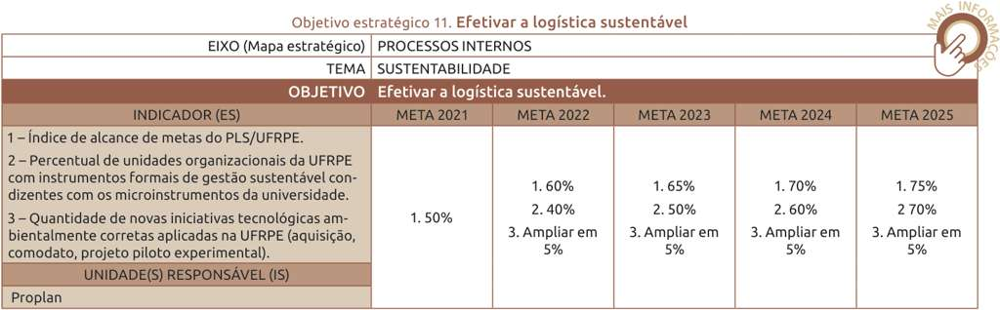

<!-- figure p137-fig3 | described_by: agy | ocr_overlap: 0.97 | needs_review: false -->
**(1) Tipo de figura**
Trata-se de uma tabela estruturada de planejamento estratégico (ficha de objetivo estratégico) acompanhada de um título superior e de um selo/ícone circular interativo no canto superior direito, apresentando o eixo, o tema, o objetivo, os indicadores, a unidade responsável e as metas anuais de 2021 a 2025.

**(2) Todo o texto visível (literal)**

- **Título acima da tabela:**
  `Objetivo estratégico 11. Efetivar a logística sustentável`

- **Texto curvo ao redor do ícone circular no canto superior direito:**
  `MAIS INFORMAÇÕES`

- **Conteúdo da tabela:**
  - Linha 1, coluna 1: `EIXO (Mapa estratégico)`
  - Linha 1, colunas 2–6 (mescladas): `PROCESSOS INTERNOS`
  - Linha 2, coluna 1: `TEMA`
  - Linha 2, colunas 2–6 (mescladas): `SUSTENTABILIDADE`
  - Linha 3, coluna 1: `OBJETIVO`
  - Linha 3, colunas 2–6 (mescladas): `Efetivar a logística sustentável.`
  - Linha 4, coluna 1: `INDICADOR (ES)`
  - Linha 4, coluna 2: `META 2021`
  - Linha 4, coluna 3: `META 2022`
  - Linha 4, coluna 4: `META 2023`
  - Linha 4, coluna 5: `META 2024`
  - Linha 4, coluna 6: `META 2025`
  - Linha 5, coluna 1:
    - `1 – Índice de alcance de metas do PLS/UFRPE.`
    - `2 – Percentual de unidades organizacionais da UFRPE com instrumentos formais de gestão sustentável condizentes com os microinstrumentos da universidade.` (com quebra de linha hifenizada em `con-dizentes`)
    - `3 – Quantidade de novas iniciativas tecnológicas ambientalmente corretas aplicadas na UFRPE (aquisição, comodato, projeto piloto experimental).` (com quebra de linha hifenizada em `am-bientalmente`)
  - Linha 6, coluna 1: `UNIDADE(S) RESPONSÁVEL (IS)`
  - Linha 7, coluna 1: `Proplan`
  - Linhas 5–7 (mescladas), coluna 2 (`META 2021`):
    - `1. 50%`
  - Linhas 5–7 (mescladas), coluna 3 (`META 2022`):
    - `1. 60%`
    - `2. 40%`
    - `3. Ampliar em 5%`
  - Linhas 5–7 (mescladas), coluna 4 (`META 2023`):
    - `1. 65%`
    - `2. 50%`
    - `3. Ampliar em 5%`
  - Linhas 5–7 (mescladas), coluna 5 (`META 2024`):
    - `1. 70%`
    - `2. 60%`
    - `3. Ampliar em 5%`
  - Linhas 5–7 (mescladas), coluna 6 (`META 2025`):
    - `1. 75%`
    - `2 70%` (sem ponto após o numeral `2`, conforme consta na imagem)
    - `3. Ampliar em 5%`

**(3) Estrutura**
- A figura é composta por um título centralizado no topo, uma tabela retangular com bordas finas e um ícone circular sobreposto ao canto superior direito da tabela (desenho de uma mão com o dedo indicador apontando para o centro de círculos concêntricos, contornado pelo texto `MAIS INFORMAÇÕES`). Não há setas de fluxo, gráficos ou eixos coordenados.
- A tabela possui **6 colunas** (uma primeira coluna mais larga à esquerda e cinco colunas de larguras iguais à direita, correspondentes aos anos de 2021 a 2025) e **7 linhas** lógicas, com mesclagens:
  - **Linhas 1 a 3 (cabeçalho de identificação do objetivo):** divididas em 2 blocos horizontais — coluna 1 (rótulo alinhado à direita) e colunas 2 a 6 mescladas em uma única célula (valor alinhado à esquerda).
  - **Linha 4 (cabeçalho de indicadores e metas):** dividida nas 6 colunas individuais (`INDICADOR (ES)` na coluna 1 e `META 2021` a `META 2025` nas colunas 2 a 6, todos centralizados).
  - **Linhas 5 a 7 (corpo de indicadores, metas e unidade responsável):**
    - Na **coluna 1**, há 3 células empilhadas verticalmente: a célula superior lista os três indicadores numerados (1, 2 e 3, alinhados à esquerda); a célula intermediária contém o subtítulo `UNIDADE(S) RESPONSÁVEL (IS)` (centralizado); e a célula inferior contém `Proplan` (alinhado à esquerda).
    - Em cada uma das **colunas 2 a 6**, as linhas 5, 6 e 7 estão mescladas verticalmente em uma única célula contínua, com os valores das metas centralizados vertical e horizontalmente, correspondendo pelos números 1, 2 e 3 aos respectivos indicadores listados na coluna 1.

**(4) Números e valores de dados**
- Número do objetivo estratégico: `11`
- Anos das metas: `2021`, `2022`, `2023`, `2024`, `2025`
- Numeração dos indicadores: `1`, `2`, `3`
- **Indicador 1** (`Índice de alcance de metas do PLS/UFRPE.`):
  - META 2021: `50%`
  - META 2022: `60%`
  - META 2023: `65%`
  - META 2024: `70%`
  - META 2025: `75%`
- **Indicador 2** (`Percentual de unidades organizacionais da UFRPE com instrumentos formais de gestão sustentável condizentes com os microinstrumentos da universidade.`):
  - META 2021: sem valor listado
  - META 2022: `40%`
  - META 2023: `50%`
  - META 2024: `60%`
  - META 2025: `70%`
- **Indicador 3** (`Quantidade de novas iniciativas tecnológicas ambientalmente corretas aplicadas na UFRPE (aquisição, comodato, projeto piloto experimental).`):
  - META 2021: sem valor listado
  - META 2022: `Ampliar em 5%`
  - META 2023: `Ampliar em 5%`
  - META 2024: `Ampliar em 5%`
  - META 2025: `Ampliar em 5%`

**(5) Cores com significado**
As variações de tonalidade marrom/bege estabelecem a hierarquia estrutural das seções da tabela:
- **Fundo marrom escuro com texto branco em negrito:** destaca a linha principal da ficha (`OBJETIVO` — `Efetivar a logística sustentável.`), separando-a dos metadados superiores (`EIXO` e `TEMA`, em fundo branco) e das metas abaixo.
- **Fundo marrom médio com texto preto:** sinaliza as barras de cabeçalho das subdivisões da tabela (`INDICADOR (ES)`, `META 2021` a `META 2025` e `UNIDADE(S) RESPONSÁVEL (IS)`).
- **Fundo bege claro com texto preto:** agrupa e distingue o conteúdo descritivo/institucional da coluna 1 (os três indicadores e a unidade `Proplan`) em contraste com as células de fundo branco que exibem os valores numéricos das metas anuais.

~~~text ocr
Objetivo estratégico 11. Efetivar a logística sustentável a
>
EIXO (Mapa estratégico) | PROCESSOS INTERNOS
TEMA | SUSTENTABILIDADE
OBJETIVO Efetivar a logística sustentável.
Índice de alcance de metas do PLS/UFRPE.
2 — Percentual de unidades organizacionais da UFRPE
com instrumentos formais de gestão sustentável con-
0
dizentes com os microinstrumentos da universidade. 1.60% Gov 1.70% 1.75%
: 2.40% 2.50% 2.60% 2 70%
3 — Quantidade de novas iniciativas tecnológicas am-
bientalmente corretas aplicadas na UFRPE (aquisição, 3.Ampliarem | 3.Ampliarem | 3.Ampliarem | 3.Ampliar em
comodato, projeto piloto experimental). 5% 5% 5% 5%
~~~

<!-- Start of picture text -->
Objetivo estratégico 11. Efetivar a logística sustentável EIXO (Mapa estratégico) PROCESSOS INTERNOS TEMA SUSTENTABILIDADE OBJETIVO Efetivar a logística sustentável. INDICADOR (ES) META 2021 META 2022 META 2023 META 2024 META 2025 1 – Índice de alcance de metas do PLS/UFRPE. 2 – Percentual de unidades organizacionais da UFRPE com instrumentos formais de gestão sustentável con- 1. 60% 1. 65% 1. 70% 1. 75% dizentes com os microinstrumentos da universidade. 2. 40% 2. 50% 2. 60% 2 70% 3 – Quantidade de novas iniciativas tecnológicas am- 1. 50% bientalmente corretas aplicadas na UFRPE (aquisição,  3. Ampliar em  3. Ampliar em  3. Ampliar em  3. Ampliar em comodato, projeto piloto experimental). 5% 5% 5% 5% UNIDADE(S) RESPONSÁVEL (IS)  Proplan MAIS INFOR M A Ç Õ SE <!-- End of picture text -->

**136** 

<!-- page 138 -->

###### Objetivo estratégico 12. Fortalecer o caráter estratégico no desenvolvimento do capital humano na UFRPE 

EIXO (Mapa estratégico) APRENDIZAGEM E CRESCIMENTO TEMA GESTÃO DE PESSOAS – DESENVOLVIMENTO DO CAPITAL HUMANO 

|OBJETIVO|Fortalecer|o caráter estraté|gico no desenv|olvimento do c|apital humano n|a UFRPE.|
|---|---|---|---|---|---|---|
|INDICADOR(ES)|META 2021| META 2022|META 2023|META 202|4 M|ETA 2025|
|1 – Índice de Capacitação dos Servidore(a)s (servidore(a)s capacitado(a)s/to- tal de servidore(a)s) X 100. 2 – Percentual de implementação de gestão por competência. 3 – Percentual de implementação de política de dimensionamento depessoal.|1. Capacita 40% do(a)s servidore(a) da UFRPE|r   s 1. Capacitar 50% do(a)s servidore(a)s da UFRPE 2. Mapear 100% das compe- tências do(a)s|   1.Capacitar 60% do(a)s servidore(a)s da UFRPE| 1. Capacitar do(a)s servido da UFRP 3. Estudo de d sionamento d soal atualizad|65% re(a)s E imen- e pes- o em 1. Capa servido 2. Institu Gestão p 3. Implem dimensi |citar 70% do(a)s re(a)s da UFRPE ir o Programa de or Competências entar política de onamento e redi- |
|UNIDADE(S)RESPONSÁVEL(IS)|| servidore(a)s da ||100% das unid|ades mension de trab|amento da força alho na UFRPE|
|Progepe||UFRPE||||   |
|Objetivo estratégico 13.Qualificar dialo EIXO(Mapa e|gicamente stratégico)|as ações de atenç APRENDIZAGEM E|ão à saúde,se CRESCIMENTO|gurança no tra|balho equalida|de de vida **M** **A** **I** |
||TEMA|VALORIZAÇÃO DA|VIDA||||
|O|BJETIVOi |Qualificar dialogi e qualidade de vi|i camente as açõ da.|i   es de atenção|i      à saúde, segura|i        nça no trabalho|
|INDICADOR(ES)||META 2021|META 2022|META 2023|META 2024|META 2025|
|1 – Percentual de servidore(a)s que participam de mas de QVT. 2 – Quantidade de Pesquisas de Intenção de Ativi realizadas.|progra- dades||1. 20% 2. Realizar|1. 25% 2. Realizar|1. 30% 2. Realizar|1. 35% 2. Realizar|
|3 – Quantidade de ações de prevenção e promoç mental. 4 – Quantidade de ações de vigilância e seguranç ocupacional.|ão à saúde a|1. 15% 3 4|pesquisa . Ampliar em 5% . Ampliar em|pesquisa 3. Ampliar em 5% 4. Ampliar em|pesquisa 3. Ampliar em 5% 4. Ampliar em|pesquisa 3. Ampliar em 5% 4. Ampliar em|
|UNIDADE(S)RESPONSÁVEL(IS)|||5%|5%|5%|5%|
|Progepe(DQV),IMM(Núcleo do Cuidado Human|o),Proad||||||

**137** 

<!-- page 139 -->

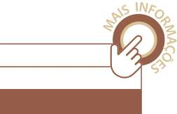

<!-- figure p139-fig1 | described_by: agy | ocr_overlap: None | needs_review: false -->
1. **Tipo de figura:** Trata-se de um elemento gráfico ilustrativo (ícone/banner decorativo em estilo vetorial), usado como cabeçalho ou selo de chamada de seção em um documento, representando a indicação interativa de acesso a mais informações (uma mão clicando em um botão circular).

2. **Texto visível (literal):**
   - `MAIS INFORMAÇÕES` (em caixa alta, disposto em arco no sentido horário ao redor da borda externa do círculo, da parte superior esquerda até a parte inferior direita).
   - Não há outros textos, títulos, legendas, rótulos de eixos ou células.

3. **Estrutura:**
   - **Bloco horizontal à esquerda:** Uma estrutura retangular que se estende até a borda esquerda (sem fechamento vertical nesse lado) e é fechada à direita por uma linha vertical, composta por três faixas horizontais empilhadas:
     - Faixa superior: área vazia delimitada por uma linha horizontal superior e outra inferior, ligando-se à direita ao ícone da mão e ao círculo.
     - Faixa intermediária: área vazia entre a linha divisória superior, a faixa inferior preenchida e a borda vertical à direita (que desce a partir da base da mão).
     - Faixa inferior: barra horizontal sólida alinhada à mesma borda direita das faixas acima.
   - **Ícone circular e mão à direita (sobrepostos ao canto superior direito do bloco):**
     - Um botão circular formado por três círculos concêntricos: um anel externo mais largo, um anel interno mais fino e um círculo central vazio.
     - O texto `MAIS INFORMAÇÕES` envolve o arco externo superior e direito desse círculo.
     - Uma ilustração estilizada de uma mão com o dedo indicador estendido para cima e para a direita, apontando diretamente para o interior do círculo central (gesto de clique/toque), com o polegar voltado para cima à esquerda e os demais dedos dobrados; a mão sobrepõe a junção entre a borda inferior esquerda do círculo e o limite direito das duas faixas superiores.
   - Não há setas, eixos, linhas/colunas de tabela ou múltiplos painéis.

4. **Números ou valores de dados:** Não há nenhum número ou valor numérico na figura.

5. **Cores com significado:** As cores (marrom, bege/dourado claro e branco) têm função essencialmente visual/identitária, sem codificar categorias ou dados; o contraste concêntrico entre o anel externo marrom, o anel intermediário bege e o centro branco serve apenas para evidenciar o alvo circular onde o dedo aponta, enquanto o preenchimento marrom sólido da faixa inferior atua como base visual do bloco.

<!-- Start of picture text -->
MAIS INFOR M A Ç Õ SE <!-- End of picture text -->

###### Objetivo estratégico 14. Implementar a gestão integrada da infraestrutura física da UFRPE 

|EIXO(Mapa estratégico)|APRENDIZAGEM E C|RESCIMENTO||||
|---|---|---|---|---|---|
|TEMA|INFRAESTRUTURA|||||
|OBJETIVO|Implementar age|stão integrada da in|fraestrutura física|da UFRPE.||
|INDICADOR(ES)|META 2021|META 2022|META 2023|META 2024|META 2025|
|1 – Iniciativas de avanço da reestruturação organizacional (criação de plano diretor, superintendência, comitês de infraestrutu- ra, etc). 2 – Taxa de implementação da agenda de intervenções. UNIDADE(S)RESPONSÁVEL(IS) Nemam, Reitoria e Unidades Acadêmicas|2. Realizar 20% das intervenções pro- postas na agenda de intervenções|1. Reestruturar o Nemam 1. Instituir o Comitê Permanente de Demanda e Ocupação por Espaços Físicos 2. Realizar 40% das intervenções pro- postas na agenda de intervenções|2. Realizar 60% das intervenções propostas na agen- da de intervenções|1. Estabelecer comitês de infraes- trutura física em todos os_campi_da UFRPE 2. Realizar 80% das intervenções pro- postas na agenda de intervenções|1. Criar plano dire- tor para cada_cam-_ _pus_da UFRPE 2. Realizar 100% das intervenções propostas na agen- da de intervenções|

Objetivo estratégico 15. Assegurar e gerir os recursos tecnológicos necessários para uma melhor eficiência das atividades da UFRPE. 

|EIXO(Mapa estratégico)|APRENDIZAGEM E CRESCIMENTO||
|---|---|---|
|TEMA OBJETIVO|INFRAESTRUTURA TECNOLÓGICA Assegurar e gerir os recursos tecnológicos necessários para u  i atividades da UFRPE.|ma melhor eficiência das|
|INDICADOR(ES)|META 2022 META 2023|META 2024|
|Taxa de implementação das ações do PDTI .|||
|UNIDADE(S)RESPONSÁVEL(IS)|1. 50% 1. 60%|1. 80%  **A** **I** **S**     **I** **N** **F** **O** **R**|
|Ipê,Proad,Nemam,STD||**M**   **M** **A** **Ç** **Õ** **E** **S**|

**138** 

<!-- page 140 -->

###### Objetivo estratégico 16. Conhecer e adotar as melhores práticas do sistema de IFES na ampliação 

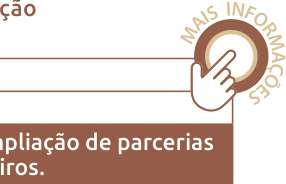

<!-- figure p140-fig1 | described_by: agy | ocr_overlap: 1.0 | needs_review: false -->
1. **Tipo de figura:** Trata-se de um recorte (fragmento parcial, cortado nas bordas esquerda e inferior) de um elemento gráfico/caixa de destaque de um documento em PDF, contendo um ícone ilustrativo estilizado de clique/interação ("mais informações") sobreposto ao canto superior direito de um quadro estruturado em faixas horizontais.

2. **Todo o texto visível (literal):**
   - No canto superior esquerdo, fora da caixa (cortado à esquerda): `ção`
   - Em arco ao redor da borda externa superior direita do ícone circular (em maiúsculas): `MAIS INFORMAÇÕES`
   - No bloco retangular marrom na parte inferior esquerda (em duas linhas, ambas cortadas à esquerda):
     - Primeira linha: `[illegible]pliação de parcerias` (há apenas o traço vertical direito de uma letra cortada imediatamente antes de `pliação`)
     - Segunda linha: `iros.`

3. **Estrutura:**
   - **Texto superior esquerdo:** Fragmento `ção` posicionado acima da borda superior do quadro.
   - **Quadro retangular em faixas horizontais (aberto/cortado à esquerda e na base):**
     - **Faixa superior (branca):** Delimitada acima e abaixo por duas linhas horizontais finas. A linha superior parte da borda esquerda da imagem e conecta-se à borda esquerda do anel circular; a linha inferior parte da borda esquerda e termina na lateral esquerda do desenho da mão.
     - **Faixa intermediária (branca):** Situada abaixo da segunda linha horizontal, sem conteúdo textual visível, fechada à direita por uma linha vertical fina que desce a partir da base da mão até encontrar o bloco preenchido abaixo.
     - **Faixa inferior (bloco retangular preenchido):** Alinhada à direita com a mesma borda vertical da faixa intermediária, estendendo-se até as bordas esquerda e inferior da imagem e contendo as duas linhas de texto branco alinhadas à esquerda.
   - **Ícone circular no canto superior direito:** Sobreposto ao encontro das linhas do quadro, composto por dois anéis concêntricos (um anel externo mais largo e um anel interno mais fino) ao redor de um centro circular branco. Contornando a metade superior e direita do anel externo (aproximadamente da posição das 10 horas às 5 horas no sentido horário), aparece o texto curvado `MAIS INFORMAÇÕES`.
   - **Ilustração de mão:** Sobreposta à parte inferior esquerda do círculo, uma mão estilizada com o dedo indicador estendido apontando na diagonal para cima e para a direita, em direção ao centro branco do círculo (gesto de toque/clique). Não há setas, eixos ou gráficos de dados.

4. **Números ou valores de dados:** Não há nenhum número ou valor de dado visível na imagem.

5. **Cores com significado:**
   - **Marrom (tom terroso escuro):** Atua como cor principal de estrutura e destaque — define as bordas do quadro, o texto superior (`ção`), o anel externo do ícone, o contorno da mão e o fundo sólido do bloco inferior (onde cria contraste para destacar o texto em branco).
   - **Bege/ocre claro:** Atua como cor secundária de destaque do selo interativo — aplicada no anel concêntrico interno e no rótulo `MAIS INFORMAÇÕES`, diferenciando a chamada de ação das linhas estruturais do quadro.
   - **Branco:** Usado no fundo geral, no preenchimento da mão, no centro do alvo circular e no texto dentro do bloco marrom inferior para garantir contraste e legibilidade.

~~~text ocr
ção
pliação de parcerias
iros.
~~~

<!-- Start of picture text -->
MAIS INFOR M A Ç Õ SE <!-- End of picture text -->

de parcerias com entes públicos e privados para captação de recursos financeiros 

|EIXO(Mapa estratégico)|ORÇAMENTÁRIO E FIN|ANCEIRO|||
|---|---|---|---|---|
|TEMA|CAPTAÇÃO DE RECURS|OS|||
|OBJETIVO|Conhecer e adotar as com entes públicos e      i|melhores práticas do privados para captaçã   i|sistema de IFES na am o de recursos finance|pliação de parcerias iiros.|
|INDICADOR(ES)|META 2022|META 2023|META 2024|META 2025|
|Arrecadação de recompensa por meio de parce- rias da UFRPE. UNIDADE(S)RESPONSÁVEL(IS)|Ampliar em 2%|Ampliar em 2%|Ampliar em 2%|Ampliar em 2%|
|Ipê|||||

|Objetivo estratégico 17.Envolve EIXO(Mapa estratégico)  TEMA  OBJETIVO          i|r todos os níveis d  ORÇAMENTÁRIO E  GESTÃO DE CUSTO Envolver todos o       i|egestão nos esfo FINANCEIRO S s níveis de gestão    i|rçospor eficiênc nos esforços por ei|iia e sustentabilid ficiência e susten|i  ade i  tabilidade. **M** **A** **I** **S**     **I** **N** **F** **O** **R** **M** **A** **Ç** **Õ** **E** **S**|
|---|---|---|---|---|---|
|INDICADOR(ES)|META 2021|META 2022|META 2023|META 2024|META 2025|
|1 – Funcionamento da UFRPE (20RK): eficiência de custos.||||||
|2 – Funcionamento da UFRPE (20RK): eficácia de custos. 3 – Número de campanhas anuais para economia de recursos e redução do impacto ambiental. 4 – Número de eventos/oficinas voltados para gestore(a)spara sustentabilidade de recursos. UNIDADE(S)RESPONSÁVEL(IS)|1. Manter índice acima de 1 2. Manter índice acima de 1|1. Manter índice acima de 1 2. Manter índice acima de 1 3. 2 campanhas 4. 2 eventos|1. Manter índice acima de 1 2. Manter índice acima de 1 3. 2 campanhas 4. 2 eventos|1. Manter índice acima de 1 2. Manter índice acima de 1 3. 2 campanhas 4. 2 eventos|1.Manter índice acima de 1 2. Manter índice acima de 1 3. 2 campanhas 4. 2 eventos|
|Proad||||||

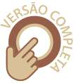

<!-- figure p140-fig2 | described_by: agy | ocr_overlap: None | needs_review: false -->
1. **Tipo de figura:** Ícone/selo gráfico (botão indicativo de link ou ação de clique/toque) que sinaliza o acesso à versão completa de um documento ou conteúdo.

2. **Texto visível (literal):**
   - `VERSÃO COMPLETA`

3. **Estrutura:**
   - A figura é composta por um elemento circular central formado por dois anéis concêntricos (um anel externo mais espesso e um anel interno mais fino) ao redor de um centro vazio.
   - Sobreposta à parte inferior esquerda desses anéis, há a ilustração estilizada de uma mão com o dedo indicador estendido, apontando diagonalmente para cima e para a direita em direção ao centro do círculo, representando o gesto de clicar ou tocar.
   - O texto `VERSÃO COMPLETA`, em letras maiúsculas, está disposto em arco ao longo da borda externa do círculo, iniciando na parte superior esquerda (`VERSÃO`) e contornando no sentido horário até a parte inferior direita (`COMPLETA`).
   - Não há caixas, setas, eixos, linhas, colunas ou múltiplos painéis.

4. **Números e valores de dados:**
   - Nenhum. A figura não contém números nem valores de dados.

5. **Cores com significado:**
   - Nenhuma cor carrega significado semântico ou codificação de dados; a paleta (tons de marrom e bege claro sobre fundo branco/transparente) é apenas estilística, servindo para dar contraste entre os anéis concêntricos, o contorno/preenchimento da mão e o texto.

<!-- Start of picture text -->
VERSÃOCO M P L E T A <!-- End of picture text -->

**139** 

<!-- page 141 -->

**8** 

**Projeto Pedagógico Institucional (PPI)** 

**140** 

<!-- figure p141-fig1 | described_by: agy | ocr_overlap: None | needs_review: false -->
(1) **Type of figure:** A decorative monochrome texture / background graphic (not a data chart, diagram, or table). It depicts a light, faintly textured or crumpled paper-/plaster-like surface speckled with scattered dark splatter marks.

(2) **Visible text:** None. There are no titles, labels, legends, captions, axis ticks, or cell values in the image.

(3) **Structure:** The image contains no boxes, arrows, connections, axes, rows, columns, or panels. It is a single continuous horizontal rectangular panel consisting solely of:
- A mottled off-white and pale-gray textured surface with faint, irregular creases and shading throughout.
- Small, scattered dark-gray speckles of varying pinpoint sizes distributed sparsely across the entire area.
- Larger dark-gray ink-like blotches clustered near the bottom-right corner and cut off along the lower right and bottom edges.
- A soft, pale-gray wash/smudge in the upper-right corner.

(4) **Numbers or data values:** None.

(5) **Meaningful colours:** None. The image uses only grayscale tones (off-white, light gray, and dark gray/charcoal) purely for decorative texture, carrying no semantic or quantitative meaning.

<!-- page 142 -->

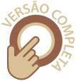

<!-- figure p142-fig1 | described_by: agy | ocr_overlap: None | needs_review: false -->
**1. Tipo de figura**
Trata-se de um ícone gráfico estilizado (selo ou botão indicativo de clique/toque).

**2. Texto visível**
- `VERSÃO COMPLETA`

**3. Estrutura**
A figura é composta por três elementos principais sobre fundo claro/transparente, sem caixas, setas, eixos, tabelas ou painéis:
- **Círculo concêntrico central:** um anel circular externo mais espesso envolvendo um anel interno mais fino, delimitando um centro circular vazio, semelhante a um botão ou alvo.
- **Mão apontando:** posicionada no quadrante inferior esquerdo e parcialmente sobreposta à borda dos anéis, há uma mão estilizada com o polegar erguido à esquerda, três dedos dobrados e o dedo indicador estendido em diagonal para cima e para a direita, apontando diretamente para o centro do círculo, o que sugere a ação de clicar ou tocar.
- **Texto em arco:** a expressão `VERSÃO COMPLETA` acompanha a curvatura externa do círculo no sentido horário, começando aproximadamente na posição das 10 horas (`V`), passando pelo topo (`Ã`, `O`) e descendo pelo lado direito até aproximadamente a posição das 5 horas (`A`).

**4. Números e valores de dados**
Não há números nem valores de dados na figura.

**5. Cores com significado**
As cores não carregam significado informacional ou codificação de dados; os tons de marrom e bege são usados apenas de forma estética para dar contraste entre os anéis, o contorno e o preenchimento da mão e o texto.

<!-- Start of picture text -->
VERSÃOCO M P L E T A <!-- End of picture text -->

## **Projeto Pedagógico Institucional (PPI)** 

O Projeto Pedagógico Institucional (PPI), como parte integrante do Projeto de Desenvolvimento Institucional, segue a linha de construção democrática do PDI, referenciado por significativa participação dos diversos segmentos que formam o tecido social no interior da UFRPE e também extramuros. Tal participação, além de expressar a contribuição da Universidade no exercício democrático, permite contemplar demandas e perspectivas mais abrangentes. 

O PPI não se propõe determinante da prática pedagógica, antes informa concepções, princípios e diretrizes importantes para orientação dessa prática que tem seu locus nos processos de ensino e aprendizagem constitutivos da função axial da Universidade. O conjunto doutrinário do PPI, formado por concepções, princípios e diretrizes, não implementado de forma isolada, articula-se com eixos teórico-metodológicos e práticos fundamentais que orientam os rumos definidos institucionalmente, tais como: a Visão, a Missão e a Avaliação institucional, o perfil geral do(a) egresso(a) dos diversos cursos, a qualificação profissional do(a)s docentes que conduzem a prática pedagógica, a gestão participativa em todas as instâncias que opera. 

A narrativa textual do PPI não é pronta e acabada. O próprio termo projeto, que significa lançar para frente, sugere esse inacabamento, portanto, a dimensão teleológica que lhe é inerente. Nessa perspectiva, Vasconcellos (2007, p. 169) define projeto pedagógico como sendo: 

a sistematização nunca definitiva, de um processo de planejamento participativo, que se aperfeiçoa e se concretiza na caminhada, que define claramente o tipo de ação educativa que se quer realizar. É um instrumento teórico-metodológico para a intervenção e mudança da realidade. É um elemento de organização e integração da atividade prática da instituição nesse processo de transformação. 

Nessa perspectiva, ganha realce a dimensão metodológica do projeto que, presumivelmente, terá chance de êxito no caminho da práxis entendida por Freire (1987, p. 67) como “a ação e a reflexão dos homens sobre o mundo para transformá-lo”. 

Definir caminhos metodológicos não significa eleger um conjunto de técnicas que se aplicam a qualquer objeto com fins determinados. Essa definição exige conhecimento da 

**141** 

<!-- page 143 -->

realidade para a qual se planeja. Exige práxis, num movimento que encampa ações indissociáveis de reflexão, constatação ou não das hipóteses de conhecimento sobre a realidade, interpretação da realidade e sua transformação qualitativa. É um movimento que considera a prática na qual estamos inseridos, como referência e desafio para a transformação, incluindo as experiências anteriores. Refletir sobre a prática na perspectiva da espiral transformadora exige trabalho coletivo crítico, que capte as contradições, a estrutura e o movimento do real rumo à transformação que inclui o conhecimento da realidade institucional, a abertura de novas possibilidades, propostas e ações. Nessa perspectiva, ganham importância diversas ferramentas de gestão entre as quais os relatórios resultantes dos processos avaliativos realizados pela CPA/UFRPE. 

Com base na concepção de PPI, como construção coletiva, contínua, crítica e essencialmente pedagógica, portanto política, a sua construção se compõe dos tópicos que seguem. 

**Inserção regional, nacional e internacional** A centenária Universidade Federal Rural de Pernambuco ocupa papel importante na difusão de conhecimento técnico-científico, na formação de pessoal e na promoção da cultura no estado de Pernambuco, no Brasil e no exterior. A UFRPE procura disseminar suas formas de atuação em áreas geograficamente diversificadas do estado de Pernambuco, investindo, permanentemente, nas dimensões quantitativa e qualitativa dos projetos acadêmicos, científicos, tecnológicos 

e culturais em andamento ou em fase de planejamento. Com Unidades e/ou _campi_ avançados em todas as regiões de Pernambuco, a UFRPE experimenta as diferentes realidades vivenciadas no estado, e é salutar a influência da universidade nas cidades em que atua e nas suas circunvizinhanças. 

Nessa seara, é importante notar que a Universidade está presente nas cidades do Recife ( _campus_ Dois Irmãos), de Serra Talhada (Unidade Acadêmica de Serra Talhada), Belo Jardim (Unidade Acadêmica de Belo Jardim) e Cabo de Santo Agostinho (Unidade Acadêmica do Cabo de Santo Agostinho). Essas Unidades cumprem sua missão primordial da UFRPE de realizar ensino, pesquisa e extensão de qualidade, formando recursos humanos capazes de exercer a cidadania e de promover o desenvolvimento sustentável de todo o estado de Pernambuco. 

A UFRPE também está presente na cidade de Carpina com a Estação Experimental de Cana-de-Açúcar do Carpina (EECAC) e Estação Experimental de Pequenos Animais de Carpina (EEPAC), na cidade de Ibimirim com a Estação de Agricultura Irrigada de Ibimirim (EAII Ibimirim), na cidade de Parnamirim com a Estação de Agricultura Irrigada de Parnamirim (EAIP) e na cidade de São Lourenço da Mata com Estação Ecológica do Tapacurá e o Colégio Agrícola Dom Agostinho Ikas (Codai). Os _campi_ avançados têm a finalidade de expandir as ações de ensino, pesquisa e extensão e ampliar a produção do conhecimento em diferentes 

**142** 

<!-- page 144 -->

cenários dentro do Estado, por meio dos _campi_ avançados, estudantes, professore(a)s e pesquisadore(a)s desenvolvem experiências, participam de vivências e atendem a produtore(a)s locais e à comunidade de maneira geral. 

Além disso, em 2005, a UFRPE iniciou a oferta de cursos na modalidade a distância, através do Programa Pró-Licenciatura do Ministério da Educação. Em 2006, o MEC implantou o Programa Universidade Aberta do Brasil (UAB), tendo como prioridade a formação de profissionais para a Educação Básica. Para atingir este objetivo central, a UAB realizou ampla articulação entre instituições públicas de ensino superior, estados e municípios brasileiros. 

Desde então, a UFRPE destaca-se no cenário pernambucano e no âmbito Norte-Nordeste como uma das instituições pioneiras na oferta de cursos na modalidade a distância através da Unidade Acadêmica de Educação a distância e Tecnologia (UAEADTec). Essa experiência resultou do engajamento dos seus profissionais comprometidos com o processo de ampliação das atividades educacionais da UFRPE, visando à difusão de cursos de nível superior para atender a uma demanda de formação profissional, há muito tempo reprimida em vários municípios. 

Todos os cursos a distância da UFRPE estão distribuídos em diversos municípios, através dos polos de apoio presencial. A abrangência territorial das ações em Educação a Distância 

da UFRPE é tão expressiva, que se expande nos estados de Pernambuco e Bahia, já tendo atendido, inclusive, à demanda por cursos nos Estados de Tocantins, Ceará e Paraíba. Além da UAEADTec, a UFRPE conta com o Núcleo em Educação a Distância (NEaD) do Codai que oferece os cursos de Técnico em Meio Ambiente e Técnico em Alimentos. 

A par da sua inserção regional, nacional e internacional, a UFRPE tem tido presença marcante em importantes redes e consórcios internacionais interuniversitários, com o objetivo de fortalecer parcerias com Instituições Internacionais, como: a FULBRIGHT que é uma Comissão para Intercâmbio Educacional entre os Estados Unidos da América e o Brasil; FAUBAI– _Brazilian Association for International Education_ , que reúne cerca de 180 instituições de ensino superior brasileiras com o intuito de promover a integração de seus membros, além do intercâmbio e da cooperação internacional como instrumentos para a melhoria das atividades de ensino, pesquisa, extensão e administração das instituições filiadas, e Grupo Coimbra de Universidades Brasileiras, que tem a missão de promover a integração interinstitucional e internacional, mediante programas de mobilidade docente e discente. 

##### **Princípios filosóficos** 

A UFRPE tem como missão: “semear conhecimento, inovação e inclusão, por meio de atividades de ensino, pesquisa, extensão e gestão, atenta à complexidade, pluralidade e diversidade dos anseios de uma sociedade”. (UFRPE, 2021g). É uma 

**143** 

<!-- page 145 -->

instituição de referência na formação de indivíduos críticos e éticos, a partir de sólida base científica e humanística. Assim, a UFRPE colabora com o crescimento socioeconômico a partir do desenvolvimento de políticas afirmativas e inclusivas de acesso e permanência na formação de qualidade nas diferentes áreas do conhecimento humano. Nesse sentido, adota os valores: “autonomia, integridade, diálogo, transparência, inovação, inclusão, respeito à diversidade e aos saberes populares, equidade, ética e sustentabilidade”. (UFRPE, 2021g). 

Os princípios norteadores da abordagem didático-pedagógica da UFRPE são: 

- **I.** Ensino flexível, atual e inclusivo comprometidos com a inserção regional e nacional do(a)s egresso(a)s; 

- **II.** Formação de qualidade associada ao desenvolvimento humano; 

**III.** Educação como um processo de formação integral; 

**IV.** Indissociabilidade entre ensino, pesquisa e extensão; 

- **V.** Interdisciplinaridade entre os conteúdos programáticos dos componentes curriculares; 

- **VI.** Formação de cidadãos críticos, inovadores e éticos; 

- **VII.** Formação profissional pautada na responsabilidade social; 

- **VIII.** Elaboração e implementação de projetos que venham promover o desenvolvimento local, regional e nacional; 

- **IX.** Desenvolvimento da cidadania, em prol da melhoria das condições de vida das comunidades; 

- **X.** Valorização das pessoas e dos aspectos sócio-histórico-culturais; 

- **XI.** Respeito às características distintas das pessoas e comunidades, em seus modos de ser e agir; 

- **XII.** Promoção da inclusão das pessoas em todas as suas dimensões, em função de suas necessidades e/ou diferenças; 

- **XIII.** A flexibilidade curricular, embasada na ampliação do conceito de atividade acadêmica e no entendimento do conceito de percurso para fins de integralização curricular; 

- **XIV.** O permanente esforço de inovação metodológica no ensino, visando à elevação da qualidade dos cursos. 

##### **Políticas institucionais** 

##### **Política de formação inicial e de formação continuada de profissionais da educação para a educação básica** 

Na UFRPE, a formação inicial e continuada de profissionais para a educação básica implementa-se nos cursos de licenciatura. Essa formação é instituída como política, por norma específica proposta pelo Colegiado para Acompanhamento da Política Institucional de Formação Inicial e Continuada de Profissionais do Magistério para a Educação Básica da UFRPE (Coapi), criado por orientação da Capes. Tal política, em consonância com o PPI e articulação com a missão e a visão 

**144** 

<!-- page 146 -->

institucional, tem como locus de execução os cursos de licenciatura regidos pelos Projetos Pedagógicos dos Cursos _–_ PPC, os quais, por sua vez, regem-se pelas Diretrizes Curriculares Nacionais que lhes são inerentes e por largo leque de normativas que compõem a legislação educacional. 

Na UFRPE, os cursos de licenciatura constituem-se como espaços formativos político-pedagógicos que buscam a construção da identidade docente no processo de formação de profissionais para atuação na educação básica em áreas específicas do conhecimento. A perspectiva da construção da identidade docente ganha destaque quando examinada à luz do processo histórico no qual emergiram os cursos de licenciatura. 

A partir da década de 1930, a licença para ensinar no nível secundário _–_ correspondente hoje aos anos finais do Ensino Fundamental e ao Ensino Médio _–_ era obtida mediante o acréscimo, à formação trienal no bacharelado, de mais um ano de estudos de disciplinas da área de educação, razão pela qual esse modelo ficou popularmente conhecido como “3+1” (GATTI, 2010; ROMANELLI, 2002). 

Embora existissem os liceus como escolas secundárias, desde a década de 1830, seus professores ou lentes das cadeiras eram clérigos, profissionais liberais ou simples detentores, pela prática, de determinado conhecimento, a exemplo de estrangeiros que ensinavam seu idioma pátrio 

(MONLEVADE, 2001; ALVES, 2019). A institucionalização das licenciaturas, no contexto sociopolítico de 1930, certamente se constituiu como avanço. No entanto, o modelo inicial que considerou a licenciatura como um apêndice do bacharelado, embora já abolido, requer o olhar crítico, com vistas a superar resquícios que possam repercutir nos processos formativos e comprometer a formação da identidade docente. Esse olhar sobre as licenciaturas, embora recorrente no interior dos próprios cursos, requer também discussão em espaço coletivo mais amplo que congregue todos os cursos de licenciatura de forma mais abrangente. 

O Fórum das Licenciaturas da UFRPE tem se constituído como esse espaço político-pedagógico mais amplo legitimamente propositivo, a partir do debate sobre as mudanças, propostas e implementação dos cursos. Nessa perspectiva, o Fórum é o espaço de construção de conhecimento, confluência de ideias, concepções e propostas que embora, presumivelmente divergentes, sejam passíveis de gerar proposições e encaminhamentos. O Fórum das Licenciaturas da UFRPE foi instituído em 2007. 

Segundo Tenório (2017), sua gênese data de 23 de novembro daquele ano, por ocasião de ampla reunião entre os Colegiados de Coordenação Didática (CCD) dos cursos de licenciatura em Química, Matemática, Biologia, Física e Computação. Propunha-se discutir os pontos de convergência e divergência na construção dos projetos pedagógicos 

**145** 

<!-- page 147 -->

dos cursos. Motivava a reunião a busca pela construção de entendimentos comuns e estruturantes para a formação de professore(a)s nos cursos de licenciatura da UFRPE, diante de diferentes e, por vezes, divergentes interpretações dadas à legislação para a formação em nível superior de professore(a)s para a educação básica, vigente naquela época. 

A UFRPE conta atualmente com 17 cursos de licenciatura, sendo 11 na modalidade presencial e 6 na modalidade EAD, conforme quadro que segue: 

Quadro 10. **Cursos de licenciatura da UFRPE** por área de conhecimento, modalidade e localização 

|**Unidade** **Acadêmica**|**Curso de Licenciatura**|**Quantitativo**|
|---|---|---|
|Sede (Recife)|Ciências Biológicas, Física, Química, Matemática, Computação, Letras, História,Pedagogia,Educação Física.|9 cursos|
|UAEADTec|Física, Computação, Artes Visuais, Letras,Pedagogia,História.|6 cursos|
|UAST|Química,Letras.|2 cursos|
||**Total **|**17 cursos**|

Em meados de 2016, foi instituído cronograma com reuniões mensais a serem realizadas no Fórum, exceto nos meses reservados ao recesso das atividades acadêmicas. A retrospectiva das sessões, nas quais foram discutidas as mais diversas temáticas de interesse dos cursos de licenciatura, 

encontra-se nos _links_ : memórias das reuniões – **Ano de 2016** – **Anos de 2017 a 2019** 

No ano de 2020, impactado pelo contexto da pandemia de Covid-19, o cronograma mensal foi interrompido. A sessão do Fórum realizada, nesse ano, foi realizada sob a forma de _live,_ transmitida pelo canal oficial da Universidade no _Youtube_ ( **www.youtube.com/ufrpeoficial** ). 

As sessões do Fórum das Licenciaturas ofereceram subsídios para a Política de Formação Inicial e Continuada de Professore(a)s para a Educação Básica na UFRPE, instituída pelo Coapi, já preconizado no PDI (2013 _–_ 2020) quando o referido documento dispõe que, para o acompanhamento e o planejamento estratégico da política institucional, a PróReitoria de Ensino de Graduação (PREG) deverá constituir um Colegiado para o Acompanhamento da Política Institucional de Formação de Professore(a)s para Educação Básica (Coapi), com os objetivos de: 

**_1._** Integrar a política de formação de profissionais do magistério da Educação Básica na UFRPE; 

**_2._** Promover a articulação entre licenciaturas, pesquisa, pós-graduação, extensão e programas/projetos de formação inicial e continuada de profissionais do magistério para a Educação Básica; 

**_3._** Aproximar as licenciaturas da UFRPE das escolas de Educação Básica. 

**146** 

<!-- page 148 -->

Em consonância com os objetivos expressos no PDI, a Política de Formação elaborada pelo Coapi, institucionalizada através da Resolução nº 109/20 – Cepe/UFRPE, acrescenta como objetivos: 

**_1._** Propor princípios, diretrizes e objetivos para orientar a organização e o funcionamento dos cursos de Licenciatura da UFRPE, em consonância com os princípios e as políticas institucionais, a legislação vigente para a Formação Inicial e Continuada em Nível Superior de Profissionais do Magistério para a Educação Básica, respeitando as especificidades dos cursos ofertados na Sede e nas Unidades Acadêmicas; 

**_2._** Contribuir com o projeto de inserção e articulação da UFRPE com as redes públicas e privadas de ensino, com espaços educativos não escolares e com a sociedade em geral, colaborando para a consolidação de uma educação de qualidade em nosso país; 

**_3._** Contribuir com a formação de professore(a)s para Educação Básica, no âmbito dos cursos de licenciatura da UFRPE, através da articulação entre os domínios curriculares e da integração das atividades de ensino, pesquisa e extensão; 

**_4._** Fortalecer as relações entre os cursos de licenciatura da UFRPE e os programas de pós-graduação; 

**_5._** Contribuir com a construção, reformulação e gestão pedagógica dos Projetos Pedagógicos dos Cursos 

(PPC) de licenciatura, dialogando com as instâncias relacionadas. (UFRPE, 2020). 

Sobre a formação, o PDI (2013 _–_ 2020) dispõe ainda que, a fim de contribuir para a formação plena dos profissionais da educação que atenda às especificidades do exercício de suas atividades e aos objetivos das diferentes etapas e modalidades da Educação Básica, a Política Institucional de Formação de Professore(a)s da UFRPE terá como princípios: 

- **I.** A colaboração constante, articulada, entre a UFRPE, o MEC, os sistemas e as redes de ensino, e as instituições educativas – Decreto nº 8.752/2016 (BRASIL, 2016b); 

- **II.** A organização de suas ações em consonância com o PNE aprovado pela Lei nº 13.005/2014 (BRASIL, 2014), e com os planos decenais do estados e municípios atendidos pela UFRPE; 

- **III.** A organicidade com a Política Nacional de Formação de Professore(a)s e com as Diretrizes Nacionais do CNE. 

Somam-se a esse o disposto na Resolução nº 109/20 – Cepe/UFRPE, que informa ainda como princípios: 

**I.** Indissociabilidade entre ensino, pesquisa e extensão; **II.** Liberdade de cátedra; 

**147** 

<!-- page 149 -->

- **III.** Valorização da educação superior; 

- **IV.** Formação integral e processualidade dialógica na organização pedagógica; 

- **V.** Humanização dos processos, práticas e espaços educativos; 

- **VI.** Processo educativo como fator gerador de sentido para vida; 

- **VII.** Formação profissional como fator gerador de aplicabilidade para vida e o trabalho; 

- **VIII.** Formação política como fator gerador de liberdade, criticidade e participação; 

- **IX.** Apreço à tolerância; 

Por formação de profissionais do magistério, entende-se o conjunto de práticas didático-pedagógicas exercidas por profissionais formadore(a)s, legalmente habilitado(a)s no âmbito dos cursos de licenciatura, no interior de processos complexos para os quais concorrem inúmeras variáveis e diferentes práticas. Essas práticas se constituem de modo formal, planejado, metódico e intencional, sendo passíveis de legalizar e legitimar o exercício profissional. A formação de profissionais do magistério dar-se-á mediante uma práxis pedagógica que garanta os conteúdos específicos da área de conhecimento do curso e os conteúdos pedagógicos, bem como o aprofundamento das formas de realizar essa práxis na educação básica. 

- **X.** Gestão democrática e o planejamento participativo; 

- **XI.** Interdisciplinaridade; 

- **XII.** Contextualização, democratização, pertinência e relevância social do conhecimento; 

- **XIII.** Ética, sensibilidade afetiva e estética; 

**XIV.** Articulação entre teoria e prática. (UFRPE, 2020) 

A Política de Formação considera um conjunto de diretrizes que orientam o currículo, a organização das atividades de ensino, pesquisa, extensão e pós-graduação e os processos de organização pedagógica e de gestão acadêmica dos cursos, as quais emanam do arcabouço legal que rege a formação; dos princípios e normas instituídos na UFRPE; da política educacional; do Fórum das Licenciaturas; do Coapi. A Política de Formação traz, ainda, concepções importantes no sentido de nortear a prática formativa. 

Por profissionais do magistério da Educação Básica, entendem-se aquele(a)s que desempenham as atividades de docência ou as de suporte pedagógico à docência, incluindo a gestão educacional dos sistemas de ensino e das unidades escolares, bem como planejamento, inspeção, supervisão, orientação e coordenação de processos educacionais, exercidas no âmbito das unidades escolares de Educação Básica, em suas diversas etapas e modalidades, bem como em outros espaços educativos escolares e não escolares, com a formação mínima determinada pela legislação federal de diretrizes e bases da educação nacional. 

A valorização do(a)s profissionais do magistério compreende os processos de formação inicial e continuada, o plano de carreira, salários condignos e condições de trabalho. 

**148** 

<!-- page 150 -->

Por docência, entende-se a ação educativa, realizada por meio de processos pedagógicos planejados, metódicos e intencionais, construídos com base em conhecimentos científicos transformados didaticamente em objetos de ensino. A docência realizar-se-á mediante prática educativa fundamentada na articulação entre conhecimentos científicos, relações socioculturais, econômicas e políticas, valores éticos e estéticos inerentes a processos de aprendizagem, socialização e construção do conhecimento, no âmbito do diálogo entre diferentes visões de mundo. Essa perspectiva de docência tem como finalidades promover o desenvolvimento humano a partir dos 

conhecimentos produzidos historicamente pelo conjunto da humanidade, mediante definição e organização de métodos que viabilizem esse desenvolvimento em cada sujeito, particularmente, e promover o compromisso com a democratização do conhecimento e da sociedade na perspectiva da melhoria da qualidade do ensino na Educação Básica. 

É na direção da formação com qualidade e equidade que, na UFRPE, caminha a Política de Formação Inicial e Continuada de profissionais da educação para atuação na Educação Básica. 

**149** 

<!-- page 151 -->

##### **Objetivos e Metas** _–_ **Formação Inicial e Formação Continuada de Profissionais da Educação para Educação Básica** 

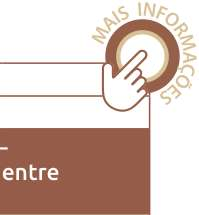

<!-- figure p151-fig1 | described_by: agy | ocr_overlap: None | needs_review: false -->
1. **Tipo de figura:** Trata-se de um elemento gráfico decorativo/informativo recortado (recorte do canto superior direito de um quadro ou caixa de destaque de um documento), composto por uma caixa retangular em faixas sobreposta por um ícone circular interativo de mão apontando para um botão ("mais informações").

2. **Texto visível (literal):**
   - Disposto em arco ao redor da borda externa do ícone circular, em letras maiúsculas: `MAIS INFORMAÇÕES`
   - Dentro da área retangular inferior escura (cortado na margem esquerda da imagem), em duas linhas:
     - Primeira linha (junto à borda esquerda): `-`
     - Segunda linha: `entre`

3. **Estrutura:**
   - **Caixa retangular recortada (parte esquerda e inferior):** Ocupa a metade inferior e parte da lateral esquerda da imagem, estando cortada à esquerda e fechada por uma borda fina à direita e no topo. É dividida horizontalmente em três faixas empilhadas:
     - Faixa superior: retângulo estreito com fundo branco, delimitado por linhas horizontais acima e abaixo.
     - Faixa intermediária: retângulo com fundo branco, delimitado acima por linha horizontal e à direita pela borda vertical da caixa.
     - Faixa inferior: bloco retangular sólido preenchido, onde aparece o texto recortado (`-` na linha de cima e `entre` na linha de baixo).
   - **Ícone circular no canto superior direito:** Posicionado sobre o encontro das bordas superior e direita da caixa retangular, é formado por círculos concêntricos (um anel externo mais largo, um anel intermediário mais fino e um centro circular branco). O texto `MAIS INFORMAÇÕES` acompanha a curvatura externa do anel, no sentido horário, da posição aproximada de 10 horas até cerca de 4 horas e meia.
   - **Ícone de mão:** Sobreposto à parte inferior esquerda dos círculos concêntricos e à borda superior direita da caixa retangular, uma mão estilizada com o dedo indicador estendido para cima e para a direita aponta diretamente para o centro branco dos círculos, representando a ação de clicar ou tocar. Não há setas, eixos ou conexões de fluxograma.

4. **Números ou valores de dados:** Nenhum. A figura não contém números, valores quantitativos ou dados numéricos.

5. **Cores com significado:** As cores (marrom, bege/dourado claro e branco) têm função apenas estilística e de contraste visual (para destacar o alvo clicável, o contorno da mão e a legibilidade do texto branco sobre o fundo marrom), não codificando categorias ou valores de dados.

<!-- Start of picture text -->
MAIS INFOR M A Ç Õ SE <!-- End of picture text -->

###### Objetivo 8. Licenciatura e formação continuada 

|EIXO(Mapa estratégico)|APRENDIZAGE|M E CRESCIME|NTO|||||
|---|---|---|---|---|---|---|---|
|TEMA OBJETIVO|LICENCIATURA Elevar a quali       i formadore(a)s Educação Sup  |E FORMAÇÃO dade da form     i e estudante erior e Educa |CONTINUADA ação inicial e c  i s – nos cursos ção Básica. |ontinuada de i de licenciatur |profissionais d a, promovendo |i o magistério a integração |i   – entre |
|INDICADOR(ES)|META 2022|META|2023|META|2024|MET|A 2025|
|||1º Sem.|2º Sem.|1º Sem.|2º Sem.|1º Sem.|2º Sem.|
|Oferta de programas (cursos) de for- mação continuada para formadore(a)s de professore(a)s e do(a)s discentes de graduação. UNIDADE(S)RESPONSÁVEL(IS)|1 curso|1 curso|1 curso|1 evento|2 cursos|1 curso|3 cursos|
|PREG, PROExC, Progepe e coordena- ções de cursos.||||||||

**150** 

<!-- page 152 -->

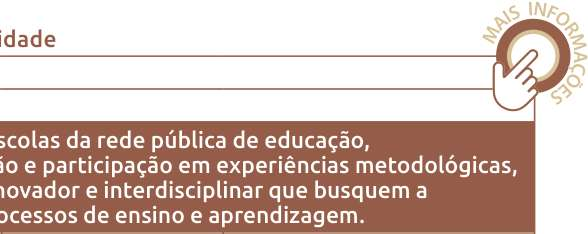

<!-- figure p152-fig1 | described_by: agy | ocr_overlap: 1.0 | needs_review: false -->
1. **Tipo de figura:** Recorte parcial (parte superior direita) de um quadro informativo ou bloco tabular estilizado extraído de um PDF, com um ícone/botão gráfico de chamada para ação ("MAIS INFORMAÇÕES") sobreposto ao canto superior direito e texto cortado na margem esquerda.

2. **Texto visível (ipsis litteris):**
   - No canto superior esquerdo (cortado à esquerda): `idade`
   - Ao redor do ícone circular no canto superior direito (em texto curvo): `MAIS INFORMAÇÕES`
   - No bloco retangular marrom inferior, em quatro linhas (todas cortadas à esquerda):
     - `scolas da rede pública de educação,`
     - `ão e participação em experiências metodológicas,` (com o `ã` parcialmente cortado à esquerda)
     - `novador e interdisciplinar que busquem a`
     - `ocessos de ensino e aprendizagem.` (com o `o` levemente cortado à esquerda)

3. **Estrutura:**
   - A figura exibe apenas a porção direita de um quadro com borda direita vertical fina na cor marrom e extremidade esquerda recortada.
   - De cima para baixo, o quadro é dividido em:
     - Uma área superior de fundo branco contendo o fragmento de texto `idade` à esquerda.
     - Uma primeira linha horizontal marrom, seguida de uma faixa horizontal vazia de fundo branco e de uma segunda linha horizontal marrom.
     - Uma segunda faixa horizontal vazia de fundo branco abaixo da segunda linha, fechada à direita pela borda vertical marrom.
     - Um bloco retangular de fundo marrom ocupando a metade inferior da imagem, contendo as quatro linhas de texto em branco; na margem inferior externa, há uma linha divisória muito fina indicando continuação do elemento abaixo.
   - Sobreposto ao canto superior direito (cruzando as duas linhas horizontais e a borda direita), encontra-se um selo/botão circular composto por um anel externo marrom espesso, um anel interno bege/dourado claro e miolo branco. O texto `MAIS INFORMAÇÕES` acompanha externamente a curva superior e direita do círculo. Sobre o quadrante inferior esquerdo do círculo há o desenho estilizado de uma mão branca com contorno marrom cujo dedo indicador aponta para o centro do círculo.

4. **Números e valores de dados:** Não há números nem valores numéricos visíveis na figura.

5. **Cores com significado:** O esquema em marrom, bege e branco estabelece hierarquia visual: o bloco com fundo marrom e letras brancas destaca o texto descritivo em relação ao cabeçalho/faixas de fundo branco, enquanto o selo circular em marrom e bege com o ícone de mão apontando sinaliza um elemento interativo ou link de acesso a mais informações.

~~~text ocr
dade
colas da rede pública de educação,
o e participação em experiências metodológicas,
ovador e interdisciplinar que busquem a
de ensino e aprendizagem.
~~~

<!-- Start of picture text -->
proporcionando-lhes oportunidades de criação e participação em experiências metodológicas, prendizagem.rendizagem.gem.em.rendizagem.gem.em.gem.em.em. MAIS INFOR M A Ç Õ SE <!-- End of picture text -->

###### Objetivo 9. Interação Escola X Universidade 

###### EIXO (Mapa estratégico) SOCIEDADE E APRENDIZAGEM E CRESCIMENTO TEMA INTERAÇÃO ESCOLA X UNIVERSIDADE Inserir o(a)s licenciando(a)s no cotidiano de escolas da rede pública de educação, proporcionando-lhes oportunidades de criação e participação em experiências metodológicas, OBJETIVO tecnológicas e práticas docentes de caráter inovador e interdisciplinar que busquem a superação de problemas identificados nos processos de ensino e aprendizagem.rendizagem.gem.em.peração de problemas identificados nos processos de ensino e aprendizagem.rendizagem.gem.em.eração de problemas identificados nos processos de ensino e aprendizagem.rendizagem.gem.em.ção de problemas identificados nos processos de ensino e aprendizagem.rendizagem.gem.em.ão de problemas identificados nos processos de ensino e aprendizagem.rendizagem.gem.em.problemas identificados nos processos de ensino e aprendizagem.rendizagem.gem.em.roblemas identificados nos processos de ensino e aprendizagem.rendizagem.gem.em.prendizagem.rendizagem.gem.em.rendizagem.gem.em.gem.em.em. 

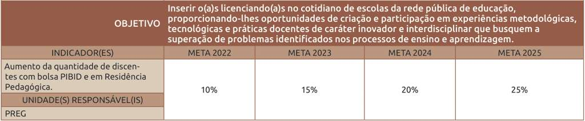

<!-- figure p152-fig2 | described_by: agy | ocr_overlap: 1.0 | needs_review: false -->
1. **Tipo de figura:** Tabela (quadro) de planejamento institucional/estratégico que apresenta um objetivo, o indicador associado, a unidade responsável e as metas percentuais anuais para o período de 2022 a 2025.

2. **Todo o texto visível (verbatim):**
   - Faixa superior (esquerda): `OBJETIVO`
   - Faixa superior (direita): `Inserir o(a)s licenciando(a)s no cotidiano de escolas da rede pública de educação, proporcionando-lhes oportunidades de criação e participação em experiências metodológicas, tecnológicas e práticas docentes de caráter inovador e interdisciplinar que busquem a superação de problemas identificados nos processos de ensino e aprendizagem.`
   - Linha de cabeçalhos das colunas:
     - Coluna 1: `INDICADOR(ES)`
     - Coluna 2: `META 2022`
     - Coluna 3: `META 2023`
     - Coluna 4: `META 2024`
     - Coluna 5: `META 2025`
   - Células do corpo da tabela:
     - Coluna 1, 1ª linha interna: `Aumento da quantidade de discen-tes com bolsa PIBID e em Residência Pedagógica.` (com quebra de linha hifenizada entre `discen-` e `tes`)
     - Coluna 1, 2ª linha interna: `UNIDADE(S) RESPONSÁVEL(IS)`
     - Coluna 1, 3ª linha interna: `PREG`
     - Coluna 2: `10%`
     - Coluna 3: `15%`
     - Coluna 4: `20%`
     - Coluna 5: `25%`

3. **Estrutura:**
   - Quadro tabular retangular com bordas finas, organizado em 5 colunas, sem setas, gráficos, eixos ou painéis separados.
   - **Faixa superior (linha 1):** ocupa toda a largura da tabela sem linha divisória vertical visível entre os dois textos; o rótulo `OBJETIVO` fica alinhado à direita dentro da largura da Coluna 1, enquanto a descrição do objetivo ocupa a largura das Colunas 2 a 5, alinhada à esquerda em 4 linhas de texto.
   - **Linha de cabeçalhos (linha 2):** dividida em 5 células lado a lado com texto centralizado (`INDICADOR(ES)`, `META 2022`, `META 2023`, `META 2024`, `META 2025`).
   - **Bloco inferior (linhas 3 a 5):**
     - A **Coluna 1** é subdividida horizontalmente em 3 células empilhadas: no topo, a descrição do indicador (alinhada à esquerda); no meio, o subcabeçalho `UNIDADE(S) RESPONSÁVEL(IS)` (centralizado); na parte inferior, a sigla `PREG` (alinhada à esquerda).
     - As **Colunas 2, 3, 4 e 5** possuem, cada uma, uma única célula mesclada verticalmente abrangendo toda a altura das 3 células empilhadas da Coluna 1, exibindo os valores percentuais centralizados horizontal e verticalmente sob seus respectivos anos.

4. **Todos os números e valores de dados:**
   - Anos de referência das metas: `2022`, `2023`, `2024`, `2025`.
   - Metas percentuais para o indicador:
     - `META 2022`: `10%`
     - `META 2023`: `15%`
     - `META 2024`: `20%`
     - `META 2025`: `25%`

5. **Cores com significado:**
   - As cores diferenciam hierarquicamente os níveis da tabela:
     - **Marrom-escuro com texto branco:** identifica a faixa de nível mais alto, correspondente ao `OBJETIVO` e à sua descrição.
     - **Marrom-médio claro com texto preto:** identifica os cabeçalhos das colunas (`INDICADOR(ES)`, `META 2022` a `META 2025`) e o subcabeçalho `UNIDADE(S) RESPONSÁVEL(IS)`.
     - **Bege-claro com texto preto:** identifica os campos de conteúdo textual da primeira coluna (descrição do indicador e a unidade responsável `PREG`).
     - **Branco com texto preto:** destaca as células dos valores numéricos das metas anuais (`10%`, `15%`, `20%`, `25%`).

~~~text ocr
Inserir o(a)s licenciando(a)s no cotidiano de escolas da rede pública de educação,
OBJETIVO proporcionando-lhes oportunidades de criação e participação em experiências metodológicas,
tecnológicas e práticas docentes de caráter inovador e interdisciplinar que busquem a
superação de problemas identificados nos processos de ensino e aprendizagem.
Aumento da quantidade de discen-
tes com bolsa PIBID e em Residência
Pedagógica. 10% 15% 20% 25%
PREG
~~~

<!-- Start of picture text -->
Inserir o(a)s licenciando(a)s no cotidiano de escolas da rede pública de educação, proporcionando-lhes oportunidades de criação e participação em experiências metodológicas, OBJETIVO tecnológicas e práticas docentes de caráter inovador e interdisciplinar que busquem a superação de problemas identificados nos processos de ensino e aprendizagem.rendizagem.gem.em.peração de problemas identificados nos processos de ensino e aprendizagem.rendizagem.gem.em.eração de problemas identificados nos processos de ensino e aprendizagem.rendizagem.gem.em.ção de problemas identificados nos processos de ensino e aprendizagem.rendizagem.gem.em.ão de problemas identificados nos processos de ensino e aprendizagem.rendizagem.gem.em.problemas identificados nos processos de ensino e aprendizagem.rendizagem.gem.em.roblemas identificados nos processos de ensino e aprendizagem.rendizagem.gem.em.prendizagem.rendizagem.gem.em.rendizagem.gem.em.gem.em.em. INDICADOR(ES) META 2022 META 2023 META 2024 META 2025 Aumento da quantidade de discen- tes com bolsa PIBID e em Residência Pedagógica. 10% 15% 20% 25% UNIDADE(S) RESPONSÁVEL(IS) PREG <!-- End of picture text -->

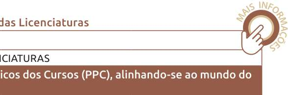

<!-- figure p152-fig3 | described_by: agy | ocr_overlap: 1.0 | needs_review: false -->
1. **Tipo de figura:** Recorte parcial (canto superior direito) de um quadro/tabela informativa de um documento em PDF, contendo cabeçalhos/faixas de texto cortados à esquerda e um ícone circular interativo de botão clicável ("MAIS INFORMAÇÕES") com uma mão apontando no canto superior direito.

2. **Todo o texto visível (verbatim):**
   - Acima da borda superior do quadro, à esquerda: `das Licenciaturas`
   - Disposto em arco ao redor do ícone circular no canto superior direito (em letras maiúsculas): `MAIS INFORMAÇÕES`
   - Na segunda linha horizontal interna do quadro (cortado na borda esquerda, iniciando com um traço vertical encostado à margem): `ICIATURAS`
   - Na faixa inferior preenchida do quadro (cortado na borda esquerda): `icos dos Cursos (PPC), alinhando-se ao mundo do`

3. **Estrutura:**
   - A imagem apresenta um recorte retangular horizontal limitado à esquerda e na parte inferior, deixando visível a extremidade direita de um quadro estruturado em faixas horizontais empilhadas:
     - **Cabeçalho superior externo:** Posicionado acima da linha superior do quadro, contendo o fragmento de texto `das Licenciaturas`.
     - **Linha 1 do quadro:** Faixa horizontal retangular vazia, com fundo branco, delimitada por uma linha horizontal superior, uma linha horizontal inferior e a borda vertical direita do quadro (não há borda esquerda visível devido ao recorte).
     - **Linha 2 do quadro:** Faixa horizontal retangular de fundo branco, logo abaixo da Linha 1, delimitada pela linha horizontal superior, pela borda vertical direita e pelo topo da faixa inferior preenchida; contém o fragmento de texto `ICIATURAS` alinhado à esquerda do recorte.
     - **Linha 3 (faixa inferior):** Faixa retangular preenchida mais alta que as anteriores, alinhada à mesma borda direita do quadro e estendendo-se até a borda inferior e esquerda da imagem; contém o fragmento de texto `icos dos Cursos (PPC), alinhando-se ao mundo do`.
   - **Ícone no canto superior direito:** Sobreposto à quina superior direita do quadro (cobrindo parcialmente a borda superior e a borda direita das Linhas 1 e 2), há um selo circular composto por anéis concêntricos (anel externo mais largo, anel interno mais fino e centro circular branco). Em volta da metade superior e direita do anel externo (aproximadamente das 10h às 5h no sentido horário), acompanha em curva o texto `MAIS INFORMAÇÕES`. Sobreposto à porção inferior esquerda dos anéis há o ícone estilizado de uma mão com o dedo indicador estendido na diagonal para cima e para a direita, apontando para o centro branco do círculo (indicando elemento clicável/interativo). Não há setas, eixos ou outras conexões.

4. **Números e valores de dados:** Não há números nem valores numéricos visíveis na figura.

5. **Cores com significado:**
   - **Marrom:** Utilizado para destacar visualmente o título externo (`das Licenciaturas`), estruturar as bordas do quadro, preencher o fundo da faixa inferior (diferenciando-a como barra de destaque/subtítulo em relação às linhas brancas acima, com texto em branco para contraste) e compor o anel externo do ícone e o contorno da mão apontadora.
   - **Bege/dourado claro:** Utilizado no anel interno do ícone circular e no texto curvo `MAIS INFORMAÇÕES`, destacando a chamada visual de ação associada ao botão clicável.
   - **Preto sobre branco:** Utilizado na Linha 2 (`ICIATURAS`), diferenciando visualmente esse nível de texto da faixa marrom com texto branco logo abaixo.

~~~text ocr
Jas Licenciaturas A
icos dos Cursos (PPC), alinhando-se ao mundo do
~~~

<!-- Start of picture text -->
 das Licenciaturas MAIS INFOR M A Ç Õ SE <!-- End of picture text -->

###### Objetivo 10. Projeto Pedagógico Curricular (PPC) das Licenciaturas 

###### EIXO (Mapa estratégico) APRENDIZAGEM E CRESCIMENTO 

|TEMA|PROJETO PEDAGÓGICO CU|RRICULAR (PPC) DAS LICENCI|ATURAS||
|---|---|---|---|---|
|OBJETIVO|Atualizar permanenteme trabalho e à legislação e|nte os Projetos Pedagógic ducacional pertinente.|os dos Cursos (PPC), alin|hando-se ao mundo do|
|INDICADOR(ES)|META 2022|META 2023|META 2024|META 2025|
|Atualização dos PPC dos cursos de licenciatura. UNIDADE(S)RESPONSÁVEL(IS)|10% dos PPC|25% dos PPC|50% dos PPC|100% dos PPC|
|PREG e Coordenações de Curso|||||

**151** 

<!-- page 153 -->

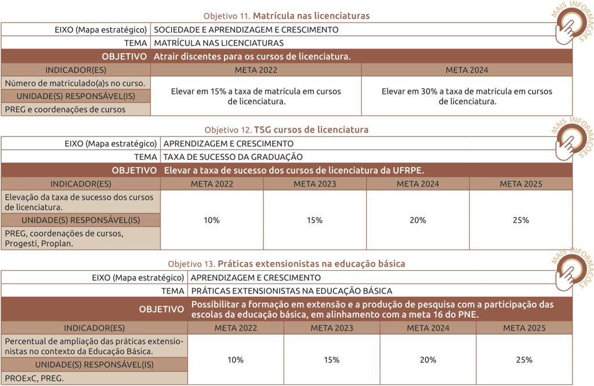

<!-- figure p153-fig1 | described_by: agy | ocr_overlap: 1.0 | needs_review: false -->
**1. Tipo de figura**
Trata-se de um conjunto de três tabelas estruturadas (fichas de planejamento estratégico), dispostas verticalmente uma abaixo da outra, que detalham objetivos estratégicos institucionais (Objetivos 11, 12 e 13), seus respectivos eixos, temas, indicadores, unidades responsáveis e metas anuais. No canto superior direito de cada tabela há um ícone circular com uma mão apontando e texto curvado indicando acesso a mais informações.

**2. Todo o texto visível (transcrição literal)**

* **Tabela 1**
  * Título acima da tabela: `Objetivo 11. Matrícula nas licenciaturas`
  * Selo no canto superior direito: `MAIS INFORMAÇÕES`
  * Linha 1: `EIXO (Mapa estratégico)` | `SOCIEDADE E APRENDIZAGEM E CRESCIMENTO`
  * Linha 2: `TEMA` | `MATRÍCULA NAS LICENCIATURAS`
  * Linha 3: `OBJETIVO` | `Atrair discentes para os cursos de licenciatura.`
  * Linha 4 (cabeçalhos): `INDICADOR(ES)` | `META 2022` | `META 2024`
  * Coluna 1, célula 1: `Número de matriculado(a)s no curso.`
  * Coluna 1, célula 2: `UNIDADE(S) RESPONSÁVEL(IS)`
  * Coluna 1, célula 3: `PREG e coordenações de cursos`
  * Coluna 2 (abaixo de `META 2022`): `Elevar em 15% a taxa de matrícula em cursos de licenciatura.`
  * Coluna 3 (abaixo de `META 2024`): `Elevar em 30% a taxa de matrícula em cursos de licenciatura.`

* **Tabela 2**
  * Título acima da tabela: `Objetivo 12. TSG cursos de licenciatura`
  * Selo no canto superior direito: `MAIS INFORMAÇÕES`
  * Linha 1: `EIXO (Mapa estratégico)` | `APRENDIZAGEM E CRESCIMENTO`
  * Linha 2: `TEMA` | `TAXA DE SUCESSO DA GRADUAÇÃO`
  * Linha 3: `OBJETIVO` | `Elevar a taxa de sucesso dos cursos de licenciatura da UFRPE.`
  * Linha 4 (cabeçalhos): `INDICADOR(ES)` | `META 2022` | `META 2023` | `META 2024` | `META 2025`
  * Coluna 1, célula 1: `Elevação da taxa de sucesso dos cursos de licenciatura.`
  * Coluna 1, célula 2: `UNIDADE(S) RESPONSÁVEL(IS)`
  * Coluna 1, célula 3: `PREG, coordenações de cursos, Progesti, Proplan.`
  * Coluna 2 (abaixo de `META 2022`): `10%`
  * Coluna 3 (abaixo de `META 2023`): `15%`
  * Coluna 4 (abaixo de `META 2024`): `20%`
  * Coluna 5 (abaixo de `META 2025`): `25%`

* **Tabela 3**
  * Título acima da tabela: `Objetivo 13. Práticas extensionistas na educação básica`
  * Selo no canto superior direito: `MAIS INFORMAÇÕES`
  * Linha 1: `EIXO (Mapa estratégico)` | `APRENDIZAGEM E CRESCIMENTO`
  * Linha 2: `TEMA` | `PRÁTICAS EXTENSIONISTAS NA EDUCAÇÃO BÁSICA`
  * Linha 3: `OBJETIVO` | `Possibilitar a formação em extensão e a produção de pesquisa com a participação das escolas da educação básica, em alinhamento com a meta 16 do PNE.`
  * Linha 4 (cabeçalhos): `INDICADOR(ES)` | `META 2022` | `META 2023` | `META 2024` | `META 2025`
  * Coluna 1, célula 1: `Percentual de ampliação das práticas extensio-nistas no contexto da Educação Básica.` (com hifenização de quebra de linha em `extensio-` / `nistas`)
  * Coluna 1, célula 2: `UNIDADE(S) RESPONSÁVEL(IS)`
  * Coluna 1, célula 3: `PROExC, PREG.`
  * Coluna 2 (abaixo de `META 2022`): `10%`
  * Coluna 3 (abaixo de `META 2023`): `15%`
  * Coluna 4 (abaixo de `META 2024`): `20%`
  * Coluna 5 (abaixo de `META 2025`): `25%`

**3. Estrutura**
A figura é organizada em três painéis tabulares independentes empilhados verticalmente, sem setas ou conexões entre eles, seguindo o mesmo modelo estrutural:
* **Cabeçalho externo:** cada tabela possui um título centralizado no topo e, sobreposto ao canto superior direito da borda da tabela, um botão/ícone circular composto por um anel com o texto curvado `MAIS INFORMAÇÕES` na borda superior direita e o desenho de uma mão com o dedo indicador apontando para o centro.
* **Parte superior da grade (3 linhas):**
  * As duas primeiras linhas (`EIXO (Mapa estratégico)` e `TEMA`) têm duas colunas: a coluna da esquerda apresenta o rótulo alinhado à direita e a coluna da direita (mesclada horizontalmente por toda a largura restante) apresenta o valor alinhado à esquerda.
  * A terceira linha (`OBJETIVO`) forma uma faixa contínua sem linha divisória vertical interna, mantendo o rótulo `OBJETIVO` alinhado à coluna da esquerda e a descrição do objetivo iniciando na mesma margem vertical da segunda coluna.
* **Parte inferior da grade (cabeçalho de metas + bloco de dados):**
  * A quarta linha funciona como barra de cabeçalhos: a primeira coluna contém `INDICADOR(ES)` (alinhada à primeira coluna das linhas superiores) e o restante da largura divide-se em colunas iguais para as metas anuais — 2 colunas de metas na Tabela 1 (`META 2022` e `META 2024`, totalizando 3 colunas) e 4 colunas de metas nas Tabelas 2 e 3 (`META 2022`, `META 2023`, `META 2024` e `META 2025`, totalizando 5 colunas).
  * Abaixo dessa barra de cabeçalhos, a primeira coluna subdivide-se verticalmente em 3 linhas empilhadas: (1) descrição do indicador, (2) subcabeçalho `UNIDADE(S) RESPONSÁVEL(IS)` e (3) lista das unidades responsáveis. Em contraste, cada coluna de meta anual ocupa uma única célula mesclada verticalmente correspondente à altura total dessas 3 sublinhas, com o valor centralizado horizontal e verticalmente.

**4. Todos os números e valores de dados**
* **Identificadores dos objetivos:** `11`, `12`, `13`.
* **Referência normativa no texto do Objetivo 13:** meta `16` do PNE.
* **Objetivo 11 (Matrícula nas licenciaturas):**
  * Ano `2022`: elevação de `15%`.
  * Ano `2024`: elevação de `30%`.
* **Objetivo 12 (TSG cursos de licenciatura):**
  * Ano `2022`: `10%`.
  * Ano `2023`: `15%`.
  * Ano `2024`: `20%`.
  * Ano `2025`: `25%`.
* **Objetivo 13 (Práticas extensionistas na educação básica):**
  * Ano `2022`: `10%`.
  * Ano `2023`: `15%`.
  * Ano `2024`: `20%`.
  * Ano `2025`: `25%`.

**5. Cores com significado**
As variações tonais de marrom e bege servem para diferenciar a hierarquia funcional das células dentro de cada tabela:
* **Marrom escuro com texto branco em negrito:** destaca a faixa principal do `OBJETIVO`, diferenciando-a visualmente dos metadados superiores (`EIXO` e `TEMA`) e das metas inferiores.
* **Marrom médio/bege escuro com texto preto:** identifica os cabeçalhos das seções inferiores (`INDICADOR(ES)`, `META 2022`–`META 2025` e o subcabeçalho `UNIDADE(S) RESPONSÁVEL(IS)`).
* **Bege claro com texto preto:** agrupa os valores textuais da coluna lateral esquerda (descrição dos indicadores e nomes das unidades responsáveis).
* **Fundo branco com texto preto:** destaca os campos superiores (`EIXO` e `TEMA`) e, principalmente, as células de valores das metas anuais, separando-as da coluna de indicadores/unidades.

~~~text ocr
Objetivo 11. Matrícula nas licenciaturas a
EIXO (Mapa estratégico) | SOCIEDADE E APRENDIZAGEM E CRESCIMENTO é
TEMA | MATRÍCULA NAS LICENCIATURAS
OBJETIVO Atrair discentes para os cursos de licenciatura.
Número de matriculado(a)s no curso.
PREG e coordenações de cursos
Elevar em 15% a taxa de matrícula em cursos Elevar em 30% a taxa de matrícula em cursos
de licenciatura. de licenciatura.
Objetivo 12. TSG cursos de licenciatura
EIXO (Mapa estratégico) | APRENDIZAGEM E CRESCIMENTO
TEMA | TAXA DE SUCESSO DA GRADUAÇÃO
OBJETIVO Elevar a taxa de sucesso dos cursos de licenciatura da UFRPE.
Elevação da taxa de sucesso dos cursos
de licenciatura.
10% 15% 20%
PREG, de cursos,
Progesti,
Objetivo 13. Práticas extensionistas na educação básica a
EIXO (Mapa estratégico) | APRENDIZAGEM E CRESCIMENTO
TEMA | PRÁTICAS EXTENSIONISTAS NA EDUCAÇÃO BÁSICA
Possibilitar a formação em extensão e a produção de pesquisa com a participação das
OBJETIVO
escolas da educação básica, em alinhamento com a meta 16 do PNE.
Percentual de ampliação das práticas extensio-
nistas no contexto da Educação Básica.
10% 15% 20% 25%
= PREG.
~~~

<!-- Start of picture text -->
Objetivo 11. Matrícula nas licenciaturas EIXO (Mapa estratégico) SOCIEDADE E APRENDIZAGEM E CRESCIMENTO TEMA MATRÍCULA NAS LICENCIATURAS OBJETIVO Atrair discentes para os cursos de licenciatura. INDICADOR(ES) META 2022 META 2024 Número de matriculado(a)s no curso. Elevar em 15% a taxa de matrícula em cursos   Elevar em 30% a taxa de matrícula em cursos UNIDADE(S) RESPONSÁVEL(IS) de licenciatura. de licenciatura. PREG e coordenações de cursos Objetivo 12. TSG cursos de licenciatura EIXO (Mapa estratégico) APRENDIZAGEM E CRESCIMENTO TEMA TAXA DE SUCESSO DA GRADUAÇÃO OBJETIVO Elevar a taxa de sucesso dos cursos de licenciatura da UFRPE. INDICADOR(ES) META 2022 META 2023 META 2024 META 2025 Elevação da taxa de sucesso dos cursos de licenciatura. UNIDADE(S) RESPONSÁVEL(IS) 10% 15% 20% 25% PREG, coordenações de cursos, Progesti, Proplan. Objetivo 13. Práticas extensionistas na educação básica EIXO (Mapa estratégico) APRENDIZAGEM E CRESCIMENTO TEMA PRÁTICAS EXTENSIONISTAS NA EDUCAÇÃO BÁSICA OBJETIVO Possibilitar a formação em extensão e a produção de pesquisa com a participação das escolas da educação básica, em alinhamento com a meta 16 do PNE. INDICADOR(ES) META 2022 META 2023 META 2024 META 2025 Percentual de ampliação das práticas extensio- nistas no contexto da Educação Básica. 10% 15% 20% 25% UNIDADE(S) RESPONSÁVEL(IS) PROExC, PREG. I I I N N N F F F S S S I I I O O O A A A R R R M M M M M M A A A Ç Ç Ç Õ Õ Õ E E E S S S <!-- End of picture text -->

**152** 

<!-- page 154 -->

##### **Políticas de Ensino da Educação Básica, Técnica e Tecnológica (Codai e UACSA/UFRPE)** 

A Educação Profissional e Tecnológica está inserida no Projeto Pedagógico Institucional da UFRPE devido à existência do Colégio Agrícola Dom Agostinho Ikas da UFRPE (Codai) desde a fundação desta Universidade. Pela Lei nº 12.677, de 25/06/2012 (BRASIL, 2012f), as Escolas Técnicas Vinculadas às Universidades Federais (ETFVUF) passaram a integrar a Rede Federal Educação Profissional, Científica e Tecnológica (RFEPCT), vinculada ao Ministério da Educação. 

Não obstante compor a UFRPE, desde a sua fundação, a Lei nº 11.892, de 29/12/2008 (BRASIL, 2008d), incluiu o Codai entre as trinta e duas Escolas Técnicas vinculadas às Universidades Federais, acrescentando “da UFRPE” ao nome tradicional “Colégio Agrícola Dom Agostinho Ikas” (BRASIL, 2008b; BRASIL, 2012g). Colocadas ao lado dos Institutos Federais de Educação, Ciência e Tecnologia e outras instituições federais na RFEPCT, as ETFVUF assumem a responsabilidade de executar as diretrizes da Educação Profissional e Tecnológica no âmbito das Universidades. 

A LDB _–_ Lei nº 9.394/1996 (BRASIL, 1996b), alterada pela Lei nº 11.741/2008 (BRASIL, 2008b), estabeleceu que a Educação Profissional e Tecnológica abrange os cursos de: 

**_2._** Educação Profissional Técnica de Nível Médio; e 

**_3._** Educação Profissional Tecnológica, de graduação e pós-graduação. 

Ao ser sancionada em 1996, a LDB separou o Ensino Médio, etapa final da Educação Básica, da Educação Profissional. A medida foi regulamentada pelo Decreto nº 2208/1997 (BRASIL, 1997a) que, na prática, visava à extinção do Ensino Médio na RFEPCT, deixando essa oferta para as redes estaduais de educação. Apesar do regramento legal, desde 2002, o Codai optou por ofertar o Ensino Médio de forma independente da Educação Profissional, justificando a decisão pela inserção na UFRPE. Considerou-se que a vinculação do Codai requer atuação na oferta de Estágio Supervisionado Obrigatório dos cursos de licenciatura, nos moldes de uma escola de aplicação. Também se levou em conta a localização geográfica do Colégio na Região Metropolitana do Recife e a grande demanda do público pelo Ensino Médio em complementação à oferta da rede estadual. 

O Codai oferece cursos de Educação Profissional no nível técnico e Educação Básica de nível médio, na modalidade presencial e cursos de Educação Profissional nos níveis de formação inicial e no nível técnico, na modalidade de Educação a Distância (EAD). 

**_1._** Formação inicial e continuada ou qualificação profissional; 

**153** 

<!-- page 155 -->

##### **Cursos na Modalidade Presencial** 

Quadro 11. **Cursos regularmente** oferecidos pelo Codai 

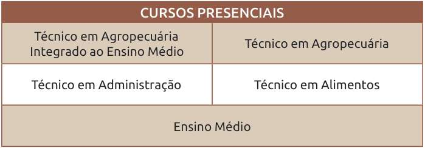

<!-- figure p155-fig1 | described_by: agy | ocr_overlap: 0.9 | needs_review: false -->
1. **Tipo de figura:** Tabela informativa (quadro) listando cursos presenciais.

2. **Todo o texto visível (verbatim):**
   - Cabeçalho: `CURSOS PRESENCIAIS`
   - Linha 1, coluna 1: `Técnico em Agropecuária` / `Integrado ao Ensino Médio`
   - Linha 1, coluna 2: `Técnico em Agropecuária`
   - Linha 2, coluna 1: `Técnico em Administração`
   - Linha 2, coluna 2: `Técnico em Alimentos`
   - Linha 3 (célula única): `Ensino Médio`

3. **Estrutura:**
   - A figura é uma tabela retangular com bordas finas, composta por 4 linhas no total (1 cabeçalho e 3 linhas de conteúdo) e até 2 colunas de larguras iguais, com todo o texto centralizado horizontal e verticalmente em cada célula:
     - **Cabeçalho (1 célula mesclada em toda a largura):** `CURSOS PRESENCIAIS`
     - **Linha 1 (2 colunas):** esquerda com `Técnico em Agropecuária` (primeira linha) e `Integrado ao Ensino Médio` (segunda linha); direita com `Técnico em Agropecuária`.
     - **Linha 2 (2 colunas):** esquerda com `Técnico em Administração`; direita com `Técnico em Alimentos`.
     - **Linha 3 (1 célula mesclada abrangendo as 2 colunas):** `Ensino Médio`.
   - Não há setas, conexões, eixos, legendas ou painéis adicionais.

4. **Números e valores de dados:**
   - Não há números nem valores quantitativos na figura.

5. **Cores com significado:**
   - O cabeçalho destaca-se das demais linhas pelo preenchimento marrom-avermelhado com texto branco, indicando tratar-se do título do quadro. As cores de fundo das linhas de conteúdo (alternância entre bege claro na 1ª e na 3ª linhas e branco na 2ª linha) têm função apenas visual (zebrado para facilitar a leitura), sem indicar categorias ou significados distintos.

~~~text ocr
CURSOS PRESENCIAIS
Técnico em Agropecuária
9rop Técnico em Agropecuária
Integrado ao Ensino Médio
Técnico em Administração Técnico em Alimentos
~~~

<!-- Start of picture text -->
CURSOS PRESENCIAIS Técnico em Agropecuária Técnico em Agropecuária Integrado ao Ensino Médio Técnico em Administração Técnico em Alimentos Ensino Médio <!-- End of picture text -->

##### **Educação Profissional** 

A Lei nº 11.741, de 16 de julho de 2008 (BRASIL, 2008b), estabelece que a Educação Profissional de nível médio será oferecida de forma articulada com o Ensino Médio e de forma Subsequente, destinada a discentes egresso(a)s do Ensino Médio. Os Projetos Pedagógicos dos Cursos (PPC) estão passando por revisão, observando as diretrizes estabelecidas na Resolução CNE/CP nº 01, de 5 Janeiro de 2021 (BRASIL, 2021a), para implantação a partir do 1º semestre de 2021. Os cursos são descritos a seguir: 

O Plano do Curso Integrado, em vigor, é composto por disciplinas da área técnica em Agropecuária, bem como por componentes curriculares do Ensino Médio, visando ao cumprimento das finalidades estabelecidas para a formação geral e as condições de preparação para o exercício de profissões técnicas, conforme exigência do Decreto nº 5.154/2004 (BRASIL, 2004a). Desta maneira, o curso tem 3 anos de duração, com dois turnos (manhã e tarde), subdividido em 6 semestres, totalizando 5.200 horas. Tal estrutura curricular torna o curso muito extenso, submetendo o estudante adolescente a uma carga de 17 disciplinas semestrais nos cinco primeiros semestres letivos. 

O estabelecimento de itinerários formativos, trazidos pela Lei nº 13.415, 16 de fevereiro de 2017, (BRASIL, 2017h), flexibiliza a carga horária para atendimento à BNCC _–_ EM, com o máximo de 1800 horas. Prevê elaborar o perfil profissional dos cursos técnicos integrados, considerando o Catálogo Nacional dos Cursos Técnicos (CNCT), complementado, se necessário, com a Classificação Brasileira de Ocupações (CBO) (CONIF, 2018). O novo currículo do Curso Técnico em Agropecuária Integrado ao Ensino Médio está em fase de aprovação para implantação no 1º semestre de 2021. 

###### **Ensino Técnico Integrado ao Ensino Médio** 

O Curso é ofertado desde o ano letivo de 2010, com Plano de Curso baseado na legislação vigente à época (Decreto nº 5.154/2004 (BRASIL, 2004a), Resolução nº 3/2008 – CNE (BRASIL, 2008a) e Catálogo Nacional de Cursos Técnicos). 

###### **Ensino Técnico Subsequente e o Concomitante ao Ensino Médio** 

De acordo com a LDB (BRASIL, 1996b), a Educação Profissional Técnica de nível médio, desenvolvida na forma 

**154** 

<!-- page 156 -->

subsequente, é ofertada a candidato(a)s que possuam o certificado de conclusão do Ensino Médio _–_ EM, ou equivalente. A forma articulada concomitante é oferecida a candidato(a)s ingressantes no Ensino Médio ou que estejam cursando o EM, efetuando-se matrículas distintas para cada curso. 

No Codai, os Cursos _Técnico em Administração_ e _Técnico em Alimentos_ são ofertados exclusivamente na forma subsequente. O C _urso Técnico em Agropecuária_ é ofertado nas formas subsequente e concomitante. 

###### **Ensino Médio** 

O Ensino Médio, com duração de três anos, é ofertado nos turnos da manhã e da tarde. Corresponde à última fase da Educação Básica, cuja finalidade, estabelecida na LDB, é a consolidação e o aprofundamento dos conhecimentos construídos no Ensino Fundamental, possibilitando a continuidade dos estudos; a preparação básica para o trabalho e a cidadania do(a) educando(a), para continuar aprendendo, de modo a ser capaz de se adaptar com flexibilidade a novas condições de ocupação ou aperfeiçoamento posteriores; o aprimoramento do(a) discente como pessoa humana, incluindo a formação ética e o desenvolvimento da autonomia intelectual e do pensamento crítico; e a compreensão dos fundamentos científico-tecnológicos dos processos produtivos, relacionando a teoria com a prática em cada disciplina. (BRASIL, 1996b). 

Com a Lei nº 13.415, de fevereiro de 2017 (BRASIL, 2017h), foi dada nova redação ao Artigo nº 36 da LDB (BRASIL, 1996b): 

O currículo do Ensino Médio será composto pela Base Nacional Comum Curricular e por itinerários formativos, que deverão ser organizados por meio da oferta de diferentes arranjos curriculares, conforme a relevância para o contexto local e a possibilidade dos sistemas de ensino. (BRASIL, 2017h). 

O Conselho Nacional de Educação (CNE), na Resolução CNE/CP nº 4, de 17 de dezembro de 2018 (BRASIL, 2018i), que institui a Base Nacional Comum Curricular na etapa do Ensino Médio (BRASIL, 2018i), BNCC _-_ EM, no Artigo 12, estabeleceu um prazo para adequação dos currículos e implementação até o ano letivo de 2022. 

No âmbito do Codai, foi instituída a Comissão de Atualização do Projeto Pedagógico do Ensino Médio a fim de apresentar proposta de nova organização curricular e definir itinerário formativo, conforme base legal citada.O itinerário formativo 5 trata da formação técnica profissional já existente no Codai pela oferta do Curso Técnico em Agropecuária integrado ao Ensino Médio. 

**155** 

<!-- page 157 -->

##### **Cursos na modalidade de Educação a Distância** 

##### **Criação da Rede e-Tec Brasil** 

O Sistema Escola Aberta do Brasil foi criado em 2007 pelo Decreto nº 6.301/2007 (BRASIL, 2007a), embasado pela LDB – Lei nº 9.394/1996 (BRASIL, 1996b). Surgiu com a finalidade de desenvolver a Educação Profissional e Tecnológica por meio da Educação a Distância (EAD), a fim de expandir e interiorizar a oferta, como também democratizar o acesso a cursos técnicos de nível médio de forma gratuita. Em 2011, com a Rede Federal de Educação Profissional, Científica e Tecnológica já instituída, e com a extinção da Secretaria de Educação a Distância no 

Ministério da Educação foi publicado o Decreto n0 7.589, de 26 de outubro de 2011 (BRASIL, 2011a), transformando o Sistema Escola Aberta do Brasil em “Rede e-Tec Brasil”, passando sua coordenação inteiramente para a Secretaria de Educação Profissional e Tecnológica do Ministério da Educação – SETEC/MEC. 

Ao longo de mais de dez anos de existência, a Rede e-Tec Brasil ampliou o número de instituições ofertantes, vagas e polos de apoio presenciais. Em 2017, a Rede e-Tec Brasil esteve presente em todo o território nacional, com mais de 400 instituições e 450 mil vagas ofertadas. Além disso, a Rede conta com 2.864 polos de apoio presencial, em uma parceria entre União, estado e municípios (FNETEC, 2017). 

##### **Cursos técnicos e de formação inicial e continuada a distância no Codai** 

O Núcleo de Educação a Distância (NEaD/Codai) foi criado mediante aprovação da Resolução nº 127/2009 _–_ Consu/ UFRPE, em 02 junho de 2009. (UFRPE, 2009). 

No entanto, a integração da equipe ao programa teve início em 27 de abril de 2007, por meio de participação na Chamada Pública referente ao Edital n0 01/2007 da Secretaria de Educação a Distância _–_ SEED, do Ministério da Educação, que propôs a oferta de Cursos Técnicos na modalidade a distância. 

No segundo semestre de 2009, o NEaD/Codai elaborou e ofereceu o Curso Técnico em Alimentos na modalidade a distância, de forma subsequente ao Ensino Médio, com atividades presenciais em 4 (quatro) polos: Recife, Caruaru, Palmares e Escada, sendo ofertadas 50 vagas em cada polo de apoio presencial. 

Em 2012, atendendo ao programa de expansão da Educação Profissional Técnica de nível médio do Plano Nacional de Educação _–_ PNE (BRASIL, 2014), iniciou-se a oferta de dois cursos técnicos a distância: Curso Técnico em Administração, nos polos de Garanhuns e São Bento do Una, e o Técnico em Açúcar Álcool em Palmares, Escada e Cabo de Santo Agostinho. 

**156** 

<!-- page 158 -->

Em 2015, com a publicação das Portarias nº 817, de 13 de agosto de 2015, e nº 1.152, de 22 de dezembro de 2015 (BRASIL, 2015), houve nova alteração no funcionamento da Rede e-Tec Brasil. Desde então, a oferta de cursos é feita mediante o Mapa de Demanda Identificada, ou seja, de acordo com necessidades locais. Essa alteração teve como objetivo principal otimizar a proposta do programa, visando à empregabilidade do(a)s formando(a)s. 

Nesse contexto, em 2017, o NEaD/Codai ofertou o Curso Técnico em Meio Ambiente, na forma concomitante ao Ensino Médio, bem como manteve a oferta dos cursos técnicos existentes. A ação do _MedioTec_ tem o propósito de ofertar cursos de Educação Profissional Técnica de nível médio na forma concomitante para discentes matriculado(a)s no Ensino Médio regular nas redes públicas estaduais e distrital de educação. Como objetivo principal, o _MedioTec_ tem a missão de garantir que o(a) estudante do Ensino Médio, após concluir essa etapa de ensino, esteja apto(a) a se inserir no mundo do trabalho e produzir renda. 

Para diversificar a oferta e promover a inserção e a reinserção de jovens e trabalhadore(a)s no mundo do trabalho, por meio de cursos de curta duração, conforme previsto no Decreto nº 5.154/2004 (BRASIL, 2014a), alterado pelo Decreto nº 8.268/2014 (BRASIL 2014), o NEaD/Codai, a partir do ano de 2020, iniciou a oferta de 4.100 mil vagas distribuídas entre os 19 (dezenove) cursos de Formação 

Inicial e Continuada – FIC ou qualificação profissional (Quadro 12). Os cursos, com 160 horas, foram produzidos com base no **Guia Pronatec de cursos FIC – 2016** , aprovado pela **Portaria MEC nº 12/2016** (BRASIL, 2016) e pelo Conselho Técnico Administrativo do Codai – CTA. 

Quadro 12. **Cursos FIC** ofertados pelo NEaD/ Codai e respectivas cargas horárias 

|**Cursos a distân**|**cia**|
|---|---|
|Açougueiro|Apicultor|
|Organizador de eventos*|Padeiro|
|Operador de usina de compostagem|Produtor de cerveja|
|Produtor de derivado de leite|Produtor de licores|
|Agente de alimentação escolar|Almoxarife|
|Assistente administrativo|Assistente de crédito e cobrança|
|Assistente de recursos humanos|Microempreendedor individual**|
|Produtor de frutas, hortaliças e plantas aromáticas processadas por secagem e desidratação.|Auxiliar de fiscalização ambiental|
|Editor de projeto visual gráfico **|Cerimonialista e mestre de cerimônia**|
|Ilustrador**||

_* Curso com 180h   **Cursos ofertados em 2021_ 

**157** 

<!-- page 159 -->

##### **Gestão operacional do NEaD/Codai** 

A gestão dos cursos técnicos e de formação inicial e continuada na modalidade EAD é coordenada pelo Núcleo de Educação a Distância – NEaD/Codai sob a responsabilidade da Direção Geral do Codai. O Núcleo conta com equipe gestora composta por: Coordenação Geral, Coordenação Adjunta, Coordenação de Cursos, secretário(a)s pedagógico(a)s, Coordenação de professore(a)s mediadore(a)s a distância, equipe de comunicação, equipe de Tecnologia da Informação (TI), equipe audiovisual, equipe de Registro Acadêmico, além de equipe administrativa e Coordenações de Polo presenciais. Também há bolsistas, professore(a)s formadore(a)s e mediadore(a)s a distância. 

Os cursos técnicos na modalidade de EAD são ofertados na forma semipresencial, com polos em diferentes localidades de Pernambuco distribuídos nas mesorregiões Metropolitana do Recife, Mata e Agreste Pernambucano. Enquanto, os cursos FIC são ofertados inteiramente na modalidade a distância, com abrangência para todos os estados do Brasil. Para os cursos técnicos, com encontro semanal nos polos ofertantes, contamos com a presença da coordenação de polo e do(a) professor(a) mediador(a) presencial _–_ tutor(a), responsáveis por toda a logística das atividades presenciais desenvolvidas. 

##### **Gestão administrativa e financeira** 

A gestão administrativa tem prática voltada para governança com planejamento detalhado das ações semestralmente. 

Além disso, implantou programa de monitoramento ou controladoria das ações administrativas e financeiras, a fim de acompanhar toda a execução financeira e a parte documental, visando à transparência da gestão e sua organização. Os recursos orçamentários são feitos pelo Fundo Nacional de Desenvolvimento da Educação _–_ FNDE, por meio de autorização da SETEC/MEC e com recursos descentralizados e cadastrados no Sistema Integrado de Monitoramento Execução e Controle _–_ SIMEC, no qual são detalhados os elementos de despesas para cada semestre ou ano e o números de vagas pactuadas. Esse processo exige planejamento eficiente e minucioso para que seja possível detalhar, adequadamente, os elementos de despesas na classificação orçamentária correta. Além disso, após a etapa de planejamento e antes da oferta dos cursos, existe a etapa preparatória para processos licitatórios, celebração de contratos e editais de seleção da equipe acadêmica _–_ professore(a)s formadore(a)s e mediadore(a)s _–_ e de discentes. 

É importante registrar que o NEaD/Codai participou, entre os anos de 2012 e 2013, de pesquisa promovida pela SETEC/MEC e realizada pelo grupo de Pesquisa Científica em Educação a Distância _–_ PCEADIS, do Programa de Pósgraduação em Educação da Universidade Federal de Santa Catarina _–_ UFSC. Como resultado que consta no Relatório Executivo da Pesquisa: Metodologias e Experiências Exitosas Implementadas na Rede e-Tec Brasil, cita o NEaD/ Codai como uma das 10 Instituição de Ensino Profissional 

**158** 

<!-- page 160 -->

em EAD de melhor Gestão Institucional entre as 22 analisadas (UFSC, 2013). 

##### **Gestão de polos presenciais NEaD/Codai** 

Os polos surgiram após assinatura do Convênio de Cooperação nº 05/2015, firmado entre a UFRPE e a Secretaria de Educação e Esporte do Estado de PE _–_ SEDUC/PE, com indicações de escolas de referências com melhores infraestruturas físicas e tecnológicas. Para início da oferta, as escolas-polos foram submetidas à avaliação do MEC. Após o processo de pactuação dos cursos e liberação dos recursos financeiros pela SETEC/MEC, realiza-se cadastrado no Sistema Nacional de Informações da Educação Profissional e Tecnológica – SISTEC. 

Existe gestão compartilhada entre Coordenação Geral do NEaD e Coordenações de Polos para definir períodos de aulas presenciais, aulas práticas, projeto de permanência de aluno(a)s, ações que integram as decisões com a oferta. 

##### **Gestão pedagógica** 

Cada curso é composto por coordenador(a) com respectivo(a) secretário(a) pedagógico(a), que planejam o calendário acadêmico, organizam, acompanham e monitoram todas as ações executadas pelo(a)s professore(a)s formadore(a)s desde a construção da sala de aula virtual até a condução do processo de ensino-aprendizagem no Ambiente Virtual de Aprendizagem _–_ AVA. 

A coordenação de professore(a)s mediadore(a)s a distância _–_ tutores(as) _–_ acompanha e monitora os atendimentos virtuais para discentes durante a oferta da disciplina. A equipe didático-pedagógica conta, também, com apoio de profissionais, como: psicopedagogo(a), intérprete de Libras e equipe de Registro Escolar. 

As atividades didático-pedagógicas utilizadas no processo de ensino-aprendizagem do NEaD/Codai, bem como a integração entre toda equipe com o(a)s discentes ocorrem, preferencialmente, por meio do Ambiente Virtual de Aprendizagem _–_ AVA, em momentos síncronos ou assíncronos, com uso de diversificadas ferramentas, conforme natureza da demanda. As ferramentas mais utilizadas são fóruns, _chat_ , questionários, glossários, videoaulas, mensagens, _wikis,_ dentre outros. Semanalmente, são realizadas atividades presenciais no polo, como: aulas teóricas, aulas práticas ou visitas técnicas. 

Os professore(a)s mediadore(a)s a distância têm como atribuições acompanhar o(a)s discentes nas visitas técnicas, aplicar as avaliações de aprendizagem, realizar o acompanhamento dos grupos de estudo, participar de reuniões de orientações com auxílio de psicopedagogo(a), dentre outras atividades. 

A equipe envolvida na produção do material de validação das salas de aula virtuais postadas no AVA é formada por: 

**159** 

<!-- page 161 -->

professore(a)s formadore(a)s e mediadore(a)s a distância, coordenação de curso, secretário(a) pedagógico(a), pessoal de Tecnologia da Informação (TI) e audiovisual. Cada membro da equipe tem funções e atribuições próprias nas etapas de análise ou edição do material recebido pelo(a) professor(a) formador(a) e seguem atendendo a um fluxograma de etapas de elaboração com prazos determinados. 

Existe uma equipe no NEaD/Codai caracterizada como “ _permanência de discentes_ ”, que analisa as informações extraídas do programa _Power BI_ , visando ao monitoramento de acesso de discentes no AVA. Essa análise contribui para que o(a)s gestore(a)s possam tomar decisões, com foco na diminuição da evasão escolar. 

Com planejamento detalhado da avaliação da educação profissional, que considere objetivos, execução e devolução dos resultados para discentes, docentes e sociedade, de forma sistemática, analítica e construtiva, pode-se aumentar a eficácia do processo de ensino-aprendizagem e contribuir, de forma significativa, para o pleno desenvolvimento da competência. (MORAIS, 2020). 

Para avaliação dos cursos ofertados, o NEaD utiliza o Sistema de Acompanhamento e Avaliação dos Cursos e-Tec Brasil (SAAS), o qual possibilita o acesso a questionários utilizados nas avaliações. (CATAPAN, 2015). Os dados coletados são baseados em atendimento às dimensões avaliativas 

relacionadas a: curso (coordenação, infraestrutura, AVA, discente); disciplinas (plano de ensino, material didático, corpo pedagógico) e polos (laboratórios, biblioteca, infraestrutura). 

##### **Produção de Material Didático** 

O NEaD/Codai entrega ao(à)s discentes, nos polos de apoio presencial, os materiais didáticos em meio impresso _–_ livros ou apostilas, bem como no formato digital, com conteúdos disponibilizados nas salas de aula virtuais. Essa ação auxilia o(a) discente na complementação de conhecimento das aulas e facilita o acesso aos materiais didáticos. 

Periodicamente, a equipe de diagramação e comunicação atua para aprimorar ou elaborar novos materiais didáticos, estruturados a partir de manual norteador elaborado pela gestão. Dependendo da proposta pedagógica, o material utilizado no curso pode ser produzido sob supervisão da equipe do NEaD, cedido por outra instituição de ensino ou captado gratuitamente do repositório do Portal da Rede e-Tec Brasil. Vale salientar que o NEaD/Codai foi responsável pela oferta do primeiro Curso Técnico em Alimentos na modalidade EAD no Brasil, produzindo 19 (dezenove) livros didáticos, todos com certificados ISBN e disponíveis em mídia digital no Portal da Rede e-Tec Brasil. 

É importante registrar que, em 2011, membros da Coordenação do NEaD participaram da elaboração do 

**160** 

<!-- page 162 -->

Currículo de Referência Nacional para o Sistema da Rede e-Tec-Brasil na condição de Pesquisadore(a)s na Área de Produção Alimentícia, sob orientação do Grupo de Pesquisa Científica em EAD _–_ PCEADIS da Universidade Federal de Santa Catarina (UFSC), em parceria com a Coordenação Geral do Sistema e-Tec Brasil. 

Outra ação vinculada à UFSC e com participação de membros do NEaD/Codai foi a publicação, em 2015, da coleção “ _Pro jeto de Gestão e Docência na EaD”_ , com 8 (oito) volumes em formato de livro: _O Processo de Gestão Institucional, Ges tão de Informação e Comunicação; Polo de Apoio Presencial_ : _Tecnologia e Infra estrutura, SAAS_ : _Um Sistema de Acompanhamento e Avaliação de Cursos, PROEJA_ : _Dimensões Cur ri culares, Material Didático_ : _Construindo Referências. Formação Continuada_ : _Diagnóstico e Proposições e Projeto Pedagógico do Curso_ : _Protocolo de Referência._ A coleção está disponível em: < **www.etec.ufsc.br/file.php/1/etec/ index.html** >. 

##### **Diretrizes para Educação Básica, Técnica e Tecnológica no Codai** 

O início do 2º decênio do século XXI apresenta desafios às instituições que compõem a RFEPCT e as ETFVUF, considerando as alterações no regramento na Educação Profissional e no Ensino Médio, e a urgência do Ensino Remoto imposta pela pandemia de Covid-19. No âmbito do Codai, soma-se a necessidade de inovar e reforçar o vínculo 

histórico da instituição com o Ensino Agrícola, com foco nas necessidades de formação profissional dos municípios ao norte e oeste da Região Metropolitana do Recife e da Zona da Mata Setentrional do Estado de Pernambuco. Este cenário aponta para a adoção de diretrizes estratégicas para a EBTT, tais como: 

**_1._** Revisão periódica do Projeto Político-Pedagógico do Colégio, cuja última versão, datada de 2004, já se encontra em andamento na Comissão já instituída pela Direção Geral do Codai (Objetivo 14); 

**_2._** Transformação da proposta pedagógica, com a transição do modelo tradicional de ensino para o Ensino Híbrido pela adoção de ferramentas tecnológicas de informação, sem desprestigiar a peculiaridade do fazer prático dos Cursos Técnicos (Objetivo 15); 

**_3._** Atualizar e implantar Planos de Cursos de Educação Profissional, presenciais e a distância, nos níveis de qualificação profissional, técnico de nível médio e tecnológico, que orbitem nos eixos tecnológicos de interesse da vocação regional e da demanda social (Objetivo 16); 

**_4._** Ampliar a participação do Codai junto às demais Unidades Acadêmicas e administrativas da UFRPE, promovendo mais parcerias e ações integradoras nas áreas de estágio dos cursos de licenciatura, pesquisa de graduação e pós-graduação, ações extensionistas, entre outras (Objetivo 17). 

**161** 

<!-- page 163 -->

###### Objetivo 14. Detalhamento da Diretriz 1 Detalhamento da Diretriz 1 _–_ Revisão periódica do Projeto Político- 

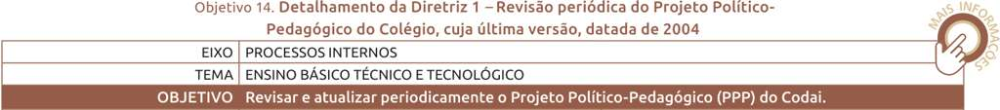

<!-- figure p163-fig1 | described_by: agy | ocr_overlap: 0.96 | needs_review: false -->
1. **Tipo de figura:** Trata-se do cabeçalho (parte superior) de uma tabela estruturada de detalhamento de objetivo estratégico, acompanhada de um título acima e de um ícone gráfico informativo/interativo sobreposto ao canto superior direito. A imagem é cortada imediatamente abaixo da terceira linha da tabela.

2. **Todo o texto visível (literal):**
   - **Título centralizado acima da tabela (em duas linhas):**
     `Objetivo 14. Detalhamento da Diretriz 1 – Revisão periódica do Projeto Político-`
     `Pedagógico do Colégio, cuja última versão, datada de 2004`
   - **Texto no ícone circular no canto superior direito (em arco ao redor do círculo):**
     `MAIS INFORMAÇÕES`
   - **Conteúdo das células da tabela:**
     - Linha 1, Coluna 1: `EIXO`
     - Linha 1, Coluna 2: `PROCESSOS INTERNOS`
     - Linha 2, Coluna 1: `TEMA`
     - Linha 2, Coluna 2: `ENSINO BÁSICO TÉCNICO E TECNOLÓGICO`
     - Linha 3, Coluna 1: `OBJETIVO`
     - Linha 3, Coluna 2: `Revisar e atualizar periodicamente o Projeto Político-Pedagógico (PPP) do Codai.`

3. **Estrutura:**
   - No topo, centralizado, aparece o título em duas linhas, com `Objetivo 14.` em peso normal e o restante em negrito.
   - Abaixo do título há uma tabela retangular composta por 3 linhas visíveis e 2 colunas:
     - A coluna esquerda é mais estreita (cerca de um quarto da largura total) e traz os rótulos dos campos alinhados à direita (`EIXO`, `TEMA`, `OBJETIVO`).
     - A coluna direita é mais larga (cerca de três quartos da largura total) e traz os respectivos valores alinhados à esquerda.
     - As duas primeiras linhas (`EIXO` e `TEMA`) possuem bordas externas e divisórias internas (horizontal e vertical) finas.
     - A terceira linha (`OBJETIVO`) forma uma faixa contínua preenchida de ponta a ponta, sem linha divisória vertical visível entre as duas colunas, mas mantendo o mesmo alinhamento vertical dos rótulos e valores das linhas superiores.
     - Na borda inferior extrema da imagem, logo abaixo da terceira linha, nota-se uma faixa muito estreita de fundo bege claro com marcas verticais sutis, indicando a continuidade da tabela na parte recortada do documento original.
   - Sobreposto ao canto superior direito da tabela (cobrindo parcialmente a borda direita das linhas 1 e 2) há um ícone circular formado por anéis concêntricos com o desenho de uma mão apontando o dedo indicador para o centro do círculo, contornado pelo texto curvo `MAIS INFORMAÇÕES` disposto do lado superior esquerdo até o lado inferior direito do círculo.

4. **Números e valores de dados:**
   - `14` (identificação do objetivo: `Objetivo 14`)
   - `1` (identificação da diretriz: `Diretriz 1`)
   - `2004` (ano da última versão do Projeto Político-Pedagógico: `datada de 2004`)

5. **Cores com significado:**
   - **Marrom escuro:** usado para hierarquia visual e destaque, diferenciando o cabeçalho/título e enfatizando a linha `OBJETIVO` por meio de preenchimento sólido com texto em branco e negrito, em contraste com as linhas de metadados (`EIXO` e `TEMA`), que possuem fundo branco e texto preto.
   - **Marrom escuro e bege claro no ícone superior direito:** destacam o símbolo de mão apontando e o rótulo `MAIS INFORMAÇÕES` como um marcador visual de conteúdo adicional ou link interativo no documento.

~~~text ocr
Objetivo 14. Detalhamento da Diretriz 1 — Revisão periódica do Projeto Politico-
Pedagógico do Colégio, cuja última versão, datada de 2004 A
EIXO | PROCESSOS INTERNOS
TEMA | ENSINO BÁSICO TÉCNICO E TECNOLÓGICO
OBJETIVO Revisar e atualizar periodicamente o Projeto Político-Pedagógico (PPP) do Codai.
~~~

<!-- Start of picture text -->
Objetivo 14. Detalhamento da Diretriz 1 Detalhamento da Diretriz 1  –  Revisão periódica do Projeto Político- Pedagógico do Colégio, cuja última versão, datada de 2004 EIXO PROCESSOS INTERNOS TEMA ENSINO BÁSICO TÉCNICO E TECNOLÓGICO OBJETIVO Revisar e atualizar periodicamente o Projeto Político-Pedagógico (PPP) do Codai. MAIS INFOR M A Ç Õ SE <!-- End of picture text -->

INDICADOR(ES) META 2022 META 2024 PPP atualizado e publicado. UNIDADE(S) RESPONSÁVEL(IS) 1ª Atualização do PPP 2ª Atualização do PPC Diretoria Geral do Codai Diretoria de Ensino do Codai 

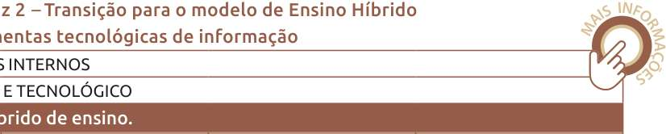

<!-- figure p163-fig2 | described_by: agy | ocr_overlap: 1.0 | needs_review: false -->
1. **Tipo de figura:** Recorte parcial (cortado nas bordas esquerda e inferior) do título e das primeiras linhas de uma tabela informativa extraída de um documento PDF, acompanhado no canto superior direito por um ícone gráfico circular de indicação de clique/informações adicionais.

2. **Todo o texto visível (literal):**
   - **Título acima da tabela (cortado à esquerda):**
     - Linha 1: `z 2 – Transição para o modelo de Ensino Híbrido`
     - Linha 2: `[illegible]entas tecnológicas de informação` *(uma letra imediatamente anterior a `entas` está cortada pela borda esquerda)*
   - **Ícone circular no canto superior direito (texto curvado em sentido horário ao redor da borda externa):**
     - `MAIS INFORMAÇÕES`
   - **Linhas da tabela (cortadas à esquerda e na parte inferior):**
     - Linha 1: `S INTERNOS` *(a letra `S` está levemente cortada na borda esquerda)*
     - Linha 2: `E TECNOLÓGICO`
     - Linha 3: `brido de ensino.` *(a haste esquerda da letra `b` está parcialmente cortada na borda esquerda)*
     - Linha 4: sem texto visível (apenas a borda superior da linha aparece na imagem).

3. **Estrutura:**
   - **Área de título:** Duas linhas de texto em negrito posicionadas no topo, sem caixa ao redor, truncadas na margem esquerda.
   - **Tabela:** Grade retangular com borda vertical direita fechada e bordas esquerda e inferior cortadas pelo recorte da imagem, composta por quatro faixas horizontais empilhadas:
     - **Linha 1:** Célula horizontal contínua (sem divisórias verticais visíveis) contendo `S INTERNOS`.
     - **Linha 2:** Célula horizontal contínua (sem divisórias verticais visíveis) contendo `E TECNOLÓGICO`.
     - **Linha 3:** Faixa horizontal contínua de largura total (sem divisórias verticais visíveis) contendo `brido de ensino.`.
     - **Linha 4 (apenas uma tira superior visível na base da imagem):** Faixa subdividida verticalmente por duas linhas divisórias finas (além da borda direita), indicando a divisão da tabela em pelo menos três colunas abaixo da linha 3.
   - **Ícone no canto superior direito:** Botão/selo circular composto por dois anéis concêntricos envolvendo um centro circular vazio, sobreposto à extremidade direita da área do título e ao canto superior direito das linhas 1 e 2 da tabela. Sobre a porção inferior esquerda do círculo está desenhada uma mão estilizada em contorno, com o dedo indicador apontando na diagonal para cima e para a direita, em direção ao centro do círculo (símbolo de clique). O texto `MAIS INFORMAÇÕES` envolve externamente o círculo da parte superior esquerda até a parte inferior direita. Não há setas ou conectores ligando blocos.

4. **Números e valores de dados:**
   - `2` (em `z 2 – Transição para o modelo de Ensino Híbrido`).
   - Nenhum outro número ou valor de dado está visível.

5. **Cores com significado:**
   - **Marrom escuro (terracota):** Demarca a hierarquia visual — aparece no título, nas linhas de grade da tabela, no contorno da mão e anel externo do ícone interativo, e no preenchimento sólido da linha 3 (com texto em **branco**), destacando-a como faixa de título/enunciado em contraste com as linhas 1 e 2 (fundo **branco** com texto **preto**).
   - **Bege / marrom-claro:** Utilizado no preenchimento da linha 4 (parcialmente visível na base), diferenciando visualmente essa linha colunar da faixa marrom escura imediatamente acima, bem como no anel interno e no texto `MAIS INFORMAÇÕES` do selo interativo.

~~~text ocr
z 2 Transição para o modelo de Ensino Híbrido
entas tecnológicas de informação
> INTERNOS
E TECNOLÓGICO
de ensino.
~~~

<!-- Start of picture text -->
–  Transição para o modelo de Ensino Híbrido ão de ferramentas tecnológicas de informaçãogicas de informaçãoicas de informaçãoçãoão MAIS INFOR M A Ç Õ SE <!-- End of picture text -->

###### Objetivo 15. Detalhamento da Diretriz 2 _–_ Transição para o modelo de Ensino Híbrido 

###### <u>pela adoção de ferramentas tecnológicas de informaçãogicas de informaçãoicas de informaçãoçãoão</u> 

###### EIXO SOCIEDADE E PROCESSOS INTERNOS 

###### TEMA ENSINO BÁSICO TÉCNICO E TECNOLÓGICO OBJETIVO Consolidar o modelo híbrido de ensino. 

|INDICADOR(ES)|META 2022|META 2023|META 2024|META 2025|
|---|---|---|---|---|
|Índice de avaliaçãopositiva.|||||
|UNIDADE(S)RESPONSÁVEL(IS)|50% de Avaliação positi-|60 % de Avaliação positi-|70 % de Avaliação positi-|80% de Avaliação positi-|
|Diretoria de Ensino do Codai|va pelo(a)s estudantes|va do(a)s estudantes|va do(a)s estudantes|va do(a)s estudantes|
|Coordenações dos Cursos|||||

**162** 

<!-- page 164 -->

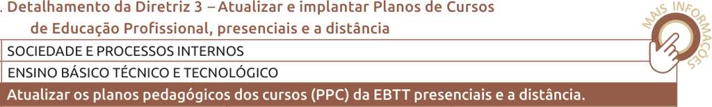

<!-- figure p164-fig1 | described_by: agy | ocr_overlap: 0.84 | needs_review: false -->
1. **Tipo de figura:** Recorte da parte superior de uma tabela/quadro informativo de planejamento educacional (contendo título e três linhas iniciais), acompanhado de um selo/botão circular interativo no canto superior direito.

2. **Todo o texto visível (verbatim):**
   - **Título (acima da tabela, em duas linhas):**
     - Linha 1 (com um ponto visível na borda esquerda, indicando recorte de numeração anterior): `. Detalhamento da Diretriz 3 – Atualizar e implantar Planos de Cursos`
     - Linha 2 (com recuo à esquerda): `de Educação Profissional, presenciais e a distância`
   - **Texto curvado ao redor do ícone circular (canto superior direito):**
     - `MAIS INFORMAÇÕES`
   - **Conteúdo das linhas da tabela (de cima para baixo):**
     - Linha 1: `SOCIEDADE E PROCESSOS INTERNOS`
     - Linha 2: `ENSINO BÁSICO TÉCNICO E TECNOLÓGICO`
     - Linha 3: `Atualizar os planos pedagógicos dos cursos (PPC) da EBTT presenciais e a distância.`

3. **Estrutura:**
   - **Cabeçalho externo:** O título em duas linhas fica posicionado acima da tabela, à esquerda.
   - **Tabela:** Bloco retangular de uma única coluna visível, dividido em três linhas horizontais empilhadas e delimitadas por bordas finas:
     - **Linha 1:** Célula de largura total com texto alinhado à esquerda em letras maiúsculas.
     - **Linha 2:** Célula de largura total com texto alinhado à esquerda em letras maiúsculas.
     - **Linha 3:** Faixa horizontal de largura total com preenchimento sólido e texto alinhado à esquerda. A imagem é cortada logo abaixo da borda inferior dessa linha.
   - **Ícone sobreposto:** No canto superior direito, sobrepondo-se ao canto direito das linhas 1 e 2 da tabela, há um emblema circular formado por anéis concêntricos com centro branco, um pictograma de mão com o dedo indicador apontando para o centro do círculo (indicando interatividade/clique) e a legenda `MAIS INFORMAÇÕES` acompanhando o contorno externo superior e direito do círculo.
   - Não há setas de ligação, eixos, legendas adicionais nem múltiplos painéis.

4. **Números e valores de dados:**
   - `3` (em `Diretriz 3`). Não existem outros números ou dados quantitativos na figura.

5. **Cores com significado:**
   - **Fundo marrom sólido com texto branco na linha 3:** diferencia e destaca a declaração da ação/objetivo em relação às duas linhas superiores de classificação/contexto (fundo branco com texto preto).
   - **Tons de marrom e bege no título, nas bordas da tabela e no selo `MAIS INFORMAÇÕES`:** criam destaque hierárquico para o título da diretriz e para o elemento interativo clicável.

~~~text ocr
. Detalhamento da Diretriz 3 — Atualizar e implantar Planos de Cursos
de Educação Profissional, presenciais e a distância A
SOCIEDADE E PROCESSOS INTERNOS
ENSINO BASICO TECNICO E TECNOLOGICO
Atualizar os planos pedagógicos dos cursos (PPC) da EBTT presenciais e a distância.
~~~

<!-- Start of picture text -->
Detalhamento da Diretriz 3  –  Atualizar e implantar Planos de Cursos de Educação Profissional, presenciais e a distância EIXO SOCIEDADE E PROCESSOS INTERNOS ENSINO BÁSICO TÉCNICO E TECNOLÓGICO Atualizar os planos pedagógicos dos cursos (PPC) da EBTT presenciais e a distância. MAIS INFOR M A Ç Õ SE <!-- End of picture text -->

###### Objetivo 16. Detalhamento da Diretriz 3 _–_ Atualizar e implantar Planos de Cursos 

EIXO SOCIEDADE E PROCESSOS INTERNOS TEMA ENSINO BÁSICO TÉCNICO E TECNOLÓGICO 

###### OBJETIVO Atualizar os planos pedagógicos dos cursos (PPC) da EBTT presenciais e a distância. 

|INDICADOR(ES)|META 2021|META 2022|META 2023|
|---|---|---|---|
|Aprovação do PPC, conforme legisla- ção vigente.||||
|UNIDADE(S)RESPONSÁVEL(IS) Diretoria de Ensino do Codai|Ajuste de carga horária e matriz curricular.|Aprovação dos PPC dos Cursos Técnicos no Cepe.|100% dos Cursos com PPC atualizado.|
|Coordenações dos Cursos||||

###### Objetivo 17. Detalhamento da Diretriz 4 _–_ Ampliar a participação do Codai junto 

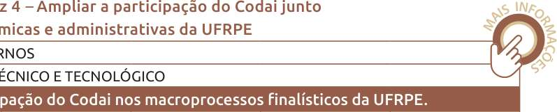

<!-- figure p164-fig2 | described_by: agy | ocr_overlap: 1.0 | needs_review: false -->
1. **Tipo de figura:** Recorte parcial (cortado na margem esquerda e na margem inferior) de uma seção de documento contendo um título superior, as três primeiras linhas de uma tabela ou ficha estruturada e um ícone gráfico circular em estilo de botão clicável no canto superior direito.

2. **Texto visível (verbatim):**
   - **Título superior (duas linhas, com início cortado à esquerda):**
     - `z 4 – Ampliar a participação do Codai junto`
     - `micas e administrativas da UFRPE`
   - **Linhas da tabela (de cima para baixo, com início cortado à esquerda):**
     - Linha 1: `RNOS`
     - Linha 2: `ÉCNICO E TECNOLÓGICO`
     - Linha 3: `pação do Codai nos macroprocessos finalísticos da UFRPE.`
   - **Texto curvo ao redor do ícone circular à direita:**
     - `MAIS INFORMAÇÕES`

3. **Estrutura:**
   - **Cabeçalho:** Bloco de texto em duas linhas na parte superior esquerda, sem moldura, com a extremidade esquerda cortada pela borda da imagem.
   - **Tabela/ficha:** Abaixo do título, há três linhas empilhadas verticalmente, sem divisórias verticais internas visíveis (cada linha forma uma única faixa/célula horizontal que vai da borda esquerda cortada até uma borda vertical comum à direita).
     - A linha 1 (`RNOS`) é delimitada por uma linha horizontal fina acima e outra abaixo.
     - A linha 2 (`ÉCNICO E TECNOLÓGICO`) fica imediatamente abaixo da linha 1, delimitada pela divisória superior e pela borda vertical à direita.
     - A linha 3 (`pação do Codai nos macroprocessos finalísticos da UFRPE.`) é uma barra horizontal preenchida imediatamente abaixo da linha 2, alinhada à mesma borda direita e cortada na base da imagem.
   - **Ícone gráfico à direita:** Situado à direita do título e sobreposto ao canto superior direito da tabela (cobrindo parte da extremidade direita das linhas 1 e 2 e o encontro entre a borda superior e a borda direita da tabela). É formado por círculos concêntricos (anel externo espesso, anel intermediário fino e centro circular), sobrepostos na parte inferior esquerda pelo desenho de uma mão apontando com o dedo indicador na diagonal para cima e para a direita em direção ao centro do círculo. O texto `MAIS INFORMAÇÕES` acompanha em arco o lado externo superior e direito do círculo, no sentido horário. Não há setas de fluxo nem eixos.

4. **Números e valores de dados:**
   - `4` (presente na primeira linha do título: `z 4 – Ampliar a participação do Codai junto`). Não há outros números ou valores quantitativos visíveis.

5. **Cores com significado:**
   - **Marrom:** Sinaliza hierarquia e estrutura, sendo aplicado no texto do título superior, nas bordas da tabela, no preenchimento de fundo da terceira linha (criando uma faixa de destaque com texto em branco) e no anel externo e contorno da mão no ícone clicável.
   - **Fundo branco com texto preto:** Utilizado nas linhas 1 e 2 da tabela, diferenciando esses campos de classificação da barra de destaque marrom na linha 3.
   - **Bege/tom areia:** Utilizado no anel interno e no texto curvo `MAIS INFORMAÇÕES`, destacando o elemento gráfico de chamada interativa em contraste com o fundo branco e o marrom.

~~~text ocr
z 4 — Ampliar a participação do Codai junto
micas e administrativas da UFRPE 2)
NOS
ÉCNICO E TECNOLÓGICO
pação do Codai nos macroprocessos finalísticos da UFRPE.
~~~

<!-- Start of picture text -->
–  Ampliar a participação do Codai junto às demais Unidades Acadêmicas e administrativas da UFRPE ENSINO BÁSICO TÉCNICO E TECNOLÓGICO pação do Codai nos macroprocessos finalísticos da UFRPE.ação do Codai nos macroprocessos finalísticos da UFRPE. MAIS INFOR M A Ç Õ SE <!-- End of picture text -->

###### às demais Unidades Acadêmicas e administrativas da UFRPE 

|EIXO|PROCESSOS INTERNOS|
|---|---|
|TEMA|ENSINO BÁSICO TÉCNICO E TECNOLÓGICO|

###### OBJETIVO Ampliar a participação do Codai nos macroprocessos finalísticos da UFRPE.ação do Codai nos macroprocessos finalísticos da UFRPE. 

|INDICADOR(ES)|META 2021|META 2022|META 2023|META 2024|META 2025|
|---|---|---|---|---|---|
|1 – Participação de docentes e técnico(a)s da Sede em reuniões com setores do Codai.||||||
|2 – Quantitativo de projetos dos Codai nos pro- gramas de ensino, pesquisa, extensão, gestão e inovação da UFRPE. UNIDADE(S)RESPONSÁVEL(IS)|1. 2/ano 2. 10/ano|1. 4/ano 2. 15/ano|1. 6/ano 2. 20/ano|1. 8/ano 2. 25/ano|1. 10/ano 2. 30/ano|
|Diretoria de Ensino do Codai||||||
|Coordenações dos Cursos.||||||

**163** 

<!-- page 165 -->

##### **Políticas de Ensino de Graduação** 

Na UFRPE, são ofertados cursos de graduação presencial e a distância nas categoriasde bacharelado, licenciatura e tecnológico. A seleção é realizada por meio do Sistema de Seleção Unificada (Sisu), além do processo extravestibular. Pelo extravestibular, a transferência pode ser interna através de mudança de curso, ou entre Unidades Acadêmicas, ou entre instituições. Há, também, a possibilidade do ingresso de discentes já graduado(a)s, na condição de portadore(a)s de diploma. A UFRPE adota, também, política de cotas sociais e raciais, pela qual há reserva de vagas para discentes oriundo(a)s de escolas públicas e para autodeclarado(a)s preto(a)s, pardo(a)s ou indígenas (PPI) egresso(a)s da escola pública. 

A Política de Ensino de Graduação da UFRPE é resultado da busca pela sistematização de práticas permanentemente refletidas, visando a aprimorar o ensino, tendo em vista as constantes mudanças sociais e do mundo do trabalho, em conformidade com as políticas públicas de educação. 

A organização curricular adotada, no âmbito da Política de Ensino de Graduação, busca expressar concepções de ensino e de currículo orientadoras das práticas educativas que concretizam os projetos dos cursos de graduação, reconhecendo a diversidade e a identidade dos cursos, em consonância com a realidade da região. Nessa perspectiva, a 

Política de Ensino de Graduação organiza-se em torno dos seguintes princípios: 

- **I.** Flexibilidade curricular; 

- **II.** Formação continuada; 

- **III.** Gestão colegiada dos cursos; 

- **IV.** Interdisciplinaridade e organicidade; 

- **V.** Ensino inclusivo; 

- **VI.** Formação de qualidade associada ao desenvolvimento humano; 

**VII.** Educação como um processo de formação integral; **VIII.** Indissociabilidade entre ensino, pesquisa e extensão; 

- **IX.** Formação de cidadãos críticos, inovadores e éticos; 

- **X.** Formação profissional pautada na responsabilidade social; 

- **XI.** Valorização das pessoas e dos aspectos sócio-histórico-culturais. 

**Cursos de graduação** _–_ **modalidade presencial** A UFRPE possui 55 cursos de graduação com uma oferta anual de cerca de 4 mil vagas. Com as Políticas de Extensão Universitária, contamos com cursos que abrangem quase todo o Estado, desde o litoral até o sertão, incluindo, mais recentemente, o arquipélago de Fernando de Noronha. A UFRPE é composta por: _campus_ Sede, Unidade Acadêmica do Cabo de Santo Agostinho (UACSA), Unidade Acadêmica de Serra Talhada (UAST) e Unidade Acadêmica de Belo Jardim (UABJ). Todas essas Unidades estão voltadas para os 

**164** 

<!-- page 166 -->

cursos de graduação presencial. Em se tratando dos cursos de graduação na modalidade a distância, temos a Unidade Acadêmica de Educação a Distância e Tecnologia (UAEADTec). A distribuição dos cursos de graduação, modalidade presencial, da UFRPE é apresentada a seguir. 

Quadro 13. **Relação de** cursos de graduação _–_ modalidade presencial 

|**SE**|**DE**|
|---|---|
|Administração|Engenharia de Pesca|
|Agronomia|Engenharia Florestal|
|Aquicultura|Licenciatura em Ciências Agrícolas|
|Bacharelado em Agroecologia|Licenciatura em Ciências Biológicas|
|Bacharelado em Ciência da Computação|Licenciatura em Computação|
|Bacharelado em Ciências Biológicas|Licenciatura em Educação Física|
|Bacharelado em Ciências do Consumo|Licenciatura em Física|
|Bacharelado em Ciências Econômicas|Licenciatura em História|
|Bacharelado em Ciências Sociais|Licenciatura em Letras (Português e Espanhol)|
|Bacharelado em Gastronomia|Licenciatura em Matemática|
|Bacharelado em Sistemas da Informação|Licenciatura em Pedagogia|
|Economia Doméstica|Licenciatura emQuímica|
|Engenharia Agrícola e Ambiental|Medicina Veterinária|
|Engenharia Ambiental|Zootecnia|

|**UACSA**|
|---|
|Engenharia Civil Engenharia de Materiais|
|Engenharia Elétrica Engenharia Mecânica|
|Engenharia Eletrônica **UABJ**|
|Engenharia da Computação Engenharia Hídrica|
|Engenharia de Controle e Automação Engenharia Química|
|**UAST**|
|Administração Engenharia de Pesca|
|Agronomia Licenciatura em Letras|
|Bacharelado em Ciências Biológicas Licenciatura em Química|
|Bacharelado em Ciências Econômicas Zootecnia|
|Bacharelado em Sistemas da Informação|

_Fonte_ : _PREG–UFRPE (2021)._ 

Na avaliação do MEC, conforme Índice Geral dos Cursos (IGC), os cursos de graduação da UFRPE vêm obtendo resultados exitosos. No total de 29 cursos avaliados, em uma escala de conceitos de 1 a 5, 18 foram avaliados com conceito 4, 8 com o conceito 3 e, por fim, 3 cursos com conceito 2. 

**165** 

<!-- page 167 -->

##### **Controle de Evasão e Retenção nos cursos de graduação: ações, diagnóstico e acompanhamento de indicadores** 

A evasão é uma questão complexa enfrentada globalmente na educação superior (XAVIER; MENESES, 2020). Por ainda não existir uma definição consensual sobre a evasão, consequentemente, existem várias formas de medi-la. Já a retenção refere-se a situações intermediárias de insucesso, acarretando irregularidade ou atraso na trajetória esperada que pode levar o(a)s estudantes a permanecerem no curso por 

um tempo além do previsto na instituição para conclusão (ANDIFES, 1996; INEP, 2017). Porém, assim como no caso da evasão, existem diversas formas de se definir e medir retenção, que também podem variar de acordo com as características das instituições de ensino superior (IES), dos cursos e do perfil dos estudantes (LIMA JÚNIOR _et al_ ., 2019). 

Considerando tal problemática e comprometida com a qualidade do ensino, nos anos de 2018 e 2019, foram formadas comissões de combate à evasão e à retenção na UFRPE, instituídas oficialmente por meio de portarias. Uma Comissão Gestora é encarregada de coordenar as ações das demais comissões sempre em parceria com as coordenações de curso e com o Observatório de Dados da Graduação (doravante ODG)5 . O ODG trabalha 

com extração de dados do Sistema Integrado de Gestão Acadêmica (SIGA/SIGAA), a partir dos quais são criadas diferentes visualizações gráficas para a análise de diversos aspectos relacionados à retenção e à evasão. O diagnóstico sobre evasão e retenção é realizado a partir de três fontes: extração e análise quantitativa de dados acadêmicos do SIGA/SIGAA; questionários às coordenações de curso; e questionários a discentes. Os resultados são sintetizados e discutidos para elaboração de ações planejadas. 

Os dados sintetizados em gráficos e relatórios permitem às coordenações de curso identificar as disciplinas e os períodos do curso com maiores taxas de retenção que podem contribuir fortemente para a evasão, e, assim, planejar ações específicas e direcionadas para diminuir a retenção do(a)s discentes. A Comissão Gestora também orienta e acompanha as coordenações de curso e comissões de combate à evasão na elaboração e execução de planos de ação de curto e médio prazos. O planejamento e a realização de ações se desenvolvem com apoio da Comissão Gestora das ações de combate à retenção e à evasão da UFRPE, e envolvem ações diferenciadas como: Seminário de Combate à Evasão e Retenção; ações propostas pelas coordenações; Semanas de recepção aos ingressantes; e outros eventos realizados pelas coordenações de curso. 

> _5 .  Site do ODG:_ **https://ufrpe-odg.github.io/site/index.html** 

**166** 

<!-- page 168 -->

Vale destacar que o relatório apresenta várias análises quantitativas do desempenho da UFRPE. A figura 10 mostra a evolução da taxa de evasão de 2013 a 2019 na UFRPE. No gráfico, é possível observar uma queda significativa a partir do ano de 2017, quando as ações descritas começaram a ter uma continuidade maior. 

grau acadêmico (Bacharelado e Licenciatura). Esses gráficos são importantes para mostrar que a tendência de queda apresentada na UFRPE, em geral, foi criada de maneira uniforme em toda a universidade. Todas as unidades e graus acadêmicos possuem uma tendência de queda a partir do ano de 2017. 

Figura 11 – **Evolução da taxa** de evasão por unidade 

Figura 10 – **Evolução da taxa** de evasão da UFRPE de 2013 a 2019 

acadêmica da UFRPE de 2013 a 2019 

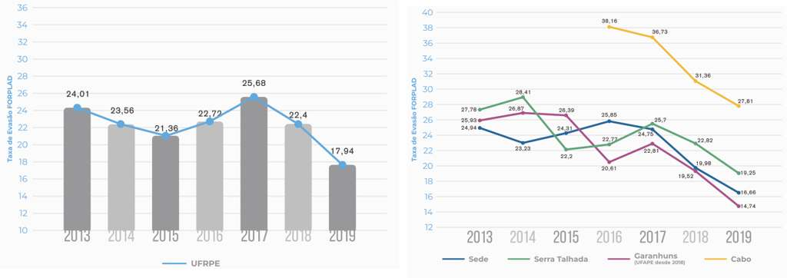

<!-- figure p168-fig1 | described_by: agy | ocr_overlap: 1.0 | needs_review: false -->
### 1. Tipo de figura
A imagem é uma figura composta por dois gráficos estatísticos dispostos lado a lado (dois painéis) que apresentam séries temporais anuais de 2013 a 2019:
- **Painel esquerdo:** gráfico combinado de barras verticais e linha com marcadores circulares representando uma única série agregada (`UFRPE`).
- **Painel direito:** gráfico de linhas múltiplas com marcadores circulares representando quatro séries distintas por unidade/campus (`Sede`, `Serra Talhada`, `Garanhuns (UFAPE desde 2018)` e `Cabo`).

---

### 2. Todo o texto visível (ipsis litteris)

Não há título geral, subtítulo nem legenda de figura (caption) externa aos gráficos.

**Painel esquerdo:**
- Rótulo do eixo vertical: `Taxa de Evasão FORPLAD`
- Marcações do eixo vertical (de baixo para cima): `10`, `12`, `14`, `16`, `18`, `20`, `22`, `24`, `26`, `28`, `30`, `32`, `34`, `36`
- Marcações do eixo horizontal (da esquerda para a direita): `2013`, `2014`, `2015`, `2016`, `2017`, `2018`, `2019`
- Rótulos de dados sobre os pontos/barras (da esquerda para a direita): `24,01`, `23,56`, `21,36`, `22,72`, `25,68`, `22,4`, `17,94`
- Legenda inferior: `UFRPE`

**Painel direito:**
- Rótulo do eixo vertical: `Taxa de Evasão FORPLAD`
- Marcações do eixo vertical (de baixo para cima): `12`, `14`, `16`, `18`, `20`, `22`, `24`, `26`, `28`, `30`, `32`, `34`, `36`, `38`, `40`
- Marcações do eixo horizontal (da esquerda para a direita): `2013`, `2014`, `2015`, `2016`, `2017`, `2018`, `2019`
- Rótulos de dados junto aos pontos:
  - Em `2013`: `27,78`, `25,93`, `24,94`
  - Em `2014`: `28,41`, `26,87`, `23,23`
  - Em `2015`: `26,39`, `24,31`, `22,2`
  - Em `2016`: `38,16`, `25,85`, `22,77`, `20,61`
  - Em `2017`: `36,73`, `25,7`, `24,75`, `22,81`
  - Em `2018`: `31,36`, `22,82`, `19,98`, `19,52`
  - Em `2019`: `27,81`, `19,25`, `16,66`, `14,74`
- Legenda inferior (da esquerda para a direita):
  - `Sede`
  - `Serra Talhada`
  - `Garanhuns` com a linha menor logo abaixo: `(UFAPE desde 2018)`
  - `Cabo`

---

### 3. Estrutura
A figura é organizada horizontalmente em dois painéis independentes de dimensões semelhantes, separados por um espaço em branco central. Não há caixas de texto nem setas.

- **Painel esquerdo:**
  - **Eixo vertical (Y):** posicionado à esquerda, com o rótulo `Taxa de Evasão FORPLAD` orientado verticalmente (lido de baixo para cima). A escala vai de `10` a `36`, com intervalos uniformes de 2 unidades e linhas de grade horizontais em cada marcação.
  - **Eixo horizontal (X):** posicionado na base (alinhado ao valor `10` do eixo Y), listando sete anos consecutivos de `2013` a `2019`.
  - **Elementos gráficos:** para cada ano há uma barra vertical com cantos superiores arredondados partindo da base (`10`) até a altura do valor daquele ano, sobreposta por uma linha contínua com marcadores circulares no topo de cada barra conectando sequencialmente os anos de `2013` a `2019`. Observação visual: embora o rótulo de `2014` indique `23,56`, a barra e o marcador correspondentes estão desenhados em altura próxima de `22,4` (quase no mesmo nível de `2018`).
  - **Legenda:** centralizada abaixo do eixo horizontal, mostrando um segmento de linha seguido do texto `UFRPE`.

- **Painel direito:**
  - **Eixo vertical (Y):** posicionado à esquerda, com o rótulo `Taxa de Evasão FORPLAD` orientado verticalmente (lido de baixo para cima). A escala é diferente da do painel esquerdo, indo de `12` a `40`, com intervalos uniformes de 2 unidades e linhas de grade horizontais em cada marcação.
  - **Eixo horizontal (X):** posicionado na base (alinhado ao valor `12` do eixo Y), listando os mesmos sete anos de `2013` a `2019`.
  - **Elementos gráficos e conexões entre pontos:** quatro linhas poligonais com marcadores circulares conectam os valores anuais de cada série:
    - `Sede` conecta 7 pontos consecutivos (`2013` a `2019`), cruzando com `Serra Talhada` entre `2014` e `2015` (quando `Sede` sobe e `Serra Talhada` cai) e novamente entre `2016` e `2017` (quando `Serra Talhada` sobe acima de `Sede`).
    - `Serra Talhada` conecta 7 pontos consecutivos (`2013` a `2019`), apresentando pico em `2014`, queda acentuada em `2015`, recuperação até `2017` e queda até `2019`; cruza com `Garanhuns (UFAPE desde 2018)` entre `2014` e `2015` e novamente entre `2015` e `2016`.
    - `Garanhuns (UFAPE desde 2018)` conecta 7 pontos consecutivos (`2013` a `2019`), permanecendo acima de `Sede` de `2013` a `2015`, cruzando abaixo de `Sede` e `Serra Talhada` entre `2015` e `2016`, e permanecendo como a curva mais baixa de `2016` a `2019`.
    - `Cabo` não possui pontos nem segmentos em `2013`, `2014` e `2015`; inicia-se em `2016` e conecta 4 pontos consecutivos (`2016` a `2019`) em trajetória continuamente decrescente, mantendo-se acima de todas as demais séries em todo o período em que aparece.
  - **Legenda:** disposta horizontalmente em uma linha abaixo do eixo X, com quatro segmentos de linha coloridos precedendo cada nome de série.

---

### 4. Todos os números e valores de dados

**Escalas dos eixos:**
- Painel esquerdo — eixo Y: `10`, `12`, `14`, `16`, `18`, `20`, `22`, `24`, `26`, `28`, `30`, `32`, `34`, `36`; eixo X: `2013`, `2014`, `2015`, `2016`, `2017`, `2018`, `2019`.
- Painel direito — eixo Y: `12`, `14`, `16`, `18`, `20`, `22`, `24`, `26`, `28`, `30`, `32`, `34`, `36`, `38`, `40`; eixo X: `2013`, `2014`, `2015`, `2016`, `2017`, `2018`, `2019`.
- Menção numérica na legenda do painel direito: `2018` (em `(UFAPE desde 2018)`).

**Valores da série do painel esquerdo (`UFRPE`):**

| Ano | UFRPE |
| --- | --- |
| 2013 | 24,01 |
| 2014 | 23,56 |
| 2015 | 21,36 |
| 2016 | 22,72 |
| 2017 | 25,68 |
| 2018 | 22,4 |
| 2019 | 17,94 |

**Valores das séries do painel direito:**

| Ano | Sede | Serra Talhada | Garanhuns (UFAPE desde 2018) | Cabo |
| --- | --- | --- | --- | --- |
| 2013 | 24,94 | 27,78 | 25,93 | — |
| 2014 | 23,23 | 28,41 | 26,87 | — |
| 2015 | 24,31 | 22,2 | 26,39 | — |
| 2016 | 25,85 | 22,77 | 20,61 | 38,16 |
| 2017 | 24,75 | 25,7 | 22,81 | 36,73 |
| 2018 | 19,98 | 22,82 | 19,52 | 31,36 |
| 2019 | 16,66 | 19,25 | 14,74 | 27,81 |

---

### 5. Cores com significado
- **Painel esquerdo:**
  - **Azul-claro:** identifica a série `UFRPE` (tanto na linha com marcadores circulares quanto na legenda).
- **Painel direito:** as cores distinguem as quatro séries de dados (linhas, marcadores circulares e traços correspondentes na legenda):
  - **Azul-escuro:** `Sede`
  - **Verde:** `Serra Talhada`
  - **Roxo/magenta:** `Garanhuns (UFAPE desde 2018)`
  - **Amarelo/dourado:** `Cabo`

~~~text ocr
Taxa de Evasão FORPLAD
— UFRPE
25,68
Taxa de Evasão FORPLAD
38,16
36,73
31,36
2013 2014 2015 2016 2017 2018 2019
Garanhuns
(UFAPE desde 2018) Cabo
Sede — Serra Talhada
~~~

_Fonte: ODG (2021)_ 

_Fonte: ODG (2021)_ 

Seguindo a mesma análise, as figuras 11 e 12 apresentam as taxas de evasão contabilizadas por unidade acadêmica e por 

A figura 13 apresenta uma visão contextualizada do progresso da UFRPE em relação ao cenário nacional das IES públicas, públicas federais e privadas. Percebe-se que a taxa 

**167** 

<!-- page 169 -->

de evasão da UFRPE está bem abaixo da média geral que considera todos os tipos de IES e vem se aproximando da média das IES públicas federais, apresentando uma queda a partir de 2017. Além disso, vale ressaltar que as IES privadas possuem o pior desempenho neste cenário. 

A UFRPE tem feito um trabalho sistemático de controle da evasão e de retenção, incluindo diagnósticos, acompanhamento de indicadores, planejamento sistemático e realização de ações pelas coordenações de curso em parceria com a PREG e Proplan. 

Figura 12 – **Evolução da taxa** de evasão 

por grau acadêmico da UFRPE de 2013 a 2019 

Figura 13 – **Evolução da taxa** de evasão da UFRPE de 2013 a 2019, contextualizada no cenário nacional 

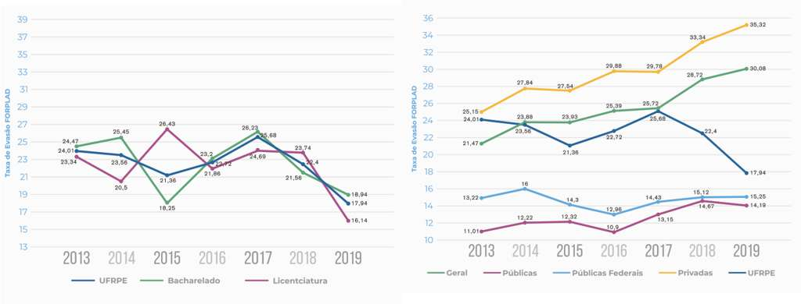

<!-- figure p169-fig1 | described_by: agy | ocr_overlap: 1.0 | needs_review: false -->
**1. Tipo de figura**

Figura composta por dois gráficos de linhas com marcadores circulares, dispostos lado a lado (painel esquerdo e painel direito), que apresentam a evolução anual da taxa de evasão FORPLAD de 2013 a 2019 para diferentes categorias.

---

**2. Todo o texto visível (verbatim)**

Não há títulos de gráfico, título geral da figura, rótulo do eixo X nem legenda explicativa (caption) em nenhum dos painéis.

- **Painel esquerdo**
  - Rótulo do eixo Y: `Taxa de Evasão FORPLAD`
  - Marcações do eixo Y (de baixo para cima): `13`, `15`, `17`, `19`, `21`, `23`, `25`, `27`, `29`, `31`, `33`, `35`, `37`, `39`
  - Marcações do eixo X (da esquerda para a direita): `2013`, `2014`, `2015`, `2016`, `2017`, `2018`, `2019`
  - Legenda (da esquerda para a direita): `UFRPE`, `Bacharelado`, `Licentciatura` *(grafia exata presente na imagem)*
  - Rótulos de valores junto aos pontos (por ano, de cima para baixo):
    - 2013: `24,47`, `24,01`, `23,34`
    - 2014: `25,45`, `23,56`, `20,5`
    - 2015: `26,43`, `21,36`, `18,25`
    - 2016: `23,2`, `22,72`, `21,86`
    - 2017: `26,23`, `25,68`, `24,69`
    - 2018: `23,74`, `22,4`, `21,56`
    - 2019: `18,94`, `17,94`, `16,14`

- **Painel direito**
  - Rótulo do eixo Y: `Taxa de Evasão FORPLAD`
  - Marcações do eixo Y (de baixo para cima): `10`, `12`, `14`, `16`, `18`, `20`, `22`, `24`, `26`, `28`, `30`, `32`, `34`, `36`
  - Marcações do eixo X (da esquerda para a direita): `2013`, `2014`, `2015`, `2016`, `2017`, `2018`, `2019`
  - Legenda (da esquerda para a direita): `Geral`, `Públicas`, `Públicas Federais`, `Privadas`, `UFRPE`
  - Rótulos de valores junto aos pontos (por ano, de cima para baixo):
    - 2013: `25,15`, `24,01`, `21,47`, `13,22`, `11,01`
    - 2014: `27,84`, `23,88`, `23,56`, `16`, `12,22`
    - 2015: `27,54`, `23,93`, `21,36`, `14,3`, `12,32`
    - 2016: `29,88`, `25,39`, `22,72`, `12,96`, `10,9`
    - 2017: `29,78`, `25,72`, `25,68`, `14,43`, `13,15`
    - 2018: `33,34`, `28,72`, `22,4`, `15,12`, `14,67`
    - 2019: `35,32`, `30,08`, `17,94`, `15,25`, `14,19`

---

**3. Estrutura**

A imagem organiza-se em dois painéis independentes posicionados lado a lado, sem molduras externas nem setas, cada um contendo área de plotagem com linhas de grade horizontais contínuas correspondentes a cada marcação do eixo Y e uma legenda em linha única centralizada abaixo do eixo X. Em ambos os painéis, o eixo Y é rotulado verticalmente à esquerda (`Taxa de Evasão FORPLAD`) e o eixo X lista os sete anos consecutivos de `2013` a `2019`. Cada série é representada por segmentos de reta que ligam marcadores circulares ano a ano, com o valor numérico impresso próximo a cada marcador.

- **Painel esquerdo**
  - **Eixos:** Eixo Y numérico de `13` a `39`, com incremento de 2 unidades (14 marcações horizontais); eixo X categórico/temporal de `2013` a `2019`.
  - **Séries (3 linhas):** `UFRPE`, `Bacharelado` e `Licentciatura`.
  - **Trajetórias e cruzamentos:** As três séries oscilam próximas entre si e se cruzam diversas vezes ao longo do período. Em 2013 e 2014, `Bacharelado` está acima de `UFRPE`, que está acima de `Licentciatura`. Entre 2014 e 2015, `Licentciatura` sobe bruscamente até o maior pico do gráfico (`26,43`), cruzando acima de `UFRPE` e `Bacharelado`, enquanto `Bacharelado` cai acentuadamente para `18,25`. Entre 2015 e 2016, as curvas invertem novamente: `Bacharelado` sobe e volta a liderar (`23,2`), `UFRPE` fica no meio (`22,72`) e `Licentciatura` cai para a última posição (`21,86`). Em 2017, todas as três séries sobem mantendo essa mesma ordem (`Bacharelado` > `UFRPE` > `Licentciatura`). Entre 2017 e 2018, `Bacharelado` e `UFRPE` caem abaixo de `Licentciatura`, que permanece quase estável (`23,74`) e assume o topo, ficando acima de `UFRPE` (`22,4`) e `Bacharelado` (`21,56`). Entre 2018 e 2019, todas as séries caem e `Licentciatura` despenca, cruzando abaixo das outras duas até `16,14`, enquanto `Bacharelado` termina no topo (`18,94`) e `UFRPE` em posição intermediária (`17,94`).

- **Painel direito**
  - **Eixos:** Eixo Y numérico de `10` a `36`, com incremento de 2 unidades (14 marcações horizontais); eixo X de `2013` a `2019`.
  - **Séries (5 linhas):** `Privadas`, `Geral`, `UFRPE`, `Públicas Federais` e `Públicas`.
  - **Trajetórias e agrupamentos:** As cinco séries se separam visualmente em dois blocos bem distintos (um superior, entre ~18 e ~35, e um inferior, entre ~11 e ~16), sem que as linhas do bloco inferior cruzem as do bloco superior:
    - **Bloco superior (`Privadas`, `Geral` e `UFRPE`):** `Privadas` permanece sempre na posição mais alta, com tendência geral de forte crescimento de `25,15` (2013) até `35,32` (2019), com leves recuos em 2015 e 2017. `Geral` inicia abaixo de `UFRPE` em 2013 (`21,47` contra `24,01`), cruza para cima de `UFRPE` entre 2013 e 2014 (`23,88` contra `23,56`) e permanece acima dela até 2019, crescendo de forma contínua até `30,08` (quase tocando `UFRPE` em 2017, quando `Geral` marca `25,72` e `UFRPE` marca `25,68`). `UFRPE` (mesma série do painel esquerdo) oscila entre `21,36` e `25,68` até 2017 e depois cai acentuadamente em 2018 (`22,4`) e 2019 (`17,94`), afastando-se para baixo de `Geral` e aproximando-se do bloco inferior.
    - **Bloco inferior (`Públicas Federais` e `Públicas`):** Ambas permanecem abaixo de 17 durante todo o período e nunca se cruzam, com `Públicas Federais` sempre acima de `Públicas`. `Públicas Federais` atinge seu máximo em 2014 (`16`), cai até 2016 (`12,96`) e volta a subir até 2019 (`15,25`). `Públicas` apresenta seu mínimo em 2016 (`10,9`), sobe até 2018 (`14,67`, aproximando-se de `Públicas Federais` em `15,12`) e recua ligeiramente em 2019 (`14,19`).

---

**4. Todos os números e valores de dados**

**Painel esquerdo — Taxa de Evasão FORPLAD (escala do eixo Y: 13 a 39, passo 2)**

| Série | 2013 | 2014 | 2015 | 2016 | 2017 | 2018 | 2019 |
| :--- | :---: | :---: | :---: | :---: | :---: | :---: | :---: |
| **UFRPE** | 24,01 | 23,56 | 21,36 | 22,72 | 25,68 | 22,4 | 17,94 |
| **Bacharelado** | 24,47 | 25,45 | 18,25 | 23,2 | 26,23 | 21,56 | 18,94 |
| **Licentciatura** | 23,34 | 20,5 | 26,43 | 21,86 | 24,69 | 23,74 | 16,14 |

**Painel direito — Taxa de Evasão FORPLAD (escala do eixo Y: 10 a 36, passo 2)**

| Série | 2013 | 2014 | 2015 | 2016 | 2017 | 2018 | 2019 |
| :--- | :---: | :---: | :---: | :---: | :---: | :---: | :---: |
| **Privadas** | 25,15 | 27,84 | 27,54 | 29,88 | 29,78 | 33,34 | 35,32 |
| **Geral** | 21,47 | 23,88 | 23,93 | 25,39 | 25,72 | 28,72 | 30,08 |
| **UFRPE** | 24,01 | 23,56 | 21,36 | 22,72 | 25,68 | 22,4 | 17,94 |
| **Públicas Federais** | 13,22 | 16 | 14,3 | 12,96 | 14,43 | 15,12 | 15,25 |
| **Públicas** | 11,01 | 12,22 | 12,32 | 10,9 | 13,15 | 14,67 | 14,19 |

---

**5. Cores com significado**

As cores das linhas, de seus marcadores circulares e dos traços correspondentes nas legendas distinguem cada série de dados (note-se que verde e roxo/magenta representam categorias diferentes entre o painel esquerdo e o direito, enquanto azul-escuro representa `UFRPE` em ambos):

- **Painel esquerdo**
  - **Azul-escuro:** `UFRPE`
  - **Verde:** `Bacharelado`
  - **Roxo/magenta:** `Licentciatura`

- **Painel direito**
  - **Verde:** `Geral`
  - **Roxo/magenta:** `Públicas`
  - **Azul-claro:** `Públicas Federais`
  - **Amarelo/dourado:** `Privadas`
  - **Azul-escuro:** `UFRPE`

~~~text ocr
Taxa de Evasão FORPLAD
2013 2014 2015 2016
UFRPE
Bacharelado
2017 2018 2019
Licentciatura
Taxa de Evasão FORPLAD
— Geral
2013
— Públicas — Públicas Federais —— Privadas
2014 2015 2016 2017
2018
2019
— UFRPE
~~~

_Fonte: ODG (2021)_ 

_Fonte: ODG (2021)_ 

**168** 

<!-- page 170 -->

##### **Observatório de dados da Graduação da UFRPE** _–_ **ODG** 

O Observatório de Dados da Graduação da UFRPE (ODG _–_ UFRPE) é um laboratório da UFRPE criado no final de 2019, tendo sua sede situada inicialmente no DEINFO, uma base na UAST e está ligado à Pró-Reitoria de Ensino de Graduação (PREG). O ODG _–_ UFRPE conta com a participação de professore(a)s de diferentes departamentos e unidades, que realizam pesquisas relacionadas à ciência de dados aplicadas à educação. Sendo assim, este laboratório associa pesquisa e desenvolvimento na área da educação, auxiliando a PREG na gestão baseada em evidências. 

Uma vez que os cursos de graduação da UFRPE não podem ser vistos de forma isolada do meio, dados que estão indiretamente relacionados com a graduação também são analisados por este laboratório. O conhecimento obtido a partir da análise de tais dados são, então, aplicados na melhoria da gestão e dos próprios cursos. Os principais objetivos do ODG são: 

- Assessorar a Pró-Reitoria de Ensino de Graduação da UFRPE e a Direção Geral e Acadêmica das unidades acadêmicas na utilização de dados para o planejamento e a gestão acadêmica da graduação; 

- Auxiliar a elaboração de ações e métodos institucionais para a melhoria dos sistemas estudados, bem 

como dar suporte ao monitoramento dos resultados destas ações; 

- Obter e organizar os dados referentes aos cursos de graduação da Universidade Federal Rural de Pernambuco; 

- Realizar pesquisas na área de ciência de dados aplicadas à educação, especialmente do ensino superior; 

- Contribuir para uma gestão baseada em evidências da UFRPE, especialmente da PREG; 

- Orientar estudantes de pós-graduação e graduação interessado(a)s no tema; 

- Desenvolver sistemas, ferramentas e relatórios voltados para o ensino superior. 

Dentre as ações de gestão da PREG que são assessoradas pelo ODG, citam-se: a elaboração de estudos e relatórios relacionados aos cursos de graduação, formulação e análise de pesquisas relacionadas aos cursos e estudantes de graduação, suporte na definição do cálculo das vagas disponíveis para o extravestibular e a definição de indicadores de desempenho relacionados à graduação. 

Dentre as ações desenvolvidas, o ODG elaborou o módulo de indicadores de qualidade dos cursos, inclusive com estudos e concepções de métodos e modelos para caracterização de retenção e evasão com o propósito de equilibrar a reoferta de vagas. Com o desenvolvimento das ações, são 

**169** 

<!-- page 171 -->

produzidos “Relatórios e Análises” que envolvem os seguintes documentos: 

- Planilha de Indicadores de Qualidade; 

cursos de outras instituições. Tais dados são trabalhados de forma metodológica e pedagógica com as coordenações de cursos. Além das reuniões mensais individualizadas realizadas pela PREG. 

- Proposta de Indicadores de Qualidade; 

- Avaliação de Períodos excepcionais; 

- Estudo para Cálculo de Vagas de Reposição; 

- Relatório Analítico sobre Controle de Evasão e Retenção; 

- Relatório Analítico sobre a Evasão e Taxa de Ocupação; 

- Relatórios e Análises de indicadores; 

- Relatórios de avaliação do desempenho por curso de graduação. 

Vale salientar que os Relatórios são documentos que instrumentalizam o monitoramento do desempenho individualizado, apresentando indicadores por curso de graduação. Os indicadores possibilitam o acompanhamento do desempenho dos cursos da UFRPE, e por serem adotados em nível nacional, também permitem a comparação dos resultados com 

##### **Objetivos específicos e metas para o Ensino de Graduação Presencial** 

Para a Política de Ensino de Graduação, a UFRPE intenta, conforme citado neste PDI, o alcance dos seguintes resultados para o período de 2021 a 2030: 

**I.** Melhoria na política de estágios; 

- **II.** Formação continuada a docentes e técnico(a)s-administrativo(a)s; 

**III.** Criação de programas de nivelamento; e 

**IV.** Acompanhamento de discentes da graduação. 

Estes temas serão detalhados em objetivos específicos e metas para  o Ensino de Graduação, conforme quadros a seguir. 

**170** 

<!-- page 172 -->

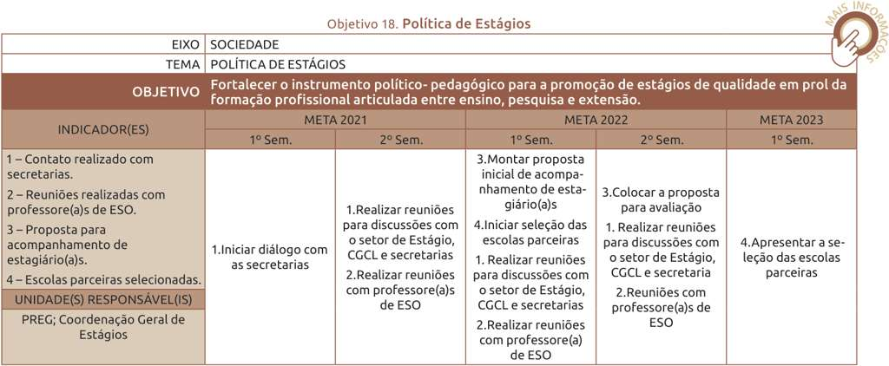

<!-- figure p172-fig1 | described_by: agy | ocr_overlap: 0.91 | needs_review: false -->
### 1. Tipo de figura
Tabela de planejamento estratégico (quadro de metas e indicadores) intitulada **Objetivo 18. Política de Estágios**, acompanhada de um ícone circular interativo no canto superior direito com o rótulo "MAIS INFORMAÇÕES".

---

### 2. Todo o texto visível (transcrição literal)

* **Título acima da tabela (centralizado):**
  `Objetivo 18. Política de Estágios`
* **Texto curvo no ícone do canto superior direito:**
  `MAIS INFORMAÇÕES`
* **Linha 1 (Eixo):**
  * Coluna esquerda: `EIXO`
  * Coluna direita: `SOCIEDADE`
* **Linha 2 (Tema):**
  * Coluna esquerda: `TEMA`
  * Coluna direita: `POLÍTICA DE ESTÁGIOS`
* **Linha 3 (Objetivo):**
  * Coluna esquerda: `OBJETIVO`
  * Coluna direita: `Fortalecer o instrumento político- pedagógico para a promoção de estágios de qualidade em prol da formação profissional articulada entre ensino, pesquisa e extensão.`
* **Linhas 4 e 5 (Cabeçalhos de indicadores e metas):**
  * Coluna 1 (mesclada nas linhas 4 e 5): `INDICADOR(ES)`
  * Linha 4, colunas 2–3 (mescladas): `META 2021`
  * Linha 4, colunas 4–5 (mescladas): `META 2022`
  * Linha 4, coluna 6: `META 2023`
  * Linha 5, coluna 2: `1° Sem.`
  * Linha 5, coluna 3: `2° Sem.`
  * Linha 5, coluna 4: `1° Sem.`
  * Linha 5, coluna 5: `2° Sem.`
  * Linha 5, coluna 6: `1° Sem.`
* **Corpo da tabela — Coluna 1 (dividida verticalmente em 3 células):**
  * Célula superior (lista de indicadores):
    * `1 – Contato realizado com secretarias.`
    * `2 – Reuniões realizadas com professore(a)s de ESO.`
    * `3 – Proposta para acompanhamento de estagiário(a)s.`
    * `4 – Escolas parceiras selecionadas.`
  * Célula intermediária (subcabeçalho):
    `UNIDADE(S) RESPONSÁVEL(IS)`
  * Célula inferior:
    `PREG; Coordenação Geral de Estágios`
* **Corpo da tabela — Colunas 2 a 6 (ações/metas por semestre):**
  * **Coluna 2 (`META 2021` / `1° Sem.`):**
    * `1.Iniciar diálogo com as secretarias`
  * **Coluna 3 (`META 2021` / `2° Sem.`):**
    * `1.Realizar reuniões para discussões com o setor de Estágio, CGCL e secretarias`
    * `2.Realizar reuniões com professore(a)s de ESO`
  * **Coluna 4 (`META 2022` / `1° Sem.`):**
    * `3.Montar proposta inicial de acompa-nhamento de esta-giário(a)s` *(quebras de linha hifenizadas para "acompanhamento" e "estagiário(a)s")*
    * `4.Iniciar seleção das escolas parceiras`
    * `1. Realizar reuniões para discussões com o setor de Estágio, CGCL e secretarias`
    * `2.Realizar reuniões com professore(a) de ESO`
  * **Coluna 5 (`META 2022` / `2° Sem.`):**
    * `3.Colocar a proposta para avaliação`
    * `1. Realizar reuniões para discussões com o setor de Estágio, CGCL e secretaria`
    * `2.Reuniões com professore(a)s de ESO`
  * **Coluna 6 (`META 2023` / `1° Sem.`):**
    * `4.Apresentar a se-leção das escolas parceiras` *(quebra de linha hifenizada para "seleção")*

---

### 3. Estrutura
* **Layout geral:** A figura é composta por um título centralizado no topo, uma tabela retangular com bordas finas marrons e um elemento gráfico circular sobreposto ao canto superior direito da tabela (na altura das linhas `EIXO` e `TEMA`). Não há setas nem gráficos.
* **Ícone do canto superior direito:** Um emblema circular composto por círculos concêntricos com o desenho de uma mão branca com o dedo indicador apontando/clicando no centro, cercado na parte superior direita pelo texto curvo `MAIS INFORMAÇÕES`.
* **Grade da tabela (6 colunas principais):**
  * **Bloco superior de identificação (linhas 1 a 3):** Dividido em 2 áreas horizontais — a coluna 1 estreita (rótulos `EIXO`, `TEMA` e `OBJETIVO`, alinhados à direita) e as colunas 2 a 6 mescladas em uma única célula larga à direita com o respectivo conteúdo alinhado à esquerda.
  * **Cabeçalho temporal (linhas 4 e 5):**
    * Coluna 1: célula única mesclada verticalmente (`INDICADOR(ES)`).
    * Colunas 2 e 3: agrupadas sob `META 2021`, subdivididas em `1° Sem.` e `2° Sem.`.
    * Colunas 4 e 5: agrupadas sob `META 2022`, subdivididas em `1° Sem.` e `2° Sem.`.
    * Coluna 6: `META 2023`, contendo apenas `1° Sem.`.
  * **Bloco inferior (corpo da tabela):**
    * A coluna 1 é subdividida verticalmente em três células empilhadas: (1) lista dos 4 indicadores numerados; (2) faixa de título `UNIDADE(S) RESPONSÁVEL(IS)`; e (3) nome das unidades responsáveis (`PREG; Coordenação Geral de Estágios`).
    * Cada uma das 5 colunas de semestre (colunas 2 a 6) forma uma única célula vertical contínua com a mesma altura somada das três células da coluna 1, com texto centralizado horizontal e verticalmente.
    * As ações listadas nas colunas de semestre são prefixadas pelos números `1.`, `2.`, `3.` e `4.`, conectando cada ação planejada ao respectivo indicador numerado (`1` a `4`) na coluna `INDICADOR(ES)`.

---

### 4. Números e valores de dados
* **Número do objetivo:** `18`
* **Anos das metas:** `2021`, `2022`, `2023`
* **Períodos semestrais (5 colunas):** `1° Sem.` (2021), `2° Sem.` (2021), `1° Sem.` (2022), `2° Sem.` (2022), `1° Sem.` (2023)
* **Quantidade e numeração de indicadores:** 4 indicadores (`1`, `2`, `3`, `4`)
* **Distribuição numérica das ações vinculadas aos indicadores por semestre:**
  * `META 2021 – 1° Sem.`: 1 ação (indicador `1`)
  * `META 2021 – 2° Sem.`: 2 ações (indicadores `1`, `2`)
  * `META 2022 – 1° Sem.`: 4 ações (listadas na ordem dos indicadores `3`, `4`, `1`, `2`)
  * `META 2022 – 2° Sem.`: 3 ações (listadas na ordem dos indicadores `3`, `1`, `2`)
  * `META 2023 – 1° Sem.`: 1 ação (indicador `4`)

---

### 5. Cores com significado
A paleta em tons de marrom e bege organiza visualmente a hierarquia das informações da tabela:
* **Marrom escuro com texto branco em negrito:** destaca a faixa central do `OBJETIVO`, diferenciando a declaração estratégica principal das demais linhas.
* **Marrom médio (tom terroso/caramelo) com texto preto:** identifica os cabeçalhos estruturais de seção e tempo (`INDICADOR(ES)`, `META 2021`, `META 2022`, `META 2023`, os rótulos `1° Sem.` / `2° Sem.` e o subcabeçalho `UNIDADE(S) RESPONSÁVEL(IS)`).
* **Bege claro com texto preto:** agrupa o conteúdo de referência na coluna esquerda (a lista de indicadores e as unidades responsáveis), separando-o visualmente das colunas cronológicas.
* **Fundo branco com texto preto:** usado nas linhas superiores de classificação (`EIXO` e `TEMA`) e nas cinco colunas de ações semestrais, facilitando a leitura do cronograma de metas.
* **Texto marrom no título superior:** associa o título externo (`Objetivo 18. Política de Estágios`) à identidade visual e às bordas da tabela.

~~~text ocr
Objetivo 18. Política de Estágios
EIXO | SOCIEDADE
TEMA | POLITICA DE ESTAGIOS
Fortalecer o instrumento politico- pedagógico para a promoção de estágios de qualidade em prol da
OBJETIVO :
formação profissional articulada entre ensino, pesquisa e extensão.
1 — Contato realizado com 3.Montar proposta
secretarias.
inicial de acompa-
2 - Reuniões realizadas com nhamento de esta- | a proposta
professore(a)s de ESO. 1.Realizar reuniões giário(a)s para avaliação
3-Proposta para para discussões com | 4.Iniciar seleção das
acompanhamento de o setor de Estágio, escolas parceiras | para discussões com | 4.Apresentar a se-
estagiário(a)s. as secretarias CGCLe secretarias | 1 Realizar reuniões | o setor de Estágio, | leção das escolas
: : id i 6 CGCL e secretaria arceiras
4- Escolas parceiras selecionadas. 2.Realizar reuniões | para discussões com p
com professore(a)s | osetor de Estágio, 2.Reuniões com
de ESO CGCL e secretarias professore(a)s de
PREG; Coordenação Geral de > ESO
Estágios
com professore(a)
de ESO
1. Realizar reuniões
~~~

<!-- Start of picture text -->
Objetivo 18. Política de Estágios EIXO SOCIEDADE TEMA POLÍTICA DE ESTÁGIOS OBJETIVO Fortalecer o instrumento político- pedagógico para a promoção de estágios de qualidade em prol da formação profissional articulada entre ensino, pesquisa e extensão. META 2021 META 2022 META 2023 INDICADOR(ES) 1º Sem.  2º Sem. 1º Sem. 2º Sem. 1º Sem. 1 – Contato realizado com  3.Montar proposta secretarias.  inicial de acompa- 2 – Reuniões realizadas com  nhamento de esta- 3.Colocar a proposta professore(a)s de ESO. 1.Realizar reuniões  giário(a)s para avaliação 3 – Proposta para  para discussões com  4.Iniciar seleção das  1. Realizar reuniões acompanhamento de  o setor de Estágio,  escolas parceiras para discussões com  4.Apresentar a se- estagiário(a)s. 1.Iniciar diálogo com as secretarias CGCL e secretarias 1. Realizar reuniões  o setor de Estágio,  leção das escolas 2.Realizar reuniões  para discussões com  CGCL e secretaria parceiras 4 – Escolas parceiras selecionadas. com professore(a)s  o setor de Estágio,  2.Reuniões com UNIDADE(S) RESPONSÁVEL(IS) de ESO CGCL e secretarias professore(a)s de PREG; Coordenação Geral de  2.Realizar reuniões  ESO Estágios com professore(a) de ESO MAIS INFOR M A Ç Õ SE <!-- End of picture text -->

**171** 

<!-- page 173 -->

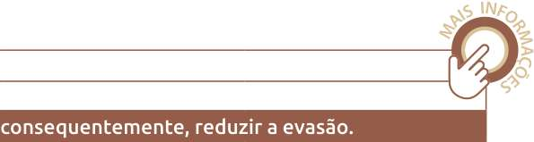

<!-- figure p173-fig1 | described_by: agy | ocr_overlap: 1.0 | needs_review: false -->
1. **Tipo de figura:** Elemento gráfico decorativo e informativo (recorte parcial de um quadro/caixa de destaque do tipo "Mais Informações") extraído de um PDF, composto por linhas horizontais, um ícone interativo estilizado de clique no canto superior direito e uma faixa inferior preenchida com o trecho final de uma frase.

2. **Todo o texto visível (verbatim):**
   - Ao redor do ícone circular no canto superior direito, em curva e em caixa alta: `MAIS INFORMAÇÕES`
   - Na faixa preenchida inferior, alinhado à esquerda: `consequentemente, reduzir a evasão.`

3. **Estrutura:**
   - **Faixas horizontais (de cima para baixo), todas abertas na borda esquerda:**
     - Uma linha horizontal fina no topo que parte da borda esquerda e termina tocando a lateral esquerda do círculo do ícone.
     - Uma primeira faixa horizontal retangular vazia (em branco), delimitada pela linha superior e por uma segunda linha horizontal fina paralela abaixo dela, que parte da borda esquerda e termina tocando a lateral esquerda da ilustração da mão.
     - Uma segunda faixa horizontal retangular vazia (em branco), delimitada acima pela segunda linha horizontal, abaixo pelo topo da faixa preenchida inferior e à direita por uma linha vertical fina que desce da parte inferior direita da mão até o canto superior direito da faixa preenchida.
     - Uma faixa horizontal inferior preenchida (sólida), estendendo-se da borda esquerda até o mesmo alinhamento vertical da borda direita acima dela (deixando uma margem em branco à direita, abaixo da metade direita do ícone). Contém o texto `consequentemente, reduzir a evasão.` alinhado à esquerda.
   - **Ícone no canto superior direito:**
     - Composto por anéis concêntricos (anel externo espesso, anel intermediário mais fino e centro circular vazio/branco), formando um alvo ou botão circular.
     - O texto `MAIS INFORMAÇÕES` envolve a parte externa do círculo em sentido horário, começando no quadrante superior esquerdo, passando pelo topo e descendo pelo lado direito até o quadrante inferior direito.
     - Sobrepondo o quadrante inferior esquerdo do círculo, há o desenho de uma mão apontando com o dedo indicador na diagonal para cima e para a direita, em direção ao centro do círculo (como um cursor/gesto de clique).

4. **Números ou valores de dados:**
   - Não há números, métricas ou valores de dados na imagem.

5. **Cores com significado:**
   - **Marrom:** delimita a estrutura da caixa (linhas horizontais e vertical), forma o anel externo do ícone e o contorno da mão, e preenche o fundo da faixa inferior para dar destaque visual ao bloco de texto.
   - **Bege claro:** destaca o rótulo curvo `MAIS INFORMAÇÕES` e o anel interno do ícone, diferenciando-os visualmente do marrom principal.
   - **Branco:** usado no preenchimento do fundo, do centro do ícone e da mão, bem como na cor da fonte sobre a faixa marrom inferior para garantir contraste e legibilidade.

~~~text ocr
onsequentemente, reduzir a evasão.
~~~

<!-- Start of picture text -->
MAIS INFOR M A Ç Õ SE <!-- End of picture text -->

###### Objetivo 19. Redução da Evasão 

###### EIXO SOCIEDADE 

|TEMA OBJETIVO|ENSINO E APRENDIZAGEM Aprimorar oprocesso de|ensino- aprendizagem e,|consequentemente, redu|zir a evasão.|
|---|---|---|---|---|
|INDICADOR(ES)|META 2022|META 2023|META 2024|META 2025|
|1 – Cursos de formação continua- da para docentes. 2 – Taxa de evasão. UNIDADE(S)RESPONSÁVEL(IS)|1.1 2. Reduzir em 1%|1.1 2.Reduzir em 1%|1.1 2. Reduzir em 1%|1.1 2. Reduzir em 1%|
|PREG,Progepe,PROExC|||||

|EIXO|Objetivo 2 SOCIEDAD|0.Acompa E|nhamento d|e Discente|e Apoio Pe|dagógico|||**M** **A** **I** **S**     **I** **N** **F** **O** **R** **M** **A** **Ç** |
|---|---|---|---|---|---|---|---|---|---|
|TEMA  OBJETIVO|ACOMPANH  Otimizar o|AMENTO D acompanh|E DISCENTES amento de|E APOIO PED discentes.|AGÓGICO||||**Õ** **E** **S**|
||META|META|2022|META|2023|META|2024|MET|A 2025|
|INDICADOR(ES)|2021|1º Sem.|2º Sem.|1º Sem.|2º Sem.|1º Sem.|2º Sem.|1º Sem.|2º Sem.|
|1 – Ações de acolhimento promovidas.||||||||||
|2 – Percentual de discentes||||||||||
|acompanhado(a)s/discentes nos Programas de Auxílios.|2.90%|1.1|2. 90%|1.1|2. 100%|1.1|2. 100%|1.1|2.100%|
|UNIDADE(S)RESPONSÁVEL(IS)||||||||||
|PREG,Progesti||||||||||

**172** 

<!-- page 174 -->

##### **Cursos de graduação – modalidade Educação a Distância (EAD)** 

O processo de institucionalização da Educação a Distância (EAD) revela-se fundamental para que as Instituições de Ensino Superior desenvolvam políticas direcionadas às demandas específicas da modalidade. As Diretrizes e as Normas Nacionais para oferta de programas e cursos de Educação Superior, na modalidade a distância, estabelecidas na Resolução CNE/CES nº 1/2016 (BRASIL, 2016), orientam políticas e processos de avaliação e regulação dos cursos e das Instituições de Educação Superior (IES) no âmbito da EAD. A referida resolução estabelece que a EAD deve compor a política institucional das IES, constando nos instrumentos de planejamento institucional e nos projetos pedagógicos. 

A oferta de cursos de graduação EAD e a qualidade da formação devem primar pela equidade, organizando-se de modo sistêmico e de maneira articulada. A esse respeito o Parecer CNE/CES nº 564/2015 (BRASIL, 2015a) complementa: “É preciso superar a implementação da EAD, como política à parte, e, em muitos casos, dissociada do PDI, de modo que se consolide políticas institucionais, que articulem as dinâmicas político-pedagógicas para a educação superior oferecidas pelas IES”. (BRASIL, 2015a, p. 11). 

O PDI da UFRPE dialoga com a regulamentação da EAD, considerando o potencial estratégico da modalidade para a expansão da Educação Superior. Considerando as metas 

previstas no Plano Nacional de Educação – PNE (BRASIL, 2014), sobretudo as Metas 12 e 15, a EAD pode ratificar seu papel estratégico nos processos de interiorização e expansão das atividades acadêmicas da UFRPE, bem como no incremento dos números de vagas e matrículas em diversos municípios com a oferta de cursos de graduação EAD. Nesse sentido, as políticas institucionais para a expansão da graduação EAD são necessárias para atender ao PNE, tendo em vista o processo de interiorização da Educação Superior em diversos municípios. Somando-se às demandas de expansão de matrículas e ofertas de cursos de graduação, a EAD pode impulsionar a formação docente, em sintonia com a Meta 15 do PNE. (BRASIL, 2014). 

##### **Implantação dos cursos de graduação – modalidade EAD** 

A UFRPE iniciou sua trajetória na graduação EAD com a adesão, em 2005, ao Pró-Licenciatura, programa do Ministério da Educação, o qual propôs a formação inicial a distância a professore(a)s em exercício nos anos finais do Ensino Fundamental e/ou Ensino Médio dos sistemas públicos de ensino (BRASIL, 2005). O primeiro curso de graduação ofertado na modalidade a distância pela UFRPE foi Licenciatura em Física, autorizado pela Portaria nº 3.726, de 21 de outubro de 2005 (BRASIL, 2005), pelo Programa Prólicenciatura. Em 2006, foi criado o Programa Universidade Aberta do Brasil _–_ UAB, por meio do Decreto nº 5.800, de 08 de junho de 2006 (BRASIL, 2006b), voltado para o 

**173** 

<!-- page 175 -->

desenvolvimento da modalidade de Educação a Distância, com a finalidade de expandir e interiorizar a oferta de cursos e programas de Educação Superior no Brasil. A UAB realizou ampla articulação entre instituições públicas de ensino superior, estados e municípios. Com a implantação da UAB, a UFRPE deu continuidade às ações no âmbito da EAD e aderiu, em 2006, à oferta de cursos de graduação a distância, tendo em vista plano estratégico para aumento da capilaridade do ensino superior em Pernambuco, bem como em outros estados, como: Bahia, Ceará, Paraíba e Tocantins. 

Em 2009, a UFRPE promoveu a expansão da graduação EAD, aderindo ao Plano Nacional de Formação de Professores da Educação Básica – Parfor, instituído pelo Decreto nº 6.755/2009 (BRASIL, 2009). Nesse sentido, com a adesão 

ao Parfor, a UFRPE implementou os cursos de primeira licenciatura a distância: Artes Visuais, História, Computação, Letras, Pedagogia, e a licenciatura interdisciplinar em Ciências Naturais, além dos cursos de segundas licenciaturas em Computação e Pedagogia. As primeiras turmas dos referidos cursos iniciaram em 2010, ano em que a UFRPE também implantou o Bacharelado em Administração Pública, por meio do Programa Nacional de Formação em Administração Pública (PNAP). Essa expansão da EAD na UFRPE está atrelada à criação da Unidade Acadêmica de Educação a Distância e Tecnologia – UAEADTec, conforme Resolução nº 017/2010 – Consu/UFRPE. (UFRPE, 2010). 

O quadro a seguir apresenta a implementação de cursos de graduação EAD na UFRPE. 

Quadro 14. **Histórico dos Cursos** de Graduação EAD – UAEADTec/UFRPE 

|**ANO**|**CURSO – EAD**|**PROGRAMA**|
|---|---|---|
|2005/2006|Licenciatura em Física|2005_–_Adesão da UFRPE ao Programa Pró-Licenciatura. 2006_–_Adesão da UFRPE ao Programa Universidade Aberta do Brasil_–_UAB.|
|2008|Licenciatura em Computação; Bacharelado em Sistemas de Informação.|Programa Universidade Aberta do Brasil_–_UAB|
|2009/2010|Licenciaturas em: Artes Visuais; Computação, História; Pedagogia; Letras, Licenciatura Interdisciplinar em Ciências Naturais. Segundas Licenciaturas em: Computação;Pedagogia.|2009_–_Adesão da UFRPE ao Parfor_–_Plano Nacional de Formação de professore(a)s da Educação Básica. 2010_–_Expansão da oferta de cursospelo Parfor.|
|2010|Bacharelado em Administração Pública|Programa Nacional de Formação em Administração Pública(PNAP).|

**174** 

<!-- page 176 -->

|**ANO**|**CURSO – EAD**|**PROGRAMA**|
|---|---|---|
|2014|Licenciaturas em: Artes Visuais; Computação; Física; História; Pedagogia; Letras. Bacharelados em: Sistemas de Informação e Administração Pública|Expansão do Programa UAB na UFRPE. Novas ofertas de cursos de graduação EAD.|
|2017|Licenciaturas em: Artes Visuais; Computação; Física; História; Pedagogia; Letras. Bacharelados em: Administração Pública;Sistemas de Informação.|Programa UAB PNAP|
|2020|Licenciaturas em: Artes Visuais; Física; História; Letras. Bacharelado em Administração Pública.|Programa UAB PNAP|

_Fonte: UAEADTec/UFRPE (2021)._ 

No ano de 2021, a UAEADTec apresenta oito cursos de graduação EAD, sendo seis licenciaturas e dois bacharelados, ofertados pelo Programa Universidade Aberta do Brasil _–_ UAB. 

###### Quadro 15. **Cursos de Graduação EAD** ativos na UAEADTec/UFRPE 

<!-- figure p176-fig1 | described_by: agy | ocr_overlap: 0.88 | needs_review: false -->
**1. Tipo de figura**
Tabela informativa listando cursos de graduação na modalidade de Ensino a Distância (EAD), divididos em duas categorias principais lado a lado.

**2. Todo o texto visível (literal)**
- Título principal: `Cursos de Graduação – EAD`
- Cabeçalhos de categoria:
  - Coluna da esquerda: `LICENCIATURAS`
  - Coluna da direita: `BACHARELADOS`
- Células sob `LICENCIATURAS`:
  - `1` | `Artes Visuais`
  - `2` | `Computação`
  - `3` | `Física`
  - `4` | `História`
  - `5` | `Letras – Português`
  - `6` | `Pedagogia`
- Células sob `BACHARELADOS`:
  - `1` | `Administração Pública`
  - `2` | `Sistemas de Informação`

**3. Estrutura**
A figura é uma tabela retangular com bordas externas e divisórias internas visíveis, composta por:
- **Bloco de cabeçalho superior** (duas faixas horizontais unificadas sem linhas divisórias entre si):
  - Primeira faixa: ocupa toda a largura da tabela com o título centralizado `Cursos de Graduação – EAD`.
  - Segunda faixa: dividida espacialmente em duas metades, contendo `LICENCIATURAS` à esquerda e `BACHARELADOS` à direita.
- **Corpo da tabela**, organizado em 4 colunas (dois pares de colunas `[número | nome do curso]`) e 6 linhas de altura:
  - **Metade esquerda (`LICENCIATURAS`)**: 2 colunas (uma coluna estreita à esquerda para a numeração e uma coluna larga à direita para o nome do curso) distribuídas em 6 linhas completas (linhas 1 a 6), todas preenchidas.
  - **Metade direita (`BACHARELADOS`)**: 2 colunas (uma coluna estreita à esquerda para a numeração e uma coluna larga à direita para o nome do curso) preenchidas apenas nas 2 primeiras linhas (linhas 1 e 2). O espaço correspondente às linhas 3 a 6, abrangendo ambas as colunas desse lado, forma uma única célula vazia mesclada sem divisórias internas.

**4. Todos os números e valores de dados**
- Numeração dos itens sob `LICENCIATURAS`: `1`, `2`, `3`, `4`, `5`, `6` (6 cursos listados).
- Numeração dos itens sob `BACHARELADOS`: `1`, `2` (2 cursos listados).
- Não há outros valores numéricos, quantidades de vagas ou percentuais na tabela.

**5. Cores com significado**
- **Fundo marrom-avermelhado com texto branco**: diferencia hierarquicamente o bloco de cabeçalho (título principal e rótulos das duas categorias) do corpo de dados da tabela.
- **Alternância entre fundo branco e bege-claro (estilo zebrado) com texto preto**: distingue linhas ímpares (branco: linhas 1, 3 e 5) de linhas pares (bege-claro: linhas 2, 4 e 6) para auxiliar o acompanhamento visual horizontal dos itens.
- **Área mesclada em branco contínuo** (abaixo do item `2` em `BACHARELADOS`): contrasta com o zebrado à esquerda, indicando visualmente que não há mais cursos listados nessa categoria.

~~~text ocr
Cursos de Graduação - EAD
LICENCIATURAS BACHARELADOS
1 Artes Visuais 1 Administração Pública
2 | Computação 2 | Sistemas de Informação
3 | Fisica
4 | Historia
5 Letras — Português
6 | Pedagogia
~~~

<!-- Start of picture text -->
Cursos de Graduação – EAD LICENCIATURAS BACHARELADOS 1 Artes Visuais 1 Administração Pública 2 Computação 2 Sistemas de Informação 3 Física 4 História 5 Letras – Português 6 Pedagogia <!-- End of picture text -->

_Fonte: UAEADTec/UFRPE (2021)._ 

A expansão da EAD na UFRPE vem se consolidando em ações institucionais direcionadas ao tripé ensino-pesquisa-extensão e ancoradas em demandas por formação e qualificação profissional no âmbito da Educação Superior. O crescimento da EAD, na UFRPE, pode ser estratégico para promover conexões com modelos híbridos de ensino, buscando-se maiores articulações entre o ensino de graduação presencial e a EAD. 

##### **A EAD como política estratégica para expansão da educação superior e articulações com o sistema híbrido** 

A pandemia de Covid-19, em 2020, propiciou mudanças nos paradigmas da educação, tendo em vista a paralisação de aulas presenciais nas escolas de Educação Básica e nas universidades. Docentes e discentes tiveram que se adaptar 

**175** 

<!-- page 177 -->

rapidamente ao contexto desafiador, visando à inserção de TDIC em processos de ensino e aprendizagem. 

A EAD e os modelos de ensino remoto e ensino híbrido ganharam destaque. As aulas _on-line_ passaram a fazer parte da rotina de milhares de estudantes brasileiros do Ensino Superior e da Educação Básica. Nesse contexto, a educação mediada por tecnologias digitais ganhou destaque como alternativa para a continuidade de aulas e atividades acadêmicas não presenciais. A EAD passou a ser compreendida pelas Instituições de Ensino Superior como modalidade promissora. 

Vislumbrando novas fronteiras para o ensino de graduação no Brasil, com a inserção de TDIC e metodologias diversificadas, em Portaria nº 2.117, publicada em 6 de dezembro de 2019 (BRASIL, 2019g), o MEC dispõe sobre a oferta de carga horária na modalidade EAD em cursos presenciais de graduação. A legislação já indica caminhos para a adoção do modelo híbrido, com atividades acadêmicas presenciais e não presenciais, combinando as características da EAD e do ensino presencial, em função das demandas da Educação Superior na cultura digital. 

O Plano Nacional de Educação (PNE) estabelece o crescimento na formação superior do Brasil, contribuindo para a institucionalização da modalidade, tendo em vista a importância política da EAD, sobretudo, se levarmos em conta os desafios colocados na Meta 12 do PNE para expansão da 

Educação Superior. A UFRPE pode contribuir para essa expansão, considerando o desenvolvimento de políticas institucionais direcionadas à EAD, com foco na integração entre EAD e ensino presencial, por meio de oferta de até 40% da carga horária de cursos presenciais no formato a distância. (BRASIL, 2019). 

##### **Política Institucional para modalidade EAD – cursos de graduação** 

##### **Gestão dos cursos de graduação EAD** 

A gestão dos cursos de graduação EAD da UFRPE é de responsabilidade da Unidade Acadêmica de Educação a Distância e Tecnologia (UAEADTec), situada no bairro de Dois Irmãos, em Recife. A UAEADTec conta com equipe de gestão geral formada por: Direção Geral e Acadêmica, Direção Administrativa, Coordenação da Universidade Aberta do Brasil _–_ UAB, Coordenação Geral de Cursos de Graduação, Coordenações de Cursos de Graduação, Coordenação de Produção de Material Didático, equipe multidisciplinar de apoio técnico-administrativo. 

Os cursos de graduação são ofertados nos polos situados em diferentes municípios de Pernambuco e da Bahia. Cada polo conta com estrutura técnico-administrativa para a gestão de ações relativas à dinâmica dos cursos EAD, com participação de Coordenação de Polos, Assistente à Docência e Tutores Presenciais. 

**176** 

<!-- page 178 -->

No tocante à gestão administrativa, cada Coordenação de Curso de graduação conta equipe formada por: Coordenação de Tutoria, Coordenação Pedagógica e Apoio ao Discente. No âmbito da gestão pedagógica dos cursos, docentes formadore(a)s e a tutoria (virtual/presencial) atuam, de modo colaborativo, no acompanhamento dos processos de ensino e aprendizagem no AVA UFRPE e nos polos EAD. 

##### **A importância dos polos na graduação EAD** 

O polo tem papel fundamental para o corpo discente da EAD, sobretudo, para estudantes que não têm acesso aos recursos tecnológicos e contam, preferencialmente, com a infraestrutura disponível nos polos. De acordo com a Resolução nº 1, de 11 de março de 2016 (BRASIL, 2016), o polo de EAD é uma “unidade acadêmica e operacional descentralizada”, ou seja, um “prolongamento orgânico e funcional da Instituição no âmbito local para efetivar apoio político-pedagógico, tecnológico e administrativo às atividades educativas dos cursos e programas ofertados a distância”. (BRASIL, 2016). É preciso que o polo funcione como local de apoio para atividades acadêmicas, tendo em vista as seguintes características: 

- Local estruturado para dar suporte ao corpo discente dos cursos de graduação EAD; 

- Espaço de apoio para que o corpo discente tenha acesso à biblioteca, facilitando pesquisas e contribuindo para metodologias de estudo com base na autonomia e no protagonismo estudantil; 

- A biblioteca do polo precisa dar suporte para pesquisas e deve ser compreendida como espaço de trocas de experiências, por meio da organização de grupos de estudo; 

- Os laboratórios de informática e tecnologias são fundamentais nos polos, contribuindo para que o corpo discente se aproprie dos recursos tecnológicos e amplie práticas de letramentos digitais; 

- O acesso aos laboratórios de informática facilita a interação de estudantes com materiais didáticos disponíveis no AVA, contribuindo para que o corpo discente desenvolva metodologias de estudo baseadas na autonomia; 

- Vivências práticas também são realizadas nos polos, tendo em vista a necessidade de articulação entre teoria e prática; 

- Os polos são relevantes nas etapas de avaliações presenciais, nas quais o(a)s discentes realizam exames, testes, provas, seminários, apresentação de TCC/monografias, socialização de relatórios e experiências de estágios obrigatórios, bem como outros instrumentos de avaliação. 

**Polos de apoio presencial** : **expansão da graduação EAD e inserção regional da UFRPE** No ano de 2021, a UAEADTec conta com 14 polos ativos para os cursos de graduação EAD, sendo 11 em Pernambuco e 3 na Bahia, conforme quadro a seguir. 

**177** 

<!-- page 179 -->

###### Quadro 16. **Cursos de Graduação EAD** _–_ 

###### UAEADTec/UFRPE por polos 

|**Nº**|**POL** **Polo UAB**|**OS EM PERNAMBUCO** **Cursos degraduação EAD**|
|---|---|---|
|**01**|**Afrânio – PE**|Bacharelado em Administração Pública. Licenciaturas em: Artes Visuais; História; Letras.|
|**02**|**Carpina – PE**|Bacharelados em: Administração Pública; Sistemas de Informação. Licenciaturas em: Artes Visuais; Física; História;Letras.|
|**03**|**Gravatá – PE**|Licenciaturas em: Artes Visuais; Física; História;Pedagogia.|
|**04**|**Jaboatão dos** **Guararapes – PE**|Licenciatura em Letras Especialização em Gestão Pública Municipal.|
|**05**|**Limoeiro – PE**|Bacharelado em Administração Pública Licenciaturas em: Computação;Física.|
|**06**|**Palmares – PE**|Bacharelado em Sistemas de Informação. Licenciaturas em: História;Pedagogia.|
|**07**|**Pesqueira – PE**|Bacharelado em Sistemas de Informação. Licenciaturas em: História;Pedagogia.|
|**08**|**Petrolina – PE**|Licenciaturas em: Artes Visuais;História.|
|**09**|**Recife – PE**|Bacharelado em Administração Pública. Licenciaturas em: Artes Visuais; História; Computação;Letras;Pedagogia.|
|**10**|**Santa Cruz do** **Capibaribe – PE**|Licenciatura em Artes Visuais.|
|**11**|**Surubim – PE**|Licenciaturas em: Computação; Física; Letras.|

|Nº|**Polo UAB**|POLOS NA BAHIA Cursos degraduação EAD|
|---|---|---|
|**12**|**Camaçari – BA**|Licenciaturas em: Artes Visuais;História.|
|**13**|**Ilhéus – BA**|Licenciatura em Artes Visuais.|
|**14**|**Vitória da** **Conquista – BA**|Licenciatura em Artes Visuais.|

_Fonte: UAEADTec/UFRPE (2021)._ 

A figura 14 apresenta o mapa com a inserção regional da UFRPE em relação à oferta de cursos de graduação EAD em diferentes municípios de Pernambuco e da Bahia. 

###### Figura 14 – **Polos com oferta** de Cursos de Graduação EAD- UAEADTec/UFRPE 

<!-- figure p179-fig1 | described_by: agy | ocr_overlap: 1.0 | needs_review: false -->
1. **Tipo de figura**
Mapa geográfico esquemático (mapa de localização) destacando dois estados brasileiros — Pernambuco (`PE`) e Bahia (`BA`) — com marcadores circulares indicando a posição de municípios em seus territórios, acompanhado à direita por uma lista dos nomes desses municípios agrupados por estado.

2. **Todo o texto visível (ipsis litteris)**
- No interior do mapa:
  - `PE`
  - `BA`
- Na lista à direita (alinhada à direita, em ordem vertical):
  - `PE`
  - `Afrânio`
  - `Carpina`
  - `Gravatá`
  - `Jaboatão dos Guararapes`
  - `Limoeiro`
  - `Palmares`
  - `Pesqueira`
  - `Petrolina`
  - `Recife`
  - `Santa Cruz do Capibaribe`
  - `Surubim`
  - `BA`
  - `Camaçari`
  - `Ilhéus`
  - `Vitória da Conquista`
- Não há título geral, subtítulo, legenda de cores, rótulos junto aos pontos, escala cartográfica, rosa dos ventos, eixos, coordenadas nem rodapé visíveis na imagem.

3. **Estrutura**
- A figura consiste em um único painel horizontal dividido em duas áreas principais: o mapa à esquerda/centro e uma coluna textual à direita, sem molduras, caixas, tabelas, eixos, setas ou linhas conectoras entre os elementos.
- **Mapa (esquerda/centro):** exibe uma porção do território continental ao fundo sem divisões administrativas, limitada a leste pela linha de costa sobre fundo branco. Sobre essa base, destacam-se os polígonos contíguos de dois estados:
  - **Superior (`PE`):** formato alongado no sentido oeste-leste, com a sigla `PE` centralizada. Faz divisa ao sul com a Bahia. Contém 11 marcadores circulares distribuídos da seguinte forma:
    - 2 marcadores na extremidade oeste: um próximo à borda oeste/noroeste e outro um pouco a sudeste, perto da divisa com a Bahia.
    - 9 marcadores concentrados na porção leste do estado: 1 ponto um pouco mais a oeste desse conjunto; um agrupamento denso de 7 pontos na região nordeste/leste (muito próximos entre si, alguns quase tangenciando ou levemente sobrepostos, chegando até a margem litorânea); e 1 ponto mais ao sul, próximo à fronteira meridional da porção leste.
  - **Inferior (`BA`):** polígono amplo abaixo de `PE`, ocupando a maior parte do mapa, com a sigla `BA` centralizada. Contém 3 marcadores circulares:
    - 1 ponto na costa centro-leste (junto à reentrância litorânea).
    - 1 ponto na costa mais ao sul.
    - 1 ponto no interior sul/sudoeste, próximo à borda inferior do estado.
- **Lista de municípios (direita):** disposta em coluna única alinhada à direita, dividida em dois blocos separados por espaço vertical. O primeiro bloco traz o cabeçalho `PE` seguido de 11 nomes de municípios em ordem alfabética; o segundo traz o cabeçalho `BA` seguido de 3 nomes de municípios em ordem alfabética. Não há ícones nem círculos coloridos ao lado dos nomes que façam correspondência explícita entre cada cor no mapa e cada município listado.

4. **Números e valores de dados**
- Não há números, valores quantitativos, datas, escalas ou coordenadas escritos na imagem.
- Por contagem direta dos elementos gráficos e textuais, a figura representa: 2 estados (`PE` e `BA`) e 14 municípios no total (14 pontos no mapa e 14 nomes na lista), sendo 11 em `PE` e 3 em `BA`.

5. **Cores com significado**
- **Bege (preenchimento) com contorno marrom-escuro:** destaca os estados focalizados (`PE` e `BA`) em contraste com o território vizinho ao fundo (cinza-claro) e a área externa/oceânica (branco).
- **Branco em negrito (siglas `PE` e `BA` sobre o mapa):** identifica os estados em contraste com o preenchimento bege.
- **Marrom-escuro em negrito (cabeçalhos `PE` e `BA` da lista):** retoma a cor dos contornos estaduais e diferencia os cabeçalhos dos estados dos nomes dos municípios (em cinza-escuro regular).
- **Cores dos 14 marcadores circulares:** cada ponto possui uma cor distinta (com contorno fino escuro) para diferenciar individualmente os locais representados, embora a figura não contenha legenda indicando qual cor corresponde a qual município da lista:
  - **Em `PE` (11 pontos, da esquerda para a direita / oeste para leste):** bege-claro/creme (extremo oeste); roxo-escuro (sudoeste); magenta/vinho (margem oeste do agrupamento leste); azul-escuro (noroeste do agrupamento denso); azul-médio (logo a leste do azul-escuro); marrom (parte superior do agrupamento denso); amarelo-claro (a leste do marrom); amarelo-ouro/mostarda (abaixo do marrom e do amarelo-claro); laranja/âmbar (extremo nordeste, no litoral); azul-marinho muito escuro (abaixo do laranja, no litoral); e vermelho-escuro (ao sul do agrupamento leste).
  - **Em `BA` (3 pontos, de norte para sul):** verde-água/turquesa (litoral centro-leste), verde-médio (litoral sul) e verde-escuro (interior sul/sudoeste) — todos os marcadores da Bahia pertencem à família de tons verdes, distinguindo-se visualmente da paleta usada em Pernambuco.

~~~text ocr
PE
Afrânio
Carpina
Gravatá
Jaboatão dos Guararapes
Limoeiro
Palmares
Pesqueira
Petrolina
Recife
Santa Cruz do Capibaribe
Surubim
BA
Camaçari
ilhéus
Vitória da Conquista
~~~

<!-- Start of picture text -->
PE PE Afrânio Carpina Gravatá Jaboatão dos Guararapes Limoeiro Palmares BA Pesqueira Petrolina Recife Santa Cruz do Capibaribe Surubim BA Camaçari Ilhéus Vitória da Conquista <!-- End of picture text -->

_Fonte: UAEADTec/UFRPE (2021)._ 

**178** 

<!-- page 180 -->

O processo de interiorização da EAD é fruto da implantação dos polos em diversos municípios. Para implementar o funcionamento dos cursos de graduação EAD nos polos é realizado estudo diagnóstico, conforme descrição a seguir. 

##### **Estudo diagnóstico para implantação de polos EAD – UFRPE** 

O estudo diagnóstico para implementação de cursos de graduação nos diversos polos EAD – UAEADTec realiza-se com base nos indicadores do Censo Escolar da Educação Básica, buscando-se mapear as demandas de cada município no tocante à etapa do Ensino Médio para ingresso na Educação Superior. Destaca-se, ainda, a participação das Coordenações de Polos e das Coordenações de Cursos na elaboração de mapeamentos estratégicos de demandas dos municípios quanto à oferta de cursos EAD. Nesse sentido, a UAEADTec considera as demandas dos polos, por meio de relatórios das Coordenações de Polos, bem como mapeamentos das Coordenações de Cursos, com base em dados do Censo da Educação Básica com informações dos diversos municípios. Ressalta-se, ainda, o mapeamento de demandas de oferta de cursos EAD nos polos com base no Plano Nacional de Educação – PNE (BRASIL, 2014), bem como tendo em vista as orientações dos editais do Programa UAB. O Censo Escolar da Educação Básica de 2019, organizado pelo Inep e publicado em 2020 (BRASIL, 2020), revela o panorama atual da educação básica em Pernambuco, com estatísticas apresentadas em série histórica, o que também possibilita traçar algumas tendências da área. O Censo 

Escolar é o principal instrumento de coleta de informações da Educação Básica, realizado em regime de colaboração entre Secretarias Estaduais e Municipais de Educação, com a participação de escolas públicas e privadas de Pernambuco. Os dados abrangem as diferentes etapas e modalidades da educação básica: ensino regular, Educação Especial, EJA e Educação Profissional. Para a oferta de cursos de graduação EAD, dados sobre Ensino Médio são relevantes para mapear perfis de ingressantes na Educação Superior. 

Conforme dados do Censo Escolar, em 2019, foram registradas 335.117 matrículas no Ensino Médio. Esse valor é 8,1% menor do que o número de matrículas em 2015. O Ensino Médio não integrado à Educação Profissional apresentou redução de 9,2% no número de matrículas entre 2015 e 2019 e o Ensino Médio integrado à Educação Profissional apresentou aumento de 7,0% no mesmo período. A rede estadual possui a maior participação na matrícula do Ensino Médio com 87,2% das matrículas, sendo seguida pela rede privada (10,4%). (BRASIL, 2020). 

Nos municípios do interior de Pernambuco, as dificuldades de acesso à Educação Superior são visíveis e a EAD pode contribuir para apoiar a continuidade dos estudos de discentes egresso(a)s do Ensino Médio, considerando, sobretudo, o contexto da rede pública estadual. Os dados referentes aos polos são fundamentais para planejamento e implementação de cursos de graduação e outras ações no âmbito da modalidade de Educação a Distância. 

**179** 

<!-- page 181 -->

##### **Processo de seleção e implantação dos polos EAD** _–_ **UFRPE/UAEADTec** 

A seleção de polos para funcionamento dos cursos de graduação da UAEADTec está atrelada a editais específicos de financiamento da Capes e dos órgãos de fomento para as ações da EAD na Educação Superior. A UAEADTec oferta cursos de graduação EAD, considerando os polos com avaliações positivas, em conformidade com os padrões da Capes, considerando infraestrutura física e tecnológica, com laboratórios, computadores, ferramentas para webconferência e outros recursos de apoio às atividades acadêmicas de ensino, pesquisa e extensão no contexto da graduação EAD. 

No planejamento de ofertas de vagas para os polos, a UAEADTec desenvolve os seguintes procedimentos: 

- Estudo de avaliação diagnóstica para ofertas de novos cursos de graduação nos polos EAD, considerando as demandas dos municípios, conforme relatórios das Coordenações de Polos, Coordenações de Cursos, dados do Censo da Educação Básica e do Plano Nacional de Educação – PNE (BRASIL, 2014); 

- Avaliação da logística de acesso aos polos EAD, tendo em vista mapeamento de estratégias e recursos financeiros para deslocamentos de tutore(a)s e docentes para encontros e atividades acadêmicas presenciais; 

- Consulta às Coordenações de Polos sobre demandas relativas a propostas de cursos de graduação, em sintonia com os perfis de cada município; 

- As demandas dos polos são enviadas às Coordenações de Cursos, que, por sua vez, comunicam à Coordenação UAB e à Direção Geral da UAEADTec; 

- A Coordenação UAB organiza as demandas enviadas pelas Coordenações de Cursos e encaminha as solicitações à Capes, com base nas chamadas dos editais específicos para articulações via Sistema UAB; 

- A Coordenação UAB estabelece comunicação com a Capes para obter orientações necessárias para novas ofertas de polos e cursos de graduação, conforme editais específicos; 

- Após o PPC do novo curso ser aprovado nos trâmites institucionais da UFRPE, toda documentação é inserida no sistema SISUAB; 

- Organiza-se, na sede e nos polos, processo de divulgação dos editais de seleção e ingresso de discentes para os cursos de graduação EAD. 

No que se refere à oferta de novos polos, a Coordenação UAB é responsável por manter contato com a Capes, com vistas à autorização dos encaminhamentos para firmar contrato de parceria com os municípios, que manifestem interesse e estrutura necessária, para se constituírem em polos de apoio presencial para oferta de cursos EAD. As informações dos polos são inseridas nos editais de novas ofertas de cursos pretendidos, conforme determinação da Portaria MEC nº 218, de 24 de setembro de 

**180** 

<!-- page 182 -->

2018 (BRASIL, 2018), a qual regulamenta as diretrizes de admissibilidade de novos polos, permanência e desligamento dos polos no Sistema SISUAB. 

É importante salientar que as demandas para a expansão da Educação Superior na modalidade a distância são indicadas pela Capes em editais específicos que contextualizam as áreas prioritárias, com base na Lei nº 13.005, de 25 de junho de 2014 (BRASIL, 2014) e na Política Nacional de Formação de professore(a)s (BRASIL, 2017). Nesse sentido, as licenciaturas são indicadas como prioritárias, sobretudo nas áreas de conhecimento de componentes da Base Nacional Comum Curricular – BNCC (BRASIL, 2018), bem como em áreas específicas articuladas às demandas formativas prioritárias diante da necessidade de formação inicial docente em diversos municípios brasileiros, sobretudo, em áreas, como: Língua Portuguesa, Pedagogia, Matemática, Física, Química, Biologia e Ciências, no sentido de atender às formação de educadore(a)s para Educação Básica, em conformidade com a Meta 15 do PNE, “assegurado que todos os professores e as professoras da educação básica possuam formação específica de nível superior, obtida em curso de licenciatura na área de conhecimento em que atuam” (BRASIL, 2014). 

##### **Dinâmica de encontros presenciais nos polos EAD** 

Nos cursos de graduação da UAEADTec, os encontros presenciais nos polos estão programados no calendário 

acadêmico. Os encontros presenciais são realizados aos finais de semana nos polos, preferencialmente aos sábados. De acordo com as dinâmicas dos diversos cursos e dos componentes curriculares ofertados, em geral, os encontros presenciais organizam-se com a participação de tutore(a)s que realizam mediações nas etapas avaliativas de 1ª VA, 2ª, 3ª VA e avaliação final. A frequência dos encontros presenciais nos polos é norteada por recursos financeiros específicos para deslocamentos de tutore(a)s, docentes, gestore(a)s, colaboradore(a)s e equipe multidisciplinar, podendo sofrer ajustes, de acordo com previsão orçamentária proposta para cursos de graduação EAD. Ressalta-se que é priorizada a avaliação presencial para a EAD, conforme Decreto nº 5.622/2005, Art. 4, Inciso II, §2 (BRASIL,2005b), ou seja, os instrumentos de avaliação são aplicados presencialmente nos polos, de acordo com calendário acadêmico da UAEADTec. 

##### **Metodologias utilizadas na EAD** 

As tecnologias e as mídias digitais têm proporcionado novas relações entre discentes e docentes, em função da construção de redes, da disseminação e do compartilhamento dinâmico de informações. Com as inovações tecnológicas, as estratégias metodológicas precisam ser repensadas, de acordo com as demandas de aprendizagem do(a)s estudantes. Nesse sentido, as metodologias ativas têm sido valorizadas, no sentido de evidenciarem o(a) estudante como protagonista na construção de percursos formativos pautados 

**181** 

<!-- page 183 -->

na autonomia e na flexibilidade de situações interativas para construção de aprendizagens significativas. 

Algumas metodologias ativas são utilizadas nos cursos de graduação EAD da UAEADTec para apoiar a aprendizagem e a autonomia de discentes, tais como: sala de aula invertida, aprendizagem baseada em problemas, aprendizagem entre times, aprendizagem baseada em projetos. As metodologias utilizadas precisam destacar a aprendizagem ativa, considerando a avaliação formativa no processo de acompanhamento de discentes. Os(as) docentes planejam as metodologias e o desenho didático do AVA de acordo com as especificidades dos componentes curriculares, e tendo em vista as demandas de aprendizagem do(a)s discentes. 

**Avaliação e acompanhamento da aprendizagem** Com as possibilidades metodológicas ampliadas pelo AVA, o(a)s docentes contam com mais elementos para acompanhar e avaliar o(a)s discentes de forma contínua, considerando, por exemplo, o processo de avaliação formativa. Esse processo avaliativo estende-se aos momentos presenciais, com atividades que permitem ao(à)s docentes e discentes expandirem e aprofundarem os conteúdos abordados no AVA. Destaca-se que a avaliação da aprendizagem, nesse contexto, ocorre por meio de atividades avaliativas realizadas continuamente no AVA e presencialmente nos polos. 

Na dinâmica dos cursos de graduação EAD da UAEADTec, o(a)s estudantes participam de avaliações assíncronas, realizadas por meio de atividades virtuais disponíveis no AVA, bem como de avaliações síncronas, tendo em vista encontros presenciais nos polos, com realização de testes, exames, seminários, além de outros instrumentos avaliativos indicados nos planos de ensino dos componentes curriculares e previstos nos PPC. 

##### **Políticas de avaliação de cursos de graduação EAD – UFRPE** 

Os cursos de graduação da UAEADTec são continuamente avaliados, em conformidade com os parâmetros das práticas avaliativas institucionais da Comissão Própria de Avaliação (CPA) da UFRPE, bem como tendo em vista os instrumentos de avaliação externa propostos pelo Inep nos processos de credenciamento/recredenciamento. 

A CPA realiza ciclos avaliativos, considerando as demandas e as especificidades dos cursos de graduação EAD, por meio da aplicação de instrumento de avaliação que contempla características das dimensões pedagógicas e tecnológicas. Os instrumentos avaliativos da CPA são aplicados a docentes, discentes, servidore(a)s técnico(a)s, tendo em vista eixos avaliativos propostos na Lei nº 10.861/2004 – Sinaes (BRASIL, 2004b). O Sinaes foi instituído com a finalidade de analisar, oferecer subsídios, fazer recomendações, propor critérios e estratégias para a reformulação dos 

**182** 

<!-- page 184 -->

processos e políticas de avaliação da Educação Superior e elaborar a revisão crítica dos seus instrumentos, metodologias e critérios utilizados. As dimensões para os ciclos avaliativos são definidas na Lei nº 10.861/2004, em seu artigo 3º (BRASIL, 2004b). 

No caso das avaliações na dinâmica dos cursos de graduação EAD, a CPA/UFRPE inseriu, nos instrumentos avaliativos, dimensões características da modalidade EAD, tais como: materiais didáticos, recursos educacionais, tecnologias digitais, AVA, polos, metodologias, e outros itens. Discentes, docentes e servidore(a)s técnico(a)s acessam os instrumentos avaliativos organizados pela CPA nas bases SIGA/SIGAA com _login_ e senha de acesso. Não há a obrigatoriedade em relação às respostas aos questionários, ou seja, docentes, discentes e técnico(a)s podem escolher responder ou não. Esse processo é feito para consolidar a cultura de avaliação institucional para que os sujeitos percebam a importância da construção do processo formativo nos fluxos de autoavaliação institucional. 

Em 2020, a CPA realizou processo avaliativo referente ao Eixo Temático: _Políticas Acadêmicas – Ensino, Pesquisa, Extensão, Assistência Estudantil e Comunicação Institucional._ Considerando a participação dos membros da comunidade acadêmica da UAEADTec aptos a participar da avaliação, houve participação de: discentes (41.02%), docentes (92.11%) e técnico(a)s (100%). (UFRPE, 2020). O quadro a 

seguir apresenta os dados referentes ao Ciclo Avaliativo – 2020, considerando a avaliação do item Políticas Acadêmicas. 

Quadro 17. **Dados do Relatório da CPA** (2020) _–_ 

Cursos de graduação UAEADTec/UFRPE 

|**Perfil**|**Descrição**|
|---|---|
|DISCENTES|Dos 629 discentes aptos a participar da avaliação, 258 (41.02%) responderam ao questionário. Do total das respostas referentes às Políticas Acadêmicas, 3.94% foram “péssimo”, 4.71% foram “ruim”, 16.87% foram “regular”, 33.79% foram “bom”, 16.49% foram “excelen- te”,e 24.21% foram outras opções de resposta.|
|DOCENTES|Dos 38 docentes aptos a participar da avaliação, 35 (92.11%) responderam ao questionário. Do total das respostas referentes às Políticas Acadêmicas, 3.25% foram “péssimo”, 7.17% foram “ruim”, 17.54% foram “regular”, 38.66% foram “bom”, 15.41% foram “excelen- te”,e 17.98% foram outras opções de resposta.|
|TÉCNICO(A)S|Do(a)s 13 técnico(a)s aptos a participar da avaliação, 13 (100%) responderam ao questionário. Do total das res- postas referentes às Políticas Acadêmicas, 2.4% foram “péssimo”, 11.06% foram “ruim”, 18.75% foram “regu- lar”, 28.85% foram “bom”, 12.02% foram “excelente”, e 26.92% foram outras opções de resposta.|

_Fonte_ : _UNIVERSIDADE FEDERAL RURAL DE PERNAMBUCO. Relatório CPA (2020)_ 

_– Eixo avaliativo_ : _Políticas Acadêmicas (Ensino, Pesquisa, Extensão, Assistência Estudantil e Comunicação Institucional)_ **https://jhcp.github.io/cpa2020/reports/** 

**unidades/uaeadtec.html** 

Na UFRPE, a graduação EAD vem se destacando nos processos avaliativos, a exemplo do Enade, com destaque para 

**183** 

<!-- page 185 -->

dois cursos de graduação da UAEADTec que elevaram seus conceitos Enade (CE) referentes ao Ciclo Avaliativo 2017. Licenciatura em Pedagogia e Licenciatura em Letras elevaram conceitos Enade de 3 e 2 (2014), respectivamente, para 4 (2017). (UFRPE _,_ 2019). 

da Universidade, contratado(a)s por concurso público e professore(a)s colaboradore(a)s na categoria de bolsistas, selecionado(a)s a partir de processo seletivo específico, atendendo aos critérios estabelecidos pela Capes. O corpo técnico é selecionado por meio de concurso público e contratado de acordo com o estabelecido na Lei nº 8.112/90 (BRASIL, 1990). 

##### **Profissionais vinculados à EAD** 

O(a)s docentes dos cursos EAD podem ser servidore(a)s da UFRPE, contratado(a)s mediante concurso público para área específica de formação, com doutorado ou mestrado nas áreas de competência dos cursos. São regido(a)s pela Lei nº 8.112/1990 (BRASIL, 1990) que dispõe sobre o regime jurídico do(a)s servidore(a)s públicos civis da União, Autarquias e Fundações Públicas Federais. 

O Programa UAB abriu possibilidade de selecionar bolsistas para a função de Professor(a) Pesquisador(a) para atuação como docentes nos cursos EAD. As bolsas são financiadas pela Capes, nos termos da Lei nº 11.273/2006 (BRASIL, 2006d), que autoriza a concessão de bolsas de estudo e de pesquisa a participantes de programas de formação inicial e continuada de professore(a)s para a Educação Básica. Tal Lei foi modificada pela Lei nº 11.502/2007 (BRASIL,2007b), que atualizou as competências e a estrutura organizacional da Capes e autoriza a concessão de bolsas de estudo/ pesquisa a participantes do programa de formação inicial e continuada de professore(a)s para a Educação Básica. Dessa forma, a UFRPE apresenta corpo docente de servidore(a)s 

Os cursos de graduação EAD da UFRPE contam, também, com a participação do(a) tutor(a). Os requisitos de titulação e experiência profissional para sua contratação são: formação superior na área do conhecimento do curso/disciplina e experiência de, no mínimo um ano no exercício da docência no ensino básico ou superior ou ter pós-graduação concluída ou em andamento. O(a)s tutores atuam nos cursos EAD ofertados no âmbito da UAB, com apoio de bolsas financiadas pela Capes nos termos da Lei nº 11.273/2006 (BRASIL, 2006). Além de docentes e tutore(a)s, os cursos possuem Coordenação de Curso vinculada à Coordenação Geral de Cursos de Graduação a distância. 

Conforme Portaria Capes nº 15, de 23 de janeiro de 2017 (BRASIL, 2017), os perfis do sistema UAB que atuam nos cursos de graduação EAD da UAEADTec são: Coordenação UAB; Coordenação Adjunta, Coordenação de Curso, 

Coordenação Pedagógica, Coordenação de Tutoria, Apoio ao Discente, Professor(a) Formador(a), Tutor(a), Professor(a) Conteudista, Coordenação de Polo, Assistente à Docência. Além da relação de profissionais no âmbito da UAB, definida 

**184** 

<!-- page 186 -->

pela Portaria MEC/Capes nº 15, de 23 de janeiro de 2017, a Instrução Normativa nº 2, de 19 de abril de 2017 (BRASIL, 2017), prevê a atuação de equipe multidisciplinar para apoiar a produção de materiais didáticos e recursos educacionais, conforme modelo EAD. 

##### **Política de capacitação e formação continuada para docentes e corpo tutorial** 

Na UAEADTec, colaboradore(a)s, docentes, tutore(a)s e membros da equipe multidisciplinar são selecionado(a)s por meio de editais organizados pela Comissão de Seleção da UAEADTec, em conformidade com os perfis propostos pela regulamentação da Capes para cadastro de bolsas no Programa UAB. Os processos seletivos são realizados de acordo com as demandas da graduação EAD, por meio de editais específicos para seleção de tutore(a)s, docentes e equipe multidisciplinar. 

O(a)s aprovado(a)s nos editais de seleção participam do Curso de Formação em EAD, realizado em duas etapas. A primeira etapa é realizada no AVA da UAEADTec, priorizando-se interações assíncronas no Curso de Formação Inicial para EAD, o qual contempla conhecimentos sobre questões pedagógicas, AVA, tecnologias e recursos educacionais para EAD, logística dos encontros presenciais nos polos, dentre outras temáticas relevantes. Essa etapa, realizada com apoio de tecnologias digitais, consegue contemplar a diversidade de polos, propiciando participação de tutore(a)s 

presenciais e a distância, bem como Coordenações de Polos. A segunda etapa é de responsabilidade das Coordenações de Curso, com apresentação de PPC, matrizes curriculares e informações específicas, de acordo com a dinâmica de cada curso de graduação EAD. O Curso de Formação em EAD é ofertado para docentes, tutore(a)s virtuais e presenciais e membros da equipe multidisciplinar. 

Além da proposta do Curso de Formação em EAD, a UAEADTec busca incentivar a participação de docentes e tutore(as) em eventos científicos, dentro e fora da Universidade, com vistas ao incremento da qualificação acadêmica e profissional. O(a)s docentes também contam com oficinas, minicursos e cursos de formação complementar, organizados em parcerias institucionais entre UAEADTec, PREG, Progepe, PROExC e outros setores da UFRPE. Além disso, a UFRPE/UAEADTec confere apoio institucional ao corpo docente quanto a deslocamentos e ajuda de custos para incentivar a participação em eventos científicos. 

##### **Formação discente EAD** 

O(a)s discentes ingressantes participam de Curso de Formação em EAD, com foco em ambientação, usos de ferramentas e recursos do AVA UFRPE. A UAEADTec organiza a etapa de formação discente direcionada à ambientação no AVA UFRPE, bem como para as demandas formativas de ingressantes, a exemplo de ações direcionadas para cursos de extensão e nivelamento, voltados para principais dificuldades 

**185** 

<!-- page 187 -->

de discentes matriculado(a)s no primeiro período do curso. Nos processos de formação discente, as Coordenações de Curso organizam interações síncronas e assíncronas, por meio de mediações com apoio de tecnologias digitais, bem como realizam encontros presenciais nos polos, a depender das previsões orçamentárias para deslocamentos. 

**Tecnologias e recursos educacionais na EAD** As inovações tecnológicas estão redesenhando novas formas de ensino e aprendizagem. As TDIC ganham destaque e revelam papel fundamental para apoiar interações síncronas e assíncronas entre docentes e discentes. No âmbito da EAD, os recursos tecnológicos são primordiais para apoiar a aprendizagem e minimizar os efeitos das distâncias físicas entre docentes e discentes. Diversos recursos são utilizados nos cursos de graduação EAD para dinamizar fluxos de interação _on-line_ , tais como: AVA, materiais didáticos, Recursos Educacionais Abertos _–_ REA, objetos de aprendizagem, videoaulas, _podcasts_ , fóruns de discussão, _webquests, chats, wikis, quiz,_ guias de estudo, tutoriais, ferramentas de colaboração/compartilhamento, de interações síncronas e assíncronas, de criação de produtos educacionais, _Google workspace_ ( _e-mail, drive, classroom, meet,_ formulários _, jamboard,_ etc _._ ) e outros recursos. 

**Ambiente Virtual de Aprendizagem** _–_ **AVA** Nos cursos de graduação da UAEADTec, os processos de ensino e aprendizagem são mediados pelas tecnologias 

digitais e efetivados no AVA UFRPE, com a participação de docentes, discentes, tutore(a)s, além do apoio pedagógico da Coordenação de Curso, Coordenação Pedagógica, Coordenação de Tutoria e Apoio ao Discente. Os cursos funcionam com o auxílio do _Moodle._ Ressalta-se que o AVA está hospedado no site institucional da UFRPE. Além do AVA UFRPE, utilizado para atividades de ensino dos componentes curriculares da graduação EAD, a UAEADTec dispõe de AVA específico para demais atividades acadêmicas de formação docente/discente, pesquisa e extensão. 

O uso do AVA articula-se a outras atividades realizadas em contínuo diálogo com os polos, a exemplo de encontros presenciais nos finais de semana, atividades avaliativas presenciais, eventos de extensão, seminários, fóruns de debates, apresentação de TCC/monografias, mostras de experiências pedagógicas de estágios supervisionados, de acordo com calendários acadêmicos dos cursos de graduação EAD. 

##### **Sistema de controle e distribuição de materiais didáticos para EAD** 

Na EAD, os processos de ensino e aprendizagem têm no material didático-pedagógico um de seus principais suportes. Os Projetos Pedagógicos dos cursos EAD da UFRPE preveem recursos e materiais didáticos que ficam disponíveis no AVA e/ou em formato impresso, distribuídos nos polos. São utilizados materiais desenvolvidos pela 

**186** 

<!-- page 188 -->

UAEADTec/UFRPE ou produzidos por outras instituições de ensino que fazem parte do sistema UAB. Diversas instituições de ensino disponibilizam materiais didáticos e recursos educacionais no portal EDUCapes, disponível em: **https://educapes.capes.gov.br** . Os formatos dos materiais didáticos são diversos, como: livros, roteiros de estudos, videoaulas, _quiz,_ quadrinhos, REA, dentre outros recursos. 

Na dinâmica da graduação EAD, os recursos e materiais didáticos articulam-se com a proposta pedagógica dos cursos, tendo em vista demandas de aprendizagens do(a)s discentes, além de questões sobre inclusão e acessibilidade. Portanto, um mesmo material, além de poder ser apresentado em diversos formatos, prima pela fácil navegabilidade, flexibilidade e acessibilidade, conforme orienta o Parecer CNE/CES nº 564/2015 (BRASIL,2015a). Na UAEADTec, além de livros, outros tipos de recursos educacionais são destacados, tais como: videoaulas, roteiros de estudos, guias, manuais, quadrinhos, _podcasts, webquests_ e outros. 

A UAEADTec dispõe de gráfica própria para produção de materiais didáticos e recursos educacionais para os cursos EAD. Os materiais didáticos são produzidos em meio impresso e disponibilizados ao(à)s discentes nos polos e no AVA. A gráfica da UAEADTec gerencia os processos de impressão, organização e distribuição dos materiais didáticos aos polos, juntamente com a equipe de logística da Unidade. 

Após a produção dos materiais didáticos na gráfica, a equipe de logística da Unidade organiza o transporte dos materiais aos polos. Estes recebem os livros e disponibilizam os materiais ao(à)s discentes em encontros presenciais. Na UAEADTec, a produção de material didático atende aos Referenciais de Qualidade para Educação Superior a Distância (BRASIL, 2007), os quais apontam para a necessidade de compor equipe multidisciplinar para produção de conteúdos didáticos. A Unidade dispõe de equipe multidisciplinar, com participação de colaboradore(a)s da UAB e docentes autore(a)s. 

##### **Acessibilidade no contexto dos Cursos de Graduação EAD** 

No interesse de potencializar ações institucionais de acessibilidade, a UFRPE criou o Núcleo de Acessibilidade (Naces), por meio da Resolução nº 090/2013 – Consu/UFRPE (UFRPE, 2013a). O Naces atende aos cursos de graduação – modalidades presencial e EAD, promovendo ações de acessibilidade para atendimento às necessidades das pessoas com deficiência ou mobilidade reduzida, no sentido de minimizar barreiras físicas, pedagógicas, atitudinais e comunicacionais existentes no ambiente acadêmico. Na UFRPE, a acessibilidade é compreendida a partir de diferentes dimensões: arquitetônica, comunicacional, metodológica, instrumental, atitudinal e programática. A acessibilidade está presente desde o momento de ingresso do(a) estudante, ao destinar uma reserva de vagas para as pessoas com deficiência (Lei 

**187** 

<!-- page 189 -->

nº 13. 409/2016, BRASIL, 2016), até a sua conclusão, prezando pela qualidade social de sua permanência na instituição. A Universidade também cumpre requisitos legais de acessibilidade e inclusão, previstos no Decreto nº 5.626/2005 (BRASIL, 2005), uma vez que oferece a disciplina de Libras como optativa para os bacharelados e obrigatória para as licenciaturas. 

No contexto da graduação EAD, a diversidade de cursos e a amplitude quanto ao número de discentes oriundo(a)s de diferentes polos representam desafios para planejamento de ações direcionadas à acessibilidade, com foco na educação inclusiva. Na EAD, a acessibilidade considera as demandas do(a)s discentes em termos dos processos de ensino e aprendizagem mediados por tecnologias digitais, reconhecendo-se, também, as distâncias físicas/geográficas entre docentes e discentes. A produção de materiais didáticos acessíveis, bem como a elaboração de recursos educacionais adequados às especificidades da EAD são premissas fundamentais para apoiar planejamentos com foco na educação inclusiva. 

Na UAEADTec, realiza-se avaliação diagnóstica no momento de ingresso do(a) discente nos cursos de graduação EAD, com vistas ao mapeamento de estudantes com demandas específicas. O(a)s tutore(a)s presenciais têm papel de destaque nesse mapeamento e indicam às Coordenações dos Cursos as especificidades levantadas na avaliação 

diagnóstica, com indicações de estudantes que precisam de apoio quanto à acessibilidade. O Naces também solicita às Coordenações dos Cursos o mapeamento de estudantes EAD para ações relativas à acessibilidade. 

Destaca-se que a UFRPE possui equipes que passam por processos de formação para a produção dos recursos e materiais pedagógicos, considerando as necessidades das pessoas com deficiência. Nesse sentido, no AVA, é possível ao deficiente visual realizar a leitura do material, por meio de programas de audiodescrição de imagens, vídeos e produções textuais. No que diz respeito aos surdos, pode-se fazer uso de vídeos para a tradução em Libras, bem como a utilização de _chats_ para conversação. Quanto ao atendimento de estudantes com Transtorno do Espectro Autista (TEA), o Núcleo de Acessibilidade, ao identificar o caso, encaminha para atendimento e acompanhamento pedagógico. Assim como ocorre com outros casos de discentes com necessidades educacionais especiais, profissionais de Pedagogia identificam as necessidades educacionais específicas do(a) discente com TEA, elaboram Plano de Atendimento Educacional Especializado, contendo recursos didáticos necessários que minimizem as barreiras pedagógicas existentes nos processos de ensino e aprendizagem. Além disso, são realizadas orientações educacionais específicas sobre adaptações curriculares necessárias ao atendimento de necessidades educacionais do(a) discente. Destaca-se, ainda, a criação do Guia de Acessibilidade pelo Naces, no sentido de apoiar docentes, discentes e 

**188** 

<!-- page 190 -->

técnico(a)s-administrativo(a)s para noções sobre o eixo da acessibilidade. No caso dos cursos de graduação EAD, a produção de guias e materiais de orientação sobre acessibilidade é fundamental, sobretudo, em função das distâncias físicas/ geográficas e da ampla diversidade do corpo discente. 

##### **Objetivos específicos e metas para Ensino de Graduação EAD** 

Ressalta-se que o planejamento estratégico para a graduação EAD é necessário para institucionalização da Educação a Distância como política estratégica para expansão da Educação Superior e interiorização da UFRPE, em conformidade com a Meta 12 do PNE (BRASIL, 2014). A UAEADTec apresenta as seguintes proposições estratégicas para consolidar a Política Institucional de EAD. 

- Criar Conselho específico para elaborar Política Institucional de Educação a Distância da UFRPE, com participação de diversos segmentos da comunidade acadêmica; 

- Implementar Política Institucional de Educação a Distância, promovendo acompanhamento e monitoramento das ações estratégicas direcionadas ao processo de institucionalização da EAD; 

- Apoiar a elaboração e execução de Projetos Pedagógicos que envolvam a modalidade EAD; 

- Promover ações e parcerias nos diferentes setores da UFRPE, bem como em polos, no atendimento 

   - aos referenciais de qualidade traçados pela Política Institucional de EAD da UFRPE na oferta de cursos EAD; 

- Supervisionar e monitorar o funcionamento e as instalações dos polos, tendo em vista a manutenção adequada do espaço acadêmico e o atendimento presencial ao(à)s discentes da UFRPE, permitindo a articulação entre polos e Universidade; 

- Elaborar e implementar plano de formação continuada para docentes, técnico(a)s-administrativo(a)s, discentes, tutore(a)s e outros membros da comunidade acadêmica da UFRPE, visando à utilização de TDIC em atividades educacionais que envolvam a EAD, sejam elas para cursos a distância, modalidade presencial ou no formato híbrido (EAD e presencial); 

- Assessorar as Pró-Reitorias da UFRPE na formulação e reformulação de PPC que envolvam a modalidade EAD ou que utilizem o percentual permitido por lei para atividades na modalidade a distância em cursos presenciais; 

- Propor regulamentação de política para elaboração de materiais didáticos e recursos educacionais para EAD, considerando diversidade de tipos, formatos, tecnologias e suportes, em conformidade com os Referencias de Qualidade para Educação Superior a Distância (BRASIL, 2007); 

- Criar comissão específica para construir Política Institucional de Educação Aberta, com vistas a articular ações nos campos de EAD e Educação Aberta; 

**189** 

<!-- page 191 -->

- Elaborar e divulgar Recursos Educacionais Abertos – REA para apoiar processos de ensino e aprendizagem mediados por tecnologias digitais; 

- Acompanhar a elaboração de materiais didáticos e recursos educacionais para EAD, com apoio de equipe multidisciplinar; 

- Promover ações para a adoção de direitos autorais para materiais didáticos e recursos educacionais produzidos na UFRPE; 

- Propor, subsidiar e acompanhar políticas de avaliação de materiais didáticos e recursos educacionais dos cursos EAD; 

- Propor e apoiar a organização de eventos de ensino, pesquisa ou extensão com foco na EAD; 

- Propor métricas e métodos de análise de qualidade, análise de soluções logísticas e comunicacionais com polos, definindo estratégias e instrumentos de acompanhamento das atividades presenciais e a distância dos cursos. 

- Fomentar o desenvolvimento de pesquisas em EAD e interagir com outros grupos de pesquisa; 

- Oferecer subsídios para a definição de oferta de cursos e vagas, tendo em vista as características dos polos; 

- Ampliar canais de comunicação e de divulgação das ações no âmbito da EAD, considerando a necessidade de 

   - divulgar atividades de ensino, pesquisa, extensão e gestão em EAD; 

- Atuar junto à Reitoria e às Pró-Reitorias da UFRPE na captação e administração de recursos financeiros para investimentos em equipamentos e bolsas (iniciação científica, de treinamento, estagiários e outras modalidades) para a EAD e para apoio ao ensino presencial; 

- Manter a interlocução com representantes de órgãos, agências e instituições interessadas nos cursos da UFRPE oferecidos pela modalidade de Educação a Distância, especialmente entre a UFRPE e os mantenedores de polos, Ministério da Educação e outras instituições de ensino superior interessadas. 

- O planejamento estratégico a seguir está organizado em quadros com objetivos estratégicos, indicadores e metas, tendo em vista as dimensões articuladas às demandas dos cursos de graduação EAD, a exemplo dos eixos: 

**_1._** Ensino; 

**_2._** Pesquisa; 

**_3._** Extensão; 

**_4._** Formação docente/tutorial e formação discente; 

**_5._** Infraestrutura física, tecnológica e inovação. 

**190** 

<!-- page 192 -->

<!-- figure p192-fig1 | described_by: agy | ocr_overlap: 1.0 | needs_review: false -->
1. **Tipo de figura:** Trata-se de um recorte parcial (canto superior direito) de um quadro informativo ou caixa de destaque (*callout*) extraído de um PDF, composto por um ícone/botão de chamada no canto superior direito e parte de um bloco de texto em destaque na porção inferior.

2. **Texto visível (ipsis litteris):**
   - Texto em arco ao redor do ícone circular (canto superior direito, em maiúsculas): `MAIS INFORMAÇÕES`
   - Texto em três linhas dentro do bloco retangular inferior (cortado na margem esquerda):
     - Linha 1: `[illegible]e graduação EAD,`
     - Linha 2: `o em: expansão de`
     - Linha 3: `Inep, ampliação de`

3. **Estrutura:**
   - Não há gráficos, eixos, setas ou tabelas.
   - A figura apresenta o lado direito de uma moldura retangular cortada à esquerda e na base, organizada em seções empilhadas verticalmente:
     - **Faixa superior branca:** delimitada por duas linhas horizontais paralelas finas que partem da borda esquerda da imagem; a linha superior conecta-se à borda esquerda do ícone circular e a linha inferior conecta-se à lateral esquerda da ilustração da mão.
     - **Faixa intermediária branca:** posicionada entre a segunda linha horizontal e o bloco preenchido inferior, fechada à direita por uma linha vertical fina que desce a partir da base da mão até o bloco inferior.
     - **Bloco retangular inferior:** painel preenchido alinhado à mesma margem vertical direita das faixas superiores e estendendo-se até as bordas esquerda e inferior da imagem, contendo as três linhas de texto alinhadas horizontalmente (cortadas à esquerda).
     - **Ícone no canto superior direito:** sobreposto ao canto da moldura, formado por três círculos concêntricos (anel externo espesso, anel intermediário mais fino e miolo branco). O texto `MAIS INFORMAÇÕES` acompanha externamente a curvatura do círculo, no sentido horário, da parte superior esquerda até a inferior direita. Sobreposto à porção inferior esquerda dos círculos há o desenho estilizado de uma mão com o dedo indicador estendido apontando diagonalmente para cima e para a direita, em direção ao centro branco do círculo, representando a ação de clicar ou tocar.

4. **Números e valores de dados:** Não há números nem valores numéricos visíveis na figura.

5. **Cores com significado:** O preenchimento marrom do bloco inferior serve para destacar o conteúdo textual (exibido em branco por contraste), enquanto a combinação de anéis marrom e bege claro ao redor do centro branco, acompanhada do texto bege `MAIS INFORMAÇÕES` e da mão apontando, sinaliza visualmente um elemento interativo ou botão de acesso a informações adicionais.

~~~text ocr
e graduação EAD,
D em: expansão de
nep, ampliação de
~~~

<!-- Start of picture text -->
MAIS INFOR M A Ç Õ SE <!-- End of picture text -->

###### Objetivo 21. Graduação EAD _–_ Eixo Ensino 

|EIXO|SOCIEDADE||||
|---|---|---|---|---|
|TEMA|ENSINO DE GRADUAÇÃO –|EAD|||
|OBJETIVO|Promover políticas instit visando ao incremento d ofertas/matrículas, qualii indicadores do Enade, el|ucionais de acordo com as os padrões de qualidade n ficação dos cursos em ter evação das Taxas de Suce|demandas dos  cursos d o eixo ENSINO, com foc i    mos dos indicadores do sso.|e graduação EAD, o em: expansão de i        Inep, ampliação de|
|INDICADOR(ES)|**META** 2022|**META** 2023|**META** 2024|**META** 2025|
|1 – Índice CPC. 2 – Participação quanti/qualitativa do discente EAD no Enade. 3 – Índice de Retenção e Índice de Evasão. 4 – Quantidade de cursos de gra- duação EAD e cursos de graduação no formato híbrido (EAD e presen- cial)novos. UNIDADE(S)RESPONSÁVEL(IS) Unidade Acadêmica de Educação a Distância e Tecnologia_–_UAEADTec|1.Consolidar a qualifica- ção dos cursos de gradua- ção EAD, seguindo indi- cadores do Inep, visando aos conceitos 3 (bom), 4 (muito bom) ou 5 (exce- lente) nas avaliações do Inep em, pelo menos, 50% dos cursos de graduação EAD|2. Ampliar e consolidar os padrões de qualidade de ensino dos cursos de graduação EAD, com base nos processos avaliativos do Enade, ampliando nú- mero de cursos com con- ceitos 3 (bom), 4 (muito bom) ou 5 (excelente)|3.Diminuir a retenção e a evasão nos cursos de graduação EAD|4.Ampliar a oferta de cursos de graduação EAD, cursos de graduação no formato híbrido (presen- cial e EAD), com vistas aos processos de interioriza- ção e expansão das ativi- dades de ensino|

**191** 

<!-- page 193 -->

||Objetivo 22.Graduaç|ão EAD_–_Eixo Pesquis|a|**M** **A** **I** **S**     **I** **N** **F** **O** **R** **M** **A**|
|---|---|---|---|---|
|EIXO|SOCIEDADE|||**Ç** **Õ** **E** |
|TEMA|PESQUISA – EAD|||**S**|
|OBJETIVO|Promover políticas ins graduação EAD, visand com foco em: expansã produção científica de qualitativos na organiz promoção e participaç        i|titucionais de acordo c o ao incremento dos p o de atividades de pesq i  docentes; tutore(a)s e ação de projetos de pe ão de docentes, tutore     i|om as demandas dos cu adrões de qualidade no uisa e inovação; increm i     discentes; aumento de squisa, formação de gr (a)s e discentes em eve i|rsos de graduação eixo PESQUISA, ento nos índices de i        indicadores quanti/ upos de pesquisa, ntos científicos.|
|INDICADOR(ES)|**META** 2022|**META** 2023|**META** 2024|**META** 2025|
|1 – Quantidade de projetos de pesquisa sub- metidos à comissão de pesquisa - UAEADTec 2 – Índices de produção científica, com base na plataforma Lattes_–_CNPq e nos Diretórios de Produção Científica. 3 – Quantidade de projetos de pesquisa apro- vados em editais de fomento da UFRPE e de órgãos de pesquisa_–_Facepe, CNPq e outros. 4 – Quantidade de grupos de pesquisa cadas- trados na base do diretório do CNPq. – Quantidade de produções científicas geradaspelosgrupos depesquisa.|1.Expandir os proje- tos de PESQUISA e INOVAÇÃO submetidos à comissão de pesquisa no âmbito dos cursos EAD, promovendo articulações entre pes- quisas nos contextos de graduação e pós-gra- duação da Unidade, com vistas a fortalecer a formação/produ-|2.Ampliar os índices de produção científica de docentes conside- rando publicações em periódicos, livros, anais de eventos, publica- ções técnicas, e outros canais de divulgação científica|3.Aumentar a submis- são de Projetos de Pesquisa para editais de fomento, como edi- tais internos da UFRPE, editais externos_–_ Facepe, CNPq e outros, visando à concessão de Bolsas de Pesquisa|4.Participação nos Grupos de Pesquisa, na base do Diretório do CNPq, considerando a diversidade de conhe- cimentos dos diversos cursos EAD|
|UNIDADE(S)RESPONSÁVEL(IS) Unidade Acadêmica de Educação a Distância e Tecnologia(UAEADTec)| ção científica do(a)s discentes||||

**192** 

<!-- page 194 -->

<!-- figure p194-fig1 | described_by: agy | ocr_overlap: 1.0 | needs_review: false -->
**1. Tipo de figura**
Recorte parcial (metade/porção direita) de uma tabela de planejamento estratégico ou plano de metas extraída de um documento PDF, contendo também um selo/ícone gráfico interativo no canto superior direito. A imagem está cortada na margem esquerda, exibindo apenas parte do título superior, parte da faixa de cabeçalho principal, uma pequena fresta de uma coluna anterior e duas colunas completas de metas anuais.

**2. Todo o texto visível (ipsis litteris)**
* **Topo esquerdo (cortado à esquerda):**
  `tensão`
* **Ícone circular no canto superior direito (texto curvado em arco):**
  `MAIS INFORMAÇÕES`
* **Faixa de cabeçalho principal (cortada à esquerda):**
  `s demandas dos cursos de graduação EAD,`
  `no eixo do EXTENSÃO, com foco em: expansão`
  `e indicadores quanti/qualitativos na organização/`
  `Projetos de Extensão, adesão a Editais de`
* **Cabeçalho da primeira coluna completa (à esquerda):**
  `META`
  `2024`
* **Cabeçalho da segunda coluna completa (à direita):**
  `META`
  `2025`
* **Célula de conteúdo sob "META 2024":**
  `3. Organizar um evento anual na sede e/ou polos presenciais, com foco nas articulações entre os eixos de ensino, pes-quisa e extensão, apro-ximando Universidade e Comunidade`
  *(quebras de linha originais com hifenização em "pes-" / "quisa" e "apro-" / "ximando")*
* **Célula de conteúdo sob "META 2025":**
  `4. Ampliar a integração Universidade, polos e Comunidade, por meio de relações dialógicas entre os saberes construídos nas práticas extensionistas, considerando a realidade dos municípios/polos`

**3. Estrutura**
* **Cabeçalho superior externo e linhas vazias:** No topo, acima da tabela principal, há o trecho de texto `tensão` à esquerda, sublinhado por uma linha horizontal marrom. Abaixo dela existem duas faixas horizontais brancas estreitas e vazias, separadas por outra linha horizontal marrom e fechadas à direita por uma borda vertical marrom.
* **Ícone sobreposto no canto superior direito:** Sobreposto ao canto direito das duas faixas estreitas superiores está um botão/selo circular composto por anéis concêntricos, o texto curvado `MAIS INFORMAÇÕES` acompanhando a borda superior e direita, e o desenho de uma mão branca com contorno marrom com o dedo indicador apontando para o centro do círculo (indicando um elemento clicável/interativo).
* **Faixa de título da seção da tabela:** Logo abaixo das faixas vazias, um bloco retangular largo ocupa toda a largura visível da tabela, contendo quatro linhas de texto alinhadas à esquerda (cortadas na borda esquerda da imagem).
* **Grade de colunas e linhas da tabela:** Abaixo da faixa de título, a tabela divide-se verticalmente em colunas separadas por linhas finas marrons:
  * À extrema esquerda, aparece apenas uma tira estreita e vazia pertencente a uma coluna anterior (cortada).
  * **Coluna 1 visível:** linha de cabeçalho contendo `META` (em negrito) acima de `2024`, conectada diretamente abaixo a uma célula vertical alta e branca contendo o texto centralizado do item `3.`.
  * **Coluna 2 visível:** linha de cabeçalho contendo `META` (em negrito) acima de `2025`, conectada diretamente abaixo a uma célula vertical alta e branca contendo o texto centralizado do item `4.`.
* A tabela é encerrada por uma borda horizontal fina na base e uma borda vertical fina à direita. Não há setas, eixos cartesianos nem legendas.

**4. Todos os números ou valores de dados**
* `2024` — ano de referência no cabeçalho da primeira coluna completa (`META 2024`).
* `2025` — ano de referência no cabeçalho da segunda coluna completa (`META 2025`).
* `3.` — número de ordem da meta descrita na coluna `META 2024`.
* `4.` — número de ordem da meta descrita na coluna `META 2025`.

**5. Cores com significado**
* **Marrom escuro (fundo) com texto branco:** destaca a faixa de cabeçalho principal/descrição geral do eixo temático da tabela, diferenciando-a hierarquicamente das linhas abaixo.
* **Marrom claro/bege (fundo) com texto preto:** identifica a linha de subcabeçalhos das colunas de metas anuais (`META 2024` e `META 2025`), separando visualmente os títulos das colunas tanto do cabeçalho principal acima quanto do corpo da tabela abaixo.
* **Branco (fundo) com texto preto e bordas marrons:** delimita as células de conteúdo com o detalhamento de cada meta.
* **Tons de marrom e bege no selo circular (`MAIS INFORMAÇÕES`):** harmonizam o ícone com a paleta da seção e destacam visualmente a área interativa para acesso a informações adicionais.

~~~text ocr
ensão
demandas dos cursos de graduação EAD,
o eixo do EXTENSÃO, com foco em: expansão
indicadores quanti/qualitativos na organização/
Projetos de Extensão, adesão a Editais de
3. Organizar um evento
anual na sede e/ou polos
presenciais, com foco
nas articulações entre
os eixos de ensino, pes-
quisa e extensão, apro-
ximando Universidade e
Comunidade
4. Ampliar a integração
Universidade, polos e
Comunidade, por meio de
relações dialógicas entre
os saberes construídos nas
práticas extensionistas,
considerando a realidade
dos municípios/polos
~~~

<!-- Start of picture text -->
: expansão META  META 2024 2025 3. Organizar um evento  4. Ampliar a integração anual na sede e/ou polos  Universidade, polos e presenciais, com foco  Comunidade, por meio de nas articulações entre  relações dialógicas entre os eixos de ensino, pes- os saberes construídos nas quisa e extensão, apro- práticas extensionistas, ximando Universidade e  considerando a realidade Comunidade dos municípios/polos MAIS INFOR M A Ç Õ SE <!-- End of picture text -->

###### Objetivo 23. Graduação EAD _–_ Eixo Extensão 

|EIXO|SOCIEDADE||||
|---|---|---|---|---|
|TEMA|EXTENSÃO – EAD||||
|OBJETIVO|Promover políticas instit visando ao incremento d de atividades de extensã promoção de eventos de Extensãopara concessão |ucionais de acordo com as os padrões de qualidade n o e inovação; aumento de extensão, elaboração de de bolsas. |demandas dos cursos de o eixo do EXTENSÃO, co indicadores quanti/qualit Projetos de Extensão, ade |graduação EAD, m foco em:expansão ativos na organização/ são a Editais de |
|INDICADOR(ES)|**META** 2022|**META** 2023|**META** 2024|**META** 2025|
|1 – Percentual de créditos curri- culares assegurados e exigidos para a graduação em programas e projetos de extensão. 2 – Quantidade de Projetos de Extensão BEXT cadastrados no Sigproj. 3 – Quantidade de eventos realizados. 4 – Quantidade de ações inte- gradas (Universidade, polos e Comunidade) realizadas. UNIDADE(S)RESPONSÁVEL(IS)|1. Atualizar Projetos Pedagógicos dos Cursos_–_ PPC de graduação EAD, as- segurando a curriculariza- ção da extensão, prevista no PNE para a graduação em Programas e Projetos de Extensão Universitária, priorizando-se áreas de grande pertinência social|2. Ampliar o cadastro anual de Projetos de Extensão BEXT no Sigproj para aprovação em editais de fomento da UFRPE ou de órgãos externos de apoio à extensão universitária|3. Organizar um evento anual na sede e/ou polos presenciais, com foco nas articulações entre os eixos de ensino, pes- quisa e extensão, apro- ximando Universidade e Comunidade|4. Ampliar a integração Universidade, polos e Comunidade, por meio de relações dialógicas entre os saberes construídos nas práticas extensionistas, considerando a realidade dos municípios/polos|
|Unidade Acadêmica de Educação a Distância e Tecnologia _–_UAEADTec|||||

**193** 

<!-- page 195 -->

###### Objetivo 24. Graduação EAD _–_ Formação docente/tutorial e formação discente 

###### EIXO APRENDIZAGEM E CRESCIMENTO 

TEMA FORMAÇÃO DOCENTE/TUTORIAL E FORMAÇÃO DISCENTE 

Promover políticas institucionais de acordo com as demandas dos cursos de graduação EAD, visando ao incremento dos padrões de qualidade no eixo da FORMAÇÃO DOCENTE/TUTORIAL OBJETIVO E FORMAÇÃO DISCENTE, com foco em: atividades de formação docente/tutorial; políticas de qualificação profissional; atividades no âmbito da formação discente; políticas de atendimento ao(à) discente. 

|INDICADOR(ES)|**META** 2021- 2022|**META** 2022|**META** 2023|**META** 2024|**META** 2025|
|---|---|---|---|---|---|
|1 – Indicadores de participação de docentes em cursos de formação complementar.||||||
|2 – Relatórios de monitoramento da Comissão de Seleção da UAEADTec. 3 – Quantidade de discentes em progra- mas de cursos de formação em EAD. 4 – Inserção quantitativa e qualitativa de discentes nos programas institu- cionais e nas políticas de atendimento ao(à) discente. 5 – Inserção quantitativa e qualitativa de discentes nos programas institucio- nais de assistência estudantil. UNIDADE(S)RESPONSÁVEL(IS)|1. Consolidar ativi- dades de formação docente/tutorial, de acordo com as demandas dos di- ferentes cursos de graduação EAD e com base nos indi- cadores de avalia- ção do Inep|2. Implementar políticas de seleção e qualificação pro- fissional no âmbito dos cursos de gra- duação EAD|3. Organizar ativi- dades de formação discente no âmbito dos cursos de gra- duação EAD|4. Implementar políticas de atendi- mento ao(à) discen- te no âmbito dos cursos de gradua- ção EAD|5. Implementar e consolidar políticas institucionais de as- sistência estudantil para discentes dos cursos de gradua- ção EAD|
|Unidade Acadêmica de Educação a Distância e Tecnologia_–_UAEADTec||||||

**194** 

<!-- page 196 -->

##### **Planejamento estratégico para cursos de graduação EAD** _–_ **Infraestrutura física, tecnológica e inovação** 

<!-- figure p196-fig1 | described_by: agy | ocr_overlap: 1.0 | needs_review: false -->
1. **Tipo de figura:** Trata-se de um recorte de elemento gráfico/layout de página (como um infográfico ou quadro informativo) composto pelo canto superior direito de uma caixa retangular com texto parcialmente cortado, sobreposto por um ícone circular interativo/decorativo de "mais informações" (mão apontando para um botão circular).

2. **Todo o texto visível (literalmente):**
   - Texto curvo ao redor do ícone circular (em letras maiúsculas): `MAIS INFORMAÇÕES`
   - Texto dentro do bloco retangular inferior (cortado na margem esquerda, em quatro linhas):
     - Linha 1: `cursos de graduação`
     - Linha 2: `e INFRAESTRUTURA`
     - Linha 3: `p e visando aos`
     - Linha 4: `[illegible] recredenciamento.` (há apenas um fragmento cortado de letra na extremidade esquerda antes de `recredenciamento.`)

3. **Estrutura:**
   - **Caixa retangular recortada (parte inferior e esquerda):** Estende-se da borda esquerda até cerca de quatro quintos da largura da imagem, com borda direita vertical contínua e margens esquerda e inferior cortadas. É dividida horizontalmente em três faixas empilhadas:
     - **Faixa superior:** Uma linha/faixa horizontal branca vazia, delimitada acima e abaixo por linhas horizontais finas.
     - **Faixa intermediária:** Uma segunda faixa horizontal branca vazia, um pouco mais alta que a primeira, delimitada acima pela linha divisória e abaixo pelo bloco preenchido.
     - **Bloco inferior:** Um painel retangular preenchido contendo as quatro linhas de texto alinhadas a partir da borda esquerda cortada.
   - **Ícone de botão circular com mão (canto superior direito):** Posicionado sobre o canto superior direito da caixa retangular, sobrepondo a extremidade direita das linhas horizontais superiores. É composto por:
     - Dois anéis concêntricos (um externo mais espesso e um interno mais fino) ao redor de um círculo central branco, formando um alvo/botão.
     - O rótulo `MAIS INFORMAÇÕES` disposto em arco no sentido horário ao redor da borda externa do anel, da posição aproximada de 10 horas até a posição de 4 horas.
     - Uma ilustração estilizada de mão humana apontando na diagonal para cima e para a direita, com o dedo indicador estendido entrando no círculo central branco, o polegar levantado à esquerda e os demais dedos dobrados, indicando o gesto de clicar/tocar no botão.
   - Não há setas, eixos, legendas ou múltiplos painéis independentes.

4. **Números ou valores de dados:** Não há nenhum número ou valor de dado na imagem.

5. **Cores com significado:** As cores (marrom, bege/dourado claro e branco) exercem função puramente visual e de hierarquia de interface, sem codificação de dados: o preenchimento marrom no bloco inferior separa e destaca a área de texto (em branco) em relação às faixas brancas vazias acima, enquanto os anéis concêntricos em marrom e bege em torno do centro branco destacam o ponto de clique do ícone `MAIS INFORMAÇÕES`.

~~~text ocr
cursos de graduação
e INFRAESTRUTURA
p e visando aos
recredenciamento.
~~~

<!-- Start of picture text -->
. MAIS INFOR M A Ç Õ SE <!-- End of picture text -->

Objetivo 25. Graduação EAD _–_ Infraestrutura física, tecnológica e Inovação 

|EIXO|APRENDIZAGEM E CR|ESCIMENTO|||
|---|---|---|---|---|
|TEMA|INFRAESTRUTURA FÍ|SICA, TECNOLÓGICA E|INOVAÇÃO||
|OBJETIVO|Promover políticas in EAD, visando ao incre FÍSICA, TECNOLÓGIC conceitos 4 ou 5 emp  |stitucionais de acordo mento dos padrões de A E INOVAÇÃO, seguin rocessos avaliativos de |com as demandas dos qualidade nos eixos d do indicadores do Ine credenciamento e/ou |cursos de graduação e INFRAESTRUTURA p e visando aos recredenciamento. |
|INDICADOR(ES)|**META** 2021- 2022|**META** 2023|**META** 2024|**META** 2025|
|1 –Monitoramento da equipe de logística da UAEADTec, quan- to aos recursos, materiais didáticos enviados aos polos. 2 – Incremento da quantidade de Recursos Humanos para apoiar os serviços de produção gráfica, diagramação e impres- são na gráfica da UAEADTec. • Aumento da quantidade de máquinas/equipamentos/recur- sos e qualidade na manutenção de equipamentos e materiais da gráfica da UAEADTec. • Quantidade de publicações produzidas pela gráfica da UAEADTec. 3 – Relatórios da unidade acadêmica sobre a estrutura física e tecnológica. 4 – Aumento da quantidade de laboratórios de informática. • Aumento na quantidade de recursos tecnológicos. • Aumento na quantidade de recursos e materiais educacio- nais direcionados à acessibilidade pedagógica e tecnológica. 5 – Inserção e consolidação de Políticas Institucionais de inova- ção tecnológica nos Projetos Pedagógicos dos cursos de gra- duação EAD, com foco nos padrões de qualidade para educação superior no âmbito da inovação. |1. Ampliar o apoio logístico para levan- tamento dos pontos críticos, quanto a necessidade de materiais e recursos didáticos para au- xiliar processos de ensino e aprendiza- gem em encontros/ atividades acadêmi- cas presenciais|2. Ampliar investi- mentos na gráfica da UAEADTec, vi- sando à produção e impressão de livros, materiais didáticos, produtos técnicos e outras produções científicas/bibliográ- ficas para divulga- ção das atividades dos cursos de gra- duação EAD|3. Prover os cursos de graduação EAD quanto à infraestru- tura para laborató- rios específicos dos cursos, tendo em vista os referenciais de qualidade para cursos EAD e os indi- cadores do Inep 4. Ampliar e forta- lecer infraestrutura física e tecnológica para apoiar as ações de ensino, pesquisa e extensão no âm- bito dos cursos de graduação EAD, em conformidade com a|5. Implementar polí- tica institucional de inovação tecnológi- ca, com foco nas de- mandas dos cursos de graduação EAD e nos cursos de gra- duação no formato híbrido (presencial e EAD)|
|UNIDADE(S)RESPONSÁVEL(IS)|||Meta 12 do PNE||
|Unidade Acadêmica de Educação a Distância e Tecnologia _–_UAEADTec|||||

**195** 

<!-- page 197 -->

##### **Políticas de ensino de pós-graduação** 

A Educação Superior abrange programas de pós-graduação _stricto sensu_ , com cursos de mestrado e doutorado, pós-graduação _lato sensu_ com os cursos de especialização, além da residência universitária, cursos de aperfeiçoamento e outros, abertos a candidato(a)s diplomado(a)s em cursos de graduação e que atendam às exigências das instituições de ensino (BRASIL, 1996). Nessa perspectiva, a UFRPE oferece cursos de pós-graduação _stricto sensu_ e _lato sensu_ . 

**Programas de pós-graduação** **_stricto sensu_** As pós-graduações _stricto sensu_ compreendem cursos de mestrado e doutorado abertos a diplomado(a)s em cursos superiores de graduação e que atendam às exigências das instituições de ensino e ao edital de seleção de discentes. Ao final do curso, após cumprimento das exigências legais, o(a) discente obterá o diploma. Os programas de pós-graduação _stricto sensu_ da UFRPE são apresentados no Quadro 18. 

- _1 Trata-se de um programa de Doutorado Profissional que se constitui em uma associação de Universidades da Região Nordeste do Brasil, formada_ 

- _pela Universidade Federal do Vale do São Francisco, Universidade Federal Rural de Pernambuco, Universidade do Estado da Bahia._ 

- _2 É uma rede formada por instituições de ensino e pesquisa de todos os_ 

- _estados da Região Nordeste e do estado do Espírito Santo, agregando cerca_ 

- _de 200 pesquisadore(a)s, atuantes nas diferentes áreas da Biotecnologia, em nível de Doutorado._ 

- _3 Programa de Doutorado em associação com Universidade Federal do Ceará, Universidade Federal da Paraíba, Universidade Federal Rural de Pernambuco_ 

- _e Universidade Federal do Rio Grande do Norte._ 

- _4 São cursos de Mestrado ofertados na modalidade presencial pela Unidade Acadêmica de Educação a Distância e Tecnologia (UAEADTec)._ 

Quadro 18. **Cursos de pós-graduação** _stricto sensu_ oferecidos pela UFRPE com respectivos conceitos/notas, de acordo com a última avaliação quadrienal da Capes (2017), por modalidade. Recife, 2021 

|**Sede Recife**_–_ _Campus_**Dois ir**|**mãos**||||
|---|---|---|---|---|
|||Ní|vel||
|Programas de Pós-Graduação|ME|DO|MP|DP|
|Administração e Desenvolvimento Rural|**X**||||
|Agroecologia e Desenvolvimento Territorial1||||**X**|
|Agronomia (Melhoramento Genético de Plantas)|**X**|**X**|||
|Biociência Animal|**X**|**X**|||
|Biometria e Estatística Aplicada|**X**|**X**|||
|Biotecnologia (Renorbio)2||**X**|||
|Biodiversidade|**X**|**X**|||
|Ciência do Solo|**X**|**X**|||
|Ciência e Tecnologia de Alimentos|**X**||||
|Ciências Florestais|**X**|**X**|||
|Controladoria|**X**||||
|Desenvolvimento e Inovação Tecnológica em Medicamentos3||**X**|||
|Educação, Cultura e Identidades|**X**||||
|Engenharia Agrícola|**X**|**X**|||
|Engenharia Ambiental|**X**||||
|Ensino das Ciências|**X**|**X**|||
|Entomologia|**X**|**X**|||
|Estudos da Linguagem4|**X**||||
|Etnobiologia e Conservação da Natureza|**X**|**X**|||
|Física Aplicada|**X**||||

**196** 

<!-- page 198 -->

|**Sede Recife**_–_ _Campus_**Dois ir**|**mãos**||||
|---|---|---|---|---|
|||Ní|vel||
|Programas de Pós-Graduação|ME|DO|MP|DP|
|Fitopatologia|**X**|**X**|||
|História|**X**|**X**|||
|Informática Aplicada|**X**||||
|Medicina Veterinária|**X**|**X**|||
|Mestrado Profissional em Administração Pública|||**X**||
|Mestrado Profissional em Ensino de Física|||**X**||
|Mestrado Profissional em Matemática em Rede Nacional|||**X**||
|Mestrado Profissional em Saúde Única|||**X**||
|Mestrado Profissional em Química em Rede Nacional|||**X**||
|Química|**X**|**X**|||
|Recursos Pesqueiros e Aquicultura|**X**|**X**|||
|Tecnologia e Gestão em Educação a Distância4|||**X**||
|Zootecnia|**X**|**X**|||
|**Unidade Acadêmica do Cabo de Sant** |**o Ago**|**stin** Ní|**ho** vel||
|Programas de Pós-Graduação|ME|DO|MP|DP|
|Engenharia Física|**X**||||
| **Unidade Acadêmica de Serra T**|**alhad**|**a** Ní|vel||
|Programas de Pós-Graduação|ME|DO|MP|DP|
|Biodiversidade e Conservação|**X**||||
|Produção Vegetal|**X**||||

A UFRPE conta com 36 Programas de Pós-Graduação (PPG), que ofertam 30 cursos de mestrado e 19 cursos de doutorado, totalizando 49 cursos. Destes programas, dois estão vinculados à UAEADTec. A criação de PPG profissional em rede destaca-se nos últimos anos. Essa configuração agrega valor multidisciplinar à formação de estudantes, além de promover a cooperação entre universidades de diferentes estados. A ação visa a minimizar as assimetrias regionais e confere oportunidade ao público que trabalha e não pode se afastar de suas atividades. 

O acesso aos PPG da UFRPE ocorre por meio de edital geral de seleção de discentes para cada entrada letiva em que forem oferecidas vagas, com normas complementares para cada PPG. Poderão ocorrer entradas extraordinárias, em função da disponibilidade de vagas de cada curso. 

Os PPG recebem apoio financeiro da UFRPE, bem como da Capes, por meio do Programa de Apoio à Pós-graduação (Proap), Programa de Demanda Social (DS) e do Programa de Excelência Acadêmica (Proex), para fins de bolsas de estudo e de despesas de custeio. 

Além disso, o Conselho Nacional de Desenvolvimento Científico e Tecnológico (CNPq) concede bolsas de estudo diretamente aos Programas ou a pesquisadore(a)s/orientadore(a)s por meio de projetos de pesquisa, bem como constitui 

**197** 

<!-- page 199 -->

apoio imprescindível ao desenvolvimento das pesquisas realizadas na Instituição. 

Desde 2006, a UFRPE recebe bolsas da Fundação de Amparo à Ciência e Tecnologia do Estado de Pernambuco (Facepe) para discentes de pós-graduação _stricto sensu_ , em atendimento a editais específicos, bem como apoio a projetos de pesquisa dos pesquisadore(a)s/professore(a)s vinculado(a)s aos PPG da Universidade. As bolsas de estudos são relevantes para que o(a) estudante consiga manter a dedicação exclusiva aos cursos para atividades de pesquisa com qualidade. De acordo com o relatório de autoavaliação dos PPG da UFRPE, 36,63% dos motivos de desistência de discentes estão relacionados a questões socioeconômicas. 

**Políticas de criação de cursos de pós-graduação** **_stricto sensu_** 

A Coordenação de Aperfeiçoamento de Pessoal de Nível Superior (Capes), fundação do Ministério da Educação (MEC), desempenha papel fundamental na expansão e consolidação da pós-graduação _stricto sensu_ em todos os estados.Assim, a política de criação de novos cursos de pós-graduação da UFRPE atende à regulamentação da Capes, além da Resolução nº 174 /2015, que aprova normas para avaliação das propostas de novos cursos e/ou programas _stricto sensu_ pela UFRPE (UFRPE, 2015b). 

Figura 15 – **Trajetória das propostas** de criação de novos cursos de pós-graduação _stricto sensu_ da UFRPE. Recife, 2021 

PASSO Proposição por professore(a)s doutore(a)s, conforme 01 o artigo da Resolução nº174/2015. 

PASSOAvaliação da proposta pelo Conselho Técnico 02Administrativo (CTA) da UFRPE. PASSO Avaliação da proposta pelo Conselho de Ensino, 03Pesquisa e Extensão (CEPE) da UFRPE. PASSO A proposta é encaminhada para Coordenação de 04Aperfeiçoamento de Pessoal de Nível Superior ( **Capes** PASSO Por último, se aprovada, retornará para homologação no 05 **Conselho Superior (Consu)** da UFRPE. 

**198** 

<!-- page 200 -->

##### **Programa de abertura de cursos de Pós-graduação** 

A Pró-Reitoria de Pós-Graduação realiza acompanhamento sistemático nos PPG, de forma a identificar aqueles que atendam aos requisitos para solicitar abertura de cursos novos (mestrado ou doutorado) em PPG já existentes na UFRPE. Para programas que possuem apenas a modalidade de curso de Mestrado, é exigido que o mesmo possua nota igual ou superior a 4 na última avaliação quadrienal, realizada pela Coordenação de Aperfeiçoamento de Pessoal de Nível Superior (Capes). No entanto, para que isto aconteça, é necessário que a Capes lance um edital específico para criação de Cursos Novos (APCN). 

Ressalta-se, ainda, que a PRPG também está atenta às necessidades da sociedade para criação de novos PPG na UFRPE. Todavia, para criar um PPG também é necessário que um grupo de docentes, com capacitação específica para a formação de pessoas a nível de mestrado ou doutorado, encaminhem, via Departamento ou Unidade Acadêmica, um projeto, contendo objetivo, missão, área de concentração, linhas de pesquisa, corpo docente, disciplinas com suas respectivas ementas, etc. É importante evidenciar que a UFRPE possui, atualmente, 43 PPG, dos quais 42% encontram-se na Área de Agrárias. Entretanto, nos últimos anos, observou-se a contratação de docentes para atender às necessidades dos novos cursos de graduação na área de humanidades. Com isto, é possível identificar 

que a UFRPE possui docentes qualificado(a)s e que propostas nesta área devem ser priorizadas para a solicitação de criação de novos PPG, por terem grande demanda da sociedade. 

##### **Objetivos específicos e metas** 

**para pós-graduação** **_stricto sensu_** 

Em sua essência, os programas de pós-graduação _stricto sensu_ da UFRPE têm como objetivo a formação e qualificação de recursos humanos, destinados ao exercício das atividades técnico-científicas, de pesquisa e ensino superior nas respectivas áreas, visando ao atendimento das demandas dos setores público e privado (Resolução nº 342/2019). A partir dos resultados do relatório de autoavaliação, a UFRPE mobiliza seus PPG para alcançar melhorias em relação à infraestrutura, internacionalização e inserção social, pesquisa e inovação, avaliação da elaboração de dissertação/tese e publicação discente.Uma iniciativa, nesse sentido, é a realização do planejamento estratégico de cada programa, que pode ser acompanhado **neste link** . 

Em relação às atividades inovadoras, o Instituto de Inovação, Pesquisa e Empreendedorismo (Ipê) desenvolve ações que envolvem a graduação e a pós-graduação, como o Programa CATALISA ICT, que objetiva transformar projetos em negócios inovadores. A cultura inovadora e empreendedora deve ser incentivada na UFRPE em todas as modalidades e níveis de ensino. 

**199** 

<!-- page 201 -->

Dentre as metas estabelecidas pelo Plano Nacional de Educação (PNE) (BRASIL, 2014), as ações referentes à interiorização e estruturação dos PPG nas Unidades Acadêmicas devem ser discutidas e implementadas pela UFRPE. A seguir, são apresentados objetivos específicos e metas para a pós-graduação na UFRPE. 

O conceito Capes é responsável pela manutenção dos PPG. De acordo com os indicadores de desempenho propostos pelo Tribunal de Contas da União, os resultados da avaliação dos cursos de pós-graduação pela Capes têm impactado quantitativamente no orçamento anual das universidades. Assim, as ações relacionadas à melhoria dos conceitos dos cursos de pós-graduação da UFRPE são necessárias. 

<!-- figure p201-fig1 | described_by: agy | ocr_overlap: None | needs_review: false -->
1. **Tipo de figura:** Ícone ilustrativo / selo gráfico decorativo (elemento visual de destaque ou chamada para seção de informações adicionais em documento).

2. **Texto visível (literal):**
   - `MAIS INFORMAÇÕES` (em letras maiúsculas, disposto em arco no sentido horário ao redor da borda externa do elemento circular, aproximadamente da posição de 10 horas até 5 horas).

3. **Estrutura:**
   - **Elemento circular (à direita, parte superior):** Um botão ou alvo composto por anéis concêntricos (anel externo mais largo, anel interno mais fino e centro circular vazado/branco). O texto `MAIS INFORMAÇÕES` contorna externamente esse círculo pelo topo e pela direita.
   - **Ícone de mão (sobreposto ao quadrante inferior esquerdo do círculo):** Uma mão estilizada desenhada em contorno, com o polegar erguido à esquerda, três dedos dobrados à direita e o dedo indicador estendido na diagonal para cima e para a direita, apontando/clicando exatamente no centro branco do elemento circular.
   - **Faixa/estrutura retangular à esquerda:** A partir da esquerda da figura, estendem-se até o ícone da mão e do círculo três faixas horizontais empilhadas, delimitadas à direita por uma linha vertical que desce da base da mão até a borda inferior (e abertas na borda esquerda da imagem):
     - Faixa superior: área branca delimitada acima e abaixo por linhas horizontais finas.
     - Faixa intermediária: área branca entre a linha divisória central e o bloco inferior, parcialmente sobreposta pela base da mão.
     - Faixa inferior: retângulo horizontal totalmente preenchido, alinhado à mesma borda direita da faixa intermediária.

4. **Números ou valores de dados:** Não há números nem valores de dados na imagem.

5. **Cores com significado:** Nenhuma cor carrega significado semântico ou codificação de dados; a paleta (marrom, bege claro e branco) tem função exclusivamente visual e decorativa.

<!-- Start of picture text -->
MAIS INFOR M A Ç Õ SE <!-- End of picture text -->

###### Objetivo 26. Pós-graduação _–_ infraestrutura 

|EIXO TEMA OBJETIVO  INDICADOR(ES)|APRENDIZA PÓS-GRADU  Melhorar a META 2021|GEM E CRESCI AÇÃO infraestrutu META|MENTO ra dos progr 2022|amas de pós META|-graduação 2023|da UFRPE. META|2024|META|2025|
|---|---|---|---|---|---|---|---|---|---|
|||1º Sem.|2º Sem.|1º Sem.|2º Sem.|1º Sem.|2º Sem.|1º Sem.|2º Sem.|
|1 – Número de residências criadas. 2 – Número de salas multimídia.|**1**. Disponi-|||||||||
|3 – Índice de espaços físicos. 4 – Número de obras no acervo bibliográfi- co disponível em meio eletrônico. 5 – Índice de cursos com bibliografia básica e complementar. UNIDADE(S) RESPONSÁVEL(IS) PRPG|bilizar resi- dência pro- visória para estudantes oriundo(a)s do interior, de outros estados e de outros países|**2.**Disponi- bilizar salas de multimí- dia com re- cursos para ativi dades via video- conferência|**3.**Ampliar o espaço físico para os PPG em consolida- ção|**4.**Aumen- tar em 20% o acervo bibliográfi- co em meio eletrônico|**3.**Ampliar em 5% os espaços físicos destinados ao estudo individual e coletivo|**5.**Aumen- tar em 10% o Índice de Cursos com biblio grafia básica|**5.**Aumen- tar em 10% o Índice de Cursos com bibliografia comple- mentar|**3.**Disponi- bilizar e estruturar novos espa- ços para a realização das ativi- dades dos PPG|**3.**Disponi- bilizar e estru turar novos espaços físicos para os PPG do interior|

**200** 

<!-- page 202 -->

||Objetivo 27.Pós|-graduação_–_Internacion|alização|**M** **A** **I** **S**     **I** **N** **F** **O** **R** **M** **A**|
|---|---|---|---|---|
|EIXO|SOCIEDADE|||**Ç** **Õ**  |
|TEMA|PÓS-GRADUAÇÃO|||**E** **S**|
|OBJETIVO|Ampliar as ações de inte|rnacionalização nos progr|amas de pós-graduação da|UFRPE.|
|INDICADOR(ES)|META 2022|META 2023|META 2024|META 2025|
|1 – Número de docentes envol- vido(a)s em projetos com institui- ções estrangeiras.|||||
|2 – Número de parcerias interna- cionais firmadas pelos PPG. 3 – Número de projetos de coope- ração internacional aprovados. 4 – Número de publicação dos programas em revistas, livros e/ ou capítulos de livros em coauto- ria internacional. 5 – Números de estudantes parti- cipantes de intercâmbios. 6 – Número de programas de in- tercâmbio virtual criados.|**1**. Aumentar em 15% as relações internacionais dos docentes **2**. Aumentar em 15% as ações de cooperação com outros Programas e centros de pesquisa internacionais. **3**. Aumentar em 15% os projetos de cooperação internacional.|**4**. Aumentar em 15% as publicações dos progra- mas em revistas, livros e/ ou capítulos de livros em coautoria internacional.|**5**. Aumentar em 10% os intercâmbios entre estu- dantes do Brasil e outros países. **6**. Criar programa de inter- câmbio virtual destinado ao corpo discente.|**7**. Aumentar em 20% os produtos ou patentes com coautoria internacional.|
|7 – Número de produtos ou paten- tes com coautoria internacional. UNIDADE(S)RESPONSÁVEL(IS) PRPG/Ipê|||||

**201** 

<!-- page 203 -->

<!-- figure p203-fig1 | described_by: agy | ocr_overlap: None | needs_review: false -->
1. **Tipo de figura:** Elemento gráfico decorativo / cabeçalho recortado de uma caixa de destaque (quadro informativo), exibindo o canto superior direito de um quadro com um ícone de clique ("mais informações") e parte do título ou texto interno cortado nas bordas esquerda e inferior.

2. **Todo o texto visível (transcrição literal):**
   - Ao redor do ícone circular, em letras maiúsculas curvadas: `MAIS INFORMAÇÕES`
   - Na faixa retangular inferior, recortado à esquerda: `s de pesquisa dos`

3. **Estrutura:**
   - **Ícone circular e cursor (canto superior direito):** Um conjunto de anéis concêntricos (anel externo espesso marrom, anel intermediário mais fino bege e centro branco) forma um botão circular. Sobreposto à parte inferior esquerda desse círculo há o desenho estilizado de uma mão (cursor de clique) inclinada para a direita, cujo dedo indicador aponta diretamente para o centro branco do círculo. O texto `MAIS INFORMAÇÕES` acompanha o contorno externo do círculo em arco no sentido horário, do topo à esquerda até a lateral inferior direita.
   - **Linhas e moldura da caixa (esquerda e centro):** Da borda esquerda da imagem partem duas linhas horizontais paralelas que seguem até encontrar o lado esquerdo do ícone circular e do desenho da mão, delimitando uma faixa horizontal branca vazia entre elas. Abaixo da mão, uma linha vertical desce até a borda inferior da imagem, formando a lateral direita do quadro.
   - **Bloco inferior:** Abaixo da área branca delimitada pela segunda linha horizontal, há um retângulo preenchido (recortado nas margens esquerda e inferior e alinhado à direita com a linha vertical do quadro) contendo o fragmento de texto `s de pesquisa dos`. Não há setas, eixos, tabelas, painéis ou legendas.

4. **Números ou valores de dados:** Não há nenhum número ou valor de dado na imagem.

5. **Cores com significado:** As cores (marrom, bege e branco) têm função apenas visual e de contraste editorial — destacando o botão interativo e garantindo legibilidade do texto branco sobre o fundo marrom — sem codificar categorias ou valores de dados.

~~~text ocr
de pesquisa dos
~~~

<!-- Start of picture text -->
MAIS INFOR M A Ç Õ SE <!-- End of picture text -->

###### Objetivo 28. Pós-graduação _–_ Inovação e Empreendedorismo 

|EIXO|SOCIEDADE||||
|---|---|---|---|---|
|TEMA|PÓS-GRADUAÇÃO||||
|OBJETIVO|Estimular o caráter programas depós-g|inovador e empreen raduação da UFRPE.|dedor nas atividade|s de pesquisa dos|
|INDICADOR(ES)|META 2022|META 2023|META 2024|META 2025|
|1 – Número de patentes vigentes oriundas da pós-graduação.|||||
|2 – Número de eventos e oficinas de P&D realizadas pela pós-graduação. 3 – Número de parcerias-convênios-termos de coo- peração vigentes, com foco em P&D, oriundos da pós-graduação. 4 – Número de pesquisas cadastradas com o caráter ino- vador e/ou empreendedor. 5 – Número de produtos e empreendimentos oriundos das atividades de pesquisa da pós-graduação. |1. Monitorar o quan- titativo de patentes vigentes oriundas da pós-graduação 2. Aumentar o quan-|3. Aumentar o quantitativo de parcerias-convê- nios-termos de coo- peração, com foco em P&D, oriundos da pós-graduação|5. Aumentar o quan- titativo de produtos e empreendimentos oriundos das ativida- des de pesquisa da pós-graduação 6. Introduzir disci-|7. Aumentar em 10% os pedidos de paten- tes depositados pela pós-graduação 8. Aumentar em|
|6 – Presença de disciplinas relacionadas à inovação e ao empreendedorismo nas grades curriculares dos cursos de pós-graduação. 7 – Número de Pedidos de Patentes Depositados (INPI ou Instituições Internacionais) pela pós-graduação. 8 – Número de proteções de conhecimento requeridas pelapós-graduação.|titativo de eventos e oficinas de P&D realizadas pela pós-graduação|4. Aumentar o quan- titativo de pesquisas com o potencial de gerar produtos ou empreendimentos|plinas relacionadas à inovação e ao empreendedorismo nas matrizes curricu- lares dos cursos de pós-graduação|20% as proteções de conhecimento requeridas pela pós-graduação|
|UNIDADE(S)RESPONSÁVEL(IS)|||||
|PRPG/Instituto Ipê|||||

**202** 

<!-- page 204 -->

|Obje|tivo 29.Pós-gradu|ação_–_Dissertaç|ões e teses||**M** **A** **I** **S**     **I** **N** **F** **O** **R** **M** **A**|
|---|---|---|---|---|---|
|EIXO|PROCESSOS INTER|NOS|||**Ç** **Õ**  |
|TEMA|PÓS-GRADUAÇÃO||||**E** **S**|
|OBJETIVO|Facilitar o proces pós-graduação d|so de elaboração a UFRPE.|das dissertações/|teses dos program|as de|
|INDICADOR(ES)|META 2022|META 2023|META 2024|META 1º Sem.|2025 2º Sem.|
|1 – Relação entre o quantitativo de estudantes ingressantes e o quantitativo de dissertações e teses publicadas. 2 – Número de artigos publicados em revistas indexadas. 3 – Porcentagem de trabalhos de conclusão que resultaram em publicação de artigos qualificados de B4 a A1,livros ou capítulos de livros.|**Meta 1** Aumentar o quantitativo de dissertações/te- ses publicadas no prazo estipulado |**Meta 2** Aumentar o quantitativo de artigos publica- dos em revistas indexadas, oriun- dos de disserta- |**Meta 3** Aumentar a agili- dade do processo de elaboração das dissertações/ teses dos PPG|**Meta 4** Aumentar o per- centual de traba- lhos de conclusão que resultaram em publicação de artigos qualifi- cados de B4 a A1|**Meta 5** Melhorar quali- dade e adequa- ção das teses, dissertações em relação às áreas de concentração e linhas de|
|UNIDADE(S)RESPONSÁVEL(IS)|pelo PPG|ções/teses dos PPG||, livros ou capítu-| pesquisa do|
|PRPG/Coordenação dos programas de pós-graduação||||los de livros|programa|

**203** 

<!-- page 205 -->

<!-- figure p205-fig1 | described_by: agy | ocr_overlap: 1.0 | needs_review: false -->
1. **Tipo de figura:** Trata-se de uma tabela de cabeçalho/ficha de planejamento estratégico (identificação de objetivo institucional) acompanhada de um ícone gráfico circular de chamada interativa no canto superior direito.

2. **Todo o texto visível (verbatim):**
   - Título acima da tabela: `Objetivo 30. Pós-graduação – conceito Capes`
   - Texto curvo ao redor do ícone no canto superior direito: `MAIS INFORMAÇÕES`
   - Linha 1, coluna 1: `EIXO`
   - Linha 1, coluna 2: `SOCIEDADE`
   - Linha 2, coluna 1: `TEMA`
   - Linha 2, coluna 2: `PÓS-GRADUAÇÃO`
   - Linha 3, coluna 1: `OBJETIVO`
   - Linha 3, coluna 2: `Elevar o conceito Capes dos cursos de pós-graduação da UFRPE.`

3. **Estrutura:**
   - No topo, centralizado acima da tabela, aparece o título, com `Objetivo 30.` em fonte normal e `Pós-graduação – conceito Capes` em negrito.
   - Abaixo do título há uma tabela retangular composta por 3 linhas horizontais e 2 colunas verticais, delimitada por bordas finas:
     - A coluna da esquerda é mais estreita e apresenta os rótulos dos campos alinhados à direita (`EIXO`, `TEMA` e `OBJETIVO`).
     - A coluna da direita ocupa a maior parte da largura da tabela e apresenta os respectivos conteúdos alinhados à esquerda (`SOCIEDADE`, `PÓS-GRADUAÇÃO` e `Elevar o conceito Capes dos cursos de pós-graduação da UFRPE.`).
     - Nas duas primeiras linhas há uma linha divisória vertical separando as duas colunas; na terceira linha, o preenchimento é contínuo de ponta a ponta sem linha divisória visível entre o rótulo e o texto, mantendo o mesmo alinhamento vertical das colunas superiores.
   - Sobreposto ao canto superior direito da tabela (cruzando a borda superior da primeira linha e avançando até a altura da segunda linha) há um ícone circular formado por anéis concêntricos com o centro branco, apontado por uma mão estilizada com o dedo indicador estendido voltado para o centro do círculo. O texto `MAIS INFORMAÇÕES` acompanha em arco o contorno externo superior e direito desse círculo.

4. **Números e valores de dados:**
   - `30` (identificador numérico presente em `Objetivo 30.`). Não há outros números ou valores quantitativos na figura.

5. **Cores com significado:**
   - A terceira linha (`OBJETIVO` e sua descrição) possui fundo marrom sólido com texto branco em negrito, destacando visualmente a declaração do objetivo principal em contraste com as duas linhas anteriores de classificação (`EIXO` e `TEMA`), que têm fundo branco e texto preto.
   - O mesmo tom de marrom é empregado no título, nas bordas da tabela e no ícone de `MAIS INFORMAÇÕES` (combinado com bege no anel interno e no texto curvo), indicando unidade temática/visual da seção.

~~~text ocr
Objetivo 30. Pós-graduação — conceito Capes A
EIXO | SOCIEDADE
TEMA | PÓS-GRADUAÇÃO
OBJETIVO Elevar o conceito Capes dos cursos de pós-graduação da UFRPE.
~~~

<!-- Start of picture text -->
Objetivo 30. Pós-graduação  –  conceito Capes EIXO SOCIEDADE TEMA PÓS-GRADUAÇÃO OBJETIVO Elevar o conceito Capes dos cursos de pós-graduação da UFRPE. MAIS INFOR M A Ç Õ SE <!-- End of picture text -->

|INDICADOR(ES)|META|2022|META|2023|META|2024|MET|A 2025|
|---|---|---|---|---|---|---|---|---|
||1º Sem.|2º Sem.|1º Sem.|2º Sem.|1º Sem.|2º Sem.|1º Sem.|2º Sem.|
|1 – Monitoramento realizado. 2 – Qualidade da produção inte- lectual e atuação de egresso(a)s.|||||||||
|3 – Número de nucleações, intercâmbios sistemáticos, integração e solidarieda- de com outros Programas/ Instituições; número de participações em projetos de cooperação entre PPG, voltados à inovação da pesqui- sa ou ao desenvolvimento da pós-graduação em regiões ou sub-regiões geográficas menos aquinhoadas. 4 – Conceito dos PPG. 5 – Taxa de programas de pós-graduação com avanço na avaliação da Capes. 6 – Índice de programas de pós-graduação com nota máxima.|**1.**Ampliar o monitora- mento do perfil do- cente, pla- nejamento estratégico e autoavalia- ção dos PPG|**2.**Melhorar a formação dos PPG, atentando para a qua- lidade da produção intelectual gerada pe- los progra- mas, bem como para os perfis de egresso(a)s e docentes|**3.**Aumentar o impacto econômi- co, social e cultural dos PPG|**4.**Elevar o conceito dos cursos de pós-gradua- ção recém criados|**5.**Aumentar o quanti- tativo de programas de pós-gra- duação com avanço na avaliação da Capes|**6.**Aumentar o quanti- tativo de programas de pós-gra- duação com nota máxima|**4.**Elevar para 5 e 6 o conceito Capes dos PPG|**7.**Implantar cursos em nível de doutorado nos progra- mas que ofertam apenas os cursos em nível de mestrado|
|7 – Número de PPG que ofer- tam cursos de doutorado. UNIDADE(S)RESPONSÁVEL(IS) PRPG|||||||||

**204** 

<!-- page 206 -->

<!-- figure p206-fig1 | described_by: agy | ocr_overlap: None | needs_review: false -->
1. **Tipo de figura:** Recorte parcial (fragmento cortado à esquerda e na borda inferior) de uma tabela ou caixa estruturada extraída de um documento em PDF, com um ícone gráfico em estilo de botão interativo sobreposto ao canto superior direito.

2. **Todo o texto visível (literal):**
   - Canto superior esquerdo (acima da linha superior da tabela, cortado à esquerda): `mental`
   - Canto superior direito (em arco no sentido horário ao redor do ícone circular): `MAIS INFORMAÇÕES`
   - Faixa horizontal marrom na parte inferior (alinhado à esquerda, cortado na margem esquerda, onde aparece apenas a borda curva direita de um caractere anterior): `[illegible]s-graduação.`

3. **Estrutura:**
   - **Texto superior esquerdo:** A palavra parcial `mental` aparece sobre fundo branco, acima da borda superior da tabela.
   - **Ícone/selo no canto superior direito:** Composto por dois anéis concêntricos (anel externo marrom espesso e anel interno bege mais fino) ao redor de um centro circular branco. A expressão `MAIS INFORMAÇÕES` contorna a parte externa do círculo em arco, aproximadamente da posição das 10 horas até as 5 horas. Sobreposto à porção inferior esquerda do círculo há o desenho de uma mão branca de contorno marrom com o dedo indicador estendido para cima e para a direita, apontando para o centro branco do círculo (gesto de clique/toque).
   - **Estrutura tabular (da borda esquerda da imagem até uma linha vertical marrom à direita, alinhada abaixo da borda direita da mão, deixando uma margem branca vazia à direita sob o ícone):**
     - **Linha 1:** Faixa horizontal vazia de fundo branco, delimitada acima por uma linha horizontal marrom fina (que termina à direita ao encontrar o anel externo do ícone circular) e abaixo por outra linha horizontal marrom fina (que termina à direita ao encontrar a lateral esquerda do ícone da mão). Sem divisórias verticais internas visíveis.
     - **Linha 2:** Faixa horizontal vazia de fundo branco, delimitada acima pela segunda linha horizontal marrom, abaixo pela borda superior da faixa marrom preenchida e à direita por uma linha vertical marrom fina que desce a partir da base direita do contorno da mão. Sem divisórias verticais internas visíveis.
     - **Linha 3 (faixa de cabeçalho/seção):** Barra horizontal sólida em marrom que se estende da borda esquerda até a linha vertical direita da tabela, contendo à esquerda o texto branco `[illegible]s-graduação.`.
     - **Linha 4 (recorte inferior):** Apenas os primeiros pixels do topo de uma linha preenchida em marrom-claro/bege aparecem na borda inferior da imagem, logo abaixo da barra marrom sólida. Essa faixa é dividida verticalmente em duas colunas visíveis por uma linha vertical marrom fina situada um pouco à esquerda do centro horizontal da tabela, sendo encerrada à direita pela continuação da borda vertical externa da tabela.
   - Não há setas, eixos ou painéis adicionais.

4. **Números ou valores de dados:** Nenhum número ou valor de dado está presente na imagem.

5. **Cores com significado estrutural/visual:**
   - **Marrom escuro:** Demarca as bordas da tabela, destaca a barra horizontal de título/seção (criando contraste para o texto branco `[illegible]s-graduação.`) e compõe o anel externo e o contorno da mão no botão `MAIS INFORMAÇÕES`.
   - **Bege / marrom-claro:** Diferencia visualmente a linha parcialmente visível na parte inferior em relação à barra de cabeçalho marrom-escura acima e às linhas brancas superiores, além de compor o texto `MAIS INFORMAÇÕES` e o anel interno do ícone circular.
   - **Branco:** Usado como fundo das duas linhas superiores da tabela, como texto sobre a barra marrom escura e como preenchimento do centro do botão e da mão indicadora.

~~~text ocr
mental
s-graduação.
~~~

<!-- Start of picture text -->
MAIS INFOR M A Ç Õ SE <!-- End of picture text -->

###### Objetivo 31. Pós-graduação _–_ Saúde mental 

###### EIXO SOCIEDADE E APRENDIZAGEM E CRESCIMENTO TEMA PÓS-GRADUAÇÃO 

###### OBJETIVO Ampliar as ações relacionadas à saúde mental na pós-graduação. 

|INDICADOR(ES)|META|2022|META|2023|META|2024|META|2025|
|---|---|---|---|---|---|---|---|---|
||1º Sem.|2º Sem.|1º Sem.|2º Sem.|1º Sem.|2º Sem.|1º Sem.|2º Sem.|
|1 – Número de desistência, em virtude de problemas relacio- nados à saúde mental. 2 – Número de busca por atendimento psicológico no Departamento de Qualidade de Vida.|||||||||
|3 – Número de eventos rela- cionados à saúde mental na pós-graduação. 4 – Qualidade das Dissertações/Teses. 5 – Número de trabalhos que resultaram em publicação de artigos qualificados de B4 a A1, livros ou capítulos de livros. 6 – Número de produtos inova- dores e de empreendimentos gerados pelos PPG.|**Meta 1**: Diminuir o quantitativo de desis- tências, em virtude de problemas relaciona- dos à saúde mental|**Meta 2**: Aproximar o DQV de discentes da pós-gradua- ção|**Meta 3**: Aumentar o quantitativo de eventos relaciona- dos à saúde mental na pós-gradua- ção|**Meta 4**: Melhorar a qualidade das disserta- ções /teses publicadas|**Meta 5**: Aumentar o percentual de publi- cações em revistas e capítulos de livros|**Meta 6**: Aumentar o quantitativo de produtos inovadores e de em- preendimen- tos gerados pelos PPG|**Meta 7**: Aumentar o quantitativo de discentes concluintes|**Meta 8**: Aumentar o acompanha- mento de egresso(a)s dos PPG|
|7 – Número de discentes concluintes. 8 – Perfil de egresso(a)s dos PPG.|||||||||
|UNIDADE(S)RESPONSÁVEL(IS) PRPG/DQV|||||||||

**205** 

<!-- page 207 -->

<!-- figure p207-fig1 | described_by: agy | ocr_overlap: 1.0 | needs_review: false -->
**1. Tipo de figura**
Trata-se de uma tabela estruturada (quadro de planejamento estratégico/gestão institucional) com título centralizado acima e um selo/botão gráfico interativo no canto superior direito.

**2. Todo o texto visível (verbatim)**
- Título superior (acima da tabela): `Objetivo 32. Pós-graduação – Contexto pós-pandêmico`
- Texto curvo no ícone do canto superior direito: `MAIS INFORMAÇÕES`
- Linha 1, coluna esquerda: `EIXO`
- Linha 1, coluna direita: `APRENDIZAGEM E CRESCIMENTO`
- Linha 2, coluna esquerda: `TEMA`
- Linha 2, coluna direita: `PÓS-GRADUAÇÃO`
- Linha 3, coluna esquerda: `OBJETIVO`
- Linha 3, coluna direita: `Monitorar o contexto pós-pandêmico.`
- Linha 4, coluna esquerda: `INDICADOR(ES)`
- Linha 4, coluna direita: `META 2023`
- Linha 5, coluna esquerda: `Acompanhamento realizado.`
- Linha 6, coluna esquerda: `UNIDADE(S) RESPONSÁVEL(IS)`
- Linha 7, coluna esquerda: `PRPG`
- Linhas 5 a 7, coluna direita (célula mesclada verticalmente): `Acompanhar o desenvolvimento das atividades acadêmicas de docentes e discentes`

**3. Estrutura**
- **Cabeçalho externo:** O título `Objetivo 32. Pós-graduação – Contexto pós-pandêmico` aparece centralizado fora e acima da borda superior da tabela.
- **Ícone/botão no canto superior direito:** Sobrepondo-se parcialmente à extremidade superior direita das duas primeiras linhas da tabela, há um elemento circular composto por anéis concêntricos com o desenho de uma mão apontando para o centro (indicando clicabilidade/link), contornado na parte superior e direita pelo texto curvo `MAIS INFORMAÇÕES`.
- **Grade da tabela:** Retângulo delimitado por bordas finas contínuas, organizado em 2 colunas (uma coluna esquerda mais estreita, ocupando cerca de um quarto da largura total, e uma coluna direita mais larga, ocupando cerca de três quartos) e 7 linhas horizontais:
  - **Linhas 1 e 2:** Divididas nas duas colunas, apresentando os pares rótulo/valor (`EIXO` / `APRENDIZAGEM E CRESCIMENTO` e `TEMA` / `PÓS-GRADUAÇÃO`). Os rótulos à esquerda estão alinhados à direita; os valores à direita estão alinhados à esquerda.
  - **Linha 3:** Faixa contínua sem linha divisória vertical visível entre as colunas, mantendo o alinhamento das duas colunas: `OBJETIVO` alinhado à direita na faixa da primeira coluna e `Monitorar o contexto pós-pandêmico.` alinhado à esquerda na faixa da segunda coluna.
  - **Linha 4:** Linha de cabeçalhos divididos entre as duas colunas, com texto centralizado: `INDICADOR(ES)` à esquerda e `META 2023` à direita.
  - **Linhas 5, 6 e 7:**
    - Na **coluna esquerda**, há três células empilhadas verticalmente: na linha 5, o conteúdo do indicador (`Acompanhamento realizado.`, alinhado à esquerda); na linha 6, um subcabeçalho centralizado (`UNIDADE(S) RESPONSÁVEL(IS)`); e na linha 7, o valor correspondente à unidade responsável (`PRPG`, alinhado à esquerda).
    - Na **coluna direita**, as linhas 5, 6 e 7 estão mescladas em uma única célula grande, cujo texto (`Acompanhar o desenvolvimento das atividades acadêmicas de docentes e discentes`) está centralizado horizontal e verticalmente, correspondendo ao cabeçalho `META 2023` acima dela.

**4. Números e valores de dados**
- `32` (número identificador do objetivo no título: `Objetivo 32.`)
- `2023` (ano de referência da meta no cabeçalho da coluna direita: `META 2023`)
- Não há outros números, percentuais ou valores quantitativos na figura.

**5. Cores com significado**
- **Marrom escuro (fundo da linha 3 com texto branco em negrito):** Destaca visualmente a linha principal do quadro (`OBJETIVO` e sua descrição) como o elemento central de maior hierarquia na tabela.
- **Marrom médio / bege escuro (fundo das células `INDICADOR(ES)`, `META 2023` e `UNIDADE(S) RESPONSÁVEL(IS)`):** Sinaliza cabeçalhos e subcabeçalhos de seção na metade inferior da tabela, diferenciando rótulos estruturais de seus respectivos conteúdos.
- **Bege claro (fundo das células `Acompanhamento realizado.` e `PRPG`):** Agrupa e diferencia os valores de conteúdo da coluna esquerda em relação aos seus cabeçalhos (em marrom médio) e ao fundo branco da célula mesclada de `META 2023` e das linhas de classificação iniciais (`EIXO` e `TEMA`).

~~~text ocr
EIXO | APRENDIZAGEM E CRESCIMENTO
TEMA | PÓS-GRADUAÇÃO
OBJETIVO Monitorar o contexto pós-pandêmico.
Acompanhamento realizado.
PRPG
Objetivo 32. Pós-graduação — Contexto pós-pandêmico © 2
Acompanhar o desenvolvimento das atividades acadêmicas de docentes e discentes
~~~

<!-- Start of picture text -->
Objetivo 32. Pós-graduação  –  Contexto pós-pandêmico EIXO APRENDIZAGEM E CRESCIMENTO TEMA PÓS-GRADUAÇÃO OBJETIVO Monitorar o contexto pós-pandêmico. INDICADOR(ES) META 2023 Acompanhamento realizado. UNIDADE(S) RESPONSÁVEL(IS) Acompanhar o desenvolvimento das atividades acadêmicas de docentes e discentes PRPG MAIS INFOR M A Ç Õ SE <!-- End of picture text -->

##### **Cursos de pós-graduação** **_lato sensu_** 

As pós-graduações _lato sensu_ – presenciais e a distância – compreendem programas de especialização e incluem os cursos designados como _Master Business Administration_ (MBA). Com duração mínima de 360 horas, ao final do curso o(a) discente poderá obter certificado e não diploma. Ademais, são abertos a candidato(a)s diplomado(a)s em cursos superiores e que atendam às exigências das instituições de ensino – Art. 44, III, Lei nº 9.394/1996 (BRASIL, 1996b). A oferta de cursos _lato sensu_ está articulada às demandas oriundas da graduação da UFRPE, visando à qualificação de discentes em diferentes áreas do conhecimento. 

Pernambuco apresenta aptidão para a produção animal, especialmente no ambiente semiárido. O Programa de Residência em Área Profissional da Saúde – Medicina Veterinária – constitui uma forma de pós-graduação _lato sensu_ (Resolução n° 293/2019) (UFRPE, 2019a). Entre os anos de 2016 e 2017, a 

UFRPE ofertou o curso de Residência Veterinária Sanidade de Ruminantes e o curso Residência em Área Profissional de Saúde na Clínica de Bovinos no _campus_ avançado em Garanhuns, e na Sede. A Residência confere o aperfeiçoamento de novos profissionais, permitindo a formação de recursos humanos para atuação no campo das ciências agrárias com competências voltadas para a produção animal. 

O Programa de Residência Profissional Agrícola também representa modalidade de pós-graduação _lato sensu_ . O primeiro curso ofertado foi Qualificação Técnica e Inserção de Engenheiros Florestais em Empresas da Área Florestal atuantes na Região Nordeste. O programa visa à inserção de residentes recém-egresso(a)s do curso de Engenharia Florestal no ambiente real de trabalho, por meio de treinamento prático, orientado e supervisionado, propiciando o desenvolvimento de conhecimentos, habilidades e atitudes necessárias ao exercício profissional (Edital nº 01/2020). 

**206** 

<!-- page 208 -->

##### **Políticas de criação de cursos de pós-graduação** **_lato sensu_** 

Os cursos podem ser implementados por solicitação externa e/ou em parceria com órgãos ou entidades, desde que submetidos à apreciação do(s) Conselho(s) Técnico(s) Administrativo(s) (CTA) do(s) Departamento(a) Acadêmicos(s)/Unidade(s) Acadêmica(s) envolvido(s), exigindo-se a celebração de ajustes formais entre as partes interessadas. Veda-se a abertura de projetos de novos cursos com a mesma nomenclatura e modalidade de cursos já existentes no DA/UA de origem (Resolução nº 293/2019) (UFRPE, 2019a). 

Para implantação de curso de pós-graduação _lato sensu_ é exigido projeto pedagógico/financeiro aprovado pelo CTA do DA/UA que o originou, o qual será, posteriormente, encaminhado: à Coordenação dos Cursos _lato sensu_ (Clase) da PRPG e, em seguida, ao Núcleo de Relações Institucionais (Nuri/Ipê). Após ser avaliado pelo Nuri, o projeto deve ser reencaminhado à Coordenação Geral dos Cursos _Lato sensu_ (Clase) e ser submetido à apreciação da Câmara de Pesquisa e Pós-graduação do Conselho de Ensino, Pesquisa e Extensão (Cepe). Após aprovação do projeto no Cepe, encaminha-se ao Nuri _–_ em projeto por meio de convênio _–_ para apreciação, parecer jurídico e assinatura de convênio. 

As inscrições para a seleção de candidato(a)s aos cursos de pós-graduação _lato sensu_ serão abertas após homologação do projeto pedagógico/financeiro pela Clase da PRPG e após ser homologado pelo Cepe, mediante publicação de edital no Diário Oficial da União (DOU) e na página da UFRPE. 

##### **Objetivos específicos e metas** 

**para a pós-graduação** **_lato sensu_** 

A pós-graduação _lato sensu_ da UFRPE objetiva a formação de especialistas em determinados setores de estudo e a aquisição e reconstrução de novos conhecimentos e de tecnologias mais modernas, com o objetivo de elevar o nível de capacitação e formação de recursos humanos (Resolução nº 293/2019) (UFRPE, 2019a). Entretanto, novos objetivos e metas são necessários para ampliar as crescentes demandas da sociedade: 

- Ampliar a oferta de cursos EAD na pós-graduação, com objetivo de facilitar o acesso à educação; 

- Ampliar a oferta da Residência Profissional para a melhoria da formação discente; 

- Ampliar a oferta de cursos de pós-graduação _lato sensu_ nas Unidades Acadêmicas, visando ao aumento do alcance das ações de ensino da UFRPE no estado. 

**207** 

<!-- page 209 -->

<!-- figure p209-fig1 | described_by: agy | ocr_overlap: 0.97 | needs_review: false -->
**1. Tipo de figura**
Trata-se de uma tabela estruturada (ficha de objetivo estratégico) de planejamento institucional, acompanhada por um título centralizado no topo e por um ícone circular interativo no canto superior direito indicando acesso a informações adicionais.

**2. Todo o texto visível (transcrição literal)**
- **Título acima da tabela:** `Objetivo 33. Pós-graduação – Especializações`
- **Texto curvo no ícone do canto superior direito:** `MAIS INFORMAÇÕES`
- **Linha 1:**
  - Coluna esquerda: `EIXO (Mapa estratégico)`
  - Coluna direita: `SOCIEDADE`
- **Linha 2:**
  - Coluna esquerda: `TEMA`
  - Coluna direita: `PÓS-GRADUAÇÃO`
- **Linha 3:**
  - Coluna esquerda: `OBJETIVO`
  - Coluna direita: `Ampliar a oferta de especializações nas diversas áreas do conhecimento.`
- **Linha 4 (cabeçalhos das colunas):**
  - Coluna 1: `INDICADOR(ES)`
  - Coluna 2: `META 2022`
  - Coluna 3: `META 2023`
  - Coluna 4: `META 2024`
  - Coluna 5: `META 2025`
- **Conteúdo abaixo dos cabeçalhos:**
  - **Coluna 1 (célula superior, sob `INDICADOR(ES)`):**
    - `1 – Número de especializações presencial e EAD criadas.`
    - `2 – Número de programas de residência criados.`
    - `3 – Número de especializações nas Unidades Acadêmicas`
    - `4 – Número de discentes formado(a)s.`
  - **Coluna 1 (célula intermediária, subcabeçalho):** `UNIDADE(S) RESPONSÁVEL(IS)`
  - **Coluna 1 (célula inferior):** `PRPG`
  - **Coluna 2 (sob `META 2022`):**
    - `Meta 1`
    - `Aumentar em 10% o quantitativo de especializações presencial e EAD nas diversas áreas do conhecimento`
  - **Coluna 3 (sob `META 2023`):**
    - `Meta 2`
    - `Aumentar a oferta de programas de residên-cia profissional para os cursos das Ciências Agrárias` *(quebra de linha com hífen em "residên-cia")*
  - **Coluna 4 (sob `META 2024`):**
    - `Meta 3`
    - `Aumentar o quantitati-vo de especializações na Unidades Acadêmicas` *(quebra de linha com hífen em "quantitati-vo" e grafia literal "na Unidades Acadêmicas")*
  - **Coluna 5 (sob `META 2025`):**
    - `Meta 4`
    - `Aumentar o percentual de recursos humanos capacitados em diversas áreas do conhecimento`

**3. Estrutura**
A figura é composta por um título centralizado fora da grade, uma tabela retangular com bordas finas e um ícone circular sobreposto ao canto superior direito da borda da tabela (mostrando uma mão estilizada com o dedo indicador apontando para o centro de círculos concêntricos, contornado pelo texto `MAIS INFORMAÇÕES`). Não há setas de fluxo nem eixos gráficos.

A tabela organiza-se verticalmente em duas seções principais integradas na mesma grade:
- **Seção superior (linhas 1 a 3):** composta por 3 linhas divididas em 2 colunas. A primeira coluna (mais estreita, alinhada à largura da coluna `INDICADOR(ES)`) contém os rótulos alinhados à direita (`EIXO (Mapa estratégico)`, `TEMA`, `OBJETIVO`); a segunda coluna mescla a largura das quatro colunas restantes e apresenta os valores correspondentes alinhados à esquerda (`SOCIEDADE`, `PÓS-GRADUAÇÃO`, `Ampliar a oferta de especializações nas diversas áreas do conhecimento.`).
- **Seção inferior (linha 4 em diante):** dividida em 5 colunas. A linha 4 serve de cabeçalho horizontal para as cinco colunas (`INDICADOR(ES)`, `META 2022`, `META 2023`, `META 2024`, `META 2025`). Abaixo dessa linha:
  - A **coluna 1** subdivide-se verticalmente em 3 células empilhadas: a superior contém os quatro indicadores numerados (alinhados à esquerda); a intermediária atua como subcabeçalho centralizado (`UNIDADE(S) RESPONSÁVEL(IS)`); e a inferior exibe a sigla da unidade responsável (`PRPG`, alinhada à esquerda).
  - As **colunas 2, 3, 4 e 5** possuem, cada uma, uma única célula alta que se estende por toda a altura combinada das três células da coluna 1, centralizando vertical e horizontalmente o texto de `Meta 1`, `Meta 2`, `Meta 3` e `Meta 4`, respectivamente.

**4. Todos os números e valores de dados**
- Número do objetivo: `33` (em `Objetivo 33.`)
- Anos das metas: `2022`, `2023`, `2024`, `2025`
- Numeração dos indicadores: `1`, `2`, `3`, `4`
- Numeração das metas: `1`, `2`, `3`, `4` (em `Meta 1`, `Meta 2`, `Meta 3`, `Meta 4`)
- Valor quantitativo/percentual: `10%` (em `Aumentar em 10%`, na `Meta 1` referente a `META 2022`)

**5. Cores com significado**
- **Marrom-escuro com texto branco (linha `OBJETIVO`):** destaca hierarquicamente a linha do objetivo estratégico principal, separando-a dos campos de classificação superiores (`EIXO` e `TEMA`, em fundo branco) e da área de indicadores e metas abaixo.
- **Marrom-médio com texto preto (linha de cabeçalhos `INDICADOR(ES)` / `META 2022`–`META 2025` e célula `UNIDADE(S) RESPONSÁVEL(IS)`):** identifica os títulos das colunas e o subcabeçalho interno da primeira coluna.
- **Bege-claro com texto preto (célula da lista de indicadores e célula `PRPG`):** diferencia visualmente a coluna de acompanhamento e responsabilidade (indicadores e unidade responsável) das quatro colunas de metas anuais, que têm fundo branco.

~~~text ocr
~ =
Objetivo 33. Pós-graduação - Especializações 2)
EIXO (Mapa estratégico) | SOCIEDADE
TEMA | PÓS-GRADUAÇÃO
OBJETIVO
Ampliar a oferta de especializações nas diversas áreas do conhecimento.
1 Número de especializações presencial
e EAD criadas.
2 — Número de programas de residência
criados.
3 — Número de especializações nas
Unidades Acadêmicas
4 Número de discentes formado(a)s.
PRPG
Meta 1
Aumentar em 10%
o quantitativo de
especializações
presenciale EAD nas
diversas áreas do
conhecimento
Meta 2 Meta 4
Aumentar a oferta de Meta 3 e
| Aumentar o percentual
programas de residên- | Aumentar o quantitati-
de recursos humanos
cia profissional para vo de especializações na
Ami capacitados em diversas
os cursos das Ciências Unidades Acadêmicas |
áreas do conhecimento
Agrárias
~~~

<!-- Start of picture text -->
Objetivo 33. Pós-graduação  –  Especializações EIXO (Mapa estratégico) SOCIEDADE TEMA PÓS-GRADUAÇÃO OBJETIVO Ampliar a oferta de especializações nas diversas áreas do conhecimento. INDICADOR(ES) META 2022 META 2023 META 2024 META 2025 1 – Número de especializações presencial e EAD criadas. Meta 1 2 – Número de programas de residência  Meta 2 Aumentar em 10%  Meta 4 criados. Aumentar a oferta de  Meta 3 o quantitativo de  Aumentar o percentual programas de residên- Aumentar o quantitati- 3 – Número de especializações nas  especializações  de recursos humanos Unidades Acadêmicas presencial e EAD nas  cia profissional para  vo de especializações na  capacitados em diversas os cursos das Ciências  Unidades Acadêmicas 4 – Número de discentes formado(a)s. diversas áreas do  áreas do conhecimento Agrárias conhecimento UNIDADE(S) RESPONSÁVEL(IS) PRPG MAIS INFOR M A Ç Õ SE <!-- End of picture text -->

**208** 

<!-- page 210 -->

##### **Políticas de Pesquisa** 

Não é possível pensar nas políticas de pesquisa sem considerar o papel social da Universidade. Alinhados com o pensamento de Panizzi (2018), a liberdade de pensamento e a igualdade de condições e de decisões devem imperar no interior das Universidades, sem, no entanto, esquecer seus fins últimos: “formar cidadão e profissionais aptos a pensar e repensar a sociedade em prol do bem comum e do desenvolvimento de condições que permitam à humanidade avançar em direção ao futuro” (PANIZZI, 2018, p.5). 

Tais políticas precisam direcionar ações que contribuam com: o desenvolvimento social, a transformação nas formas de ver, modos de pensar, compreender e produzir para além do presente, além de visões para o futuro, projetando novos fazeres, conforme as especificidades de cada área do conhecimento. 

A UFRPE possui cursos nas diversas áreas, tais como: Ciências Exatas e da Terra, Ciências Biológicas, Engenharia/Tecnologia, Ciências da Saúde, Ciências Agrárias, Ciências Sociais, Ciências Humanas, Linguística, Letras e Artes. A Política de Pesquisa aqui exposta busca estabelecer condições para o desenvolvimento das pesquisas, considerando a importância de todas as áreas do conhecimento, garantindo autonomia para docentes pesquisadore(a)s e orientando(a)s na condução dos trabalhos. 

As pesquisas podem ser classificadas quanto à natureza, temporalidade, objetivos e conforme procedimentos de coleta. 

Na perspectiva da inovação, destacam-se as pesquisas de validação de produtos oriundos do setor industrial e empresarial. Para contemplar esse último segmento, houve a necessidade de estruturação de um órgão que centralizasse as diferentes dimensões das pesquisas realizadas pela UFRPE. 

Nesse sentido, a partir do ano de 2020, a UFRPE conta com o Instituto de Inovação, Pesquisa, Empreendedorismo, Internacionalização e Relações Institucionais (Instituto Ipê), visando ao fortalecimento da autonomia da UFRPE. Além disso, respeitando a identidade institucional de universidade pública, gratuita e de qualidade, o Instituto Ipê busca fomentar a inovação, o empreendedorismo, a pesquisa científica, a internacionalização e as relações institucionais da UFRPE. Na organização do Instituto Ipê, foram pensados quatro eixos/áreas de atuação: pesquisa, empreendedorismo, internacionalização e relações institucionais. 

É no Nupesq que está a gestão da pesquisa institucional, cabendo às coordenadorias _–_ Coordenadoria de Fomento e Apoio à Pesquisa (Copesq), Coordenadoria do Centro de Apoio à Pesquisa (Cenapesq) e Coordenadoria de Gestão de Programas de Pesquisa e da Produção Científica e Tecnológica (CGPROD) _–_ os diversos programas, serviços e ações que viabilizam a pesquisa da UFRPE. São eles: cadastro de projetos e grupos de pesquisa, centros multiusuários (Cenapesq e Cepeve), iniciação científica, veículos 

**209** 

<!-- page 211 -->

destinados à condução de pesquisa, entre outros, os quais são avaliados, quantitativa e qualitativamente, a partir de diferentes **indicadores** . 

Segundo o último censo do CNPq (BRASIL,2016), a UFRPE conta com cerca de 248 grupos de pesquisa, mostrando aumento significativo, visto que, na primeira versão do PDI 2013 _–_ 2020, registraram-se 111 grupos. Esses grupos representam as diversas áreas do conhecimento, supracitadas, abrangendo temáticas relevantes para o desenvolvimento social, científico e tecnológico da região. 

O aumento de mais de 100% do quantitativo de grupos de pesquisa entre 2013 e 2020 mostra o amadurecimento da UFRPE no que se refere à pesquisa, resultado da oferta de diversos programas institucionais, dos quais destacam-se: Programa Pesquisa em Movimento, Programa Publica Rural, Programa Pró-pesquisador Permanente, Programa Auxílio Pesquisa e, Programa Institucional de Bolsas de Iniciação Científica, conforme descrição a seguir. 

**Programa Pesquisa em Movimento** : oferta de veículos para que pesquisadore(a)s possam atuar mais intensamente na instalação, no acompanhamento e na coleta de dados de pesquisas desenvolvidas no âmbito da UFRPE, de forma a incrementar, qualitativa e quantitativamente, a publicação científica e técnica dos resultados das pesquisas executadas. 

**Programa Publica Rural** : constituído de edital em fluxo contínuo, possibilita a concessão de recurso de apoio à publicação de artigos em periódicos qualificados nas áreas do conhecimento. 

**Programa Pró-pesquisador Permanente** : fornece um enxoval de microinformática ao(à)s docentes ou técnico(a)s de nível superior, do quadro efetivo da instituição, que tenham concluído cursos de pós-graduação e que estejam desenvolvendo pesquisas. 

**Programa Auxílio Pesquisa** : apoia a atividade de pesquisa científica, tecnológica e de inovação, mediante seleção de propostas para concessão de apoio financeiro a projetos de pesquisa científica, tecnológica e de inovação, visando ao estabelecimento e à expansão das competências no âmbito da UFRPE em todas as áreas do conhecimento. A ação é baseada no Decreto nº 9.283 de 2018 e já teve três edições: 2009, 2014 e 2018. 

**Programa Institucional de Bolsas de Iniciação Científica (PIBIC/CNPq/UFRPE)** : voltado ao corpo discente da UFRPE, com os objetivos de despertar a vocação científica e incentivar talentos potenciais entre estudantes de graduação, mediante sua participação em projetos de pesquisa que introduzem o(a) universitário(a) no domínio do método científico. 

Em 2020, além do PIBIC/CNPq/UFRPE, foi lançado pela UFRPE o primeiro edital PIBIC _–_ Ações Afirmativas (PIBIC _–_ Af/ CNPq/UFRPE), que tem por missão complementar as ações 

**210** 

<!-- page 212 -->

afirmativas já existentes na nossa Universidade, possibilitando ao(à)s estudantes beneficiado(a)s pelas políticas afirmativas a participação em atividades acadêmicas de iniciação científica através da oferta cotas de bolsas. 

Além dos laboratórios, vinculados aos departamentos e às Unidades Acadêmicas, e dos centros multiusuários, a UFRPE dispõe dos _campi_ avançados, que funcionam como espaços para realização de atividades de pesquisas dos programas de pós-graduação _stricto sensu_ e _lato sensu_ e da Iniciação Científica. Os _campi_ estão situados estrategicamente em Pernambuco, no litoral, Zona da Mata, Agreste e Sertão e integram a infraestrutura de ensino, pesquisa e extensão. 

**Clínica de Bovinos** : localizada em Garanhuns e fundada em 1979, a partir de convênio entre a UFRPE e a Secretaria de Agricultura do Estado de Pernambuco (Polonordeste), tendo recebido apoio técnico-científico da Escola Superior de Medicina Veterinária de Hannover, Alemanha, assim como do Ministério da Agricultura. Desenvolve atividades de pesquisa e extensão, desde ações nas áreas de clínicas médica e cirúrgica, laboratório em ruminantes e equídeos. Também promove cursos e palestras para criadore(a)s da região, além de educação continuada para médico(a)s veterinário(a)s. A Clínica possui ainda um programa de Residência em Medicina Veterinária e estágio curricular e extracurricular para discentes da UFRPE e de outras universidades brasileiras. 

**Estação Experimental de Cana-de-Açúcar do Carpina (EECAC)** : situada em Carpina, a EECAC realiza pesquisas no setor sucroalcooleiro, o mais expressivo sustentáculo agrícola da economia pernambucana, por meio de estudos com a cultura da cana-de-açúcar, seus produtos e subprodutos. Dentre os programas realizados na Estação, destacam-se os de melhoramento genético, manejo varietal, controle biológico de pragas e estudos sobre a viabilidade de novos produtos a partir da cana-de-açúcar. Além da programação de pesquisa, a Estação realiza trabalhos de capacitação de recursos humanos, assistência técnica, produtos e serviços. 

**Estação Experimental de Pequenos Animais do Carpina (EEPAC)** : localizada em Carpina, realiza pesquisa e capacitação sobre pequenos animais, cuja atividade de criação constitui importante contribuição para os sistemas produtivos da Zona da Mata pernambucana. Os trabalhos efetuados pela Estação têm proporcionado a oferta de animais de superior qualidade genética, importantes para o melhoramento dos plantéis regionais. Desenvolve seus trabalhos de pesquisa e oferece estágios e outras formas de capacitação, abordando os criatórios de suínos, coelhos e aves (galinhas e codornas). 

**Estação de Agricultura Irrigada de Ibimirim (EAII** _–_ **Ibimirim)** : base de apoio das pesquisas realizadas na região do Sertão do Moxotó, a Estação realiza ações de capacitação, como treinamento para irrigantes, estágios, aulas práticas sobre agricultura irrigada. 

**211** 

<!-- page 213 -->

**Estação de Agricultura Irrigada de Parnamirim (EAIP)** : localizada em Parnamirim, tem como objetivo estimular a introdução de atividades como a fruticultura e a apicultura na região, contribuindo para a melhoria do desempenho das atividades existentes. A estação dispõe de 59,9 hectares e conta com dois alojamentos, refeitório e setor administrativo. A infraestrutura é adequada à realização de atividades de ensino, pesquisa e extensão relacionadas à produção vegetal e animal. 

**Estação Ecológica do Tapacurá** : situada em São Lourenço da Mata, em área de 776 hectares, a Estação se destina a pesquisas nas áreas de Botânica, Zoologia e Ecologia. O trabalho realizado tem como objetivo desenvolver hábitos de conservação de recursos florestais e da fauna da Mata Atlântica. Também realiza atividades de produção de mudas de espécies frutíferas e florestais de interesse da Mata Atlântica, com destaque para o Pau-Brasil, Pau-Jangada e Ipê. Na área em que atua, encontram-se matas primitivas, capoeiras e terrenos vagos, além de uma bacia hidrográfica, representada pelo lago formado pela represa do Rio Tapacurá. Além de incentivar a educação ambiental, através da realização de visitas ecológicas, a Estação é uma importante base de pesquisas, como o estudo da recuperação espontânea e orientada em solos fora de uso, reintrodução de espécies vegetais e animais extintos na região. Funciona ainda como banco permanente de sementes, dando suporte a empresas de reflorestamento e silvicultura. 

**Base de Piscicultura Ornamental e Pesquisa Marinha (Popmar)** : localizada na Ilha de Itamaracá, destina-se a subsidiar atividades de ensino, pesquisa e extensão por meio de aulas práticas, projetos, capacitações que atendam ao corpo discente da UFRPE e às comunidades locais. É utilizada para aulas práticas de componentes curriculares dos cursos de Biologia, Engenharia de Pesca e Zootecnia da UFRPE/Sede e Unidade Acadêmica de Serra Talhada (UAST). Também atende a cursos de Engenharia de Pesca de instituições de outros Estados, como Maranhão, Pará e Piauí. 

Em termos de acesso a textos completos de artigos científicos, bases referenciais e de patentes, livros, normas técnicas, estatísticas entre outros conteúdos, o(a)s pesquisadore(a)s da UFRPE contam com o acervo disponibilizado pelo Portal de Periódicos da Capes, o qual, dentre as inúmeras funcionalidades mencionadas, viabiliza o acesso remoto via CAFe (Comunidade Acadêmica Federada) aos usuários, sem a necessidade de conexão direta à rede da UFRPE. Na Figura 16, são apresentados alguns dos periódicos que integram o Portal de Periódicos da Capes em que há produção científica da UFRPE. 

##### **Objetivos e metas para a pesquisa** 

No intuito de projetar as pesquisas que serão desenvolvidas na Universidade, torna-se imperativa a definição de objetivos e metas da UFRPE referentes às suas atividades de pesquisa para o período de 2022 e 2025. Estes encontram-se sumarizados nos quadros a seguir. 

**212** 

<!-- page 214 -->

Figura 16 – **Periódicos da UFRPE** que integram os periódicos da Capes 

<!-- figure p214-fig1 | described_by: agy | ocr_overlap: 0.88 | needs_review: false -->
**(1) Tipo de figura**

Trata-se de um infográfico/catálogo visual em formato de grade que apresenta 17 periódicos científicos (majoritariamente vinculados à UFRPE — Universidade Federal Rural de Pernambuco). Cada periódico é exibido como um par composto por uma etiqueta de texto à esquerda e a miniatura da respectiva capa à direita. Não há título geral, legenda externa, fonte de dados, eixos nem gráficos analíticos.

---

**(2) Todo o texto visível (transcrição literal)**

Listagem linha por linha, da esquerda para a direita, separando o texto da etiqueta principal (em branco) e o texto legível dentro da capa de cada periódico:

* **Linha 1, Coluna 1**
  * **Etiqueta:** `Anais da` / `Academia Pernambucana de` / `Ciência Agronômica`
  * **Capa:** `Anais da` / `Academia Pernambucana` / `de Ciência Agronômica` / `Proceedings of the` / `Pernambuco Agricultural` / `Science` / `[illegible]` (uma linha pequena acima do ano) / `2021`

* **Linha 1, Coluna 2**
  * **Etiqueta:** `Entheoria: Cadernos` / `de Letras e Humanas`
  * **Capa:** `[illegible]` (pequena inscrição acima da faixa vermelha, à direita) / na faixa vermelha central: `entheoria` / `cadernos de letras e` / `humanas` / `[illegible]` (linha pequena na parte inferior esquerda)

* **Linha 1, Coluna 3**
  * **Etiqueta:** `Revista Debates em` / `Ensino de Química`
  * **Capa:** `REDEQUIM` / `Revista Debates em Ensino de Quí[illegible]` (final cortado/ilegível) / `[illegible]` (linha pequena em vermelho abaixo do subtítulo) / `[illegible]` (linha de volume, número e ano abaixo) / `[illegible]` (legendas acima dos dois mapas/gráficos de pontos centrais) / `[illegible]` (duas linhas de legenda na parte inferior)

* **Linha 2, Coluna 1**
  * **Etiqueta:** `Arquivos Brasileiros` / `de Alimentação`
  * **Capa:** `ABA` / `[illegible]` / `DE ALIMENTAÇÃO` / `[illegible]` (texto dentro da barra verde abaixo e duas linhas alaranjadas sob ela) / `[illegible]` (pequenos textos nos logotipos no canto inferior esquerdo)

* **Linha 2, Coluna 2**
  * **Etiqueta:** `Interdisciplinaridades` / `do Mundo do Trabalho`
  * **Capa:** `70` / `[illegible]` (texto minúsculo sob o número `70`) / `Declaração` / `[illegible]` (linha minúscula intermediária) / `Direitos Humanos`

* **Linha 2, Coluna 3**
  * **Etiqueta:** `Revista da Escola` / `Regional de Informática`
  * **Capa:** `ERIPE` / `Anais` `2013` / `da` / `III ESCOLA REGIONAL` / `DE INFORMÁTICA` / `DE PERNAMBUCO` / `GARANHUNS, PE` / `6-8 DE NOVEMBRO` / `[illegible]` (bloco pequeno abaixo com tema em três linhas e linha de ISSN à direita) / `[illegible]` (textos minúsculos nos logotipos da faixa inferior)

* **Linha 3, Coluna 1**
  * **Etiqueta:** `Brazilian Journal of` / `Agroecology` / `and Sustainability`
  * **Capa:** `BJAS` / `BRAZILIAN JOURNAL OF` / `AGROECOLOGY AND` / `[illegible]` (terceira linha sobreposta à copa da árvore) / na tarja verde inferior esquerda: `[illegible]` (duas linhas pequenas de volume/número e ISSN) / sob o brasão no canto inferior direito: `[illegible]`

* **Linha 3, Coluna 2**
  * **Etiqueta:** `Journal of` / `Environmental Analysis` / `and Progress`
  * **Capa:** no canto superior direito: `ISSN [illegible]` / abaixo do globo no canto superior esquerdo: `JEAP` / no centro: `Journal of Environmental` / `Analysis and Progress`

* **Linha 3, Coluna 3**
  * **Etiqueta:** `Revista Geama`
  * **Capa:** `Geama` / `[illegible]` (várias linhas de texto branco pequeno no canto superior direito e sobrepostas às fotografias no centro e na base) / no canto inferior direito: `7/2` (com o algarismo `2` parcialmente cortado na borda direita)

* **Linha 4, Coluna 1**
  * **Etiqueta:** `Educação e` / `(Trans)formação`
  * **Capa:** sem texto (apenas um emblema gráfico branco estilizado lembrando uma tocha com chama sobre um bloco vertical)

* **Linha 4, Coluna 2**
  * **Etiqueta:** `Revista Caboré`
  * **Capa:** sob o brasão no canto superior esquerdo: `[illegible]` / no topo à direita: `REVISTA` / `CABORÉ` / na faixa horizontal azul-marinho: `Revista do corpo discente` / `de Ciências Sociais da UFRPE` / dentro do quadro azul central: `[illegible]` / na parte inferior centralizada (duas linhas): `[illegible]`

* **Linha 4, Coluna 3**
  * **Etiqueta:** `Revista de Medicina` / `Veterinária da UFRPE`
  * **Capa:** `MEDICINA` / `VETERINÁRIA (UFRPE)` / `[illegible]` (uma linha branca pequena à direita abaixo do título) / na base centralizada: `Recife - PE`

* **Linha 5, Coluna 1**
  * **Etiqueta:** `Encontros de Vista`
  * **Capa:** nos cantos superiores esquerdo e direito: `[illegible]` / no centro: `Encontros` / `de Vista` (com um círculo branco sobreposto à letra `a`) / no pequeno retângulo branco no canto inferior esquerdo: `[illegible]`

* **Linha 5, Coluna 2**
  * **Etiqueta:** `Revista Cadernos` / `de Ciências Sociais` / `da UFRPE`
  * **Capa:** no selo superior central: `[illegible]` / no quadro central esquerdo: `Revista Cadernos de` / `Ciências Sociais da` / `UFRPE` e `[illegible]` (duas linhas menores à direita de `UFRPE`) / na parte inferior direita (três linhas pequenas): `[illegible]`

* **Linha 5, Coluna 3**
  * **Etiqueta:** `Revista Milba`
  * **Capa:** em arco no topo da ilustração: `MILBA` / na base: `UFRPE`

* **Linha 6, Item 1 (esquerda)**
  * **Etiqueta:** `Management` / `Control Review`
  * **Capa:** `MANAGEMENT` / `CONTROL` / `REVIEW` / no canto inferior direito: `[illegible]`

* **Linha 6, Item 2 (direita)**
  * **Etiqueta:** `Mandacaru: Revista` / `de Ensino de Ciências` / `e Matemática`
  * **Capa:** `Mandacaru` / `Revista de Ensino de Ciências e Matemática` / `[illegible]` (duas linhas pequenas em azul logo abaixo do título) / `[illegible]` (parágrafo de cerca de dez linhas de texto descritivo miúdo abaixo)

---

**(3) Estrutura**

* **Disposição geral:** Grade sobre fundo branco organizada em **6 linhas** e **17 cartões/unidades** no total:
  * **Linhas 1 a 5:** 3 colunas alinhadas verticalmente (5 × 3 = 15 itens).
  * **Linha 6:** 2 itens centralizados horizontalmente sob a grade de 3 colunas (deslocados para o centro em relação às colunas superiores).
* **Estrutura de cada unidade (cartão):**
  * À esquerda, uma **etiqueta retangular com a borda esquerda semicircular (formato de pílula)** preenchida em bege-alaranjado, contendo o nome do periódico em texto branco alinhado à direita.
  * Diretamente conectada à extremidade direita dessa etiqueta (sem setas nem linhas de ligação), uma **miniatura retangular vertical da capa do periódico** envolvida por uma moldura fina da mesma cor bege-alaranjada, mais alta que a etiqueta e centralizada verticalmente em relação a ela.
* **Conexões e elementos ausentes:** Não há setas, conectores hierárquicos, agrupamentos por caixas externas, eixos ou subdivisões em painéis rotulados. Os itens estão dispostos em ordem majoritariamente alfabética por coluna (Coluna 1: *Anais...*, *Arquivos...*, *Brazilian...*, *Educação...*, *Encontros...*; Coluna 2: *Entheoria...*, *Interdisciplinaridades...*, *Journal...*, *Revista Caboré*, *Revista Cadernos...*; Coluna 3: *Revista Debates...*, *Revista da Escola...*, *Revista Geama*, *Revista de Medicina...*, *Revista Milba*), com os dois últimos títulos (*Management Control Review* e *Mandacaru: Revista de Ensino de Ciências e Matemática*) posicionados na 6ª linha.
* **Elementos visuais principais nas capas:**
  * *Anais da Academia Pernambucana de Ciência Agronômica:* fundo cinza-claro, faixa vertical cinza à direita e brasão circular no canto superior direito.
  * *Entheoria:* foto em tons de cinza de máquina de escrever na metade superior e faixa vermelha na metade inferior.
  * *Revista Debates em Ensino de Química:* desenho de retorta química no topo esquerdo e dois pequenos mapas do Brasil acima de diagramas circulares de pontos.
  * *Arquivos Brasileiros de Alimentação:* ilustração vertical de dupla hélice de DNA à esquerda composta por alimentos (brócolis, abacate, frutas, milho, queijo) e logotipos na base.
  * *Interdisciplinaridades do Mundo do Trabalho:* ilustração da figura da Justiça vendada segurando uma balança, acompanhada de silhuetas humanas vermelhas dentro de um contorno semicircular ao lado do número `70`.
  * *Revista da Escola Regional de Informática:* silhueta do mapa de Pernambuco no topo e barra branca inferior com quatro logotipos institucionais.
  * *Brazilian Journal of Agroecology and Sustainability:* fotografia de uma árvore isolada em paisagem aberta sob céu azul-claro e brasão institucional no canto inferior direito.
  * *Journal of Environmental Analysis and Progress:* globo terrestre no canto superior esquerdo e ilustração central de figuras estilizadas ao redor de um globo sobre fundo laranja degradê.
  * *Revista Geama:* fotografia em close-up de metades de frutos amarelos sobre fundo escuro.
  * *Educação e (Trans)formação:* fundo azul-marinho com ícone branco estilizado de tocha.
  * *Revista Caboré:* brasão no canto superior esquerdo, ícone de coruja azul no topo direito e forma circular azul-clara à direita.
  * *Revista de Medicina Veterinária da UFRPE:* fundo verde-escuro com faixa vertical vermelha à esquerda e brasão da UFRPE no topo central.
  * *Encontros de Vista:* fundo vermelho com leve detalhe ondulado na base.
  * *Revista Cadernos de Ciências Sociais da UFRPE:* fotografia em tons dourados de uma multidão vista de cima/trás, com selo superior e quadro vinho sobrepostos.
  * *Revista Milba:* ilustração em preto e branco do rosto de uma mulher negra com cabelo volumoso black power contendo o título colorido em arco.
  * *Management Control Review:* fundo em degradê do cinza (topo) ao branco (base).
  * *Mandacaru:* ilustração de um cacto verde no canto superior esquerdo acima de blocos de texto.

---

**(4) Números e valores de dados**

* **Contagem estrutural da figura:** `17` periódicos ao todo, distribuídos em `6` linhas (`3` itens por linha nas primeiras `5` linhas e `2` itens na `6ª` linha).
* **Números legíveis presentes dentro das capas:**
  * *Anais da Academia Pernambucana de Ciência Agronômica:* `2021` (há indicação numérica de volume/número ilegível acima: `[illegible]`).
  * *Interdisciplinaridades do Mundo do Trabalho:* `70`.
  * *Revista da Escola Regional de Informática:* `2013`, `III` (edição) e `6-8` (dias de novembro); o número de ISSN está ilegível (`[illegible]`).
  * *Revista Geama:* `7/2` (no canto inferior direito, com o `2` parcialmente cortado).
* **Números presentes mas ilegíveis:** dados de ISSN, volume, número, ano e quantidades nos gráficos da capa de *Revista Debates em Ensino de Química* (`[illegible]`); volume/número e ISSN na capa de *Brazilian Journal of Agroecology and Sustainability* (`[illegible]`); dígitos do ISSN na capa de *Journal of Environmental Analysis and Progress* (`[illegible]`).
* Não há outros valores quantitativos ou dados estatísticos na figura.

---

**(5) Cores com significado**

* **Cor estrutural (bege-alaranjado / salmão):** aplicada de forma uniforme às 17 etiquetas em pílula e às molduras das 17 capas para indicar visualmente o pareamento entre cada nome de periódico e sua capa. Não representa categorias ou grupos distintos entre os periódicos.
* **Cores com função de destaque tipográfico dentro das capas:**
  * Em *Revista Debates em Ensino de Química*, as letras `DE` de `REDEQUIM` estão em vermelho enquanto `RE` e `QUIM` estão em preto, destacando a composição da sigla.
  * Em *Revista da Escola Regional de Informática*, `ERI` aparece em verde e `PE` em azul na sigla `ERIPE`, separando visualmente a sigla do evento da sigla do estado de Pernambuco.
  * Em *Brazilian Journal of Agroecology and Sustainability*, as letras da sigla `BJAS` alternam entre azul (`B`, `A`) e verde (`J`, `S`).
  * Em *Management Control Review*, apenas as letras iniciais `M`, `C` e `R` de `MANAGEMENT CONTROL REVIEW` são exibidas em vermelho (com o restante em laranja), evidenciando a sigla `MCR`.
  * Em *Interdisciplinaridades do Mundo do Trabalho*, as silhuetas humanas em vermelho destacam-se sobre a ilustração em preto e branco.
  * Em *Revista Milba*, as letras de `MILBA` usam múltiplas cores (vermelho/laranja, amarelo e verde) para se destacar sobre o cabelo preto da figura.
* As demais cores pertencem apenas ao design gráfico próprio de cada capa e não carregam codificação de dados na figura.

~~~text ocr
da
>
JEAP
Journal of Environmental
and Progress
IRE
ER
Anais
q
DE
DE PERNAMBUCO
GARAWHUNS, PE
DE
MEDICINA
~~~

<!-- Start of picture text -->
Anais da Academia Entheoria: Cadernos Revista Debates em Pernambucana de de Letras e Humanas Ensino de Química Ciência Agronômica Arquivos Brasileiros Interdisciplinaridades Revista da Escola de Alimentação do Mundo do Trabalho Regional de Informática Brazilian Journal of  Journal of Agroecology Environmental Analysis Revista Geama and Sustaintability and Progress Educação e Revista de Medicina Revista Caboré (Trans)formação Veterinária da UFRPE Revista Cadernos Encontros de Vista de Ciências Sociais Revista Milba da UFRPE Mandacaru: Revista Management de Ensino de Ciências Control Review e Matemática <!-- End of picture text -->

**213** 

<!-- page 215 -->

||Objetivo 34.Pesquisa científica n|i agraduação epós-graduação|**M** **A** **I** **S**     **I** **N** **F** **O** **R** **M** **A**|
|---|---|---|---|
|EIXO|APRENDIZAGEM E CRESCIMENTO||**Ç** **Õ** **E** |
|TEMA|PESQUISA||**S**|
|OBJETIVO      i|Fortalecer o trabalho de pesquis i|a científica na graduação e na pó|i     s-graduação.|
|INDICADOR(ES)|META 2022|META 2023|META 2025|
|1 – Quantidade de grupos de pesqui- sa credenciados.||||
|2 – Número de projetos de pesquisa em execução.||||
|3 – Número de projetos de pesquisa financiados. 4 – Número de projetos de pesqui- sa com cooperação internacional aprovados. 5 – Quantidade de estudantes em iniciação científica. UNIDADE(S)RESPONSÁVEL(IS)|Ampliar em, no mínimo, 3% ±1% a formação e consolidação de grupos de pesquisa, na base do Diretório do CNPq, considerando a diversidade de áreas de conhe- cimentos dos diversos cursos de graduação e pós-graduação, em relação ao ano base 2020|Expandir em, no mínimo,3% ±1% as atividades de pesquisa no âmbito dos cursos de graduação e pós-graduação nas diferentes áreas de conhecimentos|Aumentar em 3% ±1% a participa- ção de estudantes de graduação em projetos de pesquisa|
|Comissões de Pesquisa, PREG, PRPG, Departamentos, Unidades Acadêmicas e Ipê (Todos que irão colaborarpara atingir o objetivo)||||

**214** 

<!-- page 216 -->

<!-- figure p216-fig1 | described_by: agy | ocr_overlap: 0.97 | needs_review: false -->
### 1. Tipo de figura
A figura é composta por duas tabelas (quadros) de planejamento estratégico institucional da UFRPE (Universidade Federal Rural de Pernambuco), empilhadas verticalmente, detalhando dois objetivos estratégicos (Objetivo 35 e Objetivo 36), seus respectivos eixos, temas, indicadores, unidades responsáveis e metas anuais para o período de 2022 a 2025. Cada quadro possui, em seu canto superior direito, um ícone circular interativo (em formato de botão clicado por uma mão) com o rótulo "MAIS INFORMAÇÕES".

---

### 2. Todo o texto visível (literal)

#### Quadro superior (Objetivo 35)
- **Título acima da tabela:** `Objetivo 35. Política de Publicação`
- **Ícone no canto superior direito:** `MAIS INFORMAÇÕES`
- **Linha 1:**
  - Coluna 1: `EIXO (Mapa estratégico)`
  - Colunas 2–5 (mescladas): `PROCESSOS INTERNOS`
- **Linha 2:**
  - Coluna 1: `TEMA`
  - Colunas 2–5 (mescladas): `PESQUISA`
- **Linha 3:**
  - Coluna 1: `OBJETIVO`
  - Colunas 2–5 (mescladas): `Constituir uma política de publicação.`
- **Linha 4 (cabeçalhos das colunas):**
  - Coluna 1: `INDICADOR(ES)`
  - Coluna 2: `META 2022`
  - Coluna 3: `META 2023`
  - Coluna 4: `META 2024`
  - Coluna 5: `META 2025`
- **Coluna 1 (bloco de indicadores, linha 5):**
  - `1 – Número de artigos publicados qualificados de B4 a A1, livros ou capítulos de livros.`
  - `2 – Qualis e fator de impacto dos periódicos da UFRPE.`
  - `3 – Registro de número de publicações e citações das publicações de pesquisadore(a)s da UFRPE.`
  - `4 – Taxa de publicação da graduação e da pós-graduação.`
- **Coluna 1 (subcabeçalho, linha 6):**
  - `UNIDADE(S) RESPONSÁVEL(IS)`
- **Coluna 1 (conteúdo da unidade responsável, linha 7):**
  - `Ipê/Nupesq/Ninter`
- **Coluna 2 (célula de META 2022, mesclada verticalmente nas linhas 5–7):**
  - `META 1`
  - `Aumentar em 2% ±1% a taxa de publicações das pesquisas oriundas da graduação e da pós-graduação`
- **Coluna 3 (célula de META 2023, mesclada verticalmente nas linhas 5–7):**
  - `META 2`
  - `Aumentar o Qualis Capes e o fator de impacto das revistas integrantes dos periódicos da UFRPE`
- **Coluna 4 (célula de META 2024, mesclada verticalmente nas linhas 5–7):**
  - `META 3`
  - `Aumentar qualitativamente em 2% ±1% o quantitativo de publicações oriundas da graduação e da pós-graduação em revistas de alto fator de impacto e Qualis`
- **Coluna 5 (célula de META 2025, mesclada verticalmente nas linhas 5–7):**
  - `META 4`
  - `Aumentar em 2% ±1% o número de publicações em coautoria com pesquisadore(a)s estrangeiro(a)s`

#### Quadro inferior (Objetivo 36)
- **Título acima da tabela:** `Objetivo 36. Valorizar a pesquisa e as atividades inovadoras`
- **Ícone no canto superior direito:** `MAIS INFORMAÇÕES`
- **Linha 1:**
  - Coluna 1: `EIXO (Mapa estratégico)`
  - Colunas 2–5 (mescladas): `SOCIEDADE`
- **Linha 2:**
  - Coluna 1: `TEMA`
  - Colunas 2–5 (mescladas): `PESQUISA`
- **Linha 3:**
  - Coluna 1: `OBJETIVO`
  - Colunas 2–5 (mescladas): `Valorizar a pesquisa científica e as atividades inovadoras desenvolvidas pela UFRPE perante a sociedade.`
- **Linha 4 (cabeçalhos das colunas):**
  - Coluna 1: `INDICADOR(ES)`
  - Coluna 2: `META 2022` / `1º Sem.`
  - Coluna 3: `META 2023` / `1º Sem.`
  - Coluna 4: `META 2024` / `2º Sem.`
  - Coluna 5: `META 2025` / `2º Sem.`
- **Coluna 1 (bloco de indicadores, linha 5):**
  - `1 – Quantidade de atividades virtuais realizadas no canal oficial da UFRPE.`
  - `2 – Quantidade de ações de comunicação desenvolvidas junto à sociedade no canal oficial da UFRPE.`
  - `3 – Fortalecimento de eventos institucionais (JEPEX, etc.).`
- **Coluna 1 (subcabeçalho, linha 6):**
  - `UNIDADE(S) RESPONSÁVEL(IS)`
- **Coluna 1 (conteúdo da unidade responsável, linha 7):**
  - `Ipê/PROExC`
- **Coluna 2 (célula de META 2022 / 1º Sem., mesclada verticalmente nas linhas 5–7):**
  - `META 1`
  - `Promover a divulgação das atividades de pesquisa científica da UFRPE por meio das mídias sociais`
- **Coluna 3 (célula de META 2023 / 1º Sem., mesclada verticalmente nas linhas 5–7):**
  - `META 2`
  - `Desenvolver ações integrativas relacionadas à pesquisa científica desenvolvida pela UFRPE`
- **Coluna 4 (célula de META 2024 / 2º Sem., mesclada verticalmente nas linhas 5–7):**
  - `Meta 3`
  - `Fortalecer os eventos institucionais`
- **Coluna 5 (célula de META 2025 / 2º Sem., mesclada verticalmente nas linhas 5–7):**
  - `META 4`
  - `Construir canais de comunicação entre a Sociedade e a Universidade, visando à participação da comunidade externa no direcionamento das ações da UFRPE`

---

### 3. Estrutura
- **Disposição geral:** Dois painéis/quadros retangulares independentes, de igual largura e estrutura idêntica, posicionados um acima do outro (Objetivo 35 no topo e Objetivo 36 na base), cada um precedido por um título centralizado fora da grade da tabela. Não há setas nem conexões gráficas entre os quadros ou entre as células.
- **Grade de cada tabela (5 colunas × 7 linhas lógicas):**
  - **Coluna 1** (mais larga, cerca de um terço da largura total) contém os rótulos de metadados (`EIXO (Mapa estratégico)`, `TEMA`, `OBJETIVO`, alinhados à direita), o cabeçalho `INDICADOR(ES)` (centralizado), a lista numerada de indicadores (alinhada à esquerda), o subcabeçalho `UNIDADE(S) RESPONSÁVEL(IS)` (centralizado) e o nome das unidades responsáveis (alinhado à esquerda).
  - **Colunas 2 a 5** (quatro colunas de larguras equivalentes correspondentes aos anos de 2022, 2023, 2024 e 2025):
    - Nas **linhas 1, 2 e 3**, as colunas 2 a 5 estão mescladas horizontalmente em uma única célula ampla que exibe, alinhado à esquerda, o valor de `EIXO`, `TEMA` e `OBJETIVO`.
    - Na **linha 4**, as colunas 2 a 5 se separam em quatro cabeçalhos individuais (`META 2022`, `META 2023`, `META 2024`, `META 2025`; no Objetivo 36, cada cabeçalho traz uma segunda linha especificando o semestre).
    - Nas **linhas 5 a 7**, cada uma das colunas 2 a 5 forma uma única célula alta, mesclada verticalmente (abrangendo a mesma altura somada dos indicadores, do subcabeçalho de unidade responsável e do nome das unidades na coluna 1), com o texto da respectiva meta (`META 1` a `META 4`, sendo `Meta 3` em caixa mista no Objetivo 36) centralizado horizontal e verticalmente.
- **Elementos acessórios externos à grade:**
  - Sobreposto ao canto superior direito de cada tabela (na altura das linhas de título, `EIXO` e `TEMA`), há um selo circular com anéis concêntricos, o desenho de uma mão apontando/clicando o centro e o texto `MAIS INFORMAÇÕES` curvado ao longo da borda superior direita.
  - Na margem extrema inferior direita da imagem (fora da tabela do Objetivo 36, próximo ao rodapé), aparece um pequeno retângulo vertical preenchido (elemento gráfico/marcador de página cortado na borda).

---

### 4. Todos os números e valores de dados
- **Identificadores dos objetivos:** `35` e `36`.
- **Anos das metas (em ambos os objetivos):** `2022`, `2023`, `2024` e `2025`.
- **Semestres especificados (apenas no Objetivo 36):**
  - `META 2022`: `1º Sem.`
  - `META 2023`: `1º Sem.`
  - `META 2024`: `2º Sem.`
  - `META 2025`: `2º Sem.`
- **Numeração das metas (em ambos os objetivos):** `1`, `2`, `3` e `4`.
- **Numeração dos indicadores:**
  - Objetivo 35: `1`, `2`, `3` e `4` (4 indicadores).
  - Objetivo 36: `1`, `2` e `3` (3 indicadores).
- **Estratos de qualificação Qualis (Objetivo 35, indicador 1):** `B4` a `A1`.
- **Valores quantitativos das metas (Objetivo 35):**
  - `META 1` (2022): `2% ±1%` (aumento na taxa de publicações das pesquisas oriundas da graduação e da pós-graduação).
  - `META 2` (2023): sem valor numérico (meta qualitativa).
  - `META 3` (2024): `2% ±1%` (aumento qualitativo no quantitativo de publicações em revistas de alto fator de impacto e Qualis).
  - `META 4` (2025): `2% ±1%` (aumento no número de publicações em coautoria com pesquisadores estrangeiros).
- **Valores quantitativos das metas (Objetivo 36):** não há valores numéricos nas descrições de `META 1`, `META 2`, `Meta 3` e `META 4` (todas são metas qualitativas).

---

### 5. Cores com significado
- **Marrom escuro (fundo com texto branco em negrito):** aplicado exclusivamente na faixa da linha `OBJETIVO`, conferindo maior destaque hierárquico ao enunciado do objetivo estratégico em comparação aos demais campos. O mesmo tom é usado nos títulos superiores (`Objetivo 35.` e `Objetivo 36.`).
- **Marrom médio / bege escuro (fundo com texto preto):** marca os cabeçalhos estruturais das seções e colunas (`INDICADOR(ES)`, `META 2022` a `META 2025` e `UNIDADE(S) RESPONSÁVEL(IS)`), diferenciando rótulos de conteúdo.
- **Bege claro (fundo com texto preto):** preenche as células de conteúdo da coluna esquerda (lista de indicadores e nomes das unidades responsáveis), distinguindo visualmente os parâmetros de acompanhamento e responsabilidade das células de metas anuais.
- **Branco (fundo com texto preto):** utilizado nas linhas de classificação superiores (`EIXO` e `TEMA`) e nas quatro colunas de descrição das metas (`META 1` a `META 4`), separando visualmente o conteúdo das metas do bloco sombreado de indicadores/unidades à esquerda.

~~~text ocr
Objetivo 35. Política de Publicação
EIXO (Mapa estratégico) | PROCESSOS INTERNOS é
TEMA | PESQUISA
OBJETIVO Constituir uma política de publicação.
1 — Número de artigos publicados qualificados de
B4 a Aí, livros ou capítulos de livros. META 3
2 — Qualis e fator de impacto dos periódicos da META 2 Aumentar qualitati-
UFRPE. mer Aumentar 0 Qualis vamente em 2% +1% |
umentar em | fator de umentar em 2% +1%
3 — Registro de numero de publicações e citações | ataxade publicações | o número de publi-
das publicações de pesquisadore(a)s da UFRPE. | das pesquisas oriun- | das revistas publicações oriundas | em coautoria
integrantes dos perió- da graduação e da
4- Taxa de publicação da graduação e da das da graduação e da dicos da UFRPE pós-graduação em | Com pesquisadore(a)s
pós-graduação. pós-graduação revistas de alto estrangeiro(a)s
de impacto e Qualis
Objetivo 36. Valorizar a pesquisa e as atividades inovadoras
EIXO (Mapa estratégico) | SOCIEDADE 214
TEMA | PESQUISA A
Valorizar a pesquisa científica e as atividades inovadoras desenvolvidas pela UFRPE
OBJETIVO :
perante a sociedade.
1 — Quantidade de atividades virtuais realizadas no META 4
canal oficial da UFRPE.
META 1 META 2 Construir canais de
comunicação en-
Promover a divulga- | Desenvolver ações Meta 3 tre a Sociedade e à
ção das atividades de integrativas rela-
. . . Fortalecer os eventos | Universidade, visando
3 — Fortalecimento de eventos institucionais (JEPEX, | pesquisa científica da | cionadas à pesquisa
institucionais à participação da co-
etc.). UFRPE por meio das | científica desenvolvi-
munidade externa no
midias sociais da pela UFRPE
direcionamento das
Ipé/PROExC ações da UFRPE
2 — Quantidade de ações de comunicação desenvol-
vidas junto à sociedade no canal oficial da UFRPE.
~~~

<!-- Start of picture text -->
Objetivo 35. Política de Publicação EIXO (Mapa estratégico) PROCESSOS INTERNOS TEMA PESQUISA OBJETIVO Constituir uma política de publicação. INDICADOR(ES) META 2022 META 2023 META 2024 META 2025 1 – Número de artigos publicados qualificados de B4 a A1, livros ou capítulos de livros. META 3 2 – Qualis e fator de impacto dos periódicos da  META 2  Aumentar qualitati- META 1 META 4 UFRPE. Aumentar o Qualis  vamente em 2% ±1% Aumentar em 2% ±1%  Aumentar em 2% ±1% Capes e o fator de  o quantitativo de 3 – Registro de número de publicações e citações  a taxa de publicações  o número de publi- impacto das revistas  publicações oriundas das publicações de pesquisadore(a)s da UFRPE. das pesquisas oriun- cações em coautoria integrantes dos perió- da graduação e da 4 – Taxa de publicação da graduação e da  das da graduação e da  dicos da UFRPE pós-graduação em  com pesquisadore(a)s pós-graduação. pós-graduação revistas de alto fator  estrangeiro(a)s UNIDADE(S) RESPONSÁVEL(IS) de impacto e Qualis Ipê/Nupesq/Ninter Objetivo 36. Valorizar a pesquisa e as atividades inovadoras EIXO (Mapa estratégico) SOCIEDADE TEMA PESQUISA OBJETIVO  Valorizar a pesquisa científica e as atividades inovadoras desenvolvidas pela UFRPE perante a sociedade. META 2022  META 2023  META 2024  META 2025 INDICADOR(ES) 1º Sem.  1º Sem. 2º Sem. 2º Sem. 1 – Quantidade de atividades virtuais realizadas no  META 4 canal oficial da UFRPE.  Construir canais de META 1 META 2 2 – Quantidade de ações de comunicação desenvol- comunicação en- Promover a divulga- Desenvolver ações vidas junto à sociedade no canal oficial da UFRPE. Meta 3 tre a Sociedade e a ção das atividades de  integrativas rela- Fortalecer os eventos  Universidade, visando 3 – Fortalecimento de eventos institucionais (JEPEX,  pesquisa científica da  cionadas à pesquisa institucionais à participação da co- etc.). UFRPE por meio das  científica desenvolvi- munidade externa no UNIDADE(S) RESPONSÁVEL(IS) mídias sociais da pela UFRPE direcionamento das Ipê/PROExC ações da UFRPE I I N N F F S S I I O O A A R R M M M M A A Ç Ç Õ Õ E E S S <!-- End of picture text -->

**215** 

<!-- page 217 -->

|Objeti|vo 37.Integração atividades depesquisa e os**_ca_**|**_mpi_**avançados|**M** **A** **I** **S**     **I** **N** **F** **O** **R** **M** **A** |
|---|---|---|---|
|EIXO(Mapa estratégico)|SOCIEDADE||**Ç** **Õ** **E** |
|TEMA|PESQUISA||**S**|
|OBJETIVO|Promover a integração entre as atividades de p|esquisa e os_campi_avançados.||
|INDICADOR(ES)|META 2024|META 2025||
|1 – Número de atividades de pesqui- sa e inovação realizadas nos_campi_ avançados.|**META 1**|**META 2**||
|2 – Número de instituições envolvidas nas atividades de pesquisa com os_campi_ avançados.|Aumentar em 2% ±1% o quantitativo de discentes, docentes e técnico(a)s envolvidos em atividades de pesquisa e inovação nos_campi_avançados.|Aumentar em 2% ±1% o número de in envolvidas nas atividades de pesquisa c avançados.|stituições om os_campi_|
|UNIDADE(S)RESPONSÁVEL(IS)||||
|Ipê/_campi _avançados||||

##### **Políticas de Extensão** 

A UFRPE é uma Universidade atenta aos saberes tradicionais, plurais e memorialísticos, fortalecendo seu papel crítico-reflexivo e em estreito diálogo com os direitos humanos e cidadãos. O Conselho Nacional de Educação – CNE/MEC instituiu, em dezembro de 2018, a Resolução nº 007/2018 MEC/ CNE/CES (BRASIL, 2018), marco regulatório que estabelece os princípios, fundamentos e procedimentos para a Extensão Universitária brasileira e regimenta à Creditação da Extensão prevista no Plano Nacional de Educação – PNE (BRASIL,2014), com a inclusão da Extensão em, no mínimo, 10% da carga horária dos currículos dos cursos de graduação. Tendo em vista a promoção da interação dialógica Universidade/Sociedade, é 

fundamental a produção de um novo arranjo curricular para as instituições de ensino superior, baseado em saberes e conhecimentos transformadores, fortalecendo a indissociabilidade entre ensino, pesquisa e extensão. 

A extensão, na UFRPE, tem como missão democratizar o conhecimento acadêmico e a participação junto à sociedade, integrando-se ao ensino e à pesquisa, em todos os níveis, estabelecendo mecanismos que relacionem o saber acadêmico ao popular, incentivando a prática acadêmica de forma que contribua para o desenvolvimento da consciência social e política, formando profissionais cidadãos. 

**216** 

<!-- page 218 -->

Os valores da extensão são: interação dialógica, responsabilidade socioambiental, respeito ao pluralismo de ideais, protagonismo da sociedade, impacto e transformação social, diálogo entre ações extensionistas, formação e integração de saberes, indissociabilidade entre ensino, pesquisa e extensão; impacto na formação do(a) estudante. 

Dentre as ações da extensão, destacam-se: 

- Realizar diagnóstico – participativo, crítico e reflexivo 

- – das ações de Extensão Universitária, realizadas pela UFRPE, no campo e na cidade; 

- Construir um processo de planejamento participativo e descentralizado da Política de Extensão Universitária da UFRPE; 

- Realizar Fóruns Itinerantes nas Unidades Acadêmicas e departamentos da Sede, com base nas potencialidades e perfil de cada curso; 

- Fortalecer e dinamizar a Câmara de Extensão; 

- Promover a participação de servidore(a)s em comissões e conselhos da sociedade com foco na Extensão Universitária. 

- Fortalecer, qualificar e dinamizar as Semanas de Extensão Universitária e o Congresso de Extensão (CONEX); 

- Proporcionar momentos de encontro e diálogo entre os projetos/programas/ações da UFRPE, viabilizando a confluência e parceria entre as diversas ações de extensão, num diálogo inter, multi e transdisciplinar, especialmente as realizadas no mesmo território. 

##### **Diálogo permanente** 

- Elaborar editais direcionados aos territórios onde a UFRPE está localizada para fortalecer as relações com as comunidades do entorno, em consonância também com os ODS; 

- Realizar parcerias com organizações e movimentos sociais, ONGs, grupos organizados que tenham trabalhos de relevância reconhecidos pela sociedade; 

- Realizar parcerias com outras instituições que estejam nos mesmos territórios de ação da UFRPE e/ou atuem nas mesmas temáticas; 

- Desenvolver estratégias de internacionalização da extensão a partir do diálogo com outras IES e com a comunidade universitária. 

##### **Formação continuada** 

- Realizar oficinas e palestras sobre a Política Nacional de Extensão Universitária; 

- Promover intercâmbios entre experiências da UFRPE e de outras Universidades e instituições; 

##### **Indissociabilidade com ensino e pesquisa** 

- Flexibilização curricular para construção de projetos pedagógicos pautados em perspectivas inter e transdisciplinares. 

**217** 

<!-- page 219 -->

- Implementação da Curricularização da Extensão Universitária em parceria com a PREG. 

- Implantação de metodologias ativas e inovadoras, articuladas ao ensino, com vistas à interface extensão-tecnologia-ensino. 

- Integralização de créditos curriculares de discentes participantes de programas e projetos de extensão. 

- Fortalecimento de programas de extensão alinhados à formação discente e à internacionalização. 

- Desenvolvimento de ações de extensão que promovam a integração de discentes dos cursos de graduação na modalidade de Educação a Distância. 

Em 2020, a PROExC amplia a compreensão do conceito de cidadania, não mais restrito aos marcos do EstadoNação, aos direitos e deveres individuais, mas lida com um conjunto de dimensões ligadas ao exercício ampliado e coletivo de direitos, fundamentados nos novos referenciais teóricos-conceituais e legais. Assim, incorporou-se à Pró-Reitoria de Extensão e Cultura o nome Cidadania, e criaram-se as Coordenações de Gestão de Programas, Projetos e Eventos, e a Coordenação de Direitos Humanos, Ações Afirmativas e Diversidades. Essa mudança fortalece a interação transformadora entre a universidade e outros setores da sociedade, estando alinhada ao Plano Nacional de Extensão Universitária aprovado no Fórum de PróReitores de Extensão das Universidades Públicas Brasileiras (FORPROEXC, 2012). 

Com a crescente expansão da UFRPE e a criação de novos cursos de graduação e pós-graduação, surge a necessidade de fortalecer a Extensão Universitária para públicos diversos, firmando um compromisso da Instituição. Trata-se de momento marcado pela ampliação do foco de atuação para outros ramos do conhecimento, em virtude das novas áreas trabalhadas pela Instituição, no qual o espaço urbano passou a ser um objeto ainda mais presente nas ações de Extensão Universitária, sem perder o foco no ambiente rural. 

A partir da interiorização dos cursos de graduação da UFRPE, as ações de extensão, assim como as atividades de ensino e pesquisa, passaram a dividir a estrutura com a Unidade Acadêmica de Serra Talhada (UAST), a Unidade Acadêmica do Cabo de Santo Agostinho (UACSA), a Unidade Acadêmica de Belo Jardim (UABJ) e a Unidade Acadêmica de Educação a Distância e Tecnologia (UAEADTec), assim como o Colégio Agrícola Dom Agostinho Ikas (Codai) e os _campi_ avançados. Amplia-se, assim, de forma expressiva, o quantitativo produtivo em relação aos projetos, programas, serviços e atividades de extensão. Em conformidade com o Plano Nacional de Extensão Universitária, sobretudo, com as demandas sociais da sociedade, obedeceu-se ao mandamento constitucional de indissociabilidade entre ensino, pesquisa e extensão, baseando-se na LDB, que estabelece a extensão como uma das finalidades da Universidade (Art. 43) e institui a possibilidade de apoio financeiro do Poder Público, inclusive mediante bolsas de estudo (Arts. 44, 52, 53 e 77). (BRASIL, 1996). 

**218** 

<!-- page 220 -->

As ações de extensão da UFRPE, a partir de 2006, passaram a diversificar e qualificar ainda mais atividades, integrando-as com ensino e pesquisa, sendo fortalecidas e articuladas com diversos setores da sociedade, a exemplo de parcerias com ONGs, sindicatos, secretarias municipais de educação, de agricultura e meio ambiente e movimentos populares.Com o aumento da demanda das ações de extensão universitária, foi ampliada a oferta de bolsas de extensão para estudantes de graduação, articulando mais as ações de extensão com os PPC. 

As atividades de Cultura e Extensão Universitária devem ser entendidas como processos educativos, culturais e científicos que integram o ensino e a pesquisa, viabilizando a relação transformadora entre a universidade e a sociedade. Sendo assim, o componente cultural passa a agregar as ações da PROExC, no que diz respeito às atividades culturais que preservam e/ou ampliam o patrimônio cultural, material ou imaterial, valorizando os marcos e as manifestações artísticas, estimulando a adoção de uma postura crítica na Universidade. 

Pensar em uma política artística e cultural para UFRPE é relevante para a contribuição na construção de uma sociedade mais equânime e dotada de princípios éticos e sociais nas práticas acadêmicas. Ações dessa natureza representam o devido valor que a Arte e a Cultura exercem na constituição das identidades culturais, não relegando as atividades culturais a meros entretenimentos. A UFRPE reconhece que a Cultura, no âmbito universitário, tem o papel de proporcionar a interação 

e a integração entre discentes, servidore(a)s e comunidade externa, além de lidar com os problemas estruturais formadores de nossas identidades culturais, a exemplo do racismo e do patriarcalismo. A relação entre Cultura e Extensão fortalece a Universidade que se preocupa e se compromete com o fomento, de modo amplo e permanente, de políticas artístico-culturais e de ações afirmativas que contribuam com a formação de identidades plurais e comprometidas com os direitos humanos. 

Para ampliar os espaços de participação ativa da comunidade acadêmica e da sociedade junto às ações de extensão, a PROExC criou o Fórum Permanente de Extensão Cultura e Cidadania (Forpexc), com o objetivo de promover e articular diálogo permanente entre a implementação e articulação de ações de extensão, sistematizar, produzir e socializar conhecimentos, produtos e serviços, por meio das ações de extensão, nos âmbitos regional, nacional e internacional. O Forpexc tem a participação representativa dos vários segmentos da instituição. 

A PROExC desenvolverá, em articulação com o Forpexc, processos de participação, discussão e mobilização da comunidade acadêmica, visando à formulação de programas estratégicos de extensão, conectados às áreas temáticas da Política Nacional de Extensão do Fórum de Pró-Reitores de Extensão das Instituições Públicas de Educação Superior Brasileiras (FORPROEX, 2012), com o intuito de definir a Política de 

**219** 

<!-- page 221 -->

Extensão, Cultura e Cidadania da UFRPE, de modo dialógico e referenciado nos trabalhos realizados pelo(a)s extensionistas. 

Os programas visam a criar maior articulação, organicidade, dinamicidade ao conjunto de ações de extensão voltadas para os objetivos estratégicos institucionais, organicamente integrados às políticas de extensão, pesquisa, ensino e inovação da Universidade. 

A concepção e a implementação dos programas estratégicos de extensão estarão orientadas por abordagem transversal que incorpore os fundamentos do feminismo, de uma educação antirracista, da sustentabilidade ecológica, da diversidade sociocultural e da participação dialógica. É fundamental para a UFRPE cumprir a Política Nacional de Extensão em relação ao enfrentamento dos problemas das desigualdades sociais, econômicas, raciais, de gênero, culturais e ambientais. 

A PROExC criou duas novas coordenações, visando a melhorar o impacto e a eficiência das ações de extensão, tais como: Coordenação de Gestão de Programas, Projetos e Eventos e a Coordenação de Direitos Humanos, Ações Afirmativas e Diversidades, Resolução 059/2020 – Consu (UFRPE, 2020j), que amplia os referenciais teóricos e conceituais institucionais, e adensa as políticas acadêmicas para considerar as emergências das políticas de democratização do acesso às universidades com novos repertórios de pesquisa, ensino e extensão, além de estabelecer um acolhimento mais qualificado das 

demandas da comunidade acadêmica em sua diversidade. Por intermédio do desenvolvimento dos programas estratégicos, será criado um Programa de Ações Afirmativas de natureza transversal, articulado com graduação e pós-graduação, gestão, pesquisa e internacionalização da instituição. Nesse intuito, a UFRPE integrará a Cátedra da Unesco para Educação Superior, Povos Indígenas e Afrodescendentes na América Latina. 

A PROExC auxilia os _campi_ avançados quanto ao desenvolvimento de ações integradas nos diversos _campi_ da UFRPE, com o objetivo de fortalecer, ainda mais, as ações de ensino, pesquisa e extensão da instituição. A capilaridade geográfica da localização dos _campi_ avançados permite que as ações atendam não só os municípios que os sediam, mas também os municípios circunvizinhos, tendo em vista que a extensão é uma via de mão dupla, assegurando à comunidade a possibilidade de contribuir com o desenvolvimento local por intermédio de ações realizadas em diálogo e articulação com as comunidades locais, respeitando os conhecimentos tradicionais em uma perspectiva transdisciplinar. 

Com o foco na indissociabilidade entre ensino, pesquisa e extensão, por meio de ações transformadoras, a PROExC desempenha papel fundamental junto ao Consórcio de Universidades de Pernambuco (Universitas), que criou um modo inédito de articulação entre as instituições públicas e comunitárias de Ensino Superior com o intuito de promover 

**220** 

<!-- page 222 -->

a cooperação técnica, científica, educacional e cultural entre as cinco universidades, visando ao desenvolvimento e à execução conjunta de programas e projetos, e ao intercâmbio em assuntos educacionais, culturais, científicos e tecnológicos. A UFRPE tem priorizado ações junto aos órgãos de fomento da extensão universitária, bem como ao Fórum de Pró-Reitores de Extensão das Universidades Públicas Brasileiras (FORPROEX), visando à propagação das ações de extensão. 

A PROExC/UFRPE se baseia em cinco diretrizes fundamentais da prática extensionista e está produzindo novas arquiteturas formativas que buscam articular as dimensões de ensino, pesquisa, extensão, inovação e gestão participativas em Redes Interinstitucionais, locais, nacionais e internacionais. Reafirmam-se como fundamentais as diretrizes que apontam a pertinência da: 

**I.** Interação dialógica; 

**II.** Interdisciplinaridade e Interprofissionalidade; **III.** Indissociabilidade ensino-pesquisa-extensão; **IV.** Impacto na formação do discente; **V.** Impacto na transformação social. 

Concebe-se que essas diretrizes necessitam ser incorporadas criativamente, considerando os desafios institucionais e civilizatórios que apontam para a necessidade de realizarmos uma transição agroecológica gradual das bases produtivas, 

sociais e culturais ancoradas na necessidade de reequilíbrio ecológico do agroecossistema; da governança digital; da produção de conhecimentos e formação em redes mediadas pelas tecnologias de informação e comunicação; pelos direitos humanos, geracionais, crianças, adolescentes e idoso(a)s; dos saberes tradicionais dos povos originários e afrobrasileiros; das lutas decoloniais e antirracistas; dos direitos das mulheres originados das lutas feministas. 

Para atender a tais diretrizes, é necessário que o ensino e a pesquisa desenvolvidos na UFRPE, tanto em nível de ensino técnico, de graduação e de pós-graduação, possam contribuir com a inovação tecnológica e serviços que atendam às demandas da sociedade. Para isso, é importante o envolvimento de docentes, técnico(a)s, discentes e da gestão com a comunidade, visando à transversalidade desejada. O conhecimento acadêmico precisa considerar outras formas de produção de conhecimento em uma relação dialética e respeitosa. Esse modo dialógico de produzir e compartilhar conhecimentos e saberes deve contribuir com a solução de problemas sociais. A articulação com o poder público também se faz necessária, uma vez que orienta as possibilidades de atuação e o relacionamento entre universidade e sociedade. 

A UFRPE, no que se refere às ações de extensão na modalidade a distância, possibilita a chegada da Universidade a cidades distantes e em Estados vizinhos. Na atualidade, a EAD permite aprendizagem e formação, com foco em: 

**221** 

<!-- page 223 -->

flexibilidade de tempo, proximidade geográfica do(a) discente, grande disponibilidade de informação em rede, tendo em vista a diversidade de recursos em convergência de mídias. Assim, na UFRPE, a EAD é forte aliada à oferta de cursos e eventos de extensão diversos para formação de pessoas. Nesse sentido, a EAD impacta a formação de pessoas de modo focal ou interdisciplinar, atendendo a uma formação dialógica, tecnológica e assistiva. 

##### **Projetos de desenvolvimento institucional** 

A PROExC desenvolve projetos alinhados às demandas sociais, tendo em vista ações em diálogo com a comunidade do entorno da UFRPE.Como exemplo dessas ações integradoras, há o Coro da UFRPE, que tem como objetivos despertar, apoiar e promover o interesse pela arte e pela música, integrando os três segmentos acadêmicos e a sociedade. No período de expansão de bolsas de extensão, o Coro foi fortalecido com a oferta de bolsas para estudantes coristas. 

A Escola de Música Naná Vasconcelos busca, por meio dessa arte, ampliar os repertórios formativos das crianças das comunidades circunvizinhas e proporcionar ações artístico-culturais que produzam identidades e fortaleçam os vínculos entre universidade e sociedade. Pretende-se desenvolver, no âmbito do Consórcio Universitas e das Secretarias Estadual e Municipais de Cultura e Educação, um Festival Anual de Arte, Cultura e Educação, Naná Vasconcelos, construindo um ambiente acadêmico comprometido com o 

fomento, de modo amplo e permanente, de políticas artístico-culturais. A Naná tem como ações a integração e a socialização das comunidades do entorno da Universidade, a fim de desenvolver habilidades musicais com instrumentos de cordas, sopro e percussão, comprometidos com a valorização da diversidade cultural brasileira. 

Outra iniciativa é o projeto Barbatanas, que desenvolve atividades esportivas como pano de fundo para a inclusão de crianças e adolescentes em vulnerabilidade social, além de contribuir com a saúde física e o bem-estar. Destacam-se, ainda, os projetos de preparação para o Enem, o Prepex e o Pré-Enem UACSA, que buscam auxiliar o(a)s estudantes das escolas públicas no apoio à educação emocional para enfrentar os medos e a ansiedade em relação às provas, e um reforço do conteúdo por meio da resolução de problemas de questões do Exame, além de orientar na inscrição do SISU. Busca-se diálogo com outras iniciativas institucionais que desenvolvem programas de preparação para o ingresso na pós-graduação. 

##### **Objetivos específicos e metas para atividades de Extensão** 

- **I.** Estímulo e apoio às ações de extensão nas áreas temáticas definidas no Plano Nacional de Extensão: Saúde, Educação, Cultura, Tecnologia, Direitos Humanos, Trabalho, Meio Ambiente e Comunicação, de modo a contemplar as diversas demandas da sociedade; 

**222** 

<!-- page 224 -->

- **II.** Promoção da extensão como processo educativo, cultural e científico que articula ensino e pesquisa, integrando as várias áreas do conhecimento e aproximando diferentes sujeitos sociais, com vistas à construção de uma sociedade igualitária e justa; 

- **III.** Estímulo à cultura do empreendedorismo econômico e social; 

- **IV.** Intensificação do envolvimento da instituição na participação e organização de eventos científicos, educativos, artísticos e culturais locais, regionais, nacionais e internacionais; 

- **V.** Curricularização da extensão por meio da implementação de ações desenvolvidas pelos programas estratégicos, projetos extensão, atividades dos Núcleos Temáticos e dos Institutos da UFRPE, na condição de componentes curriculares nos projetos pedagógicos dos cursos, 10% da carga horária do curso, visando à formação inovadora, integrada, participativa e humanística; 

- **VI.** Contribuição para formulação de Política de Preservação do Patrimônio Histórico e Cultural da UFRPE, ampliando ações como guarda, divulgação e estudo dos acervos de valor histórico e cultural relacionados à memória da UFRPE; 

- **VII.** Reforço das ações de promoção dos valores democráticos, da justiça social e da liberdade, de garantia de direitos sociais e individuais e do combate a toda 

forma de discriminação – étnica, de gênero, geracional, social, sexual, religiosa, entre outras; 

- **VIII.** Fomento à construção e à socialização de tecnologias, incluindo as sociais, a fim de promover a sustentabilidade de comunidades, em sintonia com os Objetivos de Desenvolvimento Sustentável da ONU; 

- **IX.** Estímulo à criação e ao fortalecimento de ações – integradas com aquelas das instâncias governamentais da Educação Básica – na formação continuada de professore(a)s, gestore(a)s e técnico(a)s que atuam nas escolas da rede pública federal, estadual e municipal, em uma perspectiva inclusiva, democrática e emancipatória; 

- **X.** Fomento à extensão através do incremento do orçamento para custeio e bolsas em ações, sobretudo, voltadas aos setores da população, histórica e sistematicamente excluídos de seus direitos e sua cidadania; 

- **XI.** Ampliação do diálogo da Universidade com setores da iniciativa pública e privada, ONGs e movimentos sociais em geral, a fim de intensificar ações de extensão em regime colaborativo; 

- **XII.** Elaboração e socialização entre os setores da Instituição de uma agenda de ações de extensão, internas e externas, nacionais e internacionais nas áreas temáticas elencadas no Plano Nacional de Extensão Universitária (FORPROEX,2012). 

**223** 

<!-- page 225 -->

##### **Indicadores de desempenho da extensão** 

**Nº 01** – Percentual Anual de Projetos de Extensão que Captam Recursos Financeiros Externos. 

**Nº 02** – Taxa de Inclusão de População Vulneráveis às Ações Extensionistas. 

**Nº 03** – Taxa de Representatividade das Comissões de Extensão da UFRPE nos Grupos de Trabalho de Elaboração das Políticas e Programas Estratégicos de Extensão, Cultura e Cidadania _–_ TRCEGTEECC. 

**Nº 04** – Taxa de Participação dos Membros das Comissões de Extensão da UFRPE nos Grupos de Trabalho de Elaboração das Políticas e Programas Estratégicos de Extensão, Cultura e Cidadania _–_ TPMCEGTEECC. 

**224** 

<!-- page 226 -->

<!-- figure p226-fig1 | described_by: agy | ocr_overlap: None | needs_review: false -->
(1) Tipo de figura: Recorte parcial (fragmento) de uma tabela ou quadro informativo extraído de um documento, com um ícone circular de chamada à ação ("botão" com mão clicando) sobreposto ao canto superior direito. A imagem está cortada na borda esquerda e na borda inferior, deixando parte do conteúdo truncado.

(2) Todo o texto visível, literalmente:
- No canto superior esquerdo (cortado à esquerda): `editação`
- Em arco ao redor do ícone circular no canto superior direito: `MAIS INFORMAÇÕES`
- Na faixa horizontal preenchida na parte inferior (cortado à esquerda): `unto com a PREG.`

(3) Estrutura:
- Na parte superior esquerda, sobre fundo branco e fora da grade, aparece o fragmento de título `editação`.
- Abaixo dele estende-se uma estrutura tabular delimitada por uma borda horizontal superior, linhas divisórias horizontais e uma borda vertical à direita (a borda esquerda está fora do recorte):
  - 1ª linha da tabela: faixa horizontal de fundo branco, vazia na área visível.
  - 2ª linha da tabela: faixa horizontal de fundo branco, vazia na área visível.
  - 3ª linha da tabela: barra horizontal de fundo sólido contendo o texto `unto com a PREG.` alinhado à esquerda dentro do recorte.
  - 4ª linha (apenas o topo extremo visível junto à margem inferior): início de uma linha subdividida por uma linha vertical fina próxima ao centro da largura visível e encerrada pela borda vertical direita.
- Sobreposto ao canto superior direito da tabela (cruzando o canto da 1ª e 2ª linhas), há um ícone composto por círculos concêntricos (anel externo, anel interno e centro branco) com o texto `MAIS INFORMAÇÕES` disposto em curva no sentido horário ao redor das metades superior e direita. Sobre a parte inferior esquerda do círculo encontra-se o desenho de uma mão apontando o dedo indicador para o centro do botão, indicando um elemento clicável/interativo.

(4) Números ou valores de dados:
Não há números ou valores de dados visíveis na imagem.

(5) Cores com significado:
- Marrom escuro: utilizado para hierarquia e delimitação estrutural — destaca o texto do título (`editação`), as linhas/bordas da tabela, o anel externo do ícone, o contorno da mão e o fundo de destaque da faixa horizontal inferior (onde o texto `unto com a PREG.` aparece em branco para contraste).
- Bege/marrom-claro: utilizado para diferenciar elementos secundários e separar áreas — aparece no texto curvado `MAIS INFORMAÇÕES`, no anel interno do botão e no preenchimento de fundo da linha parcialmente visível na margem inferior (indicando diferenciação visual entre faixas da tabela).

~~~text ocr
unto com a PREG.
~~~

<!-- Start of picture text -->
creditaçãoçãoão MAIS INFOR M A Ç Õ SE <!-- End of picture text -->

###### Objetivo 38. Extensão _–_ Curricularização/creditaçãoçãoão 

###### EIXO (Mapa estratégico) SOCIEDADE TEMA EXTENSÃO 

###### OBJETIVO Implantar a curricularização/creditação da Extensão em conjunto com a PREG. 

|INDICADORES|META 2021|META|2022|META|2023|MET|A 2024|MET|A 2025|
|---|---|---|---|---|---|---|---|---|---|
|()||1º Sem.|2º Sem.|1º Sem.|2º Sem.|1º Sem.|2º Sem.|1º Sem.|2º Sem.|
|1 – Documento inicial construído, discutido e aprovado. 2 – Resolução aprovada. 3 – Percentual de cur- sos com resolução de curricularização implementada.|1.Construir o documen- to inicial de referência com diag- nóstico, orientação e diretrizes|||||||||
|4 – Percentual de cursos avaliados com curricula- rização implementada. 5 – Eventos realizados. UNIDADE(S) RESPONSÁVEL(IS) PROExC, PREG|1.Realizar processo de discus- são do documen- to inicial produzido 1.Produzir documento final que será sub- metido às instâncias institu- cionais (Câmaras, Conselhos) para aprovação|2. Aprovar a resolução de regula- mentação da curricu- larização da Extensão da UFRPE nos Conselhos Superiores|3. Implemen- tar a Resolução em 100% dos cursos|4. Avaliar 30% dos cursos|4. Avaliar 40% dos cursos 5. I Evento de discus- são e ava- liação dos resultados.|4. Avaliar 60% dos cursos|4. Avaliar 70% dos cursos 5. II Evento de discus- são e ava- liação dos resultados|4. Avaliar 80% dos cursos|4. Avaliar 100% dos cursos 5. III Evento de discus- são e ava- liação dos resultados|

**225** 

<!-- page 227 -->

###### Objetivo 39. Extensão _–_ comunicação, arte, cultura e cidadania 

###### EIXO (Mapa estratégico) SOCIEDADE 

###### TEMA EXTENSÃO 

###### OBJETIVO Consolidar e expandir as ações de Comunicação, Arte , Cultura e Cidadania. 

||META 2021|META|2022|META|2023|META|2024|META 2025|
|---|---|---|---|---|---|---|---|---|
|INDICADOR(ES)||1º Sem.|2º Sem.|1º Sem.|2º Sem.|1º Sem.|2º Sem.||
|1 – Documento de referên- cia construído, discutido e aprovado. 2 – Festival Integrado de Arte, Cultura e Cidadania Naná Vasconcelos realizado. 3 – Percentual de recursos captados para construção de um Centro Cultural. 4 – Percentual de construção do Centro Cultural. UNIDADE(S) RESPONSÁVEL(IS) PROExC, Sistema Integrado de Bibliotecas e Ascom.|1.Construir o documento de refe- rência para estabeleci- mento de programas estruturan- tes de comu- nicação, arte, cultura e cidadania 1.Realizar amplo processo de discussão do documento inicial produzido 2.Realizar o I Festival Integrado de Arte, Cultura e Cidadania Naná Vasconcelos|3.Captar 50% dos recursos para cons- trução de um Centro Cultural da UFRPE|3.Captar +50% dos recursos 2.Realizar o II Festival|4.Construir 30% do Centro Cultural da UFRPE|4.Construir +30% do Centro Cultural da UFRPE 2.Realizar o III Festival|4. Construir +40% do Centro Cultural da UFRPE|2. Realizar o IV Festival|2. Realizar o V Festival|

**226** 

<!-- page 228 -->

###### Objetivo 40. Direitos humanos e diversidade 

###### EIXO SOCIEDADE 

###### TEMA DIREITOS HUMANOS E DIVERSIDADE 

###### OBJETIVO Planejar e promover ações institucionais transversais de direitos humanos, ações afirmativas e diversidades. 

|INDICADOR(ES)|META 2021|META|2022|META|2023|META|2024|MET|A 2025|
|---|---|---|---|---|---|---|---|---|---|
|||1º Sem.|2º Sem.|1º Sem.|2º Sem.|1º Sem.|2º Sem.|1º Sem.|2º Sem.|
|1 – Realização do I we- binário de ações insti- tucionais transversais de Direitos Humanos, ações afirmativas e diversidades.||||||||||
|2 – Implementação de programas de ações afirmativas transversais. 3 – Criação de ins- trumento de avalia- ção do processo de implementação das ações afirmativas transversais. UNIDADE(S) RESPONSÁVEL(IS) PROExC, Progesti, PREG, Proplan, PRPG, Progepe, Instituto Ipê, Instituto Menino Miguel, DQV, Comissão de Direitos Humanos Gregório Bezerra e núcleos/gru- pos depesquisa.|Realizar o I webinário de ações instituci- nais trans- versais de direitos humanos, ações afir- mativas e diversida- des|Imple- mentar programas de ações afirmativas transversais|Imple- mentar programas de ações afirmativas transversais Criar instru- mento de avaliação do proces- so de imple- mentação dasações afirmativas transversais|Imple- mentar programas de ações afirmativas transversais Divul gar os resul- tados das políticas de ações afirmativas implemen- tadas|Imple- mentar programas de ações afirmativas transversais Divul gar os resul- tados das políticas de ações afirmativas implemen- tadas|Imple- mentar programas de ações afirmativas transversais Divul gar os resul- tados das políticas de ações afirmativas implemen- tadas|Imple- mentar programas de ações afirmativas transversais Divul gar os resul- tados das políticas de ações afirmativas implemen- tadas|Imple- mentar programas de ações afirmativas transversais Divul gar os resul- tados das políticas de ações afirmativas implemen- tadas|Imple- mentar programas de ações afirmativas transversais Divul gar os resul- tados das políticas de ações afirmativas implemen- tadas|

**227** 

<!-- page 229 -->

###### Objetivo 41. Extensão _–_ Política de Extensão 

###### EIXO PROCESSOS INTERNOS TEMA EXTENSÃO 

###### OBJETIVO Elaborar o documento da Política de Extensão. 

|INDICADOR(ES)|META 2021|META|2022|META|2023|META|2024|MET|A 2025|
|---|---|---|---|---|---|---|---|---|---|
|||1º Sem.|2º Sem.|1º Sem.|2º Sem.|1º Sem.|2º Sem.|1º Sem.|2º Sem.|
|1 – Finalizar a constru- ção do documento da Política de Extensão, Cultura e Cidadania.|Construir docu- mento da Política de||60% do||70% do||80% do||85% do|
|2 – Lançar editais, conforme a Política de Extensão, Cultura e Cidadania aprovada. Verificar se os editais estão em consonância com os programas estratégicos definidos na Política. 3 – Analisar a partici- pação das Comissões de Extensão.|Extensão, Cultura e Cidadania, com base nas minu- tas dos Programas Estratégicos e da Política Nacional de Extensão|Lançar 4 editais conforme a Política de Extensão, Cultura e Cidadania aprovada|número total de Comissões de Extensão na partici- pação da formulação, acompa- nhamento e avalia- ção da Política de|Lançar 5 editais, conforme a Política de Extensão, Cultura e Cidadania aprovada|número total de Comissões de Extensão na partici- pação da formulação, acompa- nhamento e avalia- ção da Política de|Lançar 5 editais, conforme a Política de Extensão, Cultura e Cidadania aprovada|número total de Comissões de Extensão na partici- pação da formulação, acompa- nhamento e avalia- ção da Política de|Lançar 5 editais, conforme a Política de Extensão, Cultura e Cidadania aprovada|número total de Comissões de Extensão na partici- pação da formulação, acompa- nhamento e avalia- ção da Política de|
|UNIDADE(S) RESPONSÁVEL(IS) PROExC|Realizar um webi- nário para apresen- tação do documento||Extensão (15,6 das 26 comissões)||Extensão (15,6 das 26 comissões)||Extensão (15,6 das 26 comissões)||Extensão (15,6 das 26 comissões)|

**228** 

<!-- page 230 -->

##### **Acessibilidade Pedagógica e Educação Inclusiva** 

À luz de uma perspectiva inclusiva, e em resposta aos dispositivos legais que preconizam a garantia de um sistema educacional acessível em todos os níveis de ensino, a política de gestão da UFRPE tem sido pautada sob os ideais de inclusão e acessibilidade, com vistas a implementar práticas que garantam a todo(a)s o(a)s estudantes, indiscriminadamente, os recursos e os meios necessários para plena participação e autonomia no exercício de sua vida acadêmica e social. 

##### **O Núcleo de Acessibilidade** 

Nesse sentido, após a institucionalização do Programa Incluir, projeto federal desenvolvido com o objetivo de fomentar a criação e a consolidação de núcleos de acessibilidade nas Instituições Federais de Educação Superior, a UFRPE instituiu, em 2013, o Núcleo de Acessibilidade (Naces) com atividades regulamentadas pela Resolução nº 172/2013 – Consu/UFRPE (UFRPE, 2013), sendo definido, em Regimento Interno, como órgão executivo da Administração Superior, subordinado à Reitoria. 

Em 2020, iniciaram-se as discussões sobre a reestruturação organizacional do Naces e a atualização do regimento. Atualmente, encontra-se em construção, também, a Política de Acessibilidade da UFRPE, projeto coletivo que pretende reafirmar o compromisso da Universidade com uma sociedade inclusiva, formalizando as diretrizes para as ações institucionais sob uma perspectiva inclusiva. O Naces desenvolve 

atividades em articulação com Setores de Acessibilidade presentes nas demais Unidades Acadêmicas. Os objetivos do Naces envolvem a promoção e o desenvolvimento de ações para eliminar ou minimizar barreiras físicas, atitudinais, pedagógicas e na comunicação e informação que restringem a participação, a autonomia pessoal e o desenvolvimento acadêmico, social e profissional da pessoa com deficiência, tendo como público-alvo discentes, docentes, técnico(a)s-administrativo(a)s e terceirizado(a)s com deficiência ou mobilidade reduzida inseridos na comunidade acadêmica da UFRPE. Além de discentes com transtornos globais do desenvolvimento, altas habilidades/superdotação e/ou outras necessidades educacionais especiais. 

O Naces possui um Laboratório de Acessibilidade, situado na Biblioteca Central, espaço dotado de tecnologias assistivas, onde é realizada a adaptação dos materiais para discentes com deficiência visual. As tecnologias assistivas foram adquiridas com recurso do Programa Incluir e são distribuídas também para as Unidades Acadêmicas, com vistas à implementação de laboratórios descentralizados. Estas tecnologias contribuem para proporcionar e ampliar habilidades funcionais das pessoas com deficiência, promovendo autonomia e inclusão. Entre elas, o laboratório dispõe de lupas eletrônicas, impressora braille, linhas braille, leitores autônomos, _mouses_ adaptados, máquinas de escrever em braille, planos inclinados, leitores de audiolivros, _scanners_ 

**229** 

<!-- page 231 -->

de mesa, teclados com fonte ampliada, licença de _softwares_ leitores de tela, para uso no laboratório e/ou empréstimo. 

Para contribuir com proposição, articulação e desenvolvimento de ações institucionais de acessibilidade, assegurando o direito da pessoa com deficiência à educação superior, fundamentado nos princípios e diretrizes contidos na Convenção sobre os Direitos das Pessoas com Deficiência (ONU, 2006), nos Decretos n° 186/2008 (BRASIL, 2008), nº 6.949/2009 (BRASIL, 2009), nº 5.296/2004 (BRASIL, 2004), nº 5.626/2005 (BRASIL, 2005) e nº 7.611/2011 (BRASIL, 2011), nas Leis nº. 10.098/2000 (BRASIL, 2000), nº. 10.436/2002 (BRASIL, 2002), nº. 13.143/2015 (BRASIL, 2015) e demais dispositivos legais relacionados à inclusão e acessibilidade, são ofertados os seguintes serviços na UFRPE: apoio pedagógico ao(à) discente com necessidades educacionais especiais; adaptação de materiais; tradução e interpretação em Língua Brasileira de Sinais (Libras); orientação ao(à)s docentes sobre estratégias pedagógicas , e adequações e adaptações na dinâmica das aulas, incluindo a publicação do **Guia de Acessibilidade: orientação aos docentes** ; Cursos de Libras e de Formação sobre Acessibilidade e Inclusão para técnico(a)s e docentes; promoção de eventos e palestras sobre Acessibilidade e Inclusão a todo(a)s da comunidade acadêmica. 

O Naces conta com o apoio de estagiário(a)s de Libras e monitore(a)s, estes fazem parte do Programa Monitor Apoiador, parceria com a Pró-Reitoria de Ensino de Graduação. 

Programa desenvolvido através da tutoria por pares, compreendida como uma atividade acadêmica de estudante para outro(a) estudante, na qual utilizam estratégias pedagógicas específicas e individuais que contribuem para o desenvolvimento de competências educacionais, sociais e interpessoais. 

O Naces atua como setor de referência na UFRPE, no entendimento de que a inclusão é um tema transversal construído por toda a Universidade que garante condições de permanência de estudantes com deficiência na UFRPE, tendo em vista melhor desempenho nas atividades acadêmicas, bem como a promoção de autonomia e protagonismo. Tem sido proporcionada, dessa forma, a quebra da invisibilidade de estudantes com deficiência por meio de estratégias, ações e instrumentos que visam à inclusão em todos os espaços. 

##### **Acessibilidade Pedagógica** 

As ações para construção de uma Universidade inclusiva começam desde o momento de ingresso do(a) estudante, ao destinar uma reserva de vagas para as pessoas com deficiência, e seguem até a conclusão do curso, prezando pela qualidade social de sua permanência na instituição. 

A Universidade coopera para a inserção da temática da acessibilidade na formação acadêmica de estudantes de graduação, uma vez que oferece a disciplina de Libras como optativa para os bacharelados e obrigatória para todas as licenciaturas. 

**230** 

<!-- page 232 -->

Propõe-se a possibilidade de flexibilização e adaptações curriculares que considerem metodologias de ensino e recursos didáticos diferenciados, processos de avaliação compreensivos adequados ao desenvolvimento de discentes e em consonância com o projeto pedagógico da instituição. É importante, também, garantir o acesso, a permanência, a participação e a aprendizagem, por meio da oferta de serviços e recursos de acessibilidade que eliminem/minimizem as barreiras e promovam a inclusão. É primordial atender às demandas de estudantes com deficiência, garantindo o pleno acesso ao currículo em condições de igualdade, favorecendo a ampliação e diversificação dos tempos e dos espaços curriculares por meio da criatividade e inovação dos profissionais de educação e dinamismo curricular e educacional. 

Com esse entendimento, o princípio da inclusão deverá nortear os processos de ensino e aprendizagem, garantindo que o(a)s docentes, ao realizarem suas avaliações, promovam adaptações em função das necessidades educacionais especiais do(a)s estudantes. Desta forma, a UFRPE busca garantir caminhos para viabilizar processos de ensino e aprendizagem inclusivos. 

**Objetivos específicos e metas para Acessibilidade Pedagógica e Educação Inclusiva** 

Diante do quadro de desafios diretamente relacionados com o atendimento de discentes com necessidades educacionais especiais e da necessidade de respostas institucionais para as diversas demandas identificadas no campo da acessibilidade e educação inclusiva, apresentam-se os seguintes objetivos. 

**231** 

<!-- page 233 -->

<!-- figure p233-fig1 | described_by: agy | ocr_overlap: 1.0 | needs_review: false -->
1. **Tipo de figura:** Cabeçalho de ficha/tabela de objetivo estratégico (extraído de um documento de planejamento institucional), acompanhado de um ícone interativo de chamada para mais detalhes no canto superior direito.

2. **Todo o texto visível (literal):**
   - Título acima da tabela: `Objetivo 42. Política de Acessibilidade Institucional`
   - Texto curvado ao redor do ícone no canto superior direito: `MAIS INFORMAÇÕES`
   - Linha 1 da tabela: `PROCESSOS INTERNOS`
   - Linha 2 da tabela: `TRANSVERSAL`
   - Linha 3 da tabela: `Difundir a política institucional de acessibilidade.`

3. **Estrutura:**
   - **Cabeçalho superior:** O título `Objetivo 42. Política de Acessibilidade Institucional` aparece fora e acima da moldura da tabela, posicionado à esquerda do centro (com `Objetivo 42.` em peso regular e `Política de Acessibilidade Institucional` em negrito).
   - **Tabela:** Bloco retangular horizontal dividido em 3 linhas empilhadas, cada uma ocupando toda a largura (1 coluna):
     - **Linha 1:** Célula com bordas finas, fundo branco e texto alinhado à esquerda (`PROCESSOS INTERNOS`).
     - **Linha 2:** Célula com bordas finas, fundo branco e texto alinhado à esquerda (`TRANSVERSAL`).
     - **Linha 3:** Faixa preenchida em cor sólida com texto em negrito alinhado à esquerda (`Difundir a política institucional de acessibilidade.`). Na borda inferior extrema, logo abaixo dessa faixa, percebe-se o início de pequenas linhas verticais divisórias, indicando que a tabela continua abaixo dividida em colunas (cortadas pela borda da imagem).
   - **Ícone/selo no canto superior direito:** Sobreposto ao canto direito da borda superior e às linhas 1 e 2 da tabela, há um símbolo circular em formato de alvo/botão (círculo externo preenchido, anel interno mais claro e centro branco) com o desenho de uma mão branca contornada apontando o dedo indicador para o centro do círculo. A expressão `MAIS INFORMAÇÕES` acompanha em arco, no sentido horário, a parte superior e direita externa do círculo. Não há setas ou conectores ligando elementos além da sobreposição desse ícone ao canto da tabela.

4. **Números e valores de dados:**
   - `42` (número identificador do objetivo em `Objetivo 42.`). Não há outros números ou dados quantitativos na figura.

5. **Cores com significado:**
   - **Marrom-avermelhado (terracota):** Usado como cor temática unificadora do bloco — presente no título, nas bordas da tabela, no contorno/anel do ícone e no fundo sólido da 3ª linha — destacando a descrição principal do objetivo (`Difundir a política institucional de acessibilidade.`) em texto branco sobre fundo escuro, diferenciando-a visualmente das duas linhas superiores de classificação/perspectiva (`PROCESSOS INTERNOS` e `TRANSVERSAL`), que usam texto preto sobre fundo branco.
   - **Bege claro:** Usado no texto curvado `MAIS INFORMAÇÕES` e no anel interno do ícone circular, funcionando como destaque secundário para sinalizar o elemento de acesso a informações adicionais.

~~~text ocr
Objetivo 42. Política de Acessibilidade Institucional 2)
PROCESSOS INTERNOS é
TRANSVERSAL
Difundir a política institucional de acessibilidade.
~~~

<!-- Start of picture text -->
Objetivo 42. Política de Acessibilidade Institucional EIXO PROCESSOS INTERNOS TRANSVERSAL Difundir a política institucional de acessibilidade.política institucional de acessibilidade.olítica institucional de acessibilidade. MAIS INFOR M A Ç Õ SE <!-- End of picture text -->

###### EIXO PROCESSOS INTERNOS 

###### TEMA TRANSVERSAL 

###### OBJETIVO Difundir a política institucional de acessibilidade.política institucional de acessibilidade.olítica institucional de acessibilidade. 

|INDICADOR(ES)|META 2022|META 2023|META 2024|META 2025|
|---|---|---|---|---|
|Avaliação da implementação pela comissão. UNIDADE(S) RESPONSÁVEL(IS)|25% dos departamentos/ setores|50% dos departamentos/ setores|75% dos departamentos/ setores|100% dos departamentos/ setores|
|Reitoria,Naces|||||

###### Objetivo 43. Formação de servidore(a)s em Acessibilidade 

###### EIXO (Mapa estratégico) APRENDIZAGEM E CRESCIMENTO 

|TEMA|FORMAÇ|ÃO DE SE|RVIDORE(|A)S|||||||
|---|---|---|---|---|---|---|---|---|---|---|
|OBJETIVO|Promov acessibi|er formaç lidade.|ão de se|rvidore(a)|s nas tem|áticas rel|acionada|s à inclus|ão e||
||META|2021|MET|A 2022|META|2023|META|2024|MET|A 2025|
|INDICADOR(ES)|1º Sem.|2º Sem.|1º Sem.|2º Sem.|1º Sem.|2º Sem.|1º Sem.|2º Sem.|1º Sem.|2º Sem.|
|Quantidade de formações (cursos, treinamen- tos,capacitações)oferecidas.|||||||||||
|UNIDADE(S) RESPONSÁVEL(IS)|1|1|2|2|3|3|4|4|4|4|
|Naces, Progepe|||||||||||

**232** 

<!-- page 234 -->

##### **Coordenadoria de Acompanhamento e Monitoramento de Egressos (Came)** 

##### **Perfil do(a) egresso(a)** 

O perfil do(a) discente egresso(a) da UFRPE, em quaisquer áreas de formação profissional, deve estar pautado por conduta ética e comprometida com questões sociais e ambientais que afetam as populações, em especial, aquelas em desvantagem socioeconômica, como característica de uma atuação profissional apoiada em princípios éticos de solidariedade, cooperação, respeito à alteridade e justiça social. 

Esse compromisso implica preparo técnico-científico indispensável à produção e aplicação do conhecimento, além de competências, atitudes e habilidades que caracterizam a capacidade de diagnosticar, analisar e contextualizar problemas próprios a um profissional da área; a defesa dos direitos humanos e a capacidade de atuar de forma crítica, autônoma e criativa no atendimento às demandas da vida social; o desenvolvimento da capacidade para atuar em equipe na defesa, individual e coletiva, do bem comum; a capacidade comunicativa para compor equipes no desenvolvimento de um trabalho integrado e contributivo, que supõe investimentos na própria formação contínua, reconhecendo-se como ser inacabado e em busca de constante aprimoramento científico e técnico. 

O percurso formativo do(a)s acadêmico(a)s da UFRPE prima por preparar profissionais com sólida base científica, humanística e cultural para uma atuação que, sendo propositiva, estará empenhada na busca de soluções para as questões sociais demandadas pela contemporaneidade. 

Atendendo às disposições regulamentadoras do sistema de acompanhamento de processo das Instituições de Ensino Superior, no que tange às instruções para elaboração do PDI, a UFRPE implementou a temática sobre egresso(a)s através da Coordenação de Acompanhamento e Monitoramento de Egressos (Came). 

Criada pela Resolução nº 263/2012 – Consu/UFRPE, de 05/11/2012, a Came tem por diretriz desenvolver política de acompanhamento e monitoramento de egresso(a)s, levando em consideração as oportunidades de formação profissional e educação continuada de inserção no mundo do trabalho e de implementação de ações institucionais para atender às exigências científicas, mercadológicas, econômicas e sociais.(UFRPE, 2012). Obedece ao disposto na Lei nº 10.861/2004 (BRASIL,2004b), que normatiza a avaliação institucional externa, e ao Decreto nº 9.235, de 15 de dezembro de 2017 (BRASIL, 2017), que dispõe sobre o exercício das funções de regulação, supervisão e avaliação das instituições e dos cursos superiores de graduação e de pós-graduação no sistema federal de ensino. Também atende ao disposto no Artigo 43 da LDB – Lei nº 

**233** 

<!-- page 235 -->

9.394/1996 (BRASIL, 1996b), sobre a finalidade de colaborar com a formação contínua, aperfeiçoamento e prestação de serviço à comunidade universitária. 

O trabalho desenvolvido pela Came busca apresentar dados à comunidade universitária: Unidades Acadêmicas, Codai, Departamentos, Cursos, Núcleo Docente Estruturante (NDE), Comissão de Orientação e Acompanhamento Acadêmico (COAA). As políticas e as ações da UFRPE vinculam-se à ideia da formação de “profissionais competentes, em sintonia com as necessidades da sociedade e pela produção de conhecimento”, sobretudo, “comprometidos com valores éticos e com a construção de uma sociedade justa e democrática”. Nessa intenção, a UFRPE vem desenvolvendo amplo processo de avaliação institucional, com o objetivo de fomentar a autocrítica institucional, garantir a qualidade das ações no âmbito da instituição e informar à sociedade da consonância dessas ações com as demandas científicas e sociais. A autocrítica institucional pressupõe a análise retroativa daquele(a)s que trilharam sua formação acadêmica e que hoje, possivelmente, encontram-se atuando no mundo de trabalho. Para tanto, estabelecer a Política de Acompanhamento do(a) Egresso(a) é condição indispensável. 

O acompanhamento do(a) egresso(a) compõe, junto a outros parâmetros, uma das ferramentas fundamentais na construção de indicadores, contribuindo para a discussão das ações implementadas, considerando sua eficácia e repercussão. 

Pretende-se que o acompanhamento do(a)s concluintes possa destacar aspectos referentes aos cursos oferecidos pela UFRPE, a partir das expectativas sociais e mercadológicas, contribuindo para o aperfeiçoamento dos projetos pedagógicos. Constituem objetivos da Política de Acompanhamento do(a) Egresso(a): 

**_1._** Identificar o perfil do(a) egresso(a) e criar mecanismos para avaliação de seu desempenho nos postos de trabalho no setor público, no privado ou no terceiro setor; 

**_2._** Manter base de dados com informações que possibilitem manter com o(a) egresso(a) comunicação permanente e estreito vínculo institucional; 

**_3._** Fomentar o relacionamento entre a UFRPE e egresso(a)s, visando ao aperfeiçoamento das ações institucionais concernentes à implementação de cursos e programas no âmbito da educação superior; 

**_4._** Obter informações de empregadore(a)s e órgãos de classe que, associadas às do(a) egresso(a), direcionem à tomada de decisões institucionais ou do curso; 

**_5._** Estimular e criar condições para a educação continuada através de parcerias internas e externas; 

**_6._** Construir indicadores que subsidiem a adequação curricular às necessidades do desenvolvimento de competências e habilidades em consonância com as diretrizes nacionais para os cursos superiores; 

**234** 

<!-- page 236 -->

**_7._** Promover ações de apoio à empregabilidade de egresso(a)s no mundo do trabalho através do observatório de mercado e disponibilização de banco de currículos; 

**_8._** Divulgar possibilidades e eventuais ofertas de vagas de emprego pertinentes à formação através de entidades parceiras; 

**_9._** Promoção e participação nas ações da Comissão de Interação Universidade x Mundo do trabalho; 

**_10._** Apresentar os dados de egresso(a)s à comunidade universitária por meio de estudos comparativos entre a atuação do(a) egresso(a) e a formação recebida para subsidiar ações de melhoria relacionadas às demandas da sociedade e do mundo do trabalho; 

**_11._** Subsidiar, informacionalmente, à gestão para ações institucionais. 

A viabilidade para atender às necessidades previstas na Política de Acompanhamento do(a) Egresso(a) concretiza-se pela criação do **Portal do Egresso(a)** , um canal permanente e dinâmico de comunicação entre a UFRPE e seus(suas) egresso(a)s, possibilitando vínculo contínuo, bem como buscando estender e estreitar a relação de confiança já estabelecida. 

###### O Portal do(a) Egresso(a) apresenta como objetivos: 

**_1._** Promover atualização acadêmica oferecendo cursos, seminários e palestras direcionadas à educação profissional continuada; 

**_2._** Integrar o(a) egresso(a) à comunidade acadêmica através da participação em eventos promovidos pela Universidade; 

**_3._** Proporcionar a participação de egresso(a)s em atividades extensionistas _–_ como proponentes de cursos de extensão, palestrante/conferencista em eventos acadêmicos e científicos, e como colaboradore(a)s em atividades de responsabilidade social; 

**_4._** Oferecer e divulgar a política de benefícios direcionada a egresso(a)s da UFRPE; 

**_5._** Proporcionar espaço para socialização e divulgação de contribuições à sociedade: conquistas, premiações e produção científica e literária; 

**_6._** Possibilitar e promover o relacionamento entre egresso(a)s e o curso através do Café de Interação; 

**_7._** Captar informações, através de ferramenta própria, para construção de indicadores que irão subsidiar a política institucional de acompanhamento do(a) egresso(a). 

**235** 

<!-- page 237 -->

###### Objetivo 44. Acompanhamento de Egresso(a)s 

###### EIXO (Mapa estratégico) PROCESSOS INTERNOS TEMA EGRESSO(A)S 

###### OBJETIVO Fortalecer a política institucional de acompanhamento de egresso(a)s. 

|INDICADOR(ES)|META 2021|META 2022|META 2023|META 2024|META 2025|
|---|---|---|---|---|---|
|1 – Percentual de egresso(a)s ca- dastrado(a)s na Base de Dados. 2 – Percentual de respostas no instrumento de pesquisa de egresso(a)s. 3 – Número de Cursos ofertados. 4 – Portal de Egresso(a)s implantado. 5 – Percentual de divulgação junto a parceiro(a)s de oportunidades de egresso(a)s no mercado de trabalho. 6 – Número de palestras ofertadas. 7 – Participação de egresso(a)s em eventos de educação continuada. 8 – Percentual de emprega- dore(a)s de egresso(a)s cadas- trado(a)s na base de dados. 9 – Percentual de respostas no instrumento de pesquisa do(a)s empregadore(a)s de egresso(a)s.|1 – Aumentar em 10% o número de egresso(a)s cadas- trado(a)s 2 – Aumentar em 10% o número de respostas 3 – Ofertar 600 cursos 5 – Aumentar em 10% 6 – Ofertar 300 palestras 7 – Aumentar em 10% 8 – Aumentar em 10% 9 – Aumentar em 10%|1 – Aumentar em 15% o número de egresso(a)s cadas- trado(a)s 2 – Aumentar em 15% o número de respostas 3 – Ofertar 600 cursos 4 – Implantar Portal de Egresso(a)s 5 – Aumentar em 15% 6 – Ofertar 300 palestras 7 – Aumentar em 15% 8 – Aumentar em 15% 9 – Aumentar em 15%|1 – Aumentar em 15% o número de egresso(a)s cadas- trado(a)s 2 – Aumentar em 20% o número de respostas 3 – Ofertar 600 cursos 5 – Aumentar em 15% 6 – Ofertar 300 palestras 7 – Aumentar em 20% 8 – Aumentar em 15% 9 – Aumentar em 15%|1 – Aumentar em 15% o número de egresso(a)s cadas- trado(a)s 2 – Aumentar em 25% o número de respostas 3 – Ofertar 600 cursos. 5 – Aumentar em 15% 6 – Ofertar 300 palestras 7 – Aumentar em 25% 8 – Aumentar em 15% 9 – Aumentar em 15%|1 – Aumentar em 15% o número de egresso(a)s cadas- trado(a)s 2 – Aumentar em 30% o número de respostas 3 – Ofertar 600 cursos. 5 – Aumentar em 15% 6 – Ofertar 300 palestras 7 – Aumentar em 30% 8 – Aumentar em 15% 9 – Aumentar em 15%|
|UNIDADE(S)RESPONSÁVEL(IS) Came|||||**V** **E** **R** **S** **Ã** **O**   **C** **O** **M** **P** **L** **E** **T** **A**|

**236** 

<!-- page 238 -->

**9** 

Lencuo 

**Políticas de atendimento ao(à) discente (presencial e a distância)** 

<!-- figure p238-fig1 | described_by: agy | ocr_overlap: None | needs_review: false -->
1. **Type of figure:** A very low-resolution, blurry, cropped grayscale image (appearing to be a small photographic or scanned fragment, micrograph detail, or ink/smudge artifact on a light background rather than a chart, diagram, or table).

2. **Visible text:** None. There are no titles, labels, legends, captions, axis ticks, or readable characters anywhere in the image.

3. **Structure:** There are no boxes, arrows, axes, rows, columns, or multiple panels—only a single unframed rectangular image containing irregular dark-gray marks on a nearly white background:
   - **Central mass (lower-center to center-left):** A prominent, irregular dark-gray blob extending to the bottom edge. Its main rounded body sits near the lower center, with a smaller rounded lobe extending upward and to the left, connected by a narrower neck; slight darker linear/angular edges appear near the bottom-left and bottom-right base of the mass.
   - **Small specks:** Several tiny, scattered gray dots/specks appear above and to the upper-left of the central mass.
   - **Upper-left mark:** A medium-gray irregular blotch sits near the upper-left edge, with a few faint specks near the top-left border.
   - **Upper-right mark:** A thin, dark-gray, nearly vertical downward-tapering streak enters from the top edge to the right of center.
   - **Background:** A bright white to very pale gray field with faint, low-contrast horizontal streaks or grain running across the lower half.

4. **Numbers and data values:** None.

5. **Colours:** The image is strictly grayscale (white/light gray background with medium-to-dark gray shapes); colour carries no encoded meaning.

**237** 

<!-- page 239 -->

**Ã** 

## **Políticas de atendimento ao(à) discente (presencial e a distância)** 

As Políticas de Atendimento ao(à) Discente da UFRPE, eixo importante da missão institucional, promovem e visam a assegurar o acesso, a permanência e o êxito acadêmico de estudantes. A UFRPE conta com os seguintes órgãos para o atendimento ao(à) estudante: 

acadêmico, processos seletivos, regulação, supervisão e avaliação dos cursos de graduação. 

**Coordenações de Cursos** : responsável pelo atendimento das demandas específicas de cada curso. 

**Pró-Reitoria de Gestão Estudantil e Inclusão (Progesti)** : visa a incentivar, apoiar, orientar e acompanhar, de forma articulada com as demais Pró-Reitorias, Departamentos Acadêmicos, Departamentos Administrativos e Órgãos Suplementares, o(a) estudante em vulnerabilidade socioeconômica, em suas múltiplas demandas, no decorrer de sua trajetória estudantil, através de ações afirmativas de permanência e inclusão nas áreas social, técnico-científica, cultural, política e esportiva. 

**Pró-Reitoria de Ensino de Graduação (PREG)** : uma de suas finalidades é, responder institucionalmente pelas questões relacionadas à graduação nos conselhos superiores, em entidades representativas e órgãos do Ministério da Educação (MEC), principalmente no que diz respeito ao cadastro de cursos, normas da graduação, controle 

**Comissão de Orientação e Acompanhamento Acadêmico – COAA** : responsável pelo acompanhamento de estudantes para melhoria do desempenho acadêmico daquele(a)s com dificuldade na aprovação de uma disciplina reprovada por duas vezes. 

**Departamento de Qualidade de Vida – DQV** : vinculado à Pró-Reitoria de Gestão de Pessoas (Progepe), desenvolve ações relacionadas à promoção da saúde e bem-estar da comunidade acadêmica. 

**Sistemas Integrados de Bibliotecas – SIB** , constituído por: Biblioteca Central (BC) e Biblioteca Setorial (Sede); Biblioteca da UABJ – em processo de instalação; Biblioteca da UACSA; Biblioteca da UAST; Biblioteca do Codai. Durante a pandemia de Covid-19, a UFRPE 

**238** 

<!-- page 240 -->

###### disponibilizou a plataforma de livros eletrônicos nacionais Minha Biblioteca. 

**Núcleo de Acessibilidade (Naces)** : promove e desenvolve ações que visem a eliminar ou minimizar barreiras físicas, atitudinais, pedagógicas e na comunicação e informação que restringem a participação, a autonomia pessoal e o desenvolvimento acadêmico, social e profissional da pessoa com deficiência. 

Em relação às Unidades Acadêmicas, a PREG é representada pela Coordenação Geral dos Cursos de Graduação (Coger). A Progesti é representada pela Coordenação de Gestão Estudantil e Inclusão (Cogesti). O DQV tem sua representação pelo Núcleo de Apoio e Atenção à Saúde (Naps). Já o Naces é representado pelo Setor de Acessibilidade. 

##### **Acesso** 

A admissão aos cursos de graduação oferecidos pela UFRPE ocorre por meio do Sistema de Seleção Unificada (SisU), com base na nota do Exame Nacional do Ensino Médio (Enem), ou por processo seletivo extra. Na UFRPE, são atendidas as exigências da Lei de Cotas. Com isso, a instituição reserva metade das vagas para os candidatos que estudaram todo o Ensino Médio em escolas públicas, com porcentagem para candidato(a)s de baixa renda, autodeclarado(a)s preto(a)s, pardo(a)s e indígenas e pessoas com deficiência (PcD). 

Em atendimento às ações afirmativas, o(a) candidato(a) que tenha cursado integralmente o Ensino Médio, em qualquer uma das escolas situadas nas microrregiões do Agreste ou do Sertão de Pernambuco que façam inscrições na UFRPE, se devidamente comprovado, receberá bônus de 10% no cômputo geral da nota do Enem, enquanto egresso(a) do Colégio Agrícola Dom Agostinho Ikas (Codai), instituição vinculada à UFRPE, receberá o mesmo percentual caso opte por concorrer a uma vaga nos cursos da Sede – Edital nº 008, de 7 de abril de 2021. 

No caso de processo seletivo extra, a UFRPE tem mecanismos que permitem o ingresso de estudantes, duas vezes ao ano, em datas previstas e com editais publicados pela Pró-Reitoria de Graduação (PREG), nos quais são divulgados os cursos e as vagas disponíveis para esse acesso. As modalidades de acesso através de processo seletivo extra são: reintegração, reopção, transferência (obrigatória ou facultativa), portador(a) de diploma e aluno(a) especial. 

**Reintegração** : após ter perdido o vínculo com a UFRPE, o(a) discente que tenha se evadido há menos de 5 anos poderá requerer a reintegração, uma única vez, no mesmo curso _–_ inclusive para colação de grau, desde que tenha condições de concluir o curso dentro do prazo máximo permitido _–_ considerando o prazo do vínculo anterior e o que necessitaria para integralização do currículo - e que não possua quatro ou mais reprovações em uma ou mais disciplinas. 

**239** 

<!-- page 241 -->

**Reopção** : o(a) discente regularmente matriculado(a) e ingressante na UFRPE através do SiSU que esteja insatisfeito(a) com o seu curso poderá se submeter à transferência interna para outro curso de graduação da UFRPE, de uma área de conhecimento afim ao seu de origem, de acordo com a existência de vagas no curso pretendido, desde que tenha cursado, no mínimo, 40% do currículo original do seu curso e que disponha de tempo para integralização curricular, considerando os vínculos com o curso anterior e pretendido. 

**Transferência** : a UFRPE recebe discentes de outras Instituições de Ensino Superior vinculado(a)s a cursos reconhecidos pelo Conselho Nacional de Educação (CNE), que desejam continuar o curso iniciado ou ingressar em curso de área afim, que estejam com vínculo ativo ou trancado com a Instituição de origem, que tenham condições de integralizar o currículo dentro do seu prazo máximo, considerando o prazo na outra Instituição de Ensino Superior e o que necessitaria cursar na UFRPE e que não possuam quatro reprovações em disciplina(s) no seu vínculo anterior. Salvo nos casos de transferência _ex-officio –_ que independem de vagas, é necessário, para ingresso, que o curso tenha vagas ociosas. 

**Portador(a) de diploma** : portadore(a)s de diploma de curso superior pleno, reconhecido pelo CNE que desejam fazer outro curso superior na UFRPE, podem também requerer o 

ingresso, desde que sobrem vagas no curso desejado, após o preenchimento das demais modalidades. 

**Estudante-convênio** : o Programa Estudantes-Convênio de Graduação (PEC _–_ G) oferece oportunidades de formação superior a cidadãos de países em desenvolvimento com os quais o Brasil mantém acordos educacionais e culturais. 

**Consórcio/Intercâmbio acadêmico** : é competência do Núcleo de Internacionalização (Ninter), e oferece a possibilidade de o(a) discente estrangeiro(a) cursar algumas disciplinas por dois semestres, podendo se estender por três semestres. 

**Aluno(a) especial** : considera-se como especial aquele(a) que cursa disciplinas isoladas e que não esteja vinculado(a) a nenhum curso da UFRPE. 

##### **Permanência e êxito acadêmico** 

As políticas de permanência da UFRPE promovem a fluidez na trajetória de estudantes, seja de graduação presencial ou a distância, da educação básica, técnica e tecnológica, e, da pós-graduação, contribuindo para o êxito acadêmico do(a) discente, por meio da realização de ações multifatoriais, tais como: acessibilidade através do Naces e da infraestrutura; apoio pedagógico através da PREG; alimentação através do Restaurante Universitário (RU); saúde através do atendimento no DQV; transporte com a disponibilidade de ônibus 

**240** 

<!-- page 242 -->

circular; creche com o Centro Municipal de Educação Infantil (CMEI) Ariano Vilar Suassuna que disponibiliza 50% de suas vagas para a comunidade da UFRPE _–_ filhos e filhas, entre 1 e 3 anos, de estudantes; ações de promoção ao esporte, cultura e lazer que contribuem para a preservação da saúde física e mental, desenvolvimento cognitivo, do pensamento criativo e inovador estimulando a socialização e permanência do estudante na Instituição. 

Em se tratando de estudantes em vulnerabilidade socioeconômica, sejam do ensino básico, técnico e tecnológico, graduação presencial ou a distância e pós-graduação, a UFRPE desenvolve políticas que promovem a permanência de discentes na Instituição. 

Para estudantes do Codai – Educação Básica Técnica e Tecnológica, as políticas de permanência são realizadas através da ação programática orçamentária nº 2994 que destina recursos financeiros para manutenção dos Programas de Apoio ao(à) Discente – auxílio mobilidade e alimentação, aquisição de uniformes e, excepcionalmente, melhorias da infraestrutura que promovam a permanência de estudantes. 

Estudantes de graduação da Educação a Distância recentemente foram selecionado(a)s para recebimento de bolsa de estudos concedida através de convênio entre a UFRPE e o setor privado. Essa ação constitui uma política de permanência para esse segmento que, até então, não havia 

sido implementada. Parcerias entre instituições privadas e a UFRPE são de fundamental importância, visto que complementam as ações voltadas para promover a permanência do(a) discente de recorte social na educação superior pública. 

Em 19 de julho de 2010, foi instituído o Programa Nacional de Assistência Estudantil (PNAES) – (BRASIL, 2010), cuja finalidade é ampliar as condições de permanência de estudantes de graduação presencial na educação superior pública federal. As ações da assistência estudantil são desenvolvidas com recursos financeiros provenientes do Ministério da Educação nas seguintes áreas: moradia, alimentação, transporte, atenção à saúde, inclusão digital, cultura, esporte, creche, acessibilidade, e apoio pedagógico. A Progesti, em consonância com o PNAES, através de suas políticas e ações de assistência estudantil igualitária, contribui para a integração, permanência, e o êxito sócio-acadêmico do(a)s referido(a)s discentes. Essas ações facilitam e oferecem condições adequadas para que o(a)s estudantes encontrem o necessário incentivo, apoio logístico e financeiro para desenvolver, com sucesso, os seus estudos. Esse investimento financeiro é essencial para a manutenção desse(a)s estudantes na Universidade. 

A permanência do(a) estudante em vulnerabilidade socioeconômica matriculado(a) em cursos de graduação no ensino superior constitui um desafio que compreende não apenas 

**241** 

<!-- page 243 -->

as condições acadêmicas, mas, também, as inter-relações como os fatores pessoais, interpessoais e sociais (MACEDO, 2018). Nessa perspectiva, a Progesti, através do incentivo de ações e programas, acompanha a trajetória acadêmica do(a) estudante assistido(a) de recorte social, identificando precocemente possíveis fatores que possam levá-lo(a) ao baixo desempenho acadêmico e, consequentemente, à evasão e/ ou retenção. Ações como essas contribuem para a permanência de estudantes na Instituição, favorecendo a igualdade de oportunidades e o combate às situações de retenção e evasão, por isso, a importância da visão global do(a) beneficiário(a). Considerando informações coletadas a partir do indicador de pesquisa de satisfação do(a) usuário(a), as políticas de assistência estudantil podem influenciar positivamente a formação acadêmica do(a) estudante (COSTA _et al_ ., 2019; MACEDO _et al_ ., 2020). 

Nesse sentido, a Progesti elaborou o Plano de Ação em Saúde Mental da Assistência Estudantil, cuja competência envolve colaborar com a promoção, a prevenção e a atenção à saúde mental por meio de ações voltadas, prioritariamente, ao(à)s discentes em situação de vulnerabilidade social, visando à garantia da sua permanência na Universidade (Resolução nº 049/2020, Consu/UFRPE) (UFRPE, 2020h). 

Além disso, profissionais de Psicologia, Assistência Social e Educação Física vêm, continuamente, ampliando discussões sobre elaboração de protocolos de atendimento ao(à) 

estudante assistido(a) que sofre violência doméstica, bem como sobre políticas de permanência para discentes com deficiências. As políticas de assistência estudantil não se resumem apenas à concessão de benefícios financeiros, mas também envolvem ações que contribuem para as dimensões sociais, emocionais, culturais que integram a vida acadêmica do(a) estudante. 

O resultado das ações desenvolvidas pode ser observado na análise da Taxa de Sucesso da Graduação da Assistência Estudantil (TSG _–_ AE) da UFRPE. No ano de 2019, a TSG _–_ AE alcançou 77% e esse dado demonstra a importância das políticas de assistência estudantil para atingir o êxito acadêmico (SILVA _et al_ ., 2020). 

Com a criação da Câmara de Assistência Estudantil no Conselho de Ensino, Pesquisa e Extensão (Cepe), a Progesti visa a ampliar as discussões com o movimento estudantil a fim de construir políticas que atendam às necessidades reais do segmento. 

**Assistência estudantil durante a pandemia de Covid-19 para a permanência do(a) discente** Considerando o contexto da pandemia de Covid-19, em decisão histórica, a UFRPE lançou editais para a concessão do Auxílio Emergencial de Inclusão Digital, visando à aquisição de equipamentos eletrônicos para o acesso às aulas remotas. Tal benefício foi destinado a estudantes dos cursos 

**242** 

<!-- page 244 -->

presenciais da Sede e das Unidades Acadêmicas (Resolução nº 029/2020) (UFRPE, 2020f) e estudantes regularmente matriculado(a)s nos cursos presenciais de Ensino Médio e técnico do Codai (Edital nº 01/2020). Além do benefício financeiro, houve a adesão ao projeto Alunos Conectados (Ministério da Educação _–_ Rede Nacional de Ensino e Pesquisa MEC/RNP) em que a Progesti coordenou a distribuição de chips de acesso à internet a estudantes em situação de vulnerabilidade socioeconômica da graduação presencial e a distância, para manutenção das atividades remotas durante os Períodos Letivos Excepcionais (PLE) de 2020.3 e 2020.4 (Resolução nº 085/2020 _–_ Cepe/UFRPE) (UFRPE, 2020c). 

Quadro 19. **Quantitativo de beneficiário(a)s** durante o PLE. 

||Sede|UABJ|UACSA|UAST|NEaD_–_ Codai|TOTAL|
|---|---|---|---|---|---|---|
|Auxílio Emergencial de Inclusão Digital|1266|59|354|987|177|2843|
|Projeto Alunos Conectados|693|37|161|619|509|1461|

_Fonte: Progesti (2020)._ 

É de ressaltar que o(a)s estudantes da pós-graduação tiveram acesso aos _chips_ para internet e auxílio para compra de _notebook_ e _tablets_ para facilitar o desenvolvimento de suas atividades. Essa ação foi realizada através da Pró-Reitoria de Pósgraduação, seguindo as normas da Resolução nº 036/2020 (UFRPE, 2020g). 

A Progesti visa à criação da Coordenadoria de Inclusão Digital (CID), em consonância com as diretrizes do PNAES, consolidando, dessa forma, ações que envolvem desde o aprimoramento do processo de inscrição _on-line_ dos editais, gerenciamento de recursos que promovam a inclusão digital de estudantes assistido(a)s, bem como otimização da comunicação com o(a)s beneficiário(a)s. 

Adicionalmente, os atendimentos com os serviços de Psicologia e Assistência Social foram intensificados e disponibilizados de forma remota em decorrência da demanda de estudantes nesse período da pandemia. 

##### **Políticas de Assistência Estudantil** 

O Programa Nacional de Assistência Estudantil – PNAES (BRASIL, 2010) norteia as políticas afirmativas de assistência estudantil da UFRPE, executadas pela Progesti, tendo em vista os seguintes objetivos: 

**_1._** Democratizar as condições de permanência dos jovens na educação superior pública Federal; 

**_2._** Minimizar os efeitos das desigualdades sociais e regionais na permanência e conclusão da Educação Superior; 

**_3._** Reduzir as taxas de retenção e evasão; 

**_4._** Contribuir para a promoção da inclusão social por meio da educação. 

**243** 

<!-- page 245 -->

Um atendimento de excelência, prioritariamente a estudantes assistido(a)s, deve-se não somente a uma equipe técnica multidisciplinar especializada, mas também à ampliação do quantitativo desse(a)s profissionais, abrangendo, dessa forma, todas as Unidades Acadêmicas e modalidades educacionais. 

##### **Programas de Assistência Estudantil** 

Os programas ofertados pela Progesti são regidos por resoluções específicas e lançados através de editais semestrais, publicados no site do setor, de acordo com o calendário acadêmico, e tem como público-alvo estudantes regularmente matriculado(a)s nos cursos de graduação presencial em situação de vulnerabilidade socioeconômica. Os programas têm recorte social e consideram vulnerável o(a) discente que comprovar renda familiar per capita igual ou inferior a 1,5 salário mínimo. A seguir, são apresentados programas de Assistência Estudantil. 

**PAI (PNAES – Transporte)** : Programa de Apoio ao(à) Ingressante – Duração de 6 meses. Modalidades: Bolsa Tipo A: para discentes que residem em local diferente de onde funciona o curso. Bolsa Tipo B: discentes domiciliado(a)s na cidade do curso. (Resolução nº 023/2017 – Consu/UFRPE) (UFRPE, 2017c). 

socioeconômica durante a realização do curso de graduação presencial (Resoluções nº 021/2017 e nº 190/2019 – Consu/ UFRPE) (UFRPE, 2017a; UFRPE, 2019k). Modalidades:(a) Bolsa de Apoio Acadêmico; (b) Auxílio Transporte; (c) Auxílio Alimentação. 

**PRUG e Auxílio Moradia (PNAES: Moradia)** : Programa de Residência Universitária para a graduação. Tem por finalidade garantir a moradia, em instalações físicas, de estudantes vulneráveis socioeconomicamente que residam fora do município onde o curso funciona, e na Sede, fora da Região Metropolitana do Recife (Resoluções nº 108/2016 e nº 187/2019 – Consu/UFRPE) (UFRPE, 2016b; UFRPE, 2019h). Em falta de Residência na Unidade Acadêmica ou indisponibilidade de vagas onde ocorrem as moradias estudantis poderá ser concedido o Auxílio Moradia (Resolução nº 188/2019 – Consu/ UFRPE) (UFRPE, 2019i). 

**PPE (PNAES: Esporte)** : Programa de Promoção ao Esporte tem por finalidade promover a inclusão de estudante vulnerável socioeconomicamente, no esporte, contribuindo para sua permanência na UFRPE. Duração de 2 anos, renovável por igual período (Resolução nº189/2019 – Consu/UFRPE) (UFRPE, 2019j). São realizadas duas etapas no processo seletivo: (a) por recorte social; (b) teste de aptidão ao esporte. 

**PAD (PNAES: apoio pedagógico, transporte e alimenta-** 

**ção)** : Programa de Apoio ao(à) Discente, tem como objetivo promover a permanência de discentes em vulnerabilidade 

**PAG (PNAES: Creche)** : Programa de Apoio à Gestante. Para as discentes que tenham um(a) filho(a) durante o período da 

**244** 

<!-- page 246 -->

graduação. Duração máxima: 3 anos e 11 meses (Resolução nº 119/2018 – Consu/UFRPE) (UFRPE, 2018g). 

**AEID (PNAES: Inclusão Digital)** : O Auxílio Emergencial de Inclusão Digital foi criado em decorrência da pandemia de Covid-19. Com o objetivo de promover a inclusão digital de estudantes em vulnerabilidade socioeconômica, garantindo sua permanência e êxito no período de aulas remotas. (Resolução nº 029/2020 – Consu/UFRPE) (UFRPE, 2020f). 

**Plano de Ação em Saúde Mental (PNAES** _–_ **Atenção à Saúde)** : Esse plano envolve 2 programas e visa a sistematizar as ações, em saúde mental, a serem desenvolvidas pela Pró-reitoria de Gestão Estudantil e Inclusão para discentes da UFRPE, normatizado pela Resolução nº 049/2020– Consu/UFRPE (UFRPE, 2020h). 

**Programa de Acolhimento e Atendimento Psicológico** : Corresponde às ações de acolhimento e atendimento psicológico com enfoque nas relações de ensino-aprendizagem e relacionamento acadêmico. 

**Programa de Promoção à Saúde Mental e Prevenção de Riscos** : Consiste na realização de ações coletivas para promoção de saúde mental e a prevenção de seus agravos que possam ter relação com as situações de retenção e evasão no âmbito da assistência estudantil. 

##### **Auxílios de Fluxo Contínuo** 

Constituem auxílios de fluxo contínuo e/ou periódicos, os benefícios que podem ser solicitados de acordo com a necessidade, obedecendo aos prazos e às Resoluções normativas vigentes. 

**Auxílio de Atenção à saúde** : consiste na concessão de benefício, uma vez ao ano, no valor máximo de duas bolsas de apoio acadêmico, para estudantes beneficiário(a)s, com objetivo de auxiliá-lo(a)s em eventuais e especializadas demandas de saúde (Resolução nº 140/2018 – Consu/UFRPE) (UFRPE, 2018i). 

**Auxílio Volta ao Lar** : está vinculado ao Programa de Residência Universitária para graduação e estabelece que discentes residentes possam solicitar passagens de ida e volta para suas residências de origem em períodos de recesso acadêmico (Resolução nº 005/2018 – Consu/UFRPE) (UFRPE, 2018b). 

##### **Restaurante Universitário** 

O Restaurante Universitário (RU) faz parte das políticas públicas de ações afirmativas realizadas pela Progesti, sendo beneficiário(a)s discentes regularmente matriculado(a)s na UFRPE. Constitui uma política de permanência universal e seu principal objetivo é fornecer alimentação equilibrada e de qualidade, contribuindo para que o(a) discente conclua seu curso de graduação de maneira satisfatória. 

**245** 

<!-- page 247 -->

A relação custo-benefício garante o sucesso do RU, uma vez que o valor reduzido das refeições possibilita a utilização do mesmo pela maioria do(a)s estudantes, sem que haja perda na qualidade nutricional dos alimentos fornecidos. Para tanto, os restaurantes universitários contam com servidore(a)s especializado(a)s como Nutricionista e Economista Doméstica. Além disso, parte dos insumos é proveniente da agricultura familiar de base ecológica, o que contribui para a qualidade dos alimentos fornecidos e a movimentação na economia local. 

Como parte integrante da Política de Sustentabilidade da UFRPE, a Progesti, através da Coordenadoria de Gestão de Alimentos e Restaurante Universitário (CGARU), vem desenvolvendo políticas de supressão de material descartável no RU. Os materiais descartáveis foram substituídos _–_ copos descartáveis e embalagens das sobremesas _–_ ou excluídos _–_ mexedores de café, mantendo seu compromisso com o meio ambiente. 

Com vistas ao atendimento qualitativo de toda comunidade acadêmica no Restaurante Universitário da Sede, foram realizadas melhorias que incluem acesso exclusivo para pessoas com deficiência, sinalização nas mesas, indicando assento prioritário, dentre outras benfeitorias. Os novos restaurantes já contam, em seus projetos, com políticas de acessibilidade. 

O RU está presente na Sede e pode acomodar 482 usuário(a)s. São produzidas diariamente, em média, 2.500 refeições no horário do almoço e 1.500 no jantar. O Restaurante da Unidade Acadêmica de Serra Talhada conta com 300 lugares para acomodar usuário(a)s sentado(a)s, e estima-se uma produção de 2.000 refeições ao dia quando iniciar suas atividades. Em projetos futuros, pretende-se ampliar o RU da Sede e implantar novos restaurantes universitários nas demais Unidades Acadêmicas da UFRPE. 

**246** 

<!-- page 248 -->

##### **Objetivos Específicos e Metas para Atendimento ao(à) Discente** 

<!-- figure p248-fig1 | described_by: agy | ocr_overlap: 1.0 | needs_review: false -->
**1. Tipo de figura**
Trata-se do recorte superior de uma tabela ou ficha de indicador institucional extraída de um PDF (cortada na margem esquerda e na parte inferior), contendo um cabeçalho com título, três linhas visíveis de uma tabela e um ícone/selo gráfico interativo no canto superior direito.

**2. Todo o texto visível (verbatim)**
* Fragmento no canto superior esquerdo (cortado): `e`
* Título acima da tabela (com a borda esquerda da primeira letra rente ao corte): `Estudantil – Taxa de Sucesso, Taxa de retenção e evasão de Estudantes Assistido(a)s`
* Texto curvo ao redor do selo no canto superior direito: `MAIS INFORMAÇÕES`
* 1ª linha da tabela: `PROCESSOS INTERNOS`
* 2ª linha da tabela: `ASSISTÊNCIA ESTUDANTIL`
* 3ª linha da tabela (faixa preenchida): `Aumentar a Taxa de Sucesso e mitigar a Taxa de Retenção e Evasão de estudantes assistido(a)s.`

**3. Estrutura**
* **Área superior (cabeçalho):** Acima da tabela há um fragmento de texto cortado no canto superior esquerdo (`e`) e, logo abaixo dele, uma linha de título horizontal.
* **Ícone/selo no canto superior direito:** Posicionado sobre o canto superior direito, sobrepondo-se parcialmente à extremidade direita das duas primeiras linhas da tabela, há um símbolo circular formado por dois anéis concêntricos e um centro branco, sobre o qual aparece o desenho de uma mão com o dedo indicador apontando/tocando o centro do círculo. Ao longo da borda superior e direita externa do círculo, o texto `MAIS INFORMAÇÕES` acompanha o formato curvo no sentido horário.
* **Tabela:** Composta por três linhas horizontais visíveis delimitadas por bordas finas, sem setas ou conectores:
  * **Linha 1:** Célula de fundo branco contendo `PROCESSOS INTERNOS` alinhado à esquerda. Próximo à margem esquerda da imagem existe uma linha vertical divisória indicando uma coluna anterior cortada pelo recorte, e uma linha vertical na extremidade direita fecha a tabela.
  * **Linha 2:** Estrutura idêntica à linha 1, com fundo branco e o texto `ASSISTÊNCIA ESTUDANTIL` alinhado à esquerda, mantendo a linha vertical próxima à margem esquerda e a borda direita.
  * **Linha 3:** Faixa retangular horizontal preenchida de ponta a ponta (sem a divisão vertical à esquerda visível nas linhas 1 e 2), contendo a frase `Aumentar a Taxa de Sucesso e mitigar a Taxa de Retenção e Evasão de estudantes assistido(a)s.` alinhada à esquerda.
  * **Borda inferior:** Logo abaixo da 3ª linha, a figura é cortada exatamente na linha horizontal inferior da faixa, onde se nota um pequeno indício de continuação da tabela (incluindo uma marca sutil de divisão vertical próxima ao centro).

**4. Números e valores de dados**
Não há números, porcentagens ou valores quantitativos visíveis na figura.

**5. Cores com significado**
* **Fundo marrom com texto branco em negrito (3ª linha):** Diferencia visualmente a declaração do objetivo/finalidade em destaque das duas linhas superiores de classificação/categorização (que usam fundo branco com texto preto).
* **Marrom e bege/dourado-claro nos elementos gráficos:** O marrom agrupa a identidade visual do título, das bordas da tabela e do contorno/anel externo do selo; combinado ao anel interno e ao texto em bege (`MAIS INFORMAÇÕES`), destaca o ícone circular como um elemento de chamada visual/botão clicável.

~~~text ocr
=studantil —- Taxa de Sucesso, Taxa de retenção e evasão de Estudantes Assistido(a)s 2)
PROCESSOS INTERNOS é
ASSISTÊNCIA ESTUDANTIL
Aumentar a Taxa de Sucesso e mitigar a Taxa de Retenção e Evasão de estudantes assistido(a)s.
~~~

<!-- Start of picture text -->
–  Taxa de Sucesso, Taxa de retenção e evasão de Estudantes Assistido(a)s, Taxa de retenção e evasão de Estudantes Assistido(a)s Taxa de retenção e evasão de Estudantes Assistido(a)sção e evasão de Estudantes Assistido(a)são e evasão de Estudantes Assistido(a)s(a)sa)s)ss PROCESSOS INTERNOS ASSISTÊNCIA ESTUDANTIL Aumentar a Taxa de Sucesso e mitigar a Taxa de Retenção e Evasão de estudantes assistido(a)s. MAIS INFOR M A Ç Õ SE <!-- End of picture text -->

Objetivo 45. Assistência Estudantil _–_ Taxa de Sucesso, Taxa de retenção e evasão de Estudantes Assistido(a)s, Taxa de retenção e evasão de Estudantes Assistido(a)s Taxa de retenção e evasão de Estudantes Assistido(a)sção e evasão de Estudantes Assistido(a)são e evasão de Estudantes Assistido(a)s(a)sa)s)ss 

EIXO PROCESSOS INTERNOS TEMA ASSISTÊNCIA ESTUDANTIL 

OBJETIVO Aumentar a Taxa de Sucesso e mitigar a Taxa de Retenção e Evasão de estudantes assistido(a)s. INDICADOR(ES) META 2022 META 2024 1 – TSG de estudantes assistido(a)s. 2 – Taxa de Retenção e Evasão de estu1. Alcançar 80% na TSG _–_ AE 1. Alcançar 85% na TSG dantes assistido(a)s. 2. Diminuir para 12,5% e 3,0% as taxas de Retenção 2. Diminuir para 10,0% e 2,0% e as taxas de UNIDADE(S) RESPONSÁVEL(IS) e evasão da AE Retenção e evasão, respectivamente Progesti 

|EIXO(Mapa estratégico) TEMA  OBJETIVO  |Objetivo 4 PROCESSO  ASSISTÊNC  Aferir os r META|6.Assistên S INTERNOS IA ESTUDAN esultados o 2021|cia Estuda TIL btidos com META|ntil – Acom as política 2022|panhamen s de perma META|to de Disce nência des 2023|ntes Assis envolvidas META|tido(a)s na UFRPE. 2024|MET|A 2025 **M** **A** **I** **S**     **I** **N** **F** **O** **R** **M** **A** **Ç** **Õ** **E** **S**|
|---|---|---|---|---|---|---|---|---|---|---|
|INDICADOR(ES)|1º Sem.|2º Sem.|1º Sem.|2º Sem.|1º Sem.|2º Sem.|1º Sem.|2º Sem.|1º Sem.|2º Sem.|
|1 – Avaliação do desem- penho acadêmico da assistência estudantil.|1 A|1. Acom- panhar 100% de||1. Acom- panhar 100% de||1. Acom- panhar 100% de||1. Acom- panhar 100% de||1. Acom- panhar 100% de|
|2 – TSG da assistência estudantil. 3 – Retenção e evasão da assistência estudantil. UNIDADE(S) RESPONSÁVEL(IS)|. com- panhar 100% de discentes assisti- do(a)s|discentes assisti- do(a)s 2. e 3. Cálculo da TSG e TER com 100%|1. Acom- panhar 100% de discentes assisti- do(a)s|discentes assisti- do(a)s 2. e 3. Cálculo da TSG e TER com 100%|1. Acom- panhar 100% de discentes assisti- do(a)s|discentes assisti- do(a)s 2. e 3. Cálculo da TSG e TER com 100%|1. Acom- panhar 100% de discentes assisti- do(a)s|discentes assisti- do(a)s 2. e 3. Cálculo da TSG e TER com 100%|1. Acom- panhar 100% de discentes assisti- do(a)s|discentes assisti- do(a)s 2. e 3. Cálculo da TSG e TER com 100%|
|Progesti||dessa amostra||dessa amostra||dessa amostra||dessa amostra||dessa amostra|

**247** 

<!-- page 249 -->

###### Objetivo 47. Políticas de apoio à permanência 

###### EIXO PROCESSOS INTERNOS 

###### TEMA ASSISTÊNCIA ESTUDANTIL 

###### OBJETIVO Criar e ampliar, qualitativa e quantitativamente, políticas de apoio à permanência. 

|INDICADORES|META|2022|META|2023|MTA|2024|META|2025|META 2027|
|---|---|---|---|---|---|---|---|---|---|
|()|1º Sem.|2º Sem.|1º Sem.|2º Sem.|1º Sem.|2º Sem.|1º Sem.|2º Sem.|2º Sem.|
|1 – Tempo atual da conces- são (6 meses) do PAI.||||||||||
|2 – Número de benefícios concedidos nos Programas. 3 – Número de vagas na Residência Estudantil. 4 – Número de programas. 5 – Refeições oferecidas. 6 – Número de Restaurantes Universitários. 7 – Número de programas criadospara a UAEADTec. UNIDADE(S) RESPONSÁVEL(IS)|5. Ampliar em 25% (estimativa referente ao ensino semipre- sencial)|1. Ampliar em 100% o tempo de duração do programa concessão do PAI|5. Ampliar em 25% (estimativa referente ao ensino semipre- sencial)|2. Ampliar em 5% o número de beneficiá- rio(a)s des- ses progra- mas|4. Criar 1 programa de apoio à permanên- cia 3. Destinar 5% do total de vagas em cada Unidade Acadêmica para dis- centes em mobilidade|2. Ampliar em 5% o número de beneficiá- rio(a)s des- ses progra- mas|7. Criar políticas de assistência estudantil para dis- centes da graduação a distância|3. Ampliar em 10% o número de vagas na residência estudantil 6. Ampliar em 20% a estrutura física do RU da Sede|6. Ampliar em 50% o número de Restau- rantes Universi- tários|
|Progesti/UAEADTec||||||||||

**248** 

<!-- page 250 -->

<!-- figure p250-fig1 | described_by: agy | ocr_overlap: 1.0 | needs_review: false -->
**1. Tipo de figura**
A figura é um conjunto de duas tabelas (quadros) de planejamento estratégico empilhadas verticalmente, cada uma apresentando um objetivo institucional acompanhado de seu eixo, tema, descrição do objetivo, indicadores, unidade responsável e metas anuais (ou semestrais), além de um ícone clicável/selo circular de "Mais Informações" no canto superior direito de cada quadro.

---

**2. Todo o texto visível (verbatim)**

**Quadro superior**
- Título acima da tabela: `Objetivo 48. Assistência Estudantil – Inclusão Digital`
- Selo no canto superior direito: `MAIS INFORMAÇÕES`
- Linha 1: `EIXO` | `PROCESSOS INTERNOS`
- Linha 2: `TEMA` | `ASSISTÊNCIA ESTUDANTIL`
- Linha 3: `OBJETIVO` | `Consolidar a Inclusão Digital.`
- Cabeçalhos da grade inferior:
  - Coluna 1: `INDICADOR(ES)`
  - Colunas 2 e 3 (cabeçalho mesclado): `META 2021`
    - Subcabeçalho da coluna 2: `1º Sem.`
    - Subcabeçalho da coluna 3: `2º Sem.`
  - Coluna 4: `META 2022`
  - Coluna 5: `META 2023`
  - Coluna 6: `META 2024`
- Conteúdo da coluna 1 (`INDICADOR(ES)`):
  - `1 – Número de benefícios concedidos.`
  - `2 – Número de programas.`
  - `3 – Número de coordenadorias.`
  - `4 – Número de oficinas ofertadas.`
  - `5 – Número de aplicativos criados.`
- Subcabeçalho na parte inferior da coluna 1: `UNIDADE(S) RESPONSÁVEL(IS)`
- Célula inferior da coluna 1: `Progesti`
- Conteúdo da coluna 2 (`META 2021` / `1º Sem.`): `1. Aumentar em 10% a concessão do Auxílio para Inclusão Digital`
- Conteúdo da coluna 3 (`META 2021` / `2º Sem.`): `2. Criar 1 Programa de inclusão digital`
- Conteúdo da coluna 4 (`META 2022`): `3. Criar 1 Coordenadoria de Inclusão Digital`
- Conteúdo da coluna 5 (`META 2023`): `4. Ofertar, semestralmente, oficinas referentes à Inclusão Digital` (com hifenizações nas quebras de linha: `semes-` / `tralmente,` e `ofici-` / `nas`)
- Conteúdo da coluna 6 (`META 2024`): `5.Aumentar em 100% a disponibilidade de aplicativos` (sem espaço entre `5.` e `Aumentar`, e com hifenização na quebra de linha: `disponibili-` / `dade`)

**Quadro inferior**
- Título acima da tabela: `Objetivo 49. Estrutura para atender pessoa com deficiência`
- Selo no canto superior direito: `MAIS INFORMAÇÕES`
- Linha 1: `EIXO (Mapa estratégico)` | `PROCESSOS INTERNOS`
- Linha 2: `TEMA` | `ASSISTÊNCIA ESTUDANTIL`
- Linha 3: `OBJETIVO` | `Adequação de estrutura física e capacitação de pessoal para atender pessoa com deficiência (PCD).`
- Cabeçalhos da grade inferior:
  - Coluna 1: `INDICADOR(ES)`
  - Coluna 2: `META 2022`
  - Coluna 3: `META 2023`
  - Coluna 4: `META 2024`
  - Coluna 5: `META 2025`
- Conteúdo da coluna 1 (`INDICADOR(ES)`):
  - `1 – Número de servidore(a)s capacitado(a)s.` (com hifenização na quebra de linha: `capa-` / `citado(a)s.`)
  - `2 – Número de ações de requalificação do RU para acessibilidade.` (com hifenização na quebra de linha: `requalifi-` / `cação`)
  - `3 – Número de eventos.`
  - `4 – Número de parcerias realizadas.`
- Subcabeçalho na parte inferior da coluna 1: `UNIDADE(S) RESPONSÁVEL(IS)`
- Célula inferior da coluna 1: `Progesti`
- Conteúdo da coluna 2 (`META 2022`): `1. Capacitar servidore(a)s para atendimento ao(à) estudante`
- Conteúdo da coluna 3 (`META 2023`): `2. Ampliar em 10% a requalificação das condições estruturais dos RU para otimizar a acessibilidade` (com hifenização na quebra de linha: `re-` / `qualificação`)
- Conteúdo da coluna 4 (`META 2024`): `3. Ofertar, anualmente, eventos esportivos para estimular a inclusão da pessoa com deficiência`
- Conteúdo da coluna 5 (`META 2025`): `4. Sensibilizar e fortalecer o estabelecimento de parcerias (outros setores da Instituição e externas) para garantir o direito à acessibilidade`

---

**3. Estrutura**
A imagem contém dois painéis/quadros independentes dispostos um acima do outro, separados por um pequeno espaço em branco. Não há setas ou linhas conectando elementos entre si.

- **Elementos comuns aos dois quadros:**
  - Acima de cada tabela há um título centralizado.
  - No canto superior direito de cada tabela, sobrepondo-se parcialmente à borda das duas primeiras linhas, há um ícone circular estilizado mostrando uma mão com o dedo indicador apontando/clicando no centro de dois círculos concêntricos, contornado na parte superior direita pelo texto curvo `MAIS INFORMAÇÕES`.
  - As três primeiras linhas de cada tabela têm 2 colunas: uma coluna esquerda mais estreita (com rótulos alinhados à direita: `EIXO` / `EIXO (Mapa estratégico)`, `TEMA`, `OBJETIVO`) e uma coluna direita larga que abrange toda a largura restante da tabela (com os valores alinhados à esquerda).
  - Abaixo da linha `OBJETIVO`, a tabela se divide em múltiplas colunas de largura semelhante para a coluna de indicadores/unidade responsável (à esquerda) e as colunas de metas (à direita).
  - Na primeira coluna da seção inferior, o corpo é dividido verticalmente em 3 células empilhadas: a lista numerada de indicadores no topo, o subcabeçalho `UNIDADE(S) RESPONSÁVEL(IS)` no meio e o nome da unidade (`Progesti`) embaixo. Todas as colunas de metas à direita têm células únicas de altura total, estendendo-se paralelamente a essas três subdivisões da primeira coluna, com texto centralizado vertical e horizontalmente.
  - Os números das metas (`1.`, `2.`, `3.`, etc.) correspondem sequencialmente aos itens numerados da lista de indicadores (`1 –`, `2 –`, `3 –`, etc.).

- **Diferenças estruturais entre os quadros:**
  - **Quadro superior (Objetivo 48):** a seção inferior possui **6 colunas** no total (`INDICADOR(ES)` + 5 colunas de metas). A linha de cabeçalho das metas tem dois níveis porque `META 2021` ocupa 2 colunas e se subdivide em `1º Sem.` e `2º Sem.`; as demais colunas (`INDICADOR(ES)`, `META 2022`, `META 2023`, `META 2024`) mesclam verticalmente os dois níveis de cabeçalho.
  - **Quadro inferior (Objetivo 49):** a seção inferior possui **5 colunas** no total (`INDICADOR(ES)` + 4 colunas de metas: `META 2022`, `META 2023`, `META 2024`, `META 2025`), com apenas um nível de cabeçalho.
  - No extremo canto inferior direito da imagem, fora da tabela inferior, aparece um pequeno retângulo marrom-claro cortado na margem (detalhe gráfico de borda da página do PDF).

---

**4. Todos os números e valores de dados**
- **Quadro superior (Objetivo 48):**
  - Identificação do objetivo: `48`
  - Períodos das metas: `2021` (`1º Sem.` e `2º Sem.`), `2022`, `2023`, `2024`
  - Índices dos indicadores: `1`, `2`, `3`, `4`, `5`
  - Índices das metas: `1.`, `2.`, `3.`, `4.`, `5.`
  - Valores quantitativos nas metas:
    - `10%` (meta 1, `META 2021` / `1º Sem.`: aumento na concessão do Auxílio para Inclusão Digital)
    - `1` (meta 2, `META 2021` / `2º Sem.`: criação de 1 Programa de inclusão digital)
    - `1` (meta 3, `META 2022`: criação de 1 Coordenadoria de Inclusão Digital)
    - `100%` (meta 5, `META 2024`: aumento na disponibilidade de aplicativos)
    - *(A meta 4, `META 2023`, não apresenta número de meta além da periodicidade semestral.)*

- **Quadro inferior (Objetivo 49):**
  - Identificação do objetivo: `49`
  - Períodos das metas: `2022`, `2023`, `2024`, `2025`
  - Índices dos indicadores: `1`, `2`, `3`, `4`
  - Índices das metas: `1.`, `2.`, `3.`, `4.`
  - Valores quantitativos nas metas:
    - `10%` (meta 2, `META 2023`: ampliação na requalificação das condições estruturais dos RU para otimizar a acessibilidade)
    - *(As metas 1, 3 e 4 não apresentam valores numéricos absolutos ou percentuais; a meta 3 indica periodicidade anual.)*

---

**5. Cores com significado**
As cores servem para hierarquizar visualmente as seções de cada tabela em uma paleta monocromática de tons terrosos/marrom:
- **Marrom-avermelhado escuro com texto branco em negrito:** destaca a faixa principal da linha `OBJETIVO` em ambos os quadros.
- **Marrom médio com texto preto:** identifica todas as faixas de cabeçalho e subcabeçalho estruturais (`INDICADOR(ES)`, `META 2021` a `META 2025`, `1º Sem.`, `2º Sem.` e `UNIDADE(S) RESPONSÁVEL(IS)`).
- **Bege-claro com texto preto:** diferencia as células descritivas da primeira coluna (lista de indicadores e nome da unidade responsável `Progesti`) das células brancas de `EIXO`, `TEMA` e das descrições das metas anuais/semestrais.

~~~text ocr
Objetivo 48. Assistência Estudantil — Inclusão Digital
EIXO | PROCESSOS INTERNOS fy] É
ASSISTÊNCIA ESTUDANTIL
OBJETIVO Consolidar a Inclusão Digital.
1 —- Número de benefícios concedidos.
2 — Número de programas.
3 — Número de coordenadorias.
4 — Número de oficinas ofertadas.
1. Aumentar em
10% a concessão
do Auxílio para
Inclusão Digital
4. Ofertar, semes-
tralmente, ofici-
nas referentes à
Inclusão Digital
1
Coordenadoria de
Inclusão Digital
5.Aumentar em
100% a disponibili-
dade de aplicativos
2. Criar 1 Programa
de inclusão digital
5 Número de aplicativos criados.
Objetivo 49. Estrutura para atender pessoa com deficiência
EIXO (Mapa estratégico) | PROCESSOS INTERNOS
TEMA | ASSISTÊNCIA ESTUDANTIL
OBJETIVO Adequação de estrutura física e capacitação de pessoal para atender pessoa com deficiência (PCD).
1 — Número de servidore(a)s capa-
citado(a)s.
2 — Número de ações de requalifi-
cação do RU para acessibilidade.
3 Número de eventos.
2. Ampliar em 10% a re-
qualificação das condições
estruturais dos RU para
otimizar a acessibilidade
3. Ofertar, anualmente,
eventos esportivos para
estimular a inclusão da
pessoa com deficiência
1. Capacitar servidore(a)s
para atendimento ao(à)
4 Número de parcerias estudante
realizadas.
4. Sensibilizar e fortalecer
o estabelecimento de
parcerias (outros setores
da Instituição e externas)
para garantir o direito à
acessibilidade
~~~

<!-- Start of picture text -->
Objetivo 48. Assistência Estudantil  –  Inclusão Digital EIXO PROCESSOS INTERNOS TEMA ASSISTÊNCIA ESTUDANTIL OBJETIVO Consolidar a Inclusão Digital. META 2021 INDICADOR(ES) META 2022 META 2023 META 2024 1º Sem. 2º Sem. 1 – Número de benefícios concedidos. 2 – Número de programas. 3 – Número de coordenadorias. 1. Aumentar em  4. Ofertar, semes- 3. Criar 1  5.Aumentar em 10% a concessão  2. Criar 1 Programa  tralmente, ofici- 4 – Número de oficinas ofertadas. Coordenadoria de  100% a disponibili- do Auxílio para  de inclusão digital nas referentes à Inclusão Digital dade de aplicativos 5 – Número de aplicativos criados. Inclusão Digital Inclusão Digital UNIDADE(S) RESPONSÁVEL(IS) Progesti Objetivo 49. Estrutura para atender pessoa com deficiência EIXO (Mapa estratégico) PROCESSOS INTERNOS TEMA ASSISTÊNCIA ESTUDANTIL OBJETIVO Adequação de estrutura física e capacitação de pessoal para atender pessoa com deficiência (PCD). INDICADOR(ES) META 2022 META 2023 META 2024 META 2025 1 – Número de servidore(a)s capa- citado(a)s. 2 – Número de ações de requalifi- 4. Sensibilizar e fortalecer cação do RU para acessibilidade. 2. Ampliar em 10% a re- 3. Ofertar, anualmente,  o estabelecimento de 1. Capacitar servido re(a)s 3 – Número de eventos. para atendimento ao(à)  qualificação das condições  eventos esportivos para  parcerias (outros setores estruturais dos RU para  estimular a inclusão da  da Instituição e externas) 4 – Número de parcerias  estudante otimizar a acessibilidade pessoa com deficiência para garantir o direito à realizadas. acessibilidade UNIDADE(S) RESPONSÁVEL(IS) Progesti I I N N F F S S I I O O A A R R M M M M A A Ç Ç Õ Õ E E S S <!-- End of picture text -->

**249** 

<!-- page 251 -->

##### **Programas e ações de incentivo à vivência acadêmica** 

O objetivo dos programas e ações de incentivo à vivência acadêmica é estimular estudantes de graduação e pós-graduação, por meio de programas e projetos que proporcionem o desenvolvimento da vida universitária. A vivência dessas ações estimula a pesquisa e a formação crítico-reflexiva do(a)s acadêmico(a)s, tornando a aprendizagem desafiadora, pois exige do(a) discente dedicação e desenvolvimento de habilidades de trabalho em equipe. 

A coordenação das ações de incentivo à vivência acadêmica é compartilhada pela Pró-Reitoria de Ensino de Graduação (PREG), Pró-Reitoria de Pós-Graduação (PRPG), Pró-Reitoria de Extensão, Cultura e Cidadania (PROExC) e Pró-Reitoria de Gestão Estudantil e Inclusão (Progesti). Os principais programas vinculados à PREG são: Monitoria, Programa de Educação Tutorial, Programa de Vivência Interdisciplinar, Bolsa de Iniciação Acadêmica, Programa de Mobilidade Acadêmica e Programa de EstudantesConvênio de Graduação. 

Quadro 20. **Programas vinculados** à PREG 

|**PROGRAMA**|**DESCRIÇÃO**|**CRITÉRIOS DE PARTICIPAÇÃO**|
|---|---|---|
|**Monitoria**|Objetiva incentivar estudantes que apresentem rendimento escolar satisfatório e demonstrem interesse e aptidão pela carreira acadêmica, assegurando a cooperação do corpo discente ao corpo docente nas ati- vidades de ensino, pesquisa e extensão, com base em planos elaborados pelo(a)s professore(a)s_–_orientadore(a)s, de acordo com a Resolução nº 262/2001 – Cepe/UFRPE. Oferece duas categorias: Monitor(a) Bolsista e Monitor(a) Voluntário(a).|Para acessar o programa, o(a) discente deve se submeter à seleção, estar matriculado(a) e frequentando curso de graduação da UFRPE, além de apresentar coeficiente de rendimen- to maior que 5,0 e não possuir reprovação na disciplina pretendida. Após classificado(a) em processo seletivo, é orientado(a) por docente da área.|
|**Programa de Educação** **Tutorial (PET)**|Destinado a estudantes que demonstrem potencial, interesse e habilida- de destacados no curso, o PET objetiva a formação integral de discentes de graduação envolvido(a)s direta ou indiretamente com o programa, estimulando a fixação de valores que reforcem a cidadania e a consciência social de todo(a)s o(a)s participantes e a melhoria dos cursos de gradua- ção. O PET foi instituído pela Lei nº 11.180/2005 (BRASIL, 2005) e regula- mentado pela Portaria do MEC n.º 3.385/2005 (BRASIL, 2005); Portaria nº 1638/2006 (BRASIL, 2006); Portaria nº 1046/2007 (BRASIL, 2007); Portaria nº 976/2010(BRASIL,2010).|Para acessar o programa, o(a) discente deve estar regularmente matriculado(a) no curso que apresenta o PET, além de ter coeficiente de rendimento superior a 6,0 e ter disponibi- lidade para dedicar 20h ao programa. Cada estudante fica sob a orientação de um(a) Tutor(a).|

**250** 

<!-- page 252 -->

|**PROGRAMA**|**DESCRIÇÃO**|**CRITÉRIOS DE PARTICIPAÇÃO**|
|---|---|---|
|**Programa de** **Atividades de Vivência** **Multidisciplinar (PAVI)**|Objetiva adquirir e aprimorar habilidades e competências essenciais para o desenvolvimento de atividades profissionais, de acordo com as normas estabelecidas na Resolução nº 676/2008 – Cepe/UFRPE. Tem caráter vo- luntário, não apresenta bolsa.|Pode acessar o programa qualquer estudante regularmente matriculado(a) no semestre vigente. Para tanto, deve ter docente orien- tador(a) da disciplina pretendida e um plano de atividade que será entregue à PREG, junta- mente com o formulário específico.|
|**Programa de Bolsa de** **Incentivo Acadêmico** **(BIA)**|Objetiva favorecer a adaptação à vida universitária, por meio de ajuda fi- nanceira a discentes em seu primeiro ano do curso (preferencialmente, uma Licenciatura), que sejam egresso(a)s de escolas públicas da rede estadual de Pernambuco. Com a supervisão de docente do curso, o(a)s discentes de- senvolvem atividades acadêmicas em escolas públicas, contribuindo para o fortalecimento do ensino público e incentivando estudantes da rede pública à continuidade dos estudos após a conclusão do Ensino Médio.|O(a)s discentes egresso(a)s de escola pública, ingressantes em cursos de graduação serão selecionado(a)s mediante suas notas do SiSU.|
|**Mobilidade Acadêmica**|Tem como objetivo possibilitar ao(à) discente de graduação cursar, por até três períodos, componentes curriculares em outra IFES no mesmo curso ao qual está vinculado(a) na instituição de origem; regido pela Resolução nº 444/2006– Cepe/UFRPE|O(a) discente requerente deve estar vincu- lado(a) a uma Instituição Pública de Ensino Superior e estar cursando, no mínimo, 3º período do curso e, no máximo, penúltimo ano do curso. Também deverá apresentar plano de estudo orientado por docente ou coordenação.|
|**Programa de Estudante** **Convênio de Graduação** **(PEC**_–_**G)**|O PEC_–_G constitui um conjunto de atividades e procedimentos de coope- ração educacional internacional, preferencialmente com os países em de- senvolvimento, com base em acordos bilaterais vigentes. Tem como obje- tivos a formação e a qualificação de estudantes estrangeiro(a)s por meio de oferta de vagasgratuitas em cursos degraduação em IES brasileiras.|Discentes regularmente matriculado(a)s em IES conveniadas.|
|**Programa Institucional** **de Bolsa de Iniciação à** **Docência (Pibid)**|Objetiva incentivar o(a) licenciando(a) a participar de projetos de iniciação à docência, desenvolvidos por IES conjuntamente com escolas de educa- ção básica da rede pública de ensino.|O(a) discente regularmente matriculado(a) pode concorrer à bolsa, por meio de edital de seleção e de acordo com a disponibilidade de vagaspublicadas semestralmente.|
|**Estágios**|Informações gerais sobre ofertas de estágios, cadastramento e encami- nhamento de estudantes para diversas áreas, através de levantamentos de oferta de vagas junto a empresas e órgãos conveniados, além de con- vênios que atendam às áreas de atuação dos cursos. Promoção de even- tos com empresas e agenciadoras de estágio, favorecendo a participação no mundo do trabalho e na formação acadêmica.|Discentes regularmente matriculado(a)s na UFRPE.|

**251** 

<!-- page 253 -->

Os principais programas ligados à PRPG são os programas de pós-graduação. 

###### Quadro 21. **Programas vinculados** à PRPG 

|**PROGRAMA**|**DESCRIÇÃO**|
|---|---|
|Programas de pós-graduação da UFRPE|Visam à formação de recursos humanos em ní- veis de mestrado e doutorado acadêmicos para a atuação nos setores governamentais, privados e Terceiro Setor, principalmente em ensino, pesqui- sa e extensão. Já os cursos de mestrado profissio- nal têm como objetivo aprimorar a formação de profissionais em atuação mais especializados em seus respectivos setores.|

A PROExC é responsável por programas que possibilitam ao(à)s discentes participação em atividades de extensão, por meio de ações e projetos voltados à ação comunitária. Os resultados desses trabalhos também são apresentados no Congresso de Extensão (Conex). 

Quadro 22. **Programas vinculados** à PROExC 

|**PROGRAMA**|**DESCRIÇÃO**|
|---|---|
|BEXT|O(a) discente deve entrar em contato com um(a) docente, visando à elaboração, em parceria, de proje- to para concorrer a uma das bolsas ofertadas anual-|
||mente no edital BEXT. No ano de 2020, 144 projetos BEXT foram aprovados na UFRPE.|

A Progesti visa ao aprofundamento de compromissos e responsabilidades sociais da UFRPE, por meio da valorização de sua missão pública, da promoção dos valores democráticos, do respeito às diferenças e à diversidade, da afirmação da autonomia e identidade institucional e do aumento permanente da sua eficácia institucional e efetividade acadêmica e social. Nesse sentido, são contempladas políticas direcionadas à igualdade de oportunidades a fim de proporcionar ao(à)s acadêmico(a)s da UFRPE condições para sua permanência e conclusão do curso. A Progesti tem como missão incentivar, apoiar, orientar e acompanhar, o(a) estudante, em suas múltiplas demandas, no decorrer de sua trajetória estudantil, através de ações afirmativas de permanência nas áreas social, técnico-científica, cultural, política e esportiva, através dos programas e dos auxílios descritos nos quadros a seguir. 

**252** 

<!-- page 254 -->

Quadro 23. **Programas vinculados** à Progesti 

|**PROGRAMA**|**DESCRIÇÃO**|
|---|---|
|Residência Estudantil|A Residência Universitária tem como objetivo promover a permanência do(a) estudante na UFRPE, comprovadamente carente de recursos financeiros e residente fora da área metropolitana do Recife, oferecendo-lhe condições materiais que possibilitem o processo de formação acadêmica. São 134 vagas (112 masculinas e 22 femininas), distribuídas em três casas de estudantes masculinas (casas 1, 2 e 3) e uma feminina (casa 4), todas situadas no_campus_. A inscrição é semestral e a seleção de novo(a)s residentes é realizada através de avaliação baseada em critérios socioeconômicos, incluindo en- trevistas,análise de documentação e visita domiciliar,com base na Resolução nº 327/2008 – Consu/UFRPE.|
|Programa de Apoio ao Discente (PAD)|Programa para discentes regularmente matriculado(a)s em curso de graduação presencial da UFRPE com renda familiar_per_ _capta_igual ou inferior a 1,5 salário mínimo que não estejam matriculado(a)s em outra instituição de ensino superior e não sejam diplomado(a)s em outro curso de graduação. Tem a duração do tempo médio do curso e possui as seguintes modalida- des: 1_–_Bolsa de Apoio Acadêmico;2_–_Auxílio Transporte;3_–_Auxílio Alimentação.|
|Programa de Apoio ao Ingressante (PAI)|Para discentes regularmente matriculado(a)s no primeiro período da graduação presencial na UFRPE com renda familiar _per capta_igual ou inferior a 1,5 salário mínimo, que não estejam matriculado(a)s em outra instituição de ensino superior e não sejam diplomado(a)s em outro curso. Tem curta duração, por período de seis meses e possui a_Bolsa Tipo A_: para discentes cuja família reside em local diferente de onde funciona o curso; e_Bolsa Tipo B_: para discentes domiciliado(a)s na cidade do curso.|
|Programa de Apoio à Gestante (PAG)|Voltado a discentes regularmente matriculado(a)s em graduação presencial da UFRPE com renda familiar per capta igual ou inferior a 1,5 salário mínimo, que não estejam matriculado(a)s em outra instituição de ensino superior e não sejam di- plomado(a)s em outro curso. Destina-se a discentes que tenham filho(a) no período da graduação e tem duração máxima de 3 anos e 11 meses.|
|Programa de Promoção ao Esporte(PPE)|São realizadas duas etapas no processo seletivo: 1_–_Por recorte social (requisitos do PAD); 2_–_Teste de aptidão ao esporte.|
|Programa de Incentivo à Cultura(PIC)|São realizadas duas etapas no processo seletivo: 1_–_Por recorte social (requisitos do PAD); 2_–_Teste de aptidão ao canto.|
|Programa de Residência Universitária para Graduação (PRUG)|Para discentes regularmente matriculado(a)s em curso de graduação presencial da UFRPE com renda familiar_per capita_ igual ou inferior a 1,5 salário mínimo que residam fora do município onde o curso funciona, e na Sede fora da região me- tropolitana do Recife, além de não estar matriculado(a) em outra instituição de ensino superior pública ou ser diplomado em curso degraduação. Tem a duração do tempo médio do curso + um semestre.|
|Programa de Volta ao Lar|Para ser contemplado nesse programa, o(a) discente necessita estar vinculado(a) ao PRUG. Concedido para que possam retornar às suas residências durante o recesso escolar.|
|Bolsa Permanência do MEC|Poderão solicitar a Bolsa Permanência do MEC Indígenas e Quilombolas devidamente matriculado(a)s na UFRPE que comprovem sua origem étnica segundo a Portaria do MEC nº 389/2013 (BRASIL, 2013) e a Nota Técnica nº 15/2018 (BRASIL,2018).|

**253** 

<!-- page 255 -->

Quadro 24. **Auxílios coordenados** <u>pela Progesti</u> 

|**AUXÍLIO**|**DESCRIÇÃO**|
|---|---|
|Acompanhamento e Atendimento Pedagógico|O acompanhamento pedagógico é uma estratégia de orientação que tem como objetivo auxiliar o(a) estudante em seuprocesso educacional através de umplanejamento individualizado de ações específicas de aprendizagem.|
|Acompanhamento e Atendimento Psicológico|O Serviço de Psicologia da Progesti destina-se exclusivamente a estudantes da UFRPE, prioritariamente aquele(a)s beneficiado(a)s pelos programas de assistência estudantil. O acesso ocorre por meio do Plantão Psicológico,sem necessidade de marcaçãoprévia.|
|Acompanhamento e Atendimento de Serviço Social|O trabalho do Serviço Social na Progesti consiste em facilitar o acesso de discentes da graduação presencial aos programas e ações da assistência estudantil da UFRPE. Trabalha na realização dos processos seletivos dos progra- mas de permanência da assistência estudantil, na orientação, acolhimento e escuta aos discentes em vulnerabili- dade socioeconômica e realiza encaminhamentos aos outros serviços da Progesti(Pedagogia e Psicologia).|
|Ajuda de Custo para Eventos Acadêmicos|Para solicitação de ajuda de custos para eventos acadêmicos é necessário que o(a) estudante leia atentamente a **Resolução nº 188/2012**– UFRPE, que rege o referido auxílio,além da entrada da documentação necessária.|

Ainda, é de responsabilidade da Progesti a administração do Restaurante Universitário (RU), parte integrante dos Programas de Assistência ao/à discente. A descrição detalhada dos objetivos e ações do RU está contida na seção “Políticas de Assistência Estudantil” deste PDI. 

##### **Organização Estudantil** 

A UFRPE disponibiliza, em seus _campi_ , espaços para a organização do Diretório Central dos Estudantes (DCE) e dos Diretórios Acadêmicos (DA). O DCE é a entidade de representação do conjunto de estudantes da Universidade, responsável pelo encaminhamento das reivindicações do(a)s discentes aos órgãos de decisão. Sua sede social e administrativa, intitulada Odjias Carvalho de Souza, está situada no _campus_ Dois Irmãos, Recife. Por meio do DCE, o(a)s estudantes têm espaço de representação nos 

órgãos deliberativos e consultivos da Instituição, como o Conselho Universitário (Consu), o Conselho de Ensino, Pesquisa e Extensão (Cepe), o Conselho de Curadores (CC), os Conselhos Técnico-Administrativo (CTA) dos Departamentos Acadêmicos e Unidades Acadêmicas, os Colegiados de Coordenação Didática dos Cursos, as Comissões de Orientação e Acompanhamento Acadêmico (COAA) e a Comissão Própria de Avaliação (CPA). Os DA organizam-se conforme os cursos, pois são as suas entidades representativas. São responsáveis pelo encaminhamento de questões particulares de cada curso às instâncias superiores. A representação estudantil é extremamente importante, uma vez que participa diretamente dos destinos da Instituição, luta pelas reivindicações do corpo discente e participa da avaliação do desempenho dos cursos e dos departamentos. 

**254** 

<!-- page 256 -->

##### **Objetivos e Metas** 

<!-- figure p256-fig1 | described_by: agy | ocr_overlap: 1.0 | needs_review: false -->
### 1. Tipo de figura
Trata-se de uma página (ou recorte de página) de planejamento estratégico composta por **três tabelas empilhadas verticalmente** (Objetivos 50, 51 e 52), acompanhadas de um título geral no canto superior esquerdo e de um botão/ícone interativo gráfico no canto superior direito de cada tabela.

---

### 2. Todo o texto visível (transcrição literal)

**Título no canto superior esquerdo (parcialmente cortado na borda superior):**
- `Objetivos e Metas`

**Tabela 1 — Título centralizado acima da tabela:**
- `Objetivo 50. Programa de Atividade de Vivência Multidisciplinar (PAVI)`
- Texto curvo no ícone do canto superior direito: `MAIS INFORMAÇÕES`

**Tabela 1 — Células:**
- `EIXO` | `APRENDIZAGEM E CRESCIMENTO`
- `TEMA` | `INCENTIVO À VIVÊNCIA ACADÊMICA`
- `OBJETIVO` | `Regulamentar adequadamente o Programa de Atividades de Vivência Multidisciplinar (PAVI).`
- `INDICADOR(ES)` | `META 2021` | `META 2022` | `META 2023` | `META 2024` | `META 2025`
- (Subcabeçalhos de semestre sob os anos): `2º Sem.` | `1º Sem.` | `2º Sem.` | `1º Sem.` | `2º Sem.` | `1º Sem.` | `2º Sem.` | `1º Sem.` | `2º Sem.`
- Coluna esquerda (três sublinhas):
  - `Abertura de Editais do PAVI.`
  - `UNIDADE(S) RESPONSÁVEL(IS)`
  - `PREG`
- Células de valores (da esquerda para a direita, uma para cada semestre):
  - `1 edital` | `1 edital` | `1 edital` | `1 edital` | `1 edital` | `1 edital` | `1 edital` | `1 edital` | `1 edital`

**Tabela 2 — Título centralizado acima da tabela:**
- `Objetivo 51. Programas de Monitoria`
- Texto curvo no ícone do canto superior direito: `MAIS INFORMAÇÕES`

**Tabela 2 — Células:**
- `EIXO` | `APRENDIZAGEM E CRESCIMENTO`
- `TEMA` | `MONITORIA`
- `OBJETIVO` | `Incentivar a participação de discentes no Programa de Monitoria.`
- `INDICADOR(ES)` | `META 2022` | `META 2023` | `META 2024` | `META 2025`
- (Subcabeçalhos de semestre sob os anos): `1º Sem.` | `1º Sem.` | `1º Sem.` | `1º Sem.`
- Coluna esquerda (três sublinhas):
  - `Aumento da quantidade de vagas de Monitoria.`
  - `UNIDADE(S) RESPONSÁVEL(IS)`
  - `PREG`
- Células de valores (da esquerda para a direita):
  - `5%` | `10%` | `15%` | `20%`

**Tabela 3 — Título centralizado acima da tabela:**
- `Objetivo 52. Bolsa de Incentivo Acadêmico (BIA)`
- Texto curvo no ícone do canto superior direito: `MAIS INFORMAÇÕES`

**Tabela 3 — Células:**
- `EIXO` | `APRENDIZAGEM E CRESCIMENTO`
- `TEMA` | `BOLSA DE INCENTIVO ACADÊMICO (BIA)`
- `OBJETIVO` | `Aumentar a participação no Programa BIA.`
- `INDICADOR(ES)` | `META 2022` | `META 2023` | `META 2024` | `META 2025`
- Coluna esquerda (três sublinhas):
  - `Aumento na quantidade de bolsas BIA.`
  - `UNIDADE(S) RESPONSÁVEL(IS)`
  - `PREG`
- Células de valores (da esquerda para a direita):
  - `10%` | `15%` | `20%` | `25%`

---

### 3. Estrutura
A figura apresenta três blocos tabulares independentes, dispostos verticalmente em sequência (Objetivo 50 no topo, Objetivo 51 no centro e Objetivo 52 na base), sem setas ou conectores entre eles. Sobreposto ao canto superior direito da borda externa de cada tabela há um ícone circular com o desenho de uma mão cujo dedo indicador aponta para o centro do círculo, contornado na parte superior direita pelo texto curvo `MAIS INFORMAÇÕES`. Na extremidade inferior direita da imagem, fora da terceira tabela, aparece uma pequena faixa retangular vertical decorativa cortada pela margem.

As três tabelas compartilham o mesmo layout geral, variando apenas na quantidade de colunas de metas e na presença ou ausência de sublinhas de semestre:
- **Bloco superior de metadados (3 linhas em todas as tabelas):** dividido em duas áreas — coluna à esquerda contendo os rótulos (`EIXO`, `TEMA`, `OBJETIVO`), alinhados à direita, e área à direita (mesclada por toda a largura das colunas de metas) contendo os respectivos textos descritivos, alinhados à esquerda.
- **Faixa de cabeçalho de indicadores e metas:**
  - **Tabela 1 (Objetivo 50):** 10 colunas ao todo. A 1ª coluna (`INDICADOR(ES)`) é mesclada verticalmente em 2 linhas. As 9 colunas restantes correspondem aos períodos de meta, agrupadas em 2 linhas de cabeçalho: `META 2021` abrange 1 coluna (`2º Sem.`); `META 2022`, `META 2023`, `META 2024` e `META 2025` abrangem 2 colunas cada (`1º Sem.` e `2º Sem.`).
  - **Tabela 2 (Objetivo 51):** 5 colunas ao todo. A 1ª coluna (`INDICADOR(ES)`) é mesclada verticalmente em 2 linhas. As 4 colunas restantes (`META 2022`, `META 2023`, `META 2024`, `META 2025`) possuem, cada uma, uma segunda linha de subcabeçalho com `1º Sem.`.
  - **Tabela 3 (Objetivo 52):** 5 colunas ao todo. Possui apenas 1 linha de cabeçalho (`INDICADOR(ES)`, `META 2022`, `META 2023`, `META 2024`, `META 2025`), sem subdivisão por semestre.
- **Bloco inferior de indicador, unidade responsável e valores:**
  - A 1ª coluna é subdividida horizontalmente em 3 linhas empilhadas: a 1ª descreve o indicador, a 2ª traz o rótulo `UNIDADE(S) RESPONSÁVEL(IS)` e a 3ª indica a sigla da unidade (`PREG`).
  - Cada coluna de meta à direita consiste em uma única célula mesclada verticalmente ao longo da altura das 3 sublinhas da 1ª coluna, exibindo o valor da meta centralizado horizontal e verticalmente.

---

### 4. Todos os números e valores de dados
- **Identificadores dos objetivos:** `50`, `51`, `52`
- **Objetivo 50 (PAVI — Abertura de Editais do PAVI.):**
  - `META 2021` — `2º Sem.`: `1 edital`
  - `META 2022` — `1º Sem.`: `1 edital`; `2º Sem.`: `1 edital`
  - `META 2023` — `1º Sem.`: `1 edital`; `2º Sem.`: `1 edital`
  - `META 2024` — `1º Sem.`: `1 edital`; `2º Sem.`: `1 edital`
  - `META 2025` — `1º Sem.`: `1 edital`; `2º Sem.`: `1 edital`
- **Objetivo 51 (Monitoria — Aumento da quantidade de vagas de Monitoria.):**
  - `META 2022` — `1º Sem.`: `5%`
  - `META 2023` — `1º Sem.`: `10%`
  - `META 2024` — `1º Sem.`: `15%`
  - `META 2025` — `1º Sem.`: `20%`
- **Objetivo 52 (BIA — Aumento na quantidade de bolsas BIA.):**
  - `META 2022`: `10%`
  - `META 2023`: `15%`
  - `META 2024`: `20%`
  - `META 2025`: `25%`

---

### 5. Cores com significado
A paleta em tons de marrom e bege diferencia hierarquicamente os papéis das linhas e células em todas as tabelas:
- **Marrom-escuro com texto branco:** destaca a linha `OBJETIVO`, separando visualmente o enunciado principal do objetivo dos campos superiores (`EIXO` e `TEMA`, em fundo branco) e da grade de metas abaixo.
- **Marrom-médio com texto preto:** identifica cabeçalhos estruturais de colunas e subseções (`INDICADOR(ES)`, linhas de `META` e semestres, e o rótulo `UNIDADE(S) RESPONSÁVEL(IS)`).
- **Bege-claro com texto preto:** distingue as células de conteúdo descritivo da coluna esquerda (o texto de cada indicador e a sigla `PREG`).
- **Fundo branco com texto preto:** reserva-se aos campos de metadados superiores (`EIXO` e `TEMA`) e às células de valores numéricos das metas, facilitando a leitura direta dos números.

~~~text ocr
EIXO | APRENDIZAGEM E CRESCIMENTO
TEMA | INCENTIVO À VIVÊNCIA ACADÊMICA
OBJETIVO Regulamentar adequadamente o Programa de Atividades de Vivência Multidisciplinar (PAVI).
Objetivo 50. Programa de Atividade de Vivência Multidisciplinar (PAVI)
Abertura de Editais do PAVI.
1 edital 1 edital 1 edital 1 edital 1 edital 1 edital 1 edital
Objetivo 51. Programas de Monitoria 2)
EIXO | APRENDIZAGEM E CRESCIMENTO é
TEMA | MONITORIA
OBJETIVO Incentivar a participação de discentes no Programa de Monitoria.
Aumento da | Aumento da quantidade de vagas de Monitoria. | de vagas de Monitoria.
EIXO | APRENDIZAGEM E CRESCIMENTO
TEMA | BOLSA DE INCENTIVO ACADÊMICO (BIA)
OBJETIVO Aumentar a participação no Programa BIA.
Objetivo 52. Bolsa de Incentivo Acadêmico (BIA) 2)
Aumento na na quantidade de bolsas de bolsas BIA.
10% 15% 20% 25%
~~~

<!-- Start of picture text -->
Objetivos e Metas Objetivo 50. Programa de Atividade de Vivência Multidisciplinar (PAVI) EIXO APRENDIZAGEM E CRESCIMENTO TEMA INCENTIVO À VIVÊNCIA ACADÊMICA OBJETIVO Regulamentar adequadamente o Programa de Atividades de Vivência Multidisciplinar (PAVI). META 2021 META 2022 META 2023 META 2024 META 2025 INDICADOR(ES) 2º Sem.  1º Sem.  2º Sem.  1º Sem.  2º Sem.  1º Sem.  2º Sem.  1º Sem.  2º Sem. Abertura de Editais do PAVI. UNIDADE(S) RESPONSÁVEL(IS) 1 edital 1 edital 1 edital 1 edital 1 edital 1 edital 1 edital 1 edital 1 edital PREG Objetivo 51.  Programas de Monitoria EIXO APRENDIZAGEM E CRESCIMENTO TEMA MONITORIA OBJETIVO Incentivar a participação de discentes no Programa de Monitoria. META 2022 META 2023 META 2024 META 2025 INDICADOR(ES) 1º Sem.  1º Sem.  1º Sem.  1º Sem. Aumento da quantidade de vagas de Monitoria. UNIDADE(S) RESPONSÁVEL(IS) 5% 10% 15% 20% PREG Objetivo 52. Bolsa de Incentivo Acadêmico (BIA) EIXO APRENDIZAGEM E CRESCIMENTO TEMA BOLSA DE INCENTIVO ACADÊMICO (BIA) OBJETIVO Aumentar a participação no Programa BIA. INDICADOR(ES) META 2022 META 2023 META 2024 META 2025 Aumento na quantidade de bolsas BIA. UNIDADE(S) RESPONSÁVEL(IS) 10% 15% 20% 25% PREG I I I N N N F F F S S S I I I O O O A A A R R R M M M M M M A A A Ç Ç Ç Õ Õ Õ E E E S S S <!-- End of picture text -->

**255** 

<!-- page 257 -->

<!-- figure p257-fig1 | described_by: agy | ocr_overlap: 0.95 | needs_review: false -->
**1. Tipo de figura**
Tabela informativa de planejamento estratégico (quadro de objetivo estratégico com indicador, metas anuais e unidades responsáveis), acompanhada de um título acima e de um ícone circular de chamada interativa ("MAIS INFORMAÇÕES") no canto superior direito.

**2. Todo o texto visível (ipsis litteris)**
- Título acima da tabela: `Objetivo 53. Estágio de Discentes`
- Ícone circular no canto superior direito: `MAIS INFORMAÇÕES`
- Linha 1: `EIXO (Mapa estratégico)` | `SOCIEDADE E APRENDIZAGEM E CRESCIMENTO`
- Linha 2: `TEMA` | `ESTÁGIO`
- Linha 3: `OBJETIVO` | `Diversificar as opções de estágio dos discentes da UFRPE.`
- Linha 4: `INDICADOR(ES)` | `META 2022` | `META 2023` | `META 2024` | `META 2025`
- Linha 5 (coluna 1): `Formação de Parceria com empresas e escolas`
- Linha 6 (coluna 1): `UNIDADE(S) RESPONSÁVEL(IS)`
- Linha 7 (coluna 1): `PREG e coordenações de cursos`
- Linhas 5 a 7 (colunas 2 a 5): `5%` | `10%` | `15%` | `20%`

**3. Estrutura**
- **Cabeçalho externo e ícone:** Acima da tabela há o título centralizado (`Objetivo 53. Estágio de Discentes`, com "Estágio de Discentes" em negrito). Sobreposto ao canto superior direito da tabela (na altura das linhas 1 e 2), há um ícone composto por anéis circulares concêntricos, o desenho de uma mão apontando/clicando no centro e o texto `MAIS INFORMAÇÕES` disposto em arco ao redor da metade superior/direita.
- **Grade da tabela:** Composta por 5 colunas e 7 linhas delimitadas por bordas finas, com células mescladas da seguinte forma:
  - **Linha 1:** Coluna 1 com o rótulo `EIXO (Mapa estratégico)` (alinhado à direita) e Colunas 2 a 5 mescladas horizontalmente com `SOCIEDADE E APRENDIZAGEM E CRESCIMENTO` (alinhado à esquerda).
  - **Linha 2:** Coluna 1 com o rótulo `TEMA` (alinhado à direita) e Colunas 2 a 5 mescladas horizontalmente com `ESTÁGIO` (alinhado à esquerda).
  - **Linha 3:** Faixa horizontal contínua sem divisória vertical visível entre o rótulo `OBJETIVO` (alinhado à direita da Coluna 1) e a descrição `Diversificar as opções de estágio dos discentes da UFRPE.` (alinhada à esquerda das Colunas 2 a 5).
  - **Linha 4:** Cinco células independentes de cabeçalho com texto centralizado: `INDICADOR(ES)` (Coluna 1), `META 2022` (Coluna 2), `META 2023` (Coluna 3), `META 2024` (Coluna 4) e `META 2025` (Coluna 5).
  - **Linhas 5 a 7:**
    - Na **Coluna 1**, há três linhas empilhadas: Linha 5 com o nome do indicador (`Formação de Parceria com empresas e escolas`, alinhado à esquerda); Linha 6 com o subcabeçalho `UNIDADE(S) RESPONSÁVEL(IS)` (centralizado); e Linha 7 com `PREG e coordenações de cursos` (alinhado à esquerda).
    - Nas **Colunas 2, 3, 4 e 5**, cada coluna possui uma única célula mesclada verticalmente abrangendo as Linhas 5 a 7, com o respectivo valor percentual centralizado vertical e horizontalmente sob o cabeçalho do ano correspondente (`5%` sob `META 2022`, `10%` sob `META 2023`, `15%` sob `META 2024` e `20%` sob `META 2025`).

**4. Todos os números e valores de dados**
- Identificação do objetivo: `53`
- Anos das metas: `2022`, `2023`, `2024`, `2025`
- Metas para o indicador `Formação de Parceria com empresas e escolas`:
  - `META 2022`: `5%`
  - `META 2023`: `10%`
  - `META 2024`: `15%`
  - `META 2025`: `20%`

**5. Cores com significado**
- **Marrom escuro com texto branco em negrito:** destaca a faixa do `OBJETIVO`, conferindo-lhe o maior peso hierárquico e separando visualmente a classificação superior (`EIXO` e `TEMA`, em fundo branco) dos blocos operacionais abaixo.
- **Marrom médio com texto preto:** identifica os cabeçalhos de seção e de colunas (`INDICADOR(ES)`, `META 2022` a `META 2025` e `UNIDADE(S) RESPONSÁVEL(IS)`).
- **Bege claro com texto preto:** diferencia os conteúdos textuais da primeira coluna (`Formação de Parceria com empresas e escolas` e `PREG e coordenações de cursos`) das células de fundo branco que exibem os valores numéricos das metas (`5%`, `10%`, `15%`, `20%`).

~~~text ocr
Objetivo 53. Estágio de Discentes Z
EIXO (Mapa estratégico) | SOCIEDADE E APRENDIZAGEM E CRESCIMENTO
TEMA | ESTAGIO
OBJETIVO Diversificar as opções de estágio dos discentes da UFRPE.
Formação de Parceria com empresas e escolas | de Parceria com empresas e escolas
5% 10% 15% 20%
PREG e coordenações de cursos
~~~

<!-- Start of picture text -->
Objetivo 53. Estágio de Discentes EIXO (Mapa estratégico) SOCIEDADE E APRENDIZAGEM E CRESCIMENTO TEMA ESTÁGIO OBJETIVO Diversificar as opções de estágio dos discentes da UFRPE. INDICADOR(ES) META 2022 META 2023 META 2024 META 2025 Formação de Parceria com empresas e escolas UNIDADE(S) RESPONSÁVEL(IS)  5% 10%  15% 20% PREG e coordenações de cursos MAIS INFOR M A Ç Õ SE <!-- End of picture text -->

<!-- figure p257-fig2 | described_by: agy | ocr_overlap: 0.95 | needs_review: false -->
**1. Tipo de figura**
Tabela institucional de planejamento estratégico (ficha de objetivo estratégico) com cabeçalho superior e um ícone circular interativo/informativo sobreposto ao canto superior direito.

**2. Todo o texto visível (verbatim)**
- Título acima da tabela (centralizado): `Objetivo 54. Residência Pedagógica`
- Texto curvo no selo circular no canto superior direito: `MAIS INFORMAÇÕES`
- Linha 1:
  - Coluna 1: `EIXO`
  - Colunas 2–5 (mescladas): `SOCIEDADE E APRENDIZAGEM E CRESCIMENTO`
- Linha 2:
  - Coluna 1: `TEMA`
  - Colunas 2–5 (mescladas): `RESIDÊNCIA PEDAGÓGICA`
- Linha 3:
  - Coluna 1: `OBJETIVO`
  - Colunas 2–5 (mescladas): `Ampliar as oportunidades de formação inicial do(a) licenciando(a).`
- Linha 4 (cabeçalhos das colunas):
  - Coluna 1: `INDICADOR(ES)`
  - Coluna 2: `META 2022`
  - Coluna 3: `META 2023`
  - Coluna 4: `META 2024`
  - Coluna 5: `META 2025`
- Bloco inferior — Coluna 1 (dividida em 3 linhas empilhadas):
  - Linha 5:
    `1 – Reimplantação do programa na UFRPE.`
    `2 – Ampliação do número de bolsas .`
  - Linha 6: `UNIDADE(S) RESPONSÁVEL(IS)`
  - Linha 7: `PREG e coordenações de cursos; Ipê.`
- Bloco inferior — Colunas 2 a 5 (cada uma mesclada verticalmente abrangendo as linhas 5 a 7):
  - Coluna 2 (`META 2022`):
    `1. Implantação do programa`
    `2. 5%`
  - Coluna 3 (`META 2023`):
    `1. Manutenção do programa`
    `2. 10%`
  - Coluna 4 (`META 2024`):
    `1. Manutenção do programa`
    `2. 15%`
  - Coluna 5 (`META 2025`):
    `1. Manutenção do programa`
    `2. 20%`

**3. Estrutura**
A figura é composta por um título centralizado no topo, uma tabela retangular com bordas finas e um selo circular com ilustração de uma mão clicando (dedo indicador apontando para o centro de círculos concêntricos) posicionado sobre o canto superior direito da tabela, com o texto curvo `MAIS INFORMAÇÕES` acompanhando a borda superior e direita do círculo.

A tabela possui 5 colunas de largura aproximadamente igual na parte inferior e organiza-se verticalmente da seguinte forma:
- **Linhas 1 e 2 (metadados):** divididas em 2 células cada — a primeira coluna contém o rótulo alinhado à direita (`EIXO` e `TEMA`) e as colunas 2 a 5 estão mescladas em uma única célula com o texto alinhado à esquerda.
- **Linha 3 (faixa do objetivo):** forma uma barra horizontal contínua sem linha divisória vertical visível, mantendo o alinhamento de `OBJETIVO` à direita na primeira coluna e a descrição à esquerda a partir da segunda coluna.
- **Linha 4 (cabeçalho de indicadores e metas):** dividida em 5 células alinhadas ao centro (`INDICADOR(ES)` e as metas anuais de 2022 a 2025).
- **Linhas 5 a 7 (corpo inferior):**
  - A **Coluna 1** é subdividida em três células verticais: a superior lista os dois indicadores numerados (`1` e `2`), a intermediária serve de subtítulo (`UNIDADE(S) RESPONSÁVEL(IS)`) e a inferior lista as unidades responsáveis.
  - As **Colunas 2, 3, 4 e 5** são mescladas verticalmente (cada uma ocupa toda a altura equivalente às linhas 5 a 7), exibindo de forma centralizada os resultados esperados correspondentes aos indicadores `1.` e `2.` para cada ano.

**4. Números e valores de dados**
- Número do objetivo: `54`
- Período das metas: anos `2022`, `2023`, `2024` e `2025`
- Indicador `1` (`Reimplantação do programa na UFRPE.`):
  - 2022: `Implantação do programa`
  - 2023: `Manutenção do programa`
  - 2024: `Manutenção do programa`
  - 2025: `Manutenção do programa`
- Indicador `2` (`Ampliação do número de bolsas .`):
  - 2022: `5%`
  - 2023: `10%`
  - 2024: `15%`
  - 2025: `20%`

**5. Cores com significado**
A variação de tons de marrom e bege diferencia a hierarquia funcional das células da tabela:
- **Marrom-escuro com texto branco em negrito:** destaca a faixa principal do `OBJETIVO`.
- **Marrom-médio (tom terroso claro) com texto preto:** identifica os cabeçalhos estruturais das colunas e subseções (`INDICADOR(ES)`, `META 2022` a `META 2025` e `UNIDADE(S) RESPONSÁVEL(IS)`).
- **Bege-claro com texto preto:** diferencia as células descritivas da coluna esquerda (lista de indicadores e unidades responsáveis) em relação às células de fundo branco que contêm os valores das metas anuais e os campos superiores de `EIXO` e `TEMA`.

~~~text ocr
Objetivo 54. Residência Pedagógica
EIXO | SOCIEDADE E APRENDIZAGEM E CRESCIMENTO
OBJETIVO Ampliar as oportunidades de formação inicial do(a) licenciando(a).
1 — Reimplantação do programa na
UFRPE.
2 - Ampliacão do nú 1. Implantação 1. Manutenção 1. Manutenção 1. Manutenção
do programa do programa do programa do programa
2.5% 2.10% 2.15% 2.20%
PREG e coordenações de cursos; Ipê.
TEMA | RESIDÊNCIA PEDAGÓGICA
~~~

<!-- Start of picture text -->
Objetivo 54. Residência Pedagógica EIXO SOCIEDADE E APRENDIZAGEM E CRESCIMENTO TEMA RESIDÊNCIA PEDAGÓGICA OBJETIVO Ampliar as oportunidades de formação inicial do(a) licenciando(a). INDICADOR(ES) META 2022 META 2023 META 2024 META 2025 1 – Reimplantação do programa na UFRPE. 1. Implantação   1. Manutenção   1. Manutenção   1. Manutenção 2 – Ampliação do número de bolsas . do programa do programa do programa do programa UNIDADE(S) RESPONSÁVEL(IS) 2. 5% 2. 10% 2. 15% 2. 20% PREG e coordenações de cursos; Ipê. MAIS INFOR M A Ç Õ SE <!-- End of picture text -->

<!-- figure p257-fig3 | described_by: agy | ocr_overlap: 1.0 | needs_review: false -->
**1. Tipo de figura**
Trata-se de uma tabela estruturada de planejamento estratégico (ficha de objetivo estratégico) com título superior e um selo/ícone interativo circular no canto superior direito.

**2. Todo o texto visível (verbatim)**
- Título acima da tabela: `Objetivo 55. Programa de Iniciação à Docência`
- Texto curvo ao redor do ícone no canto superior direito: `MAIS INFORMAÇÕES`
- Linha 1, coluna 1: `EIXO (Mapa estratégico)`
- Linha 1, colunas 2 a 5: `SOCIEDADE E APRENDIZAGEM E CRESCIMENTO`
- Linha 2, coluna 1: `TEMA`
- Linha 2, colunas 2 a 5: `PIBID`
- Linha 3 (faixa de destaque), esquerda: `OBJETIVO`
- Linha 3 (faixa de destaque), direita: `Ampliação do Programa de Iniciação à Docência.`
- Linha 4, coluna 1: `INDICADOR(ES)`
- Linha 4, coluna 2: `META 2022`
- Linha 4, coluna 3: `META 2023`
- Linha 4, coluna 4: `META 2024`
- Linha 4, coluna 5: `META 2025`
- Linhas 5 a 7, coluna 1 (sublinha 1): `Aumento do número de bolsas.`
- Linhas 5 a 7, coluna 1 (sublinha 2): `UNIDADE(S) RESPONSÁVEL(IS)`
- Linhas 5 a 7, coluna 1 (sublinha 3): `PREG e coordenações de cursos`
- Linhas 5 a 7, coluna 2 (célula mesclada): `5%`
- Linhas 5 a 7, coluna 3 (célula mesclada): `10%`
- Linhas 5 a 7, coluna 4 (célula mesclada): `15%`
- Linhas 5 a 7, coluna 5 (célula mesclada): `20%`

**3. Estrutura**
A figura é composta por um título centralizado no topo, uma tabela retangular com bordas finas e um ícone circular sobreposto ao canto superior direito da tabela (desenho de uma mão branca apontando sobre um círculo duplo, contornado pelo texto `MAIS INFORMAÇÕES`).

A tabela organiza-se em 5 colunas na metade inferior e possui a seguinte disposição de linhas e células mescladas:
- **Linha 1:** dividida em duas células — rótulo à esquerda (`EIXO (Mapa estratégico)`, alinhado à direita) e valor à direita ocupando a largura das 4 colunas restantes (`SOCIEDADE E APRENDIZAGEM E CRESCIMENTO`, alinhado à esquerda).
- **Linha 2:** mesma divisão da linha 1 — rótulo à esquerda (`TEMA`, alinhado à direita) e valor à direita (`PIBID`, alinhado à esquerda).
- **Linha 3:** faixa horizontal contínua sem divisória vertical interna visível, contendo o rótulo `OBJETIVO` alinhado à direita da primeira coluna e o texto `Ampliação do Programa de Iniciação à Docência.` alinhado à esquerda a partir da segunda coluna.
- **Linha 4 (cabeçalho de indicadores e metas):** dividida em 5 colunas iguais nas posições 2 a 5 e coluna mais larga na posição 1, com rótulos centralizados: `INDICADOR(ES)`, `META 2022`, `META 2023`, `META 2024` e `META 2025`.
- **Bloco inferior (linhas 5 a 7):**
  - A **coluna 1** divide-se verticalmente em três células empilhadas: (1) o indicador `Aumento do número de bolsas.` (alinhado à esquerda), (2) o subtítulo `UNIDADE(S) RESPONSÁVEL(IS)` (centralizado) e (3) as unidades responsáveis `PREG e coordenações de cursos` (alinhado à esquerda).
  - As **colunas 2, 3, 4 e 5** correspondem respectivamente a `META 2022`, `META 2023`, `META 2024` e `META 2025`; cada uma forma uma única célula mesclada verticalmente abrangendo toda a altura das três sublinhas da coluna 1, exibindo o valor percentual centralizado.

**4. Todos os números e valores de dados**
- Número do objetivo: `55`
- Anos das metas: `2022`, `2023`, `2024`, `2025`
- Valores das metas (correspondentes ao indicador `Aumento do número de bolsas.`):
  - `META 2022`: `5%`
  - `META 2023`: `10%`
  - `META 2024`: `15%`
  - `META 2025`: `20%`

**5. Cores com significado**
A paleta em tons de marrom e bege diferencia a hierarquia das informações na tabela:
- **Fundo marrom-escuro com texto branco em negrito:** destaca a faixa principal do objetivo (`OBJETIVO` / `Ampliação do Programa de Iniciação à Docência.`).
- **Fundo marrom-médio (terracota claro) com texto preto:** identifica os cabeçalhos de seção (`INDICADOR(ES)`, `META 2022`, `META 2023`, `META 2024`, `META 2025` e `UNIDADE(S) RESPONSÁVEL(IS)`).
- **Fundo bege-claro com texto preto:** distingue o conteúdo descritivo sob os cabeçalhos da primeira coluna (`Aumento do número de bolsas.` e `PREG e coordenações de cursos`).
- **Fundo branco com texto preto:** destaca os campos de identificação superior (`EIXO`, `TEMA`) e os valores numéricos das metas anuais (`5%`, `10%`, `15%`, `20%`).

~~~text ocr
Objetivo 55. Programa de Iniciação à Docência a
EIXO (Mapa estratégico) | SOCIEDADE E APRENDIZAGEM E CRESCIMENTO
TEMA | PIBID
OBJETIVO Ampliação do Programa de Iniciação à Docência.
Aumento do número de bolsas.
5% 10% 15% 20%
PREG e si de cursos
~~~

<!-- Start of picture text -->
Objetivo 55. Programa de Iniciação à Docência EIXO (Mapa estratégico) SOCIEDADE E APRENDIZAGEM E CRESCIMENTO TEMA PIBID OBJETIVO Ampliação do Programa de Iniciação à Docência. INDICADOR(ES) META 2022 META 2023 META 2024 META 2025 Aumento do número de bolsas. UNIDADE(S) RESPONSÁVEL(IS) 5% 10% 15% 20% PREG e coordenações de cursos MAIS INFOR M A Ç Õ SE <!-- End of picture text -->

**256** 

<!-- page 258 -->

<!-- figure p258-fig1 | described_by: agy | ocr_overlap: 1.0 | needs_review: false -->
**1. Tipo de figura**
Trata-se de um conjunto de três tabelas (fichas de planejamento estratégico) empilhadas verticalmente, numeradas como Objetivos 56, 57 e 58, apresentando eixos, temas, objetivos, indicadores, unidades responsáveis e metas anuais. Cada tabela possui, no canto superior direito, um ícone circular interativo estilizado (botão de "mais informações").

---

**2. Todo o texto visível (transcrição literal)**

* **Tabela 1 (superior)**
  * Título acima da tabela: `Objetivo 56. Bolsas de Extensão`
  * Texto curvo no ícone do canto superior direito: `MAIS INFORMAÇÕES`
  * Linha 1: `EIXO` | `SOCIEDADE, APRENDIZAGEM E CRESCIMENTO`
  * Linha 2: `TEMA` | `BOLSA DE EXTENSÃO`
  * Linha 3: `OBJETIVO` | `Garantir bolsas de extensão.`
  * Linha 4 (cabeçalhos): `INDICADOR(ES)` | `META 2022` | `META 2023` | `META 2024` | `META 2025`
  * Linha 5 (coluna 1): `Ampliação das bolsas.`
  * Linha 6 (coluna 1): `UNIDADE(S) RESPONSÁVEL(IS)`
  * Linha 7 (coluna 1): `PROExC`
  * Colunas 2 a 5 (mescladas nas linhas 5 a 7): `5%` | `10%` | `15%` | `20%`

* **Tabela 2 (intermediária)**
  * Título acima da tabela: `Objetivo 57. Restaurante Universitário (RU)`
  * Texto curvo no ícone do canto superior direito: `MAIS INFORMAÇÕES`
  * Linha 1: `EIXO` | `FINANCEIRO`
  * Linha 2: `TEMA` | `ASSISTÊNCIA ESTUDANTIL`
  * Linha 3: `OBJETIVO` | `Implantação de Restaurante Universitário (RU) em todas as Unidades.`
  * Linha 4 (cabeçalhos): `INDICADOR(ES)` | `META 2022`
  * Linha 5 (coluna 1): `Implantação do RU.`
  * Linha 6 (coluna 1): `UNIDADE(S) RESPONSÁVEL(IS)`
  * Linha 7 (coluna 1): `Progesti, Proplan e Proad`
  * Coluna 2 (mesclada nas linhas 5 a 7): `Implantar o R.U`

* **Tabela 3 (inferior)**
  * Título acima da tabela: `Objetivo 58. Residência Estudantil`
  * Texto curvo no ícone do canto superior direito: `MAIS INFORMAÇÕES`
  * Linha 1: `EIXO (Mapa estratégico)` | `FINANCEIRO`
  * Linha 2: `TEMA` | `ASSISTÊNCIA ESTUDANTIL`
  * Linha 3: `OBJETIVO` | `Implantar Residência Estudantil em todas as Unidades.`
  * Linha 4 (cabeçalhos): `INDICADOR(ES)` | `META 2022`
  * Linha 5 (coluna 1): `Implantação da residência estudantil.`
  * Linha 6 (coluna 1): `UNIDADE(S) RESPONSÁVEL(IS)`
  * Linha 7 (coluna 1): `Progesti, Proplan e Proad`
  * Coluna 2 (mesclada nas linhas 5 a 7): `Implantar residências estudantis em todos os campi da instituição` (com a palavra *campi* em itálico)

---

**3. Estrutura**
* **Disposição geral:** Três painéis tabulares independentes, de mesma largura, dispostos um abaixo do outro em uma única coluna vertical, sem setas ou linhas conectando-os.
* **Elementos externos de cada tabela:**
  * Um título centralizado imediatamente acima da borda superior da tabela, com o número do objetivo em fonte regular e o nome em negrito.
  * Um ícone circular sobreposto ao canto superior direito (cobrindo parcialmente a extremidade direita das duas primeiras linhas), composto por círculos concêntricos tocados por uma mão com o dedo indicador estendido e o texto `MAIS INFORMAÇÕES` curvado ao longo da borda superior e direita do círculo.
* **Linhas e colunas internas (padrão compartilhado pelas três tabelas):**
  * **Linha 1 e Linha 2:** Divididas em duas colunas — uma coluna esquerda estreita (alinhada à direita) com os rótulos (`EIXO` ou `EIXO (Mapa estratégico)`, e `TEMA`) e uma coluna direita larga (alinhada à esquerda) com os respectivos valores.
  * **Linha 3:** Faixa horizontal contínua sem divisória vertical visível, contendo o rótulo `OBJETIVO` à esquerda (alinhado à direita, na mesma coluna vertical dos rótulos acima) e o enunciado do objetivo à direita (alinhado à esquerda).
  * **Linha 4 (cabeçalho de indicadores e metas):**
    * Na Tabela 1: 5 colunas — coluna 1 para `INDICADOR(ES)` e 4 colunas de mesma largura para `META 2022`, `META 2023`, `META 2024` e `META 2025`, com títulos centralizados.
    * Nas Tabelas 2 e 3: 2 colunas — coluna 1 para `INDICADOR(ES)` e uma única coluna direita larga para `META 2022`, com títulos centralizados.
  * **Linhas 5 a 7 (bloco inferior):**
    * Na coluna 1, há três linhas empilhadas: linha 5 com a descrição do indicador (alinhada à esquerda), linha 6 com o subcabeçalho `UNIDADE(S) RESPONSÁVEL(IS)` (centralizado) e linha 7 com os nomes das unidades responsáveis (alinhados à esquerda).
    * À direita da coluna 1, cada coluna de meta (4 células na Tabela 1; 1 célula larga nas Tabelas 2 e 3) é mesclada verticalmente abrangendo as linhas 5, 6 e 7, com o conteúdo centralizado horizontal e verticalmente.
  * Na Tabela 3, a linha divisória vertical da coluna 1 está ligeiramente mais à esquerda do que nas Tabelas 1 e 2.

---

**4. Todos os números e valores de dados**
* **Identificadores dos objetivos:** `56`, `57`, `58`.
* **Anos de referência das metas:**
  * Objetivo 56: `2022`, `2023`, `2024`, `2025`.
  * Objetivo 57: `2022`.
  * Objetivo 58: `2022`.
* **Valores quantitativos das metas (Objetivo 56 — Indicador "Ampliação das bolsas."):**
  * `META 2022`: `5%`
  * `META 2023`: `10%`
  * `META 2024`: `15%`
  * `META 2025`: `20%`
* **Valores qualitativos das metas (Objetivos 57 e 58 — sem valores numéricos além do ano):**
  * Objetivo 57 (`META 2022`): `Implantar o R.U`
  * Objetivo 58 (`META 2022`): `Implantar residências estudantis em todos os campi da instituição`

---

**5. Cores com função semântica**
As três tabelas compartilham a mesma paleta em tons de marrom e bege, utilizada exclusivamente para sinalizar a hierarquia estrutural dos campos (não há distinção de cor entre objetivos):
* **Fundo marrom-escuro com texto branco em negrito:** destaca a faixa da linha `OBJETIVO` como elemento central de cada ficha (o mesmo tom aparece nos títulos dos objetivos acima das tabelas).
* **Fundo marrom-médio (bege-escuro) com texto preto:** identifica cabeçalhos de seção internos (`INDICADOR(ES)`, `META 2022` a `META 2025` e `UNIDADE(S) RESPONSÁVEL(IS)`).
* **Fundo bege-claro com texto preto:** identifica os valores descritivos subordinados na coluna esquerda (texto do indicador e nomes das unidades responsáveis).
* **Fundo branco com texto preto:** usado nas células de classificação superior (`EIXO` e `TEMA`) e nas células de metas à direita, separando visualmente os valores das metas do bloco de indicadores e responsáveis.

~~~text ocr
Objetivo 56. Bolsas de Extensão
EIXO | SOCIEDADE, APRENDIZAGEM E CRESCIMENTO é
TEMA | BOLSA DE EXTENSÃO
OBJETIVO Garantir bolsas de extensão.
Ampliação das bolsas.
5% 10% 15% 20%
Objetivo 57. Restaurante Universitário (RU)
EIXO | FINANCEIRO a >
TEMA | ASSISTÊNCIA ESTUDANTIL
OBJETIVO Implantação de Restaurante Universitário (RU) em todas as Unidades.
Implantação do RU.
Progesti, Proplan e Proad
Implantar o R.U
Objetivo 58. Residência Estudantil
EIXO (Mapa estratégico) | FINANCEIRO
TEMA | ASSISTÊNCIA ESTUDANTIL
OBJETIVO Implantar Residência Estudantil em todas as Unidades.
Implantação da residência estudantil.
Progesti, Proplan e Proad
Implantar residências estudantis em todos os campi da instituição
~~~

<!-- Start of picture text -->
Objetivo 56. Bolsas de Extensão EIXO SOCIEDADE, APRENDIZAGEM E CRESCIMENTO TEMA BOLSA DE EXTENSÃO OBJETIVO Garantir bolsas de extensão. INDICADOR(ES) META 2022 META 2023 META 2024 META 2025 Ampliação das bolsas. UNIDADE(S) RESPONSÁVEL(IS) 5% 10% 15% 20% PROExC Objetivo 57. Restaurante Universitário (RU) EIXO FINANCEIRO TEMA ASSISTÊNCIA ESTUDANTIL OBJETIVO Implantação de Restaurante Universitário (RU) em todas as Unidades. INDICADOR(ES) META 2022 Implantação do RU. UNIDADE(S) RESPONSÁVEL(IS) Implantar o R.U Progesti, Proplan e Proad Objetivo 58. Residência Estudantil EIXO (Mapa estratégico) FINANCEIRO TEMA ASSISTÊNCIA ESTUDANTIL OBJETIVO Implantar Residência Estudantil em todas as Unidades. INDICADOR(ES) META 2022 Implantação da residência estudantil. UNIDADE(S) RESPONSÁVEL(IS)  Implantar residências estudantis em todos os  campi  da instituição Progesti, Proplan e Proad I I I N N N F F F S S S I I I O O O A A A R R R M M M M M M A A A Ç Ç Ç Õ Õ Õ E E E S S S <!-- End of picture text -->

<!-- figure p258-fig2 | described_by: agy | ocr_overlap: None | needs_review: false -->
1. **Tipo de figura:** Elemento gráfico editorial/ícone ilustrativo (com aparência de botão ou selo clicável indicando acesso à versão completa), combinado a um marcador numérico (típico de numeração de página) e blocos geométricos decorativos de diagramação.

2. **Todo o texto visível (literal):**
   - `VERSÃO COMPLETA`
   - `257`

3. **Estrutura:**
   - **Canto superior esquerdo:** Ícone circular composto por dois anéis concêntricos (um anel externo mais largo e um anel interno mais fino) ao redor de um centro branco vazio. Sobreposta à parte inferior esquerda dos anéis há a ilustração estilizada de uma mão com o dedo indicador estendido para cima e para a direita, apontando para o centro do círculo (gesto de clique ou toque). Acompanhando em arco a borda externa superior e direita do círculo está o texto `VERSÃO COMPLETA` em letras maiúsculas.
   - **Lado direito:** Um retângulo sólido preenchido, posicionado à direita do ícone circular e estendendo-se até próximo à margem inferior.
   - **Base:** Uma faixa horizontal fina na parte inferior da imagem, separada por um pequeno espaço branco da base do retângulo à direita.
   - **Centro inferior:** Um quadrado branco opaco posicionado sobre a faixa inferior e sobrepondo-se ao canto inferior esquerdo do retângulo da direita, contendo o número `257` centralizado em fonte serifada.
   - Não há setas, eixos, linhas de conexão, legendas, tabelas ou múltiplos painéis.

4. **Números ou valores de dados:**
   - `257`

5. **Cores com significado:** Nenhuma cor carrega significado semântico ou de codificação de dados; a paleta em tons terrosos (marrom, bege/areia e pêssego claro sobre fundo branco) é exclusivamente estilística e usada para contraste visual dos elementos e do texto.

<!-- Start of picture text -->
257 VERSÃOCO M P L E T A <!-- End of picture text -->

<!-- page 259 -->

**10** 

**<mark>Gestão Institucional</mark>** 

**258** 

<!-- figure p259-fig1 | described_by: agy | ocr_overlap: None | needs_review: false -->
1. **Figure type:** A decorative graphic or cropped background texture (an off-white textured paper surface with scattered paint or watercolor speckles and splatters). It is not a chart, diagram, table, or data visualization.

2. **Visible text:** None. There are no titles, labels, legends, captions, axis ticks, or cell values in the image.

3. **Structure:** A single horizontal rectangular panel with no borders, boxes, arrows, axes, rows, columns, or sub-panels. Across the rough, off-white textured background, small irregular flecks and tiny dots are sparsely scattered, with one slightly larger fleck in the lower-left-of-center region, the edge of a faint smudge cropped at the top-right corner, and a cluster of larger circular paint-splatter droplets concentrated in the bottom-right corner (one of which is partially cropped by the right edge).

4. **Numbers and data values:** None.

5. **Meaningful colours:** None. The off-white paper texture, dark brown/grey speckles, and light terracotta/peach-brown splatters are purely decorative and carry no informational or categorical meaning.

<!-- page 260 -->

<!-- figure p260-fig1 | described_by: agy | ocr_overlap: None | needs_review: false -->
1. **Tipo de figura:** Trata-se de um cabeçalho gráfico ilustrado de seção (ou elemento visual em formato de botão/selo clicável indicando acesso à versão completa de uma seção).

2. **Texto visível (literal):**
   - Texto em arco ao redor do ícone (em maiúsculas): `VERSÃO COMPLETA`
   - Título principal à direita: `Gestão Institucional`

3. **Estrutura:** A imagem tem disposição horizontal sobre fundo branco/transparente, composta por dois elementos alinhados lado a lado, sem caixas, setas, eixos, linhas, colunas ou painéis adicionais:
   - **À esquerda:** um ícone circular formado por um anel concêntrico espesso com centro vazio. Sobre a parte inferior esquerda do anel está sobreposta a ilustração de uma mão humana com o dedo indicador estendido apontando para o centro do círculo (sugerindo o gesto de clique ou toque). Contornando a borda externa do anel no sentido horário — do topo esquerdo passando pela lateral direita até a parte inferior direita — encontra-se o texto curvado `VERSÃO COMPLETA`.
   - **À direita:** alinhado verticalmente ao centro do ícone, aparece o título `Gestão Institucional` em tipografia estilizada de tamanho grande.

4. **Números e valores de dados:** Não há números nem valores de dados na imagem.

5. **Cores com significado:** As cores utilizadas (marrom no anel externo, no contorno da mão e no título principal; bege/ocre claro na borda interna do anel, no preenchimento da mão e no texto em arco) têm função apenas decorativa e de identidade visual, não carregando significado quantitativo ou categórico.

~~~text ocr
A
WN
= Gestão Institucional
~~~

<!-- Start of picture text -->
Gestão Institucional VERSÃOCO M P L E T A <!-- End of picture text -->

A Gestão Institucional refere-se ao elemento norteador do planejamento, da organização, da liderança, do monitoramento e da avaliação das ações desenvolvidas pela instituição; deve estar em consonância com a identidade e os objetivos estratégicos propostos para a Universidade Federal Rural de Pernambuco (UFRPE). De acordo com a LDB – Lei nº 9.394/1996 (BRASIL, 1996b), a gestão democrática, eixo condutor da instituição, é considerada o fundamento de integração entre a educação e a sociedade, de maneira participativa e dialógica. As políticas de gestão institucional da UFRPE atuam nesse sentido e compõem as diretrizes da sua gestão administrativa, o que inclui a coordenação de pessoas, atividades e recursos, os papéis exercidos pelo(a)s servidore(a)s e o desenvolvimento das pessoas e das equipes. 

A UFRPE é organizada por meio de órgãos colegiados deliberativos e executivos da administração superior, órgãos de apoio e assessoramento, pró-reitorias, órgãos executivos da administração geral, unidades acadêmicas, administração departamental e órgãos suplementares. 

Em consonância com o Plano Plurianual (PPA) 2020 _–_ 2023 (BRASIL, 2019), instrumento de planejamento governamental que define as diretrizes, objetivos e metas da administração pública federal (Constituição Federal, art. 165), (BRASIL, 1988), dentre demais orientações típicas à Universidade, as políticas de gestão institucionais enfatizam: 

- **I.** A viabilização e o suporte ao Ensino, à Pesquisa e à Extensão; 

- **II.** A integração entre o planejamento e a gestão estratégica; 

- **III.** A organização e a disponibilização de recursos; 

- **IV.** O aprimoramento da governança e da gestão pública efetiva e transparente; 

**V.** O monitoramento de programas, projetos e processos; **VI.** A sistematização e a proteção da informação; 

**VII.** O desenvolvimento da política de comunicação; 

- **VIII.** A coordenação, o acompanhamento e a avaliação de pessoas e equipes; 

- **IX.** As orientações para a promoção do equilíbrio e da qualidade de vida. 

**259** 

<!-- page 261 -->

Este capítulo está organizado em 11 seções, a saber: 

possibilita o uso racional dos recursos disponíveis, em busca do alcance de objetivos com eficiência, eficácia e efetividade. 

**_1._** Políticas de planejamento e de organização administrativa; 

**_2._** Gestão da comunicação; 

**_3._** Gestão da informação; 

**_4._** Gestão documental; 

**_5._** Gestão editorial; 

**_6._** Gestão da memória institucional; 

**_7._** Gestão das Tecnologias Digitais da Informação; 

**_8._** Gestão socioambiental; 

**_9._** Gestão da Inovação e Empreendedorismo; 

**_10._** Internacionalização e cooperação internacional, e, finalmente; 

**_11._** Parceria com outras entidades. 

Na sequência, discutimos cada um desses tópicos. 

##### **Políticas de planejamento e de organização administrativa** 

O planejamento destaca-se na administração e gestão organizacional, estando presente no processo administrativo e no ciclo PDCA ( _Plan_ , _Do_ , _Check_ e _Act_ ), como observado nos capítulos 4 e 7 deste PDI. A organização é a função administrativa que tem como objetivo dispor os diversos recursos organizacionais _–_ financeiros, materiais, humanos, processos _–_ de maneira estruturada, visando ao alcance dos objetivos. É um conceito clássico da administração e no processo de gestão 

A função administrativa de organização compreende aspectos de estrutura e processos organizacionais, na medida em que define as condições que possibilitam execução das atividades; estabelece unidades que compõem a organização; determina relações de hierarquia e autoridade, descreve cargos e define funções; distribui responsabilidades; define divisão de trabalho (departamentalização); e estabelece como serão alocados os recursos para consecução dos objetivos organizacionais estabelecidos no planejamento. 

Entende-se que as IFES têm como grande desafio a adoção de uma gestão que compreenda e envolva as variáveis decorrentes de sua complexidade organizacional e realize planejamento estratégico dinâmico e flexível atrelado à avaliação institucional. Na UFRPE, as condições para atuação nesse sentido vêm sendo construídas desde 2013. 

##### **Justificativa** 

As instituições federais de ensino superior passam por diversas mudanças, tanto na gestão quanto na administração, para se moldar às necessidades advindas do seu tecido social. A gestão, atualmente, é incentivada a se adequar com rapidez às mudanças, quer seja de dispositivos legais nacionais (normas, leis decretos), ou internos (resoluções). Gera-se, assim, uma série de desafios em produtividade, eficiência, eficácia, 

**260** 

<!-- page 262 -->

efetividade, transparência, governança, avaliação dos resultados, _accountability_ que se relacionam, configurando um compromisso da instituição na construção de um modelo de gestão democrática e compartilhada. 

Atualmente, o planejamento vem sendo intensamente exigido como necessidade para o desenvolvimento da sociedade em todas as esferas públicas e privadas. A demanda por melhores resultados na utilização dos recursos exige a implementação dos melhores padrões de eficiência e eficácia. As IFES, além de serem favorecidas pelos benefícios do processo de planejamento, devem promovê-lo para atender aos anseios da sociedade e às cobranças dos órgãos de fiscalização e controle. 

Nesse contexto, com ênfase na inovação e na constante melhoria do desempenho institucional, a Universidade Federal Rural de Pernambuco faz uso do planejamento estratégico na gestão da instituição, de forma técnica e participativa, no intuito de estabelecer uma governança alinhada aos objetivos e empenhada em alcançar resultados cada vez próximos de sua missão. 

Além do planejamento, a gestão precisa exercer a função de organização, através da divisão do trabalho em tarefas, distribuição das tarefas entre as áreas que integram a estrutura, definição de competências, habilidades técnicas e responsabilidades e agrupamento de atividades conforme lógica processual. 

A UFRPE possui estrutura organizacional complexa, e sua representação gráfica – organograma – reflete tal característica na grande quantidade de níveis hierárquicos e tipos de unidades e na evidente departamentalização funcional. Diante desta complexidade estrutural, a Universidade promoveu, a partir de 2018, a formalização e adequação de sua estrutura organizacional por meio da formalização e uniformização das unidades organizacionais, elaboração de organogramas padronizados, definição de responsabilidades nos regimentos internos e controle da estrutura organizacional nos sistemas de gestão. Observou-se grande transformação na gestão da estrutura da UFRPE, que possui atualmente sua estrutura organizacional permanentemente atualizada no Sistema de Organização e Inovação Institucional do Governo Federal (SIORG) e no sistema de gestão interno utilizado pela Instituição; regimentos internos de todas as unidades atualizados e aprovados pelo Conselho Universitário e processo de atualização e alteração estrutural definido e coordenado. 

A gestão de processos visa à melhoria nas rotinas administrativas, tornando-as mais fluidas e eficazes, e, em consonância com os objetivos estratégicos, configura-se como uma atividade cíclica e dinâmica, requerendo adaptação à realidade da organização, monitoramento periódico além de comunicação constante. A gestão de processos permite a observação de todas as atividades e seus fluxos de forma detalhada e lógica, disseminação do conhecimento, readequação dos recursos 

**261** 

<!-- page 263 -->

existentes e adição de melhorias, resultando em maior agilidade e qualidade dos serviços oferecidos. 

Para adaptar-se à realidade desafiante e visando à mudança no modelo atual de realização das tarefas e maior eficácia organizacional, a UFRPE iniciou atividades de gestão de processos. Considerando a maturidade organizacional e recursos existentes, o mapeamento foi realizado, inicialmente, em unidades voluntárias. O trabalho gerou resultados importantes, inclusive, houve a edição de Instruções Normativas advindas da gestão desses processos. A partir da aprovação da Política de Gestão de Processos – Resolução Consu nº 54/2020 – a UFRPE direcionou o trabalho para um nível mais maduro, institucionalizou a gestão de processos, com princípios e competências definidas. 

A Pró-Reitoria de Planejamento e Desenvolvimento Institucional atua como unidade fundamental na gestão de processos e planejamento da Instituição, contribuindo para uma gestão de excelência e o pensamento estratégico, de modo eficiente e articulado.Além disso, a Proplan, atenta às 

modificações na sistemática da administração na UFRPE, à crescente necessidade por métodos, instrumentos e meios que apoiem a tomada de decisão, e às melhores práticas da gestão, e em, cumprimento às orientações do Tribunal de Contas da União, trabalha com a implantação do mapeamento de processos, nas unidades organizacionais, possibilitando atividades mais ágeis e rápidas, por conseguinte, a entrega de um serviço de qualidade. 

**Planejamento e Organização Administrativa** : **Objetivos, indicadores e metas** 

Diante da necessidade e valorização do planejamento estratégico na administração pública, da gestão da estrutura baseada em competências definidas e ação transparente e gestão por processos foram definidos objetivos estratégicos específicos para gestão institucional. 

A partir das considerações apresentadas, podem ser vislumbrados, até 2025, os seguintes objetivos com respectivos indicadores e metas: 

**262** 

<!-- page 264 -->

<!-- figure p264-fig1 | described_by: agy | ocr_overlap: None | needs_review: false -->
1. **Tipo de figura:** Trata-se de um recorte parcial (cortado na extremidade esquerda) de um quadro ou tabela informativa extraída de um documento PDF, contendo linhas horizontais delimitadas, uma faixa inferior de rodapé/destaque e um ícone gráfico de chamada interativa sobreposto à lateral direita.

2. **Todo o texto visível (verbatim):**
   - No topo, à esquerda (cortado no início): `s objetivos do PDI`
   - Em arco ao redor do ícone circular à direita: `MAIS INFORMAÇÕES`
   - Na faixa inferior (cortado no início): `nto dos objetivos estratégicos do PDI.`

3. **Estrutura:**
   - A figura exibe apenas a parte direita de uma estrutura retangular tipo tabela, com o lado esquerdo cortado.
   - Acima da borda superior da tabela está o texto parcial de título (`s objetivos do PDI`).
   - Abaixo do título há duas linhas horizontais retangulares empilhadas, vazias na porção visível, separadas e contornadas por linhas finas (borda superior, linha divisória intermediária e borda vertical fechando a extremidade direita; não há linhas verticais internas de colunas visíveis).
   - Diretamente abaixo das duas linhas vazias, alinhada à mesma borda direita, há uma faixa retangular horizontal sólida contendo o texto parcial `nto dos objetivos estratégicos do PDI.`.
   - Sobreposto ao canto superior direito da tabela — cruzando a borda superior, a linha intermediária e o fechamento direito — há um ícone composto por círculos concêntricos e o desenho em contorno de uma mão estilizada com o dedo indicador apontando para o centro do círculo (indicando ação de clique/seleção). A inscrição `MAIS INFORMAÇÕES` acompanha em arco o contorno externo superior e direito do círculo.
   - Não há setas, eixos, legendas adicionais ou múltiplos painéis.

4. **Números ou valores de dados:** Não há nenhum número ou valor de dado visível na figura.

5. **Cores com significado:**
   - **Marrom:** utilizado para estruturar e hierarquizar os elementos principais — texto do título superior, bordas da tabela, contorno da mão, anel externo do ícone e fundo sólido da faixa inferior (que contrasta com o texto em **branco**, destacando essa mensagem como rodapé ou conclusão do quadro).
   - **Bege/dourado claro:** utilizado no anel interno do ícone circular e no texto em arco `MAIS INFORMAÇÕES`, diferenciando visualmente o elemento de chamada interativa da grade da tabela.

~~~text ocr
s objetivos do PDI
to dos objetivos estratégicos do PDI.
~~~

<!-- Start of picture text -->
jetivos do PDIetivos do PDI MAIS INFOR M A Ç Õ SE <!-- End of picture text -->

###### Objetivo 59. Monitoramento dos objetivos do PDIetivos do PDI 

###### EIXO PROCESSOS INTERNOS TEMA GESTÃO INSTITUCIONAL 

|OBJETIVO 1  |Promover e sistem |atizar o monitoramen |to dos objetivos est |ratégicos do PDI. ||
|---|---|---|---|---|---|
|INDICADOR(ES)|META 2021|META 2022|META 2023|META 2024|META 2025|
|1 – Minuta apresentada.||||||
|2 – Total de metas monitoradas/||||||
|total de metas elaboradas (geral, e por capítulo do PDI). UNIDADE(S)RESPONSÁVEL(EIS) Comissão ampliada de acompanha- mento sistemático dos objetivos estratégicos do PDI/Proplan|1. Apresentar mi- nuta de política de monitoramento dos objetivos do PDI|2. Monitorar 100% das metas planeja- das no PDI para 2021|2. Monitorar 100% das metas plane- jadas no PDI para 2022|2. Monitorar 100% das metas plane- jadas no PDI para 2023|2. Monitorar 100% das metas plane- jadas no PDI para 2024|

###### Objetivo 60. Planejamento participativo 

|EIXO TEMA|PROCESSOS INTERNOS  GESTÃO INSTITUCIONAL||||
|---|---|---|---|---|
|OBJETIVO 2|Incentivar a participação Institucional da UFRPE.|da comunidade universi|tária e sociedade no Plan|o de Desenvolvimento|
|INDICADOR(ES)|META 2022|META 2023|META 2024|META 2025|
|1 – Quantidade de relatórios publica- dos sobre alcance de metas.|||||
|2 – Quantidade de debates públicos sobre Plano de Desenvolvimento Institucional com a comunidade e a sociedade. UNIDADE(S)RESPONSÁVEL(EIS)|1. 1 Relatório Publicado 2. 1 Debate Público|1. 1 Relatório Publicado 2. 1 Debate Público|1. 1 Relatório Publicado 2. 1 Debate Público|1. 1 Relatório Publicado 2. 1 Debate Público|
|Comissão ampliada de acompanha- mento sistemático dos objetivos estratégicos do PDI / Proplan e Reitoria|||||

**263** 

<!-- page 265 -->

<!-- figure p265-fig1 | described_by: agy | ocr_overlap: 1.0 | needs_review: false -->
1. **Tipo de figura:** Recorte parcial (seção superior direita) de uma tabela ou quadro informativo extraído de um documento em PDF, contendo um título, três linhas horizontais cortadas na margem esquerda, o início cortado da continuação inferior da tabela e um ícone circular estilizado de botão interativo sobreposto ao canto superior direito.

2. **Todo o texto visível (literal):**
   - Título superior (à esquerda): `Cultura do Planejamento`
   - Texto curvo ao redor do ícone circular (canto superior direito, no sentido horário): `MAIS INFORMAÇÕES`
   - Primeira linha da tabela (cortada à esquerda): `NOS`
   - Segunda linha da tabela (cortada à esquerda): `ONAL`
   - Terceira linha da tabela (faixa preenchida, cortada à esquerda): `[illegible]a do planejamento na UFRPE.`

3. **Estrutura:**
   - **Cabeçalho:** Acima da grade da tabela, alinhado à esquerda do recorte, aparece o título `Cultura do Planejamento`.
   - **Grade da tabela:** O recorte mostra a extremidade direita de uma tabela com borda superior horizontal, borda direita vertical e linhas divisórias horizontais, estando truncada abruptamente à esquerda e na parte inferior. Há três linhas principais visíveis:
     - **Linha 1:** Célula de fundo branco delimitada acima e abaixo por linhas horizontais e fechada à direita pela borda vertical da tabela; contém `NOS` na extremidade esquerda, seguido de espaço em branco até o ícone à direita.
     - **Linha 2:** Célula de fundo branco logo abaixo da linha 1, fechada à direita pela borda vertical da tabela; contém `ONAL` na extremidade esquerda, seguido de espaço em branco.
     - **Linha 3:** Faixa horizontal contínua com preenchimento sólido que se estende até a borda direita da tabela; contém `[illegible]a do planejamento na UFRPE.` em negrito, alinhado à esquerda (com um caractere parcialmente cortado na borda esquerda antes de `a`).
     - **Continuação inferior:** Logo abaixo da faixa preenchida da linha 3 há uma estreita borda cortada indicando que a tabela continua abaixo, com sutis marcações verticais sugerindo divisões de colunas sob a faixa.
   - **Ícone no canto superior direito:** Sobreposto ao canto superior direito da tabela (cobrindo parcialmente a borda superior, a borda direita e a extremidade direita das linhas 1 e 2), há um selo circular formado por dois anéis concêntricos em torno de um centro circular branco. Sobre a parte inferior esquerda dos anéis, o desenho estilizado de uma mão com o dedo indicador estendido aponta diagonalmente para cima e para a direita em direção ao centro do círculo, sugerindo ação de clique. Ao longo da borda externa superior e direita do anel, dispõe-se em arco o rótulo `MAIS INFORMAÇÕES`. Não há setas conectando elementos.

4. **Números e valores de dados:** Não há números nem valores numéricos visíveis na imagem.

5. **Cores com significado:**
   - **Marrom:** Identifica a seção e hierarquiza o quadro, sendo usada no título (`Cultura do Planejamento`), nas bordas da tabela, no preenchimento da terceira linha (que funciona como faixa de destaque ou subtítulo em contraste com o texto **branco**) e no anel externo e contorno da mão do ícone interativo.
   - **Preto sobre branco:** Diferencia o conteúdo regular das linhas 1 e 2 (`NOS` e `ONAL`) em relação à faixa destacada em marrom.
   - **Bege claro:** Destaca o rótulo curvo `MAIS INFORMAÇÕES` e o anel interno do ícone circular, reforçando o elemento de chamada para informações adicionais.

~~~text ocr
Cultura do Planejamento
NOS
a do planejamento na UFRPE.
~~~

<!-- Start of picture text -->
Cultura do Planejamentojamentoamento planejamento na UFRPE.lanejamento na UFRPE.jamento na UFRPE.amento na UFRPE. MAIS INFOR M A Ç Õ SE <!-- End of picture text -->

###### Objetivo 61. Cultura do Planejamentojamentoamento 

###### EIXO PROCESSOS INTERNOS 

###### TEMA GESTÃO INSTITUCIONAL 

###### OBJETIVO 3 Fomentar a cultura do planejamento na UFRPE.lanejamento na UFRPE.jamento na UFRPE.amento na UFRPE. 

|INDICADOR(ES)|META 2021|META 2022|META 2023|META 2024|META 2025|
|---|---|---|---|---|---|
|1 – Unidades com Planejamento Estratégico/ Total de Unidades do Organograma.||||||
|2 – Índice de Cursos com Planejamento a|1. 10%|1. 20%|1. 35%|1. 50%|1. 60%|
|partir da Autoavaliação.|2. 10%|2. 20%|2. 30%|2. 50%|2. 70%|
|UNIDADE(S)RESPONSÁVEL(EIS)||||||
|Proplan||||||

<!-- figure p265-fig2 | described_by: agy | ocr_overlap: None | needs_review: false -->
1. **Tipo de figura:** Fragmento gráfico recortado de um elemento de layout/ícone informativo (selo interativo de «Mais informações» posicionado no canto superior direito de uma caixa ou faixa de texto).

2. **Todo o texto visível (verbatim):**
   - Em arco ao redor da borda externa do ícone circular: `MAIS INFORMAÇÕES`
   - Na faixa retangular inferior esquerda (cortado à esquerda): `es e`

3. **Estrutura:**
   - **Ícone circular (canto superior direito):** Formado por anéis concêntricos — um anel externo mais largo (marrom), um anel interno mais fino (bege) e um círculo central branco.
   - **Texto em arco:** O rótulo `MAIS INFORMAÇÕES` acompanha o contorno externo do círculo, indo aproximadamente da posição de 10 horas até 5 horas no sentido horário.
   - **Ilustração de mão:** Sobreposta à parte inferior esquerda do círculo, há uma mão estilizada branca com contorno marrom, com o dedo indicador apontando na diagonal para cima e para a direita em direção ao centro branco do círculo, indicando ação de clique ou toque.
   - **Caixa/estrutura retangular à esquerda e abaixo (cortada na margem esquerda):**
     - Uma faixa horizontal branca superior, delimitada no topo por uma linha horizontal fina que encontra o lado esquerdo do círculo e, na base, por uma segunda linha horizontal fina que encontra o lado esquerdo da mão.
     - Uma faixa horizontal branca intermediária logo abaixo da segunda linha, fechada à direita por um pequeno segmento de linha vertical sob a base da mão.
     - Um bloco retangular sólido inferior, alinhado à mesma borda direita da caixa e cortado nas bordas esquerda e inferior da imagem, contendo o fragmento de texto `es e`.
   - Não há setas, eixos, tabelas de dados ou painéis distintos.

4. **Números ou valores de dados:** Nenhum número ou valor de dado está presente na imagem.

5. **Cores com significado:** As cores (marrom, bege e branco) são usadas apenas para composição visual e contraste entre o selo, o contorno da mão, as linhas da caixa e o texto na faixa inferior, não codificando categorias ou valores de dados específicos.

<!-- Start of picture text -->
MAIS INFOR M A Ç Õ SE <!-- End of picture text -->

###### Objetivo 62. Estrutura Organizacional 

|EIXO|PROCESSO|S INTERNOS||||||||
|---|---|---|---|---|---|---|---|---|---|
|TEMA  OBJETIVO 4  INDICADORES|GESTÃO IN  Gerenciar orientaçõ META|STITUCIONA estrutura o es dos órgã MET|L rganizacion osgestores A 2022|al da UFRP e de contr META|E, considera ole. 2023|ndo os doc META|umentos le 2024|gais vigent MET|es e A 2025|
|()|2021|1º Sem|2º Sem|1º Sem|2º Sem|1º Sem|2º Sem|1º Sem|2º Sem|
|1 – Regimentos revisados/ total de regimentos.||||||||||
|2 – Encontros para abordar a ges-|1. 10%||1. 30%||1. 50%||1. 70%||1. 80%|
|tão da estrutura organizacional. UNIDADE(S)RESPONSÁVEL(EIS)|2. 2|2. 2|2. 2|2. 3|2. 3|2. 4|2. 4|2. 5|2. 5|
|Proplan||||||||||

**264** 

<!-- page 266 -->

||Objet|ivo 63.Gestão de Processos||**M** **A** **I** **S**     **I** **N** **F** **O** **R** **M** |
|---|---|---|---|---|
|EIXO|PROCESSOS INTERN|OS||**A** **Ç** **Õ**  |
|TEMA|GESTÃO INSTITUCIO|NAL||**E** **S**|
|OBJETIVO 5|Implementar a ges Processos_–_PGPR|tão de processos, considerando as dispo OCESSOS.|sições da Política d|e Gestão de|
|INDICADOR(ES)|META 2021|META 2022 META 2023|META 2024|META 2025|
|Quantidade deprocessos mapeados.|||||
|UNIDADE(S)RESPONSÁVEL(EIS)|8|12 16|20|25|
|Comitê de Riscos/Proplan|||||

##### **Gestão da comunicação** 

A gestão da comunicação, em organizações e instituições, compreende o gerenciamento de políticas, princípios e procedimentos que possibilitam a execução de ações, projetos e atividades de comunicação, nos níveis internos e externos (KUNSCH, 2016). Na UFRPE, esse aspecto permeia diversas instâncias institucionais, sob a coordenação do setor de Comunicação Social _–_ Assessoria de Comunicação (Ascom), com o intuito de dar coerência e consistência às ações desenvolvidos pela Universidade, fortalecer a gestão da marca institucional e desenvolver os relacionamentos entre a instituição e seus públicos. 

##### **Justificativa** 

A comunicação, há muito, deixou os limites do conceito primário de troca de informações para se tornar instrumento essencial dentro do contexto social e para seus atores. O diálogo 

de fluxos horizontais entre pessoas, instituições e diferentes comunidades, com as transformações culturais vivenciadas a partir do século XIX e, principalmente, no início do XXI, passou a ocupar posição de destaque nas preocupações sociais de todos os segmentos e impulsionou o crescimento de setores de comunicação dentro das organizações. De acordo com Kunsch (2016), a organização emerge junto à comunicação, que se faz presente em todas as esferas institucionais, muito além da ultrapassada visão de comunicação como mera transmissão de informações. 

Na percepção contemporânea permeada por paradigmas como cibercultura, pós-modernidade e convergência midiática e digital, as instituições públicas e privadas passaram a adotar estratégias para transmitir a mensagem e a imagem adequadas ao público, através dos meios mais eficazes. No caso da universidade, todos os processos, práticas e realizações 

**265** 

<!-- page 267 -->

envolvem competências no campo da comunicação (BUENO, 2009). A maneira de gerenciar as informações e promover o diálogo entre os diversos sujeitos está, portanto, profundamente atrelada ao modo como a organização se desenvolve e aos horizontes que quer alcançar. 

Também, com a crescente sofisticação das ferramentas tecnológicas de comunicação, transformam-se e ampliam-se os canais e possibilidades de se comunicar, em um dinâmico cenário, em que se torna indispensável buscar diretrizes e caminhos que mantenham o foco da organização no alcance de seus objetivos, ou seja, que levem a instituição a dialogar com as pessoas de maneira eficiente e eficaz, sem perder de vista sua estratégia e, principalmente, a difusão social de conhecimento por meio da educação e da ciência. 

Importante ressaltar o caráter, na universidade, da comunicação pública, conceituação em constante construção, mas que, conforme pondera Sena (2020), sua discussão contemporânea se relaciona, tanto a práticas de popularização e democratização da comunicação quanto à democratização da própria sociedade. 

Diante dessas circunstâncias, que se tornaram ainda mais latentes e urgentes no cenário da pandemia de Covid-19, que, com a necessidade de isolamento social, trouxe as pessoas e organizações para o ciberespaço de maneira 

avassaladora, agravaram-se, também, as necessidades, demandas e gargalos institucionais relacionados à comunicação em diversos níveis. 

Nas Instituições Federais de Educação Superior (IFES) brasileiras, a comunicação está presente em práticas distintas, desde os canais de diálogo com os públicos internos e externos até a troca de informações intersetoriais e a gestão da imagem institucional, sendo gerenciada, muitas vezes, por órgãos como pró-reitorias. Na UFRPE, a gestão da comunicação social é realizada pela Assessoria de Comunicação Social (Ascom), órgão de assessoramento da Reitoria, responsável por planejar, definir, direcionar, articular, executar, acompanhar e avaliar as políticas e ações estratégicas de comunicação institucional. 

No âmbito interno, administra as notícias e técnicas de divulgação de informações de interesse de discentes, docentes e técnico(a)s-administrativo(a)s, além de comunicados oficiais e projetos setoriais de divulgação, criação de peças gráficas, cartilhas e campanhas. Entre as principais ferramentas de divulgação interna estão o portal institucional, boletins via _e-mail_ e publicações diversas. 

A comunicação institucional, que visa, principalmente, à gestão da imagem institucional/marketing institucional e ao diálogo com o(a)s cidadãos e cidadãs, é gerenciada por meio de estratégias de divulgação em diferentes frentes, a exemplo 

**266** 

<!-- page 268 -->

da gestão do portal institucional e dos perfis em mídias sociais, do atendimento aos veículos de imprensa e da divulgação científica. Também participa da criação e desenvolvimento de projetos e campanhas que fortaleçam a imagem da Universidade a partir de temáticas atuais, posicionamentos críticos e ideias inovadoras. 

Outros setores também estão ligados, direta ou indiretamente, à comunicação, a exemplo da Divisão de Comunicação Administrativa/Protocolo e canais de participação e cidadania, como Ouvidoria Geral e Serviço de Informação ao Cidadão (SIC), bem como Pró-Reitoria de Gestão de Pessoas e Comissão Própria de Avaliação (CPA). 

Diante das constantes transformações na comunicação institucional, alavancadas, principalmente, pela convergência midiática e digital em torno do espaço virtual, torna-se imprescindível uma comunicação orgânica baseada em uma política de integralidade, que leve em conta todas as esferas comunicativas da organização. No caso da Universidade, a demanda e os desafios lançados pela complexidade contemporânea, assim como a descentralização dos fluxos da comunicação entre os setores internos e seus públicos específicos, exigem 

um plano e uma administração capazes de fazer pensar estrategicamente a comunicação. A implementação da Política de Comunicação da UFRPE surge, assim, como peça fundamental para suprir essa necessidade, aumentar a visibilidade, melhorar o relacionamento com as pessoas, consolidar a imagem da Instituição e aprimorar os processos de comunicação interna. 

A implementação de uma Política de Comunicação vem para inovar, otimizar e propor uma comunicação mais estratégica, dinâmica e, portanto, efetiva para a UFRPE. A partir desse documento norteador, será possível instituir normativas, práticas, guias, instruções, ações e produtos que permitam o alinhamento do perfil institucional, com vistas a uma comunicação estratégica integrada. Compreende-se que, somente através desse documento amplo, pode-se promover o reconhecimento pelas melhores práticas universitárias, pautadas na gestão participativa, bem como valorizar e promover o envolvimento de todos os que compõem a Instituição, na contínua construção de uma universidade pública de excelência, democrática, plural e transparente. A partir dessas considerações, podem ser vislumbrados, a partir de 2021, os seguintes objetivos e metas. 

**267** 

<!-- page 269 -->

##### **Objetivos específicos e metas para a Comunicação** 

|EIXO(Mapa estratégico)|O PROCESSOS INTERNO|bjetivo 64.Política de S|Comunicação||**M** **A** **I** **S**     **I** **N** **F** **O** **R** **M** **A** **Ç** **Õ** **E** |
|---|---|---|---|---|---|
|TEMA|GESTÃO DA COMUNIC|AÇÃO_–_POLÍTICA DE CO|MUNICAÇÃO||**S**|
|OBJETIVO|Instituir a Política de|Comunicação da UFR|PE e seus produtos.|||
|INDICADOR(ES)|META 2021|META 2022|META 2023|META 2024|META 2025|
|1 – Política de Comunicação da UFRPE aprovada.||||||
|2 – Resolução da Política de Comunicação aprovada.|1. Compilar e concluir|||||
|3 – Normativas e resoluções sobre procedimentos em comunicação aprovadas. 4 – Guias e Manuais de Comunicação Interna, Perfil Digital e Transmissões ao Vivopublicados. UNIDADE(S) RESPONSÁVEL(IS)|ações da Comissão de Elaboração da Política de Comunicação 2. Oficializar a Política de Comunicação e apre- sentar à comunidade|3. Aprovar resoluções normativas de co- municação interna e externa 4. Produzir e publicar guias e manuais de comunicação|Revisar e atuali- zar a Política de Comunicação jun- to à Comissão de Elaboração|Revisar e atuali- zar a Política de Comunicação jun- to à Comissão de Elaboração|Revisar e atuali- zar a Política de Comunicação jun- to à Comissão de Elaboração|
|Assessoria de Comunicação (Ascom)||||||

**268** 

<!-- page 270 -->

||O|bjetivo 65.Gestão|da imagem insti|tucional||**M** **A** **I** **S**     **I** **N** **F** **O** **R** **M** **A**|
|---|---|---|---|---|---|---|
|EIXO(Mapa estratégico)|PROCESSOS INTER|NOS||||**Ç** **Õ** **E** |
|TEMA|GESTÃO DA COMU|NICAÇÃO_–_GESTÃO|DA IMAGEM INST|ITUCIONAL||**S**|
|OBJETIVO|Consolidar a ima|gem e presença di|gital da UFRPE.||||
|INDICADOR(ES)|META 2021|META|2022|META 2023|META 2024|META 2025|
|||1º Sem. 2022|2º Sem. 2022||||
|1 – Novo portal da UFRPE lançado.|||||||
|2 – Guia de mídias lançado. 3 – UFRPE Digital consolidado. 4 – Novo Manual de Identidade Visual lançado. 5 – Relatórios permanen- tes de mídias/audiências implementados. 6 – Núcleo do Audiovisual inaugurado. 7 – Grife UFRPE implementada. UNIDADE(S) RESPONSÁVEL(IS)|1. Implementar o novo portal da UFRPE 2. Lançar guia de mídias e sites 3. Consolidar e desenvolver as ações do progra- ma UFRPE Digital relacionadas às mídias e canais institucionais|4. Elaborar novo Manual de Identidade Visual 5. Implementar metodologia de avaliação com base em relató- rios de mídias e audiência 6. Inaugurar o Núcleo do Audiovisual da UFRPE/Estúdio|7. Lançar grife UFRPE/Loja de produtos para divulgação da Universidade|Lançar novas e atualizar mídias e ações institucio- nais existentes a partir do progra- ma UFRPE Digital|Lançar novas e atualizar mídias e ações institucio- nais existentes a partir do progra- ma UFRPE Digital|Lançar novas e atualizar mídias e ações institucio- nais existentes a partir do progra- ma UFRPE Digital|
|Assessoria de Comunicação (Ascom) e Secretaria de Tecnologias Digitais(STD)|||||||

**269** 

<!-- page 271 -->

||Objetivo 66.|Comunicação|Interna|||**M** **A** **I** **S**     |**I** **N** **F** **O** **R** **M** **A**|
|---|---|---|---|---|---|---|---|
|EIXO(Mapa estratégico)|PROCESSOS IN|TERNOS|||||**Ç** **Õ**  |
|TEMA|GESTÃO DA CO|MUNICAÇÃO_–_C|OMUNICAÇÃO I|NTERNA|||**E** **S**|
|OBJETIVO|Otimizar a co|municação inte|rna da UFRPE.|||||
|INDICADOR(ES)|META 2021|META 1º Sem. 2022|2022 2º Sem. 2022|META 2023|META 2024|META 2025||
|1 – Utilização de_e-mail_s institucionais consolidada. 2 – Produtos, canais e aplicativos de comunicação interna implementados.|1. Consolidar a utilização|3. Promover campanhas para utiliza-||||||
|3 – Campanhas para fortalecimento da utiliza- ção das ferramentas de comunicação interna realizadas. 4 – Central de Chamados implementada. 5 – Normativas e resoluções sobre procedimentos de comunicação interna aprovadas. UNIDADE(S)RESPONSÁVEL(IS)|dos_e-mail_s institucio- nais para o _Gmail_/_Google_ _Workspace_ 2. Criar_news-_ _letter_/canais de comu-|ção de_e-mail_ e ferramentas internas 4. Implementar Central de Chamados para atender|5. Aprovar normativas/ resoluções para proce- dimentos de comunicação interna|Revisar e ade- quar política, normativas e ferramentas|Revisar e ade- quar política, normativas e ferramentas|Revisar e ade- quar política, normativas e ferramentas||
|Assessoria de Comunicação (Ascom), Secretaria de Tecnologias Digitais (STD) e Pró-Reitoria de Gestão de Pessoas(Progepe)|nicação via mala-direta|demandas de comunicação interna||||||

**270** 

<!-- page 272 -->

||Ob|jetivo 67.Diálogo|com a sociedad|e||**M** **A** **I** **S**     **I** **N** **F** **O** **R** **M** **A**|
|---|---|---|---|---|---|---|
|EIXO(Mapa estratégico)|PROCESSOS INTE|RNOS||||**Ç** **Õ** **E** |
|TEMA|DIÁLOGO COM A|SOCIEDADE||||**S**|
|OBJETIVO|Ampliar o diálog|o com a sociedad|e e a comunicaç|ão pública.|||
|INDICADOR(ES)|META 2021|META 1º Sem. 2022|2022 2º Sem. 2022|META 2023|META 2024|META 2025|
|1 – Levantamento de fontes, par- cerias e materiais de divulgação realizado. 2 – Rotina de produção de conteú- dos de interesse social estabelecida. 3 – Canais de comunicação da UFRPE, voltados à sociedade, consolidados. 4 – Parcerias e ações integradas com outras instituições efetivadas. UNIDADE(S)RESPONSÁVEL(IS) Assessoria de Comunicação (Ascom), Instituto Ipê, PRPG, PROExC, Departamentos Acadêmicos|1. Realizar le- vantamento de fontes e parce- rias institucio- nais para acesso a informações e produções de conteúdos para a comunidade externa 2. Produzir e destacar con- teúdos voltados para a socieda- de a partir do conhecimento construído na UFRPE|3. Otimizar a di- vulgação de con- teúdos de inte- resse social nos canais da UFRPE, como_YouTube_, _Instagram_, _Twitter_,_Telegram_ e_Facebook_|4. Promover parcerias com instituições fe- derais de ensino superior nacio- nais para ações integradas de comunicação|Criar novos e consolidar ca- nais de comuni- cação existentes com a sociedade|Criar novos e consolidar ca- nais de comuni- cação existentes com a sociedade|Criar novos e consolidar ca- nais de comuni- cação existentes com a sociedade|

**271** 

<!-- page 273 -->

##### **Gestão da Informação** 

A gestão da informação é a administração do uso e circulação da informação como elemento referencial, noção, ideia ou mensagem contidos em um documento (ARQUIVO NACIONAL, 2005). Pode ser entendida como o procedimento sistematizado pelo qual todos os dados da Instituição são tratados. Desse modo, as informações são produzidas, recebidas, armazenadas, organizadas, prospectadas, analisadas, monitoradas, protegidas e utilizadas a fim de produzir valor documental, favorecer planejamentos e ações nos diversos âmbitos institucionais. 

Com base no que foi proposto no **PDI 2013–2020** e nos dados do **Plano Diretor de Tecnologia da Informação** observam-se grandes avanços quanto à gestão de informação, como os avanços advindos da implementação do Sistema Integrado de Gestão Administrativa e do Sistema Integrado de Gestão de Processo Eletrônico. Este último encontra-se parcialmente implementado e deve ser concluído na vigência deste PDI. No entanto, para que qualquer sistema de gestão da informação seja eficaz é preciso que os documentos institucionais estejam inseridos nele de forma correta e que a produção documental siga os padrões de classificação estabelecidos. 

##### **Justificativa** 

A gestão de informação é vital para qualquer organização, seja ela pública ou privada. A gestão administrativa e acadêmica da Universidade Federal Rural de Pernambuco depende essencialmente da forma como suas informações são geridas, a fim de otimizar suas ações e a tomada de decisões. 

O isolamento social decorrente da pandemia de Covid-19 enalteceu uma demanda latente que havia para gestão da informação _on-line_ e remota. É preciso pensar na estrutura física e administrativa para atender a essa demanda, com a valorização da força e atenção às fraquezas detectadas no **Planejamento Estratégico do Núcleo de Tecnologia da Informação (2016–2019)** e **Plano Diretor de Tecnologia da Informação** (PDTI) (2017 _–_ 2020). 

Por meio da implementação dos objetivos propostos aqui, espera-se que a gestão da informação dentro da Instituição passe a ocorrer de forma otimizada, com mais segurança e menos burocracia. 

##### **Objetivos, indicadores e metas** 

Diante das informações postas, é primordial valorizar e fortalecer a estrutura intelectual e tecnológica disponível na UFRPE e, ao fazer isto, obter ganhos para a gestão em outras áreas, sejam elas acadêmicas ou administrativas. 

Nesse sentido, os objetivos traçados buscam promover uma gestão da informação que fortaleça a Universidade por meio de ações sintonizadas com a gestão estratégica e participativa, considerando a gestão de riscos e a governança. 

**272** 

<!-- page 274 -->

Feitas estas considerações, espera-se alcançar, durante a vigência deste PDI, os seguintes objetivos, com seus indicadores e metas: 

||Obje|tivo 68.Gestão da in|formação||**M** **A** **I** **S**     **I** **N** **F** **O** **R** **M** **A** |
|---|---|---|---|---|---|
|EIXO(Mapa estratégico)|PROCESSOS INTERN|OS|||**Ç** **Õ** **E** |
|TEMA  OBJETIVO|GESTÃO DA INFORM  Otimizar agestão d|AÇÃO a informação na UF|RPE.||**S**|
|INDICADOR(ES)|META 2021|META 2022|META 2023|META 2024|META 2025|
|1 – Percentual do Sistema de ges- tão informatizado (Processos de Negócios Transformados Digitalmente) implementado. 2 – Percentual da integração do sistema de gestão informa- tizado (Processos de Negócios Transformados Digitalmente) no âmbito da UFRPE.|1. 1° parecer técnico do STD 1. 1° teste do Sistema com o uso pelo(a)s pró- rio(a)s servidor(a)s|1. 2° parecer técnico do STD 1. 2° teste do Sistema com o uso pelo(a)s pró- rio(a)s servidor(a)s|1. 3° parecer técnico do STD 1. Implementação concluída|2. 1° parecer técnico do STD 2. Teste do Sistema com o uso pelo(a)s próprio(a)s servi-|2. 2° parecer técnico do STD 2. Integração concluída|
|UNIDADE(S)RESPONSÁVEL(IS)|p da UFRPE|p da UFRPE||dore(a)s da UFRPE||
|Principal: STD||||||
|Secundário: Todas as Unidades Administrativas da UFRPE||||||

**273** 

<!-- page 275 -->

###### Objetivo 69. Trâmites informacionais e documentais _–_ Capacitação 

###### EIXO (Mapa estratégico) PROCESSOS INTERNOS 

###### TEMA GESTÃO DA INFORMAÇÃO 

###### OBJETIVO Capacitar a comunidade acadêmica com relação aos trâmites informacionais e documentais. 

|INDICADOR(ES)|META 2021|META|2022|META|2023|META|2024|META|2025|
|---|---|---|---|---|---|---|---|---|---|
|||1º Sem.|2º Sem.|1º Sem.|2º Sem.|1º Sem.|2º Sem.|1º Sem.|2º Sem.|
|1 – Número de Capacitação sobre os procedimentos adotados no uso, tramitação, armazenamento e preserva- ção das informações em do- cumentos na Instituição. 2 – Treinamentos da comu- nidade acadêmica no uso dos módulos implementa- dos do Sistema de Gestão Informatizado (Processos de Negócios Transformados Digitalmente). 3 – Quantidade de informa- tivos ao(à)s servidore(a)s a respeito do valor documental da informação.|1. Ofertar uma (1) Capa- citação ao(à)s ser- vidore(a)s|2. Disponi- bilizar tutoriais para os módulos do Sistema de Gestão Informa- tizado implemen- tados 3. Informa- tivos so- bre: o que são docu- mentos, porque, o que e como guar- dá-los, pro- cedimen- tos para a|1. Ofertar uma (1) Capa- citação ao(à)s ser- vidore(a)s|2. Disponi- bilizar tutoriais para os módulos do Sistema de Gestão Informa- tizado implemen- tados|1. Ofertar uma (1) Capa- citação ao(à)s ser- vidore(a)s|2. Disponi- bilizar tutoriais para os módulos do Sistema de Gestão Informa- tizado implemen- tados|1. Ofertar uma (1) Capa- citação ao(à)s ser- vidore(a)s|2. Disponi- bilizar tutoriais para os módulos do Sistema de Gestão Informa- tizado implemen- tados|1. Ofertar uma (1) Capa- citação ao(à)s ser- vidore(a)s|
|UNIDADE(S) RESPONSÁVEL(IS) Progepe e STD||ade quada organi- zação||||||||

**274** 

<!-- page 276 -->

||Objetivo 70.|Gestão da estrutura|intelectual e tecnoló|gica|**M** **A** **I** **S**     | **I** **N** **F** **O** **R** **M** **A**|
|---|---|---|---|---|---|---|
|EIXO(Mapa estratégico)|PROCESSOS INTERNO|S||||**Ç** **Õ**  |
|TEMA|GESTÃO DA INFORMA|ÇÃO||||**E** **S**|
|OBJETIVO|Otimizar agestão da|estrutura intelectual|e tecnológica dispon|ível na UFRPE.|||
|INDICADOR(ES)|META 1º Sem.|2022 2º Sem.|META 2023|META 2024|META 2025||
|1 – Pareceres técnicos elaborados.|||||||
|2 – Arquivo Central e Sistema de Arquivos da UFRPE criados. UNIDADE(S) RESPONSÁVEL(IS)|1. 1° parecer técnico do STD – levanta- mento do volume de informações|2. Criar uma legisla- ção da política arqui- vística na UFRPE|1. 2° parecer técnico do STD – mapea- mento do fluxo de informações|1. 3° parecer técnico do STD – parâmetros orientadores|2. Implantar o módu- lo de sistema de pre- servação da memória Institucional||
|STD,CPAD e SIC|||||||

**275** 

<!-- page 277 -->

<!-- figure p277-fig1 | described_by: agy | ocr_overlap: None | needs_review: false -->
1. **Tipo de figura:** Trata-se de um recorte parcial de uma grade ou tabela de um documento gráfico, combinado com um ícone ilustrativo/chamada interativa ("MAIS INFORMAÇÕES") sobreposto no canto superior direito. A figura está cortada na borda esquerda e na borda inferior.

2. **Texto visível (literal):**
   - No canto superior esquerdo (cortado à esquerda): `umentos`
   - No canto superior direito, curvado ao redor do ícone circular: `MAIS INFORMAÇÕES`
   - Na faixa inferior preenchida (cortado à esquerda): `es e documentos.`

3. **Estrutura:**
   - **Área superior:** Região aberta de fundo branco contendo o fragmento de texto `umentos` alinhado à esquerda, acima da borda superior da grade.
   - **Grade/tabela:** Delimitada no topo por uma linha horizontal e à direita por uma linha vertical (aberta/cortada à esquerda). É composta de cima para baixo por:
     - Uma primeira linha (célula) horizontal vazia de fundo branco.
     - Uma segunda linha (célula) horizontal vazia de fundo branco, de altura menor que a primeira, separada da anterior por uma linha horizontal.
     - Uma terceira linha constituída por uma faixa horizontal preenchida contendo o texto `es e documentos.` à esquerda.
     - Na extremidade inferior da imagem, logo abaixo dessa faixa preenchida, aparece apenas a borda superior cortada de uma seção seguinte, com indício de uma divisória vertical próxima ao centro horizontal da faixa.
   - **Ícone no canto superior direito:** Sobreposto ao canto superior direito da grade (cobrindo o encontro entre a linha horizontal superior e a linha vertical direita), há um botão circular formado por dois anéis concêntricos e um centro branco. O texto `MAIS INFORMAÇÕES` contorna em arco o lado superior e direito externo do círculo (no sentido horário). Sobreposto à parte inferior esquerda do círculo, há o desenho de uma mão apontando com o dedo indicador inclinado para cima e para a direita, tocando o centro do círculo.

4. **Números ou valores de dados:** Não há nenhum número ou valor de dado visível na imagem.

5. **Cores com significado:**
   - A faixa inferior preenchida em marrom com texto branco (`es e documentos.`) diferencia visualmente essa linha como uma barra de título, subtítulo ou seção de destaque em contraste com as linhas vazias de fundo branco acima.
   - No ícone do canto superior direito, os anéis concêntricos em marrom e bege em torno do centro branco destacam o elemento como um indicador visual de clique ou link para informações adicionais.

~~~text ocr
umentos
s e documentos.
~~~

<!-- Start of picture text -->
MAIS INFOR M A Ç Õ SE <!-- End of picture text -->

###### Objetivo 71. Acesso a informações e documentos 

###### EIXO (Mapa PROCESSOS INTERNOS estratégico) 

###### TEMA GESTÃO DA INFORMAÇÃO 

###### OBJETIVO Promover a comunicação informacional e o acesso a informações e documentos. 

|||META|2022|META|2023|META|2024|MET|A 2025|
|---|---|---|---|---|---|---|---|---|---|
|INDICADOR(ES)|META 2021|1º Sem.|2º Sem.|1º Sem.|2º Sem.|1º Sem.|2º Sem.|1º Sem.|2º Sem.|
|1 – Percentual de atualizações, contemplando a Política de Governança para o acesso à informação. 2 – Percentual de atividades Registradas. 3 – Quantidade de obras do acervo disponível em meio digital. UNIDADE(S) RESPONSÁVEL(IS) Progepe, CPAD e SIC|1. Atualizar os_sites_ins- titucionais (conteúdo, interface, integração com siste- mas institu- cionais)|1. Padro- nizar os processos e fluxos de trabalho dos serviços de TI 2. Registrar todas ativi- dades por Unidade Adminis- trativa 2. Divul gar as ativi- dades em meio ins- titucional oficial|1. Atualizar os_sites_ins- titucionais (conteúdo, interface, integração com siste- mas institu- cionais)|2. Registrar todas ativi- dades por Unidade Adminis- trativa 2. Divul gar as ativi- dades em meio ins- titucional oficial|1. Atualizar os_sites_ins- titucionais (conteúdo, interface, integração com siste- mas institu- cionais) 3. Quantificar o número de obras no acervo bi- bliográfico disponível em meio digital|2. Registrar todas ativi- dades por Unidade Adminis- trativa 2. Divul gar as ativi- dades em meio ins- titucional oficial|1. Atualizar os_sites_ins- titucionais (conteúdo, interface, integração com siste- mas institu- cionais) 3. Quantificar o número de obras no acervo bi- bliográfico indisponível em meio digital|2. Registrar todas ativi- dades por Unidade Adminis- trativa 2. Divul gar as ativi- dades em meio ins- titucional oficial|1. Atualizar os_sites_ins- titucionais (conteúdo, interface, integração com siste- mas institu- cionais) 3. Iniciar a digitali- zação do quantitativo obtido|

**276** 

<!-- page 278 -->

##### **Gestão Documental** 

De acordo com o Dicionário Brasileiro de Terminologia Arquivística, a gestão de documentos é um conjunto de procedimentos e operações técnicas referentes à produção, tramitação, uso, avaliação e arquivamento de documentos produzidos pela instituição, nas fases corrente e intermediária, visando à sua eliminação ou guarda permanente, independentemente de seu suporte físico em papel ou digital. 

A adequada aplicação da Gestão Documental visa a operacionalizar, por meio do planejamento, da organização, do controle, da coordenação dos recursos humanos, do espaço físico e dos equipamentos, e aperfeiçoar todo o ciclo documental na UFRPE. 

##### **Justificativa** 

A gestão de documentos tem a finalidade de contribuir com a eficiência da administração pública, conceder transparência e viabilizar o direito à informação, com vistas à produção, preservação e acesso a documentos públicos. A aplicação da gestão de documentos permite que a UFRPE controle e acompanhe toda a sua documentação arquivística, seja ela produzida ou recebida, garantindo uniformização de procedimentos, eficiência na recuperação da informação e criação e manutenção de documentos. 

Essas medidas de controle e acompanhamento contribuem para a transparência, a desburocratização da instituição, a 

<!-- figure p278-fig1 | described_by: agy | ocr_overlap: 1.0 | needs_review: false -->
**1. Tipo de figura**
Diagrama conceitual de processo (infográfico) em formato de peças de quebra-cabeça interconectadas, que representa as etapas da gestão de documentos.

**2. Texto visível (ipsis litteris)**
- Título/legenda no canto superior esquerdo (em duas linhas, com "Gestão de" em negrito):
  `Figura 17 – Gestão de documentos`
- Rótulos superiores (da esquerda para a direita):
  - `PRODUÇÃO`
  - `TRAMITAÇÃO`
  - `DESTINAÇÃO`
- Rótulos inferiores (da esquerda para a direita):
  - `CLASSIFICAÇÃO`
  - `USO`

Não há outros textos, subtítulos, legendas adicionais, eixos ou células.

**3. Estrutura**
O diagrama é formado por sete peças de quebra-cabeça quadradas rotacionadas a 45° (em formato de losango), encaixadas umas às outras pelas bordas diagonais em um arranjo horizontal alternado (em zigue-zague), distribuídas em duas fileiras sobrepostas: três peças na fileira superior e quatro na fileira inferior. Não há setas direcionais; o encaixe físico entre as peças indica a integração e a sequência contínua das etapas da esquerda para a direita.

A sequência de encaixe da esquerda para a direita é:
1. **Peça de extremidade esquerda (fileira inferior):** peça vazia, sem ícone e sem rótulo, encaixada à borda inferior esquerda da peça `PRODUÇÃO`.
2. **`PRODUÇÃO` (fileira superior):** conectada pelo vértice superior, por meio de uma linha vertical tracejada, ao rótulo `PRODUÇÃO`. Contém um ícone branco de três folhas de documento empilhadas com linhas representando texto na folha frontal. Encaixa-se à esquerda inferior com a peça vazia da extremidade esquerda e à direita inferior com `CLASSIFICAÇÃO`.
3. **`CLASSIFICAÇÃO` (fileira inferior):** conectada pelo vértice inferior, por meio de uma linha vertical tracejada, ao rótulo `CLASSIFICAÇÃO`. Contém um ícone branco de organograma/hierarquia (um bloco no topo ramificando-se em dois blocos intermediários e quatro blocos na base). Encaixa-se entre `PRODUÇÃO` (acima à esquerda) e `TRAMITAÇÃO` (acima à direita).
4. **`TRAMITAÇÃO` (fileira superior):** conectada pelo vértice superior, por meio de uma linha vertical tracejada, ao rótulo `TRAMITAÇÃO`. Contém um ícone branco de duas engrenagens entrelaçadas (uma menor acima à esquerda e uma maior abaixo à direita). Encaixa-se à esquerda inferior com `CLASSIFICAÇÃO` e à direita inferior com `USO`.
5. **`USO` (fileira inferior):** conectada pelo vértice inferior, por meio de uma linha vertical tracejada, ao rótulo `USO`. Contém um ícone branco de uma folha de documento com um clipe de papel no canto superior esquerdo, linhas de texto e uma mão sobre a margem direita apontando para baixo. Encaixa-se entre `TRAMITAÇÃO` (acima à esquerda) e `DESTINAÇÃO` (acima à direita).
6. **`DESTINAÇÃO` (fileira superior):** conectada pelo vértice superior, por meio de uma linha vertical tracejada, ao rótulo `DESTINAÇÃO`. Contém um ícone branco composto por um pino de localização abaixo de um símbolo de ramificação/compartilhamento (três círculos unidos por dois traços divergentes para a direita). Encaixa-se à esquerda inferior com `USO` e à direita inferior com a peça vazia da extremidade direita.
7. **Peça de extremidade direita (fileira inferior):** peça vazia, sem ícone e sem rótulo, encaixada à borda inferior direita da peça `DESTINAÇÃO`.

**4. Números e valores de dados**
- `17` (número de identificação da figura em `Figura 17`).

Não há outros números, medidas, escalas ou dados quantitativos.

**5. Cores com significado**
- As cinco etapas nomeadas seguem uma gradação progressiva de tons alaranjados a marrons, escurecendo continuamente da esquerda para a direita para reforçar a progressão sequencial do ciclo: bege-alaranjado claro (`PRODUÇÃO`), laranja médio (`CLASSIFICAÇÃO`), marrom-alaranjado (`TRAMITAÇÃO`), marrom-avermelhado (`USO`) e marrom-escuro (`DESTINAÇÃO`).
- Cada rótulo textual e sua respectiva linha tracejada utilizam a mesma cor da peça à qual pertencem, vinculando visualmente o nome à etapa correspondente.
- As duas peças vazias das extremidades esquerda e direita têm cor bege acinzentado neutro e uniforme, diferenciando-as visualmente como elementos de preenchimento/continuidade externos às cinco etapas principais.

~~~text ocr
Figura 17-Gestão de PRODUÇÃO
documentos
TRAMITAÇÃO DESTINAÇÃO
CLASSIFICAÇÃO uso
~~~

<!-- Start of picture text -->
Figura 17 –  Gestão de  PRODUÇÃO TRAMITAÇÃO DESTINAÇÃO documentos CLASSIFICAÇÃO USO <!-- End of picture text -->

**277** 

<!-- page 279 -->

legalidade dos atos administrativos e a destinação correta dos documentos. Portanto, a gestão de documentos envolve uma série de procedimentos e de atividades coordenadas e abrange três fases: produção, utilização e destinação de documentos. 

A Universidade Federal Rural de Pernambuco demanda de um Sistema de Arquivos que garanta a eficiente implementação de uma gestão de documentos, que esteja em consonância 

com a **Lei de Arquivos nº 8.159** , de 8 de janeiro de 1991 (BRASIL, 1991), a **Resolução nº 44 do Conarq** (BRASIL, 2020), a **Portaria 1.261/2013 do MEC** (BRASIL, 2013), Lei de Acesso à Informação (LAI) nº 12.527, de 18 de novembro de 2011 (BRASIL, 2011) e a Lei Geral de Proteção de Dados (LGPD) – nº 13.709, de 14 de agosto de 2018 (BRASIL, 2018). 

##### **Objetivos, indicadores e metas** 

###### Objetivo 72. Política de gestão de documentos 

||Obj|etivo 72.Política d|egestão de docu|mentos||**A** **I** **S**     **I** **N** **F** **O** |
|---|---|---|---|---|---|---|
|EIXO (Mapa estratégico) TEMA  OBJETIVO  INDICADOR(ES)|PROCESSOS INTE  GESTÃO DOCUME  Adequar a instit META 2021|RNOS NTAL uição àpolítica de META |Gestão de Docu 2022 |mentos na UFRPE. META 2023|META 2024|META 2025 **M**   **R** **M** **A** **Ç** **Õ** **E** **S**|
|||1º Sem.|2º Sem.||||
|1 – Legislação arquivística para a gestão de documentos contemplada. 2 – Atividades de produção, tramitação, uso e destinação de documentos controlada. UNIDADE(S)RESPONSÁVEL(IS) STD, Proplan e CPAD|1. Consolidar da Comissão Permanente de Avaliação de Documentos _–_CPAD|1. Parecer técnico do STD sobre a produção de documentos no SIPAC|1. Atualizar os_si-_ _tes_institucionais com informações sobre a gestão de documentos|1. Divulgar as atividades de gestão de docu- mentos no âmbi- to da UFRPE|1. Padronizar o processo de classificação de documentos na UFRPE|1. Divulgar as atividades de gestão de docu- mentos no site institucional 2. Parecer téc- nico do STD sobre o Projeto de Digitalização do Acervo Acadêmico|

**278** 

<!-- page 280 -->

|EIXO(Mapa estratégico)|PROCESSOS I|O NTERNOS|bjetivo 73.Ciclo|Documental|||**M** **A** **I** **S**     **I** **N** **F** **O** **R** **M** **A** **Ç** **Õ**  |
|---|---|---|---|---|---|---|---|
|TEMA|GESTÃO DE D|OCUMENTOS|||||**E** **S**|
|OBJETIVO|Aperfeiçoar|o Ciclo Docum|ental na UFRPE.|||||
||META|2022|META|2023|22|META|2025|
|INDICADOR(ES)|1º Sem.|2º Sem.|1º Sem.|2º Sem.|META 04|1º Sem.|2º Sem.|
|1 – Arquivo Central e do Sistema de Arquivos da UFRPE consolidado. 2 – Espaço Físico Para Guarda e Preservação do Acervo adequado.|1. Elaborar Minuta de Estruturação d Ai|1. Criar le- gislação da política ar- iíti|1. Elaborar o 1° parecer técnico de cenários para adequação física|1. Elaborar o 2° parecer técnico de cenários para adequação física|1. Elaborar pa- recer sobre a estruturação dos Arquivos|1. Elaborar o parecer téc- nico do STD sobre módulo de sistema de|1. Implantar módulo de sistema de preservação da memória Institucional|
|UNIDADE(S) RESPONSÁVEL(IS) CPAD, STD, Proplan e Proad|o rquvo Central|quvsca na UFRPE|e Hierárquica do Arquivo Central|e Hierárquica do Arquivo Central|Setoriais da UFRPE|preservação da memória institucional|2. Estruturar o Arquivo Central da UFRPE|

##### **Gestão editorial** 

A gestão editorial é a administração das publicações da Universidade, sejam elas em formatos de livros ou de periódicos. Essa gestão é realizada por dois setores: a Editora Universitária, responsável pelas publicações de livros, e o Sistema de Bibliotecas da UFRPE, através do Portal de Periódicos, organiza e duvulga os periódicos da universidade, através da aplicação de suas respectivas políticas editoriais. 

##### **Justificativa** 

A atividade editorial universitária – a publicação na forma de livro ou revista/periódico – é importante parte da disseminação 

do conhecimento gerado dentro da universidade, dialogando não mais apenas entre pares acadêmicos, mas com porção, ainda maior, da comunidade científica e com a sociedade, que busca, no saber acadêmico, fonte de conhecimento para atividades profissionais e de entendimento do mundo contemporâneo. 

##### **Editora Universitária** 

Criada em 1955, ainda como Imprensa Universitária, a Editora Universitária da UFRPE tinha como principal função atender à comunidade acadêmica nas demais demandas por serviços gráficos da Universidade. Em 2006, através da Resolução nº 65/2006 – Consu/UFRPE, sofreu reestruturação, passando a 

**279** 

<!-- page 281 -->

ser denominada de Editora Universitária (EdUFRPE). A partir da **Resolução nº 122/2014** – Consu/UFRPE (UFRPE, 2014c), é criado o Conselho Editorial da EdUFRPE, composto por diversos membros da comunidade acadêmica, incluindo servidore(a)s docentes e técnico(a)s, que dão respaldo técnico-científico às publicações, além de formularem e defenderem a política editorial. 

##### **Política Editorial** 

Instituída através da **Resolução nº 152/2014** – Consu/UFRPE (UFRPE, 2014d), a Política Editorial da Editora Universitária versa sobre as linhas editoriais das obras a serem publicadas, das obras analisadas pelo Conselho Editorial, as formas de publicação, do fluxo da publicação, da edição, reedição e reimpressão de obras. 

##### **Portal de Periódicos** 

O Portal de Periódicos da UFRPE congrega o Sistema Integrado de Bibliotecas (SIB), a Secretaria de Tecnologias Digitais (STD), a Editora Universitária e a Pró-Reitoria de PósGraduação (PRPG), visando a integrar e disponibilizar, em um único sítio, periódicos acadêmicos, científicos e culturais desenvolvidos nas diferentes unidades da instituição. 

O Portal de Periódicos Eletrônicos da UFRPE, criado em agosto de 2013, atualmente conta com 15 periódicos eletrônicos nas áreas de: Ciências Agrárias, Educação, Saúde, Linguística, Letras e Artes, Ciências Ambientais, Ciências Sociais e Aplicadas, Ciências Exatas e da Terra. 

A Política do Portal de Periódicos da UFRPE foi aprovada pela comissão do Portal em março de 2016, enquanto sua **Resolução nº 126/2018** foi aprovada pelo Conselho da UFRPE em outubro de 2018 (UFRPE, 2018h). 

A implementação do Portal oferece à comunidade acesso livre à informação de qualidade em um ambiente de alta visibilidade, dotado de ferramentas que facilitam a gestão e manutenção de periódicos eletrônicos, otimizando, assim, o trabalho dos editores das publicações nele hospedadas. 

O Portal utiliza o Sistema Eletrônico de Editoração de Revistas (SEER), que consiste em uma ferramenta utilizada para construção e gestão de publicações periódicas eletrônicas, propiciando agilidade nas etapas do processo editorial: submissão, avaliação, revisão, publicação _on-line_ e indexação. 

As estatísticas de acesso ao Portal de Periódicos da UFRPE, avaliadas por meio do _Google Analytics_ dos anos de 2013 a 2020, indicam mais de 70 mil acessos e 410 mil páginas visualizadas, com consultas realizadas nos seguintes países: Brasil, Espanha, Portugal, Estados Unidos, França, Emirados Árabes, Angola, Argentina, Áustria, Austrália, Aruba, Bangladesh, Bélgica, Bulgária, Benim e Itália. Esses resultados evidenciam o alcance nacional e a visibilidade internacional do Portal e da UFRPE. 

**280** 

<!-- page 282 -->

os seguintes objetivos para fortalecer a gestão editorial da UFRPE durante a vigência deste PDI: 

**Objetivos, indicadores e metas** Considerando a divulgação do conhecimento gerado na Universidade através da atividade editorial, foram traçados 

<!-- figure p282-fig1 | described_by: agy | ocr_overlap: None | needs_review: false -->
1. **Tipo de figura:** Elemento gráfico ilustrativo recortado de uma página (fragmento do canto superior direito de um quadro ou caixa de destaque informativa com ícone de botão interativo).

2. **Todo o texto visível (literalmente):**
   - Ao redor do ícone circular, em letras maiúsculas acompanhando a curva externa: `MAIS INFORMAÇÕES`
   - Na faixa retangular inferior, cortado à esquerda pela borda da imagem: `ção dos serviços,`

3. **Estrutura:**
   - **Ícone no canto superior direito:** Um círculo composto por anéis concêntricos (anel externo mais largo em marrom, anel interno mais fino em bege/dourado claro e centro circular branco). O texto `MAIS INFORMAÇÕES` acompanha a borda externa do círculo no sentido horário, aproximadamente da posição de 10 horas até a de 5 horas.
   - **Ilustração de mão:** Sobreposta à parte inferior esquerda dos anéis concêntricos, há uma mão estilizada (com contorno marrom e preenchimento branco) com o dedo indicador estendido para cima e para a direita, apontando para o centro branco do círculo, remetendo ao gesto de clicar ou tocar em um botão.
   - **Linhas e moldura à esquerda:** Do lado esquerdo do ícone circular e da mão partem duas linhas horizontais paralelas em marrom que se estendem até a borda esquerda da imagem, delimitando uma faixa branca vazia entre elas e outra área branca logo abaixo. Uma linha vertical marrom desce da base direita da mão até encontrar o bloco inferior, fechando a lateral direita dessa moldura.
   - **Faixa de texto inferior:** Logo abaixo da área branca moldurada há um bloco retangular horizontal preenchido em marrom, alinhado à direita com a linha vertical da moldura e cortado nas bordas esquerda e inferior da imagem, contendo o fragmento de texto `ção dos serviços,` em branco.

4. **Números ou valores de dados:** Não há números nem valores de dados visíveis na imagem.

5. **Cores com significado:** As cores presentes (marrom, bege/dourado claro e branco) têm função apenas estética e de contraste/hierarquia visual (destacar o ícone de botão e garantir legibilidade do texto), não codificando dados ou categorias específicas.

~~~text ocr
ão dos serviços,
~~~

<!-- Start of picture text -->
MAIS INFOR M A Ç Õ SE <!-- End of picture text -->

###### Objetivo 74. Gestão dos periódicos eletrônicos 

|EIXO(Mapa estratégico) TEMA OBJETIVO|PROCESSOS INTERN EDITORAÇÃO  Promover a gestã visibilidade epres|OS o dos periódicos elet ervação.|rônicos da UFRPE a|través da manuten|ção dos serviços,|
|---|---|---|---|---|---|
|INDICADOR(ES)|META 2021|META 2022|META 2023|META 2024|META 2025|
|1 – Percentual de editore(a)s orienta- do(a)s. 2 – Percentual de editore(a)s capacita- do(a)s. 3 – Qualis dos periódicos participantes do portal. 4 – Percentual de revistas do Portal com políticas de qualidade padronizadas. 5 – Visibilidade do Portal. UNIDADE(S)RESPONSÁVEL(Is) Sistema Integrado de Bibliotecas (Gestão do Portal de Periódicos)|1. Orientar 100% do(a)s editore(a)s para o uso de boas práticas editoriais|2. Capacitar 40% do(a)s editore(a)s para indexação dos periódicos em bases de dados de livre acesso 5. Obter_Digital_ _Object Identifier_ (DOI) para 50% dos periódicos com qualis B, partici- pantes do Portal de Periódicos da UFRPE|3. Contribuir para o aumento do qualis de 30% dos perió- dicos participantes do Portal|2. Realizar capaci- tação do OJS para 70% do(a)s edito- re(a)s 5. Aumentar em 60% a visibilida- de do Portal de Periódicos da UFRPE|4. Padronizar a política de qua- lidade do Portal de Periódicos da UFRPE em 60% das revistas|

**281** 

<!-- page 283 -->

|EIXO(Mapa estratégico)|Objetivo 7 PROCESSOS INTERNO|5.Gestão daspublic S|ações de livros||**M** **A** **I** **S**     **I** **N** **F** **O** **R** **M** **A** **Ç** **Õ**  |
|---|---|---|---|---|---|
|TEMA OBJETIVO  |EDITORAÇÃO  Promover agestão|das publicações de li|vros da UFRPE e sua|divulgação.|**E** **S**|
|INDICADOR(ES)|META 2021|META 2022|META 2023|META 2024|META 2025|
|1 – Regimento da Editora aprovado. 2 – Percentual de obras publicadas. 3 – Política Editorial revisada. 4 – Conselho Editorial renovado. 5 – Manuais criados. 6 – Edital contínuo de submissão de originais reaberto. 7 – Novo_site_da Editora em funcionamento. UNIDADE(S)RESPONSÁVEL(IS) Editora Universitária|2. Realizar levanta- mento das obras em demanda reprimida|1. Aprovar o novo re- gimento da Editora junto ao Conselho Universitário 2. Publicar (digital e/ou impresso) 50% das obras em de- manda reprimida 2. 100% das obras digitais publicadas no_site_da Editora 3. Publicar a política editorial (regras de submissão de origi- nais) revisada 6. Reabrir o edital contínuo de submis- são de originais|2. Publicar (digital e/ou impresso) 50% das obras em de- manda reprimida 2. 100% das obras publicadas no ano vigente divulga- das através dos canais oficiais (_sites_da UFRPE e Editora,_Facebook_, _Instagram_) 4. Publicar portaria de nomeação com Conselho Editorial renovado|5. Criar manuais de orientação para autore(a)s|7. Lançar novo_site_ da Editora|

**282** 

<!-- page 284 -->

##### **Gestão da memória institucional** 

Conforme Halbwachs (2006), a memória, individual ou coletiva, é um processo de reconstrução, ancorado por aspecto social que conserva os processos de sedimentação e os acontecimentos passados na consciência, além de sua conservação e reconhecimento. Já na esfera dos estudos de comunicação organizacional, autores como Barbosa (2013) utilizam o termo memória institucional para tratar, com o aporte de outros teóricos, do uso que as instituições fazem de sua própria história, a partir do envolvimento das pessoas na redescoberta de valores e experiências, reforçando vínculos e provocando sentimento de pertencimento entre o(a)s servidore(a)s e funcionário(a)s. Também se pode ponderar a memória institucional como meio eficaz para a manutenção da informação, com vistas à gestão organizacional, sendo ferramenta eficiente para a tomada de decisões estratégicas, salvaguarda de documentos, bens móveis e imóveis, produção intelectual e história institucional. 

##### **Justificativa** 

A forma de memória coletiva, relacionada à história e à historiografia de instituições como as universidades seculares, colabora para a produção de conhecimento e a 

geração de inovação, ajudando a fortalecer a identidade institucional perante a sociedade. Nesse sentido, a gestão da memória institucional se configura em uma área com contribuição interdisciplinar, com vistas ao trânsito informacional e à comunicação no interior das instituições. A necessidade de inserir a gestão da memória institucional no Plano de Desenvolvimento Institucional se dá em função da necessidade de a UFRPE consolidar e relacionar o papel da Instituição ao seu tempo, meio social e cultural. Salvaguardar a memória institucional é um trabalho interdisciplinar necessário, que não deve se resumir à mera coleta de depoimentos, uma linha de tempo, um livro ou uma exposição. Visa a fixar, preservar e divulgar a história da Instituição, ao mesmo tempo em que reúne, organiza e disponibiliza fontes e informações contidas nos documentos. Os documentos devem estar disponíveis para a pesquisa, possibilitando não só entender o desenvolvimento histórico da UFRPE, mas, também, fornecer subsídios para a definição de políticas em relação ao presente e ao futuro da Instituição. A difusão de um saber histórico também representa importante contribuição para a construção de uma identidade institucional e põe em relevo o papel da UFRPE na história de Pernambuco e do Brasil. 

**283** 

<!-- page 285 -->

##### **Objetivos, indicadores e metas** 

|EIXO(Mapa estratégico)|PROCESSOS|Objeti INTERNOS|vo 76.Políti|ca de Gestão|da Memór|ia|||**M** **A** **I** **S**     |**I** **N** **F** **O** **R** **M** **A** **Ç** **Õ** **E** **S**|
|---|---|---|---|---|---|---|---|---|---|---|
|TEMA  OBJETIVO|CONSOLIDA Implantar|ÇÃO DA MEM uma Política|ÓRIA INSTIT de Gestão|UCIONAL da Memória d|a UFRPE .||||||
|||META|2022|META|2023|META|2024|MET|A 2025||
||||||||||||
|||1º Sem.|2º Sem.|1º Sem.|2º Sem.|1º Sem.|2º Sem.|1º Sem.|2º Sem.||
|1 – Manutenção e atualiza- ção do acervo efetuada.|||||||||||
|2 – Levantamento do acervo efetuado.||||3. 10% das neces-||3. 40% das neces-|||||
|3 – Investimentos em equipa- mentos para preservação do acervo.(*) (*)_Implica a digitalização dos_ _acervos e emprego de outras_ _tecnologias inovadoras_|1. 10% do acervo atualizado 1. 10% da manu- tenção|1. 20% do acervo atualizado 1. 20% da manu- tenção|2. 100% do acervo levantado|sidades supridas 1. 40% do acervo atualizado 1. 100%|3. 20% das neces- sidades supridas|sidades supridas 1. 60% do acervo atualizado 1. 100%|3. 100% das neces- sidades supridas|1. 100% da manu- tenção realizada|1. 100% do acervo atualizado||
|UNIDADE(S) RESPONSÁVEL(IS) Memorial, Biblioteca Central e Bibliotecas Setoriais, Arquivo|realizada|realizada||da manu- tenção realizada||da manu- tenção realizada|||||

**284** 

<!-- page 286 -->

<!-- figure p286-fig1 | described_by: agy | ocr_overlap: 1.0 | needs_review: false -->
**1. Tipo de figura**
Trata-se de uma ficha/tabela de planejamento estratégico (quadro de detalhamento de objetivo estratégico com indicadores, metas periódicas e unidade responsável), acompanhada de um título acima e de um ícone interativo circular sobreposto ao canto superior direito.

**2. Todo o texto visível (verbatim)**
- **Título acima da tabela:** `Objetivo 77. Memorial da UFRPE`
- **Selo/ícone circular no canto superior direito (texto curvo em torno do ícone):** `MAIS INFORMAÇÕES`
- **Linha 1:**
  - Coluna da esquerda: `EIXO (Mapa estratégico)`
  - Coluna da direita: `PROCESSOS INTERNOS`
- **Linha 2:**
  - Coluna da esquerda: `TEMA`
  - Coluna da direita: `CONSOLIDAÇÃO DA MEMÓRIA INSTITUCIONAL`
- **Linha 3:**
  - Coluna da esquerda: `OBJETIVO`
  - Coluna da direita: `Consolidar o Memorial da UFRPE como espaço de constituição da identidade organizacional .` *(com quebra de linha antes de `organizacional .` e espaço antes do ponto final)*
- **Cabeçalhos da grade inferior (Linhas 4 e 5):**
  - Coluna 1 (mesclada nas linhas 4 e 5): `INDICADOR(ES)`
  - Coluna 2 (mesclada nas linhas 4 e 5): `META 2022`
  - Colunas 3 e 4 (linha 4 mesclada): `META 2023`
    - Coluna 3 (linha 5): `1º Sem. 2023`
    - Coluna 4 (linha 5): `2º Sem. 2023`
  - Colunas 5 e 6 (linha 4 mesclada): `META 2024`
    - Coluna 5 (linha 5): `1º Sem. 2024`
    - Coluna 6 (linha 5): `2º Sem. 2024`
- **Conteúdo da Coluna 1 (abaixo de `INDICADOR(ES)`):**
  - Célula superior (lista de indicadores):
    - `1 – Acervo do memorial e disperso na UFRPE levantado.`
    - `2 – Investimentos realizados no memorial.`
    - `3 – Memorial difundido na comunidade e para o público externo.`
  - Subcabeçalho intermediário: `UNIDADE(S) RESPONSÁVEL(IS)`
  - Célula inferior: `Memorial da UFRPE`
- **Conteúdo das colunas de metas (cada uma em uma célula única ocupando toda a altura do bloco inferior):**
  - Sob `META 2022`: `1. 50% do acer-vo levantado` *(hifenizado na quebra de linha como `acer-` / `vo`)*
  - Sob `META 2023` → `1º Sem. 2023`: `1. 100% do acer-vo levantado` *(hifenizado na quebra de linha como `acer-` / `vo`)*
  - Sob `META 2023` → `2º Sem. 2023`: `2. 50% dos investimentos realizados`
  - Sob `META 2024` → `1º Sem. 2024`: `3. Memorial difundido para as comunida-des interna e externa` *(hifenizado na quebra de linha como `comunida-` / `des`)*
  - Sob `META 2024` → `2º Sem. 2024`: `2. 100% dos investimentos realizados`

**3. Estrutura**
- Acima do quadro principal há um título centralizado (`Objetivo 77. Memorial da UFRPE`).
- No canto superior direito, sobreposto à borda das duas primeiras linhas da tabela, há um emblema circular composto por anéis concêntricos e um desenho de mão estilizada com o dedo indicador apontando para o centro, cercado na parte superior direita pelo texto curvo `MAIS INFORMAÇÕES` (indicando um botão/link de acesso a informações adicionais no documento original).
- A tabela principal é retangular, com bordas finas, organizada em dois blocos verticais:
  - **Bloco superior (3 linhas × 2 colunas):** a coluna esquerda funciona como rótulo alinhado à direita (`EIXO (Mapa estratégico)`, `TEMA`, `OBJETIVO`) e tem exatamente a mesma largura da Coluna 1 do bloco inferior; a coluna direita estende-se pela largura combinada das Colunas 2 a 6 e contém os valores correspondentes alinhados à esquerda.
  - **Bloco inferior (grade de 6 colunas):**
    - **Cabeçalho (2 linhas):** a Coluna 1 (`INDICADOR(ES)`) e a Coluna 2 (`META 2022`) ocupam duas linhas de altura; as Colunas 3–4 têm cabeçalho superior mesclado (`META 2023`) subdividido em `1º Sem. 2023` e `2º Sem. 2023`; as Colunas 5–6 têm cabeçalho superior mesclado (`META 2024`) subdividido em `1º Sem. 2024` e `2º Sem. 2024`.
    - **Corpo:** a Coluna 1 é dividida verticalmente em três células empilhadas — a lista numerada de três indicadores, a faixa de cabeçalho `UNIDADE(S) RESPONSÁVEL(IS)` e o nome da unidade (`Memorial da UFRPE`). As Colunas 2 a 6 não possuem subdivisões horizontais no corpo: cada coluna de período forma uma única célula verticalmente mesclada, com texto centralizado horizontal e verticalmente.
    - **Relação entre colunas:** os números `1.`, `2.` e `3.` no início de cada célula de meta remetem diretamente aos indicadores numerados `1`, `2` e `3` listados na Coluna 1. Não há setas ou conectores gráficos entre as células.

**4. Todos os números e valores de dados**
- Número do objetivo: `77`
- Anos de referência das metas: `2022`, `2023`, `2024`
- Períodos semestrais: `1º` e `2º` (para `2023` e `2024`)
- Índices dos indicadores: `1`, `2`, `3`
- Valores quantitativos das metas:
  - Indicador `1` em `META 2022`: `50%` (do acervo levantado)
  - Indicador `1` em `1º Sem. 2023`: `100%` (do acervo levantado)
  - Indicador `2` em `2º Sem. 2023`: `50%` (dos investimentos realizados)
  - Indicador `3` em `1º Sem. 2024`: meta qualitativa sem percentual (`Memorial difundido para as comunidades interna e externa`)
  - Indicador `2` em `2º Sem. 2024`: `100%` (dos investimentos realizados)

**5. Cores com significado**
- **Marrom escuro com texto branco:** destaca a linha do `OBJETIVO`, dando maior peso visual ao enunciado central da ficha em relação aos demais campos.
- **Marrom médio (tom terroso claro) com texto preto:** sinaliza as faixas de cabeçalho estrutural da tabela (`INDICADOR(ES)`, `META 2022`, `META 2023`, `1º Sem. 2023`, `2º Sem. 2023`, `META 2024`, `1º Sem. 2024`, `2º Sem. 2024` e `UNIDADE(S) RESPONSÁVEL(IS)`).
- **Bege claro com texto preto:** diferencia as células de definição/contexto da Coluna 1 (lista de indicadores e nome da unidade responsável) das células de metas.
- **Branco com texto preto:** usado para os metadados de classificação no topo (`EIXO (Mapa estratégico)` e `TEMA`) e para as células de metas por período, separando visualmente os alvos a cumprir dos cabeçalhos e da coluna de indicadores.

~~~text ocr
Objetivo 77. Memorial da UFRPE
EIXO (Mapa estratégico) | PROCESSOS INTERNOS
TEMA | CONSOLIDAÇÃO DA MEMÓRIA INSTITUCIONAL
OBJETIVO Consolidar o Memorial da UFRPE como espaço de constituição da identidade
organizacional.
1 — Acervo do memorial e disperso na UFRPE levantado.
2 — Investimentos realizados no memorial. 3. Memorial
2. 50% dos difundido para 2. 100% dos
investimentos as comunida- investimentos
realizados des interna e realizados
externa
3 - Memorial difundido na comunidade e para o público | 1.50% do acer- | 1. 100% do acer-
externo. vo levantado vo levantado
Memorial da UFRPE
~~~

<!-- Start of picture text -->
Objetivo 77. Memorial da UFRPE EIXO (Mapa estratégico) PROCESSOS INTERNOS TEMA CONSOLIDAÇÃO DA MEMÓRIA INSTITUCIONAL OBJETIVO  Consolidar o Memorial da UFRPE como espaço de constituição da identidade organizacional . META 2023 META 2024 INDICADOR(ES) META 2022 1º Sem. 2023 2º Sem. 2023 1º Sem. 2024 2º Sem. 2024 1 – Acervo do memorial e disperso na UFRPE levantado. 2 – Investimentos realizados no memorial. 3. Memorial 2. 50% dos  difundido para  2. 100% dos 3 – Memorial difundido na comunidade e para o público  1. 50% do acer- 1. 100% do acer- investimentos  as comunida- investimentos externo. vo levantado vo levantado realizados des interna e  realizados UNIDADE(S) RESPONSÁVEL(IS) externa Memorial da UFRPE MAIS INFOR M A Ç Õ SE <!-- End of picture text -->

##### **Gestão das Tecnologias Digitais de Informação e Comunicação** 

As Tecnologias Digitais de Informação e Comunicação (TDIC) são bases tecnológicas que permitem – através de equipamentos digitais e programas – melhor qualidade de interação entre indivíduos e ambientes, facilitando a comunicação e o armazenamento de dados e informações que irão apoiar as atividades acadêmicas e administrativas da organização. As TDIC propiciam o desenvolvimento de soluções que permitam cumprir com a sua missão, por meio de prestação de serviços de qualidade, satisfazendo os segmentos interessados e melhorando os sistemas corporativos 

e de ensino e aprendizagem da UFRPE com eficiência dos processos-chave. 

##### **Justificativa** 

Com a crescente comunicação entre cidadão(ã)s e instituições, torna-se necessária a disponibilidade de recursos tecnológicos que favoreçam o diálogo permanente com a sociedade e a comunidade interna sobre as suas atividades de ensino, pesquisa e extensão, atividades culturais, inserção social e visibilidade institucional. A necessidade desses recursos tecnológicos de comunicação foi intensificada no ano de 2020 pela situação pandêmica, acelerando o 

**285** 

<!-- page 287 -->

processo de transformação digital das atividades administrativas e a utilização de novas abordagens para o ensino remoto e o ensino híbrido. 

Os desafios resultantes da evolução permanente dos processos tecnológicos exigem o uso racional e comprometido com a chamada Tecnologia da Informação – TI verde, visando aos benefícios socioambientais. Nessa perspectiva, o conceito de _campus_ inteligente – _smart campus_ – apresenta-se como solução para melhor utilização dos recursos e serviços da universidade e melhor qualidade de vida do(a)s usuário(a)s, além de incorporar inovações para o uso e gestão eficazes e eficientes do ambiente, ao mesmo tempo em que auxilia na melhoria do aprendizado – e dos ambientes de ensino e aprendizagem – e fomenta a inovação tecnológica. 

À governança da Tecnologia da Informação cabem, portanto, o planejamento e a execução de políticas, estratégias e soluções digitais eficazes e eficientes que promovam a melhoria dos serviços técnico-administrativos, educacionais, de pesquisa e extensão da UFRPE, garantindo sua disponibilidade e segurança. Essas ações permitem a manutenção e a melhoria dos serviços digitais, a melhor condução da universidade, a partir da coleta de dados e informações, comunicações intra e extra institucionais e a transparência administrativa. 

A partir dessa necessidade de disponibilidade total desses serviços, a gestão institucional buscará fortalecer a 

governança da Tecnologia da Informação, mediante o Plano Diretor de Tecnologia da Informação (PDTI), alinhado ao PDI. O PDTI tem como objetivo orientar as ações institucionais na área de Tecnologias Digitais da Informação da UFRPE. O PDTI é elaborado pela Secretaria de Tecnologias Digitais (STD) e submetido à aprovação **pelo Comitê de Governança Digital (CGD)** , devendo ser periodicamente revisto e alinhado às diretrizes definidas pelo **Comitê de Segurança e Privacidade da Informação e Comunicação (CSIC)** e documentadas na **Política de Segurança da Informação e Comunicação(Posic)** ; pelo Comitê de Transparência e Dados Abertos (CTDA), documentadas no **Plano de Dados Abertos (PDA)** ; e pela Proplan, através da Coordenadoria de Gestão de Riscos, orientada pela **Política de Gerenciamento de Riscos (PGRiscos)** . 

**Objetivos específicos e metas para a Gestão da Tecnologia da Informação e Comunicação** A gestão das TDIC é norteada pelas demandas educacionais, técnicas e administrativas da UFRPE e precisa estar em consonância com os seguintes documentos: a) Estratégia Brasileira para a Transformação digital, estabelecida no **Decreto nº 9.319, de 21 de março de 2018** (BRASIL, 2018); b) a Estratégia de Governo Digital para o período de 2020 a 2022, instituída no **Decreto nº 10.332, de 28 de abril de 2020** (BRASIL, 2020c); c) Estratégia Nacional de Segurança Cibernética, instituída no **Decreto nº 10.222, de 5 de fevereiro de 2020** (BRASIL, 2020a); d) Política Nacional de Segurança 

**286** 

<!-- page 288 -->

Dados Abertos da UFRPE 2017 _–_ 2018, aprovada na **Resolução de nº 045/2017 do Conselho Universitário** (UFRPE, 2017e). 

da Informação, instituída no **Decreto nº 9.637, de 26 de dezembro de 2018** (BRASIL, 2018); e) Lei Geral de Proteção de Dados Pessoais (LGPD), **Lei nº 13.709, de 14 de agosto de 2018** ; f) Política de Segurança da Informação e Comunicações (Posic) da UFRPE, aprovada pela **Resolução de nº 006/2014 do Conselho Universitário** (UFRPE, 2014a); e, g) Plano de 

<!-- figure p288-fig1 | described_by: agy | ocr_overlap: 1.0 | needs_review: false -->
1. **Tipo de figura:** Recorte (fragmento) de uma página de documento em formato de duas colunas contendo texto corrido, o cabeçalho e a borda superior de um quadro/tabela e um ícone gráfico interativo circular com uma mão apontando ("MAIS INFORMAÇÕES").

2. **Todo o texto visível, verbatim:**
   - **Coluna superior esquerda (cortada na margem esquerda):**
     - `nformação e Comunicações`
     - `esolução de nº 006/2014`
     - `PE, 2014a); e, g) Plano de`
   - **Coluna superior direita:**
     - `A partir dessas considerações, podem ser vislumbrados, até`
     - `2025, os seguintes objetivos com respectivos indicadores e`
     - `metas:`
   - **Título acima da borda do quadro:**
     - `Objetivo 78. Adequação à LGPD` (com `Adequação à LGPD` em negrito)
   - **Texto curvo ao redor do ícone no canto inferior direito:**
     - `MAIS INFORMAÇÕES`

3. **Estrutura:**
   - **Parte superior:** Duas colunas de texto alinhadas lado a lado. A coluna esquerda está parcialmente cortada na borda esquerda da imagem e apresenta três linhas de texto; a coluna direita apresenta um parágrafo completo de três linhas.
   - **Parte inferior:** Abaixo das colunas de texto, posicionado acima de uma linha horizontal fina que forma a borda superior de um quadro ou tabela, encontra-se o título `Objetivo 78. Adequação à LGPD`. A borda do quadro estende-se horizontalmente de ponta a ponta da área do conteúdo, com o início das duas bordas verticais (esquerda e direita) cortadas logo abaixo pela margem inferior da imagem; nenhuma linha interna, coluna ou célula do quadro está visível.
   - **Canto inferior direito:** Sobreposto ao canto superior direito da borda do quadro, há um ícone circular formado por anéis concêntricos com centro vazado, contornado pelo texto curvo `MAIS INFORMAÇÕES` (disposto em arco no sentido horário, da parte superior esquerda até a parte inferior direita do círculo). Sobre a porção inferior esquerda do círculo está desenhada uma mão estilizada com o dedo indicador estendido apontando para o centro do círculo (ícone de clique/botão interativo). Não há setas, eixos ou outros painéis.

4. **Todos os números e valores de dados:**
   - `006/2014` (em `esolução de nº 006/2014`)
   - `2014a` (em `PE, 2014a)`)
   - `2025` (em `até 2025`)
   - `78` (em `Objetivo 78.`)

5. **Cores com significado:**
   - **Marrom-claro/bege em negrito** em `esolução de nº 006/2014`: destaca a referência normativa (indicando possível link ou ênfase) em contraste com o texto corrido em preto.
   - **Marrom-avermelhado** em `Objetivo 78. Adequação à LGPD` e nas bordas do quadro: distingue o cabeçalho e a delimitação estrutural do quadro do texto principal em preto.
   - **Marrom-avermelhado e bege** no ícone circular com a mão e o rótulo `MAIS INFORMAÇÕES`: destaca visualmente o botão/indicador interativo de acesso a informações complementares.

~~~text ocr
nformação e Comunicações partir dessas considerações, podem ser vislumbrados, até
esolução de nº 006/2014 2025, os seguintes objetivos com respectivos indicadores e
E, 2014a); e, 9) Plano de metas:
>
Objetivo 78. Adequação à LGPD
|
~~~

<!-- Start of picture text -->
A partir dessas considerações, podem ser vislumbrados, até Resolução de nº 006/2014  2025, os seguintes objetivos com respectivos indicadores e  (UFRPE, 2014a); e, g) Plano de  metas: Objetivo 78. Adequação à LGPD MAIS INFOR M A Ç Õ SE <!-- End of picture text -->

|EIXO(Mapa estratégico|) PROCESSOS INTERNOS||||
|---|---|---|---|---|
|TEM|A SEGURANÇA DA INFOR|MAÇÃO|||
|OBJETIV|O Adequar os serviços da|UFRPEàLGPD (Lei Nº13.70|9/2018).||
|INDICADOR(ES)|META 2023|MET|A 2024|META 2025|
|Índice de serviços em conformidade com a LGPD. UNIDADE(S)RESPONSÁVEL(IS)|50% dos serviços em co de com a LGPD|nformida-   75% dos serviç de co|os em conformida- m a LGPD 100% d|os serviços em conformida- de com a LGPD|
|CTDA,CSIC,CGD e STD||||**A** **I** **S**     **I** **N** **F** **O** **R** |
||Objetivo 79.Capacit|ação em Segurança da I|nformação|**M**  **M** **A** **Ç** **Õ** |
|EIXO(Mapa estratégico)|APRENDIZAGEM E CRESCI|MENTO||**E** **S**|
|TEMA|SEGURANÇA DA INFORMA|ÇÃO|||
|OBJETIVO|Conscientizar e capacita|r usuário(a)s da UFRPE e|m segurança da informaçã|o e comunicação.|
|INDICADOR(ES)|META 2022|META 2023|META 2024|META 2025|
|1 – Treinamento para técnico(a)s-ad- ministrativo(a)s. 2 – Treinamento para docentes.|1 e 2. Realizar 5 treina- mentos sobre segurança|1 e 2. Realizar 2 treina- mentos sobre segurança|1 e 2. Realizar 2 treina- mentos sobre segurança|1 e 2. Realizar 2 treina- mentos sobre segurança|
|3 – Número de servidore(a)s alcan- çado(a)s.|3. Realizar treinamentos com alcance de, ao menos,| 3. Realizar treinamentos com alcance de, ao menos,| 3. Realizar treinamentos com alcance de, ao menos,|3. Realizar treinamentos com alcance de, ao menos,|
|UNIDADE(S) RESPONSÁVEL(IS)|30% do(a)s servidore(a)s|50% do(a)s servidore(a)s|70% do(a)s servidore(a)s|90% do(a)s servidore(a)s|
|CTDA,CSIC,CGD e STD|||||

**287** 

<!-- page 289 -->

|||Objetivo 80.Segurança d|e Dados e Serviços|Digitais|**M** **A** **I** **S**     **I** **N** **F** **O** **R** **M** **A**|
|---|---|---|---|---|---|
|EIXO(Mapa est|ratégico)|PROCESSOS INTERNOS|||**Ç** **Õ** **E** |
||TEMA|SEGURANÇA DA INFORM|AÇÃO||**S**|
|OB|JETIVO|Melhorar a segurança|dos dados e serviços|digitais ofertados na Uni|versidade.|
|INDICADOR(ES)||META 2022|META 2023|META 2024|META 2025|
|1 – Índice de sistemas com risco avali 2 – Índice de sistemas sob a gestão d 3 – Nível de maturidade do processo de gestão de riscos. 4 – Número de incidentes de segura cibernética.|ado. e riscos. formal nça|1. Realizar análise de risco de, pelo menos, 20% dos sistemas|1. Realizar análise de risco de, pelo menos 40% dos sistemas 2. Monitorar 20% dos| ,   1. Realizar análise de risco de, pelo menos, 50% dos sistemas 2. Monitorar 30% dos|3. Atingir o nível 3 de maturidade 1. Realizar análise de risco de, pelo menos, 60% dos sistemas 2. Monitorar 50% dos i d|
|UNIDADE(S)RESPONSÁVEL(I CGR/Proplan, CSIC, CGD e STD|S)||riscos de segurança cibernética|riscos de segurança cibernética|rscos e segurança cibernética 4. Reduzir em 10% os incidentes de seguran- ça cibernética  |
|||Objetivo 81.Segu|rança da informação||**M** **A** **I** **S**     **I** **N** **F** **O** **R** **M** |
|EIXO(Mapa estratégico)|PROCES|SOS INTERNOS|||**A** **Ç** **Õ** |
|TEMA|SEGURA|NÇA DA INFORMAÇÃO|||**E** **S**|
|OBJETIVO|Aprimo|rar a segurança da infor|mação.|||
|INDICADOR(ES)||META 2022|META 2023|META 2024|META 2025|
|Quantidade de iniciativas de segu- rança da informação formalizadas e executadas. UNIDADE(S)RESPONSÁVEL(IS) CSIC,CGD e STD|Forma iniciati da|lizar e executar 2 vas de segurança informação Form inicia |alizar e executar 2 tivas de segurança da informação|Formalizar e executar 2 iniciativas de segurança da informação|Formalizar e executar 2 iniciativas de segurança da informação|

**288** 

<!-- page 290 -->

||Obje|tivo 82.Dados Abertos||**M** **A** **I** **S**   |   **I** **N** **F** **O** **R** **M** **A**|
|---|---|---|---|---|---|
|EIXO(Mapa estratégico)|PROCESSOS INTERNOS||||**Ç** **Õ**  |
|TEMA|ACESSO À INFORMAÇÃO||||**E** **S**|
|OBJETIVO|Adequar a Instituiçãoàs n Nº10.332/2020) (BRASIL,|ormas de DadosAbertos dei 2020c) e LGPD (Lei Nº13.709|finidas pelas Estratégias do /2018).|i    Governo Digital (Decreto||
|INDICADOR(ES)|META 2022|META 2023|META 2024|META 2025||
|1 – Número de fontes dados abertos. 2 – Índice OCDE para acessibilidade de dados.|1. Ampliar em 30 % a quantidade de bases de dados abertos|1. Ampliar em 10% a quan- tidade de bases de dados abertos 2. Melhorar em 15% a qua-|1. Ampliar em 10% a quan- tidade de bases de dados abertos 2. Melhorar em 15% a qua-|1. Ampliar em 10% a quan- tidade de bases de dados abertos 2. Melhorar em 10% a| |
|UNIDADE(S)RESPONSÁVEL(IS)|| lidade das bases de dados| lidade das bases de dados|qualidade das bases de||
|CTDA,CGD e STD||abertos|abertos|dados abertos||

<!-- figure p290-fig1 | described_by: agy | ocr_overlap: None | needs_review: false -->
1. **Tipo de figura:** Ícone gráfico ilustrativo / selo visual vetorial (elemento de chamada para ação ou indicação de clique/acesso a conteúdo complementar).

2. **Texto visível (literal):**
   - `MAIS INFORMAÇÕES` (em letras maiúsculas, disposto em arco acompanhando a borda externa superior e direita do círculo). Não há outros textos, legendas, títulos ou rótulos.

3. **Estrutura:**
   - **Elemento circular (parte superior):** Um alvo/botão circular formado por três áreas concêntricas — um anel externo mais espesso, um anel interno mais fino e um círculo central vazado/branco.
   - **Texto em arco:** O texto `MAIS INFORMAÇÕES` acompanha externamente a circunferência do botão, começando no lado superior esquerdo (`MAIS`), passando pelo topo e descendo pelo lado direito até a parte inferior direita (`INFORMAÇÕES`), em sentido horário.
   - **Ícone de mão:** Sobreposto ao quadrante inferior esquerdo do círculo, há uma mão estilizada em contorno, com o dedo indicador apontando na diagonal (para cima e para a direita) diretamente para o centro do círculo, simulando o gesto de tocar ou clicar; o polegar está apontado para cima e os outros três dedos estão dobrados.
   - **Faixa/coluna vertical esquerda:** Atrás e abaixo da mão, alinhada à borda esquerda da figura, há uma estrutura retangular vertical dividida horizontalmente em segmentos: uma área superior contornada por linha fina (cortada por uma linha horizontal na altura da base da mão), um segmento intermediário retangular vazio com contorno fino à direita e um bloco retangular sólido na base.
   - Não há setas, eixos, linhas, colunas, tabelas ou múltiplos painéis.

4. **Números ou valores de dados:** Nenhum. A figura não contém números nem valores de dados.

5. **Cores com significado:** As cores utilizadas (marrom, bege claro e branco) têm papel apenas visual e de destaque/contraste para compor o ícone e a identidade gráfica, sem codificar categorias de dados, escalas ou significados quantitativos.

<!-- Start of picture text -->
MAIS INFOR M A Ç Õ SE <!-- End of picture text -->

|Objetivo|83.Sistemas de informação de ac|ordo com as diretrizes do Govern|o Digital |
|---|---|---|---|
|EIXO(Mapa estratégico)|APRENDIZAGEM E CRESCIMENTO|||
|TEMA|SOLUÇÕES DIGITAIS|||
|OBJETIVO|Avaliar e adotar sistemas de infor Digital.|mação de acordo com diretrizes e|stabelecidas pelo Governo|
|INDICADOR(ES)|META 2021|META 2023|META 2025|
|Número de rotinas implantadas / Número de rotinas selecionadas. UNIDADE(S)RESPONSÁVEL(IS) STD|Implantar 100% dos módulos sele- cionados para o ano vigente|Implantar, pelo menos, 90% dos módulos selecionados no PDTI 2022_–_2023|Implantar, pelo menos, 90% dos módulos selecionados no PDTI 2024_–_2025|

**289** 

<!-- page 291 -->

<!-- figure p291-fig1 | described_by: agy | ocr_overlap: 1.0 | needs_review: false -->
1. **Tipo de figura:** Recorte parcial (porção direita) de um elemento gráfico tabular ou caixa informativa extraída de um PDF, combinada com um ícone circular de chamada interativa ("botão" de clique) no canto superior direito.

2. **Todo o texto visível (literal):**
   - No topo, à esquerda (cortado na margem esquerda): `nsformados digitalmente`
   - Disposto em arco ao redor do ícone circular no canto superior direito: `MAIS INFORMAÇÕES`
   - Na faixa inferior (cortado na margem esquerda): `negócio transformados digitalmente.`

3. **Estrutura:**
   - Acima da estrutura principal, à esquerda, aparece o trecho de título ou cabeçalho `nsformados digitalmente`.
   - Abaixo desse texto, há uma grade retangular cortada à esquerda e fechada à direita por uma linha vertical, dividida horizontalmente em três linhas empilhadas:
     - **Linha 1 (superior):** célula vazia de fundo branco, delimitada acima e abaixo por linhas horizontais finas, terminando à direita onde se sobrepõe o ícone circular.
     - **Linha 2 (intermediária):** célula vazia de fundo branco, delimitada acima pela linha divisória horizontal, abaixo pela borda superior da faixa preenchida e fechada à direita por uma linha vertical fina.
     - **Linha 3 (inferior):** faixa horizontal de fundo preenchido, alinhada à mesma borda direita da linha 2 e estendendo-se até o corte esquerdo, contendo o texto `negócio transformados digitalmente.`.
   - Sobreposto ao canto superior direito da grade há um ícone circular de chamada para ação composto por anéis concêntricos (anel externo espesso, anel interno mais fino e centro circular branco), com o texto `MAIS INFORMAÇÕES` curvado em sentido horário ao longo das bordas superior e direita. Sobre a parte inferior esquerda do círculo, há o desenho estilizado de uma mão com o dedo indicador apontando para o centro do círculo, indicando um gesto de clique ou toque.

4. **Números ou valores de dados:**
   - Não há números nem valores numéricos visíveis na imagem.

5. **Cores com significado:**
   - **Marrom (preenchimento sólido) com texto branco:** destaca a terceira linha (inferior) como barra de destaque ou resumo, diferenciando-a visualmente das duas linhas brancas vazias acima.
   - **Marrom e bege/dourado com centro branco:** compõem o ícone circular e o texto curvo `MAIS INFORMAÇÕES`, diferenciando-o da grade principal para sinalizar visualmente um ponto interativo ou chamada para informações adicionais.

~~~text ocr
digitalmente A
negócio transformados digitalmente.
~~~

<!-- Start of picture text -->
ócio transformados digitalmentegitalmenteitalmente MAIS INFOR M A Ç Õ SE <!-- End of picture text -->

###### Objetivo 84. Processos de negócio transformados digitalmentegitalmenteitalmente 

###### EIXO (Mapa estratégico) APRENDIZAGEM E CRESCIMENTO TEMA SOLUÇÕES DIGITAIS 

|OBJETIVO|Ampliar o quantitat|ivo de processos de|negócio transformad|os digitalmente.||
|---|---|---|---|---|---|
|INDICADOR(ES)|META 2021|META 2022|META 2023|META 2024|META 2025|
|Número de processos de negócio transformados digitalmente. UNIDADE(S)RESPONSÁVEL(IS) STD|Adicionar 1 processo de negócio transfor- mado digitalmente|Adicionar 1 processo de negócio transfor- mado digitalmente|Adicionar 1 processo de negócio transfor- mado digitalmente|Adicionar 1 processo de negócio transfor- mado digitalmente|Adicionar 1 processo de negócio transfor- mado digitalmente|

<!-- figure p291-fig2 | described_by: agy | ocr_overlap: None | needs_review: false -->
1. **Tipo de figura:** Elemento gráfico decorativo / cabeçalho de chamada (banner com ícone interativo estilizado de botão sendo pressionado), utilizado para destacar uma seção de informações adicionais.

2. **Texto visível (literal):**
   - `MAIS INFORMAÇÕES` (em letras maiúsculas, disposto em arco no sentido horário ao redor da borda externa do ícone circular à direita).

3. **Estrutura:**
   - **Faixa horizontal à esquerda:** Composta por três faixas horizontais empilhadas e abertas na extremidade esquerda, fechadas à direita por uma linha vertical fina sob o ícone da mão:
     - Faixa superior: vazia, delimitada superior e inferiormente por linhas horizontais finas que vão da borda esquerda até o ícone circular e a mão à direita.
     - Faixa intermediária: vazia, delimitada acima pela linha divisória horizontal, abaixo pela barra inferior preenchida e à direita por uma linha vertical fina que desce a partir da base da mão.
     - Faixa inferior: barra horizontal retangular preenchida, alinhada à direita com a borda vertical da faixa intermediária.
   - **Ícone circular e mão à direita:** Posicionado no canto superior direito das linhas horizontais há um círculo composto por anéis concêntricos (anel externo mais espesso, anel interno mais fino e centro circular vazio), semelhante a um botão ou alvo. Sobreposto à parte inferior esquerda desse círculo, há um ícone estilizado de uma mão com o dedo indicador estendido na diagonal para cima e para a direita, apontando para o centro do círculo (gesto de clicar ou tocar). O texto `MAIS INFORMAÇÕES` contorna externamente a metade superior e o lado direito desse círculo, aproximadamente da posição de 10 horas até a de 5 horas.

4. **Números ou valores de dados:** Não há números nem valores de dados na imagem.

5. **Cores com significado:** Nenhuma; as cores presentes (marrom, bege/dourado claro e branco) têm função apenas estética e de identidade visual, sem codificar dados ou categorias.

<!-- Start of picture text -->
MAIS INFOR M A Ç Õ SE <!-- End of picture text -->

###### Objetivo 85. Infraestrutura tecnológica 

|EIXO(Mapa estratégico)  TEMA OBJETIVO  INDICADOR(ES)|APRENDIZAGEM E CRESC SOLUÇÕES DIGITAIS  Adequar infraestrutura META 2021|IMENTO para garantia de uso das META 2022|soluções digitais. META 2024|META 2025|
|---|---|---|---|---|
|1 – Número de servidore(a)s com equipamentos. 2 – Número de locais de atividade com conectividade adequada. 3 – Número de discentes com vulnerabilidade. UNIDADE(S)RESPONSÁVEL(IS)|1. 100% do(a)s servidore(a)s em cargos de gestão com equipamentos|1. 100% do(a)s servidore(a)s técnico(a)s-administrati- vo(a)s com equipamentos|2. 50% de aumento de locais de atividades/tra- balho com conectividade 2. 50% dos locais de atividade com conectivi- dade modernizados|3. 100% do(a)s discen- tes com vulnerabilida- de assistido(a)s com equipamentos|
|STD|||||

**290** 

<!-- page 292 -->

<!-- figure p292-fig1 | described_by: agy | ocr_overlap: 1.0 | needs_review: false -->
1. **Tipo de figura:** Tabela descritiva (ficha/cabeçalho de objetivo estratégico) com título centralizado acima e um ícone circular clicável/informativo sobreposto ao canto superior direito.

2. **Texto visível (literal):**
   - Título acima da tabela: `Objetivo 86. Datacenter backup` (`Datacenter backup` em negrito e itálico)
   - Rótulo circular no ícone do canto superior direito: `MAIS INFORMAÇÕES`
   - Linha 1, Coluna 1: `EIXO (Mapa estratégico)`
   - Linha 1, Coluna 2: `APRENDIZAGEM E CRESCIMENTO`
   - Linha 2, Coluna 1: `TEMA`
   - Linha 2, Coluna 2: `SOLUÇÕES DIGITAIS`
   - Linha 3, Coluna 1: `OBJETIVO`
   - Linha 3, Coluna 2: `Adequar infraestrutura para garantia de continuidade de uso das soluções digitais.`

3. **Estrutura:**
   - O título está posicionado no topo, centralizado horizontalmente acima da tabela.
   - A tabela tem formato retangular, organizada em 3 linhas e 2 colunas, contornada por bordas finas contínuas.
   - A coluna 1 (à esquerda, mais estreita) contém os rótulos dos campos alinhados à direita; a coluna 2 (à direita, mais larga) contém os valores correspondentes alinhados à esquerda. Uma linha vertical separa as duas colunas nas linhas 1 e 2; na linha 3, o fundo sólido percorre toda a largura da linha, preservando o alinhamento das colunas.
   - Sobreposto à extremidade direita das linhas 1 e 2 (estendendo-se acima da borda superior direita da tabela), há um selo circular formado por anéis concêntricos com o ícone de uma mão apontando o dedo indicador para o centro (símbolo de clique/link) e o texto `MAIS INFORMAÇÕES` curvado ao longo da borda externa do círculo, no sentido horário, do topo à esquerda até a parte inferior direita.

4. **Números e valores de dados:**
   - `86` (número de identificação do objetivo no título `Objetivo 86. Datacenter backup`). Não há outros números ou valores quantitativos na imagem.

5. **Cores com significado:**
   - A terceira linha (`OBJETIVO` e sua descrição) usa preenchimento marrom sólido com texto branco em negrito para dar destaque visual ao enunciado principal do objetivo, diferenciando-o das duas linhas superiores de classificação (`EIXO` e `TEMA`), que têm fundo branco e texto preto.
   - O mesmo marrom (combinado com bege/dourado claro no anel interno e no texto `MAIS INFORMAÇÕES`) aparece no título, nas bordas da tabela e no ícone do canto superior direito, identificando visualmente o grupo/eixo temático e ressaltando o elemento interativo.

~~~text ocr
Objetivo 86. Datacenter backup A
EIXO (Mapa estratégico) | APRENDIZAGEM E CRESCIMENTO é
TEMA | SOLUÇÕES DIGITAIS
OBJETIVO Adequar infraestrutura para garantia de continuidade de uso das soluções digitais.
~~~

<!-- Start of picture text -->
Objetivo 86.  Datacenter backup EIXO (Mapa estratégico) APRENDIZAGEM E CRESCIMENTO TEMA SOLUÇÕES DIGITAIS OBJETIVO Adequar infraestrutura para garantia de continuidade de uso das soluções digitais. MAIS INFOR M A Ç Õ SE <!-- End of picture text -->

|OBJE|TIVO Adequar infraestruturap|aragarantia de continuidade de|uso das soluções digitais.|
|---|---|---|---|
|INDICADOR(ES)|META 202|2|META 2024|
|1 – Número de_Datacenter backup_.||||
|2 – Número de estratégia de nuvem implan|tada. 1 1_Dtt bk_itl|d   ã 2 1 Et|téi d  iltd|
|UNIDADE(S)RESPONSÁVEL(IS)|._aacener acup_nsa|ao e em operaço .  s|aga e nuvem mpanaa|
|STD||||
||Objetivo 87.Gerir at|ivos de TIC|**M** **A** **I** **S**     **I** **N** **F** **O** **R** **M**|
|EIXO(Mapa estratégico)|APRENDIZAGEM E CRESCIMENTO||**A** **Ç** **Õ** |
|TEMA|SOLUÇÕES DIGITAIS||**E** **S**|
|OBJETIVO|Gerir os ativos de TIC.|||
|INDICADOR(ES)|META 2022|META 2024|META 2025|
|1 – Índice de equipamentos ativos legal- mente localizados. 2 – Índice de equipamentosgerenciados. UNIDADE(S)RESPONSÁVEL(IS) STD|1. Identificar a localização de, pelo menos, 70% dos equipamen- tos ativos legalmente|1. Identificar a localização de 100% dos equipamentos ativos legalmente|2. 100% dos equipamentos locali- zados gerenciados|

**291** 

<!-- page 293 -->

<!-- figure p293-fig1 | described_by: agy | ocr_overlap: 1.0 | needs_review: false -->
### 1. Tipo de figura

A figura é composta por **duas fichas/tabelas de planejamento estratégico** empilhadas verticalmente (uma acima da outra), apresentando dois objetivos institucionais consecutivos (**Objetivo 88** e **Objetivo 89**), seus respectivos eixos, temas, descrições, indicadores, unidades responsáveis e metas anuais (de 2022 a 2025 no primeiro quadro e de 2023 a 2025 no segundo). Cada tabela possui no canto superior direito um selo/ícone circular ilustrativo de mão apontando/clicando sobre um alvo, indicando um botão ou hiperlink de "MAIS INFORMAÇÕES".

---

### 2. Todo o texto visível (transcrição literal)

#### Tabela superior

* **Título acima da tabela:** `Objetivo 88. Programa de Campus Inteligente` *(com "Campus" em itálico e "Programa de Campus Inteligente" em negrito)*
* **Ícone circular no canto superior direito:** `MAIS INFORMAÇÕES`
* **Linha 1:**
  * Coluna 1: `EIXO (Mapa estratégico)`
  * Colunas 2–5 (mescladas): `PROCESSOS INTERNOS`
* **Linha 2:**
  * Coluna 1: `TEMA`
  * Colunas 2–5 (mescladas): `CAMPUS INTELIGENTE` *(com "CAMPUS" em itálico)*
* **Linha 3:**
  * Coluna 1: `OBJETIVO`
  * Colunas 2–5 (mescladas): `Estabelecer um programa único de campus inteligente como Projeto de Desenvolvimento Institucional.` *(com "campus" em itálico)*
* **Linha 4 (cabeçalhos):**
  * Coluna 1: `INDICADOR(ES)`
  * Coluna 2: `META 2022`
  * Coluna 3: `META 2023`
  * Coluna 4: `META 2024`
  * Coluna 5: `META 2025`
* **Bloco inferior — Coluna 1 (dividida em 3 linhas verticais):**
  * Sublinha 1 (conteúdo de indicadores):
    * `1 – Número de empresas parceiras.`
    * `2 – Protocolo de funcionamento de laboratório de experimentação de dados estabelecido.`
    * `3 – Número de projetos 100% implantados.`
    * `4 – Número de patentes depositadas.`
  * Sublinha 2 (cabeçalho interno): `UNIDADE(S) RESPONSÁVEL(IS)`
  * Sublinha 3 (conteúdo): `CGD, STD e Ipê`
* **Bloco inferior — Colunas 2 a 5 (células de metas):**
  * Coluna 2 (`META 2022`): `1. Aumentar em 5% a quantidade de empresas parceiras`
  * Coluna 3 (`META 2023`):
    * `1. Aumentar em 10% a quantidade de empresas parceiras`
    * `2. Criar 1 laboratório de experimentação de dados com o protocolo implantado`
  * Coluna 4 (`META 2024`):
    * `1. Aumentar em 10% a quantidade de empresas parceiras`
    * `3. Criar e implantar 5 projetos dentro do Plano do Campus` *(com "Campus" em itálico)*
  * Coluna 5 (`META 2025`): `4. Gerar 2 patentes`

#### Tabela inferior

* **Título acima da tabela:** `Objetivo 89. Sistema único de gestão de serviços` *(com "Sistema único de gestão de serviços" em negrito)*
* **Ícone circular no canto superior direito:** `MAIS INFORMAÇÕES`
* **Linha 1:**
  * Coluna 1: `EIXO (Mapa estratégico)`
  * Colunas 2–4 (mescladas): `PROCESSOS INTERNOS`
* **Linha 2:**
  * Coluna 1: `TEMA`
  * Colunas 2–4 (mescladas): `CAMPUS INTELIGENTE` *(com "CAMPUS" em itálico)*
* **Linha 3:**
  * Coluna 1: `OBJETIVO`
  * Colunas 2–4 (mescladas): `Implantar um sistema computacional único de gestão de serviços.`
* **Linha 4 (cabeçalhos):**
  * Coluna 1: `INDICADOR(ES)`
  * Coluna 2: `META 2023`
  * Coluna 3: `META 2024`
  * Coluna 4: `META 2025`
* **Bloco inferior — Coluna 1 (dividida em 3 linhas verticais):**
  * Sublinha 1 (conteúdo de indicadores):
    * `1 – Sistema implantado.`
    * `2 – Quantidade de bases de dados.`
  * Sublinha 2 (cabeçalho interno): `UNIDADE(S) RESPONSÁVEL(IS)`
  * Sublinha 3 (conteúdo): `CGD, STD e Ipê`
* **Bloco inferior — Colunas 2 a 4 (células de metas):**
  * Coluna 2 (`META 2023`): `1. Criar 1 sistema base de gestão de serviços de campus inteligente` *(com "campus" em itálico)*
  * Coluna 3 (`META 2024`): `2. Fomentar o sistema com, ao menos, 1 base de dados oriundas de projetos`
  * Coluna 4 (`META 2025`): `2. Fomentar o sistema com, ao menos, 2 bases de dados oriundas de projetos`

---

### 3. Estrutura

* **Disposição geral:** Dois painéis retangulares independentes em formato de tabela, alinhados à mesma largura total e empilhados verticalmente com um pequeno espaço em branco entre eles. Não há setas, conectores ou eixos cartesianos.
* **Relação entre indicadores e metas:** Em ambas as tabelas, a numeração nas células de metas (`1.`, `2.`, `3.`, `4.`) remete diretamente aos respectivos indicadores numerados (`1 –`, `2 –`, `3 –`, `4 –`) listados na primeira coluna.
* **Estrutura da tabela superior (Objetivo 88):**
  * Grade com **5 colunas** na parte inferior e **7 faixas horizontais** no total (3 linhas de metadados/descrição no topo, 1 linha de cabeçalhos de coluna e 1 bloco inferior onde a 1ª coluna é subdividida em 3 linhas).
  * Nas 3 primeiras linhas (`EIXO (Mapa estratégico)`, `TEMA` e `OBJETIVO`), a coluna 1 contém o rótulo alinhado à direita e as colunas 2 a 5 estão mescladas em uma única célula larga à direita com texto alinhado à esquerda.
  * Na 4ª linha, as 5 colunas são separadas: `INDICADOR(ES)`, `META 2022`, `META 2023`, `META 2024` e `META 2025`.
  * No bloco inferior, a coluna 1 divide-se verticalmente em três células empilhadas: a lista de 4 indicadores, a barra de subtítulo `UNIDADE(S) RESPONSÁVEL(IS)` e o valor `CGD, STD e Ipê`. Já cada uma das 4 colunas de metas (`META 2022` a `META 2025`) forma uma única célula verticalmente mesclada abrangendo toda a altura dessas três sublinhas, com texto centralizado horizontal e verticalmente.
* **Estrutura da tabela inferior (Objetivo 89):**
  * Segue exatamente a mesma arquitetura da tabela superior, mas com **4 colunas** em vez de 5 (não existe a coluna `META 2022`, apenas `META 2023`, `META 2024` e `META 2025`).
  * As 3 primeiras linhas mesclam as colunas 2 a 4. A coluna 1 no bloco inferior subdivide-se igualmente em 3 células empilhadas (lista de 2 indicadores, `UNIDADE(S) RESPONSÁVEL(IS)` e `CGD, STD e Ipê`), enquanto as 3 colunas de metas (`META 2023` a `META 2025`) são mescladas verticalmente ao longo da altura dessas três sublinhas.
* **Elemento sobreposto:** No canto superior direito de cada tabela, sobrepondo parcialmente as linhas de `EIXO` e `TEMA`, há um ícone circular composto por anéis concêntricos e uma mão estilizada com o dedo indicador apontando para o centro, rodeado no arco superior direito pelo texto curvo `MAIS INFORMAÇÕES`.

---

### 4. Todos os números e valores de dados

#### Objetivo 88
* Número do objetivo: **88**
* Indicadores numerados: **1**, **2**, **3**, **4**
* Percentual no Indicador 3: **100%** (projetos 100% implantados)
* Anos de referência das metas: **2022**, **2023**, **2024**, **2025**
* **META 2022:**
  * Referência ao indicador **1**: aumento de **5%** na quantidade de empresas parceiras.
* **META 2023:**
  * Referência ao indicador **1**: aumento de **10%** na quantidade de empresas parceiras.
  * Referência ao indicador **2**: criação de **1** laboratório de experimentação de dados com o protocolo implantado.
* **META 2024:**
  * Referência ao indicador **1**: aumento de **10%** na quantidade de empresas parceiras.
  * Referência ao indicador **3**: criação e implantação de **5** projetos dentro do Plano do *Campus*.
* **META 2025:**
  * Referência ao indicador **4**: geração de **2** patentes.

#### Objetivo 89
* Número do objetivo: **89**
* Indicadores numerados: **1**, **2**
* Anos de referência das metas: **2023**, **2024**, **2025**
* **META 2023:**
  * Referência ao indicador **1**: criação de **1** sistema base de gestão de serviços de *campus* inteligente.
* **META 2024:**
  * Referência ao indicador **2**: fomento ao sistema com, ao menos, **1** base de dados oriundas de projetos.
* **META 2025:**
  * Referência ao indicador **2**: fomento ao sistema com, ao menos, **2** bases de dados oriundas de projetos.

---

### 5. Cores com significado

* **Marrom escuro (fundo sólido com texto branco):** destaca a linha `OBJETIVO` em ambas as tabelas, separando visualmente o enunciado principal do objetivo dos demais campos.
* **Marrom médio / bege escuro (fundo sólido com texto preto):** identifica os cabeçalhos estruturais das colunas e subseções (`INDICADOR(ES)`, `META 2022`, `META 2023`, `META 2024`, `META 2025` e `UNIDADE(S) RESPONSÁVEL(IS)`).
* **Bege claro (fundo sólido com texto preto):** distingue as células de conteúdo de referência na primeira coluna (lista de indicadores e unidades responsáveis `CGD, STD e Ipê`) das células de metas anuais.
* **Fundo branco (com texto preto):** utilizado nos metadados superiores (`EIXO` e `TEMA`) e nas células de metas anuais, destacando os resultados esperados por ano em contraste com a coluna lateral sombreada.

~~~text ocr
Objetivo 88. Programa de Campus Inteligente 2)
EIXO (Mapa estratégico) | PROCESSOS INTERNOS é
TEMA | CAMPUS INTELIGENTE
Estabelecer um programa único de campus inteligente como Projeto de Desenvolvimento
OBJETIVO
Institucional.
1 Número de empresas parceiras.
2 — Protocolo de funcionamento de la- 1. Aumentar em 10% a
boratório de experimentação de dados quantidade de empre-
estabelecido. 1. Aumentar em 5% a sas parceiras sas parceiras
quantidade de empre- | 2.Criar 1 laboratório 4. Gerar 2 patentes
sas parceiras de experimentação de
projetos dentro do
dados com o protocolo
. Plano do Campus
implantado
1. Aumentar em 10% a
3 — Número de projetos 100% implantados.
4 — Número de patentes depositadas.
CGD, STD e Ipê
Objetivo 89. Sistema único de gestão de serviços 2)
EIXO (Mapa estratégico) | PROCESSOS INTERNOS é
TEMA | CAMPUS INTELIGENTE
OBJETIVO Implantar um sistema computacional único de gestão de serviços.
1 Sistema implantado.
2 - Quantidade de bases de dados. | 1. Criar 1 sistema base de gestão de 2. Fomentar o sistema com, ao me- | 2. Fomentar o sistema com, ao me-
. . . nos, 1 base de dados oriundas de nos, 2 bases de dados oriundas de
serviços de campus
CGD, STD e Ipê
projetos projetos
~~~

<!-- Start of picture text -->
Objetivo 88. Programa de  Campus  Inteligente EIXO (Mapa estratégico) PROCESSOS INTERNOS TEMA CAMPUS  INTELIGENTE OBJETIVO Estabelecer um programa único de  campus  inteligente como Projeto de Desenvolvimento Institucional. INDICADOR(ES) META 2022 META 2023 META 2024 META 2025 1 – Número de empresas parceiras. 2 – Protocolo de funcionamento de la- 1. Aumentar em 10% a 1. Aumentar em 10% a boratório de experimentação de dados  quantidade de empre- quantidade de empre- estabelecido. 1. Aumentar em 5% a  sas parceiras sas parceiras 3 – Número de projetos 100% implantados. quantidade de empre- 2. Criar 1 laboratório  4. Gerar 2 patentes 3. Criar e implantar 5 sas parceiras de experimentação de 4 – Número de patentes depositadas. projetos dentro do dados com o protocolo UNIDADE(S) RESPONSÁVEL(IS) implantado Plano do  Campus CGD, STD e Ipê Objetivo 89. Sistema único de gestão de serviços EIXO (Mapa estratégico) PROCESSOS INTERNOS TEMA CAMPUS  INTELIGENTE OBJETIVO Implantar um sistema computacional único de gestão de serviços. INDICADOR(ES) META 2023 META 2024 META 2025 1 – Sistema implantado. 2. Fomentar o sistema com, ao me- 2. Fomentar o sistema com, ao me- 2 – Quantidade de bases de dados. 1. Criar 1 sistema base de gestão de nos, 1 base de dados oriundas de  nos, 2 bases de dados oriundas de UNIDADE(S) RESPONSÁVEL(IS) serviços de  campus  inteligente projetos projetos CGD, STD e Ipê I I N N F F S S I I O O A A R R M M M M A A Ç Ç Õ Õ E E S S <!-- End of picture text -->

**292** 

<!-- page 294 -->

<!-- figure p294-fig1 | described_by: agy | ocr_overlap: 0.92 | needs_review: false -->
### 1. Tipo de figura
Conjunto de duas tabelas (fichas) empilhadas verticalmente, de planejamento estratégico institucional, apresentando dois objetivos de Tecnologia da Informação (`Objetivo 90` e `Objetivo 91`), cada um com seu eixo, tema, descrição do objetivo, indicador(es), unidade(s) responsável(is) e metas para 2023 e 2025, acompanhados de um selo/ícone interativo de link ("MAIS INFORMAÇÕES") no canto superior direito de cada ficha.

---

### 2. Todo o texto visível (transcrição literal)

#### Tabela superior
- **Título acima da tabela:** `Objetivo 90. Governança em TI`
- **Texto curvado no ícone circular (canto superior direito):** `MAIS INFORMAÇÕES`
- **Linha 1:**
  - Coluna esquerda: `EIXO (Mapa estratégico)`
  - Coluna direita: `PROCESSOS INTERNOS`
- **Linha 2:**
  - Coluna esquerda: `TEMA`
  - Coluna direita: `GOVERNANÇA EM TI`
- **Linha 3 (faixa de destaque):**
  - Coluna esquerda: `OBJETIVO`
  - Coluna direita: `Aumentar o nível de maturidade de Governança de TI aplicada na UFRPE.`
- **Linha 4 (cabeçalhos das colunas):**
  - Coluna 1: `INDICADOR(ES)`
  - Coluna 2: `META 2023`
  - Coluna 3: `META 2025`
- **Bloco inferior:**
  - Coluna 1, 1ª célula: `Índice de governança de TI(iGG) apurado bianualmente pelo TCU.`
  - Coluna 1, 2ª célula (subcabeçalho): `UNIDADE(S) RESPONSÁVEL(IS)`
  - Coluna 1, 3ª célula: `Comitê de Governança Digital (CGD) e STD`
  - Coluna 2 (abaixo de `META 2023`): `Elevar o índice de capacidade (Ciclo 2021–2022), definido pelo iGG (critérios de TI), para, ao menos, 0,60`
  - Coluna 3 (abaixo de `META 2025`): `Elevar o nível de capacidade (Ciclo 2023–2024), definido pelo iGG (critérios de TI), para Aprimorado (ïndice> 0,7)` *(grafado exatamente com trema em `ïndice` e sem espaço antes de `>`)*

#### Tabela inferior
- **Título acima da tabela:** `Objetivo 91. Plano orçamentário em TI`
- **Texto curvado no ícone circular (canto superior direito):** `MAIS INFORMAÇÕES`
- **Linha 1:**
  - Coluna esquerda: `EIXO (Mapa estratégico)`
  - Coluna direita: `ORÇAMENTO`
- **Linha 2:**
  - Coluna esquerda: `TEMA`
  - Coluna direita: `GOVERNANÇA EM TI`
- **Linha 3 (faixa de destaque):**
  - Coluna esquerda: `OBJETIVO`
  - Coluna direita: `Implementar e formalizar plano orçamentário de TI anual`
- **Linha 4 (cabeçalhos das colunas):**
  - Coluna 1: `INDICADOR(ES)`
  - Coluna 2: `META 2023`
  - Coluna 3: `META 2025`
- **Bloco inferior:**
  - Coluna 1, 1ª célula:
    - `1 – Índice de execução do plano orçamentário de TI.`
    - `2 – Orçamento destinado à TI.`
  - Coluna 1, 2ª célula (subcabeçalho): `UNIDADE(S) RESPONSÁVEL(IS)`
  - Coluna 1, 3ª célula: `Comitê de Governança Digital (CGD) e STD`
  - Coluna 2 (abaixo de `META 2023`):
    - `1. Executar, pelo menos, 70% do plano orça-mentário do PDTI 2021–2023` *(com quebra de linha hifenizada em `orça-` / `mentário`)*
    - `2. 20% de aumento do orçamento destinado à TI`
  - Coluna 3 (abaixo de `META 2025`):
    - `1. Executar, pelo menos, 70% do plano orça-mentário do PDTI 2024–2025` *(com quebra de linha hifenizada em `orça-` / `mentário`)*

---

### 3. Estrutura
A imagem é composta por dois blocos tabulares idênticos em layout, separados por um espaço em branco horizontal, cada um com seu título centralizado acima da borda superior e um ícone circular sobreposto ao canto superior direito (formado por círculos concêntricos e o desenho de uma mão com o dedo indicador apontando para o centro, rodeado pelo texto curvado `MAIS INFORMAÇÕES`). Não há setas ou eixos gráficos.

Cada tabela possui moldura retangular com linhas divisórias finas e está organizada da seguinte forma:
- **Parte superior (3 linhas × 2 colunas efetivas):**
  - A primeira coluna (à esquerda, alinhada à direita) contém os rótulos `EIXO (Mapa estratégico)`, `TEMA` e `OBJETIVO`.
  - A área à direita (alinhada à esquerda, ocupando a largura combinada das duas colunas de metas abaixo) contém os respectivos valores de eixo, tema e objetivo.
  - Nas duas primeiras linhas há divisória vertical entre a coluna da esquerda e a da direita; na faixa `OBJETIVO` não há linha divisória visível, apenas o alinhamento entre o rótulo e o texto.
- **Parte inferior (3 colunas):**
  - **Linha de cabeçalho:** dividida em 3 colunas — `INDICADOR(ES)` (esquerda), `META 2023` (centro) e `META 2025` (direita), todos centralizados.
  - **Corpo abaixo do cabeçalho:**
    - A **Coluna 1** (esquerda) é subdividida verticalmente em 3 células empilhadas: (1) descrição do(s) indicador(es), alinhada à esquerda; (2) faixa de subcabeçalho `UNIDADE(S) RESPONSÁVEL(IS)`, centralizada; e (3) nome das unidades responsáveis, alinhado à esquerda.
    - A **Coluna 2** (`META 2023`) e a **Coluna 3** (`META 2025`) formam, cada uma, uma única célula mesclada verticalmente abrangendo toda a altura das 3 sublinhas da Coluna 1, com texto centralizado horizontal e verticalmente.

---

### 4. Todos os números e valores de dados
- **Objetivo 90 (`Governança em TI`):**
  - Número do objetivo: `90`
  - Anos das metas: `2023` e `2025`
  - Ciclo de referência da Meta 2023: `2021–2022`
  - Valor mínimo do índice de capacidade (Meta 2023): `0,60`
  - Ciclo de referência da Meta 2025: `2023–2024`
  - Limiar do índice para o nível Aprimorado (Meta 2025): `> 0,7`
- **Objetivo 91 (`Plano orçamentário em TI`):**
  - Número do objetivo: `91`
  - Anos das metas: `2023` e `2025`
  - Numeração dos indicadores: `1` e `2`
  - Numeração dos itens na Meta 2023: `1.` e `2.`
  - Percentual mínimo de execução do plano orçamentário (Meta 2023, item 1): `70%`
  - Período do PDTI na Meta 2023 (item 1): `2021–2023`
  - Percentual de aumento do orçamento destinado à TI (Meta 2023, item 2): `20%`
  - Numeração do item na Meta 2025: `1.`
  - Percentual mínimo de execução do plano orçamentário (Meta 2025, item 1): `70%`
  - Período do PDTI na Meta 2025 (item 1): `2024–2025`

---

### 5. Cores com significado funcional
- **Marrom escuro (fundo) com texto branco em negrito:** destaca a faixa `OBJETIVO` em ambas as tabelas, separando hierarquicamente a classificação inicial (`EIXO` e `TEMA`) dos dados operacionais abaixo.
- **Marrom médio/claro (fundo) com texto preto:** identifica os cabeçalhos estruturais de colunas e subseções (`INDICADOR(ES)`, `META 2023`, `META 2025` e `UNIDADE(S) RESPONSÁVEL(IS)`).
- **Bege claro (fundo):** distingue as células de conteúdo da primeira coluna (indicadores e unidades responsáveis) das células de fundo branco destinadas aos metadados superiores (`EIXO` e `TEMA`) e às metas (`META 2023` e `META 2025`).

~~~text ocr
Objetivo 90. Governança em TI Z
EIXO (Mapa estratégico) | PROCESSOS INTERNOS
TEMA | GOVERNANCA EM TI
OBJETIVO Aumentar o nivel de maturidade de Governança de TI aplicada na UFRPE.
indice de governança de TI(iGG) apurado
bianualmente pelo TCU. Elevar o índice de capacidade (Ciclo 2021-2022), Elevar o nível de capacidade (Ciclo 2023-2024),
definido pelo iGG (critérios de TI), para, ao menos, | definido pelo iGG (critérios de Tl), para Aprimorado
Comitê de Governança Digital (CGD) e 0,60 (indice> 0,7)
STD
Objetivo 91. Plano orçamentário em TI Z
EIXO (Mapa estratégico) | ORÇAMENTO
TEMA | GOVERNANÇA EM TI
OBJETIVO Implementar e formalizar plano orçamentário de Tl anual
1 Índice de execução do plano orçamentário de TI. 1. Executar, pelo menos, 70% do plano orça-
2- Orçamento destinado à TI. mentário do PDTI 2021-2023 1. Executar, pelo menos, 70% do plano orça-
2.20% de aumento do orçamento destinado mentário do PDTI 2024-2025
Comitê de Governança Digital (CGD) eSTD à TI
~~~

<!-- Start of picture text -->
Objetivo 90. Governança em TI EIXO (Mapa estratégico) PROCESSOS INTERNOS TEMA GOVERNANÇA EM TI OBJETIVO Aumentar o nível de maturidade de Governança de TI aplicada na UFRPE. INDICADOR(ES) META 2023 META 2025 Índice de governança de TI(iGG) apurado bianualmente pelo TCU. Elevar o índice de capacidade (Ciclo 2021 – 2022),  Elevar o nível de capacidade (Ciclo 2023 – 2024), UNIDADE(S) RESPONSÁVEL(IS) definido pelo iGG (critérios de TI), para, ao menos,  definido pelo iGG (critérios de TI), para Aprimorado 0,60 (ïndice> 0,7) Comitê de Governança Digital (CGD) e STD Objetivo 91. Plano orçamentário em TI EIXO (Mapa estratégico) ORÇAMENTO TEMA GOVERNANÇA EM TI OBJETIVO Implementar e formalizar plano orçamentário de TI anual INDICADOR(ES) META 2023 META 2025 1 – Índice de execução do plano orçamentário de TI. 1. Executar, pelo menos, 70% do plano orça- 2 – Orçamento destinado à TI. mentário do PDTI 2021 – 2023 1. Executar, pelo menos, 70% do plano orça- UNIDADE(S) RESPONSÁVEL(IS) 2. 20% de aumento do orçamento destinado  mentário do PDTI 2024 – 2025 à TI Comitê de Governança Digital (CGD) e STD I I N N F F S S I I O O A A R R M M M M A A Ç Ç Õ Õ E E S S <!-- End of picture text -->

**293** 

<!-- page 295 -->

##### **Gestão socioambiental** 

##### **Responsabilidade Socioambiental** 

A partir dos anos 1990, nasce uma nova visão sobre a responsabilidade socioambiental ou, simplesmente, responsabilidade social, sendo aquela que se concretiza por meio de estratégias e ações que miram, em última instância, o desenvolvimento sustentável. Com a evolução das discussões em torno do tema, foi em 2010 que a _International Organization for Standardization_ (ISO) publicou a ISO 26000 – Diretrizes sobre Responsabilidade Social, deixando nítido que responsabilidade social se aplica a todos os tipos e portes de organizações: privadas, públicas ou organizações sem fins lucrativos. A elaboração envolveu 99 países, 42 organizações que atuam no tema _–_ como a Organização Mundial da Saúde – OMS, _Global Reporting Initiative_ – GRI, Pacto Global da Organização das Nações Unidas – ONU, Organização para a Cooperação e Desenvolvimento Econômico – OCDE, totalizando 450 especialistas. A definição cunhada pela ISO 26000, adotada e internalizada na norma Brasileira ABNT NBR 16001, foi a de que a Responsabilidade Social: 

é a responsabilidade de uma organização pelos impactos de suas decisões e atividades na sociedade e no meio ambiente, por meio de um comportamento ético e transparente, que contribua para o desenvolvimento sustentável, inclusive para a saúde e o bem-estar da sociedade; leve em consideração as expectativas das partes interessadas; esteja em 

conformidade com a legislação aplicável; seja consistente com as normas internacionais de comportamento e esteja integrada em toda a organização e seja praticada em suas relações . (ABNT NBR 16001). 

Portanto, essa é a definição de responsabilidade socioambiental, ou apenas social, que orientará a atuação da UFRPE. 

##### **Justificativa** 

Promover a responsabilidade socioambiental deve ser norte para todas as políticas adotadas dentro da universidade pública. Há uma crescente atuação da UFRPE na busca pela sustentabilidade institucional, respondendo ao anseio da sociedade em contribuir para o alcance do desenvolvimento sustentável no país. 

Em 1987, o termo Desenvolvimento Sustentável (DS) foi apresentado pela primeira vez no relatório “Nosso Futuro Comum” (denominado “Relatório _Brundtland_ ”), da Comissão Mundial sobre Meio Ambiente e Desenvolvimento, da Organização das Nações Unidas (ONU), sendo conceituado como 

o desenvolvimento que procura satisfazer as necessidades da geração atual, sem comprometer a capacidade das gerações futuras de satisfazerem as suas próprias necessidades, significa possibilitar que as pessoas, agora e no futuro, atinjam um nível satisfatório de desenvolvimento social e econômico e de realização humana e cultural, fazendo, ao 

**294** 

<!-- page 296 -->

mesmo tempo, um uso razoável dos recursos da terra e preservando as espécies e os habitats naturais. (Comissão Mundial sobre Meio Ambiente e Desenvolvimento. Nosso futuro comum, 1987). 

Em 2000, foram promulgados, pela ONU, os oito Objetivos de Desenvolvimento do Milênio (ODM) que deveriam ser alcançados até 2015 para combater a extrema pobreza e a fome no mundo, fatores majoritariamente presentes nas nações em desenvolvimento. Em 2015, a ONU estabeleceu os Objetivos de Desenvolvimento Sustentável (ODS), plano de ação composto por 17 objetivos e 169 metas universais. O documento _Transformando Nosso Mundo_ : _A Agenda 2030 para o Desenvolvimento Sustentável_ apresenta os Objetivos a serem alcançados pelos esforços dos países, até 2030. 

A UFRPE já vem trabalhando com referência ao Plano de Gestão de Logística Sustentável na Administração Pública, de acordo com a Instrução Normativa nº 10/2012 do antigo Ministério do Planejamento, Orçamento e Gestão. Esse Plano é uma ferramenta de planejamento com objetivos e responsabilidades definidas, ações, metas, prazos de execução e mecanismos de monitoramento e avaliação, que permite ao órgão ou entidade estabelecer práticas de sustentabilidade e racionalização de gastos e processos na administração pública a curto e médio prazos. No Brasil, a Política Nacional do Meio Ambiente (PNMA) – Lei nacional nº 6.938/1981 (BRASIL, 1981) – foi um marco 

legal na proteção do meio ambiente. Posteriormente, a Constituição da República Federativa do Brasil (BRASIL, 1988), em seu artigo 170, inciso VI e artigo 225, determinou ao poder público e à coletividade o dever de defender e preservar o direito ao meio ambiente ecologicamente equilibrado para as gerações presentes e futuras. Desde então, um arcabouço jurídico-normativo brasileiro que trata da busca pela sustentabilidade, sobretudo no âmbito das organizações, com destaque para as organizações públicas, foi criado: 

- Lei nacional nº 8.666/1993 (BRASIL, 1993), art. 3º: critérios, práticas e diretrizes para a promoção do desenvolvimento nacional sustentável nas contratações realizadas pela administração pública federal; 

- Agenda Ambiental na Administração Pública (A3P), Portaria nº 510/2002 do Ministério do Meio Ambiente. Fundamentada nas recomendações do Capítulo IV da Agenda 21, que recomenda o “estabelecimento de programas voltados ao exame dos padrões insustentáveis de produção e consumo e o desenvolvimento de políticas e estratégias nacionais de estímulo a mudanças nos padrões insustentáveis de consumo”. (BRASIL, 2002). A adesão à A3P é opcional. 

- Decreto Federal nº 5.940/2006 (BRASIL, 2006c), que instituiu a coleta seletiva no âmbito da Administração 

**295** 

<!-- page 297 -->

Pública Federal, determinando a destinação de resíduos recicláveis às associações e cooperativas de catadores de materiais recicláveis; 

- Lei nacional nº 12.305/2010 (BRASIL, 2010): Política Nacional de Resíduos Sólidos – PNRS, que instituiu em todos os setores públicos e privados a gestão dos resíduos sólidos; 

- Instrução Normativa, do Ministério do Planejamento e gestão, nº 01/2010 – que estabeleceu critérios de sustentabilidade nas aquisições de bens e contratações de serviços e obras; 

- Lei nacional nº 12.349/2010 – que visa à promoção do desenvolvimento nacional sustentável nos objetivos das licitações; 

- Acórdão TCU nº 1.752/2011 – que visa à implantação de medidas de eficiência e sustentabilidade por meio do uso racional de energia, água e papel na Administração Pública; 

- Decreto Federal nº 7.746/2012 – que visa à promoção do desenvolvimento nacional sustentável nas contratações públicas com o objetivo de instituir práticas de sustentabilidade e racionalização de gastos e de processos na Administração Pública; 

- Instrução Normativa, do Ministério do Planejamento e gestão, nº 10/2012 – que cria as regras para a elaboração dos Planos de Gestão de Logística Sustentável; 

- Decreto Federal nº 8.540/2015 – que estabelece medidas de racionalização do gasto público nas contratações para aquisição de bens e prestações de serviços e na utilização de telefones celulares corporativos; 

- Acórdão nº 1.056, de 2017 do Tribunal de Contas da União – que consolida novo entendimento sobre sustentabilidade, com a exigência de inclusão dos Planos de Logística Sustentável (PLS) no planejamento estratégico de cada órgão. 

No entanto, é fundamental abraçar compromissos voluntários, demonstrando comprometimento com a sociedade, para além do que determina a legislação brasileira. As instituições, sobretudo privadas, costumam perseguir os padrões recomendados pela Organização Internacional de Normalização ( _International Organization for Standardization_ – ISO), responsável por aprovar normas internacionais em um grande número de áreas de interesse econômico e técnico, tendo, no Brasil, a Associação Brasileira de Normas Técnicas (ABNT), membro fundador da própria Organização Internacional de Normalização, como responsável por internalizar as normas ISO. No que diz respeito à gestão ambiental, no sentido mais 

**296** 

<!-- page 298 -->

estrito, as normas da ISO mais conhecidas são as da série ISO 14000, que trazem padrões de gestão sustentável em ambientes de produção. A UFRPE busca responsabilidade mais ampla, que abarque o conceito de sustentabilidade a partir de seu tripé ambiental, social e econômico, em busca de criar uma cultura de responsabilidade socioambiental na Instituição; portanto, a normatização mais relevante é a ISO 26000. 

De acordo com a ISO 26000, responsabilidade social apresenta sete princípios: _Accountability_ ; Transparência; Comportamento ético; Respeito pelos interesses das partes interessadas ( _Stakeholders_ ); Respeito pelo Estado de Direito; Respeito pelas Normas Internacionais de Comportamento e, por fim, Direitos humanos. Apresenta, também, sete temas centrais que devem ser trabalhados pela instituição: Governança organizacional; Direitos humanos; Práticas trabalhistas; Meio ambiente; Práticas leais de operação; Questões dos consumidores e, por fim, Envolvimento e desenvolvimento da comunidade. Cada tema possui questões específicas, destacadas na norma e a eles relacionados, em um total de 37 questões distribuídas entre os 7 temas. 

Além disso, os temas centrais e suas questões devem ser inter-relacionados, portanto, não apenas neste capítulo de Responsabilidade Socioambiental, mas em todo o PDI, pois, em todas as suas atividades, a UFRPE deve estar atenta ao 

que está disposto na ISO 26000 e na Agenda 2030. No que diz respeito ao tema “Meio ambiente” na ISO 26000, os quatro princípios norteadores são: princípio da precaução; gestão de risco ambiental e, por fim, princípio do poluidor pagador. Por sua vez, as questões relativas ao meio ambiente nessa ISO são: prevenção da poluição; uso sustentável de recursos; mitigação e adaptação às mudanças climáticas; proteção do meio ambiente e da biodiversidade e, por fim, restauração de habitats naturais. 

Diversas são as práticas sustentáveis desenvolvidas pela UFRPE, sendo possível consultá-las em: 

**http://ww2.proplan.ufrpe.br/br/content/sustentabilidade** . 

##### **Responsabilidade Socioambiental: objetivos, indicadores e metas** 

Com a inserção, cada vez mais consubstanciada, do tema no PDI, a UFRPE poderá trabalhar as metas com horizontes de médio e longo prazos, sendo este documento, também instrumento norteador da elaboração anual do próprio Plano de Gestão de Logística Sustentável, sempre relacionando e integrando os 17 ODS e os temas, princípios e questões da ISO 26000. A partir das considerações apresentadas, podem ser vislumbrados, até 2025, os seguintes objetivos com respectivos indicadores e metas: 

**297** 

<!-- page 299 -->

<!-- figure p299-fig1 | described_by: agy | ocr_overlap: 1.0 | needs_review: false -->
1. **Tipo de figura:** Recorte do cabeçalho de uma tabela ou ficha informativa institucional (com a margem esquerda cortada), acompanhado de um selo/botão gráfico ilustrativo no canto superior direito.

2. **Texto visível (verbatim):**
   - Título acima da tabela (cortado à esquerda): `vo 92. Gestão de recursos hídricos` (com `vo 92.` em estilo regular e `Gestão de recursos hídricos` em negrito).
   - 1.ª linha da tabela (cortada à esquerda): `OS` (borda esquerda da letra `O` levemente cortada pela margem).
   - 2.ª linha da tabela (cortada à esquerda): `OS HÍDRICOS` (metade esquerda da letra `O` cortada pela margem).
   - 3.ª linha da tabela (cortada à esquerda): `eficiente dos recursos hídricos na UFRPE.`
   - Texto curvo ao redor do ícone no canto superior direito (em letras maiúsculas, no sentido horário): `MAIS INFORMAÇÕES`

3. **Estrutura:**
   - Acima da tabela, à esquerda, encontra-se a linha de título.
   - Abaixo do título há uma estrutura tabular composta por 3 linhas horizontais empilhadas em 1 coluna visível, delimitada por bordas finas na parte superior, entre as linhas e na extremidade direita, mas cortada abruptamente na extremidade esquerda (e terminando logo abaixo da terceira linha).
   - As duas primeiras linhas são faixas retangulares vazadas (fundo branco) contendo texto em letras maiúsculas pretas junto à borda esquerda cortada.
   - A terceira linha é uma barra horizontal sólida contendo texto em branco em letras minúsculas/mistas.
   - No canto superior direito, sobrepondo-se à borda superior direita e às duas primeiras linhas da tabela, há um ícone circular formado por dois anéis concêntricos ao redor de um centro branco, com o desenho de uma mão estilizada (contornada) cujo dedo indicador aponta para o centro do círculo (indicando ação de clique ou toque). O texto `MAIS INFORMAÇÕES` acompanha em arco o contorno externo superior e direito desse círculo. Não há setas, eixos ou outros painéis.

4. **Números e valores de dados:**
   - `92` (parte da numeração do cabeçalho: `vo 92.`). Não há outros números ou valores de dados visíveis.

5. **Cores com significado:**
   - **Marrom:** marca a identidade visual e a hierarquia estrutural, sendo usada no título superior, nas linhas divisórias e na borda direita da tabela, no preenchimento de fundo da terceira linha (destacando a faixa com texto branco) e no anel externo e contorno do ícone de mão.
   - **Preto sobre branco:** utilizado nas duas primeiras linhas da tabela para apresentar campos/rótulos de texto padrão.
   - **Branco sobre marrom:** utilizado na terceira linha para dar destaque visual ao enunciado em relação às linhas superiores.
   - **Bege claro:** utilizado no anel interno do círculo e no texto curvo `MAIS INFORMAÇÕES`, destacando o elemento gráfico de chamada para ação em contraste com a tabela.

~~~text ocr
jo 92. Gestão de recursos hídricos A
S HÍDRICOS
eficiente dos recursos hídricos na UFRPE.
~~~

<!-- Start of picture text -->
Gestão de recursos hídricos estão eficiente dos recursos hídricos na UFRPE. MAIS INFOR M A Ç Õ SE <!-- End of picture text -->

###### Objetivo 92. Gestão de recursos hídricos 

###### EIXO PROCESSOS INTERNOS TEMA GESTÃO DE RECURSOS HÍDRICOS 

###### OBJETIVO Promover a gestão eficiente dos recursos hídricos na UFRPE. 

|INDICADORES|META 2021|META 2022|META 2023|META 2024|META 2025|
|---|---|---|---|---|---|
|1 – Comissão instituída. 2 – Diagnóstico realizado. 3 – Plano de Eficiência Hídrica elaborado. 4 – Campanhas de conscientização divulgadas. 5 – Total de metas monitoradas/ total de metas elaboradas. UNIDADES RESPONSÁVEIS|1. Instituir Comissão de Gestão de Recursos Hídricos na UFRPE|2. Realizar diagnósti- co do cenário de uso de recursos hídricos na UFRPE 4. Realizar 2 campa- nhas de conscienti- zação sobre consu- mo consciente de água na UFRPE|3. Elaborar Plano de Eficiência Hídrica da UFRPE 4. Realizar 2 campa- nhas de conscienti- zação sobre consu- mo consciente de água na UFRPE|5. Executar e mo- nitorar 100% das metas previstas no Plano de Eficiência Hídrica (PEH) da UFRPE para 2024 4. Realizar 2 campa- nhas de conscienti- zação sobre consu- mo consciente de|5. Executar e mo- nitorar 100% das metas previstas no Plano de Eficiência Hídrica (PEH) da UFRPE para 2025 4. Realizar 2 campa- nhas de conscienti- zação sobre consu- mo consciente de|
|Delogs/Nemam/Ascom/Proplan||||água na UFRPE|água na UFRPE|

**298** 

<!-- page 300 -->

||Objetiv|o 93.Energia limpa e|acessível||**M** **A** **I** **S**     **I** **N** **F** **O** **R** **M** **A**|
|---|---|---|---|---|---|
|EIXO|PROCESSOS INTERN|OS|||**Ç** **Õ**  |
|TEMA|ENERGIA LIMPA E A|CESSÍVEL|||**E** **S**|
|OBJETIVO|Promover a eficiên UFRPE.|icia energética e incr|i   emento de novas f|i      ontes de energias al|i         ternativas na|
|INDICADORES|META 2021|META 2022|META 2023|META 2024|META 2025|
|1 – Grupo de Trabalho instituído. 2 – Diagnóstico realizado. 3 – Plano de Eficiência Energética e novas alternativas de energia elaborado. 4 – Número de campanhas de cons- cientização divulgadas por ano. 5 – Total de metas monitoradas/total de metas elaboradas. UNIDADES RESPONSÁVEIS|1. Instituir Grupo de Trabalho para Eficiência Energética na UFRPE|2. Realizar diagnós- tico do cenário de consumo energéti- co da UFRPE 4. Realizar 2 campa- nhas de conscienti- zação sobre o uso racional da energia elétrica|3. Elaborar Plano de Eficiência Energética e novas alternativas de energia da UFRPE 4. Realizar 2 campa- nhas de conscienti- zação sobre o uso racional da energia elétrica|5. Executar e mo- nitorar 100% das metas previstas no Plano de Eficiência Energética e novas alternativas de energia da UFRPE para 2024 4. Realizar 2 campa- nhas de conscienti- zação sobre o uso |5. Executar e monitorar as me- tas previstas no Plano de Eficiência Energética e novas alternativas de energia da UFRPE para 2025 4. Realizar 2 campa- nhas de conscienti- zação sobre o uso |
|Delogs/Nemam/Ascom/Proplan||||racional da energia elétrica|racional da energia elétrica|

**299** 

<!-- page 301 -->

###### Objetivo 94. Conscientização ambiental 

###### EIXO PROCESSOS INTERNOS TEMA CONVIVÊNCIA SOCIAL, MOBILIZAÇÃO E TRANSPARÊNCIA 

###### OBJETIVO Fortalecer relações socioculturais, econômicas e conscientização ambiental da UFRPE e entorno. 

|INDICADORES|META 2021|META 2022|META 2023|META 2024|META 2025|
|---|---|---|---|---|---|
|1 – Plano de Ação para instala- ção de espaços de convivência e alimentação elaborado. 2 – Número de debates so- bre resultados do Plano de Logística Sustentável por ano. 3 – Edital publicado. 4 – Departamentos acadêmi- cos com Comissão de susten- tabilidade/Total de departa- mentos acadêmicos. 5 – Total de metas monitora- das/total de metas elaboradas. 6 – Plano elaborado. UNIDADES RESPONSÁVEIS Delogs/Nemam/Proplan|Instituir Grupo de Trabalho|1. Elaborar plano de ação para instalação de espaços de convi- vência e alimentação 2. Realizar 2 debates de divulgação dos re- sultados do Plano de Logística Sustentável da UFRPE do ano anterior|3. Publicar edital para exploração de espa- ços de alimentação e convivência, por meio de cessão de uso, conforme legislação 4. Instalar novas Comissões de Sustentabilidade em 4 departamentos aca- dêmicos da UFRPE 2. Realizar 2 debates de divulgação dos re- sultados do Plano de Logística Sustentável da UFRPE do ano anterior|6. Elaborar um plano de promoção da mo- bilidade sustentável nos_campi_da UFRPE 4. Instalar novas Comissões de Sustentabilidade em 4 departamentos aca- dêmicos da UFRPE 2. Realizar 2 debates de divulgação dos re- sultados do Plano de Logística Sustentável da UFRPE do ano anterior|5. Executar e mo- nitorar as metas previstas no Plano de promoção da mo- bilidade sustentável nos_campi_da UFRPE para 2025 4. Instalar novas Comissões de Sustentabilidade em 4 departamentos aca- dêmicos da UFRPE 2. Realizar 2 debates de divulgação dos re- sultados do Plano de Logística Sustentável da UFRPE do ano anterior|

**300** 

<!-- page 302 -->

<!-- figure p302-fig1 | described_by: agy | ocr_overlap: 1.0 | needs_review: false -->
**1. Tipo de figura**
Recorte parcial (cortado nas bordas esquerda e inferior) do cabeçalho e das primeiras linhas de uma tabela ou ficha informativa de planejamento institucional, acompanhada por um selo/ícone gráfico circular no canto superior direito.

**2. Todo o texto visível (verbatim)**
- Título acima da tabela, à esquerda: `Objetivo 95. Resíduos sólidos` (`Objetivo 95.` em peso regular e `Resíduos sólidos` em negrito)
- Texto curvo no selo circular no canto superior direito: `MAIS INFORMAÇÕES`
- Linha 1 da tabela (junto à borda esquerda cortada): `[illegible]S` (apenas a metade direita arredondada da letra anterior, cortada pela borda, seguida por `S`)
- Linha 2 da tabela (junto à borda esquerda cortada): `S` (levemente cortada na extremidade esquerda, com o texto precedente fora do recorte)
- Linha 3 da tabela (faixa marrom, início cortado à esquerda): `correto dos resíduos sólidos gerados pela UFRPE.`

**3. Estrutura**
- **Cabeçalho externo:** no topo esquerdo, acima da borda superior da tabela, figura o título `Objetivo 95. Resíduos sólidos`.
- **Selo no canto superior direito:** sobreposto ao canto superior direito da grade da tabela há um emblema circular composto por anéis concêntricos (anel externo marrom, anel interno bege-claro e centro branco) com o desenho de uma mão branca contornada em marrom cujo dedo indicador aponta para o centro do círculo; contornando a borda externa superior e direita do círculo está o texto em caixa alta `MAIS INFORMAÇÕES`.
- **Grade tabular (cortada à esquerda e na parte inferior):** delimitada por borda superior, borda direita e divisórias horizontais finas em marrom, contendo:
  - **Linha 1:** célula horizontal única de fundo branco, sem divisórias verticais internas, exibindo o fragmento `[illegible]S` no extremo esquerdo.
  - **Linha 2:** célula horizontal única de fundo branco, sem divisórias verticais internas, exibindo o fragmento `S` no extremo esquerdo.
  - **Linha 3:** faixa horizontal única de fundo marrom-escuro, sem divisórias verticais internas, contendo o texto branco em negrito `correto dos resíduos sólidos gerados pela UFRPE.`.
  - **Linha 4 (apenas a extremidade superior visível na base do recorte):** estreita tira horizontal de fundo bege/marrom-claro dividida por três linhas verticais internas marrons (além da borda direita), indicando o início de pelo menos quatro colunas abaixo da faixa marrom; nenhum conteúdo textual dessa linha é visível devido ao corte inferior.
- Não há setas, eixos, legendas ou gráficos.

**4. Números e valores de dados**
- `95` (identificador do objetivo em `Objetivo 95.`). Não há outros números ou valores de dados visíveis.

**5. Cores com significado**
- O esquema cromático em marrom e bege-claro define a identidade visual e a hierarquia da ficha: a faixa preenchida em marrom-escuro com texto branco em negrito na terceira linha destaca essa linha como cabeçalho ou enunciado principal, separando-a visualmente das duas linhas superiores (fundo branco e texto preto) e do cabeçalho/área de colunas em bege-claro imediatamente abaixo. O mesmo par de tons (marrom e bege-claro) é usado no selo circular `MAIS INFORMAÇÕES` para indicar visualmente um elemento interativo ou de destaque associado ao bloco.

~~~text ocr
Objetivo 95. Resíduos sólidos
s
correto dos resíduos sólidos gerados pela UFRPE.
~~~

<!-- Start of picture text -->
Objetivo 95. Resíduos sólidos OBJETIVO Promover o manejo correto dos resíduos sólidos gerados pela UFRPE. MAIS INFOR M A Ç Õ SE <!-- End of picture text -->

|EIXO|PROCESSOS INTERNOS|
|---|---|
|TEMA|GESTÃO DE RESÍDUOS|

###### OBJETIVO Promover o manejo correto dos resíduos sólidos gerados pela UFRPE. 

|INDICADORES|META 2021|META 2022|META 2023|META 2024|META 2025|
|---|---|---|---|---|---|
|1 – Parceria realizada. 2 – Plano elaborado. 3 – Campanha realizada por ano e número de pessoas atingidas/ público total. 4 – Total de metas monitora- das/total de metas elaboradas. UNIDADES RESPONSÁVEIS Delogs/Nemam/Ascom/ Proplan|1. Estabelecer par- ceria com_startup_ incubada no Instituto Ipê para consultoria e assessoramento na gestão de resíduos da UFRPE|2. Elaborar o Plano de Gerenciamento de Resíduos Sólidos (PGRS) 3. Realizar 2 campa- nhas de conscienti- zação sobre descarte adequado de resí- duos do lixo|2. Elaborar plano operacional para redução e gestão de resíduos sólidos na UFRPE 3. Realizar 2 campa- nhas de conscienti- zação sobre descarte adequado de resí- duos do lixo|4. Executar e monito- rar 100% das metas previstas no plano operacional para redução e gestão de resíduos sólidos UFRPE para 2024 3. Realizar 2 campa- nhas de conscienti- zação sobre descarte adequado de resí- duos do lixo|4. Executar e monito- rar 100% das metas previstas no plano operacional para redução e gestão de resíduos sólidos UFRPE para 2025 3. Realizar 2 campa- nhas de conscienti- zação sobre descarte adequado de resí- duos do lixo|

**301** 

<!-- page 303 -->

|EIXO|SOCIEDADE|Objetivo 96.Traba|lho Social||**M** **A** **I** **S**     **I** **N** **F** **O** **R** **M** **A** **Ç** **Õ**  |
|---|---|---|---|---|---|
|TEMA|EDUCAÇÃO,EQUIDAD|E E O TRABALHO SOCIAL|||**E** **S**|
|OBJETIVO|Assegurar educação|inclusiva e igualitária e|estimular o trabalho v|oluntário na UFRPE.||
|INDICADORES|META 2021|META 2022|META 2023|META 2024|META 2025|
|1 – Plano de trabalho elaborado. 2 – Grupo de trabalho instituído. 3 – Total de metas moni- toradas/total de metas elaboradas. UNIDADES RESPONSÁVEIS Progepe/PROExC/PREG/ DQV/DED|2. Instituir Grupo de Trabalho para Educação Inclusiva 2. Instituir Grupo de Trabalho para ações voluntárias|1. Elaborar o plano de educação inclusiva e igualitária 1. Elaborar o plano de ações voluntárias permanente da comu- nidade da UFRPE|3. Executar 100% das ações previstas nos planos para 2023|3. Executar 100% das ações previstas nos planos para 2024|3. Executar 100% das ações previstas nos planos para 2025|

##### **Gestão da Inovação e Empreendedorismo** 

A inovação não está associada a um tipo específico de tecnologia, mas ao novo conhecimento. Esse conhecimento é gerado por pesquisas em todas as áreas do saber, sendo um dos princípios norteadores da UFRPE. Entre suas linhas de gestão está a preocupação com a promoção da cultura da inovação, por meio da criação de mecanismos de estímulo, orientação e apoio à comunidade, da divulgação das ofertas internas e do estímulo ao empreendedorismo em todos os níveis – ensino de graduação e pós-graduação, pesquisa e extensão _–_ em prol das atividades _–_ fim da Universidade. 

##### **Justificativa** 

O incentivo ao desenvolvimento de pesquisas pioneiras que gerem processos e produtos inovadores está intrinsecamente relacionado à formação de profissionais qualificado(a)s e comprometido(a)s com o avanço do conhecimento científico. Além da competência intelectual, espera-se das universidades a formação de pessoas com perfil inovador, capazes de contribuir para o desenvolvimento econômico e social do país, como enfatizado na Lei do Marco Legal de Ciência, Tecnologia e Inovação ( **Lei no 13.243, de 11 de janeiro de 2016** ). A UFRPE tem, entre seus princípios, a inovação e o anseio de se 

**302** 

<!-- page 304 -->

transformar em uma Universidade empreendedora, cujos cursos possam atuar junto ao setor produtivo, gerando patentes e _softwares_ licenciados, seguindo a legislação em vigor, aproveitando o conhecimento desenvolvido em prol da sociedade. 

É de responsabilidade da gestão da Inovação e Empreendedorismo identificar as demandas sociais e oportunidades, apoiar, promover e estimular a inovação na UFRPE; promover a cultura da inovação, por meio da criação de mecanismos de estímulo, orientação e apoio à comunidade, da divulgação das ofertas internas, do estímulo ao empreendedorismo, da incubação de _startups_ , do _spin-off_ acadêmico, e do apoio a empresas juniores; e apoiar pesquisadore(a)s nas fases iniciais de desenvolvimento de projetos com potencial de inovação para assegurar que os interesses da UFRPE e do(a)s pesquisadore(a)s sejam efetivamente protegidos e a transferência tecnológica realizada. 

por meio da **Resolução de nº 027/2020 do Conselho Universitário** (UFRPE, 2020e) – responsável pela gestão institucional da Inovação e Empreendedorismo, incluindo o Programa Institucional de Bolsas de Iniciação em Desenvolvimento Tecnológico e Inovação (PIBITI), voltado para discentes de graduação. Já a gestão da propriedade intelectual é normatizada pela Política de Propriedade Intelectual, formalizada por meio da **Resolução de nº 034/2017 do Conselho Universitário** (UFRPE, 2017d), a qual dispõe sobre a transferência de tecnologia e os direitos da propriedade resultantes da produção intelectual da UFRPE, além de subsidiar a elaboração e desenvolvimento de projetos conjuntos, a fim de trazer nova ótica para os processos de ensino e aprendizagem na Universidade. 

##### **Objetivos, indicadores e metas** 

A partir das considerações apresentadas na seção anterior, podem ser vislumbrados, até 2025, os seguintes objetivos com respectivos indicadores e metas: 

O Núcleo de Empreendedorismo e Inovação (NEI) é a unidade organizacional do Instituto Ipê – ambos aprovados 

**303** 

<!-- page 305 -->

||Objetivo|97.Cultura empreended|ora|**M** **A** **I** **S**     **I** **N** **F** **O** **R** **M** **A**|
|---|---|---|---|---|
|EIXO(Mapa estratégico)|PROCESSOS INTERNOS|||**Ç** **Õ**  |
|TEMA|INOVAÇÃO E EMPREENDED|ORISMO||**E** **S**|
|OBJETIVO|Fomentar a formação da|cultura empreendedora en|tre discentes e servidore(|a)s.|
|INDICADOR(ES)|META 2022|META 2023|META 2024|META 2025|
|1 – NEBTI (Número de Empresas com Base Tecnológica Incubada). 2 –_Spin-off_acadêmico apoiado pelo Instituto Ipê. 3 – Empresas Juniores apoiadas pelo Instituto Ipê. UNIDADE(S)RESPONSÁVEL(IS) NEI|1. Aumentar em 10% o nú- mero de_startups_apoiadas pelo Instituto Ipê 3. Aumentar em 10% o nú- mero de empresas juniores apoiadas pelo Instituto Ipê|1. Aumentar em 20% o nú- mero de_startups_apoiadas pelo Instituto Ipê 2. Possuir, ao menos, um_Spin off_acadêmico apoiado pelo Instituto Ipê concretizado. 3. Aumentar em 20% o nú- mero de empresas juniores apoiadaspelo Instituto Ipê|1. Aumentar em 25% o nú- mero de_startups_apoiadas pelo Instituto Ipê 2. Aumentar em 10% os _Spin off_acadêmicos apoia- dos pelo Instituto Ipê 3. Aumentar em 20% o nú- mero de empresas juniores apoiadas pelo Instituto Ipê|1. Aumentar em 25% o nú- mero de_startups_apoiadas pelo Instituto Ipê 2. Aumentar em 20% os _Spin off_acadêmicos apoia- dos pelo Instituto Ipê 3. Aumentar em 20% o nú- mero de empresas juniores apoiadas pelo Instituto Ipê|

<!-- figure p305-fig1 | described_by: agy | ocr_overlap: None | needs_review: false -->
1. **Tipo de figura:** Elemento gráfico vetorial decorativo (ícone/cabeçalho de chamada para seção de informações adicionais).

2. **Texto visível (literal):**
   - `MAIS INFORMAÇÕES`

3. **Estrutura:**
   - A imagem é composta por duas partes integradas: uma estrutura horizontal de três faixas empilhadas à esquerda/centro e um ícone de botão clicável à direita.
   - **Faixas horizontais (de cima para baixo):** estendem-se desde a borda esquerda (aberta, sem contorno vertical) até uma linha vertical à direita, posicionada abaixo do ícone da mão:
     - Faixa superior: retângulo vazio (sem texto), delimitado por uma linha horizontal no topo e outra na base, conectando-se à direita ao ícone circular e à lateral esquerda da mão.
     - Faixa intermediária: retângulo vazio (sem texto), delimitado pela linha horizontal superior, por uma linha vertical na extremidade direita (abaixo da mão) e pela borda superior da faixa sólida abaixo.
     - Faixa inferior: barra retangular preenchida de forma sólida, alinhada horizontalmente com as duas faixas acima.
   - **Ícone no canto superior direito:**
     - Um botão circular composto por três camadas concêntricas (anel externo grosso, anel intermediário mais fino e centro circular vazio).
     - Sobreposto à parte inferior esquerda do círculo, há o desenho linear de uma mão com o dedo indicador estendido na diagonal (para cima e para a direita), tocando o centro do círculo como em um gesto de clique ou toque.
     - Contornando externamente o círculo — do quadrante superior esquerdo, passando pelo topo e descendo pelo lado direito até o quadrante inferior direito — está disposto em arco o texto `MAIS INFORMAÇÕES`.
   - Não há setas, eixos, tabelas de dados nem múltiplos painéis.

4. **Números ou valores de dados:** Nenhum.

5. **Cores com significado:** Nenhuma; as cores utilizadas (tons de marrom, bege-claro e branco) têm função apenas estilística e de contraste visual, sem codificar dados ou categorias.

<!-- Start of picture text -->
MAIS INFOR M A Ç Õ SE <!-- End of picture text -->

###### Objetivo 98. Inovações Sociais e econômicas 

|EIXO(Mapa estratégico)|PROCESSOS INTERNOS||||
|---|---|---|---|---|
|TEMA OBJETIVO|INOVAÇÃO E EMPREENDE  Fomentar o desenvolvim|DORISMO ento de inovações sociais e|econômicas.||
|INDICADOR(ES)|META 2022|META 2023|META 2024|META 2025|
|1 – NPPD (Número de Pedidos de Patentes Depositados (INPI ou Instituições Internacionais). 2 – NPV (Número de Patentes Vigentes). 3 – Volume de recursos oriundos de_royalties_eparcerias. UNIDADE(S)RESPONSÁVEL(IS) NEI e Nupesq|1. Aumentar em 5% o número de patentes depositadas|1. Aumentar em 10% o número de patentes depositadas 2. Aumentar em 5% o nú- mero de patentes vigentes 3. Aumentar em 5% os recursos oriundos de_ro-_ _yalties_e parcerias|1. Aumentar em 10% o número de patentes depositadas|1. Aumentar em 10% o número de patentes depositadas 2. Aumentar em 5% o nú- mero de patentes vigentes 2. Aumentar em 5% os recursos oriundos de_ro-_ _yalties_e parcerias|

**304** 

<!-- page 306 -->

##### **Gestão da internacionalização e cooperação internacional** 

A internacionalização e a cooperação internacional representam importantes mecanismos no processo de interação da universidade com o meio que a cerca. Dessa forma, internacionalizar as atividades de ensino, pesquisa, extensão e gestão da UFRPE é objetivo perseguido pela Instituição. A promoção dessas iniciativas perpassa diversas ações 

desempenhadas pela UFRPE, como a oferta e viabilização de capacitação em idiomas, formalização de acordos internacionais, fomento à mobilidade acadêmica internacional, dentre outras. 

A seguir, apresentam-se objetivos, indicadores e metas para a internacionalização e cooperação internacional da UFRPE para o período de 2021 até 2025. 

||Objet|ivo 99.Internacionali|zação capacitação||**M** **A** **I** **S**     **I** **N** **F** **O** **R** |
|---|---|---|---|---|---|
|EIXO(Mapa estratégico)|APRENDIZAGEM E CR|ESCIMENTO|||**M** **A** **Ç**|
|TEMA|INTERNACIONALIZAÇ|ÃO|||**Õ** **E** **S**|
|OBJETIVO|Capacitar servidore|(a)s e discentes para v|iabilizar mobilidade|acadêmica internacio|nal. |
|INDICADOR(ES)|META 2021|META 2022|META 2023|META 2024|META 2025|
|1 – Disciplinas de graduação ministradas em outro idioma. 2 – Disciplinas de pós-gra- duação ministradas em outro|||1. Possuir, ao menos, 3 disciplinas de gradua- ção ministradas em outro idioma com ofer- ta regular||1. Possuir, ao menos, 6 disciplinas de gradua- ção ministradas em outro idioma com ofer- ta regular|
|idioma. 3 – Número de cursos de idio- mas realizados. 4 – Número de estudantes de graduação ativo(a)s em mobili- dades acadêmicas. 5 – Número de estudantes de pós-graduação ativo(a)s em mobilidades acadêmicas. UNIDADE(S)RESPONSÁVEL(IS) Ninter/Ipê e PRPG|3. Realizar de 16 a 20 cursos de idiomas e/ ou preparatório para certificação|1. Possuir, ao menos, 1 disciplina de graduação ministrada em outro idioma com oferta regular 3. Realizar de 16 a 20 cursos de idiomas e/ ou preparatório para certificação|2. Possuir, ao menos, 5 disciplinas de pós-gra- duação ministradas em outro idioma com ofer- ta regular 3. Realizar de 16 a 20 cursos de idiomas e/ ou preparatório para certificação 4. Aumentar em 5% a quantidade de discen- tes em mobilidades acadêmicas (mobilida- de virtual) 5. 6 discentes de pós-graduação em mo- bilidade acadêmica|3. Realizar de 16 a 20 cursos de idiomas e/ ou preparatório para certificação 4. Aumentar em 5% a quantidade de discen- tes em mobilidades acadêmicas (mobilida- de virtual) 5. 8 discentes de pós-graduação em mo- bilidade acadêmica|2. Possuir, ao menos, 10 disciplinas de pós-gra- duação ministradas em outro idioma com ofer- ta regular 3. Realizar de 16 a 20 cursos de idiomas e/ ou preparatório para certificação 4. Aumentar em 5% a quantidade de discen- tes em mobilidades acadêmicas (mobilida- de virtual) 5. 10 discentes de pós-graduação em mo- bilidade acadêmica|

**305** 

<!-- page 307 -->

||Obje|tivo 100.Cooperação I|nternacional||**M** **A** **I** **S**     **I** **N** **F** **O** **R** **M** **A**|
|---|---|---|---|---|---|
|EIXO(Mapa estratégico)|SOCIEDADE||||**Ç** **Õ**  |
|TEMA|COOPERAÇÃO INTERN|ACIONAL|||**E** **S**|
|OBJETIVO|Fomentar as colabor|ações internacionais p|ara o desenvolvimen|to de pesquisas e de|negócios.|
|INDICADOR(ES)|META 2021|META 2022|META 2023|META 2024|META 2025|
|NPCTInt (Número de Parcerias- Convênios-Termos de Cooperação com instituições internacionais de ensino e de pesquisa). UNIDADE(S)RESPONSÁVEL(IS)|Formalizar 2 no- vas cooperações internacionais|Formalizar 2 no- vas cooperações internacionais|Formalizar 2 no- vas cooperações internacionais|Formalizar 2 no- vas cooperações internacionais|Formalizar 2 no- vas cooperações internacionais|
|Ninter/Ipê||||||

##### **Parceria com outras entidades** 

A UFRPE mantém relacionamento com diferentes órgãos e entidades nacionais e internacionais, públicas e privadas, com a finalidade de atingir objetivos em comum, em prol do desenvolvimento institucional, socioambiental, econômico e do saber. 

##### **Justificativa** 

As universidades são instituições pluridisciplinares de formação dos quadros profissionais de nível superior, de pesquisa, de extensão e de domínio e cultivo do saber humano. Esse desenvolvimento do conhecimento deve ser promovido e incentivado com a colaboração da sociedade e de outras instituições, para a troca de ideias, expertise e recursos. A fim de fomentar essa colaboração, a UFRPE mantém parcerias e relações com diversas organizações, locais, nacionais e 

internacionais, seja na prática da extensão universitária, seja em projetos ligados à pesquisa, ao ensino ou ao desenvolvimento de pessoas. 

A gestão de parcerias institucionais é responsável pela gestão da celebração, acompanhamento, fiscalização e prestação de contas de parcerias, dando publicidade e transparência às relações institucionais firmadas pela UFRPE com pessoas físicas e jurídicas, públicas e privadas, nacionais e internacionais; manter as resoluções internas atualizadas em alinhamento com as modernizações da legislação nacional sobre ciência e tecnologia; disseminar, através de capacitações para a comunidade universitária, os procedimentos internos e legais para captação de recursos externos e desenvolvimento de colaborações com organizações nacionais e internacionais; orientar 

**306** 

<!-- page 308 -->

interessados em firmar parcerias; e apoiar a negociação com organizações externas. 

O Núcleo de Relações Institucionais (Nuri) , aprovado pela **Resolução de nº 027/2020 do Conselho Universitário** (UFRPE, 2020e), e vinculado ao Instituto Ipê, é responsável pela interlocução com agentes externos, gestão de acordos e planejamento e implementação de programas e projetos da área de relações institucionais. Através da Coordenadoria de Celebração de Parcerias (Celpa), analisa, orienta e acompanha os processos administrativos de solicitação e celebração de parcerias, que são acompanhadas e fiscalizadas pela Coordenadoria de Acompanhamento e Fiscalização (Cafis) com base nos procedimentos da 

**Plataforma +Brasil** . Já a Coordenadoria de Prestação de Contas (CPCONT) é responsável pela análise, orientação e publicidade da prestação de contas dos recursos repassados por meio de termos de parcerias, em observância da legislação em vigor. 

##### **Objetivos, indicadores e metas** 

Em consonância com o Novo Marco Legal da Ciência e Tecnologia – **Lei no 13.243, de 11 de janeiro de 2016** (BRASIL, 2016), em especial no tocante à promoção da cooperação e à interação entre os entes públicos, entre os setores público e privado e entre empresas, e com as estratégias do Instituto Ipê, podem ser vislumbrados, até 2025, os seguintes objetivos com respectivos indicadores e metas: 

|Objetivo 101.|Confeccionar Projetos de Desenvolvimento Institucional com recursos externos|**M** **A** **I** **S**     **I** **N** **F** **O** **R** **M** **A**|
|---|---|---|
|EIXO(Mapa estratégico)|PROCESSOS INTERNOS|**Ç** **Õ** **E** |
|TEMA|RELAÇÕES INSTITUCIONAIS|**S**|
|OBJETIVO|Fomentarprojetos de desenvolvimento institucional com recursos externos.||
|INDICADOR(ES)|META 2023 META 2025||
|Número de projetos de de- senvolvimento institucional formalizados. UNIDADE(S)RESPONSÁVEL(IS)|Formalizar 1 projeto de desenvolvimento institucional Formalizar 3 projetos de desenvolvimento|institucional|
|Nuri e Proplan|||

**307** 

<!-- page 309 -->

<!-- figure p309-fig1 | described_by: agy | ocr_overlap: 1.0 | needs_review: false -->
1. **Tipo de figura:** Recorte parcial (canto superior direito) de um quadro informativo / caixa de destaque (*callout*) extraído de um PDF, composto por um ícone ilustrativo de "mais informações" (mão tocando um botão circular), linhas de moldura e parte de um bloco retangular com texto cortado na margem esquerda.

2. **Todo o texto visível (literalmente):**
   - Texto curvado em maiúsculas ao redor do ícone circular no canto superior direito: `MAIS INFORMAÇÕES`
   - Texto em duas linhas dentro do bloco retangular inferior (ambas truncadas na borda esquerda da imagem):
     - Linha 1: `idade de projetos`
     - Linha 2: `ucional – através de`

3. **Estrutura:**
   - **Ícone circular (canto superior direito):** constituído por círculos concêntricos — um anel externo largo, um anel intermediário fino e um círculo central vazio. O texto `MAIS INFORMAÇÕES` acompanha externamente a curvatura do anel, estendendo-se no sentido horário de aproximadamente 10 horas até cerca de 4–5 horas.
   - **Ilustração de mão:** posicionada sobre a parte inferior esquerda do ícone circular, representa uma mão estilizada vista de frente/palma fechada com o polegar apontado para cima à esquerda, três dedos dobrados e o dedo indicador estendido na diagonal para cima e para a direita, apontando para o centro do círculo como em um gesto de toque ou clique.
   - **Linhas de moldura e faixas:** duas linhas horizontais finas e paralelas partem da borda esquerda da imagem em direção à direita. A linha superior termina encostando na lateral esquerda do anel externo do ícone circular; a linha inferior termina encostando na lateral esquerda da mão. A partir da borda inferior direita da mão, uma linha vertical fina desce até encontrar o canto superior direito do bloco retangular inferior, fechando à direita uma faixa branca vazia entre a linha horizontal inferior e o bloco de texto.
   - **Bloco retangular inferior:** retângulo preenchido que vai da borda esquerda da imagem até o alinhamento da linha vertical de moldura à direita (deixando área vazia à direita, sob a metade direita do ícone), contendo as duas linhas de texto alinhadas horizontalmente e cortadas à esquerda.
   - Não há setas, eixos, tabelas, linhas/colunas ou painéis adicionais.

4. **Números ou valores de dados:**
   - Nenhum. Não há números nem valores quantitativos na figura.

5. **Cores com significado:**
   - As cores não representam variáveis de dados, servindo apenas para contraste e sinalização visual do elemento gráfico: o bloco inferior preenchido em marrom dá destaque e contraste ao texto em branco; no ícone, os anéis concêntricos em marrom e bege ao redor do centro branco criam o aspecto visual de um botão/alvo clicável para a mão (branca com contorno marrom), enquanto o rótulo `MAIS INFORMAÇÕES` em bege destaca a função informativa do quadro sobre o fundo branco.

~~~text ocr
idade de projetos
cional —através de
~~~

<!-- Start of picture text -->
–  através de MAIS INFOR M A Ç Õ SE <!-- End of picture text -->

###### Objetivo 102. Prospecção e formalização de projetos acadêmicos 

|EIXO(Mapa estratégico)|PROCESSOS INTERNOS||||
|---|---|---|---|---|
|TEMA|RELAÇÕES INSTITUCIONAIS||||
|OBJETIVO|Facilitar e agilizar a prosp acadêmicos_–_ensino, pesq parcerias.|ecção, formalização, dese uisa, extensão, inovação,|nvolvimento e sustentabil e desenvolvimento institu|idade de projetos cional_–_através de|
|INDICADOR(ES)|META 2022|META 2023|META 2024|META 2025|
|1 – Número de parcerias rela- cionadas a projetos acadêmicos celebradas. |1. Aumentar pelo menos 2% do número de parcerias celebradas|1. Aumentar pelo menos 2% do número de parcerias celebradas|1. Aumentar pelo menos 2% do número de parcerias celebradas|1. Aumentar pelo menos 2% do número de parcerias celebradas|
|2 – Número de prestações de contas com pendências fora do prazo legal. 3 – Número de constatação |2. Reduzir em 20% o núme- ro de prestações de contas com pendências de análise fora do prazo legal|2. Reduzir em 20% o núme- ro de prestações de contas com pendências de análise fora do prazo legal|2. Reduzir em 20% o núme- ro de prestações de contas com pendências de análise fora do prazo legal|2. Reduzir em 20% o núme- ro de prestações de contas com pendências de análise fora do prazo legal|
|de controle pendentes de posicionamento. |3. Diminuir em 10% nú- mero de recomendações|3. Diminuir em 10% nú- mero de recomendações|3. Diminuir em 10% nú- mero de recomendações|3. Diminuir em 10% nú- mero de recomendações|
|UNIDADE(S)RESPONSÁVEL(IS) Nuri e Nupesq|de controle pendentes de posicionamento|de controle pendentes de posicionamento|de controle pendentes de posicionamento|de controle pendentes de posicionamento|

**308** 

<!-- page 310 -->

<!-- figure p310-fig1 | described_by: agy | ocr_overlap: None | needs_review: false -->
1. **Tipo de figura:** Recorte parcial do canto superior direito de uma tabela ou quadro informativo extraído de um documento, sobreposto por um ícone gráfico circular de chamada para ação (botão/link ilustrado por uma mão apontando para um alvo circular).

2. **Todo o texto visível (literal):**
   - Em arco ao redor do ícone circular no canto superior direito: `MAIS INFORMAÇÕES`
   - Na faixa horizontal marrom-escura (cortado na borda esquerda): `isponíveis.`
   - Na célula inferior direita: `META 2025`

3. **Estrutura:**
   - A figura apresenta um fragmento à direita de uma estrutura retangular em grade composta por 4 linhas horizontais empilhadas, sem eixos, setas ou múltiplos painéis:
     - **Linha 1 (topo):** faixa retangular de fundo branco, vazia na área visível, delimitada acima e abaixo por linhas horizontais finas marrons que se estendem da borda esquerda até encontrarem o ícone no canto superior direito.
     - **Linha 2:** faixa retangular de fundo branco, vazia na área visível, delimitada acima pela linha divisória com a linha 1, à direita por uma borda vertical fina marrom abaixo do ícone da mão e abaixo pela borda superior da linha 3.
     - **Linha 3:** faixa horizontal contínua com preenchimento sólido marrom-escuro, estendendo-se da borda esquerda até o limite direito da grade, contendo o texto truncado `isponíveis.` próximo à margem esquerda.
     - **Linha 4 (base):** faixa horizontal de preenchimento bege-acastanhado, dividida perto da borda esquerda por uma linha vertical fina marrom em duas colunas visíveis: à esquerda, um pequeno fragmento vazio de uma célula cortada; à direita, uma célula completa delimitada por bordas marrons contendo o rótulo centralizado `META 2025`.
   - **Elemento gráfico sobreposto (canto superior direito):** posicionado sobre a extremidade direita das linhas 1 e 2, composto por círculos concêntricos (anel externo marrom-escuro, anel intermediário bege-claro e centro circular branco). O texto `MAIS INFORMAÇÕES` acompanha em curva o contorno externo do anel marrom no sentido horário, aproximadamente da posição de 10 horas até 4 horas e meia. Sobre a porção inferior esquerda dos círculos há um ícone estilizado de uma mão branca com contorno marrom, com o dedo indicador estendido na diagonal para cima e para a direita apontando diretamente para o centro branco dos círculos (gesto de clique/toque).

4. **Números e valores de dados:**
   - `2025` (presente no rótulo `META 2025`). Não há outros números ou valores numéricos na imagem.

5. **Cores com significado:**
   - Os tons distintos de marrom e branco diferenciam hierarquicamente as faixas da tabela: o fundo marrom-escuro com texto branco destaca a faixa informativa/cabeçalho (`isponíveis.`), o fundo marrom-claro (bege-acastanhado) com texto escuro identifica a linha de subcabeçalho de coluna (`META 2025`), e o fundo branco separa as duas linhas superiores.
   - No ícone circular, a combinação do anel externo marrom-escuro, do anel intermediário e texto em bege-claro (`MAIS INFORMAÇÕES`) e do centro branco com a mão apontando sinaliza visualmente um elemento interativo ou link para informações adicionais.

~~~text ocr
isponíveis.
~~~

<!-- Start of picture text -->
poníveis. META 2025 MAIS INFOR M A Ç Õ SE <!-- End of picture text -->

###### Objetivo 103. Cultura de realização de parcerias institucionais 

|EIXO(Mapa estratégico)|PROCESSOS INTERNOS|||||
|---|---|---|---|---|---|
|TEMA|RELAÇÕES INSTITUCIO|NAIS||||
|OBJETIVO|Criar e consolidar a cu|ltura de realização de|parcerias instituciona|is nos moldes legais d|isponíveis.|
|INDICADOR(ES)|META 2021|META 2022|META 2023|META 2024|META 2025|
|1 – Quantidade de aten- dimentos dentro do Programa Balcão de Parcerias. 2 – Quantidade de atendimentos dentro do Programa Balcão de Serviços Técnicos especializados. 3 – Quantidade de treina- mentos realizados. 4 – Tempo médio para consolidar processo de firmarparcerias. UNIDADE(S) RESPONSÁVEL(IS) Nuri/Ipê|1. Realizar 50 aten- dimentos dentro do Programa Balcão de Parcerias 2. Realizar 10 aten- dimentos dentro do programa Balcão de Serviços Técnicos especializados 3. Realizar 1 treina- mento relacionado a processos de parcerias (formalização, fiscali- zação e/ou prestação de contas) 4. Diminuir em 10% o tempo médio de for- malização deparceria|1. Realizar 50 aten- dimentos dentro do Programa Balcão de Parcerias 2. Realizar 10 aten- dimentos dentro do programa Balcão de Serviços Técnicos especializados 3. Realizar 1 treina- mento relacionado a processos de parcerias (formalização, fiscali- zação e/ou prestação de contas)|1. Realizar 50 aten- dimentos dentro do Programa Balcão de Parcerias 2. Realizar 10 aten- dimentos dentro do programa Balcão de Serviços Técnicos especializados 3. Realizar 1 treina- mento relacionado a processos de parcerias (formalização, fiscali- zação e/ou prestação de contas) 4. Diminuir em 10% o tempo médio de for- malização deparceria|1. Realizar 50 aten- dimentos dentro do Programa Balcão de Parcerias 2. Realizar 10 aten- dimentos dentro do programa Balcão de Serviços Técnicos especializados 3. Realizar 1 treina- mento relacionado a processos de parcerias (formalização, fiscali- zação e/ou prestação de contas)|1. Realizar 50 aten- dimentos dentro do Programa Balcão de Parcerias 2. Realizar 10 aten- dimentos dentro do programa Balcão de Serviços Técnicos especializados 3. Realizar 1 treina- mento relacionado a processos de parcerias (formalização, fiscali- zação e/ou prestação de contas) 4. Diminuir em 10% o tempo médio de for- malização deparceria|

<!-- figure p310-fig2 | same image as p120-fig2 -->

<!-- Start of picture text -->
VERSÃOCO M P L E T A <!-- End of picture text -->

**309** 

<!-- page 311 -->

**11** 

**<mark>Gestão de Pessoas</mark>** 

**310** 

<!-- figure p311-fig1 | described_by: agy | ocr_overlap: None | needs_review: false -->
1. **Type of figure:** A small, rectangular decorative background texture or cropped abstract graphic element (resembling a textured watercolor/paper surface with faint geometric linework and scattered paint/ink splatters), rather than a chart, diagram, table, or informational figure.

2. **Visible text:** None. There are no titles, labels, legends, captions, axis ticks, or readable characters anywhere in the image.

3. **Structure:** There are no boxes, arrows, axes, rows, columns, or data panels. The visual composition consists of three overlaid layers across a single horizontal frame:
   - A uniform, mottled off-white paper-like background texture.
   - Very faint, low-contrast pale gray linear marks: thin horizontal bands near the top edge; two sets of faint parallel horizontal lines near the bottom (one on the lower left and one on the lower right, interrupted near the horizontal center by a faint vertical break); two faint vertical lines extending downward from the top (one roughly a fifth of the way from the left edge, and another roughly a fifth from the right edge); and small, faint gray vertical/curved smudges just above the bottom horizontal lines near both vertical lines.
   - Randomly scattered small dots and splatters distributed across the image, sparse on the left and center and denser/larger toward the lower-right corner (including a prominent irregular blotch near the bottom right and a partial large dot cut off by the right edge).

4. **Numbers and data values:** None.

5. **Colours:** Colours do not carry any analytical or categorical meaning; the palette is purely decorative, consisting of an off-white/cream textured background, very pale gray faint background lines/marks, and dark blue/indigo ink-like speckles and blotches.

<!-- page 312 -->

<!-- figure p312-fig1 | described_by: agy | ocr_overlap: None | needs_review: false -->
(1) **Tipo de figura:** Logotipo ou cabeçalho gráfico horizontal de seção/documento, composto por um ícone ilustrativo à esquerda acompanhado de um título à direita.

(2) **Texto visível (verbatim):**
- Em arco ao redor do ícone à esquerda: `VERSÃO COMPLETA`
- Em destaque à direita do ícone: `Gestão de Pessoas`

(3) **Estrutura:** A imagem é composta por dois elementos dispostos lado a lado em uma única linha horizontal, sem caixas, setas, eixos, tabelas ou múltiplos painéis:
- **À esquerda:** Um ícone circular formado por dois anéis concêntricos (um anel externo mais espesso e um anel interno mais fino) com o centro vazio. Partindo da parte inferior esquerda e sobrepondo-se aos anéis, há a ilustração estilizada de uma mão com o dedo indicador estendido, apontando na diagonal para cima e para a direita em direção ao centro do círculo (simulando o gesto de clicar ou tocar). Acompanhando o contorno externo do círculo, do quadrante superior esquerdo até o inferior direito no sentido horário, está o texto curvo `VERSÃO COMPLETA` em letras maiúsculas sem serifa.
- **À direita:** Alinhado verticalmente ao centro do ícone, aparece o título `Gestão de Pessoas` em uma única linha, escrito em fonte serifada.

(4) **Números ou valores de dados:** Não há nenhum número ou valor de dado na imagem.

(5) **Cores com significado:** A figura utiliza apenas tons de verde (verde-oliva escuro e verde-claro) com função exclusivamente visual e de identidade gráfica, sem codificar categorias ou dados.

~~~text ocr
SÃO
(o
Gestão de Pessoas
AY
~~~

<!-- Start of picture text -->
Gestão de Pessoas VERSÃOCO M P L E T A <!-- End of picture text -->

A gestão de pessoas é responsável por planejar e coordenar as ações que visem ao desenvolvimento e à satisfação do(a)s servidore(a)s da instituição, bem como estabelecer estratégias de capacitação, motivação e gerenciamento de competências para o bom desempenho individual e coletivo. A gestão de pessoas propicia um ambiente de trabalho saudável, levando-se em consideração os aspectos físicos e psicossociais que envolvam a organização do trabalho e a qualidade de vida, com vistas a favorecer um clima organizacional satisfatório, como também realizar a gestão dos atos de pessoal, no tocante à garantia de direitos e ao cumprimento de deveres, à luz da legislação vigente. 

Para a obtenção de resultados, a equipe de gestão de pessoas precisa planejar, elaborar, implementar e avaliar continuamente planos, programas e projetos que contribuam para o alcance dos objetivos da Universidade no desenvolvimento e bem-estar da comunidade universitária. 

##### **Perfil da força de trabalho** 

O quadro funcional da UFRPE, em 2020, contabiliza 2138 servidore(a)s distribuído(a)s entre as carreiras de Docentes do 

ensino básico, técnico e tecnológico (EBTT), Docentes do magistério superior e Técnico(a)s-administrativo(a)s, como indicado na figura 18. 

Segundo o Relatório de Gestão UFRPE 2020, a força de trabalho da UFRPE distribui-se em sua maioria na Sede da universidade, totalizando 73% da alocação. Em seguida, tem-se 13,29% do(a)s servidore(a)s alocado(a)s na UAST; 5,7% na UACSA; 3,7% no Codai; 2,4% na UAEADTec; e, por fim, 1,49% na UABJ, unidade acadêmica mais recente da UFRPE. 

Figura 18 – **Perfil da Força** de Trabalho 

<!-- figure p312-fig2 | described_by: agy | ocr_overlap: 1.0 | needs_review: false -->
1. **Tipo de figura:** Gráfico de rosca (anel) tridimensional dividido em três fatias, acompanhado de rótulos de dados ligados por linhas de chamada e uma legenda horizontal na parte inferior. A figura não possui título, subtítulo, fonte ou eixos.

2. **Todo o texto visível (literal):**
   - Rótulos de dados (acima das linhas de chamada):
     - `62`
     - `1068`
     - `1006`
   - Legenda (na parte inferior, da esquerda para a direita):
     - `D. EBTT`
     - `D. MAGISTÉRIO SUPERIOR`
     - `TÉCNICOS ADMINISTRATIVOS`

3. **Estrutura:**
   - A figura possui um único painel contendo, ao centro, um gráfico de rosca 3D visto em perspectiva inclinada, com abertura circular vazia no centro e três fatias contíguas formando um anel completo:
     - **Fatia superior estreita** (iniciando na posição de 12 horas e avançando um pouco no sentido horário): apresenta-se ligeiramente mais elevada que as demais; um ponto circular escuro no seu interior conecta-se a uma linha de chamada que sobe na diagonal para a esquerda e segue na horizontal para a esquerda, logo abaixo do número `62`.
     - **Fatia direita e inferior** (a maior do gráfico, ocupando aproximadamente metade do anel, no sentido horário do fim da fatia superior até a parte inferior esquerda): apresenta-se ligeiramente mais espessa/saliente na base inferior; um ponto circular escuro na sua porção superior direita conecta-se a uma linha de chamada que sobe na diagonal para a direita e segue na horizontal para a direita, logo abaixo do número `1068`.
     - **Fatia esquerda** (a segunda maior, ocupando quase toda a metade esquerda do anel, no sentido horário da parte inferior esquerda até as 12 horas): um ponto circular escuro na sua região esquerda conecta-se a uma linha de chamada que sobe na diagonal para a esquerda e segue na horizontal para a esquerda, logo abaixo do número `1006`.
   - Na parte inferior, abaixo do gráfico, dispõe-se horizontalmente a legenda com três entradas alinhadas em uma única linha, cada uma composta por um quadrado preenchido à esquerda do respectivo rótulo textual (`D. EBTT`, `D. MAGISTÉRIO SUPERIOR` e `TÉCNICOS ADMINISTRATIVOS`).
   - Não há caixas de texto, setas, eixos, marcas de escala, linhas de grade, linhas ou colunas de tabela.

4. **Números e valores de dados:**
   - `D. EBTT`: `62`
   - `D. MAGISTÉRIO SUPERIOR`: `1068`
   - `TÉCNICOS ADMINISTRATIVOS`: `1006`

5. **Cores com significado:**
   - **Cinza-claro** (com parede interna sombreada em cinza-médio para profundidade 3D): associa o primeiro quadrado da legenda (`D. EBTT`) à fatia superior estreita de valor `62`.
   - **Verde-oliva escuro** (com laterais externas e internas em tom mais escuro): associa o segundo quadrado da legenda (`D. MAGISTÉRIO SUPERIOR`) à maior fatia, à direita e abaixo, de valor `1068`.
   - **Verde-oliva médio** (com laterais externas e internas em tom ligeiramente mais escuro): associa o terceiro quadrado da legenda (`TÉCNICOS ADMINISTRATIVOS`) à fatia esquerda, de valor `1006`.

~~~text ocr
1068
1006
D. EBTT D. MAGISTÉRIO SUPERIOR [| TÉCNICOS ADMINISTRATIVOS
~~~

<!-- Start of picture text -->
62 1068 1006 D. EBTT D. MAGISTÉRIO SUPERIOR TÉCNICOS ADMINISTRATIVOS <!-- End of picture text -->

**311** 

<!-- page 313 -->

Quanto à titulação e nível de qualificação, a UFRPE conta com quadro capacitado de docentes e técnico(a)s, como podemos ver na figura 19. 

**Estratégia da gestão de pessoas na UFRPE** Com a missão de “desenvolver e implementar ações de gestão de pessoas, de forma inclusiva, contribuindo para o desenvolvimento pessoal e profissional, a qualidade de vida e o desempenho institucional”, a Pró-Reitoria de Gestão de Pessoas (Progepe) tem o desafio de “ser reconhecida pela excelência na promoção das melhores práticas de gestão de pessoas”, alinhando-se ao macro objetivo da Instituição. 

Dessa forma, a gestão de pessoas como uma função administrativa estratégica na administração pública converge com o que propõe o modelo de gestão por competências, que exige flexibilidade, inovação e, sobretudo, foco nos resultados para garantir a excelência dos serviços prestados a cidadãos e cidadãs. Nesse contexto, a Progepe, como órgão executivo vinculado à Reitoria e reconhecida como área estratégica de planejamento e gestão administrativa, contribui para a formulação e implementação da Política de Gestão de Pessoas. Além disso, é responsável por supervisionar e coordenar as ações estabelecidas no Plano de Desenvolvimento Institucional (PDI) e no Plano de Gestão da instituição, colaborando para o desenvolvimento da UFRPE alinhada à sua missão e visão. 

Figura 19 – **Docentes e Técnico(a)s** capacitado(a)s por titulação e nível de qualificação 

<!-- figure p313-fig1 | described_by: agy | ocr_overlap: 1.0 | needs_review: false -->
**1. Tipo de figura**
Trata-se de um infográfico ilustrado (quadro informativo) que apresenta uma lista de dados quantitativos distribuídos por nível de escolaridade/titulação.

**2. Texto visível (literal)**
- Título: `TÉCNICOS ADMINISTRATIVOS`
- Rótulos e valores da lista (de cima para baixo):
  - `Doutorado` — `55`
  - `Mestrado` — `229`
  - `Especialização` — `402`
  - `Graduação` — `173`
  - `Nível Médio` — `121`
  - `Outros` — `26`

**3. Estrutura**
A figura é composta por três elementos principais dispostos sobre um fundo branco, sem eixos, setas ou painéis múltiplos:
- **Faixa de título (parte superior):** uma barra horizontal com extremidades arredondadas que atravessa toda a largura da imagem, contendo o título `TÉCNICOS ADMINISTRATIVOS` posicionado na metade direita.
- **Ilustração (lado esquerdo):** um desenho de um diploma (pergaminho enrolado), disposto na diagonal da parte inferior esquerda em direção à parte superior direita, sobrepondo-se à extremidade esquerda da faixa de título. O diploma é envolto ao centro por uma fita com pontas cortadas em "V" e um selo oval.
- **Lista de dados (lado direito, abaixo da faixa de título):** organizada em 6 linhas e 2 colunas implícitas, sem bordas ou caixas. A coluna da esquerda traz as categorias de titulação/escolaridade alinhadas à esquerda e a coluna da direita traz os respectivos números. Cada categoria conecta-se visualmente ao seu valor correspondente por meio de uma linha horizontal pontilhada.

**4. Números e valores de dados**
- Doutorado: 55
- Mestrado: 229
- Especialização: 402
- Graduação: 173
- Nível Médio: 121
- Outros: 26

**5. Cores com significado**
As cores não codificam dados nem diferenciam categorias; o verde-oliva na faixa superior (com texto branco) serve apenas para destacar o cabeçalho em relação ao corpo da lista (em texto escuro sobre fundo branco) e harmonizar visualmente com a fita do diploma.

~~~text ocr
TÉCNICOS ADMINISTRATIVOS
. 229
. 402
Especialização
Graduação . . 173
Nível Médio
Outros. . 26
~~~

<!-- Start of picture text -->
TÉCNICOS ADMINISTRATIVOS Doutorado ...................................... 55 Mestrado...................................... 229 Especialização ............................. 402 Graduação ................................... 173 Nível Médio .................................. 121 Outros.......................................... 26 <!-- End of picture text -->

<!-- figure p313-fig2 | described_by: agy | ocr_overlap: 1.0 | needs_review: false -->
1. **Tipo de figura:** Infográfico simples (cartão informativo ilustrado) apresentando a distribuição quantitativa de docentes por titulação acadêmica.

2. **Texto visível (literal):**
   - Título na faixa superior: `DOCENTES MAGISTÉRIO SUPERIOR`
   - Lista de dados:
     - `Doutorado` — `918`
     - `Mestrado` — `138`
     - `Especialização` — `8`
     - `Graduação` — `4`

3. **Estrutura:**
   - **Cabeçalho:** Uma barra horizontal retangular com extremidades totalmente arredondadas estende-se ao longo da parte superior da figura, exibindo o título `DOCENTES MAGISTÉRIO SUPERIOR` posicionado à direita.
   - **Ilustração:** À esquerda, sobrepondo parcialmente a extremidade esquerda da barra do cabeçalho e ocupando a altura lateral esquerda da figura, há a ilustração de um capelo (chapéu de formatura) inclinado com borla pendente.
   - **Corpo de dados:** Abaixo do título, na metade direita da figura, dispõe-se uma lista estruturada em 4 linhas e 2 colunas sem bordas nem cabeçalhos de coluna. A coluna da esquerda contém os níveis de titulação alinhados à esquerda; a coluna da direita contém os respectivos valores numéricos, também alinhados à esquerda entre si. Em cada linha, uma sequência horizontal de pontos liga o nome da titulação ao seu respectivo número. Não há eixos, setas, legendas adicionais ou múltiplos painéis.

4. **Números e valores de dados:**
   - Doutorado: `918`
   - Mestrado: `138`
   - Especialização: `8`
   - Graduação: `4`

5. **Cores com significado:** Nenhuma cor codifica valores ou categorias de dados; o uso de verde-oliva na faixa superior (com texto branco) e cinza nos demais elementos tem função exclusivamente decorativa e de destaque visual para separar o título do restante das informações.

~~~text ocr
DOCENTES MAGISTÉRIO SUPERIOR
138
Especialização 8
4
~~~

<!-- Start of picture text -->
DOCENTES MAGISTÉRIO SUPERIOR Doutorado...................................... 918 Mestrado...................................... 138 Especialização ............................. 8 Graduação ................................... 4 <!-- End of picture text -->

<!-- figure p313-fig3 | described_by: agy | ocr_overlap: 1.0 | needs_review: false -->
**1. Tipo de figura**
Bloco infográfico ilustrado contendo um título em faixa de cabeçalho e uma lista tabular simples de quantitativos por titulação acadêmica.

**2. Texto visível (ipsis litteris)**
- Título no cabeçalho: `DOCENTES EBTT`
- Linhas da lista de dados:
  - `Doutorado` — `30`
  - `Mestrado` — `30`
  - `Especialização` — `2`

**3. Estrutura**
- **Cabeçalho:** Uma faixa horizontal retangular de extremidades arredondadas atravessa a parte superior da figura, exibindo o título `DOCENTES EBTT` alinhado à direita.
- **Ilustração lateral:** No lado esquerdo, sobrepondo-se à faixa do cabeçalho e estendendo-se até a parte inferior da figura, há uma ilustração decorativa em perspectiva isométrica de uma pilha composta por cinco livros empilhados em orientações alternadas.
- **Lista de dados:** À direita da pilha de livros e abaixo da faixa de cabeçalho, organizam-se três linhas horizontais (equivalentes a duas colunas: categoria à esquerda e valor à direita). Em cada linha, o rótulo de titulação à esquerda liga-se ao número correspondente à direita por meio de uma linha pontilhada horizontal. Os rótulos estão alinhados à esquerda entre si, e os números também estão alinhados à esquerda na coluna da direita (`30`, `30` e `2`). Não há eixos, setas, legendas nem rodapés.

**4. Números e valores de dados**
- Doutorado: 30
- Mestrado: 30
- Especialização: 2

**5. Cores com significado**
As cores não codificam variáveis ou categorias de dados: têm função exclusivamente visual e decorativa (faixa verde-musgo escura com texto branco para destacar o cabeçalho `DOCENTES EBTT`, texto escuro para os dados da lista e tons variados de verde, azul-acinzentado, laranja e bege nos livros ilustrados).

~~~text ocr
DOCENTES EBTT
Doutorado
30
Especialização 2
~~~

<!-- Start of picture text -->
DOCENTES EBTT Doutorado ...................................... 30 Mestrado ...................................... 30 Especialização ............................... 2 <!-- End of picture text -->

**312** 

<!-- page 314 -->

Em consonância com a missão e a visão institucional, em nível organizacional, a Progepe adotará melhores práticas de gestão de pessoas, de forma inclusiva, para o(a)s servidore(a)s da Instituição, a fim de promover o desenvolvimento pessoal e profissional, zelando pelos direitos, deveres e qualidade de vida. Com isso, busca ser reconhecida, com excelência, na promoção das melhores práticas de gestão de pessoas. 

**Desenvolvimento, valorização e tecnologia** O crescimento da UFRPE, nos últimos anos, e os novos paradigmas do modelo de gestão pública exigem investimentos tanto nas pessoas quanto nos processos e sistemas tecnológicos. Nesse sentido, são realizadas várias ações que visam ao desenvolvimento e à valorização pessoal e profissional do(a)s servidore(a)s, à inovação, bem como outras de cunho tecnológico. A realização dessas ações é pensada desde o momento do ingresso do(a) servidor(a) até sua aposentadoria. 

Para melhor acompanhamento dos ingressantes, a Comissão Permanente de Concurso Docente (CPCD) passará a integrar a estrutura da Progepe, transformando-se em Coordenação de Concursos e Seleção de Pessoal, ligada ao Departamento de Desenvolvimento de Pessoas, que tratará das seleções de servidore(a)s de todas as carreiras conjuntamente: Professor de Magistério Superior-MS, Professor do Ensino Básico, Técnico e Tecnológico _–_ EBTT, TécnicoAdministrativo _–_ TAE e Estagiário(a)s. 

O Programa de Capacitação e Qualificação passará por alterações, pois a Política Nacional de Desenvolvimento de Pessoas (PNDP) foi reformulada através do Decreto nº 9.991/2019 (BRASIL, 2019), uniformizando o Plano de Desenvolvimento de Pessoas (PDP) para toda administração pública federal direta, autárquica e fundacional. Além das capacitações e treinamentos, abrangendo as linhas de desenvolvimentos propostas no PDP, são implementadas ações específicas como encontros, ciclos de palestras, seminários _on-line_ , formação de gestore(a)s, formação continuada para docentes, educação para a aposentadoria, gestão da economia familiar e Programa Parceiros UFRPE, em parcerias com vários setores. A instituição ampliou a oferta das ações de desenvolvimento, na modalidade EAD, permitindo capacitar maior número de servidore(a)s com menor custo. 

Concomitantemente com as ações de capacitação e treinamento, a UFRPE tem potencializado o Programa de Incentivo à Qualificação, Resolução nº 173/2019 (UFRPE, 2019g), através da promoção da qualificação do(a) servidor(a), buscando parceiros para ofertar cursos de graduação, cursos de pós-graduação _lato sensu_ , além de firmar parcerias em Programas de Pós-Graduação _stricto sensu_ que possibilitem a participação de servidore(a)s. A concessão do Incentivo à Qualificação será analisada a partir da definição das áreas de conhecimento relacionadas direta e indiretamente ao ambiente organizacional e dos critérios e processos de validação dos certificados e títulos, conforme prevê a legislação. Outro programa que incentiva 

**313** 

<!-- page 315 -->

a elevação do nível de qualificação do(a)s servidore(a)s é o Programa Qualificar, que contribui com auxílio financeiro para quem estiver cursando Ensino Médio, graduação e pós-graduação _lato sensu_ e _stricto sensu_ em instituições da rede particular de ensino, passando por alterações na sua resolução. Ainda há o apoio da Resolução nº. 096/2015 – Cepe/UFRPE (UFRPE, 2015a), que torna obrigatória a disponibilidade de vagas institucionais para servidore(a)s da UFRPE nos Programas de Pós-Graduação _stricto sensu_ da Instituição. 

Visando a ampliar as possibilidades de desenvolvimento profissional, o plano de carreira do(a)s servidore(a)s técnico(a)s da UFRPE segue o Plano de Carreira dos Cargos Técnico-Administrativos em Educação (PCCTAE). As progressões podem ser por mérito ou por capacitação. A primeira depende diretamente da sua avaliação de desempenho, já na segunda, o(a) servidor(a) capacita-se em cada interstício e a carga horária necessária para progressão varia de acordo com o nível de classificação do cargo e o nível de capacitação no qual o(a) servidor(a) se encontra. Em ambos os casos, o interstício dura 18 meses de efetivo exercício. Sendo a capacitação um mecanismo motivador para a prestação do serviço público de qualidade e a progressão. 

Para atender a todas as ações de desenvolvimento de pessoal _–_ capacitações, qualificações e treinamentos, a 

Progepe buscará meios para viabilizar a criação do Centro de Desenvolvimento de Servidore(a)s da UFRPE, a fim de centralizar as ações num mesmo ambiente. 

Para mais informações sobre o Programa de Capacitação e Qualificação da UFRPE, incluindo técnico(a)s-administrativo(a)s e docentes, em relação à Pesquisas de Intenção de Capacitação (PIC), cursos realizados e o Plano de Desenvolvimento de Pessoas, acesse: **www.progepe.ufrpe.br/capacitacao-qualificacao** . 

A UFRPE, buscando realizar as ações gerenciais necessárias à execução da estratégia de TDIC, em consonância com as diretrizes estabelecidas na Instituição, implantará o Sistema Integrado de Gestão (Sig’s), o qual inclui o Sistema Integrado de Gestão de Recursos Humanos (SigRH). A implantação do SigRH trará maior gerenciamento e controle nas ações de gestão de pessoas, com previsão da implantação dos módulos de Registro de Frequência Eletrônico, Avaliação de Desempenho, Capacitação, Concursos, Banco de vagas, Dimensionamento, Escritório de ideias e Saúde. Junto a essa ação, serão criadas as resoluções específicas. 

Ainda nessa estratégia, haverá investimento na aquisição de programas e _softwares_ que auxiliem na gestão da vida funcional do(a)s servidore(a)s, nos processos de trabalho, 

**314** 

<!-- page 316 -->

na gestão do laboratório de análises clínicas e no avanço do Programa de Assentamento Funcional Digital _–_ AFD, no sentido de melhorar os processos de comunicação institucional e interna, a compreensão e a dinâmica dos processos de trabalho. 

Para desenvolver e aprimorar o mecanismo de avaliação do(a)s servidore(a)s serão propostas mudanças no Programa de Avaliação de Desempenho, inserindo o processo à avaliação do(a)s docentes que exercem cargos de funções administrativas na UFRPE. 

No que diz respeito à gestão da força de trabalho, pretende-se atualizar o Programa de Dimensionamento e Redimensionamento Organizacional, implementar o Programa de Gestão por Competências, criar o Manual de Atribuições da UFRPE e uma Política de Movimentação de Pessoas, para o gerenciamento das vagas, a fim de ajustar algumas alocações de acordo com a necessidade institucional, priorizando a remoção via seleção por edital. 

Dessa forma, no campo do desenvolvimento e valorização, a UFRPE, por meio da Progepe, manterá a busca por desenvolver o crescimento contínuo das competências humanas e organizacionais do(a)s servidore(a)s para obter melhor desempenho de suas funções, bem como fortalecer a cidadania organizacional, contribuindo para o cumprimento da missão e do alcance da visão institucional. 

##### **Qualidade de vida, promoção à saúde e segurança no trabalho** 

A Política de Atenção à Saúde e Segurança do Trabalho do Servidor Público Federal (PASS) está ancorada em três eixos estruturantes: vigilância e promoção à saúde, assistência e perícia em saúde. Para o desenvolvimento dessa política, foi instituído o Subsistema Integrado de Atenção à Saúde do Servidor (SIASS), por meio do Decreto nº 6.833/2009 (BRASIL, 2009), com o objetivo de coordenar e integrar ações e programas nas áreas de assistência à saúde, perícia oficial, promoção, prevenção e acompanhamento da saúde do(a)s servidore(a)s da administração federal direta, autárquica e fundacional. 

A UFRPE integra o SIASS, como unidade de referência, desde 2016, e possui o Siape Saúde, o que possibilita melhor gerenciamento do perfil epidemiológico do(a)s servidore(a)s para o desenvolvimento das ações de vigilância e promoção à saúde. 

Enquanto Unidade de Atenção à Saúde do Servidor/SIASS, a UFRPE, por meio do Departamento de Qualidade de Vida (DQV/Progepe), segue os dispositivos legais, normativos e operacionais da PASS, como a Norma Operacional de Saúde do Servidor (NOSS), que integra a PASS e orienta a implantação de serviços e o desenvolvimento de ações de Vigilância e Promoção à Saúde do Servidor Público Federal. 

O DQV, baseado nas orientações da PASS e de outras políticas institucionais, tem como objetivo desenvolver ações de 

**315** 

<!-- page 317 -->

vigilância e promoção à saúde, perícia e assistência à saúde. No que diz respeito à equipe de saúde, um dos objetivos é fornecer condições de trabalho para a realização das perícias oficiais em saúde e incentivar a constante atualização para melhoria dos serviços ofertados. Além de consolidar ações de prevenção através da institucionalização de programas de promoção à saúde em diferentes abordagens multidisciplinares. 

Na área de vigilância e perícias, localizam-se as ações de concessão de adicionais ocupacionais e avaliações laborais, assim como a realização de exames periódicos. Junta-se a isso uma maior efetividade das ações de intervenção para a melhoria das relações de trabalho, como a execução das medidas corretivas propostas nos laudos técnicos periciais de insalubridade/periculosidade, para tornar o ambiente de trabalho mais saudável, identificando-se os locais com maior incidência de agravos relacionados ao trabalho, em parceria com a gestão local. 

Na área de assistência, existem atividades ambulatoriais que ajudam à compreensão das incidências epidemiológicas da Instituição, além de alimentar os programas de promoção à saúde com esses dados e apontar as diretrizes necessárias para as atividades em saúde. 

Com a política de qualidade de vida e promoção à saúde no trabalho, a UFRPE busca impulsionar o desenvolvimento 

de programas que possibilitem o acompanhamento de servidore(a)s com deficiência, a abordagem biopsicossocial, a oferta de práticas de saúde em parceria com outros departamentos e instituições, o fortalecimento dos programas existentes e a integração das ações dos Núcleos de Atenção e Promoção à Saúde (NAPS) das unidades acadêmicas. 

Para continuar realizando ações promotoras de qualidade de vida e fortalecer o desenvolvimento de ações de Atenção à Saúde do(a) Servidor(a), o DQV oficializará e aumentará o número de programas de promoção da saúde, assim como ampliará as parcerias, para que possam ser oferecidos a toda a Universidade. Além disso, buscará divulgar as ações de promoção nas diferentes redes digitais e melhorias nas tecnologias voltadas à saúde. 

Na área de prevenção e vigilância, o objetivo é ampliar o desenvolvimento de ações de saúde e segurança do trabalho do(a) servidor(a). Portanto, realizará levantamento do mapa de risco ambiental e implementará políticas de melhorias na área de segurança ocupacional. Para atendimento à legislação e para auxiliar no levantamento do perfil epidemiológico, realizará os exames periódicos. Na área de assistência, buscará implementar um sistema de informação em rede que atenda as necessidades na área de gestão de saúde, assim como ações de melhorias e certificações da qualidade de serviço oferecidos. 

**316** 

<!-- page 318 -->

Dessa forma, no campo da qualidade de vida, saúde e segurança, a UFRPE permanecerá na busca por promover o bem-estar e a saúde ocupacional, contribuindo para a motivação do(a)s servidore(a)s e melhor desempenho profissional. 

##### **Outras perspectivas em gestão de pessoas** 

Diversos aspectos contingenciais, dos quais a UFRPE está inserida, vêm ocorrendo nos últimos anos. Neste contexto, a gestão de pessoas vem sendo bastante afetada em termos de recursos orçamentários e de reposição do quadro de pessoal, tendo que enfrentar muitos desafios para assegurar a qualidade dos serviços prestados. Diante do cenário apresentado, deverá promover o aperfeiçoamento da governança e da gestão das contratações/nomeações, mediante o desenvolvimento de políticas, estratégias e ações, que resultem na otimização dos recursos, com vistas a reduzir riscos e garantir a realização da missão institucional com qualidade, ética, eficiência, efetividade. 

##### **Gestão de serviços terceirizados** 

A terceirização é uma forma de contratação de empresas prestadoras de serviços ou fornecedoras de mão de obra para o desempenho de atividades que originalmente eram exercidas pela Administração. Esse procedimento é utilizado, no serviço público, para reduzir ou extinguir a participação do Estado em atividades não essenciais, buscando redução dos gastos públicos, aumento da qualidade e maior eficiência da máquina administrativa. 

Nos últimos anos, diversos fatores impulsionaram o crescimento dos serviços terceirizados na UFRPE, a exemplo da necessidade de suprir as aposentadorias de cargos hoje extintos e para os quais não há mais a realização de concursos públicos. Assim, a contratação desses serviços torna-se essencial para a continuidade das atividades acadêmicas, podendo-se citar, entre eles, os serviços de limpeza e conservação, segurança patrimonial, recepção e portaria, apoio administrativo, apoio às atividades agrárias, manutenção predial, manutenção veicular, manutenção em sistemas de refrigeração, telefonia, impressão e muitos outros oferecidos à comunidade acadêmica. Sua atuação se estende a todas as unidades acadêmicas e estações avançadas, que usufruem de serviços terceirizados, com e sem dedicação exclusiva de mão de obra, cujas contratações são, em sua maioria, planejadas, geridas e avaliadas pela equipe do Departamento de Logística e Serviços (Delogs). 

Dessa forma, a busca contínua pela melhoria dos serviços terceirizados, acompanhada por uma gestão eficiente, é primordial para a consecução dos objetivos institucionais da UFRPE, com qualidade ampliada e atendendo, continuamente, às expectativas das partes interessadas em cada processo. No início de 2021, havia 638 funcionário(a)s terceirizado(a)s na UFRPE, quadro que passou a ser reduzido após os cortes orçamentários das IFES. 

**317** 

<!-- page 319 -->

##### **Objetivos específicos e metas de gestão de pessoas** 

pessoas da UFRPE, apresentam-se, para os próximos anos, os seguintes objetivos: 

Diante dos novos paradigmas organizacionais e das transformações que vêm sendo implementadas na área gestão de 

||Objetivo 104.C|apacitação equalifi|icação dos servidore|(a)s|**M** **A** **I** **S**     **I** **N** **F** **O** **R** **M** |
|---|---|---|---|---|---|
|EIXO(Mapa estratégico)|APRENDIZADO E CRES|CIMENTO|||**A** **Ç** **Õ**  |
|TEMA  |GESTÃO DE PESSOAS |i|||**E** **S**|
|OBJETIVO|Garantir a capacitaç|ão equalificação do(|a)s servidore(a)s da U|FRPE.||
|INDICADOR(ES)|META 2021|META 2022|META 2023|META 2024|META 2025|
|1 – Resolução atualizada e aprovada.||||||
|2 – % de servidore(a)s capacita- do(a)s. 3 – Quantitativo de gestore(a)s e docentes capacitado(a)s. 4 – Centro de Desenvolvimento dos Servidore(a)s da UFRPE viabilizado. 5 – % de servidore(a)s qualifica- do(a)s em todos os níveis. 6 – % de ampliação de parceria firmadas. 7 – Parcerias firmadas. 8 – Centro de Desenvolvimento de Servidore(a)s da UFRPE implementado. UNIDADE(S)RESPONSÁVEL(IS)|1. Atualizar e aprovar a Resolução de Plano de Capacitação e Qualificação 2. Capacitar servidore(a)s para o módulo frequência do SigRH (20%)|2. Capacitar servidore(a)s para o módulo avaliação de desempenho e concursos do SigRH (50%) 3. Capacitar 30% do(a)s gestore(a)s e docentes em ações específicas|2. Capacitar servidore(a)s para o módulo capacitação do SigRH (50%) 4. Viabilizar a criação e funcionamen- to do Centro de Desenvolvimento de Servidore(a)s da UFRPE 5. Aumentar em 5% o quantitativo de servidore(a)s qualifi- cado(a)s em todos os níveis|3. Capacitar 30% dos gestore(a)s e docentes em ações específicas 6. Ampliar em 10% as parcerias para ofertar turmas de mestrado na UFRPE exclusivo para servidore(a)s 2. Capacitar servidore(a)s para o módulo Banco de va- gas, Dimensionamento e Escritório de ideias do SigRH (50%)|7. Articular 2 parce- rias para a oferta de doutorado na UFRPE exclusivo para servidore(a)s 8. Implementar Centro de Desenvolvimento de Servidore(a)s da UFRPE 5. Aumentar em 5% o quantitativo de servidore(a)s qualifi- cado(a)s em todos os níveis|
|Progepe, Proad, Nemam e PRPG||||||

**318** 

<!-- page 320 -->

||Objetivo 105.|Sistemas eprocesso|s emgestão depess|oas|**M** **A** **I** **S**     **I** **N** **F** **O** **R** **M** |
|---|---|---|---|---|---|
|EIXO (Mapa estratégico)|PROCESSOS INTERNO|S|||**A** **Ç** **Õ**  |
|TEMA|GESTÃO DE PESSOAS||||**E** **S**|
|OBJETIVO|Reorganizar sistema|s eprocessos organi|zacionais e infraestru|tura.||
|INDICADOR(ES)|META 2021|META 2022|META 2023|META 2024|META 2025|
|1 – Módulo(s) habilitado(s). 2 – Módulo(s) em execução. 3 – DQV informatizado com sistemas de gestão em saúde. 4 – Meios de comunicação implementados.|||1. Habilitar os módu- los Banco de vagas, Dimensionamento e Escritório de Ideias 2. Executar o módulo capacitação do SigRH||7. Garantir o funcio- namento (habilitado, executado, e capa- citação) dos módu-|
|5 – % de fluxos de processos padronizados. 6 – % de melhorias na infraes- trutura física. 7 – Módulos habilitados, im- plantados, servidore(a)s ca- pacitado(a)s e em uso pelos servidore(a)s. 8 – DQV com os siste- mas de gestão em saúde implementado. 9 – % de fluxos de processos atualizados no site.|1. Habilitar os mó- dulos, avaliação de desempenho e con- cursos do SigRH 2. Executar o módulo frequência do SigRH 1. Habilitar o módulo Boletim de serviço|1. Habilitar o módulo capacitação do SigRH 2. Executar os mó- dulos avaliação de desempenho e con- cursos do SigRH 2. Executar o módulo Boletim de serviço|3. Informatizar o DQV com sistemas de gestão em saúde 4. Implementar meios para a melho- ria da comunicação e divulgação dos serviços 5. Padronizar 50% dos fluxos de proces- sos da Progepe 6. Viabilizar 20% de melhorias da in- |2. Executar os módu- los Banco de vagas, Dimensionamento e Escritório de Ideias|los dos Sistemas do SigRH pelo(a)s servidore(a)s 8. Implementar sis- temas de gestão em saúde no DQV 9. Atualizar no site da Progepe 50% dos fluxos de processos 6. Viabilizar 20% de melhorias da in- fraestrutura física da Progepe|
|UNIDADE(S)RESPONSÁVEL(IS) Progepe,Proad e STD|||fraestrutura física da Progepe|||

**319** 

<!-- page 321 -->

###### Objetivo 106. Gerenciamento do capital humano 

###### EIXO (Mapa estratégico) APRENDIZAGEM E CRESCIMENTO 

###### TEMA GESTÃO DE PESSOAS 

|OBJETIVO|Aprimorar ogerenc|iamento do capital h|umano.|||
|---|---|---|---|---|---|
|INDICADOR(ES)|META 2021|META 2022|META 2023|META 2024|META 2025|
|1 – Política de Movimentação de Pessoas elaborada.||||||
|2 – Percentual de servidore(a)s mapeado(a)s.||||||
|3 – Coordenação criada e estruturada.||4. Atualizar a Resolução de||||
|4 – Resolução de Avaliação de Desempenho atualizada. 5 – Manual criado. 6 – Resolução sobre o Programa de Gestão na modalidade do tele- trabalho na UFRPE aprovado. 7 – Modelo de gerenciamento de clima organizacional proposto. 8 – Programa de Gestão na moda- lidade do teletrabalho na UFRPE disponibilizado. 9 – Dimensionamento atualizado. 10 – Modelo de Gestão por Competência implementado. 11 – Modelo de gerenciamen- to de clima organizacional implementado. UNIDADE(S)RESPONSÁVEL(IS)|1. Elaborar Política de Movimentação de Pessoas da UFRPE 2. Mapear com- petências de 50% do(a)s servidore(a)s da UFRPE 3. Criar e estruturar Coordenação para gerir concursos e seleções da UFRPE| Avaliação de Desempenho 2. Mapear com- petências de 50% do(a)s servidore(a)s da UFRPE 5. Criar o Manual de Atribuições por Competências dos Gestores 6. Aprovar a Resolução sobre o Programa de Gestão na modalidade do teletrabalho na UFRPE|5. Criar o Manual de Atribuições por Competências corpo técnico-administra- tivo 7. Propor modelo de gerenciamento de clima organizacional para a UFRPE|8. Disponibilizar o Modelo de Gestão na modalidade do teletrabalho na UFRPE|9. Atualizar o di- mensionamento da força de trabalho da UFRPE 10. Implementar o modelo de Gestão por Competência 11. Implementar modelo de geren- ciamento de clima organizacional para a UFRPE|
|Progepe||||||

**320** 

<!-- page 322 -->

||Objetivo 107.|Ações de Atenção à|Saúde do(a)Servidor|(a)|**M** **A** **I** **S**     **I** **N** **F** **O** **R** **M** |
|---|---|---|---|---|---|
|EIXO(Mapa estratégico)|APRENDIZAGEM E CRE|SCIMENTO|||**A** **Ç** **Õ**  |
|TEMA|GESTÃO DE PESSOAS||||**E** **S**|
|OBJETIVO|Fortalecer o desenv|olvimento de ações d|e atenção à saúde do|(a)servidor(a).||
|INDICADOR(ES)|META 2021|META 2022|META 2023|META 2024|META 2025|
|1 – % de programas de atenção à saúde normatizados. 2 – % de ações de acolhimento, orientação e promoção da saú- de desenvolvidas. 3 – % de atividades com parceiros intersetorial e interinstitucional. 4 – % de ações de atenção à saúde desenvolvidas. 5 – Serviços laboratoriais com certificação dequalidade. UNIDADE(S)RESPONSÁVEL(IS)|1. Normatizar 25% dos programas de atenção à saúde 2. Ampliar em 15% as ações de acolhimen- to, orientação e pro- moção da saúde 3. Ampliar em 10% atividades em par- cerias intersetorial e interinstitucional|1. Normatizar 25% dos programas de atenção à saúde 2. Ampliar em 15% das ações de acolhi- mento, orientação e promoção da saúde 3. Ampliar em 10% atividades em par- cerias intersetorial e interinstitucional|1. Normatizar 25% dos programas de atenção à saúde 2. Ampliar em 15% ações de acolhimen- to, orientação e pro- moção da saúde 3. Ampliar em 10% atividades em par- cerias intersetorial e interinstitucional|1. Normatizar 25% dos programas de atenção à saúde 2. Ampliar em 15% ações de acolhimen- to, orientação e pro- moção da saúde 3. Ampliar em 10% atividades em par- cerias intersetorial e interinstitucional 4. Ampliar as ações de atenção à saúde|4. Ampliar as ações de atenção à saúde em 20% 5. Certificar o controle de quali- dade dos serviços laboratoriais|
|Progepe e Instituto Menino Miguel|||| em 20%||

**321** 

<!-- page 323 -->

|EIXO TEMA  OBJETIVO|Objetivo 108.Ações APRENDIZAGEM E CR  GESTÃO DE PESSOAS  Ampliar o desenvolv|de saúde e seguranç ESCIMENTO imento de ações de s|a do trabalho do(a)  aúde e segurança do|servidor(a) trabalho do(a)servid|or(a). **M** **A** **I** **S**     **I** **N** **F** **O** **R** **M** **A** **Ç** **Õ** **E** **S**|
|---|---|---|---|---|---|
|INDICADOR(ES)|META 2021|META 2022|META 2023|META 2024|META 2025|
|1 – % de ações desenvolvidas. 2 – % de exames médicos pe- riódicos realizados. 3 – % de laudos emitidos den- tro dosprazos. UNIDADE(S)RESPONSÁVEL(IS) Progepe|1. Aumentar em 10% ações de promoção, controle dos riscos e agravos à saúde 3. Garantir o cum- primento de prazos para emissão de 10% dos laudos periciais|1. Aumentar em 10% ações de promoção, controle dos riscos e agravos à saúde 2. Realizar 10% dos exames médicos periódicos do(a)s servidore(a)s 3. Garantir o cum- primento de prazos para emissão de 10% dos laudospericiais|1. Aumentar em 10% ações de promoção, controle dos riscos e agravos à saúde 2. Realizar 20% dos exames médicos periódicos do(a)s servidore(a)s 3. Garantir o cum- primento de prazos para emissão de 10% dos laudospericiais|1. Aumentar em 15% ações de promoção, controle dos riscos e agravos à saúde 2. Realizar 30% dos exames médicos periódicos do(a)s servidore(a)s 3. Garantir o cum- primento de prazos para emissão de 10% dos laudospericiais|1. Aumentar em 15% ações de promoção, controle dos riscos e agravos à saúde 2. Realizar 40% dos exames médicos periódicos do(a)s servidore(a)s 3. Garantir o cum- primento de prazos para emissão de 10% dos laudospericiais|

**322** 

<!-- page 324 -->

||O|bjetivo 109.Serviços t|erceirizados||**M** **A** **I** **S**     **I** **N** **F** **O** **R** **M** |
|---|---|---|---|---|---|
|EIXO(Mapa estratégico)|PROCESSOS INTERNO|S|||**A** **Ç** **Õ** |
|TEMA|GESTÃO DOS SERVIÇO|S TERCEIRIZADOS|||**E** **S**|
|OBJETIVO|Promover a melhori|a contínua dos serviço|s terceirizados.|||
|INDICADOR(ES)|META 2021|META 2022|META 2023|META 2024|META 2025|
|1 – Pesquisa de satisfação dos serviços terceirizados realizada 2 – Canal de sugestões com o(a)s terceirizado(a)s implementado UNIDADE(S)RESPONSÁVEL(IS) Proad/Delogs|1. Realizar estudo sobre a elaboração da pesquisa de satis- fação dos serviços terceirizados 1. Realizar estudo sobre as formas de implementação de um canal de suges- tões com o(a)s tercei- rizado(a)s sobre os serviçosprestados|1. Elaborar pesquisa de satisfação dos ser- viços terceirizados 2. Implementar ca- nal de sugestões com o(a)s terceiriza- do(a)s sobre os servi- ços prestados|1. Realizar pesqui- sa de satisfação com a comunidade acadêmica|1. Realizar pesqui- sa de satisfação com a comunidade acadêmica|2. Realizar pesqui- sa de satisfação com a comunidade acadêmica|

<!-- figure p324-fig1 | described_by: agy | ocr_overlap: None | needs_review: false -->
1. **Tipo de figura:** Ícone gráfico (selo ou botão clicável estilizado) que indica um link ou ação para acessar a versão completa de um conteúdo.

2. **Texto visível (literal):**
   - `VERSÃO COMPLETA` (em letras maiúsculas sem serifa, disposto em arco ao redor da parte superior e direita do ícone).

3. **Estrutura:**
   - A figura é composta por um único elemento central sem caixas, setas, eixos, tabelas ou painéis.
   - No centro, há dois anéis concêntricos envolvendo um miolo circular vazio (semelhante a um botão ou ponto de toque): um anel externo mais largo e um anel interno mais fino.
   - Sobrepondo a porção inferior esquerda dos anéis, há a ilustração estilizada de uma mão em gesto de clique/toque, com o dedo indicador estendido apontando diagonalmente para cima e para a direita em direção ao centro vazio do círculo, o polegar apontando para cima à esquerda e os demais três dedos dobrados.
   - Contornando externamente os anéis, em arco no sentido horário (da parte superior esquerda até a parte inferior direita), posiciona-se o texto `VERSÃO COMPLETA`.

4. **Números e valores de dados:** Não há números nem valores de dados na imagem.

5. **Cores com significado:** A figura utiliza apenas dois tons de verde (verde-oliva escuro no anel externo e no contorno da mão; verde-claro no anel interno, no preenchimento da mão e no texto), empregados apenas para fins visuais/estéticos, sem codificar dados ou categorias específicas.

<!-- Start of picture text -->
VERSÃOCO M P L E T A <!-- End of picture text -->

**323** 

<!-- page 325 -->

**12** 

**Infraestrutura, instalações acadêmicas e acessibilidade** 

**324** 

<!-- figure p325-fig1 | described_by: agy | ocr_overlap: None | needs_review: false -->
1. **Figure type:** A decorative background texture image resembling off-white speckled paper, parchment, or textured cardstock with scattered flecks and ink/paint-like splatters (not a chart, diagram, table, or informational graphic).

2. **Visible text:** None.

3. **Structure:** A single unframed rectangular panel with no boxes, arrows, axes, rows, columns, or sub-panels. The image consists solely of an even, subtly rough/fibrous light textured surface overlaid with scattered tiny specks and several larger, irregular rounded spots/splatters:
   - A small dot near the middle-left edge.
   - A small rounded spot in the lower-left interior and a slightly larger rounded spot touching the bottom edge to its lower left.
   - A few small dark dots scattered across the upper-right and top-right areas.
   - A medium rounded spot near the bottom edge, right of center.
   - A cluster of larger irregular splatters near the right edge, including a prominent stacked droplet-like blotch in the lower-right area, several smaller dots beside it, and a partial blotch cropped by the right border.

4. **Numbers or data values:** None.

5. **Meaningful colours:** None; the off-white/cream textured ground and muted grey, brown, and tan speckles/splatters are purely decorative and encode no data or meaning.

<!-- page 326 -->

<!-- figure p326-fig1 | described_by: agy | ocr_overlap: 1.0 | needs_review: false -->
1. **Tipo de figura:** Trata-se de um cabeçalho gráfico de seção (título estilizado) acompanhado de um ícone/selo visual que indica um link ou botão interativo para acesso à versão completa do conteúdo.

2. **Texto visível (literal):**
   - Texto curvo ao redor do ícone circular (à esquerda): `VERSÃO COMPLETA`
   - Título principal (à direita, em duas linhas):
     - Primeira linha: `Infraestrutura, instalações`
     - Segunda linha: `acadêmicas e acessibilidade`

3. **Estrutura:**
   - A figura é composta por um único bloco horizontal, sem quadros, bordas, setas, eixos, tabelas ou múltiplos painéis, dividido visualmente em dois elementos lado a lado:
     - **À esquerda (ícone/selo):** Um botão circular formado por dois anéis concêntricos (um anel externo mais espesso e um anel interno mais fino) ao redor de um centro circular vazio. Sobrepondo-se à parte inferior esquerda dos anéis, há o desenho de uma mão estilizada com o dedo indicador estendido apontando diagonalmente para cima e para a direita, em direção ao centro do círculo, simulando o gesto de clicar ou tocar. O texto `VERSÃO COMPLETA` acompanha em arco, no sentido horário, a borda externa superior esquerda, superior e direita do círculo.
     - **À direita (título):** O título em fonte serifada disposto em duas linhas (`Infraestrutura, instalações` acima e `acadêmicas e acessibilidade` abaixo), posicionado logo ao lado do ícone, com a primeira linha recuada à direita do círculo e a segunda linha iniciando um pouco mais à esquerda, abaixo da curvatura inferior direita do selo.

4. **Números ou valores de dados:** Não há números, valores quantitativos ou dados numéricos na figura.

5. **Cores com significado:** As cores (dois tons de verde — verde-oliva escuro no título, no anel externo e no contorno da mão; verde-claro no texto `VERSÃO COMPLETA`, no anel interno e no preenchimento da mão) não codificam dados nem categorias, servindo apenas à identidade visual e à distinção hierárquica entre o título principal e o selo interativo.

~~~text ocr
SÃO
RY
= Infraestrutura, instalações
“acadêmicas e acessibilidade
~~~

<!-- Start of picture text -->
Infraestrutura, instalações acadêmicas e acessibilidade VERSÃOCO M P L E T A <!-- End of picture text -->

Os principais órgãos responsáveis pela prestação de serviços relacionados à infraestrutura institucional são o Departamento de Logística e Serviços (Delogs), o Núcleo de Engenharia e Meio Ambiente (Nemam) e a Secretaria de Tecnologias Digitais (STD). 

O Nemam e a STD estão vinculados diretamente à Reitoria, com atuação que abrange a sede, as unidades acadêmicas e as estações avançadas. O Nemam tem sua importância na gestão de obras e reformas na Instituição. Já STD tem por propósito direcionar, planejar, executar estratégias e ações que promovam a transformação digital da UFRPE, através da tecnologia digital para ensino, pesquisa e extensão. 

O Delogs integra a Pró-Reitoria de Administração (Proad) da UFRPE e é composto por Diretoria, Coordenação Administrativa (CADM), Coordenação de Manutenção (CMAN), Divisão de Segurança Universitária (DSU), Divisão de Áreas Verdes e Vias (DAVV) e Divisão de Transporte 

(DTRANS). Suas equipes atuam para garantir o funcionamento efetivo da Instituição, por meio da promoção integrada de operações logísticas e serviços essenciais desempenhados por servidore(a)s e funcionário(a)s terceirizado(a)s. Podem-se citar, dentre eles, os serviços de limpeza e conservação, segurança patrimonial, recepção e portaria, apoio administrativo, apoio às atividades agrárias, telefonias fixa e móvel, impressão, manutenção predial, manutenção veicular e manutenção em sistemas de refrigeração. 

A atuação do Departamento de Logística e Serviços estende-se a a todas as unidades acadêmicas e estações avançadas, que usufruem de serviços terceirizados, cujas contratações são, em sua maioria, planejadas, geridas e avaliadas pela equipe do Delogs. Para além do nível operacional, o Departamento tem sua importância estratégica reconhecida, principalmente na gestão das contratações terceirizadas, que requer vasta complexidade de conhecimentos e competências. 

**325** 

<!-- page 327 -->

##### **Infraestrutura física** _–_ **cenário atual** 

A infraestrutura, nas instalações acadêmicas, compreende o conjunto de elementos estruturais capazes de proporcionar o desenvolvimento das atividades de ensino, pesquisa e extensão da Universidade. 

O Núcleo de Engenharia e Meio Ambiente (Nemam), principal órgão responsável pela gestão da infraestrutura da UFRPE, está diretamente vinculado à Reitoria, e foi criado pela Resolução nº 090/2013 _–_ Consu/UFRPE (UFRPE, 2013a) e reestruturado pela Resolução nº 013/2014 _–_ Consu/ UFRPE (UFRPE, 2014b). Suas principais atividades incluem: I _–_ Realizar o planejamento físico e de execução de obras; II – Desenvolver projetos de engenharia, arquitetura e infraestrutura, além de promover a gestão e fiscalização desses projetos; III _–_ Realizar ou autorizar a realização de intervenções no âmbito da engenharia e arquitetura das edificações, sempre que tal intervenção implicar ou possa vir a implicar na estrutura da edificação; e IV _–_ Responder, em razão de sua competência e responsabilidade técnica legalmente instituída pela Lei nº 5.194/1966 (BRASIL, 1966) e pela Lei nº 12.378/2010 (BRASIL, 2010), por toda matéria referente à engenharia e à arquitetura, tendo em vista o desenvolvimento de atividades no âmbito institucional. 

O cenário atual é de grandes desafios em relação à infraestrutura física. A UFRPE, como diversas outras IFES, almeja ampliar o conjunto de elementos de infraestrutura e as 

instalações acadêmicas para atender a uma população de estudantes e servidore(a)s cada vez mais expressiva, em decorrência da ampliação das vagas, da interiorização dos _campi_ e da realização de concursos para docentes e técnico(a)s-administrativo(a)s. Como exemplo significativo da expansão da UFRPE, tem-se a construção de duas novas unidades acadêmicas: Unidade Acadêmica do Cabo de Santo Agostinho (UACSA) e a Unidade Acadêmica de Belo Jardim (UABJ), ambas com cursos de Engenharia. São grandes projetos de expansão, atendendo às demandas e ampliando o alcance da educação pública do litoral e do interior pernambucano. 

Considerando a atual estrutura do Nemam e a demanda institucional por serviços de engenharia e arquitetura, está sendo analisada a proposta de mudança do órgão para a criação da Superintendência de Infraestrutura (Sinfra). Será o órgão responsável por projetar, coordenar, fiscalizar, sancionar e executar as ações de planejamento dos espaços físicos, construção e manutenção da infraestrutura e urbanismo, preservação do patrimônio e do meio ambiente, pautado no desenvolvimento sustentável da UFRPE. Inserida no contexto de expansão institucional e aliada à responsabilidade de manter o funcionamento das instalações físicas, a criação da Sinfra terá reflexos diretos sobre a qualidade acadêmica oferecida pela Instituição, assegurando ambiente propício ao desenvolvimento de atividades de ensino, pesquisa e extensão, além de ações para a comunidade externa. 

**326** 

<!-- page 328 -->

As ações previstas para a realização do plano de infraestrutura do Plano de Desenvolvimento Institucional (PDI) – UFRPE 2021 _–_ 2030 serão baseadas nos seguintes objetivos: 

**_1._** Aperfeiçoar os processos de gestão departamental/ setorial das instalações, promovendo a articulação de gestore(a)s e equipes, e a distribuição formal de responsabilidades – na operação e no planejamento de intervenções para ampliação, requalificação ou manutenção; 

**_2._** Ampliar e atualizar o quadro de competências em diferentes áreas da engenharia e da arquitetura, de modo a viabilizar agendas de intervenções em favor da ampliação, modernização e adequação da infraestrutura institucional, incluindo segurança, ergonomia, acessibilidade e a sustentabilidade nos _campi_ da UFRPE; 

**_3._** Aperfeiçoar a comunicação e a governança em torno de consultas prévias e decisões que alterem o uso dos espaços, criando bases dialógicas para a formação de Comitês e Planos Diretores de cada campus; 

**_4._** Promover a inovação, incorporando novas tecnologias e ferramentas de gestão – projetos e contratos – e desenvolvimento de projetos, mantendo periodicidade no treinamento do(a)s servidore(a)s e disponibilização de equipamentos adequados de trabalho, tendo em vista as modificações constantes de legislação. 

Observa-se que são inúmeros os desafios na gestão da infraestrutura da UFRPE para o período 2021 _–_ 2030, além da dependência das ações da esfera governamental. Do ponto de vista interno, baseado nas diretrizes apontadas para a área de infraestrutura, busca-se alinhar as ações propostas de infraestrutura com os objetivos estratégicos institucionais. Assim, a gestão de infraestrutura da UFRPE tem como principal objetivo contribuir para que as atividades finalísticas da instituição possam ser realizadas com a qualidade que a comunidade universitária e a sociedade necessitam e com respeito ao meio ambiente e às legislações vigentes. 

##### **Recursos tecnológicos e de audiovisual** 

Na cultura digital, as redes de computadores tornaram-se parte inseparável da vida cotidiana e também na determinação das políticas em uma instituição de ensino. Atender às novas necessidades, bem como integrar objetos inteligentes à rede de dados com a intenção de melhorar o nível de ensino, a qualidade de vida das pessoas, e gerir de forma eficiente os recursos são desafios impostos num futuro próximo. 

O _Campus_ Inteligente é a soma de ações em diversas áreas, tais como infraestrutura, governança, educação, capaz de coletar informações sobre os espaços e seus habitantes e aplicar esse conhecimento na melhoria da qualidade de vida e dos serviços ofertados à comunidade acadêmica. 

**327** 

<!-- page 329 -->

Para atender a essa demanda é necessária a agenda de reformas e ampliações de infraestrutura, manter o corpo técnico capacitado nas novas tecnologias e mitigar os gargalos existentes. Também se faz necessária, durante a vigência deste PDI, a realização das seguintes ações: 

- Expandir a cobertura da rede de fibra ótica da UFRPE, sendo a atual rede de fibra insuficiente ou antiga para todas as edificações; 

- Adequar a fibra ótica nos pontos que apresentam degradação; 

- Aumentar a cobertura da rede cabeada em todos os _campi_ ; 

- Ampliar o gerenciamento da rede da UFRPE, atualizando tecnologicamente os ativos; 

- Universalizar, com qualidade, a cobertura da rede _wi-fi_ para todos os _campi_ da UFRPE, estendendo aos espaços externos ( _outdoor_ ); 

- Definir infraestrutura padrão para todos os níveis de ensino _–_ salas de aula e laboratórios, com novos recursos audiovisuais; 

- Manter o DataCenter tecnologicamente atualizado; 

com tecnologia de _Storage_ SAN, Chassis, Lâminas/servidores, _Backup_ e _Switches_ de 10 GBits da HP. Essa infraestrutura de data center entrou em operação em agosto de 2018, após 30 dias de montagem e reforma de uma sala no andar térreo do prédio onde funciona a Secretaria de Tecnologias Digitais. Simultaneamente foram iniciados os serviços mensais de manutenção da infraestrutura tecnológica. As manutenções compreendem os sistemas e componentes físicos dos equipamentos de fornecimento de energia – UPS – _Uninterruptible Power Supply_ e quadro elétrico, infraestrutura física interna e externa do data center, além do sistema de refrigeração ( _InRow_ da _Schneider_ ), inclusive a infraestrutura de evaporadoras externas ao prédio onde está hospedado o data center. A infraestrutura computacional ativa – servidores, armazenamento, comunicação e _backup_ – possui contratos de garantias, suporte técnico, licenças de _software_ e treinamento fornecidos pelas empresas HP, Veeam e VMWare. 

Para conhecer mais sobre os recursos e funcionamento desse centro de dados, bem como recursos elétricos, de rede, tráfego de rede, cobertura _wi-fi_ e plano de contingência, entre outros, acesse: **www.nti.ufrpe.br/datacenter** . 

- Capacitar, de forma contínua, a equipe de TI. 

##### **Promoção de acessibilidade física** 

Os serviços e sistemas de TIC da UFRPE são hospedados em data center construído e comissionado pela empresa _Schneider Electric_ , no _campus_ Recife. Os serviços computacionais são mantidos por uma solução de _Bladesystem_ da HP 

À luz de uma perspectiva inclusiva e respeitando os dispositivos legais que preconizam o direito do pleno acesso das pessoas com deficiência aos espaços, as ações de infraestrutura da UFRPE têm o compromisso de atender aos critérios 

**328** 

<!-- page 330 -->

de acessibilidade que possibilitem a utilização, de maneira autônoma, independente e segura, do ambiente, das edificações, dos mobiliários e elementos à maior quantidade possível de pessoas. Segundo o Desenho Universal, considerando diversas condições de mobilidade e de percepção do ambiente, com ou sem a ajuda de aparelhos específicos (ABNT, 2015). 

Nesse sentido, desde 2010, a UFRPE incorporou a dimensão da acessibilidade aos projetos arquitetônicos realizados e implementados na Instituição. Considera-se questão prioritária, envolvendo desde adequações implementadas aos prédios existentes, à elaboração de projetos arquitetônicos que já contemplam as demandas da legislação sobre acessibilidade. 

###### A adequação dos espaços físicos está fundamentada em diversos dispositivos legais, em especial: 

- I.  Na Portaria nº 1.679/1999 (BRASIL, 1999), que determina a oferta de condições adequadas para o acesso das pessoas com deficiência, e tem como foco central a acessibilidade das pessoas que frequentam a Universidade; 

- II.  Na Lei nº 10.098, de 23 de março de 1994 (BRASIL, 1994), que estabelece normas gerais e critérios básicos para a promoção da acessibilidade das pessoas com deficiência ou com mobilidade reduzida; 

- III.  Na Lei nº 13.146/2015 (BRASIL, 2015), que institui a Lei Brasileira de Inclusão da Pessoa com Deficiência (Estatuto da Pessoa com Deficiência); e 

- IV.  Na normalização específica estabelecida pela Associação Brasileira de Normas Técnicas (ABNT), NBR 9050/2004, e sua atualização NBR 9050/2020 

- – Acessibilidade a edificações, mobiliário, espaços e equipamentos urbanos. 

Sobretudo nos últimos anos, a UFRPE entregou à comunidade universitária um conjunto de novas instalações acadêmicas e administrativas que atendem aos requisitos de acessibilidade física, como é o caso dos prédios localizados na Sede/UFRPE, Unidade Acadêmica de Serra Talhada (UAST) e no _campus_ Senador José Hermínio de Morais do Colégio Agrícola Dom Agostinho Ikas (Codai), em Tiúma. Além da construção dos novos prédios das Unidades de Belo Jardim (UABJ) e do Cabo de Santo Agostinho (UACSA), que já contemplam, em seus projetos, os critérios de acessibilidade. 

Considerando o desafio de adaptar os prédios antigos, a UFRPE, por meio do Núcleo de Engenharia e Meio Ambiente, tem realizado projetos, na sede e nas unidades acadêmicas, com o objetivo de levantar alternativas para a situação apresentada por cada edificação, bem como planejando etapas de intervenção de acordo com prioridades. Como resultado desse trabalho, algumas reformas e adaptações já foram realizadas e outras estão em fase de execução. 

**329** 

<!-- page 331 -->

Além disso, significativo número de projetos já foi finalizado e aguarda disponibilidade orçamentária para execução das demais obras. 

Apesar do esforço institucional em garantir o atendimento aos requisitos de acessibilidade em todas as etapas dos seus novos projetos construtivos, a UFRPE assume o compromisso de realizar diversas obras de adequação física/arquitetônica em parcela significativa de suas instalações físicas mais antigas. 

##### **Agenda de Intervenções** 

A relevância do investimento em infraestrutura para as universidades públicas é indiscutível. Diante disso, a UFRPE vem ampliando suas instalações para melhor atender à comunidade universitária, além de realizar diversas intervenções de melhorias nas construções existentes, sempre atenta aos requisitos fundamentais da sustentabilidade econômica, ambiental e social. 

A Agenda de Intervenções é um instrumento de planejamento com foco na gestão do espaço físico da UFRPE, pois a infraestrutura de uma instituição pública de ensino deve ser a expressão de sua estrutura funcional, que precisa ser 

planejada de forma estratégica, a fim de suprir as necessidades básicas das atividades que se desenvolvem em seus espaços, como: departamentos, salas de aula e de professore(a)s, laboratórios, bibliotecas, teatros, restaurantes, banheiros, instalações acessíveis, entre outros (Quadro 25). 

A proposta da agenda para os próximos dez anos foi construída a partir de sugestões apresentadas por representantes de diversos setores da UFRPE _–_ presentes no grupo de trabalho responsável pela elaboração deste capítulo _–_ em conjunto com o Núcleo de Engenharia e Meio Ambiente, Reitoria e Vice-Reitoria. 

Para as intervenções planejadas leva-se em consideração as necessidades e prioridades institucionais para a próxima década, em observância ao crescimento institucional, às demandas já existentes e aos aspectos orçamentários. 

Como em todo processo de planejamento estratégico, aliado ao atual cenário de pandemia _–_ com forte instabilidade nos âmbitos econômico e social, a agenda estará sujeita a adequações juntamente com o período de revisão e atualização deste PDI UFRPE 2021 _–_ 2030. 

**330** 

<!-- page 332 -->

Quadro 25. **Agenda de Intervenções** Nemam 2021 _–_ 2030 

||**Obras de construção – Sed**|**e**|
|---|---|---|
|**Unidades Organizacionais**|**Intervenção**|**Justificativa**|
|Departamento de Engenharia Agrícola|i) Construções do novo prédio.|_–_|
|Departamento de Medicina Veterinária|i) Construção do novo prédio.|i) Realocação de salas de aula, setores administrativos, auditório e salas dos professores em área externa ao hospital veterinário.|
|Departamento de Pesca|i) Construção do novo prédio do Laboratório de Maricultura Sustentável(Lamarsu).|i) Necessidade de melhoria na estrutura do departamen- to, para atendimento às demandas do curso.|
|Departamento de Tecnologia Rural|i) Construção do novo prédio.|_–_|
|Pró-Reitoria de Gestão Estudantil e Inclusão|i) Construção do novo prédio da Progesti.|i) Criação de espaço físico suficiente para realização das atividades desenvolvidaspela Progesti.|
|Departamento de Zootecnia |i) Reforma com ampliação do Laboratório de Pesquisa com Aves (Lapave); ii) Ampliação do Laboratório de Biologia Molecular Aplicada à Produção Animal (Biopa). **Obras de Construção**_–_**Unidades Acadêmicas** |iii) Necessidade de melhoria na estrutura do departamen- to, para atendimento às demandas do curso. **e**_Campi_**Avançados** **i**|
|**Unidades Organizacionais**|**Intervenção**|**Justificativa**|
|Unidade Acadêmica de Serra Talhada (UAST)|i) Construção do bloco de apoio para funcionário(a)s de campo; ii) Construção do núcleo esportivo; iii) Construção do edifício de laboratórios da pós-graduação; iv) Construção do edifício do Núcleo de Apoio e Promoção à Saúde (NAPS); v) Aulas práticas de Zootecnia.|i) Promover melhores condições de trabalho para o(a)s funcionário(a)s de campo do Setor de Horticultura; ii) Ampliar os espaços físicos, para que a comunidade acadê- mica da UAST passe a utilizar a atividade física e/ou práticas corporais e obtenha melhoria no condicionamento físico e na saúde; ampliando ainda o conhecimento das informações e discussões sobre a importância do movimento para uma melhor qualidade de vida e fortalecendo políticas públicas de perma- nência e inclusão; iii) Crescimento do Programa de Pós-Graduação; iv) Construção de ambiente de trabalho adequado para promo- ção de qualidade de vida a assistido(a)s pelo setor; v) Atendimento à crescente demanda por espaços adequados ao desenvolvimento das atividades acadêmicas, possibilitando pesquisas e atividades multidisciplinares.|

**331** 

<!-- page 333 -->

||**Obras de Construção**_–_**Unidades Acadêmicas e**|_Campi_**Avançados(Cont.)**|
|---|---|---|
|Unidade Acadêmica do Cabo de Santo Agostinho(UACSA)|i) Construção da UACSA.||
|Unidade Acadêmica de Belo Jardim(UABJ)|i) Construção da UABJ.||
||**Obras de Reformas, Melhorias e Adeq** |**uações – Sede** **i**|
|**Unidades Organizacionais**|**Intervenção**|**Justificativa**|
|Centro de Ensino de Graduação Obra-Escola (Cegoe)|i) Substituições esquadrias; ii) Infiltração coberta.|i) Esquadrias danificadas prejudicam a climatização das salas e favorecem infiltrações; ii) Existência de diversas infiltrações nas salas e corredores.|
|Departamento de Agronomia|i) Reforma Laboratório de Expressão Gênica (Labeg); ii) Reforma do Laboratório de Melhoramento Vegetal (Estufa_–_Lameve); iii) Construção de um novo prédio.|i) Promover condições salutares a servidore(a)s, terceiri- zado(a)s ou não; ii) Demanda de maior estrutura para continuidade das pesquisas e aperfeiçoamentos das aulas práticas da gra- duação e pós-graduação; iii) De acordo com os laudos técnicos, o prédio não tem condições de uso.|
|Departamento de Biologia|i) Divisão gabinete professores; ii) Reforma do Laboratório de Fisiologia Vegetal e da Casa de Vegetação; iii) Reforma do Laboratório de Fisiologia Vegetal; iv) Substituição de tela de proteção de duas casas de vegetação; v) Reforma da Casa de Vegetação; vi) Reforma dos laboratórios da Zoologia.|i) Oferecer ambiente adequado ao trabalho do(a)s professore(a)s; ii, iii, v) Necessidade de melhoria na estrutura do departa- mento, para atendimento às demandas do curso; iv) Com a falta de telas, os experimentos de tese e disser- tação sofrem danos por animais, comprometendo a quali- dade dos estudos desenvolvidos; vi) Necessidade de melhoria na estrutura do departamen- to, para atendimento às demandas do curso e normas de segurançapreconizadas na legislação.|
|Departamento de Ciências do Consumo (DCC)|i) Adequações em edifício existente; ii) Projeto elétrico.|i) Adequação do antigo prédio de pesca para uso do DCC; ii) Redimensionamento na rede elétrica para a demanda do laboratório.|

**332** 

<!-- page 334 -->

||**Obras de Reformas, Melhorias e Adequaçõ**|**es – Sede(Cont.)**|
|---|---|---|
|Departamento de Ciência Florestal|i) Adequações de acessibilidade; ii) Adequações na estrutura física.|i) Garantir acesso a todo(a)s o(a)s usuário(a)s com neces- sidades especiais, permitindo mobilidade, comunicação, convivência e o acesso educacional; ii) Melhorar o funcionamento do departamento para atendimento dos requerimentos do MEC.|
|Departamento de Economia|i) Reforma do Departamento de Economia.|i) Melhorar a estrutura do departamento para as deman- das do curso.|
|Departamento de Medicina Veterinária|i) Adequações de acessibilidade; ii) Construção da clínica de equinos; iii) Adequações da sala de cirurgia de grandes animais; iv) Reparo das instalações da sala de esterilização; v) Pedidos diversos para o Hospital Veterinário; vi) Reforma do ambulatório de grandes animais; vii) Reforma ambulatórios 7, 8 e enfermaria; viii) Adequações da sala de ultrassonografia do hospital veterinário; ix)Reforma do Centro de Caprinos e Ovinos_–_infiltrações.|i) Garantir acesso a todo(a)s o(a)s usuário(a)s com neces- sidades especiais, permitindo mobilidade, comunicação, convivência e o acesso educacional; ii, iii, iv, v, vi,vii,vii) Necessidade de melhoria na estrutura do departamento, para atendimento às demandas do curso; viii) Criação de espaço adequado para instalação e uso dos equipamentos, visando possibilitar seu uso em ativi- dades de ensino, pesquisa e extensão; ix) Existência de diversas infiltrações nas salas e corredores.|
|Morfologia e Fisiologia Animal|i) Reforma da sala de microscopia.|Melhorar a estrutura dos laboratórios de aulas práticas.|
|Departamento de Pesca|i)Reformasgerais nos blocos 1 e 2.|i)Garantir condições adequadas de funcionamento.|
|Departamento de Química|i) Instalações janelas sala de aula 10B_–_Prédio Central; ii) Reformas das salas 10A e 10B_–_Prédio Central; iii) Divisão da sala 10B; iv) Reestruturação de espaços de docentes; v) Divisões de salas dos blocos 2, 6, 8 e 10; vi) Reforma de laboratórios didáticos.|i) Vedação da sala que se encontra aberta para o uso nas atividades de ensino; ii e iii) Criação de espaços adequados para instalação e uso dos equipamentos, visando possibilitar seu uso em atividades de ensino, pesquisa e extensão; iv) Garantir condições adequadas de funcionamento; v) Criação de salas de aulas menores para melhor atendi- mento das demandas do curso; vi) Necessidade de melhoria na estrutura do departamen- to, para atendimento às demandas do curso.|

**333** 

<!-- page 335 -->

||**Obras de Reformas, Melhorias e Adequaçõe**|**s – Sede(Cont.)**|
|---|---|---|
|Departamento de Zootecnia|i) Reforma (obra inacabada) no Laboratório de Digestibilidade; ii) Reforma bubalinocultura; iii) Conclusão das instalações bubalinocultura; iv) Adequação hídrica galpão de Bubalinocultura; v) Reforma geral (elétrica, hidráulica, civil, etc.), inclusive nas baias para suínos; vi) Reforma no galpão avicultura; vii) Construção de salas em galpão e ampliação da Fábrica de Ração; vii) Colocação de divisórias por todo Departamento; viii) Reforma geral_–_piso, PVC e outros.|i, ii, iii, iv, v, vi, vii, viii) Melhorar a estrutura do departa- mento para atendimento às demandas do curso.|
|Pró-Reitoria de Administração|i) Divisão e estruturação de salas para Diretórios Acadêmicos; ii) Reforma do arquivo geral.|i) Criação de espaço físico para acomodar os diretó- rios acadêmicos dos cursos de Letras, Licenciatura em Computação, Sistemas de Informação, Engenharia Agrícola e Ambiental, Ciência da Computação e Gastronomia; ii)Melhorar a estrutura do arquivogeral.|
|Pró-Reitoria de Extensão, Cultura e Cidadania|i) Reforma nas instalações gerais.|i) Melhorar a estrutura do departamento para as deman- das institucionais.|
|Departamento de Engenharia Agrícola|i) Adequações nas instalações existentes.|i) Melhorar a estrutura do departamento, para as deman- das do curso.|

**334** 

<!-- page 336 -->

|**Obra** |**s de Reformas, Melhorias e Adequações**_–_**Unidades** |**Acadêmicas e**_Campi_**Avançados** **i**|
|---|---|---|
|**Unidades Organizacionais**|**Intervenção**|**Justificativa**|
|Estação Avançada de Parnamirim|i) Projeto elétrico.|i) Redimensionar na rede elétrica para atender à deman- da da Estação.|
|Colégio Agrícola Dom Agostinho Ikas da UFRPE (Codai)_–_Sede|i) Substituição de esquadrias do laboratório de mecânica; ii) Acessibilidade salas de aula; iii) Infiltração telhado.|i) Esquadrias danificadas, prejudicando a climatização das salas e favorecendo infiltrações; ii) Garantir acesso a todos os usuários com necessidades especiais, permitindo mobilidade, comunicação, convivên- cia e o acesso educacional; iii) Existência de diversas infiltrações nas salas e corredores.|

Com o objetivo de sempre cumprir com sua responsabilidade social em termos de acessibilidade física institucional, o Núcleo de Acessibilidade (Naces) apresenta o seguinte plano. 

**Ações de acessibilidade planejadas para 2021** _–_ **2030** 

**A2.** Departamentos de Agronomia e de Ciências Florestais _–_ nove prédios: Dept. de Agronomia/professore(a)s; Centro de Pesquisa de solos; Dept. de Ciências Florestais; Lab. de Química do Solo; Laboratório de Sementes; Fitotecnia; Núcleo de Fix. Biológica; Química ambiental de solos. 

      - Construção de caixas corridas e passarelas para implantação de plataformas ou elevadores; 

- **A1.** Necropsia: reforma para melhoria da infraestrutura e adequações físicas para fins de acessibilidade 

   - Reforma geral da edificação; 

   - Reforma de sanitários e vestiários para tornar acessíveis; 

   - Construção de calçadas e rampas de acesso ao edifício; 

   - Reforma de sanitários e vestiários para tornar acessíveis; 

   - Construção de calçadas e rampas de acesso e interligação entre os edifícios; 

   - Rebaixamento de calçadas em torno da edificação. 

   - Criação de vagas especiais de estacionamento; 

   - Piso tátil. 

- Rebaixamento de calçadas de entorno da edificação. 

- Piso tátil. 

**335** 

<!-- page 337 -->

**A3.** Departamento de Ciências Domésticas _–_ quatro prédios: Prédio de aulas; Prédio de professore(a)s; Prédio de diretoria; Prédio antigo de Pesca. 

- Criação de vagas especiais de estacionamento; 

- Piso tátil. 

**A5.** CEAGRI I, CEAGRI II, Gastronomia, Pesca Novo 

- Reforma geral do antigo edifício de pesca para a implantação do DCC após definição final quanto ao uso da edificação; 

- Reforma de sanitários e vestiários para tornar acessíveis; 

- Construção de calçadas e rampas de acesso aos edifícios; 

- Rebaixamento de calçadas em torno da edificação. 

- Criação de vagas especiais de estacionamento; 

      - Adequações físicas para fins de acessibilidade. 

   - **A6.** Hospital Veterinário Escola: 

      - Tornar acessíveis sanitários e vestiário. Realizar demarcações de vagas especiais no estacionamento. Executar rebaixamento de calçadas de acesso à edificação. 

- Piso tátil; 

- Construção de caixa corrida para implantação de plataformas _–_ antigo edifício de pesca. 

**A4** . Departamento de Tecnologia Rural _–_ sete prédios e edifício de Sementes: Prédio salas de aula; Laboratórios do DTR; Diretoria; Prédio do(a)s professore(a)s; três anexos; edifício de Sementes. 

- **A7.** Biblioteca Central: 

   - Aquisição e instalação de elevador para transporte vertical de usuário(a)s e adequações nos sanitários. 

**A8.** DLCH (5 blocos, antigos e novo) 

   - Reforma de sanitários e vestiários para tornar acessíveis; 

- Construção de caixas corridas e passarelas para implantação de plataformas ou elevadores; 

- Reforma de sanitários e vestiários para tornar acessíveis; 

- Construção de calçadas e rampas de acesso e interligação entre os edifícios; 

   - Construção de calçadas e rampas de acesso aos edifícios; 

   - Rebaixamento de calçadas em torno da edificação. 

   - Criação de vagas especiais de estacionamento; 

   - Piso tátil. 

- Rebaixamento de calçadas em torno da edificação. 

**336** 

<!-- page 338 -->

**A9.** Prefeitura (6 prédios): DSG; Almoxarifado / Prefeitura; Editora prédio novo; Divisão de Manutenção; Divisão de Transportes; Divisão de áreas verdes. 

- Reforma de sanitários e vestiários para tornar acessíveis; 

- Construção de calçadas e rampas de acesso aos edifícios; 

- Rebaixamento de calçadas em torno da edificação. 

- Criação de vagas especiais de estacionamento; 

- Piso tátil. 

**A10.** Construção do bloco para o Naces 

- Construção de novo bloco para acomodar, de forma mais adequada, o Núcleo de Acessibilidade. 

**A11.** Reforma e adequações da Praça do Cegoe: 

- Regularização de desníveis; 

- Rebaixamento de meio-fio; 

- Acesso ao Pape e Decon; 

- Faixas elevadas; 

implantação de um módulo de vestiário acessível, e a reforma da edificação principal da Clínica de Bovinos – Garanhuns. Entre outras demandas da clínica, as de acessibilidade física foram contempladas. Para locais como Codai _–_ Tiúma e São Lourenço, Estação Experimental de Cana-de-Açúcar do Carpina (EECAC), Estação de Agricultura Irrigada de Ibimirim (EAII _–_ Ibimirim) e Estação de Agricultura Irrigada de Parnamirim (EAIP), foram iniciados os levantamentos arquitetônicos das edificações, etapa inicial de um projeto de acessibilidade. Sobre a Unidade Acadêmica de Belo Jardim e a do Cabo de Santo Agostinho _–_ atualmente funcionando em edifícios alugados e acessíveis _–_ os projetos definitivos contemplam a acessibilidade física. 

O planejamento e a execução de projetos e obras de acessibilidade física-arquitetônica são tarefas minuciosas e de grande responsabilidade, que demandam atenção e dedicação de uma equipe multidisciplinar desde a etapa do levantamento de dados/estudo preliminar, passando pela elaboração dos projetos arquitetônicos e de engenharia, orçamentação, documentação técnica inerente à licitação de serviço público e, por último, a construção e fiscalização das obras. 

- Criação de vagas especiais de estacionamento; 

Em relação às intervenções realizadas nas unidades acadêmicas e _campi_ avançados, podem ser destacadas: a reforma da Unidade Acadêmica de Serra Talhada, que, além de tornar acessível todo o agenciamento da unidade, contou com 

Segundo dados do Naces, o _campus_ Dois Irmãos (Sede), em virtude da quantidade de edificações e do volume de servidore(a)s, colaboradore(a)s e discentes com deficiência e/ou mobilidade reduzida, comporta a maior quantidade de necessidades de intervenção em acessibilidade. Fato que 

**337** 

<!-- page 339 -->

justifica a previsão mais detalhada de intervenções na sede do que nas unidades e outros _campi_ . 

##### **Logística e Serviços** 

##### **Serviços de manutenção predial e elétrica** 

A manutenção do espaço físico é imprescindível para a vida útil dos bens imóveis, de forma que sejam garantidos a segurança, o conforto e o bom uso dos espaços. Iniciou-se a descentralização dos cuidados com a manutenção das unidades acadêmicas, importante passo para intervenções com tempos de resposta menores, graças às tomadas de decisões locais. 

Porém, a Universidade é centenária e diversas intervenções são necessárias. Existem ações corretivas que acabam tornando a manutenção mais onerosa, necessitando significativo destacamento orçamentário para realizar todas. No entanto, com as constantes contenções de gastos, torna-se inexequível a realização de todas em um mesmo ano, sendo importante analisar as ações necessárias e avaliar a gravidade, a urgência, a tendência e o custo. 

A gravidade avaliará se existe risco aos usuários, a urgência tratará da velocidade que se deseja que seja solucionado, a tendência avalia a evolução da situação encontrada, e o custo, o porte do valor a ser empregado para a correção, cada um avaliado de 1 a 5, sendo o 1 a situação mais favorável e 5 a desfavorável. 

Pretende-se estabelecer metas para as ações preventivas que atualmente são inexistentes. Para as corretivas, estabelecer metas baseadas na análise do ano anterior, avaliar a tabela de ações realizadas pelos índices para planejamento financeiro e de ações, de forma a permitir a migração de ações prioritariamente corretivas para prioritariamente preventivas. Também será elaborado manual do usuário, com acesso ao grande público, quanto aos cuidados com o bem imóvel e quando deve ser acionada a equipe de manutenção, a fim de que sejam realizadas as manutenções nos primeiros sinais de desgaste, evitando maiores custos com as intervenções. 

Será feita, ainda, a realização de _AS built_ das edificações e revisão das instalações para verificar as capacidades das instalações existentes. 

##### **Áreas verdes** 

Dentre as disposições para a Divisão de áreas Verdes e Vias (DAVV), alguns critérios são estabelecidos quanto aos serviços, colaborações organizações e controle pelo Departamento de Logística e Serviços. Compete à DAVV: 

**_1._** Elaborar normativo que apresente os trâmites existentes na DAVV; 

**_2._** Coordenar os serviços de coleta, transporte, tratamento e destinação final de resíduos comuns (recicláveis e não recicláveis), dos serviços de saúde dos grupos A (Riscos Biológicos), B (Riscos Químicos) e E (Perfurocortantes), 

**338** 

<!-- page 340 -->

e dos resíduos da classe 1 (perigosos) gerados pela UFRPE; 

**_3._** Coordenar os serviços de combate a pragas na UFRPE; **_4._** Realizar limpezas interna e externa de ambientes, bem como de calhas e telhados; 

**_5._** Remover o entulho gerado pelo serviço de manutenção interna, exceto entulhos de obras; 

**_6._** Realizar procedimentos necessários para autorização de poda e supressão vegetal junto aos órgãos competentes, exceto em caso de obras; 

**_7._** Colaborar na elaboração de termo de referência para aquisição de materiais e insumos necessários à manutenção das atividades da DAVV; 

**_8._** Participar do planejamento de contratações de serviços relacionados às atividades da DAVV; 

**_9._** Colaborar na elaboração de projetos paisagísticos; 

**_10._** Realizar a jardinagem, gestão e preservação de espa- 

   - ços livres, urbanos ou naturais, de forma a processar micro e macropaisagens, desde jardins de edifícios às grandes áreas livres de uso público, como praças e bosques; 

**_11._** Controlar o crescimento da vegetação no âmbito do _campus_ Dois Irmãos, realizando capinação, roço, varrição, poda das árvores e erradicação, quando necessário; 

**_12._** Realizar o planejamento de irrigação das áreas verdes úteis da UFRPE; 

**_13._** Organizar e instalar sementeiras, bem como proceder à realização de compostagem no âmbito da UFRPE; 

**_14._** Participar do planejamento de contratações de serviços relacionados às atividades da DAVV; 

**_15._** Propor à Direção do Departamento de Logística e Serviços melhorias e inovações na área de sua competência; 

**_16._** Subsidiar a Direção do Delogs em eventuais questionamentos advindos de ouvidorias e auditorias internas e externas; 

**_17._** Fiscalizar os serviços terceirizados na área de competência; 

**_18._** Executar outras tarefas de mesma natureza e nível de complexidade associadas à DAVV. 

**Elaborar projeto paisagístico em conformidade com o plano de Gestão e Logística Sustentável** 

A Constituição Federal do Brasil trata do desempenho ambiental em conformidade com as expectativas da sociedade em seu art. 225, no qual assevera que “todos têm direito ao meio ambiente ecologicamente equilibrado, [...] impondo-se ao Poder Público e à coletividade o dever de defendê-lo e preservá-lo para as presentes e futuras gerações” (BRASIL, 2017). 

A Instrução Normativa nº 10, de 12 de novembro de 2012 (BRASIL, 2012), estabelece a necessidade das Instituições Públicas Federais elaborarem o PLS (BRASIL, 2012b) para o Ministério do Planejamento, Desenvolvimento e Gestão. 

**339** 

<!-- page 341 -->

Dessa forma, investigar práticas sustentáveis para promover mudanças voltadas para uma cultura sustentável nas IFES torna-se imprescindível para a comunidade universitária. 

**Elaborar projetos de irrigação para áreas verdes para utilizar a água de forma mais racional** Os projetos desenvolvidos na universidade devem ser organizados com base em objetivos de limitações de recursos hídricos com elaborações de projetos cooperativos integrados por redução do consumo de água com a participação de estudantes, professore(a)s e demais funcionário(a)s, visando à possibilidade de ações mais amplas quanto a racionalização de água em áreas verdes da instituição. 

###### **Gestão de resíduos** 

De acordo com o Relatório Anual de Acompanhamento do Plano de Gestão de Logística Sustentável (PLS) da UFRPE de 2019: frente aos desafios de financiamento e orçamento da administração pública, faz-se imperativa a necessidade de formalizar as iniciativas de contenção de despesas, de racionalização do uso de recursos e materiais, de geração e destinação de resíduos de todo tipo, de inclusão de cobranças de sustentabilidade nas contratações e compras, por intermédio de um planejamento consubstanciado e estruturado em diálogo com os objetivos e metas do Planejamento Estratégico e do PDI. Resultou-se, portanto, na formulação e publicação do Plano de Logística Sustentável. 

###### **Vias urbanas** 

###### **Ações estratégicas** 

###### **Ações estratégicas** 

   - Intensificar as campanhas de coleta seletiva; 

- Implantação de bicicletários; 

- Placas de sinalização e orientação ao visitante interna e externa; 

- Implantação de ciclovias; 

- Substituição de lâmpadas de vapor metálico por LED. 

- Programas de reciclagem na instituição; 

- Implantar sistemas para tratamento de matéria orgânica para reutilização; 

- Incluir no calendário acadêmico atividades de conscientização acerca do Plano de Logística Sustentável e do Projeto UFRPE sustentável; 

- Criar critérios de avaliação de compatibilização de carga de trabalho do(a)s servidore(a)s envolvidos na comissão executiva do Projeto UFRPE Sustentável, a fim de efetivamente existir colaboração de toda a comissão. 

**340** 

<!-- page 342 -->

###### **Uso racional da água e melhora no sistema de esgoto** 

A Instituição vem buscando alternativas para redução do consumo de água. Para o cumprimento desse objetivo, o PLS sugere campanhas de conscientização para uso racional dos recursos; aquisição e substituição de novos equipamentos limitadores de consumo de água por prédio; estabelecer programas de monitoramento e controle dos recursos para gestão do consumo. Nesse sentido, há compromisso com a sustentabilidade nessa área, priorizando otimizar os recursos já existentes. 

###### **Ações estratégicas** 

- Campanha educativa para utilização correta dos banheiros; 

- Utilização de vasos sanitários com sistema _dual flush_ ; 

- Utilização de torneiras com temporizador; 

- Levantamento dos poços e análise da água; 

- Rotinas de monitoramento dos hidrômetros Companhia Pernambucana de Saneamento (Compesa) – destino; 

- Campanhas de conscientização para melhor uso da água; 

- Eficiência da irrigação na jardinagem _–_ horário e fisiologia da planta; 

- Instalação de hidrômetros simples por entrada de departamento ou prédio; 

- Otimização do serviço e sensibilização de usuário(a)s de canais de atendimento para registro de ponto de vazamentos; 

- Estabelecimento, para as novas edificações, de: medição individual e acessórios hidráulicos mais eficientes, do ponto de vista da durabilidade e da redução de consumo. Ex.: caixas acopladas e torneiras com temporizadores; 

- Inclusão de equipamentos de consumo eficiente de água na lista de compras permanentes; 

- Elaboração de estudo da viabilidade de aproveitamento de água de chuva. 

###### **Transporte e gestão da frota** 

A frota de veículos da UFRPE contribui significativamente para a realização das atividades de ensino, pesquisa e extensão, prestando o necessário apoio para o deslocamento dos docentes, discentes, servidore(a)s e colaboradore(a)s, além de propiciar maior eficiência aos serviços administrativos que necessitam desse meio para suas atividades. A exemplo do Programa Pesquisa em Movimento (PPM) da Pró-Reitoria de Pós-Graduação (PRPG), que tem por objetivo ampliar a oferta de veículos para a pesquisa, busca-se a melhoria na oferta do serviço de transporte. Salienta-se que a UFRPE se localiza a partir da capital Recife até Serra Talhada, sertão pernambucano, sendo necessária a utilização de veículos oficiais. 

**341** 

<!-- page 343 -->

Na UFRPE, _campus_ Dois Irmãos e estações experimentais, a unidade organizacional de transporte encontra-se no Delogs, através da Divisão de Transporte (DTRANS), conjuntamente com a Seção de Conservação e Manutenção de Veículos (SCMV). A DTRANS e a SCMV têm a finalidade de administrar, controlar e realizar a manutenção e preservação da frota, entre outras atribuições. 

Nas unidades acadêmicas localizadas fora da sede, o transporte e a gestão da frota são realizados pela Seção de Transportes, vinculada à Direção Administrativa (Dirad), que, em conjunto com a Proad, realiza o planejamento, a fiscalização e execução de contratações de serviços relacionados ao uso, manutenção e preservação veicular. Tais atividades são desempenhadas no Colégio Agrícola Dom Agostinho Ikas (Codai) pela Seção de Manutenção e Limpeza. 

A gestão e a operacionalização do trabalho são executadas por servidore(a)s do quadro e por terceirizado(a)s, com predominância da terceirização nas atividades operacionais, sobretudo na condução dos veículos, uma vez que, em virtude do Decreto nº 2.271, de 07 de julho de 1997 (BRASIL, 1997b), foi instituída a política de terceirização para atividades que poderiam ser objeto de execução indireta, como a de transportes. 

A UFRPE conta com frota oficial de veículos de diversas categorias automotivas _–_ veículos de transporte institucional e de serviços comuns _–_ e atualmente possui 147 veículos, com idade média de 10,5 anos. No entanto, em muitos casos, a frota torna-se insuficiente para atender à diversidade de demandas, sobretudo da área acadêmica _–_ aulas de campo, viagens para participação em eventos acadêmicos, realização de eventos locais _–_ que são de difícil execução, haja vista o horário das atividades, a temporalidade, os limites de horas extras. Para isso, fez-se necessária a contratação da prestação de serviços de locação de veículos _–_ veículo, motorista, combustível. 

No entanto, a publicação da Portaria nº 17, de 7 de fevereiro de 2018, do Ministério do Planejamento, Desenvolvimento e Gestão, suspendeu, até o momento, tanto a aquisição de veículos quanto a locação desses, impossibilitando o avanço do Plano Anual de Aquisição de Veículos (PAAV) – 2018, no qual foram consideradas as necessidades dos usuários da frota na UFRPE. 

A crescente preocupação com questões relativas à sustentabilidade perpassa pelo tema abordado neste tópico. Em 2017, foi aprovado o Plano de Gestão de Logística Sustentável (PLS) da UFRPE, que trata em seu Plano de Ação 11 sobre ações voltadas à Mobilidade Sustentável, construído com base nos princípios adotáveis da Lei 

**342** 

<!-- page 344 -->

Federal nº 12.587/2012 (BRASIL, 2012), que trata da Política Nacional de Mobilidade Urbana. 

###### **Segurança patrimonial e de pessoas** 

No _campus_ Dois Irmãos e estações experimentais, a unidade de segurança está vinculada ao Delogs, através Divisão de Segurança Universitária (DSU), que atua com a Seção de Vigilância Ostensiva e Patrimonial (SVOP) no fortalecimento da proteção patrimonial e na segurança da comunidade universitária. A DSU realiza o planejamento, execução e monitoramento das atividades na área de segurança. Nas unidades acadêmicas e no Codai, a direção administrativa realiza, com a Proad, o planejamento, a fiscalização e execução de contratações de serviços relacionados à segurança patrimonial e de pessoas. 

A DSU trabalha em parceria com os órgãos de segurança pública na investigação de ocorridos ligados à UFRPE. Também realiza, com frequência, o monitoramento da Instituição através do Serviço de Monitoramento Aéreo (SMA) mediante técnicas de Segurança Pública com o uso de drone de propriedade da UFRPE. 

A equipe da DSU, por meio de encontros voltados à formação dos profissionais e fortalecimento das ações realizadas pelo setor, busca a melhoria dos trabalhos de segurança no contexto universitário, visando ao âmbito das 

exigências específicas para o alcance de bons resultados nos espaços acadêmicos, como o diálogo, a escuta e boa convivência universitária, bem como a ênfase da necessidade de novas tecnologias de identificação e monitoramento. 

Visto como se dá a gestão no quesito segurança patrimonial e de pessoas na UFRPE, indicam-se como pontos de melhoria a ampliação dos pontos de iluminação no _campus_ Dois Irmãos e nas unidades acadêmicas, a ampliação e a implantação de solução institucional de segurança universitária através de videomonitoramento, e também o aumento no número de rondas e reparo nos muros que limitam os _campi_ . 

###### **Gestão de espaços de uso comum e centros de ensino** 

O _campus_ Dois Irmãos da UFRPE possui, na sua infraestrutura física, departamentos acadêmicos, bibliotecas e diferentes órgãos administrativos que apresentam espaços de uso comum, que ficam sob a gestão do Delogs, por meio de suas Coordenadorias. Existem espaços comuns de ensino distribuídos em diferentes prédios especificamente para esse fim, em que a gestão administrativa, de manutenção e conservação é realizada através das Coordenadorias seguintes: Coordenadoria do Prédio Centro de Ensino de Ciências Agrárias – Edifício Rildo Sartori (Ceagri 1), Coordenadoria do Prédio Centro de Ensino de Ciências Agrárias – Edifício João 

**343** 

<!-- page 345 -->

Vasconcelos Sobrinho (Ceagri 2), Coordenadoria do Centro de Ensino de Graduação Obra-Escola (Cegoe). 

##### **Objetivos, Indicadores e Metas** 

Abaixo, apresentam-se objetivos, indicadores e metas para a expansão, a conservação e a atualização de equipamentos institucionais em termos de frota, segurança, espaços comuns e centros de ensino. 

Nas unidades acadêmicas, o planejamento e a organização dos espaços físicos e ambientais de uso comum ficam sob a responsabilidade da Seção de Engenharia e Manutenção, vinculada à direção administrativa da respectiva Unidade. No Codai, cabe à direção administrativa e de ensino a gestão desses espaços. 

<!-- figure p345-fig1 | described_by: agy | ocr_overlap: None | needs_review: false -->
1. **Tipo de figura:** Elemento gráfico decorativo/informativo (ícone de destaque ou cabeçalho de quadro para indicação de link ou seção de informações adicionais), composto por uma estrutura de três faixas horizontais vazias combinada com um ícone circular de clique.

2. **Texto visível (literal):**
   - `MAIS INFORMAÇÕES` (em letras maiúsculas, dispostas em curva ao redor da metade superior e direita do ícone circular, no sentido horário).
   - Não há outros textos, títulos, legendas, rótulos ou conteúdos nas faixas.

3. **Estrutura:**
   - **Bloco de faixas horizontais (parte esquerda e inferior):** Um conjunto retangular composto por 3 linhas/faixas horizontais empilhadas, todas vazias, delimitadas por linhas horizontais contínuas (topo, divisórias e base) e fechadas por uma linha vertical na extremidade direita, permanecendo abertas na extremidade esquerda.
   - **Ícone circular (canto superior direito):** Posicionado sobre a extremidade direita da faixa superior, é formado por um círculo central branco envolvido por dois anéis concêntricos (um anel interno mais fino e um anel externo mais espesso).
   - **Mão indicadora:** Ilustração estilizada de uma mão com o dedo indicador estendido na diagonal para cima e para a direita, apontando diretamente para o centro branco do círculo (simulando o gesto de clicar/selecionar). A mão sobrepõe a parte inferior esquerda dos anéis, o canto direito da primeira faixa e tangencia a divisória com a segunda faixa.
   - **Disposição do texto:** O texto `MAIS INFORMAÇÕES` acompanha o contorno externo do anel maior, iniciando na parte superior esquerda (`MAIS`), contornando o topo e descendo pelo lado direito até a parte inferior direita (`INFORMAÇÕES`).

4. **Números ou valores de dados:** Não há nenhum número ou valor de dado na imagem.

5. **Cores com significado:** A figura utiliza uma paleta monocromática em tons de verde e branco. O preenchimento em verde-médio da faixa horizontal inferior diferencia essa linha das duas faixas brancas acima (indicando destaque visual ou separação/alternância de linhas). No ícone de ação, os anéis concêntricos em verde-oliva escuro (externo) e verde-claro (interno) criam contraste com o centro branco para enfatizar o ponto de clique indicado pela mão, enquanto o texto em verde-claro mantém a unidade visual com o anel interno.

<!-- Start of picture text -->
MAIS INFOR M A Ç Õ SE <!-- End of picture text -->

###### Objetivo 110. Transporte e Gestão da Frota 

|EIXO(Mapa estratégico) TEMA  OBJETIVO|PROCESSOS INTERNO  TRANSPORTE E GEST  Revisar,monitorar e|S ÃO DE FROTA efetuar melhorias n|o transporte e frota|da UFRPE.||
|---|---|---|---|---|---|
|INDICADOR(ES)|META 2021|META 2022|META 2023|META 2024|META 2025|
|1 – Veículo tipo VAN implemen- tado nos contratos de locação de veículos da UFRPE. 2 – Percentual de paradas de ônibus circular cobertas. 3 – Novos pontos de paradas de ônibus circular implementados. 4 – Projeto para acompanha- mento em tempo real do ônibus circular implementado. 5 – Taxigov implementado na UFRPE. 6 – Sistema de gerenciamento de utilização de veículos oficiais implementado.|1. Implementar a opção de VAN no planejamento de locação de veículos da Universidade|1. Realizar a licitação e contratação para a prestação dos ser- viços de locação de veículos 2. Cobrir 50% das paradas do ônibus circular 3. Realizar estudo sobre a necessidade de novos pontos de paradas 5. Implementar a|2. Cobrir 50% das paradas do ônibus circular 3.Instalar 50% dos pontos identificados no estudo 4. Realizar estudo so- bre as possibilidades de acompanhamen- tos em tempo real do ônibus circular 5. Avaliar o uso do|3.Instalar 50% dos pontos identificados no estudo 4. Implementar solu- ção identificada no estudo realizado 5. Ampliar o uso do serviço de Taxigov na UFRPE 5. Realizar estudo para implementa- ção de sistema de gerenciamento de|6. Implementar siste- ma de gerenciamen- to de utilização de veículos oficiais|
|UNIDADE(S)RESPONSÁVEL(IS) Proad/Delogs/Unidades acadêmicas/Codai/Progesti||execução do serviço de Taxigov na UFRPE|serviço de Taxigov na UFRPE|utilização de veículos oficiais||

**344** 

<!-- page 346 -->

||Objetivo 1|11.Segurança Patrim|onial e de Pessoas||**M** **A** **I** **S**     | **I** **N** **F** **O** **R** **M** |
|---|---|---|---|---|---|---|
|EIXO(Mapa estratégico)|PROCESSOS INTERNO|S||||**A** **Ç** **Õ**  |
|TEMA|SEGURANÇA PATRIMO|NIAL E DE PESSOAS||||**E** **S**|
|OBJETIVO|Revisar,monitorar e|efetuar melhorias n|o serviço de seguran|ça da UFRPE.|||
|INDICADOR(ES)|META 2021|META 2022|META 2023|META 2024|META 2025||
|1 – Drones adquiridos pela UFRPE. 2 – Número de servidore(a)s da UFRPE qualificado(a)s para ope- rar drones.||1. Aquisição de 1 dro- ne para reforço da segurança da UFRPE 2. Qualificar 4 servidore(a)s da|||||
|3 – Número de servidore(a)s da UFRPE qualificado(a)s para atuar com videomonitoramento. 4 – Percentual de câmeras insta- ladas e iluminação. 5 – Percentual de aumento no número de rondas. 6 – Serviços de segurança con- tratados de forma unificada. 7 – Implementação de videomo- nitoramento iniciada nas unida- des acadêmicas. 8 – Percentual de lâmpadas instaladas. UNIDADE(S)RESPONSÁVEL(IS) Proad/Delogs/STD/Unidades Acadêmicas/Codai|6. Realizar Estudo Técnico Preliminar para unificação dos contratos de segu- rança patrimonial da UFRPE 7. Realizar levanta- mento dos locais de baixa iluminação nos _campi_da UFRPE e elaborar cronograma de instalação para os pontos identificados|UFRPE para operar drone 3. Qualificar 6 servidore(a)s vigi- lantes da UFRPE para atuar com videomonitoramento 4. Instalar 20% das câmeras previstas em estudo e atuali- zação da iluminação 5. Realizar estudo para aumento do número de rondas 6. Realizar licitação para contratação unificada do ser- viço de segurança patrimonial 8. Instalar 100% das lâmpadas/luminárias previstaspara 2022|4. Instalar 30% das câmeras previstas em estudo e atuali- zação da iluminação 5. Implementar 100% das rondas previstas no estudo para o ano de 2023 7. Realizar estudo para ampliar o vi- deomonitoramento para as unidades acadêmicas 8. Instalar 100% das lâmpadas/luminárias previstas para 2023|4. Instalar 50% das câmeras previstas em estudo e atuali- zação da iluminação 5. Implementar 100% das rondas previstas no estudo para o ano de 2024 7. Realizar o plane- jamento da contra- tação para video- monitoramento nas unidades acadêmicas|7. Iniciar a implemen- tação do videomoni- toramento nas uni- dades acadêmicas||

**345** 

<!-- page 347 -->

|EIXO(Mapa estratégico)|Objetivo 112.Gestão PROCESSOS INTERNO|de Espaços de Uso S|Comum e Centros d|e Ensino|**M** **A** **I** **S**     **I** **N** **F** **O** **R** **M** **A** **Ç** **Õ**  |
|---|---|---|---|---|---|
|TEMA  OBJETIVO|GESTÃO DE ESPAÇOS Revisar,monitorar e|DE USO COMUM E CEN efetuar melhorias e|TROS DE ENSINO spaços de uso comu|m e centros de ensino|da UFRPE.  **E** **S**|
|INDICADOR(ES)|META 2021|META 2022|META 2023|META 2024|META 2025|
|1 – Espaços de convivência instalados. 2 – Revitalização dos espaços comuns realizada. 3 – Número de campanhas de conscientização divulgadas. 4 – Nível de satisfação de estu- dantes quanto à infraestrutura dosprédios de ensino.|1. Realizar o estudo sobre os espaços de convivência|1. Instalar 50% dos espaços de convivên- cia previstos para o ano de 2022 2. Realizar estudo e planejamento para revitalização de espaços comuns 3. Realizar 2 cam- panhas de cons- cientização sobre a|1. Instalar 50% dos espaços de convivên- cia previstos para o ano de 2023 2. Executar 100% das revitalizações previstas no estudo para o ano de 2023 3. Realizar 2 cam- panhas de cons- cientização sobre a|2.Executar 100% das revitalizações previs- tas no estudo para o ano de 2024 3. Realizar 2 cam- panhas de cons- cientização sobre a conservação do am- biente de ensino|2. Executar 100% das revitalizações previstas no estudo para o ano de 2025 3. Realizar 2 cam- panhas de cons- cientização sobre a |
|UNIDADE(S)RESPONSÁVEL(IS)|| conservação do am-| conservação do am-|4. Aumentar o nível|conservação do am- biente de ensino|
|Proad/Delogs/Unidades Acadêmicas/Codai||biente de ensino 4. Criação e aplica- ção de formulário de satisfação|biente de ensino 4. Mensurar o nível de satisfação de estudantes|de satisfação identi- ficado em 2023||

**346** 

<!-- page 348 -->

##### **Sistema Integrado de Bibliotecas (SIB)** 

O Sistema Integrado de Bibliotecas (SIB _–_ UFRPE) é órgão suplementar diretamente vinculado à Reitoria e criado pela Resolução nº 016/2020, do Conselho Universitário. Tem como objetivo atuar no suporte às atividades de ensino, pesquisa e extensão, colaborando com docentes, discentes e técnico(a)s, quanto à utilização e acesso a: ferramentas de pesquisa, bases de dados, normativas técnicas e informação de conteúdo técnico-científico e cultural. 

Constitui-se pela Biblioteca Central Professor Mário Coelho de Andrade(BC) e Biblioteca Setorial Manuel Correia de Andrade (BSMCA), no _campus_ de Dois Irmãos, Recife; Biblioteca Vanete Almeida da Unidade Acadêmica de Serra Talhada (B _–_ UAST); Biblioteca Esmeraldina Pereira da Silva da Unidade Acadêmica do Cabo de Santo Agostinho (B _–_ UACSA); Biblioteca da Unidade Acadêmica de Belo Jardim (B _–_ UABJ); e Biblioteca Roldão de Siqueira Campos do Colégio Agrícola Dom Agostinho Ikas (B _–_ Codai), totalizando seis bibliotecas. 

##### **Horário de funcionamento** 

As Bibliotecas do SIB _–_ UFRPE buscam atender às demandas da comunidade acadêmica. Todas funcionando de segunda à sexta-feira, a maioria entre às 8h e às 12h, com exceção das Bibliotecas Biblioteca Esmeraldina Pereira da Silva da Unidade Acadêmica do Cabo de Santo Agostinho e a Biblioteca da Unidade Acadêmica de Belo Jardim (das 8h às 

16h30) e da Biblioteca Roldão de Siqueira Fontes do Colégio Agrícola Dom Agostinho Ikas (das 8h às 17h). 

##### **Atividades técnicas** 

O SIB _–_ UFRPE possui as seguintes coordenações técnicas, responsáveis pela normatização, padronização e qualidade dos serviços oferecidos pelo Sistema. 

**Atendimento ao Usuário** : responsável por coordenar, dirigir e acompanhar todas as atividades de atendimento de seus usuários e público externo, com foco no acesso à informação em meio físico e digital. 

**Formação e Desenvolvimento do Acervo** : responsável por planejar, organizar, coordenar, dirigir e controlar os serviços de seleção, aquisição, intercâmbio, desfazimento e registro de materiais bibliográficos do SIB _–_ UFRPE. 

**Processamento Técnico** : responsável por classificar e catalogar os materiais bibliográficos e não bibliográficos; gerir, manter e alimentar as bases de dados; coordenar e executar o preparo final dos materiais a serem disponibilizados nos acervos, bem como orienta ações e intervenções sistêmicas de conservação, restauração e pequenos reparos. 

**Serviços Digitais de Informação** : responsável por organizar, preservar e garantir o acesso à documentação científica, memorial e cultural da UFRPE em acervos digitais; atua 

**347** 

<!-- page 349 -->

na proposição de políticas e diretrizes de serviços digitais de informação; coordena a gestão das bases: Repositório Institucional da UFRPE, da Biblioteca Digital de Teses e Dissertações (BDTD _–_ UFRPE), Portal de Periódicos da UFRPE e de outras bases de dados a serem adquiridas pelo SIB. 

**Gestão Documental e Memória** : responsável por reunir, organizar e disseminar acervos pessoais com documentos escritos, fotografias, filmes e outros suportes que compõem a memória de professore(a)s e técnico(a)s e suas contribuições para a evolução da UFRPE. 

- Emissão da declaração de isenção de débito; 

- Sistema automático de geração de ficha catalográfica para teses, dissertações e trabalhos de conclusão de cursos (TCC); 

- Elaboração de ficha catalográfica para livros e demais tipos de publicações produzidas pela comunidade acadêmica; 

- Normalização de Trabalhos Acadêmicos; 

- Orientação às normas da ABNT; 

- Adaptação de materiais bibliográficos para formatos acessíveis; 

- Acesso às normas da ABNT na íntegra; 

##### **Serviços oferecidos** 

O SIB _–_ UFRPE atende a usuário(a)s da comunidade interna: estudantes do ensino médio, técnico, graduação, pós-graduação, docentes e técnico(a)s, os quais podem se cadastrar para ter acesso aos serviços de empréstimo de materiais. Segue relação de serviços ofertados por todas as bibliotecas do SIB: 

- Cadastro de usuário; 

- Empréstimo, devolução, renovação e reserva de materiais em diversos formatos; 

- Empréstimo interbibliotecas; 

- Consulta ao acervo; 

- Consulta _on-line_ pelo Pergamum; 

- Pesquisa bibliográfica; 

- Comutação bibliográfica – COMUT; 

- Treinamentos em Bases de Dados; 

- Treinamento quanto ao uso das Normas da ABNT; 

- Depósito de TCC, teses e dissertações; 

- Acesso às bases de dados nacionais e internacionais em diversas áreas do conhecimento via Rede CAFe; 

- Tutoriais de acesso às plataformas digitais; 

- Acesso às bibliotecas digitais e Repositório Institucional da UFRPE; 

- Acesso ao Portal de Periódicos Eletrônicos da UFRPE; 

- Espaços para pesquisas; 

- Visitas dirigidas; 

- Serviço de referência; 

- Utilização do espaço físico para estudo; 

- Elaboração de relatórios por área de conhecimento, a fim de subsidiar as coordenações de cursos, especialmente nas elaborações de PPC. 

**348** 

<!-- page 350 -->

O público externo tem acesso aos serviços que não necessitem de comprovação de vínculo institucional, como consulta ao acervo e acesso a salas de estudo. 

##### **Espaço físico para estudos** 

O SIB _–_ UFRPE busca oferecer a seus usuários espaços que permitam o pleno desenvolvimento das atividades acadêmicas, contemplando os eixos de ensino, pesquisa e extensão, e contribuindo para a autonomia do(a)s estudantes. Os espaços para pesquisa e estudo se dividem em duas categorias: individuais e coletivos. As bibliotecas do SIB são estruturadas para oferecer: terminais de consulta ao catálogo _on-line_ da biblioteca; consulta _on-line_ ao acervo; acervos circulantes abertos para consulta; laboratório de informática para pesquisas; sala de audiovisual; estações de atendimento ao(à) usuário(a) para empréstimo, renovação e devolução de materiais; sala para atendimento de serviços de referência; espaços de estudos coletivos; espaços de estudos individuais. 

##### **Recursos humanos** 

Os recursos humanos do SIB _–_ UFRPE são servidore(a)s técnico-administrativo(a)s: bibliotecário(a)-documentalistas, assistentes e auxiliares administrativo(a)s e prestadore(a)s de serviços terceirizados que desempenham a função de auxiliares de biblioteca. Para a implantação de novos serviços e produtos, bem como ampliação e melhoria dos já existentes, necessita-se de aumento do número desse(a)s colaboradore(a)s. 

##### **Acervo do SIB** _–_ **UFRPE** 

Os acervos físicos e digitais do SIB _–_ UFRPE são constituídos para atender às demandas bibliográficas das atividades de ensino, pesquisa e extensão, bem como para salvaguardar a produção intelectual e a memória institucional. 

##### **Acervo físico** 

É formado por materiais em diversos formatos e suportes, com cerca de 166.466 mil exemplares, distribuídos nas 6 bibliotecas do Sistema. A consulta a esse acervo pode ser realizada através do **Catálogo** **_On-line_ do Pergamum** . Os materiais são organizados em coleções e catalogados com base no Código de Catalogação Anglo-Americano (AACR2) e na Classificação Decimal de Dewey (CDD), assim categorizados: Livros técnico-científicos de todas as áreas do conhecimento, Folhetos, Periódicos, Multimeios (CDs, CD-ROMs, DVDs e VHS), Obras de Referências _–_ dicionários gerais e especializados, guias, enciclopédias, glossários, atlas, manuais, resumos, índices, bibliografias _–_ e Coleções Especiais: Coleção IBGE, Coleção Vasconcelos Sobrinho, Relatórios Administrativos publicados pela UFRPE, Memorial Institucional: livros editados pela Editora UFRPE, produção científica _–_ monografias, teses e dissertações _–_ da UFRPE e de outras IFES. 

##### **Acervo digital** 

É constituído por dois tipos de plataformas: as bases de dados contratadas, de acesso restrito à comunidade acadêmica; e as plataformas de conteúdo produzido pela UFRPE que 

**349** 

<!-- page 351 -->

armazenam e disponibilizam a produção científica, acadêmica e memorial da Instituição, de acesso aberto ao público em geral. Esses acervos facilitam o acesso da comunidade acadêmica a livros e materiais bibliográficos, em suporte digital, que compõem as bibliografias dos cursos, e, em especial, a comunidade acadêmica da UAEADTec, que utiliza prioritariamente de fontes de informação em meio digital. 

##### **Plataformas de acesso livre com conteúdo da UFRPE** 

**Repositório Institucional da UFRPE** . Base de dados que abriga a produção intelectual e memorial da Universidade. Atualmente, estão disponíveis trabalhos de conclusão dos cursos de graduação, edições do periódico Caderno Ômega e outros. **https://repository.ufrpe.br/** 

**Biblioteca Digital de Teses e Dissertações** . Reúne as publicações produzidas pelos programas de pós-graduação da UFRPE _–_ mestrados e doutorados _–_ e disponibiliza, na íntegra, as teses e dissertações em formato digital (PDF). Integra a BDTD nacional, promovendo maior visibilidade da produção científica e tecnológica brasileira no contexto nacional e internacional. **www.tede2.ufrpe.br:8080/tede/** 

**Portal de Periódicos da UFRPE** . Abriga as revistas científicas produzidas no âmbito da Universidade, de modo a garantir maior visibilidade da produção científica. Utiliza o Sistema 

Eletrônico de Editoração de Revistas (SEER), traduzido pelo Instituto Brasileiro de Informação em Ciência e Tecnologia (IBICT) a partir da versão do _Open Journal System_ (OJS). **www. journals.ufrpe.br/** 

##### **Bases de dados de acesso restrito à comunidade da UFRPE** 

**_Ebook_ Central** . Base de dados de livros eletrônicos, que conta com um acervo com cerca de 230 mil livros, em formato digital, de acesso ilimitado, abrangendo todas as áreas de conhecimento. A base oferece acesso prático e rápido a livros de grandes editoras. Tutorial de acesso: **www.sib.ufrpe.br/ ebook-central** 

**https://ebookcentral.proquest.com/auth/lib/ ufrpe-ebooks** 

**Minha Biblioteca** . Formada por mais de 12 grandes editoras acadêmicas do Brasil e 15 selos editoriais, por meio da Minha Biblioteca, estudantes, docentes e profissionais têm acesso rápido, fácil e simultâneo a milhares de títulos. Com um amplo acervo multidisciplinar, são milhares de títulos técnicos, acadêmicos e científicos, em língua portuguesa. **https://dliportal.zbra.com.br/Login.aspx?key=UFRPE** 

**Portal de Periódicos da Capes** . A UFRPE tem acesso integral ao conteúdo do Portal Capes. O(a)s usuário(a)s 

**350** 

<!-- page 352 -->

têm acesso a textos completos disponíveis em mais de 38 mil publicações periódicas, internacionais e nacionais, e de diversas bases de dados que reúnem desde referências e resumos de trabalhos acadêmicos e científicos até normas técnicas, patentes, teses e dissertações dentre outros tipos de materiais, cobrindo todas as áreas do conhecimento. 

###### Tutorial de acesso: **www.sib.ufrpe.br/ acesso-remoto-portal-capes** 

**www.periodicos.capes.gov.br/** 

**Normas Técnicas** . O Sistema GEDWeb oferece um banco de dados de normas técnicas nacionais e estrangeiras, incluindo as normas ABNT NBR/NM e de órgãos nacionais como o INMETRO, MAPA, CONAMA, ANEEL, MTE, dentre outros. **www.gedweb.com.br/ufrpe/** 

##### **Expansão dos acervos** 

A atualização e expansão dos acervos do SIB _–_ UFRPE apoia-se na Política de Formação e Desenvolvimento de Acervos (PFDA), que estabelece as diretrizes para o processo de seleção e aquisição por compra, doação, permuta e desfazimento de materiais bibliográficos na UFRPE. A PFDA norteia a seleção e a aquisição de novos títulos e exemplares e a aquisição e manutenção das plataformas digitais que atendam às demandas bibliográficas das 

atividades de ensino, pesquisa e extensão da UFRPE nos aspectos quantitativos, qualitativos e de acesso. 

As aquisições por doação acontecem, de forma voluntária, por pessoas físicas ou jurídicas, e seu recebimento e incorporação ao acervo do SIB _–_ UFRPE obedecem aos critérios estabelecidos na PFDA. A partir de 2019, com a publicação do Decreto nº 9764/2019 (BRASIL, 2019), de 11 de abril, que instituiu o REUSE, ferramenta desenvolvida pelo Ministério da Economia que dispõe sobre o recebimento de doações para a administração pública, o SIB _–_ UFRPE necessitou readequar seus critérios e fluxos para atendimento ao Decreto, e aguarda normativa a ser elaborada pela Divisão de Administração Patrimonial da UFRPE. 

As aquisições por compra utilizam recursos do orçamento de capital previstos na Lei Orçamentária Anual (LOA), distribuídos anualmente pela Pró-Reitoria de Administração. Diante do volume das bibliografias e com objetivo de economia de escala, as aquisições das bibliografias impressas são realizadas de forma centralizada, adotando como procedimento padrão a modalidade de Registro de Preços. Esse tipo de aquisição viabiliza um melhor planejamento das aquisições, uma vez que dispensa a liberação da dotação orçamentária no momento da licitação, possibilitando a compra de materiais à medida que os recursos estiverem disponíveis. 

**351** 

<!-- page 353 -->

A permuta de materiais bibliográficos é realizada com outras instituições, públicas e privadas, com o objetivo de adquirir obras de interesse da UFRPE que não estão disponíveis para comercialização. É realizada de forma pontual e oferece como contrapartida: publicações da UFRPE e obras recebidas por doação e não incorporadas ao acervo. Esse acervo pode ser acompanhado e avaliado pela comunidade acadêmica por meio do portal Pergamum: **ww2.bc.ufrpe. br/pergamum/biblioteca/index.php** . 

##### **Objetivos, Indicadores e Metas para o Sistema Integrado de Bibliotecas (SIB)** 

Os objetivos e metas foram estabelecidos a partir de um planejamento, visando ao fortalecimento das atividades existentes, bem como a implantação de novos serviços a serem desenvolvidos pela equipe técnica do SIB _–_ UFRPE, e são apresentados nos objetivos 113, 114 e 115 listados a seguir. 

||Objetivo 113.Formação e|Desenvolvimento do Ac|ervo Bibliográfico|**M** **A** **I** **S**     **I** **N** **F** **O** **R** **M** **A**|
|---|---|---|---|---|
|EIXO(Mapa estratégico)|APRENDIZAGEM E CRESCIM|ENTO||**Ç** **Õ** **E** |
|TEMA OBJETIVO|FORMAÇÃO E DESENVOLVI Executar a aquisição de m i Desenvolvimento do Ace|MENTO DO ACERVO ateriais bibliográficos de rvo do SIB_–_UFRPE.|i  acordo com a Política de F|i       ormação e  **S**|
|INDICADOR(ES)|META 2021|META 2022|META 2023|META 2024|
|1 – Política de formação do Acervo atualizada. 2 – % de renovações das platafor- mas digitais. 3 – Número de aquisições de novas plataformas digitais. 4 – Percentual de implementação do REUSE. 5 – Quantidade de técnicos capacitados. 6 – Quantidade de ARPs vigentes de materiais bibliográficos. 7 – Modelo de Relatório elaborado|1. Atualizar a Política de Formação e Desenvolvimento de Acervo do SIB_–_UFRPE 2. Renovação das platafor- mas digitais existentes 3. Aquisição de novas pla- taformas digitais|4. Aderir às diretrizes esta- belecidas pela Divisão de Administração Patrimonial para implementação do REUSE 5. Capacitação da equipe técnica para utilização do REUSE 6. Elaboração e a licitação de uma Ata de registro de preços para aquisição|7. Elaboração de modelo de relatório de adequação, das bibliografias básicas e complementares para as avaliações de cursos de graduação|1. Atualização da Política de Formação do Acervo|
|UNIDADE(S)RESPONSÁVEL(IS)||de material bibliográfico |||
|Sistema Integrado de Bibliotecas da UFRPE||físico|||

**352** 

<!-- page 354 -->

||Objetivo 114.Preserv|ação e conservação dos|Acervos|**M** **A** **I** **S**     **I** **N** **F** **O** **R** **M** |
|---|---|---|---|---|
|EIXO(Mapa estratégico)|PROCESSOS INTERNOS|||**A** **Ç** **Õ**  |
|TEMA|SERVIÇO DE PRESERVAÇÃ|O DOS ACERVOS||**E** **S**|
|OBJETIVO|Desenvolver medidas, v informacionais.|isando à preservação e à|conservação física dos|materiais|
|INDICADOR(ES)|META 2021|META 2022|META 2023|META 2024|
|1 – Laboratórios de Restauro Instalados.|||||
|2 – Quantidade de ações de preserva- ção do acervo. 3 – Quantidade de obras danificadas levantadas. 4 – Quantidade de pessoas capacitadas em atividades de restauro. 5 – Parecer técnico realizado. 6 – Política de Preservação de Acervos aprovada.|1. Planejar e adequar espaço à instalação do laboratório na UACSA e na BC 1. Aquisição de equipa- mentos e insumos para o laboratório de restauro da UACSA e da BC|2. Desenvolver ações de preservação do acervo 3. Levantamento do quantitativo das obras danificadas nos acervos das bibliotecas do SIB 4. Capacitar as equipes que realizarão as ativida- des de restauro|5. Realizar parecer téc- nico dos espaços e dos acervos do SIB_–_UFRPE|6. Elaborar uma política de preservação de acer- vos do SIB_–_UFRPE|
|UNIDADE(S)RESPONSÁVEL(IS)|||||
|Sistema Integrado de Bibliotecas da UFRPE|||||

**353** 

<!-- page 355 -->

||Objetivo 115.Re|positório Institucional||**M** **A** **I** **S**     **I** **N** **F** **O** **R** **M** **A**|
|---|---|---|---|---|
|EIXO(Mapa estratégico)|PROCESSOS INTERNOS|||**Ç** **Õ**  |
|TEMA|REPOSITÓRIO INSTITUCIO|NAL DA UFRPE||**E** **S**|
|OBJETIVO|Armazenar, preservar, o produzidopelos setore|rganizar e disseminar a s acadêmicos e administ|mplamente o conhecime rativosque integram a U|nto desenvolvido e FRPE.|
|INDICADOR(ES)|META 2021|META 2022|META 2023|META 2024|
|1 – Percentual de Informação atualizada no sistema de gestão do repositório (DSPACE). 2 – Resolução do RI aprovada.|||||
|3 – Percentual do_harversting_dos meta- dados atualizados. 4 – Política de preservação digital elaborada. 5 – Processo de autoarquivamento dos TCCs no RI implantado. 6 – % de política de Preservação digital do RI implantado. 7 – Plano de ação para digitalização de coleções científicas e de memória elaborado.|1. Realizar atualização do DSPACE,_software_ utilizado na gestão do repositório 2. Aprovar a Resolução do RI UFRPE 3. Atualização do_har-_ _versting_dos metadados através do protocolo OAI-PMH junto ao IBICT|4. Elaborar política de preservação digital do RI UFRPE 5. Planejar as ações de autoarquivamento dos trabalhos de conclusão de curso no RI UFRPE|6. Implantar a política de preservação digital do RI UFRPE 7. Elaborar plano de ação para digitalização de coleções científicas e de memória para organiza- ção, preservação e aces- so no RI UFRPE|8. Revisar a Política do Repositório Institucional para fins de atualização|
|8 - Política do Repositório Institucional atualizada.|||||
|UNIDADE(S)RESPONSÁVEL(IS)|||||
|Sistema Integrado de Bibliotecas da UFRPE|||||

**354** 

<!-- page 356 -->

##### **Laboratórios** 

A UFRPE oferece 46 cursos de graduação na modalidade presencial, oito cursos EAD e 59 cursos de pós-graduação _stricto sensu_ . Nesse contexto, a qualidade da infraestrutura dos laboratórios e equipamentos na Instituição é fundamental ao desenvolvimento dos conceitos para inovação e evolução das ciências. Os laboratórios destinados às atividades de ensino estão vinculados aos departamentos, unidades acadêmicas e Codai. A gestão desses ambientes e equipamentos é realizada em conjunto com Reitoria, Proad, Nemam, direções dos departamentos, unidades acadêmicas e Codai, que planejam, executam e avaliam as ações de construção, ampliação, aquisição manutenção e conservação dos laboratórios, bem como o planejamento, a aquisição, a manutenção e a conservação de equipamentos destinados a esses espaços. 

No âmbito da pesquisa, os laboratórios estão situados nos programas de pós-graduação lotados nos departamentos e unidades acadêmicas. O espaço de laboratório e equipamentos multiusuário está no Centro de Apoio à Pesquisa (Cenapesq), criado em 2012, que, de acordo com a Resolução Consu nº 212/2012, tem por finalidade: i) desenvolver atividades científicas e tecnológicas com vistas à criação e transmissão do conhecimento. ii) facultar suas instalações, equipamentos e seus recursos humanos ao melhoramento da qualidade do ensino e das pesquisas desenvolvidas pela UFRPE; iii) prestar os serviços que lhe são inerentes, de maneira complementar, a pessoas físicas e jurídicas de direito público ou de direito 

privado, mediante contratos ou convênios, em consonância com a Legislação Federal. 

A gestão dos laboratórios destinados às atividades de equipamentos é planejada e realizada em conjunto pela Reitoria, os programas de pós-graduação e o Instituto Ipê, associada à captação de recursos procedentes das chamadas dos órgãos e agências de fomento à pesquisa, dos convênios e cooperação internacional. 

Na estrutura organizacional do Instituto Ipê, destaca-se o Núcleo de Pesquisa (Nupesq), unidade responsável pela gestão de programas de pesquisa e da iniciação científica, apoio à publicação e participação em eventos, transferência do conhecimento, centros e infraestrutura de apoio à pesquisa e gestão de projetos e grupos de pesquisa. 

A partir da avaliação pela comunidade acadêmica, categoria discentes, da infraestrutura, observou-se que o item laboratórios apresentou avaliação com indicação de diversos pontos de melhoria. Por outro lado, o Relatório de Gestão de 2020 demonstra o esforço da Instituição em melhorar a infraestrutura dos espaços físicos de laboratórios. Por exemplo: a Unidade Acadêmica de Educação a Distância e Tecnologia usou os recursos do TED 9677, com valor total de R$ 1.999.939,70, com o objetivo de atender às políticas institucionais e diretrizes da UFRPE, tais como: interação entre ensino presencial e a distância; avanço nos indicadores de qualidade 

**355** 

<!-- page 357 -->

dos cursos de graduação; implantação de metodologia de ensino híbrido; incentivo e apoio a eventos que utilizem as ferramentas da EAD; estímulo à produção científica e tecnológica. Assim foram adquiridos estúdio de produção de videoaulas, laboratório de produção audiovisual móvel, dentre outros. 

Objetivo, indicadores e metas para laboratórios são apresentados no Objetivo 116 a seguir. 

**356** 

<!-- page 358 -->

|EIXO(Mapa estratégico) TEMA OBJETIVO |Ob PROCESSOS INTERN LABORATÓRIOS Revisar, monitorar laboratórios da UF|jetivo 116.Laborató OS , expandir e efetuar RPE.|rios melhorias na infrae|strutura e equipam|entos dos **M** **A** **I** **S**     | **I** **N** **F** **O** **R** **M** **A** **Ç** **Õ** **E** **S**|
|---|---|---|---|---|---|---|
|INDICADOR(ES)|META 2021|META 2022|META 2023|META 2024|META 2025||
|1 – Número e localização dos labo- ratórios dos Centros Multiusuários_–_ Cenapesq, Cepeve, entre outros. 2 – Número de equipamentos dos labo- ratórios dos Centros Multiusuários. 3 – Número de mapas de riscos dos laboratórios dos Centros Multiusuários. 4 – Número de laboratórios de infor- mática dos Departamentos, Unidades Acadêmicas e Codai. 5 – Número de atendimentos realiza- dos pelos laboratórios dos Centros Multiusuários. UNIDADE(S)RESPONSÁVEL(IS) Reitoria/ Proad/Ipê/Programas de pós-graduação/Unidades acadêmicas (UA)/Codai|5. Número de aten- dimentos realizados pelos laborató- rios dos Centros Multiusuários – Cenapesq, Cepeve, entre outros|1. Realizar mapea- mento dos labora- tórios e unidades de pesquisa vinculados aos Departamentos, UA e Codai 2. Realizar mapea- mento dos equipa- mentos de labora- tório vinculados aos Departamentos, UA e Codai para fins de manutenção e aquisição 3. Realizar estudo e mapeamento, im- plantação de mapas de riscos dos labora- tórios dos Centros Multiusuários 4. Realizar mapea- mento de equipamen- tos de laboratório de informática dos Departamentos, Unidades Acadêmicas e Codai para fins de manutenção e aquisição|1. Realizar mapea- mento dos labora- tórios e unidades de pesquisa vinculados aos Departamentos, UA e Codai 2. Realizar mapea- mento de equipa- mentos de labora- tório vinculados aos Departamentos, UA e Codai para fins de manutenção e aquisição 3. Realizar estudo e mapeamento, im- plantação de mapas de riscos dos labora- tórios dos Centros Multiusuários 4. Realizar o mapea- mento de equipamen- tos de laboratório de informática dos Departamentos, Unidades Acadêmicas e Codai para fins de manutenção e aquisição|1. Realizar a norma- tização referente ao conceito de labora- tório e núcleos de pesquisa 2.Finalizar o mapea- mento de equipa- mentos de labora- tório vinculados aos Departamentos, UA e Codai para fins de manutenção e aquisição 3. Finalizar o estudo e mapeamento, im- plantação de mapas de riscos dos labora- tórios dos Centros Multiusuários (CENAPESQ, CEPEVE etc) 4. Finalizar o mapea- mento de equipamen- tos de laboratório de informática dos Departamentos, Unidades Acadêmicas e Codai para fins de manutenção e aquisição|1. Finalizar normati- zação referente ao conceito de laborató- rio, núcleos e grupos de pesquisa **V** **E** **R** **S** **Ã** **O** | **C** **O** **M** **P** **L** **E** **T** **A**|

**357** 

<!-- page 359 -->

UFRPE 

**13** 

UACSA CAMPUS DAS ENGENHARIAS **Aspectos financeiros e orçamentários** 

**358** 

<!-- figure p359-fig1 | described_by: agy | ocr_overlap: None | needs_review: false -->
1. **Type of figure:** A decorative graphic element (likely a page header, footer, or background banner fragment extracted from a PDF), not a data chart, diagram, table, or technical illustration.

2. **Visible text:** None. There are no titles, labels, legends, captions, axis ticks, or cell values anywhere in the image.

3. **Structure:** A single horizontal rectangular panel filled with a light, mottled paper-like background texture. Across the right half of this background is a very faint, low-contrast decorative motif resembling a vertical plant stem running from top to bottom, accompanied by a shorter vertical stem near the far-right bottom edge and several faint, scattered leaf-like or droplet-like shapes to its left. Along the very bottom edge sits a thin horizontal bar split into two segments by a narrow vertical white gap slightly to the left of center: a shorter segment extending from the left edge to roughly two-fifths of the width, and a longer segment extending from the gap to the right edge. There are no boxes, arrows, connections, axes, rows, columns, or sub-panels.

4. **Numbers or data values:** None.

5. **Meaningful colours:** None of the colours convey data or semantic meaning; the palette (textured off-white background, faint pale-green motif, and a two-tone bottom border with a darker muted olive-gray left segment and a lighter sage-green right segment) is purely decorative.

<!-- page 360 -->

<!-- figure p360-fig1 | described_by: agy | ocr_overlap: None | needs_review: false -->
1. **Tipo de figura**: Ícone gráfico / selo circular ilustrativo (com aparência de botão clicável).

2. **Texto visível (literal)**:
   - `VERSÃO COMPLETA`

3. **Estrutura**:
   - No centro da imagem há dois anéis circulares concêntricos que envolvem um espaço central vazio (branco/transparente): um anel externo mais espesso e um anel interno mais fino.
   - No canto inferior esquerdo, sobrepondo-se parcialmente à borda inferior esquerda dos anéis, há o ícone estilizado de uma mão (com polegar voltado para cima e os demais dedos dobrados) com o dedo indicador estendido na diagonal, apontando para cima e para a direita em direção ao centro do círculo, simulando um gesto de clique ou toque.
   - O texto `VERSÃO COMPLETA` acompanha em arco o contorno externo dos anéis no sentido horário, começando na parte superior esquerda (`VERSÃO`), passando pelo topo e descendo pela lateral direita até a parte inferior direita (`COMPLETA`).
   - Não há caixas, setas, eixos, linhas, colunas ou painéis.

4. **Números ou valores de dados**: Nenhum.

5. **Cores**: Toda a figura utiliza apenas dois tons de verde (verde-oliva escuro no anel externo e no contorno da mão; verde-claro no anel interno, no preenchimento da mão e no texto), sem função de codificação de dados ou categorias (uso meramente visual/identidade gráfica).

~~~text ocr
(o)
~~~

<!-- Start of picture text -->
VERSÃOCO M P L E T A <!-- End of picture text -->

## **Aspectos financeiros e orçamentários** 

##### **Gestão orçamentária e financeira** 

De acordo com o Manual Técnico Orçamentário de 2021, as Unidades Orçamentárias são responsáveis pela apresentação da programação orçamentária detalhada da despesa por programa, ação e subtítulo. Na estrutura atual do orçamento público, as programações orçamentárias estão organizadas em programas de trabalho, que contêm informações qualitativas e quantitativas, sejam físicas ou financeiras. O programa de trabalho, que define qualitativamente a programação orçamentária é composto pelos seguintes blocos de informação: classificação por esfera, classificação institucional, classificação funcional, estrutura programática e principais informações do Programa e da Ação. 

A gestão orçamentária e financeira da UFRPE é de competência da Pró-Reitoria de Administração (Proad), sendo assessorada pela Coordenadoria de Orçamento e Finanças (COF). A execução ocorre de forma centralizada, porém algumas unidades administrativas e pró-reitorias fazem gestão dos recursos a elas destinados no momento da elaboração orçamentária. O controle do recurso destinado ao funcionamento da Universidade é feito através 

das Unidades Gestoras de Recursos (UGRs) e dos Planos Internos (PI), nos quais são orçamentariamente destacados os valores. 

O montante de recurso destinado à Universidade é definido por Grupos e Fóruns nacionais onde todas as universidades têm representação. Por exemplo, Matriz Andifes (Associação Nacional dos Dirigentes das Instituições Federais de Ensino Superior no Brasil), Matriz PNAES (Plano Nacional de Assistência Estudantil), Matriz FORDHOV (Fórum dos Dirigentes de Hospitais Veterinários Universitários) e Matriz CONDETUF (Conselho Nacional dos Diretores de Escolas Técnicas vinculadas às Universidades Federais). Além desses montantes, as universidades recebem recursos com destinação específica. 

No momento da elaboração da proposta orçamentária, cabe à Universidade a apresentação da programação orçamentária detalhada da despesa por programa, ação e subtítulo. É nesse momento que, de acordo com planejamento interno, é feita a discriminação dos Planos Internos (PI) e Unidades Gestoras Responsáveis (UGR). 

**359** 

<!-- page 361 -->

No orçamento de 2021, fazendo gestão dos recursos da Universidade, temos: a Proad com recursos da Matriz Andifes alocados para funcionamento e REUNI; Progepe com recursos da Matriz Andifes alocados para capacitação; Ipê com recursos de convênios arrecadados pela Universidade para execução de projetos; Progesti com recursos da Matriz PNAES destinados à assistência estudantil; PREG, Ipê, PRPG e PROExC com recursos da Matriz Andifes alocados na ação de fomento às atividades de ensino, pesquisa e extensão para pagamento de bolsas; SIB com recurso da Matriz Andifes para suporte às atividades das Bibliotecas; Codai com recursos da das Matrizes CONDETUF e CONDETUF _–_ Assistência Estudantil para funcionamento do Colégio e pagamento de Ajudas de Custo; Naces com recurso do Programa INCLUIR para aquisição tecnologia assistiva; Hospital Veterinário e Clínica de Bovinos com recursos da Matriz FORDHOV para funcionamento e melhoria da estrutura dos hospitais. 

Além dos recursos citados, existem as descentralizações orçamentárias referentes às transferências de recursos destinados ao atendimento específico de projetos de ensino, pesquisa e extensão, que são de gestão da área onde serão alocados. 

##### **Sustentabilidade financeira** 

A Universidade Federal Rural de Pernambuco tem como principal fonte de financiamento de atividades o Recurso do Tesouro Nacional, repassado pelo Ministério da Educação (MEC) para manutenção de desenvolvimento do ensino. 

A União, através do MEC, é a principal mantenedora da Universidade, provendo a quase totalidade dos recursos que dão sustentação econômico-financeira às atividades fim e meio. Além dessa fonte, a UFRPE recebe recursos de convênios firmados entre entes federados, como o Governo do Estado de Pernambuco, e entre empresas, celebrados e administrados pelo Nuri. A instituição também recebe recursos descentralizados para diversas atividades, a exemplo da execução de atividades de educação à distância. E, por último, a receita própria, que é proveniente da arrecadação de taxas, emolumentos, aluguéis de imóveis da Instituição, alienação de veículos e material permanente, e da execução de contratos de prestação de serviços educacionais, pesquisa, serviços gráficos e serviços administrativos. 

O orçamento recebido para pagamento de pessoal, precatórios e encargos sociais é de responsabilidade do Governo Federal, conforme disposto na Constituição Federal (CF/88) e na Lei de Diretrizes Orçamentárias (LDO). Dessa forma, as demais despesas discricionárias de Custeio e Capital vinculadas a Programas, Projetos e Atividades ficam a cargo do orçamento da Universidade, aprovado pelo Congresso Nacional. 

##### **Evolução do orçamento da UFRPE** 

Esta seção descreve a evolução do orçamento da UFRPE entre os anos de 2016 e 2020 e suas relações com o cenário social no qual a Universidade está inserida. A análise possibilita a visualização da importância do acompanhamento de 

**360** 

<!-- page 362 -->

recursos públicos aplicados na UFRPE e seus reflexos na comunidade acadêmica. 

##### **Evolução do orçamento com pessoal** 

A evolução orçamentária das despesas com pessoal constantes na LOA dos exercícios de 2016 a 2020 estão presentes no Quadro 26 abaixo: 

Quadro 26. **Orçamento de** <u>pessoal</u> 

||**Soma de Dotação Atualizada**|||**Ano Lançamento**|||
|---|---|---|---|---|---|---|
|Ação Governo|Ação Governo  (Descrição)|2020|2019|2018|2017|2016|
|0005|Sentenças judiciais transitadas em julga- do(precatórios)|775.626,00|1.047.371,00|2.463.777,00|2.885.394,00|3.322.124,00|
|00M1|Benefícios assistenciais decorrentes do auxílio-funeral e natalidade||||262.252,00|230.351,00|
|0181|Aposentadorias e pensões civis da União|163.375.067,00|158.466.820,00|144.515.484,00|135.848.438,00|117.692.326,00|
|2004|Assistência médica e odontológica ao(à)s servidore(a)s civis, empregados e militares|4.837.146,00|5.887.596,00|4.813.537,00|5.415.922,00|5.124.224,00|
|2010|Assistência pré-escolar aos dependen- tes do(a)s servidore(a)s civis||||1.471.122,00|1.426.431,00|
|2011|Auxílio-transporte ao(à)s servidore(a)s civis,empregados e militares||||252.013,00|180.000,00|
|2012|Auxílio-alimentação ao(à)s servidore(a)s civis,empregados e militares||||13.034.753,00|12.882.292,00|
|20TP|Ativos civis da união|320.284.661,00|391.993.053,00|344.768.208,00|308.808.226,00|274.934.340,00|
|212B|Benefícios obrigatórios ao(à)s servidore(a)s civis, empregados, militares|15.328.431,00|17.140.376,00|15.365.703,00|||
|216H|Ajuda de custo para moradia ou auxílio-moradia a agentespúblicos|||||21.600,00|
||Total|504.600.931,00|574.535.216,00|511.926.709,00|467.978.120,00|415.813.688,00|

**361** 

<!-- page 363 -->

Da análise do Quadro 26, observa-se que o orçamento com despesas de pessoal teve uma evolução percentual de 21% no período de 2016 a 2020. Grande parte desta evolução foi causada pelo crescimento nos gastos com Aposentadorias e Pensões Civis da União, Ação Governo 0181. Essa teve um incremento orçamentário de 39% no quinquênio sob análise, fato que nos chama atenção para uma eventual necessidade de reforço de pessoal no quinquênio 2021 _–_ 2025. 

Outra ação que merece análise destacada é a ação de Ativos Civis da União, Ação Governo 20TP, pois ela teve um incremento de 16% no período. Cabe ressaltar que esse aumento percentual inferior ao da ação 0181 se deu, em grande parte, à segregação da folha de pessoal da Universidade Federal do Agreste Pernambucano (Ufape), que está em fase de implementação e da qual a UFRPE é a tutora durante esse processo. Caso isso não tivesse ocorrido, e considerando que o orçamento da ação 20TP em 2020 tivesse o mesmo valor orçado que em 2019, essa ação teria um incremento de 43% no período de 2016 a 2020. 

##### **Evolução do orçamento discricionário com recursos próprios** 

Feitas as análises do orçamento com pessoal, cabe uma análise no orçamento discricionário da Universidade com recursos próprios constantes no Quadro 27 com dados da Receita Própria. Pode-se observar que a Universidade não utiliza os recursos próprios para despesas com investimentos desde 

2018, o que é explicado pela necessidade de sua utilização nas despesas correntes causada pelas reduções orçamentárias nos recursos com fonte do tesouro. 

No tocante aos recursos com despesas correntes, observa-se evolução de 60% no período de 2016 a 2020. Na ação 20RK, observa-se uma evolução de 22% no quinquênio em análise. Um ponto de relevante análise nessa ação é a redução de 44% entre 2019 e 2020. Essa redução deu-se, principalmente, em virtude de mudanças mais restritivas no critério de abertura de concursos públicos promovidas pelo Ministério da Economia. Dado que grande parte da arrecadação da UFRPE vem de inscrições em concursos, essa alteração refletiu diretamente na previsão de arrecadação, e pode ser percebida na redução orçamentária nesse biênio. O fato mostra um desafio a ser enfrentado pela Universidade nos próximos cinco anos, pois a redução na arrecadação pode implicar redução na prestação de serviços, dado que os recursos com a fonte do tesouro também estão em processo de redução. 

Com relação à ação 20GK, a atividade nessa ação com fonte de recursos próprios se concentra em convênios firmados entre a UFRPE e órgãos da administração direta e indireta de entes municipais e estaduais. Observa-se que, no período 2018 a 2020, houve uma involução de 36% nos recursos orçamentários, ocasionado, principalmente, pela forte redução de 70% entre os anos de 2018 e 2019. No entanto, percebe-se uma recuperação de 110% de 2019 a 2020. 

**362** 

<!-- page 364 -->

Ainda analisando o orçamento a ser executado com recursos próprios, observa-se, no Quadro 28, com dados da Receita Própria, incluindo associações que as ações 00OL e 00PW, que são ações voltadas a pagamentos de contribuições a entidades nacionais sem exigência de programação específica, sofreu uma redução significativa de 67% de 2016 a 2020. Essa redução também encontra seu fundamento nas dificuldades com arrecadação de recursos próprios já mencionadas anteriormente. 

Da análise acima, é inegável a existência de forte tendência de dificuldades na arrecadação dos recursos próprios a serem utilizados tanto na ação 20RK quanto na ação 20GK, pois, além dos fatores elencados, vive-se, no Brasil e no mundo, forte crise econômica, cujo epicentro é a pandemia de Covid-19. No entanto, a UFRPE já vem implementando soluções para atenuar essa externalidade negativa, a exemplo da criação do Instituto Ipê, o qual tem como uma de suas ações elevar a arrecadação com a prestação de serviços administrativos para a sociedade. 

Quadro 27. **Receita Própria,** exceto associações 

|**Grupo Despesa**||**Item Informação**||**DOTA** **A**|**ÇÃO ATUALI** **no Lançament**|**ZADA** **o**||
|---|---|---|---|---|---|---|---|
|||**Ação Governo**|**2020**|**2019**|**2018**|**2017**|**2016**|
||20GK|Fomento às ações de graduação, pós-gra- duação,ensino, pesquisa,extensão.|463.770,00|221.223,00|726.195,00|||
|OUTRAS DESPESAS|20RK|Funcionamento de Instituições Federais de Ensino Superior.|1.241.661,00|2.203.077,00|1.197.159,00|965.748,00|1.016.885,00|
|CORRENTES|4572|Capacitação de servidore(a)s público(a)s federais emprocesso dequalificação.|||||50.000,00|
|||Total|1.705.431,00|2.424.300,00|1.923.354,00|965.748,00|1.066.885,00|
||20RK|Funcionamento de Instituições Federais de Ensino Superior||||663.643,00|360.006,00|
|INVESTIMENTOS|20RL|Funcionamento das Instituições da Rede Federal de Educação Profissional|||||5.850,00|
|||Total||||663.643,00|365.856,00|
|||**Total**|**1.705.431,00**|**2.424.300,00**|**1.923.354,00**|**1.629.391,00**|**1.432.741,00**|

**363** 

<!-- page 365 -->

Quadro 28. **Receita própria** associações 

|**Grupo Despesa**||**Item Informação**||**DO**|**TAÇÃO ATU** **Ano Lança**|**ALIZADA** **mento**||
|---|---|---|---|---|---|---|---|
|||**Ação Governo**|**2020**|**2019**|**2018**|**2017**|**2016**|
|OUTRAS DESPESAS CORRENTES|00OL|Contribuições e anuidades a organis- mos e entidades nacionais|||||150.000,00|
||00PW|Contribuições a entidades nacionais sem exigência deprograma|48.928,00|86.349,00|85.140,00|40.000,00||
|||**Total**|**48.928,00**|**86.349,00**|**85.140,00**|**40.000,00**|**150.000,00**|

##### **Evolução do orçamento discricionário com recursos do tesouro** 

Quadro 29. **Discricionário Despesas** Correntes com fonte tesouro 

||**fã**||**DOTA**|**ÇÃO ATUALI**|**ZADA**||
|---|---|---|---|---|---|---|
||**Item Inormaço**||**A**|**no Lançament**|**o**||
||**Ação Governo**|**2020**|**2019**|**2018**|**2017**|**2016**|
|20GK|Fomento às ações de graduação, pós-graduação, ensino, pesquisa e extensão|2.980.351,00|2.824.800,00|2.892.000,00|827.945,00|1.327.945,00|
|20RK|Funcionamento de Instituições Federais de Ensino Superior|46.637.815,00|52.564.001,00|61.795.113,00|59.456.780,00|56.310.824,00|
|20RL|Funcionamento das Instituições da Rede Federal de Educação|1.805.961,00|2.075.355,00|1.414.083,00|1.729.431,00|2.145.609,00|
|2994|Assistência ao(à)s estudantes das Instituições Federais de Educação|551.812,00|570.900,00|493.500,00|500.801,00|515.903,00|
|4002|Assistência ao(à)s estudante de ensino superior|10.855.187,00|12.265.273,00|11.238.849,00|11.223.921,00|11.561.357,00|
|4572|Capacitação de servidore(a)s público(a)s federais em pro- cesso dequalificação|372.126,00|700.000,00|908.845,00|500.000,00|800.500,00|
||**Total**|**63.203.252,00**|**71.000.329,00**|**78.742.390,00**|**74.238.878,00**|**72.662.138,00**|

**364** 

<!-- page 366 -->

Quadro 30. **Discricionário Investimentos** com fonte tesouro 

||**It Ifã**||**DOT**|**AÇÃO ATUALI**|**ZADA**||
|---|---|---|---|---|---|---|
||**em normaço**|||**Ano Lançament**|**o**||
||**Ação Governo**|**2020**|**2019**|**2018**|**2017**|**2016**|
|20GK|Fomento às ações de graduação, pós-graduação, ensino, pesquisa e extensão||||8.100,00|509.736,00|
|20RK|Funcionamento de Instituições Federais de Ensino Superior|6.127.263,00|2.272.511,00|13.533.737,00|131.139,00|14.903.388,00|
|20RL|Funcionamento das Instituições da Rede Federal de Educação Profissional|200.000,00|||||
|4002|Assistência à/ao estudante de Ensino Superior|1.061.667,00|63.765,00|61.004,00|110.000,00|110.000,00|
|8282|Reestruturação e modernização das Instituições Federais de Ensino|1.300.000,00||2.849.382,00|25.536.665,00|34.313.843,00|
||**Total**|**8.688.930,00**|**2.336.276,00**|**16.444.123,00**|**25.785.904,00**|**49.836.967,00**|

_Fonte: UFRPe, 2021._ 

Observando o Quadro 29, cabe fazer análise comparativa da evolução do orçamento discricionário de despesas correntes com recursos do tesouro. Em primeira instância, é válido observar que, em virtude da pandemia de Covid-19, houve alteração orçamentária para melhor adequação da Universidade ao novo cenário, buscando maior eficiência alocativa. Dessa forma, um montante de R$ 5.504.470,00 foi realocado para a conta de capital. Assim, o valor correto da dotação em 2020 seria o de R$ 68.707.772,00. 

Em relação aos cinco anos analisados, percebe-se que havia tendência de crescimento do montante de despesas 

correntes discricionárias até 2018. Entretanto, de 2018 até 2020, houve uma diminuição de, aproximadamente, 12,8%. Essa grande queda no montante vai ao encontro do que pode ser observado na maioria das universidades do país, em que há uma menor quantidade de recursos disponíveis para despesas discricionárias. 

Pode-se observar que a ação “Capacitação de servidore(a)s público(a)s federais em processo de qualificação” apresenta, na tabela, notável diminuição de orçamento. Grande parte dessa queda de montante é justificada pela adequação orçamentária explicada acima. Dessa forma, R$ 304.470,00 foram 

**365** 

<!-- page 367 -->

realocados da ação 4572 para a ação 20RK, evidenciando que a dotação da ação 4572, em 2020, era para ser R$ 676.596,00, o que já representaria uma considerável diminuição de 4%, aproximadamente, quando comparado com 2019. 

De acordo com o Quadro 30, alguns fatos interessantes do orçamento discricionário de investimentos com recursos do tesouro devem ser observados. Em uma primeira análise, percebe-se que o valor correto a ser comparado, em 2020, seria de R$ 3.184.460,00, já que o montante de R$ 5.504.470,00 foi realocado para a conta de capital. 

Convém observar, ainda, que os montantes totais de 2016 a 2018 representam _outliers_ na análise dos dados, já que, nesse período, havia uma maior dotação para a construção da UACSA. 

Dessa forma, comparando a dotação de 2020 com a de 2019, embora tenha ocorrido um aumento de, aproximadamente, 36%, vale notar que R$ 1.300.000,00 foram representados por emendas parlamentares. Tal fato tende a ilustrar a possível dependência da Universidade com parlamentares para orçamento mais robusto, já que, sem essas emendas, haveria uma redução de, aproximadamente, 20% no orçamento discricionário de investimentos com recursos do tesouro. 

##### **Matriz Andifes** 

A Matriz Andifes, também conhecida como Matriz OCC (Outros Custeios e Capital), é um instrumento de distribuição 

de recursos para as universidades federais destinado a outras despesas correntes – excluindo pessoal e benefícios – e de capital. Os recursos recebidos através da Matriz são avaliados para distribuição entre as IFES, utilizando, como indicadores de produtividade, por exemplo, a abrangência do atendimento e aluno(a) equivalente. Anualmente, a Secretaria de Planejamento, Orçamento e Finanças do MEC (SPO/MEC) divulga o Teto Orçamentário e estabelece prazo para que as IFES apresentem a proposta orçamentária de aplicação dos recursos. 

A distribuição dos recursos de orçamento de Outros Custeios e de Capital para as universidades federais será baseada em uma equação cujas parcelas constituintes fornecem uma medida: 

- do tamanho da instituição, e mensurado em termos do número de aluno(a)s equivalentes; 

- da eficiência/eficácia da instituição, mensurada em termos RAP (relação aluno(a) equivalente/professor(a) equivalente) e da qualidade dos cursos ofertados em cada instituição, mensurada com base nos conceitos constantes nas bases de dados do Inep e da Capes. 

O(a) aluno(a) equivalente é o principal indicador utilizado para fins de análise dos custos de manutenção das Instituições Federais de Ensino Superior. O cálculo desse indicador foi 

**366** 

<!-- page 368 -->

objeto de estudos realizados pela Secretaria de Educação Superior do MEC e pela Andifes. Para o cálculo do(a) aluno(a) equivalente, são utilizados quatro indicadores parciais, referentes às atividades educacionais nos seguintes níveis: graduação, mestrado, doutorado e residência médica. 

**Objetivos, Indicadores e Metas para Aspectos Financeiros e Orçamentários** O Objetivo 117 e o Objetivo 118 a seguir apresentam os Objetivos, Indicadores e Metas para Aspectos Financeiros e Orçamentários. 

<!-- figure p368-fig1 | described_by: agy | ocr_overlap: 1.0 | needs_review: false -->
**1. Tipo de figura**
A imagem é um recorte de página de um documento de planejamento institucional (como um Plano de Desenvolvimento Institucional) contendo duas tabelas padronizadas e empilhadas verticalmente, cada uma descrevendo um objetivo estratégico, acompanhadas de ícones gráficos circulares (botões/selos interativos) nas bordas direitas e do número da página no canto inferior direito.

**2. Todo o texto visível (verbatim)**

*Bloco superior (Tabela 1):*
- Título acima da tabela: `Objetivo 117. Gestão Orçamentária e Financeira`
- Ícone no canto superior direito da tabela: `MAIS INFORMAÇÕES`
- Linha 1, coluna esquerda: `EIXO`
- Linha 1, coluna direita: `ASPECTOS FINANCEIROS E ORÇAMENTÁRIOS`
- Linha 2, coluna esquerda: `TEMA`
- Linha 2, coluna direita: `GESTÃO ORÇAMENTÁRIA E FINANCEIRA`
- Linha 3, coluna esquerda: `OBJETIVO`
- Linha 3, coluna direita: `Descentralizar o orçamento discricionário.`
- Linha 4, coluna esquerda: `INDICADOR(ES)`
- Linha 4, coluna direita: `META 2025`
- Linha 5, coluna esquerda:
  `1 – Quantidade de ações descentralizadas.`
  `2 – Número de UGRs beneficiadas.`
  `3 – Quantidade de resoluções construídas.`
- Linha 6, coluna esquerda: `UNIDADE(S) RESPONSÁVEL(IS)`
- Linha 7, coluna esquerda: `Proad`
- Linhas 5 a 7 (célula mesclada), coluna direita:
  `1. Seis (06) ações descentralizadas`
  `2. Oito (08) UGRs beneficiadas`
  `3. Três (03) resoluções construídas`

*Bloco inferior (Tabela 2):*
- Título acima da tabela: `Objetivo 118. Transparência do Orçamento da UFRPE`
- Ícone no canto superior direito da tabela: `MAIS INFORMAÇÕES`
- Linha 1, coluna esquerda: `EIXO`
- Linha 1, coluna direita: `ASPECTOS FINANCEIROS E ORÇAMENTÁRIOS`
- Linha 2, coluna esquerda: `TEMA`
- Linha 2, coluna direita: `TRANSPARÊNCIA DO ORÇAMENTO DA UFRPE`
- Linha 3, coluna esquerda: `OBJETIVO`
- Linha 3, coluna direita: `Promover transparência e acessibilidade da informação sobre alocação de recursos orçamentários.`
- Linha 4, coluna esquerda: `INDICADOR(ES)`
- Linha 4, coluna direita: `META 2025`
- Linha 5, coluna esquerda: `Criação de portal para divulgação das in-formações orçamentárias e financeiras da UFRPE.` (com quebra de linha hifenizada em `in-` / `formações`)
- Linha 6, coluna esquerda: `UNIDADE(S) RESPONSÁVEL(IS)`
- Linha 7, coluna esquerda: `Proad`
- Linhas 5 a 7 (célula mesclada), coluna direita: `Um portal com as informações orçamentárias e financeiras da UFRPE`

*Elementos no canto inferior direito da imagem:*
- Ícone circular sobreposto ao canto inferior direito da Tabela 2: `VERSÃO COMPLETA`
- Número da página no rodapé à direita: `367`

**3. Estrutura**
A figura organiza-se em dois painéis verticais idênticos em formato, um acima do outro, correspondentes aos Objetivos 117 e 118, sem setas ou conexões gráficas entre si:
- Cada painel começa com um título centralizado fora da grade (`Objetivo 117...` e `Objetivo 118...`).
- Abaixo de cada título há uma tabela retangular com bordas finas escuras e 2 colunas: uma coluna esquerda mais estreita (cerca de 30% da largura) e uma coluna direita mais larga (cerca de 70% da largura).
- Nas 4 primeiras linhas de ambas as tabelas, as duas colunas alinham-se linha a linha:
  - Linhas 1 a 3 funcionam como pares rótulo–valor, com os rótulos alinhados à direita na coluna esquerda (`EIXO`, `TEMA`, `OBJETIVO`) e seus respectivos textos alinhados à esquerda na coluna direita.
  - A linha 4 atua como cabeçalho de subseção centralizado nas duas colunas (`INDICADOR(ES)` à esquerda e `META 2025` à direita).
- Na porção inferior de cada tabela (abaixo da linha 4), a estrutura se subdivide assimetricamente:
  - A coluna esquerda divide-se verticalmente em 3 células empilhadas: a primeira contém o(s) indicador(es) (alinhado à esquerda), a segunda contém o subtítulo centralizado `UNIDADE(S) RESPONSÁVEL(IS)` e a terceira contém o nome da unidade responsável (`Proad`, alinhado à esquerda).
  - A coluna direita funde essas 3 faixas em uma única célula alta, onde o conteúdo de `META 2025` aparece centralizado horizontal e verticalmente.
- Sobreposto ao canto superior direito de cada tabela há um selo circular composto por dois anéis concêntricos, uma mão estilizada apontando para o centro e o texto curvado `MAIS INFORMAÇÕES` acompanhando a borda superior direita.
- Sobreposto ao canto inferior direito da segunda tabela há um selo circular semelhante com o texto curvado `VERSÃO COMPLETA`, situado imediatamente acima e à esquerda do número de página `367`, que está inserido em um recorte branco emoldurado por blocos geométricos retangulares no canto inferior direito da página.

**4. Todos os números e valores de dados**
- Identificadores de objetivo: `117` e `118`
- Ano de referência das metas: `2025` (em ambas as tabelas, `META 2025`)
- Numeração dos itens do Objetivo 117: `1`, `2`, `3` (tanto na lista de indicadores quanto na lista de metas)
- Valores quantitativos das metas do Objetivo 117:
  - `Seis (06)` ações descentralizadas
  - `Oito (08)` UGRs beneficiadas
  - `Três (03)` resoluções construídas
- Valor quantitativo da meta do Objetivo 118:
  - `Um` portal com as informações orçamentárias e financeiras da UFRPE
- Número da página: `367`

**5. Cores com significado**
- **Verde médio com texto branco:** destaca a linha `OBJETIVO` e sua definição em ambas as tabelas, marcando-a visualmente como o elemento central de cada ficha e separando a classificação superior (`EIXO` e `TEMA`) dos dados operacionais abaixo.
- **Verde claro (tom intermediário) com texto preto:** identifica os cabeçalhos das seções de monitoramento e responsabilidade (`INDICADOR(ES)`, `META 2025` e `UNIDADE(S) RESPONSÁVEL(IS)`).
- **Verde pastel muito claro com texto preto:** preenche as células de conteúdo da coluna esquerda correspondentes aos indicadores e à unidade responsável (`Proad`), diferenciando-as das células brancas da meta (`META 2025`) e da classificação inicial (`EIXO` e `TEMA`).
- **Preenchimento da mão nos ícones circulares verdes:** nos ícones `MAIS INFORMAÇÕES`, a mão é branca com contorno escuro; no ícone `VERSÃO COMPLETA`, a mão é preenchida em verde, diferenciando visualmente os dois tipos de ação/link indicados pelos selos.

~~~text ocr
Objetivo 117. Gestão Orçamentária e Financeira Y
EIXO | ASPECTOS FINANCEIROS E ORÇAMENTÁRIOS
TEMA | GESTÃO ORÇAMENTÁRIA E FINANCEIRA
OBJETIVO Descentralizar o orçamento discricioná
1 Quantidade de ações descentralizadas.
2 - Número de UGRs beneficiadas.
3 — Quantidade de resoluções construídas.
1. Seis (06) ações descentralizadas
2. Oito (08) UGRs beneficiadas
3. Três (03) resoluções construídas
Proad
Objetivo 118. Transparência do Orçamento da UFRPE
EIXO | ASPECTOS FINANCEIROS E ORÇAMENTÁRIOS
TEMA | TRANSPARÊNCIA DO ORÇAMENTO DA UFRPE
Promover transparência e acessibilidade da informação sobre alocação de recursos
OBJETIVO
orçamentários.
Criação de portal para divulgação das in-
formações orçamentárias e financeiras da
UFRPE. Um portal com as informações orçamentárias e financeiras da UFRPE
| UNIDADE(S) | PN
Proad by
~~~

<!-- Start of picture text -->
Objetivo 117. Gestão Orçamentária e Financeira EIXO ASPECTOS FINANCEIROS E ORÇAMENTÁRIOS TEMA GESTÃO ORÇAMENTÁRIA E FINANCEIRA OBJETIVO Descentralizar o orçamento discricionário. INDICADOR(ES) META 2025 1 – Quantidade de ações descentralizadas. 2 – Número de UGRs beneficiadas. 1. Seis (06) ações descentralizadas 3 – Quantidade de resoluções construídas. 2. Oito (08) UGRs beneficiadas UNIDADE(S) RESPONSÁVEL(IS) 3. Três (03) resoluções construídas Proad Objetivo 118. Transparência do Orçamento da UFRPE EIXO ASPECTOS FINANCEIROS E ORÇAMENTÁRIOS TEMA TRANSPARÊNCIA DO ORÇAMENTO DA UFRPE OBJETIVO Promover transparência e acessibilidade da informação sobre alocação de recursos orçamentários. INDICADOR(ES) META 2025 Criação de portal para divulgação das in- formações orçamentárias e financeiras da UFRPE. Um portal com as informações orçamentárias e financeiras da UFRPE UNIDADE(S) RESPONSÁVEL(IS) Proad 367 Ã I I N N S O F F S S R I I C O O E A A O R R V M M M M M P A A L Ç Ç E Õ Õ T E E A S S <!-- End of picture text -->

<!-- page 369 -->

**14** 

**Processo de monitoramento, controle e revisão do PDI 2021–2030** 

<!-- figure p369-fig1 | described_by: agy | ocr_overlap: None | needs_review: false -->
1. **Type of figure:** A small, cropped decorative illustration or background texture fragment (monochrome line-art/pencil-style sketch on a textured paper background), rather than a chart, table, or technical diagram.

2. **Visible text:** None. There are no titles, labels, legends, captions, axis ticks, cell values, or any other text elements in the image.

3. **Structure:** There are no boxes, arrows, axes, rows, columns, or panels. The entire frame is filled with a uniform, faintly speckled off-white paper texture that is completely empty across the left half and upper-left area. In the lower-right portion, a faint grey hand-drawn decorative motif runs diagonally upward from near the bottom center toward the right edge: a thin diagonal line/stem supports a repeating series of three similar, partially cropped sketch elements aligned along its upper-left side. Each repeating element consists of a segmented/ribbed rounded base topped by a pointed teardrop- or dome-like outline ending in a short upward stroke (resembling stylized buds, lanterns, or ornamental shapes). The leftmost element is largely cropped at the bottom edge, the middle element is mostly intact, and the rightmost element is partially cropped along the right edge.

4. **Numbers and data values:** None.

5. **Meaningful colours:** None. The image is entirely monochrome (faint light-to-medium grey lines and texture on an off-white background), and colour carries no semantic meaning.

**368** 

<!-- page 370 -->

<!-- figure p370-fig1 | described_by: agy | ocr_overlap: 1.0 | needs_review: false -->
1. **Tipo de figura:** Cabeçalho ilustrado (título de seção com selo/ícone indicador de link clicável para a versão completa de um documento).

2. **Todo o texto visível (literal):**
   - No selo circular à esquerda (em letras maiúsculas dispostas em arco): `VERSÃO COMPLETA`
   - Título principal à direita, em duas linhas:
     - Linha 1: `Processo de monitoramento, controle`
     - Linha 2: `e revisão do PDI 2021–2030`

3. **Estrutura:**
   A figura consiste em um único bloco horizontal sem moldura, caixas, setas, eixos ou tabelas, composto por dois elementos dispostos lado a lado:
   - **À esquerda:** Um ícone circular formado por dois anéis concêntricos envolvendo um centro branco. Sobreposto à parte inferior esquerda dos anéis há o desenho estilizado de uma mão com o dedo indicador estendido apontando para o centro do círculo (simbolizando um clique ou acesso interativo). Contornando externamente o anel no sentido horário — da parte superior esquerda até a parte inferior direita — encontra-se o texto curvo `VERSÃO COMPLETA`.
   - **À direita:** O título principal em fonte serifada, organizado em duas linhas alinhadas à direita. A primeira linha (`Processo de monitoramento, controle`) estende-se de próximo ao ícone até a margem direita; a segunda linha (`e revisão do PDI 2021–2030`) aparece logo abaixo, recuada à esquerda e alinhada pela margem direita com a primeira linha.

4. **Números e valores de dados:**
   - `2021` e `2030`, apresentados como o intervalo de anos `2021–2030`. Não há outros números ou dados quantitativos.

5. **Cores com significado:**
   As cores não codificam dados ou categorias; a imagem utiliza apenas dois tons de verde (verde-oliva escuro no título, no anel externo e no contorno da mão; verde claro no anel interno, no preenchimento da mão e no rótulo `VERSÃO COMPLETA`) para estabelecer identidade visual e criar hierarquia entre o título principal (mais escuro) e o rótulo secundário do ícone interativo (mais claro).

~~~text ocr
SAO
é Processo de monitoramento, controle
e revisão do PDI 2021-2030
~~~

<!-- Start of picture text -->
Processo de monitoramento, controle e revisão do PDI 2021 – 2030 VERSÃOCO M P L E T A <!-- End of picture text -->

##### **Processo de monitoramento e controle do PDI 2021** _–_ **2030** 

O PDI 2021 _–_ 2030 da UFRPE, como instrumento de planejamento, apresenta uma série de objetivos, indicadores e metas para alcance em todos os níveis de atuação da Universidade. Visando à efetividade e à consecução das políticas institucionais, a UFRPE desenvolverá processo contínuo de monitoramento e controle do planejamento, pois monitorar indicadores e o alcance de metas faz-se fundamental para garantir aplicabilidade ao Plano de Desenvolvimento Institucional, evitando que o mesmo se torne mera peça orientativa, e não de caráter executivo. 

O processo de monitoramento deve acontecer de forma articulada entre diversos atores organizacionais da UFRPE, como a Pró-Reitoria de Planejamento, Comissão Executiva para elaboração do PDI e representantes de Comissões Temáticas. Além disso, o Comitê de Governança, Gestão de Riscos e Controles Internos da UFRPE indicará a formação de uma Comissão de Acompanhamento do PDI, a ser formada por 

integrantes representantes de todas as Comissões Temáticas participantes da elaboração do documento. 

Em virtude de o planejamento apresentado no PDI vir detalhado ano a ano, entre 2021 e 2025, entende-se que o monitoramento contínuo acontecerá anualmente. Desse modo, a Comissão de Acompanhamento do PDI, em conformidade com a Política de Planejamento da UFRPE, apresentará ao Comitê de Governança, Gestão de Riscos e Controles Internos relatório anual sobre o alcance de metas. 

Ademais, em respeito aos princípios da transparência e publicidade, a avaliação sobre os resultados da UFRPE será publicada para consulta da sociedade ampliada. Nesse quesito, a UFRPE poderá instituir portal _on-line_ específico para a disponibilização das informações. 

A contagem anual para acompanhamento obedecerá ao calendário civil, portanto, considera-se o marco inicial, para efeito de monitoramento, 2022. Os anos subsequentes serão: 

**369** 

<!-- page 371 -->

2023, 2024. A Comissão de Acompanhamento do PDI publicará os resultados nos meses de março dos anos subsequentes ao civil considerado. 

Para efeito de visualização dos processos de monitoramento e transparência, apresenta-se a Figura 20, ilustrando atores, atividades e informações avaliadas e publicadas: 

A fim de apoiar a consolidação das informações de monitoramento, as unidades responsáveis pelo alcance de objetivos 

promoverão continuamente a sistematização de informações sobre os objetivos que gerenciam. Essas informações apoiarão a elaboração dos Relatórios de Gestão anualmente enviados ao Tribunal de Contas da União, e também ao monitoramento do PDI. 

**Processo de revisão do PDI 2021** _–_ **2030** A metodologia para o processo de revisão do PDI 2021 _–_ 2030 seguirá os moldes utilizados no processo de elaboração. Porém, como o foco será em revisar as disposições do Plano 

<!-- figure p371-fig1 | described_by: agy | ocr_overlap: 0.94 | needs_review: false -->
**1. Tipo de figura**
Infográfico / diagrama de fluxo horizontal de processo em três etapas, ilustrando o fluxo e os atores envolvidos no monitoramento dos resultados do Plano de Desenvolvimento Institucional (PDI).

**2. Todo o texto visível (verbatim)**
- **Título (canto superior esquerdo):**
  `Figura 20 – Processo de monitoramento dos resultados do PDI 2021 – 2030`
- **Etapa 1 (esquerda):**
  - Rótulo: `UNIDADES RESPONSÁVEIS`
  - Texto descritivo: `Elaboram planos de ação, executam e monitoram os objetivos, indicadores e metas.`
- **Etapa 2 (centro):**
  - Rótulo: `COMISSÃO DE ACOMPANHAMENTO DO PDI`
  - Texto descritivo: `Coletam as informações das unidades responsáveis, analisam os objetivos, indicadores e metas, relatam e publicam os resultados.`
- **Etapa 3 (direita):**
  - Rótulo: `SOCIEDADE E COMUNIDADE UNIVERSITÁRIA`
  - Texto descritivo: `Monitoram os resultados publicados e dialogam com a gestão visando a melhoria das atividades da UFRPE.`
- **Símbolo textual em ícone (etapa 3):**
  `?` (dentro de um balão de fala).

**3. Estrutura**
A figura é organizada horizontalmente da esquerda para a direita em três colunas/etapas sequenciais, com o título alinhado à direita no canto superior esquerdo, fora da área principal do fluxo.

- **Linha de fluxo e conectores:** Uma linha contínua sinuosa com cantos arredondados percorre as três etapas sem pontas de seta, alternando sua concavidade em torno de cada grupo de ícones e intercalada por três círculos sólidos alinhados na horizontal:
  1. Um primeiro círculo marca o início à esquerda da Etapa 1; abaixo dele, a linha desce, contorna por baixo os ícones da Etapa 1 em formato de "U" e sobe até abaixo do segundo círculo.
  2. O segundo círculo separa a Etapa 1 da Etapa 2; acima dele, a linha sobe, contorna por cima os ícones da Etapa 2 em formato de "U" invertido e desce até acima do terceiro círculo.
  3. O terceiro círculo separa a Etapa 2 da Etapa 3; abaixo dele, a linha desce, contorna por baixo os ícones da Etapa 3 em formato de "U" e sobe à direita, terminando em uma extremidade aberta (sem quarto círculo).
- **Grupos de ícones ilustrativos (acima de cada rótulo):**
  - **Etapa 1 (`UNIDADES RESPONSÁVEIS`):** Quatro ícones agrupados — uma lâmpada acesa no topo, uma peça de quebra-cabeça à esquerda, uma engrenagem sobreposta por um lápis à direita e um alvo com uma flecha acertando o centro na parte inferior.
  - **Etapa 2 (`COMISSÃO DE ACOMPANHAMENTO DO PDI`):** Quatro ícones agrupados — um megafone emitindo ondas no topo, uma lista com três caixas marcadas e um lápis à esquerda, um gráfico de barras ilustrativo com eixos em seta (seis barras verticais sem valores) na parte inferior central e uma pilha de três folhas de documento com linhas à direita.
  - **Etapa 3 (`SOCIEDADE E COMUNIDADE UNIVERSITÁRIA`):** Três ícones agrupados — um medidor semicircular (velocímetro) com ponteiro apontando para a direita no topo, dois balões de fala sobrepostos com linhas horizontais à esquerda e um balão de fala contendo um ponto de interrogação (`?`) com três traços de destaque no canto superior direito à direita.
- **Caixas de rótulo e descrições:** Abaixo da área de cada etapa há uma caixa horizontal em formato de pílula (retângulo com extremidades semicirculares) contendo o nome do ator em letras maiúsculas. Do centro inferior de cada caixa parte um pequeno traço vertical que a conecta diretamente ao parágrafo descritivo centralizado logo abaixo.

**4. Números e valores de dados**
- `20` (numeração da figura: `Figura 20`).
- `2021` e `2030` (intervalo temporal de vigência do PDI: `2021 – 2030`).
- Não existem outros números, escalas, marcas de eixo numéricas ou dados quantitativos na imagem; o gráfico de barras da Etapa 2 e o medidor da Etapa 3 são exclusivamente simbólicos.

**5. Cores com significado**
As cores presentes (tons de verde-claro nos ícones, verde-oliva escuro nos círculos conectores, degradê de verde-claro para verde-oliva escuro nas caixas de rótulo com texto branco, e cinza no título, nas linhas conectoras e nos textos descritivos) têm função puramente visual e hierárquica, destacando os títulos das etapas em relação às descrições e mantendo unidade gráfica entre as três fases, sem codificar categorias distintas ou valores de dados.

~~~text ocr
Figura 20-Processo de
monitoramento dos resultados
do PDI 2021 - 2030
-
UNIDADES
RESPONSÁVEIS
COMISSÃO DE
WACOMPANHAMENTO DO PDI,
((SOCIEDADE E COMUNIDADE
\ UNIVERSITARIA
N
Elaboram planos de ação, Coletam as informações das Monitoram os resultados publicados
executam e monitoram os objetivos, unidades responsáveis, analisam os dialogam com a gestão visando a
indicadores e metas. objetivos, indicadores e metas, melhoria das atividades da UFRPE.
relatam e publicam os resultados.
~~~

<!-- Start of picture text -->
Figura 20 –  Processo de monitoramento  dos resultados do PDI  2021 – 2030 UNIDADES COMISSÃO DE SOCIEDADE E COMUNIDADE RESPONSÁVEIS ACOMPANHAMENTO DO PDI UNIVERSITÁRIA Elaboram planos de ação,  Coletam as informações das  Monitoram os resultados publicados executam e monitoram os objetivos,  unidades responsáveis, analisam os  e dialogam com a gestão visando a indicadores e metas. objetivos, indicadores e metas,  melhoria das atividades da UFRPE. relatam e publicam os resultados. <!-- End of picture text -->

**370** 

<!-- page 372 -->

de Desenvolvimento Institucional e não criar um novo, o processo aplicado será desenvolvido de forma simplificada, quando comparado à elaboração. 

À moda de elaboração, a revisão será direcionada por uma Comissão Executiva, composta por membros representantes de áreas estratégicas da universidade, e Comissões Temáticas. A Comissão Executiva, exercendo papel central na revisão, coordenará a formação e atuação das Comissões Temáticas, que atuarão com o levantamento, cruzamento, análise e redação das informações do PDI 2021 _–_ 2030. 

O processo de revisão terá foco na atualização das séries históricas apresentadas ao longo do documento e no ajuste de objetivos estratégicos e específicos _–_ alcançados ou não _–_ e no ajuste e repactuação de metas e indicadores _–_ alcançados ou não. 

Nesse sentido, é fundamental que todo elemento de diagnóstico seja revisitado, como a análise de cenários e tendências, bem como análise ambiental institucional, pois esses elementos de planejamento dão o norte para o estabelecimento de proposições futuras, como objetivos e metas. E, como essas condições são dinâmicas, o diagnóstico realizado em 2021 pode não estar totalmente alinhado com as condições e necessidades existentes em 2025, no processo de revisão. 

Desse modo, e levando-se em consideração que as metas do PDI foram pactuadas até 2025, o processo de revisão deve ser iniciado em 2024, com reintegração da Comissão Executiva e das Comissões Temáticas. O ano de 2025 será alocado para: 

I.  Revisão de diagnósticos, previsões e cenários; 

II.  Atualização de séries históricas; e 

III.  Ajuste/repactuação de objetivos, indicadores e metas. 

<!-- figure p372-fig1 | described_by: agy | ocr_overlap: 1.0 | needs_review: false -->
**1. Tipo de figura**
Tabela (quadro) de cronograma sem linha de cabeçalho, composta por duas colunas que associam etapas de revisão do PDI aos respectivos prazos ou meses de execução.

**2. Todo o texto visível (verbatim)**
* Título (centralizado acima da tabela, com "Cronograma Revisão" em negrito):
  `Quadro 31. Cronograma Revisão de PDI 2021 – 2030`
* Conteúdo das células (coluna esquerda | coluna direita, de cima para baixo):
  * Linha 1: `REINTEGRAR COMISSÃO EXECUTIVA` | `até AGO/2024`
  * Linha 2: `REINTEGRAR COMISSÕES TEMÁTICAS` | `DEZ/2024`
  * Linha 3: `REVISAR DIAGNÓSTICOS, PREVISÕES E CENÁRIOS` | `MAR/2025`
  * Linha 4: `ATUALIZAR SÉRIES HISTÓRICAS` | `MAR/2025`
  * Linha 5: `AJUSTE/REPACTUAÇÃO DE OBJETIVOS,` / `INDICADORES E METAS` | `JUL/2025`
  * Linha 6: `CONSULTA PÚBLICA` | `SET/2025`
  * Linha 7: `SUBMISSÃO/APROVAÇÃO` | `até NOV/2025`

**3. Estrutura**
* O título fica fora da grade, centralizado imediatamente acima da borda superior da tabela.
* A tabela é organizada em 7 linhas e 2 colunas, sem linha de cabeçalho.
* Há linhas horizontais finas na borda superior, na borda inferior e entre todas as linhas, além de uma linha vertical central separando as duas colunas; não há bordas verticais externas à esquerda nem à direita.
* A coluna esquerda (mais larga) lista as atividades/etapas em maiúsculas, fonte regular e alinhamento à direita.
* A coluna direita (mais estreita) mostra o mês/ano ou prazo correspondente à atividade na mesma linha, em negrito e alinhamento à esquerda.
* As 7 linhas estão dispostas em ordem cronológica crescente de cima para baixo.

**4. Todos os números e valores de dados**
* Identificação do quadro: `31`
* Período do PDI no título: `2021` a `2030` (`2021 – 2030`)
* Datas/prazos por etapa:
  * `REINTEGRAR COMISSÃO EXECUTIVA`: `até AGO/2024`
  * `REINTEGRAR COMISSÕES TEMÁTICAS`: `DEZ/2024`
  * `REVISAR DIAGNÓSTICOS, PREVISÕES E CENÁRIOS`: `MAR/2025`
  * `ATUALIZAR SÉRIES HISTÓRICAS`: `MAR/2025`
  * `AJUSTE/REPACTUAÇÃO DE OBJETIVOS, INDICADORES E METAS`: `JUL/2025`
  * `CONSULTA PÚBLICA`: `SET/2025`
  * `SUBMISSÃO/APROVAÇÃO`: `até NOV/2025`

**5. Cores com significado**
* As cores não carregam significado semântico ou categórico: a alternância de fundo verde-claro (linhas ímpares: 1, 3, 5 e 7) e branco (linhas pares: 2, 4 e 6) serve apenas para separação visual e facilidade de leitura entre linhas consecutivas.

~~~text ocr
Quadro 31.Cronograma Revisão de PDI 2021 -2030
REINTEGRAR COMISSÃO EXECUTIVA | até AGO/2024
REINTEGRAR COMISSÕES TEMÁTICAS | DEZ/2024
REVISAR DIAGNÓSTICOS, PREVISÕES E CENÁRIOS | MAR/2025
ATUALIZAR SÉRIES HISTÓRICAS | MAR/2025
AJUSTE/REPACTUAÇÃO DE OBJETIVOS
INDICADORES E METAS | JUL/2025
CONSULTA PÚBLICA | SET/2025
SUBMISSÃO/APROVAÇÃO | até NOV/2025
~~~

<!-- Start of picture text -->
Quadro 31.  Cronograma Revisão  de PDI 2021  –  2030 REINTEGRAR COMISSÃO EXECUTIVA até AGO/2024 REINTEGRAR COMISSÕES TEMÁTICAS DEZ/2024 REVISAR DIAGNÓSTICOS, PREVISÕES E CENÁRIOS MAR/2025 ATUALIZAR SÉRIES HISTÓRICAS MAR/2025 AJUSTE/REPACTUAÇÃO DE OBJETIVOS, INDICADORES E METAS JUL/2025 CONSULTA PÚBLICA SET/2025 SUBMISSÃO/APROVAÇÃO até NOV/2025 <!-- End of picture text -->

<!-- figure p372-fig2 | described_by: agy | ocr_overlap: None | needs_review: false -->
1. **Tipo de figura:** Ícone gráfico (selo ou emblema ilustrativo indicativo de botão clicável/acesso).

2. **Texto visível (literal):**
   - `VERSÃO COMPLETA`

3. **Estrutura:**
   - **Elemento central:** Dois anéis circulares concêntricos (um anel externo mais espesso e um anel interno mais fino) com o centro vazio, lembrando um botão ou ponto de clique.
   - **Mão indicadora:** No canto inferior esquerdo, sobreposta à borda dos anéis, há a ilustração estilizada de uma mão em gesto de clique/toque, com o dedo indicador estendido apontando na diagonal para cima e para a direita, diretamente para o centro dos círculos concêntricos; o polegar está voltado para cima e os outros três dedos estão dobrados.
   - **Disposição do texto:** O texto `VERSÃO COMPLETA`, em letras maiúsculas, acompanha em arco o contorno externo dos anéis, começando na parte superior esquerda, passando pelo topo e seguindo pela lateral direita até a parte inferior direita.
   - Não há caixas, setas, eixos, tabelas, linhas, colunas ou múltiplos painéis.

4. **Números ou valores de dados:** Nenhum.

5. **Cores com significado:** Nenhuma cor carrega significado semântico específico; os dois tons de verde (escuro e claro) presentes no ícone são apenas estilísticos.

<!-- Start of picture text -->
VERSÃOCO M P L E T A <!-- End of picture text -->

**371** 

<!-- page 373 -->

## **Equipe Técnica** 

###### **Comissão Executiva** 

Ana Lícia Patriota Feliciano Marangon Antonio José Tadeu Figueiroa Benedito Luiz Correia Carolina Guimarães Raposo Cíntia Beatriz de Oliveira Eduardo Barbuio Felipe de Brito Lima Felipe Melo de Assis Rocha Ivanda Maria Martins Silva Joana dos Santos Silva João Henrique Correia Pimentel Katya Maria Oliveira de Sousa Luciano Galvão Freire Junior Luciano Magalhães Ferreira Luiz Flávio Arreguy Maia Filho Marcos Antônio Bezerra de Figueiredo Maria do Socorro Valois Alves Marliete Maria Soares da Silva Moisés de Melo Santana Rafael Rodrigues Carvalho Renata Sá Carneiro Leão Romilson Marques Cabral Serginei José do Carmo Liberato Severino Mendes de Azevedo Júnior 

Silvia Patricia da Silva Carvalho Teresa Maria de Medeiros Maciel Walber Allan de Santana 

**Comissão de Editoração e Revisão Final** Bruno de Souza Leão Felipe de Brito Lima Ivanda Maria Martins Silva Joana dos Santos Silva José Temístocles Ferreira Júnior Noadia Iris da Silva Rafael Rodrigues Carvalho Renata Sá Carneiro Leão Sueli Manzi Suzana Ferreira Paulino Domingos Tália de Azevedo Souto Santos 

_Comissão Temática 1_ **Perfil Institucional e Avaliação e Acompanhamento do Desenvolvimento Institucional** André Fernando Lavorante Carlos Antônio Pereira Gonçalves Filho Carol Soares Bezerra de Sá Peixoto 

Carolina Guimarães Raposo Clayton de Mendonça Julião Dalton Francisco de Araújo Elisângela de Freitas Mariano Emídio Cantídio de Oliveira Filho Fabiana Ferreira Silva Felipe de Brito Lima Fernando José de Albuquerque Geyza Leyde Camello Lustosa Gláucia Mota da Silva Ferreira Isabel Cristina Pereira de Oliveira Isabelle Thais Barbosa Brasileiro Jeane Cecília Bezerra de Melo João Henrique Correia Pimentel José Pereira do Canto Juliana Ferreira dos Santos Marcos Antônio Bezerra Figueiredo Marcos José de Menezes Cardoso Júnior Maria Edilene Vilaça de Souza Maria Presciliana de Brito Ferreira Maria Rita de Cássia Gomes Ribeiro Mariana dos Santos Costa Michel Saturnino Barboza Millena de Andrade Almeida Gomes Cavalcanti 

**372** 

<!-- page 374 -->

Natanael Duarte de Azevedo Poliana Cavalcante de Souza Rosângela Cely Branco Lindoso Saulo Cunha de Serpa Brandão Sthéphanie Samara de Lima Maranhão Tália de Azevedo Souto Santos Talita Aiala Paiva Silva Tatiana Pereira da Silva Souza 

_Comissão Temática 2_ **Organização Administrativa e Governança** Albany Maria Alves do Nascimento Ana Paula da Silva Farias Fernando José de Albuquerque Katya Maria Oliveira de Sousa Luciano Galvão Freire Júnior Luísa Gomes de Araújo Nadja Macêdo de Araújo Renato Motta Rodrigues da Silva Samuel Araújo Sylvia Ferreira da Silva Taciana Lopes Ramos 

_Comissão Temática 3_ **Análise de Cenários e Tendências Contemporâneas e Planejamento Estratégico Institucional** Alan Cezar Bezerra Albany Maria Alves do Nascimento Ana Lícia Patriota Feliciano Carolina Guimarães Raposo 

Diogo Martins Nunes Joana dos Santos Silva Àlábíyí Pereira (José Emanuel Sebastião da Silva Pereira – nome civil) José Pereira do Canto Luiz Cláudio Ribeiro Machado Luiz Flávio Arreguy Maia Filho Marcos Antônio Bezerra Figueiredo Maria Rita de Cássia Gomes Ribeiro Millena de Andrade Almeida Gomes Cavalcanti 

Moisés de Melo Santana Nadja Macêdo de Araújo Paulo Manoel dos Santos Rafael Rodrigues Carvalho Soraya Giovanetti El-Deir 

_Comissão Temática 4_ **Projeto Pedagógico Institucional e Políticas de Atendimento ao Discente** Amanda Maria Rodrigues Diniz Angelita Danielle Gouveia da Silva Argélia Maria Araújo Dias Silva Arthur Henrique Bandeira Benedito Luiz Correia Camila Laís Gonzaga Lucena Camila Mendes dos Santos Cíntia Beatriz de Oliveira Crelison Nelson Hermenegildo Alves Daniela de Lourdes Anjos Coutinho Simões Andrade 

Eber Daniel Chuno Vizarreta Ednara Félix Nunes Calado Elisângela de Freitas Mariano Emanuelle Chaves Pinto Emily Rodrigues Silva Fábia Regina Nascimento Fernando Burgos Flávia Cristiane Vieira da Silva Francisco Fernando Ramos de Carvalho Gerciane Sotero Matias Hillary Godoy e Lima Ivanda Maria Martins Silva Joas Elias dos Santos Rocha Joselya Claudino de Araújo Vieira Leandro Alberto Silva Leandro José Barbosa Luciana Isabela Borges dos Santos Silva Maria do Socorro Valois Alves Maria José Fraga Maria Presciliana de Brito Ferreira Maria Tamires Gonçalo da Silva Marliete Maria Soares da Silva Noadia Iris da Silva Otoniel da Silva Marinho Filho Patrícia Rocha Pordeus Renata Araújo Milanez de Sena Andrade Ricardo Gonsalves Pereira do Rêgo Serginei José do Carmo Liberato Severino Mendes de Azevedo Júnior Tatiana Pereira da Silva Souza Thais Ludmila Ranieri Thamizy Morais da Silva Macedo Vera Lúcia Pereira de Souza 

**373** 

<!-- page 375 -->

###### Verônica Barbosa de Araújo Wiliane Marinho Feitosa 

_Comissão Temática 5_ **Gestão Institucional e Gestão de Pessoas** Ariella Rayder Gomes de Souza Cahu Doboszewski Brigitte Renata Bezerra de Oliveira Bruno de Souza Leão Geyza Leyde Camello Lustosa Glauber Caetano Ferreira Lopes Joana dos Santos Silva Jorge da Silva Correia Neto Àlábíyí Pereira (José Emanuel Sebastião da Silva Pereira – nome civil) José Pereira do Canto Karla Izabella Alves Pinheiro Leandro Alberto Silva Luana de Barros Campos do Amaral Luciana Pessoa Guedes Lira Luísa Gomes de Araújo Márcio Sampaio Pimentel 

###### Marina Ferreira de Medeiros Mendes Millena de Andrade Almeida Gomes Cavalcanti 

Obionor de Oliveira Nóbrega Rafael Rodrigues Carvalho Renata Câmara de Almeida Mendonça Renata Sá Carneiro Leão Renato Motta Rodrigues da Silva Romilson Marques Cabral Taciana Lopes Ramos Tatiana Pereira da Silva Souza Vania Ferreira da Silva Verônica Barbosa de Araújo Walber Allan de Santana 

_Comissão Temática 6_ **Infraestrutura, Instalações Acadêmicas e Acessibilidade, Aspectos Financeiros e Orçamentários** Adriana Freitas Pereira Alan Cezar Bezerra Ana Lícia Patriota Feliciano 

Antônio José Tadeu Figueiroa Arthur Henrique Bandeira Benedito Luiz Correia Fernanda Magalhães de Sá Àlábíyí Pereira (José Emanuel Sebastião da Silva Pereira – nome civil) Karla Giselli de Oliveira Bezerra Katya Maria Oliveira de Sousa Luiz Sérgio Ferreira de Lima Manuela Medeiros Gonçalves Marcleane Rocha da Cruz Maria Wellita Bezerra dos Santos Otoni Cantarelli de Carvalho Paulo Ricardo Santos Dutra Rafael Scherb Roberto Willians de Lima Santos Samara Matias da Silva Samuel Araújo de Lima Sebastião Rodrigo Gonçalves de Lima Serginei José do Carmo Liberato Tatiana Pereira da Silva Souza 

**374** 

<!-- page 376 -->

## **Referências** 

ADVOCACIA-GERAL DA UNIÃO (Brasil) **.** Portaria nº 1.399, de 5 de outubro de 2009. Dispõe sobre as manifestações jurídicas dos órgãos de direção superior e de execução da AdvocaciaGeral da União e de seus órgãos vinculados. Disponível em: **https://www.diariodasleis.com.br/busca/exibelink. php?numlink=213758** . Acesso em: 10 fev. 2021. 

ALMEIDA, Argus Vasconcelos de; OLIVEIRA, Maria Adélia Borstelmann de **. A história da estação ecológica do Tapacurá (São Lourenço da Mata, PE) baseada no relatório de Vasconcelos Sobrinho, de 1976** . Recife: [ _s. n._ ], 2009. Disponível em: **http://ww4.ufrpe.br/noticia_ver.php?idConteudo=5153** . Acesso em: 08 nov. 2016. 

ALVES, Maria do Socorro Valois. A dinâmica formativa de profissionais para a educação básica na UFRPE à luz da resolução nº2/15: desafios e perspectivas. **Formação em movimento** , Rio de Janeiro; v.1, n. 2, 2019. Disponível em: **http://costalima. ufrrj.br/index.php/FORMOV/article/view/522/821** . Acesso em: 27 out. 2021 

ARQUIVO NACIONAL (Brasil). **Dicionário brasileiro de terminologia arquivística** . Rio de Janeiro: Arquivo Nacional, 2005. Disponível em: **http://www.arquivonacional.gov.br/images/ pdf/Dicion_Term_Arquiv.pdf** . Acesso em: 8 fev. 2021. 

ARQUIVO NACIONAL (Brasil). Portaria nº 92, de 23 de setembro de 2011 **.** Estabelece o Código de Classificação e a Tabela de Temporalidade e Destinação de Documentos de Arquivo relativos às atividades fim das IFES. Disponível em: **https://www.gov. br/conarq/pt-br/legislacao-arquivistica/portarias-federais/ portaria-no-92-de-23-de-setembro-de-2011** 

ASSOCIAÇÃO BRASILEIRA DE NORMAS TÉCNICAS. **NBR 16001: Responsabilidade social - Sistema de gestão – Requisitos.** 2012. A versão 2012 foi baseada na diretriz internacional ISO 26000 publicada em novembro de 2010. Disponível em: **http:// www.inmetro.gov.br/qualidade/responsabilidade_social/ norma_nacional.asp** . Acesso em: 17 set.2021. 

ASSOCIAÇÃO BRASILEIRA DE NORMAS TÉCNICAS. **NBR 9050: Acessibilidade a edificações, mobiliário, espaços e equipamentos urbanos** . Rio de Janeiro, 2015. 

**375** 

<!-- page 377 -->

ASSOCIAÇÃO BRASILEIRA DE NORMAS TÉCNICAS. **NBR 9050: Acessibilidade a edificações, mobiliário, espaços e equipamentos urbanos** . Rio de Janeiro, 2020. 

ASSOCIAÇÃO NACIONAL DOS DIRIGENTES DAS INSTITUIÇÕES FEDERAIS DE ENSINO SUPERIOR (Brasil). **Diplomação, retenção e evasão nos cursos de graduação em instituições de ensino superior públicas** . Brasília, DF: ANDIFES: ABRUEM: SESu/MEC, 1996. 

BAGGI, Cristina Aparecida dos Santos; LOPES, Doraci Alves. Evasão e avaliação institucional no ensino superior: uma discussão bibliográfica. **Avaliação** , Campinas, v. 16, n. 2, p.35574, 2011. Disponível em: **https://doi.org/10.1590/S141440772011000200007** . Acesso em: 17 set. 2021. 

BARBOSA, Andréia Arruda. Memória Institucional: possibilidade de construção de significados no ambiente organizacional. _In:_ ENCONTRO NACIONAL DE HISTÓRIA DA MÍDIA, 9., 2013, Ouro Preto. **Anais eletrônicos [** ...]. Ouro Preto: UFOP, 2013. Disponível em: **http://www.ufrgs.br/alcar/encontros-nacionais-1/9o-encontro-2013/artigos/gt-historiografia-da-midia/memoria-institucional-possibilidade-de-construcao-de-significados-no-ambiente-organizacional** . Acesso em: 17 set. 2021. 

BRASIL.  Decreto nº 65.580, de 21 de outubro de 1969. Aprova o estatuto da Universidade Federal Rural de Pernambuco. 

[1969]. Disponível em: **https://bit.ly/3vJ7LxH** . Acesso em: 20 abr. 2021. 

BRASIL. Lei nº 8.112, de 11 de dezembro de 1990. Dispõe sobre o regime jurídico dos servidores públicos civis da União, das autarquias e das fundações públicas federais. [1990]. Disponível em: **http://www.planalto.gov.br/ccivil_03/leis/ l8112cons.htm** . Acesso em: 14 fev. 2021. 

BRASIL. Lei nº 8.666, de 21 de junho de 1993. Regulamenta o art. 37, inciso XXI, da Constituição Federal, institui normas para licitações e contratos da Administração Pública e dá outras providências. [1993]. Disponível em: **https://www.planalto.gov.br/ccivil_03/leis/l8666cons.htm** . Acesso em: 14 fev. 2021. 

BRASIL. Lei nº 9.279, de 14 de maio de 1996. Regula direitos e obrigações relativos à propriedade industrial. [1996 **a** ]. Disponível em: **http://www.planalto.gov.br/ccivil_03/leis/ l9279.htm** . Acesso em: 14 fev. 2021. 

BRASIL. Lei nº 9.394, de 20 de dezembro de 1996. Estabelece as Diretrizes e Bases da Educação Nacional. [1996 **b** ]. Disponível em: **http://www.planalto.gov.br/ccivil_03/leis/ l9394.htm** . Acesso em: 14 fev. 2021. 

BRASIL. Decreto nº 2.208, de 17 abril de 1997. Revogado pelo Decreto nº 5.154, de 2004. [1997 **a** ]. Disponível em: **http://** 

**376** 

<!-- page 378 -->

**www.planalto.gov.br/ccivil_03/decreto/d2208.htm** . Acesso em: 30 abr. 2021. 

BRASIL. Decreto nº 2.271, de 7 de julho de 1997. Dispõe sobre a contratação de serviços pela Administração Pública Federal direta, autárquica e fundacional, e dá outras providências. (Revogado pelo Decreto nº 9.507, de 2018).  [1997 **b** ]. Disponível em: **https://www.planalto.gov.br/ccivil_03/decreto/d2271. htm** . Acesso em: 17 set. 2021. 

BRASIL. Lei nº 9.609, de 19 de fevereiro de 1998. Dispõe sobre a proteção da propriedade intelectual de programa de computador, sua comercialização no País, e dá outras providências. [1998].  Disponível em: **http://www.planalto.gov.br/ccivil_03/ leis/l9609.htm#** :~:text=LEI%20N%C2%BA%209.609%20 %2C%20DE%2019,Pa%C3%ADs%2C%20e%20d%C3%A1%20 outras%20provid%C3%AAncias. Acesso em: 14 fev. 2021. 

BRASIL. Portaria nº 1.679, de 2 de dezembro de 1999. Dispõe sobre requisitos de acessibilidade de pessoas portadoras de deficiências, para instruir os processos de autorização e de reconhecimento de cursos, e de credenciamento de instituições.  [1999]. Disponível em: **http://portal.mec.gov.br/sesu/ arquivos/pdf/c1_1679.pdf** . Acesso em: 17 set. 2021. 

BRASIL. Decreto 3.591, de 6 de setembro de 2000. Dispõe sobre o Sistema de Controle Interno do Poder Executivo Federal e dá outras providências. [2000 **a** ]. Disponível em: **https://** 

**www2.camara.leg.br/legin/fed/decret/2000/decreto-3591-6-setembro-2000-371942-norma-pe.html** . Acesso em: 30 abr. 2021. 

BRASIL. Lei nº 10.098, de 19 de dezembro de 2000. Estabelece normas gerais e critérios básicos para a promoção da acessibilidade das pessoas portadoras de deficiência ou com mobilidade reduzida, e dá outras providências. [2000 **b** ]. Disponível em: **http://www.planalto.gov.br/ccivil_03/leis/l10098.htm** . Acesso em: 17 set.  2021. 

BRASIL. Lei Complementar nº 101, de 4 de maio de 2000. Estabelece normas de finanças públicas voltadas para a responsabilidade na gestão fiscal e dá outras providências. [2000 **c** ]. Disponível em: **http://www.planalto.gov.br/ccivil_03/leis/lcp/lcp101.htm** . Acesso em: 10 jan.2021. 

BRASIL. Decreto nº 4.073, de 3 de janeiro de 2002. Regulamenta a Lei nº 8.159, de 8 de janeiro de 1991, que dispõe sobre a política nacional de arquivos públicos e privados. [2002 **a** ]. Disponível em: **http://www.planalto.gov.br/ccivil_03/decreto/2002/d4073.htm** . Acesso em: 12 fev. 2021. 

BRASIL. Decreto nº 4.304, de 16 de julho de 2002 **.** Altera dispositivos do Decreto nº 3.591, de 6 de setembro de 2000, que dispõe sobre o Sistema de Controle Interno do Poder Executivo Federal e dá outras providências. [2002 **b** ]. 

**377** 

<!-- page 379 -->

Disponível em: **http://www.planalto.gov.br/ccivil_03/decreto/2002/d4304.htm** . Acesso em: 30 abr. 2021. 

BRASIL. Decreto 4.440, de 25 de outubro de 2002. Altera dispositivos do Decreto nº 3.591, de 6 de setembro de 2000, que dispõe sobre o Sistema de Controle Interno do Poder Executivo Federal. [2002 **c** ]. Disponível em: **http://www.planalto.gov.br/ccivil_03/decreto/2002/d4440.htm** . Acesso em: 30 abr. 2021. 

BRASIL. Lei no 10.480, de 2 de julho de 2002. Dispõe sobre o Quadro de Pessoal da Advocacia-Geral da União, a criação da Gratificação de Desempenho de Atividade de Apoio TécnicoAdministrativo na AGU – GDAA, cria a Procuradoria-Geral Federal, e dá outras providências. [2002 **d** ]. Disponível em: **www.planalto.gov.br/ccivil_03/leis/2002/L10480compilado. htm** . Acesso em: 20 set. 2021. 

BRASIL . Decreto nº 5.154, de 23 de julho de 2004. Regulamenta o § 2º do art. 36 e os arts. 39 a 41 da Lei nº 9.394, de 20 de dezembro de 1996, que estabelece as diretrizes e bases da educação nacional, e dá outras providências. [2004a]. Disponível em: **http://www.planalto.gov.br/ccivil_03/_ ato2004-2006/2004/decreto/d5154.htm** . Acesso em: 20 set. 2021 

BRASIL. Lei nº 10.861, 14 de abril de 2004. Institui o Sistema Nacional de Avaliação da Educação Superior – SINAES e dá 

outras providências. [2004 **b** ]. Disponível em: **http://www.planalto.gov.br/ccivil_03/_ato2004-2006/2004/lei/l10.861.htm** . Acesso em: 15 mar. 2021. 

BRASIL **.** Lei nº 10.973, de 2 de dezembro de 2004. Dispõe sobre incentivos à inovação e à pesquisa científica e tecnológica no ambiente produtivo e dá outras providências. [2004 **c** ]. Disponível em: **https://www2.camara.leg.br/legin/fed/ lei/2004/lei-10973-2-dezembro-2004-534975-publicacaooriginal-21531-pl.html** . Acesso em: 15 fev. 2021. 

BRASIL. Tribunal de Contas da União. Acórdão nº 2.267, de 13 de dezembro de 2005. Auditoria no Programa de Educação Profissional - Proep, a cargo da Secretaria de Educação Profissional e Tecnológica - Setec/MEC e das Instituições Federais de Educação Tecnológica - Ifets. [2005a]. Disponível em: **https://www.lexml.gov.br/urn/urn:lex:br:tribunal.contas.uniao;plenario:acordao:2005-12-13;2267** . Acesso em: 10 fev. 2021 

BRASIL. Decreto nº 5.622, de 19 de dezembro de 2005 **.** Regulamenta o art. 80 da Lei no 9.394, de 20 de dezembro de 1996 , que estabelece as diretrizes e bases da educação nacional. Revogado pelo Decreto nº 9.057, de 2017. [2005b]. Disponível em: **http://www.planalto.gov.br/ccivil_03/_ ato2004-2006/2005/decreto/d5622.htm** . Acesso em: 15 fev. 2021. 

**378** 

<!-- page 380 -->

BRASIL. Decreto nº 5.773, de 9 de maio de 2006. Dispõe sobre o exercício das funções de regulação, supervisão e avaliação de instituições de educação superior e cursos superiores de graduação e sequenciais no sistema federal de ensino. [2006 **a** ]. Disponível em: **http://portal.mec.gov.br/seed/arquivos/pdf/legislacao/decreton57731.pdf** . Acesso em: 15 fev. 2021. 

BRASIL. Decreto nº 5.800, de 8 de junho de 2006. Dispõe sobre o Sistema Universidade Aberta do Brasil - UAB. [2006 **b** ]. Disponível em: **http://www.planalto.gov.br/ccivil_03/_ ato2004-2006/2006/decreto/d5800.htm** . Acesso em: 15 fev. 2021. 

BRASIL. Decreto nº 5.940, de 25 de outubro de 2006. Institui a separação dos resíduos recicláveis descartados pelos órgãos e entidades da administração pública federal direta e indireta, na fonte geradora, e a sua destinação às associações e cooperativas dos catadores de materiais recicláveis, e dá outras providências. [2006 **c** ]. Disponível em: **http:// www.planalto.gov.br/ccivil_03/_ato2004-2006/2006/decreto/d5940.htm#:~:text=DECRETO%20N%C2%BA%20 5.940%2C%20DE%2025,recicl%C3%A1veis%2C%20e%20 d%C3%A1%20outras%20provid%C3%AAncias** . Acesso em: 15 fev. 2021. 

BRASIL. Lei nº 11.273, de 6 de fevereiro de 2006. Autoriza a concessão de bolsas de estudo e de pesquisa a participantes 

de programas de formação inicial e continuada de professores para a educação básica. [2006 **d** ]. Disponível em: **http://www. planalto.gov.br/ccivil_03/_ato2004-2006/2006/lei/l11273. htm** . Acesso em: 20 fev. 2021. 

BRASIL . Decreto nº 6.301, de 12 de dezembro 2007. Institui o Sistema Escola Técnica Aberta do Brasil – e-Tec Brasil. Revogado pelo Decreto nº 7.589, de 2011. [2007a]. Disponível em: **http://www.planalto.gov.br/ccivil_03/_ato20072010/2007/decreto/d6301.htm** . Acesso em: 20 fev. 2021. 

BRASIL. Lei nº 11.502, de 11 de julho de 2007. Modifica as competências e a estrutura organizacional da fundação Coordenação de Aperfeiçoamento de Pessoal de Nível Superior - CAPES, de que trata a Lei nº 8.405, de 9 de janeiro de 1992; e altera as Leis ~~n~~<u>os</u> 8.405, de 9 de janeiro de 1992, e 11.273, de 6 de fevereiro de 2006, que autoriza a concessão de bolsas de estudo e de pesquisa a participantes de programas de formação inicial e continuada de professores para a educação básica. [2007 **b** ]. Disponível em: **http://www.planalto.gov. br/ccivil_03/_ato2007-2010/2007/lei/l11502.htm** . Acesso em: 20 fev. 2021. 

BRASIL. Portaria Normativa nº 2, de 10 de janeiro de 2007. Dispõe sobre os procedimentos de regulação e avaliação da educação superior na modalidade a distância. [2007 **c** ]. Disponível em: **http://portal.mec.gov.br/sesu/arquivos/pdf/** 

**379** 

<!-- page 381 -->

**pdi/port%20normativa%20n2%20de%2010%20de%20janeiro%20de%202007.pdf** . Acesso em: 17 fev. 2021. 

BRASIL. Portaria Normativa nº 1, de 11 de janeiro de 2007. Calendário do ciclo avaliativo do SINAES, triênio 2007/2009. [2007 **d** ]. Disponível em: **http://portal.mec.gov.br/setec/arquivos/pdf_legislacao/superior/legisla_superior_port1.pdf** Acesso em: 17 fev. 2021. 

BRASIL. Secretaria de Educação a Distância. **Referenciais de qualidade para educação superior a distância.** Brasília, 2007. [2007 **e** ]. Disponível em: **http://portal.mec.gov.br/seed/arquivos/pdf/legislacao/refead1.pdf** . Acesso em: 15 fev. 2021. 

BRASIL . Resolução nº 3, de 9 de julho de 2008. Dispõe sobre a instituição e implantação do Catálogo Nacional de Cursos Técnicos de Nível Médio. [2008a]. Disponível em: **http://portal. mec.gov.br/index.php?option=com_docman&view=download&alias=10940-rceb003-08&category_slug=maio-2012-pdf&Itemid=30192** . Acesso em: 13 set. 2021. 

BRASIL. Lei nº 11.794, de  8 de outubro de 2008. Regulamenta o inciso VII do § 1º do art. 225 da Constituição Federal, estabelecendo procedimentos para o uso científico de animais; revoga a Lei nº 6.638, de 8 de maio de 1979; e dá outras providências. [2008 **b** ]. Disponível em: **http://www.planalto.gov.br/ ccivil_03/_ato2007-2010/2008/lei/l11794.htm** . Acesso em:  13 set.  2021. 

BRASIL. Lei nº 11.741, de 16 de julho de 2008. Altera dispositivos da Lei no 9.394, de 20 de dezembro de 1996, que estabelece as diretrizes e bases da educação nacional, para redimensionar, institucionalizar e integrar as ações da educação profissional técnica de nível médio, da educação de jovens e adultos e da educação profissional e tecnológica. [2008c]. Disponível em: **http://www.planalto.gov.br/ccivil_03/_ato2007-2010/2008/ lei/l11741.htm** . Acesso em: 13 set. 2021. 

BRASIL. Lei nº 11.892, de 29 de dezembro de 2008. Institui a Rede Federal de Educação Profissional, Científica e Tecnológica, cria os Institutos Federais de Educação, Ciência e Tecnologia, e dá outras providências. [2008 **d** ]. Disponível em: **http://www. planalto.gov.br/ccivil_03/_ato2007-2010/2008/lei/l11892. htm** . Acesso em: 13  set.  2021. 

BRASIL. Decreto nº 7.234, de 19 de julho de 2010. Dispõe sobre o Programa Nacional de Assistência Estudantil - PNAES. [2010 **a** ]. Disponível em: **http://www.planalto.gov.br/ccivil_03/_ ato2007-2010/2010/decreto/d7234.htm** . Acesso em: 17 set. 2021. 

BRASIL. Instrução Normativa nº 1, de 19 de janeiro de 2010 **.** Dispõe sobre os critérios de sustentabilidade ambiental na aquisição de bens, contratação de serviços ou obras pelaAdministração Pública Federal direta, autárquica e fundacional e dá outras providências. [2010 **b** ]. Disponível em: **https://portal.** 

**380** 

<!-- page 382 -->

**tcu.gov.br/lumis/portal/file/fileDownload.jsp?fileId=8A818 81F7595543501762A30FA9A2BA7** . Acesso em: 12 fev. 2021. 

BRASIL. Lei nº 12.305, de 2 de agosto de 2010. Institui a Política Nacional de Resíduos Sólidos; altera a Lei ~~n~~<u>o</u> 9.605, de 12 de fevereiro de 1998; e dá outras providências. [2010 **c** ]. Disponível em: **http://www.planalto.gov.br/ccivil_03/_ ato2007-2010/2010/lei/l12305.htm** . Acesso em: 13 set.  2021. 

BRASIL **.** Lei nº 12.349, de 15 de dezembro de 2010. Altera as Leis ~~n~~<u>os</u> 8.666, de 21 de junho de 1993, 8.958, de 20 de dezembro de 1994, e 10.973, de 2 de dezembro de 2004; e revoga o § ~~1~~<u>o</u> do art. ~~2~~<u>o</u> da Lei ~~n~~<u>o</u> 11.273, de 6 de fevereiro de 2006. [2010 **d** ]. Disponível em: **http://www.planalto.gov.br/ ccivil_03/_ato2007-2010/2010/lei/l12349.htm** . Acesso em: 13 set.  2021. 

BRASIL. Portaria Normativa nº 1.369, de 7 de dezembro de 2010. Credencia Instituições de Ensino Superior vinculadas ao Sistema Universidade Aberta do Brasil. [2010 **e** ]. Disponível em: **https://www.udesc.br/arquivos/udesc/documentos/Portaria_MEC_1369_2010___ EaD_15424919649852_5035.pdf** . Acesso em: 17 fev. 2021. 

BRASIL. Decreto nº 7.589, de 26 de outubro de 2011. Institui a Rede e-Tec Brasil. [2011 **a** ]. Disponível em: **http:// www.planalto.gov.br/ccivil_03/_ato2011-2014/2011/decreto/d7589.htm** . Acesso em: 15 fev. 2021. 

BRASIL **.** Lei nº 12.527, de 18 de novembro de 2011. Regula o acesso à informações previsto no inciso XXXIII do art. 5º, no inciso II do § 3º do art. 37 e no § 2º do art. 216 da Constituição Federal; altera a Lei nº 8.112, de 11 de dezembro de 1990; revoga a Lei nº 11.111, de 5 de maio de 2005, e dispositivos da Lei nº 8.159, de 8 de janeiro de 1991; e dá outras providências. [2011 **b** ]. Disponível em: **http:// www.planalto.gov.br/ccivil_03/_Ato2011-2014/2011/Lei/ L12527.htm** . Acesso em: 30 ago. 2021. 

BRASIL. Tribunal de Contas da União.  Acórdão nº 1.752/2011, de 29 de junho de 2011. Visa a implantação de medidas de eficiência e sustentabilidade por meio do uso racional de energia, água e papel na Administração Pública Federal. [2011 **c** ]. Disponível em: **https://www.lexml.gov. br/urn/urn:lex:br:tribunal.contas.uniao;plenario:acordao:2011-06-29;1752** . Acesso em: 10 fev.2021. 

BRASIL. Decreto nº 7.724, de 16 de maio 2012. Regulamenta a Lei nº 12.527, de 18 de novembro de 2011, que dispõe sobre o acesso a informações previsto no inciso XXXIII do caput do art. 5º , no inciso II do § 3º do art. 37 e no § 2º do art. 216 da Constituição. [2012 **a** ]. Disponível em: **http://www.planalto. gov.br/ccivil_03/_ato2011-2014/2012/decreto/d7724.htm** . Acesso em: 12 fev. 2021. 

BRASIL. Decreto nº 7.746, de 5 de junho de 2012. Regulamenta o art. 3º da Lei nº 8.666, de 21 de junho de 

**381** 

<!-- page 383 -->

1993, para estabelecer critérios e práticas para a promoção do desenvolvimento nacional sustentável nas contratações realizadas pela administração pública federal direta, autárquica e fundacional e pelas empresas estatais dependentes, e institui a Comissão Interministerial de Sustentabilidade na Administração Pública – CISAP. [2012 **b** ]. Disponível em: **http://www.planalto.gov.br/ccivil_03/_ato2011-2014/2012/decreto/d7746.htm** . Acesso em: 10 fev. 2021. 

BRASIL. Decreto nº 7.845, de 14 de novembro de 2012. Regulamenta procedimentos para credenciamento de segurança e tratamento de informação classificada em qualquer grau de sigilo, e dispõe sobre o Núcleo de Segurança e Credenciamento.[2012 **c** ].  Disponível em: **http://www. planalto.gov.br/ccivil_03/_Ato2011-2014/2012/Decreto/ D7845.htm** . Acesso em: 12 fev. 2021. 

BRASIL. Instrução Normativa nº 10, de 12 de novembro de 2012. Estabelece regras para elaboração dos Planos de Gestão de Logística Sustentável de que trata o art. 16, do Decreto nº 7.746, de 5 de junho de 2012, e dá outras providências. [2012 **d** ]. Disponível em: **https://www.gov.br/ compras/pt-br/acesso-a-informacao/legislacao/instrucoes-normativas/instrucao-normativa-no-10-de-12-de-novembro-de-2012** . Acesso em:  17 set. 2021. 

BRASIL. Lei nº 12.587, de 3 de janeiro de 2012. Institui as diretrizes da Política Nacional de Mobilidade Urbana; revoga dispositivos dos Decretos-Leis ~~n~~<u>os</u> 3.326, de 3 de junho de 1941, e 5.405, de 13 de abril de 1943, da Consolidação das Leis do Trabalho (CLT), aprovada pelo Decreto-Lei nº 5.452, de 1º de maio de 1943, e das Leis n<u>os</u> 5.917, de 10 de setembro de 1973, e  6.261, de 14 de novembro de 1975; e dá outras providências. [2012 **e** ]. Disponível em: **http://www.planalto.gov.br/ ccivil_03/_ato2011-2014/2012/lei/l12587.htm** . Acesso em: 17 set.  2021. 

BRASIL. Lei nº 12.677, de 25 de junho de 2012. Dispõe sobre a criação de cargos efetivos, cargos de direção e funções gratificadas no âmbito do Ministério da Educação, destinados às instituições federais de ensino; altera as Leis nºs 8.168, de 16 de janeiro de 1991, 11.892, de 29 de dezembro de 2008, e 11.526, de 4 de outubro de 2007; revoga as Leis nºs 5.490, de 3 de setembro de 1968, e 5.758, de 3 de dezembro de 1971, e os Decretos-Leis nºs 245, de 28 de fevereiro de 1967, 419, de 10 de janeiro de 1969, e 530, de 15 de abril de 1969; e dá outras providências. [2012f]. Disponível em: **http://www.planalto.gov.br/ccivil_03/_ato2011-2014/2012/lei/l12677.htm** . Acesso em: 17 set. 2021 

BRASIL. Lei nº 12.711, de 29 de agosto de 2012. Dispõe sobre o ingresso nas universidades federais e nas instituições federais de ensino técnico de nível médio e dá outras providências. [2012 **g** ].  Disponível: **http://www.planalto.gov.br/** 

**382** 

<!-- page 384 -->

**ccivil_03/_ato2011-2014/2012/lei/l12711.htm** . Acesso em: 17 set.  2021. 

BRASIL. Lei nº 13.005, de 25 de junho 2014. Aprova o Plano Nacional de Educação - PNE e dá outras providências. [2014]. Disponível em: **https://www2.camara.leg.br/legin/fed/ lei/2014/lei-13005-25-junho-2014-778970-publicacaooriginal-144468-pl.html** . Acesso em: 13 set. 2021. 

BRASIL. Decreto nº 8.539, de 8 de outubro de 2015. Dispõe sobre o uso do meio eletrônico para a realização do processo administrativo no âmbito dos órgãos e das entidades da administração pública federal direta, autárquica e fundacional. [2015 **a** ]. Disponível em: **http://www.planalto.gov.br/ccivil_03/_Ato2015-2018/2015/Decreto/D8539.htm** . Acesso em: 12 fev.  2021. 

BRASIL. Decreto nº 8.540, de 9 de outubro de 2015. Estabelece, no âmbito da administração pública federal direta, autárquica e fundacional, medidas de racionalização do gasto público nas contratações para aquisição de bens e prestação de serviços e na utilização de telefones celulares corporativos e outros dispositivos. [2015 **b** ]. Disponível em: **http://www.planalto.gov.br/ccivil_03/_ato20152018/2015/decreto/d8540.htm#:~:text=DECRETO%20 N%C2%BA%208.540%2C%20DE%209,celulares%20corporativos%20e%20outros%20dispositivos** . Acesso em: 10 mar. 2021. 

BRASIL. Lei 13.146, de 06 de julho de 2015. Institui a Lei Brasileira de Inclusão da Pessoa com Deficiência (Estatuto da Pessoa com Deficiência). [2015 **c** ]. Disponível em: **http:// www.planalto.gov.br/ccivil_03/_ato2015-2018/2015/lei/ l13146.htm** . Acesso em:  17 set.  2021. 

BRASIL. [Constituição (1988)]. **Constituição da República Federativa do Brasil de 1988.** Brasília, DF: Presidência da República, [2016 **a** ]. Disponível em: **www2.senado.leg. br%2Fbdsf%2Fbitstream%2Fhandle%2Fid%2F518231%2FCF88_Livro_EC91_2016.pdf&clen=4471073&chunk=true** . Acesso em: 17 set. 2021. 

BRASIL. Decreto 8.752, de 9 de maio de 2016. Dispõe sobre a Política Nacional de Formação dos Profissionais da Educação Básica. [2016 **b** ]. Disponível em: **http://www.planalto.gov.br/ ccivil_03/_Ato2015-2018/2016/Decreto/D8752.htm** . Acesso em: 12 de fev. 2021. 

BRASIL. Decreto nº 8.777, de 11 de maio de 2016. Institui a Política de Dados Abertos do Poder Executivo Federal. [2016 **c** ]. Disponível em: **http://www.planalto.gov.br/ccivil_03/_ ato2015-2018/2016/decreto/d8777.htm** . Acesso em: 10 fev. 2021. 

BRASIL. Decreto nº 8.936, de 19 de dezembro de 2016. Institui a Plataforma de Cidadania Digital e dispõe sobre a oferta dos serviços públicos digitais, no âmbito dos órgãos e das 

**383** 

<!-- page 385 -->

entidades da administração pública federal direta, autárquica e fundacional. [2016 **d** ]. Disponível em: **http://www.planalto. gov.br/ccivil_03/_ato2015-2018/2016/decreto/D8936.htm** . Acesso em: 10 fev.  2021. 

BRASIL. Instrução Normativa Conjunta nº 1, de 10 de maio de 2016. Dispõe sobre controles internos, gestão de riscos e governança no âmbito do Poder Executivo Federal. [2016 **e** ]. Disponível em: **https://www.in.gov.br/materia/-/ asset_publisher/Kujrw0TZC2Mb/content/id/21519355/do1-2016-05-11-instrucao-normativa-conjunta-n-1-de-10-de-maio-de-2016-21519197** . Acesso em: 30 ago. 2021. 

BRASIL. Lei n° 13.243, de 11 de janeiro de 2016. Dispõe sobre estímulos ao desenvolvimento científico, à pesquisa, à capacitação científica e tecnológica e à inovação e altera a Lei nº 10.973, de 2 de dezembro de 2004, a Lei nº 6.815, de 19 de agosto de 1980, a Lei nº 8.666, de 21 de junho de 1993, a Lei nº 12.462, de 4 de agosto de 2011, a Lei nº 8.745, de 9 de dezembro de 1993, a Lei nº 8.958, de 20 de dezembro de 1994, a Lei nº 8.010, de 29 de março de 1990, a Lei nº 8.032, de 12 de abril de 1990, e a Lei nº 12.772, de 28 de dezembro de 2012, nos termos da Emenda Constitucional nº 85, de 26 de fevereiro de 2015. [2016 **f** ]. Disponível em: **http://www.planalto.gov.br/ ccivil_03/_ato2015-2018/2016/lei/l13243.htm** . Acesso em: 9 set. 2021. 

BRASIL. Lei nº 13.409, de 28 de dezembro de 2016. Altera a Lei nº 12.711, de 29 de agosto de 2012, para dispor sobre a reserva de vagas para pessoas com deficiência nos cursos técnico de nível médio e superior das instituições federais de ensino. [2016 **g** ]. Disponível em: **http://www.planalto.gov. br/ccivil_03/_ato2015-2018/2016/lei/l13409.htm#:~:text=L13409&text=LEI%20N%C2%BA%2013.409%2C%20 DE%2028,das%20institui%C3%A7%C3%B5es%20federais%20de%20ensino** . Acesso em: 14 mar. 2021. 

BRASIL. Ministério da Ciência, Tecnologia, Inovações e Comunicações **. Estratégia Nacional de Ciência, Tecnologia e Inovação:** 2016-2022 **.** Brasília: MCTI, 2016 **h** . Disponível em: **http://www.finep.gov.br/images/a-finep/ Politica/16_03_2018_Estrategia_Nacional_de_Ciencia_ Tecnologia_e_Inovacao_2016_2022.pdf** . Acesso em 13 set. 2021. 

BRASIL. Portaria nº 183, de 21 de outubro de 2016. Regulamenta as diretrizes para concessão e pagamento de bolsas aos participantes da preparação e execução dos cursos e programas de formação superior, inicial e continuada no âmbito do Sistema Universidade Aberta do Brasil (UAB). [2016 **i** ]. Disponível em: **https://www.in.gov.br/materia/-/ asset_publisher/Kujrw0TZC2Mb/content/id/22061253/ do1-2016-10-24-portaria-n-183-de-21-de-outubrode-2016-22061195-22061195** . Acesso em: 17 fev. 2021. 

**384** 

<!-- page 386 -->

BRASIL. Portaria nº 1.134, de 10 de outubro de 2016. Revoga a Portaria MEC nº 4.059, de 10 de dezembro de 2004, e estabelece nova redação para o tema. [2016 **j** ]. Disponível em: **https://abmes.org.br/arquivos/legislacoes/PortMEC-1134-2016-10-10.pdf** . Acesso em: 17 fev. 2021. 

BRASIL.  Resolução nº1, de 11 de março de 2016. Estabelece Diretrizes e Normas Nacionais para a Oferta de Programas e Cursos de Educação Superior na Modalidade a Distância. [2016 **k** ]. Disponível em: **http://portal.mec.gov.br/index. php?option=com_docman&view=download&alias=35541-res-cne-ces-001-14032016-pdf&category_slug=marco-2016-pdf&Itemid=30192** . Acesso em: 12 fev. 2021. 

BRASIL. Decreto nº 9.057, de 25 de maio de 2017. Regulamenta o art. 80 da Lei nº 9.394, de 20 de dezembro de 1996, que estabelece as diretrizes e bases da educação nacional. [2017 **a** ]. Disponível em: **http://www.planalto.gov.br/ ccivil_03/_ato2015-2018/2017/decreto/d9057.htm** . Acesso em: 15 fev. 2021. 

BRASIL. Decreto nº 9.203, de 22 de novembro de 2017. Dispõe sobre a política de governança da administração pública federal direta, autárquica e fundacional. [2017 **b** ]. Disponível em: **http://www.planalto.gov.br/ccivil_03/_ato2015-2018/2017/ decreto/D9203.htm** . Acesso em: 5 mar. 2020. 

BRASIL. Instrução Normativa nº 2, de 19 de abril de 2017 **.** Estabelece procedimentos de pagamento e parâmetros atinentes à concessão das bolsas UAB regulamentadas pela Portaria CAPES nº 183, de 21 de outubro de 2016, e pela Portaria CAPES nº 15, de 23 de janeiro de 2017. [2017 **c** ]. Disponível em: **https://www.in.gov.br/materia/-/asset_publisher/Kujrw0TZC2Mb/content/id/20176421/ do1-2017-04-24-instrucao-normativa-n-2-de-19-de-abril-de-20** . Acesso em: 10 fev. 2021. 

BRASIL. Instrução Normativa nº 3, de 9 de junho de 2017. Aprova o Referencial Técnico da Atividade de Auditoria Interna Governamental do Poder Executivo Federal. [2017 **d** ]. Disponível em: **https://www.in.gov.br/materia/-/asset_publisher/Kujrw0TZC2Mb/content/id/19111706/do1-2017-06-12-instrucao-normativa-n-3-de-9-de-junho-de-2017-19111304** . Acesso em: 30 abr. 2021. 

BRASIL. Portaria nº 15, de 23 de janeiro de 2017. Altera a Portaria nº 183, de 21 de outubro de 2016, que regulamenta as diretrizes para concessão e pagamento de bolsas aos participantes da preparação e execução dos cursos e programas de formação superior, inicial e continuada no âmbito do Sistema Universidade Aberta do Brasil (UAB). [2017 **e** ].  Disponível em: **https://www.in.gov.br/materia/-/ asset_publisher/Kujrw0TZC2Mb/content/id/20356989/ do1-2017-01-25-portaria-n-15-de-23-de-janeirode-2017-20356922** . Acesso em: 17 fev. 2021. 

**385** 

<!-- page 387 -->

BRASIL. Portaria Normativa nº 11, de 20 de junho de 2017. Estabelece normas para o credenciamento de instituições e a oferta de cursos superiores a distância, em conformidade com o Decreto nº 9.057, de 25 de maio de 2017. [2017 **f** ]. Disponível em: **https://abmes.org.br/arquivos/legislacoes/Port-Normativa-011-2017-06-20.pdf** . Acesso em: 17 fev. 2021. 

BRASIL. Tribunal de Contas da União. Acórdão nº 1.056, de 24 de maio de 2017 **.** Consolida um novo entendimento sobre sustentabilidade, apoiado sobre o tripé social, econômico e ambiental, com a exigência de inclusão dos Planos de Logística Sustentável (PLS) no planejamento estratégico de cada órgão. [2017 **g** ]. Disponível em: **https:// portal.tcu.gov.br/lumis/portal/file/fileDownload.jsp?fileId=8A8182A25CA6B3A6015CB175652C6187** . Acesso em: 10 fev. 2021. 

BRASIL . Lei nº 13.415, de 16 de fevereiro de 2017. Altera as Leis n º 9.394, de 20 de dezembro de 1996, que estabelece as diretrizes e bases da educação nacional, e 11.494, de 20 de junho 2007, que regulamenta o Fundo de Manutenção e Desenvolvimento da Educação Básica e de Valorização dos Profissionais da Educação, a Consolidação das Leis do Trabalho - CLT, aprovada pelo Decreto-Lei nº 5.452, de 1º de maio de 1943, e o Decreto-Lei nº 236, de 28 de fevereiro de 1967; revoga a Lei nº 11.161, de 5 de agosto de 2005; e institui a Política de Fomento à Implementação 

de Escolas de Ensino Médio em Tempo Integral. [2017h]. Disponível em: **http://www.planalto.gov.br/ccivil_03/_ ato2015-2018/2017/lei/l13415.htm** . Acesso em: 20 fev. 2021. 

BRASIL. Coordenação de Aperfeiçoamento de Pessoal de Nível Superior. **Polos UAB.** 13 jun. 2018 **a** . Disponível em: **https://www.gov.br/capes/pt-br/acesso-a-informacao/acoes-e-programas/educacao-a-distancia/uab/mais-sobre-o-sistema-uab/polos-uab** . Acesso em: 20 fev. 2021. 

BRASIL. Decreto nº 9.319, de 21 de março de 2018. Institui o Sistema Nacional para a Transformação Digital e estabelece a estrutura de governança para a implantação da Estratégia Brasileira para a Transformação Digital. [2018 **b** ]. Disponível em: **http://www.planalto.gov.br/ccivil_03/_ato20152018/2018/decreto/D9319.htm** . Acesso em: 5 mar. 2020. 

BRASIL. Decreto nº 9.637, de 26 de dezembro de 2018. Institui a Política Nacional de Segurança da Informação, dispõe sobre a governança da segurança da informação, e altera o Decreto nº 2.295, de 4 de agosto de 1997, que regulamenta o disposto no art. 24, **caput** , inciso IX, da Lei nº 8.666, de 21 de junho de 1993, e dispõe sobre a dispensa de licitação nos casos que possam comprometer a segurança nacional.  [2018 **c** ]. Disponível em: **https://www.planalto.gov.br/ccivil_03/_ato20152018/2018/decreto/d9637.htm** . Acesso em: 9 set. 2021. 

**386** 

<!-- page 388 -->

BRASIL. Lei nº 13.709, de 14 de agosto de 2018. Lei Geral de Proteção de Dados Pessoais (LGPD). [2018 **d** ]. Disponível em: **http://www.planalto.gov.br/ccivil_03/_ato2015-2018/2018/ lei/L13709compilado.htm** . Acesso em: 9 set. 2021. 

BRASIL. Portaria nº 17, de 7 de fevereiro de 2018. Dispõe sobre medidas de racionalização do gasto público nas contratações para aquisição de bens e prestação de serviços. **Diário Oficial da União** , seção 1, Brasília, DF, n. 28, p. 158, 8 fev. 2018 **e** . Disponível em: **https://www.in.gov.br/materia/-/ asset_publisher/Kujrw0TZC2Mb/content/id/2915302/ do1-2018-02-08-portaria-n-17-de-7-de-fevereiro-de-2018-2915298** . Acesso em:  17  set.  2021. 

BRASIL. Portaria nº 178, de 5 de março de 2018. Homologa o Parecer CNE/CES nº12/2018, da Câmara de Educação Superior do Conselho Nacional de Educação, que versa a respeito do credenciamento do campus fora de sede da Universidade Federal Rural de Pernambuco. **Diário Oficial da União** , seção 1, Brasília, DF, n. 45, p. 27, 7 mar. 2018 **f** . Disponível em: **https:// pesquisa.in.gov.br/imprensa/jsp/visualiza/index.jsp?data=07/03/2018&jornal=515&pagina=27** . Acesso em: 20 set. 2021. 

BRASIL. Portaria nº 218, de 24 de setembro de 2018. Regulamenta as diretrizes de admissibilidade de novos polos, permanência e desligamento dos polos no âmbito do Sistema Universidade Aberta do Brasil - UAB. [2018 **g** ]. Disponível 

em: **https://www.in.gov.br/materia/-/asset_publisher/ Kujrw0TZC2Mb/content/id/42375033** . Acesso em: 17 fev. 2021. 

BRASIL. Portaria n° 1.089, de 25 de abril de 2018.  Estabelece orientações para que os órgãos e as entidades da administração pública federal direta, autárquica e fundacional adotem procedimentos para a estruturação, a execução e o monitoramento de seus programas de integridade e dá outras providências. **Diário Oficial da União** , seção 1, Brasília, DF, n. 80, p. 81-82, 26 abr. 2018 **h** .  Disponível em: **https://repositorio.cgu. gov.br/bitstream/1/45187/1/Portaria_1089_2018_CGU.pdf** . Acesso em: 17 fev. 2021. 

BRASIL . Resolução nº 4, de 17 de dezembro de 2018. Institui a Base Nacional Comum Curricular na Etapa do Ensino Médio (BNCC-EM), como etapa final da Educação Básica, nos termos do artigo 35 da LDB, completando o conjunto constituído pela BNCC da Educação Infantil e do Ensino Fundamental, com base na Resolução CNE/CP nº 2/2017, fundamentada no Parecer CNE/CP nº 15/2017. [2018i]. Disponível em: **http:// portal.mec.gov.br/docman/dezembro-2018-pdf/104101-rcp004-18/file** . Acesso em: 13 set. 2021. 

BRASIL. Resolução º 7, de 18 de dezembro de 2018. Estabelece as Diretrizes para a Extensão na Educação Superior Brasileira e regimenta o disposto na Meta 12.7 da Lei nº 13.005/2014, que aprova o Plano Nacional de Educação - PNE 2014-2024 e dá 

**387** 

<!-- page 389 -->

outras providências. [2018 **j** ]. Disponível em: **https://www.in. gov.br/materia/-/asset_publisher/Kujrw0TZC2Mb/content/ id/55877808** . Acesso em: 13 set. 2021. 

BRASIL. Tribunal de Contas da União. **Levantamento de governança e gestão públicas 2018 (acórdão 2699/2018-tcu-plenário)** : relatório individual da autoavaliação. [2018 **k]** . Disponível em: **http://tcu.gov.br/igg2018/175-UFRPE%20(Universidade%20Federal%20Rural%20de%20 Pernambuco).pdf** . Acesso em: 8 fev. 2021. 

BRASIL **.** Decreto nº. 9.903, de 8 de julho de 2019. Altera o Decreto nº. 8.777, de 11 de maio de 2016, que institui a Política de Dados Abertos do Poder Executivo Federal, para dispor sobre a gestão e os direitos de uso de dados abertos. [2019 **a** ]. Disponível em: **http://www.planalto.gov.br/ccivil_03/_ Ato2019-2022/2019/Decreto/D9903.htm** . Acesso em: 30 ago. 2021. 

BRASIL. Decreto nº. 9.991, de 28 de agosto de 2019. Dispõe sobre a Política Nacional de Desenvolvimento de Pessoas da administração pública federal direta, autárquica e fundacional, e regulamenta dispositivos da Lei nº 8.112, de 11 de dezembro de 1990, quanto a licenças e afastamentos para ações de desenvolvimento.[2019 **b** ].  Disponível em: **http://www.planalto.gov.br/ ccivil_03/_ato2019-2022/2019/decreto/D9991.htm** . Acesso em: 30 ago. 2021. 

BRASIL. Decreto nº 10.148, de 2 de dezembro de 2019. Institui a Comissão de Coordenação do Sistema de Gestão de Documentos e Arquivos da administração pública federal,  dispõe sobre a Comissão Permanente de Avaliação de Documentos, as Subcomissões de Coordenação do Sistema de Gestão de Documentos e Arquivos da Administração Pública Federal e o Conselho Nacional de Arquivos, e dá outras providências. [2019 **c** ]. Disponível em: **http://www.planalto.gov.br/ ccivil_03/_ato2019-2022/2019/decreto/D10148.htm** . Acesso em: 12 fev.  2021. 

BRASIL. Instrução Normativa nº 201, de 11 de setembro de 2019. Dispõe sobre os critérios e procedimentos específicos para a implementação da Política Nacional de Desenvolvimento de Pessoas, de que trata o Decreto nº 9.991, de 28 de agosto de 2019, pelos órgãos integrantes do Sistema de Pessoal Civil da Administração Federal - SIPEC **.** [2019 **d** ]. Disponível em: **https://www.in.gov.br/en/web/dou/-/instrucao-normativa-n-201-de-11-de-setembro-de-2019-215812638** . Acesso em: 30 ago. 2021. 

BRASIL. Lei nº 13.971, de 27 de dezembro de 2019. Institui o Plano Plurianual da União para o período de 2020 a 2023. [2019 **e** ]. Disponível em: **http://www.planalto.gov.br/ccivil_03/_ ato2019-2022/2019/lei/L13971.htm** . Acesso em: 15 fev. 2021. 

BRASIL. Portaria nº 102, de 10 de maio de 2019. Regulamenta o Art. 7º da Portaria CAPES nº 183, de 21 de outubro de 2016, 

**388** 

<!-- page 390 -->

que prevê a realização de processo seletivo com vistas à concessão das bolsas UAB criadas pela Lei nº 11.273, de 6 de fevereiro de 2006. [2019 **f** ]. Disponível em: **https://www.in.gov. br/en/web/dou/-/portaria-n%C2%BA-102-de-10-de-maio-de-2019-92402256** . Acesso em: 10 fev. 2021. 

BRASIL **.** Portaria nº 2.117, de 6 de dezembro de 2019. Dispõe sobre a oferta de carga horária na modalidade de Ensino a Distância - EaD em cursos de graduação presenciais ofertados por Instituições de Educação Superior - IES pertencentes ao Sistema Federal de Ensino.[2019 **g** ].  Disponível em: **http://www. in.gov.br/en/web/dou/-/portaria-n-2.117-de-6-de-dezembro-de-2019-232670913** . Acesso em: 8 mar. 2021. 

BRASIL. Decreto nº 10.222, de 5 de fevereiro de 2020. Aprova a Estratégia Nacional de Segurança Cibernética. [2020 **a** ]. Disponível em: **https://www.planalto.gov.br/ccivil_03/_ ato2019-2022/2020/decreto/d10222.htm** . Acesso em: 9 set. 2021. 

BRASIL. Decreto nº 10.278, de 18 de março de 2020. Regulamenta o disposto no inciso X do **caput** do art. 3º da Lei nº 13.874, de 20 de setembro de 2019, e no art. 2º-A da Lei nº 12.682, de 9 de julho de 2012, para estabelecer a técnica e os requisitos para a digitalização de documentos públicos ou privados, a fim de que os documentos digitalizados produzam os mesmos efeitos legais dos documentos originais. [2020 **b** ]. Disponível em: **http://www.planalto.gov.** 

**br/ccivil_03/_ato2019-2022/2020/decreto/D10278.htm** . Acesso em: 12 fev. 2021. 

BRASIL. Decreto nº 10.332, de 28 de abril de 2020. Institui a Estratégia de Governo Digital para o período de 2020 a 2022, no âmbito dos órgãos e das entidades da administração pública federal direta, autárquica e fundacional e dá outras providências.[2020 **c** ]. Disponível em: **http://www.planalto. gov.br/CCIVIL_03/_Ato2019-2022/2020/Decreto/D10332. htm#art14** . Acesso em: 12 fev. 2021. 

BRASIL. Instrução Normativa nº 13, de 6 de maio de 2020. Aprova os requisitos mínimos a serem observados nos estatutos das Unidades de Auditoria Interna Governamental (UAIG) do Poder Executivo Federal.  [2020 **d** ]. Disponível em: **https:// www.in.gov.br/web/dou/-/instrucao-normativa-n-13-de-6-de-maio-de-2020-255615399** . Acesso em: 30 abr. 2021. 

BRASIL. Instrução Normativa nº 24, de 18 de março de 2020. Dispõe sobre a elaboração, avaliação e revisão do planejamento estratégico institucional dos órgãos e das entidades da administração pública federal integrantes do Sistema de Organização e Inovação Institucional do Governo Federal – SIORG, estruturado nos termos do art. 21 do Decreto nº 9.739, de 28 de março de 2019. [2020 **e** ]. Disponível em: **https://www.in.gov.br/en/web/dou/-/instrucao-normativa-n-24-de-18-de-marco-de-2020-251068261** . Acesso em: 15 fev. 2021. 

**389** 

<!-- page 391 -->

BRASIL. Lei 14.116, de 31 de dezembro de 2020. Lei de Diretrizes Orçamentárias (LDO). Dispõe sobre as diretrizes para a elaboração e a execução da Lei Orçamentária de 2021 e dá outras providências. [2020 **f** ]. Disponível em: **https:// www2.camara.leg.br/orcamento-da-uniao/leis-orcamentarias/ldo** . Acesso em: 1 set.  2021. 

BRASIL. Ministério do Meio Ambiente. Portaria nº 510, de 23 de setembro de 2020 **.** Fixa as Metas Institucionais Globais do Instituto Brasileiro do Meio Ambiente e dos Recursos Naturais Renováveis-Ibama, para o período de 1º de junho de 2020 a 31 de maio de 2021, para fins de pagamento da Gratificação de Desempenho de Atividade de Especialista Ambiental -GDAEM. **Diário Oficial da União:** seção 1, Brasília, DF, n. 185, 25 set. 2020 **g** . Disponível em: **www.gov.br/ibama/ pt-br/acesso-a-informacao/acoes-e-programas/arquivos/ portaria51023092020.pdf** . Acesso em: 17 set. 2021. 

BRASIL. Tribunal de Contas da União. **Referencial básico de governança organizacional:** para organizações públicas e outros entes jurisdicionados ao TCU. 3. ed. Brasília: TCU, 2020h. 

BRASIL . Resolução CNE/CP nº 1, DE 5 DE janeiro DE 2021. Define as Diretrizes Curriculares Nacionais Gerais para a Educação Profissional e Tecnológica. [2021a]. Disponível em: **n.gov.br/en/web/dou/-/resolucao-cne/cp-n-1-de-5-de-janeiro-de-2021-297767578** . Acesso em: 1 set. 2021. 

BRASIL. Lei nº 14.144, de 22 de abril de 2021. Lei de Orçamentária Anual (LOA). Estima a receita e fixa a despesa da União para o exercício financeiro de 2021. [2021 **b** ]. Disponível em: **https://www2.camara.leg.br/legin/fed/ lei/2021/lei-14144-22-abril-2021-791295-norma-pl.html** . Acesso em: 1 set.  2021. 

BRASIL. Secretaria de Orçamento Federal. **Manual técnico orçamentário:** MTO 2021. Brasília, DF, 2021 **b** . Disponível em: **https://www1.siop.planejamento.gov.br/mto/lib/exe/fetch.php/mto2021:mto2021-versao7.pdf** . Acesso em:  1  set. 2021. 

BUENO, Wilson da Costa. **Comunicação empresarial** : políticas e estratégicas. São Paulo: Saraiva, 2009. 

CATAPAN, Araci Hack; NASSAR, Silvia Modesto; CISLAGHI, Renato (org.). **SAAS** : um sistema de acompanhamento e avaliação de cursos para suporte à gestão e docência na rede e-Tec Brasil. Florianópolis: NUP/CED/UFSC, 2015. (Coleção Gestão e Docência em EaD, 4). 

COLÉGIO AGRÍCOLA DOM AGOSTINHO IKAS DA UFRPE. **Resolução n. 102/2003** . Institui o Programa Bolsa de Trabalho Aluno Colaborador – PBTAC do Colégio Agrícola Dom Agostinho Ikas – CODAI/UFRPE, e estabelece critérios de seleção dos participantes e concessão de Bolsa. Disponível em: **http://ww2.codai.ufrpe.br/sites/ww2.codai.** 

**390** 

<!-- page 392 -->

**ufrpe.br/files/files/selec%CC%A7a%CC%83o%201.pdf** . Acesso em: 13 set. 2021. 

COLÉGIO AGRÍCOLA DOM AGOSTINHO IKAS DA UFRPE. **Edital n° 01/2020.** Auxílio inclusão digital. Disponível em: **http://www.codai.ufrpe.br/sites/ww5.uast.ufrpe.br/files/ Edital-n%C2%BA-01.2020-Inclus%C3%A3o%20Digital_ CODAI.pdf** . Acesso em: 8 fev. 2021. 

COMISSÃO MUNDIAL SOBRE MEIO AMBIENTE E DESENVOLVIMENTO. **Nosso futuro comum:** relatório Brundtland.  Rio de Janeiro: Fundação Getúlio Vargas, 1988. 

COMISSÃO NACIONAL DE AVALIAÇÃO DA EDUCAÇÃO SUPEROR (Brasil). **Diretrizes para a avaliação das instituições de educação superior.** [Brasília], 2004. Disponível em: **https://www.ufpe.br/documents/589185/590266/ diretrizes.pdf/66c3b29b-e4fb-42f6-a6db-908d1ffb16e8** . Acesso em: 10 mar. 2021. 

COMPREENDENDO a responsabilidade social: ISO 26000 e ABNT NBR 16001. Brasília, DF: Inmetro, [2016]. 

CONSELHO NACIONAL DE ARQUIVOS (Brasil) **. NOBRADE** : Norma Brasileira de Descrição Arquivística. Rio de Janeiro: Arquivo Nacional, 2006. Disponível em: **http://www.siga. arquivonacional.gov.br/images/publicacoes/nobrade.pdf** . Acesso em: 20 abr. 2021. 

CONSELHO NACIONAL DE EDUCAÇÃO (Brasil). Parecer nº 564, de 10 de dezembro de 2015. **Diretrizes e Normas Nacionais para a oferta de Programas e Cursos de Educação Superior na Modalidade a Distância** . [Brasília, DF], 2015 **a** . Disponível em: **http://portal.mec.gov.br/index.php?option=com_docman&view=download&alias=31361-parecer-cne-ces-564-15-pdf&Itemid=30192** . Acesso em: 16 fev. 2021. 

CONSELHO NACIONAL DE EDUCAÇÃO (Brasil). Resolução nº 2, de 1 de julho de 2015. Define as Diretrizes Curriculares Nacionais para a formação inicial em nível superior (cursos de licenciatura, cursos de formação pedagógica para graduados e cursos de segunda licenciatura) e para a formação continuada. **Diário Oficial da União** , seção 1, Brasília, DF, p. 28, 3 jul. 2015 **b** . Disponível em: **http://portal.mec.gov.br/docman/ agosto-2017-pdf/70431-res-cne-cp-002-03072015-pdf/file** . Acesso em: 12 fev. 2021. 

CONSELHO NACIONAL DE EDUCAÇÃO (Brasil). Parecer nº 12, de 24 de janeiro de 2018. Credenciamento de _campus_ fora de sede da Universidade Federal Rural de Pernambuco – UFRPE, a ser instalado no município de Belo Jardim, estado de Pernambuco. 2018. Disponível em: **http://portal.mec.gov.br/index.php?option=com_docman&view=download&alias=83681-pces012-18-3&category_slug=marco-2018-pdf&Itemid=30192** . Acesso em: 16 fev. 2021. 

**391** 

<!-- page 393 -->

FÓRUM DE PRÓ-REITORES DE EXTENSÃO DAS UNIVERSIDADES PÚBLICAS BRASILEIRAS. **Plano Nacional de Extensão Universitária** . Ilhéus: Editus, 2001. (Coleção Extensão Universitária, v. 1). 

FREIRE, Paulo. **Conscientização:** teoria e prática da libertação: uma introdução ao pensamento de Paulo Freire. 3. ed. São Paulo: Cortez & Moraes, 1980. 1987. 

GATTI, Bernadete Angelina. Formação de professores no Brasil: características e problemas. **Educação & Sociedade** , Campinas, v. 31, n. 113, p. 1355-1379, out./dez. 2010. 

GOMIDE, Tito Livio Ferreira; FAGUNDES NETO, Jerônimo Cabral P.; GULLO, Marco Antônio. **Inspeção predial total:** diretrizes e laudos no enfoque da qualidade total e da engenharia diagnóstica. São Paulo: Pini, 2011. 

HALBWACHS, Maurice. **A memória coletiva** . São Paulo: Centauro, 2006. 

IBGE. **Indicadores brasileiros para os objetivos de desenvolvimento sustentável** . [2021]. Disponível em: **https://odsbrasil.gov.br** . Acesso em: **13 jun. 2021.** 

IBICT. **Histórico. 2020** . Disponível em: **https://ibict.br/ tecnologias-para-informacao/seer#historico** . Acesso em: 12 abr. 2021. 

IBICT. **Sobre o IBICT** : histórico. c2012. Disponível em: **http://sitehistorico.ibict.br/sobre-o-ibict/historico-1** . Acesso em: 12 abr. 2021. 

INEP.  Nota Técnica nº 14, de 7 de fevereiro de 2014. Instrumento de Avaliação Institucional Externa do Sistema Nacional de Avaliação da Educação Superior (SINAES). Brasília, DF, 2014. Disponível em : **https://download.inep. gov.br/educacao_superior/avaliacao_institucional/nota_ tecnica/2014/nota_tecnica_n14_2014.pdf** . Acesso em: 15 fev. 2021. 

INEP. **Metodologia de cálculo dos indicadores de fluxo da educação superior.** Brasília, DF, 2017. 

INEP. **Resumo técnico do estado de Pernambuco:** censo da educação básica 2019. Brasília, DF, 2020 **a** . Disponível em: **http://portal.inep.gov.br/informacao-da-publicacao/-/asset_publisher/6JYIsGMAMkW1/document/ id/6880169** . Acesso em: 26 fev. 2021. 

INEP. **Sinopse estatística da educação superior:** 2019 **.** Brasília, DF,  2020 **b** . Disponível em: **http://portal.inep.gov. br/basica-censo-escolar-sinopse-sinopse** . Acesso em: 25 jan. 2021. 

INEP. Portaria nº 165, de 20 de abril de 2021. Institui a Avaliação Externa Virtual in Loco no âmbito das visitas 

**392** 

<!-- page 394 -->

por comissões de especialistas para avaliação externa de Instituições de Educação Superior e cursos de graduação, no âmbito do Sistema Nacional de Avaliação da Educação Superior (SINAES), e da avaliação das Escolas de Governo. [2021]. Disponível em: **https://www.in.gov.br/en/web/ dou/-/portaria-n-165-de-20-de-abril-de-2021-315215701** . Acesso em: 15 fev. 2021 

INEP. **Relatório de IES** : ano 2021. Disponível em: **http:// enade.inep.gov.br/enade/** . Acesso em: 13 jun. 2021. 

JOHNSON, Gerry; SCHOLES, Kevan; WHITTINGTON, Richard. **Fundamentos de estratégia** . Porto Alegre: Bookman, 2011. 

KAPLAN, Robert Steven; NORTON, David P. The Balanced Scorecard: measures that drive performance. **Harvard Business Review** , Boston, v. 70, n. 1 p. 71-79, Jan./Feb. 1992. 

KUNSCH, Maria Margarida Krohling (org.). **Comunicação organizacional estratégica** : aportes conceituais e aplicados. São Paulo: Summus, 2016. 

LEÃO, Renata Sá Carneiro (org). **O livro dos 100 anos** : memorial fotográfico da UFRPE. Recife: EDUFRPE, 2013. Disponível em: **https://issuu.com/ufrpeonline/docs/memorialfotogr__fico** . Acesso em: 7 nov. 2016. 

LEHER, Roberto. Autonomia universitária e liberdade acadêmica. **Revista Contemporânea de Educação** , Rio de Janeiro, v. 14, n. 29, p. 208-226, 2019. 

LIMA JUNIOR, Paulo; BISINOTO, Cynthia; MELO, Nilce Santos de; RABELO, Mauro.  Taxas longitudinais de retenção e evasão: uma metodologia para estudo da trajetória dos estudantes na educação superior. **Ensaio** : avaliação e políticas públicas em educação, Rio de Janeiro, v. 27, n. 102, p. 157-178, jan./mar. 2019. Disponível em: **https://doi. org/10.1590/s0104-40362018002701431** . Acesso em: 26 fev. 2021. 

LOPES, Conceição. Mulheres pioneiras, mulheres de renome: as engenheiras agrônomas pernambucanas da primeira metade do século XX (década de 40). **Anais da Academia Pernambucana de Ciência Agronômica,** Recife, v. 4, p. 6582, 2007. Disponível em: **http://www.journals.ufrpe.br/index.php/apca/article/view/82** . Acesso em: 15 set. 2017. 

MACEDO, Juliana Cavalcanti. **Política pública de assistência estudantil** : uma análise a partir da percepção dos estudantes beneficiados da Universidade Federal Rural de Pernambuco.  2018.  Dissertação (Mestrado em Educação) - Universidade Federal de Rural de Pernambuco, Recife, 2018. Disponível em: **http://www.tede2.ufrpe. br:8080/tede2/bitstream/tede2/7576/2/Juliana%20 Cavalcanti%20Macedo.pdf** . Acesso em: 26 fev. 2021. 

**393** 

<!-- page 395 -->

MACEDO, Juliana Cavalcanti; ARAÚJO, Joselya Claudino de; BARBOSA, Ailton Félix; BRITO, Gleydson Alves de; AZEVEDO JUNIOR, Severino Mendes de. **Evasão e retenção na assistência estudantil da Universidade Federal Rural de Pernambuco – UFRPE.** Recife: EDUFRPE, 2020.  Disponível em: **http://www.progesti.ufrpe.br/sites/www.progesti.ufrpe.br/files/Retencao-Evasao-Progesti.pdf** . Acesso em: 26 fev. 2021. 

MARTINS, Conceição; LEITÃO, Maria do Rosário de Fátima de Andrade (org). **Prédio Reitoria da UFRPE:** resgate histórico 1935-2009 **.** Recife: EDUFRPE, 2009. Disponível em: **http:// www.editora.ufrpe.br/node/52** .  Acesso em: 9 nov. 2016. 

MELO, Lúcio Esmeraldo Honório de; MAGALHÃES, Francisco de Oliveira; ALMEIDA, Argus Vasconcelos de; CÂMARA, Cláudio Augusto Gomes da. De alveitares a veterinários: notas históricas sobre a medicina animal e a Escola Superior de Medicina Veterinária São Bento de Olinda, Pernambuco (1912-1926). **História, Ciências, Saúde – Manguinhos** , Rio de Janeiro, v. 17, n. 1, p. 107-123, jan./mar. 2010. Disponível em: **http://www.scielo.br/pdf/hcsm/v17n1/07.pdf** . Acesso em: 8 nov. 2016. 

MIRANDA, Humberto da Silva. **Meninos, moleques, menores...** Faces da infância no Recife (1927-1937) **.** 2008. Originalmente apresentado como dissertação do autor (mestrado em História Social da Cultura Regional - Universidade 

Federal Rural de Pernambuco, Recife, 2008). Disponível em: **https://bit.ly/2PJI6p5** . Acesso em: 10 jan. 2017. 

MONLEVADE, João. **13 Lições sobre fazer-se educador no Brasil** . Brasília, DF: Idéa Ed. 2001. 

MOTTA, Rodrigo Patto Sá. Os olhos do regime militar brasileiro nos _campi_ : as assessorias de segurança e informações das universidades. **Topoi** , Rio de Janeiro, v. 9, n. 16, p. 30-67, jan./jun. 2008. Disponível em: **https://www. scielo.br/j/topoi/a/zMNpct3W9cjyrNbQdVWbZTs/?lang=pt&format=pdf** . Acesso em: 10. abr. 2017. 

NUNES, Lina Cardoso. As dimensões da auto-avaliação institucional: tecendo redes de redes. **Ensaio:** avaliação e políticas públicas em Educação **,** Rio de Janeiro, v. 14, n. 52, p. 339348, jul./set. 2006. Disponível em: **http://www.scielo.br/ pdf/ensaio/v14n52/a04v1452.pdf** . Acesso em: 17 dez. 2020. 

PANIZZI, Wrana Maria. A autonomia e a democracia na universidade e seus dilemas. **Revista Práticas de Administração Pública** , Santa Maria, v. 2, n. 2, p. 70-80, 2018. 

PERNAMBUCO. Secretaria da Casa Civil. Comissão Estadual da Memória e Verdade Dom Helder Câmara. **Relatório final:** volume 1. Recife: Cepe, 2017. Disponível em: **https:// bit.ly/3nL0ieH** . Acesso em: 10 abr. 2021. 

**394** 

<!-- page 396 -->

PLATAFORMA Sucupira. **Dados e estatísticas da pós-graduação** : 2021. Disponível em: **https://sucupira.capes.gov. br/sucupira/** . Acesso em: 13 jun. 2021. 

POLÍTICA Nacional de Educação Especial na Perspectiva da Educação Inclusiva. Equipe da Secretaria de Educação Especial/MEC. Brasília, DF: Ministério da Educação, 2008. Documento elaborado pelo Grupo de Trabalho nomeado pela Portaria nº 555/2007, prorrogada pela Portaria nº 948/2007, entregue ao Ministro da Educação em 07 de janeiro de 2008. Disponível em: **http://portal.mec.gov.br/ arquivos/pdf/politicaeducespecial.pdf** . Acesso em: 14 mar. 2021. 

ROMANELLI, Otaíza de Oliveira. **História da Educação no Brasil** . 27. ed. Petrópolis: Vozes, 2002. 

SANTOS, Diego Gomes dos; PACHECO, Ricardo de Aguiar. De escola a universidade: o desenvolvimento institucional da UFRPE e a legislação do ensino superior no Brasil. _In_ : SIMPÓSIO NACIONAL DE HISTÓRIA, 27., 2013, Natal. **Anais eletrônicos...** Natal: [s.n.], 2013. Disponível em: **https:// bit.ly/3nKkn4X** .  Acesso em: 16 nov. 2016. 

SENA, Kárita Emanuelle Ribeiro. Comunicação pública e midiatização – tecnologias digitais e práticas comunicacionais de entes do estado, mercado e sociedade civil. _In:_ CONGRESSO BRASILEIRO CIENTÍFICO DE COMUNICAÇÃO 

ORGANIZACIONAL E DE RELAÇÕES PÚBLICAS, 14., 2020, Bauru. **Anais** […] Bauru: Associação Brasileira de Comunicação Pública, 2020. 

SILVA, Denize Siqueira da. **Tecendo memória:** linhas e entrelinhas da trajetória da Universidade Federal Rural de Pernambuco (1912-1936). 2010. Dissertação. (Mestrado em História Social da Cultura Regional) - Universidade Federal Rural de Pernambuco, Recife, 2010. Disponível em: **http://www.tede2.ufrpe.br:8080/tede2/bitstream/ tede2/4712/2/Denize%20Siqueira%20da%20Silva.pdf** . Acesso em: 9 nov. 2016. 

SILVA, Simone Muniz da; MACEDO, Juliana Cavalcanti; BARBOSA, Ailton Félix.; SANTOS, Ozias Henrique dos.; AZEVEDO JÚNIOR, Severino Mendes de. **Monitoramento, acompanhamento e avaliação dos programas de assistência estudantil desenvolvidos pela Pró-Reitoria de Gestão Estudantil e Inclusão** . – 1. ed. - Recife: EDUFRPE, 2020. Disponível em: **http://www.progesti.ufrpe.br/sites/ www.progesti.ufrpe.br/files/processos.pdf** . Acesso em: 26 fev. 2021. 

SOCIEDADE BRASILEIRA PARA O PROGRESSO DA CIÊNCIA. **É preciso evitar o colapso da ciência em 2021!** [2021?]. Disponível em: **http://www.jornaldaciencia.org.br/wp-content/uploads/2021/03/** 

**395** 

<!-- page 397 -->

**Demandas-da-Cie%CC%82ncia-PLOA-2021-.pdf** . Acesso em: 12 abr. 2021. 

SOUZA, Osvaldo Martins Furtado de. Engenho São Bento. In: **COISAS e fatos do nosso mundo rural** . São Lourenço da Mata: CODAI, Associação dos Amigos da Rural, 2000. p.11-25. 

TENÓRIO, Alexandro Cardoso. Apresentação do professor Alexandro foi baseada em dados do Relatório intitulado **Fórum das Licenciaturas da UFRPE:** origens, percursos e repercussões, entregue à coordenação do Fórum das Licenciaturas no dia 12/06/17. Disponível em: **http://ww2. preg.ufrpe.br/sites/ww4.depaacademicos.ufrpe.br/files/ Mem%C3%B3ria_FL_14-06-17.pdf** . Acesso em: 26 fev. 2021. 

TENÓRIO, Robson Moreira; ANDRADE, Maria Antônia Brandão de. A avaliação da educação superior no Brasil: desafios e perspectivas. In: LORDÊLO, José Albertino Carvalho; DAZZANI, Maria Virgínia (org). **Avaliação educacional** : desatando e reatando nós. Salvador: EDUFBA, 2009. p. 31-55. 

UNIVERSIDADE FEDERAL RURAL DE PERNAMBUCO. **Estatuto e regimento geral da Universidade Federal Rural de Pernambuco** . 1975. p. [9]-127. Disponível em: **http://estatuinte.ufrpe.br/sites/estatuinte.ufrpe.br/files/estatuto-ufrpe.pdf** . Acesso em: 15 mar. 2021. 

UNIVERSIDADE FEDERAL RURAL DE PERNAMBUCO. **Plano de reestruturação, estatuto e regimento geral da Universidade Federal Rural de Pernambuco** . Recife: Imprensa Universitária da UFRPE, 1985. Disponível em: Disponível em: **https://bit.ly/3b22WaC** . Acesso em: 15 mar. 2021. 

UNIVERSIDADE FEDERAL RURAL DE PERNAMBUCO. **Resolução CONSU nº 041/1986.** [1986]. p. 37-[38]. Disponível em: **http://ufrpe.br/sites/ufrpe.br/files/PDI%20UFRPE%202013-2020%20-%20vers%C3%A3o%20revista%20e%20atualizada.pdf** .  Acesso em: 15 mar. 2021. 

UNIVERSIDADE FEDERAL RURAL DE PERNAMBUCO. **Portaria nº 313/2004 - GR.** Seu regimento atual foi aprovado pelo Conselho Universitário, através da Resolução nº 114/2018. [2004]. p. [6-7]. Disponível em: **http://cpa.ufrpe. br/sites/cpa.ufrpe.br/files/PROJETO%20CPA%2020182020%20CONSULTA.pdf** . Acesso em: 15 mar. 2021. 

UNIVERSIDADE FEDERAL RURAL DE PERNAMBUCO. **Portaria nº 313/2004-GR, de 14 de junho de 2004.** Designa os servidores, alunos e representantes de entidades para comporem, a Comissão Própria de Avaliação/CPA, com as atribuições de condução dos processos de avaliação internos da Instituição, de sistematização e de prestação das informações solicitadas pelo INEP – Instituto 

**396** 

<!-- page 398 -->

Nacional de Estudos e Pesquisas Educacionais Anísio Teixeira. [2004] Disponível em: **http://cpa.ufrpe.br/sites/ cpa.ufrpe.br/files/Portaria%20n%C2%BA%20313%20 -%20%2014%20de%20Junho%20de%202004.pdf** . Acesso em: 20 jun. 2021. 

UNIVERSIDADE FEDERAL RURAL DE PERNAMBUCO. Conselho Universitário. **Resolução CONSU nº 79/2007.** 

UNIVERSIDADE FEDERAL RURAL DE PERNAMBUCO. Conselho de Ensino, Pesquisa e Extensão. Resolução nº 456, de 17 de setembro de 2008. Cria o Núcleo de Inovação Tecnológica - NIT/UFRPE, e dá outras providências. [2008]. Disponível em: **http://nit.ufrpe.br/sites/nit.ufrpe.br/files/Arquivos/ RECEPE456.2008-cria%C3%A7%C3%A3o%20NIT.pdf** . Acesso em: 13 set. 2021. 

###### UNIVERSIDADE FEDERAL RURAL DE PERNAMBUCO. 

Resolução nº 127/2009. Aprova criação do Núcleo de Educação à Distância, no Campus Senador José Ermírio de Moraes, do Colégio Agrícola Dom Agostinho Ikas - CODAI desta Universidade. [2009]. Disponível em: **http://seg.ufrpe.br/ sites/seg.ufrpe.br/files/resolucoes/recu127.2009_criacao_do_nucleo_de_educacao_a_distancia_do_codai_0.pdf** . Acesso em: 13 set. 2021 

UNIVERSIDADE FEDERAL RURAL DE PERNAMBUCO. **Resolução nº 10/2010** . Aprova modificações do Estatuto e 

Regimento Geral da UFRPE, visando abranger as estruturas organizacionais da Unidade Acadêmica de Educação a Distância e Tecnologia. 

UNIVERSIDADE FEDERAL RURAL DE PERNAMBUCO. Conselho Universitário. **Resolução nº 272, de 4 de dezembro de 2012** . Aprova novo Regimento do Centro de Apoio à Pesquisa (CENAPESQ) da Universidade Federal Rural de Pernambuco. [2012]. Disponível em: **http://www.cenapesq.ufrpe.br/sites/ www.cenapesq.ufrpe.br/files/files/RECU272_2012%20%20 REGIMENTO%20DO%20CENTRO%20DE%20APOIO%20 A%20PESQUISA%20CENAPESQ.pdf** . Acesso em: 15 mar. 2021. 

UNIVERSIDADE FEDERAL RURAL DE PERNAMBUCO. Conselho Universitário. **Resolução nº 090, de 18 de março de 2013.** Aprova reestruturação de Unidades Organizacionais da Universidade Federal Rural de Pernambuco e dá outras providências. [2013 **a** ]. Disponível em: **http://www.nuric. ufrpe.br/sites/nuric.ufrpe.br/files/RECU090.2013%20 %20NOVA%20REESTRUTURA%C3%87%C3%83O%20 ORGANIZACIONAL%20DA%20UFRPE%2025.03.213%20 %20TEM%20ANEXO.pdf** . Acesso em: 15 mar. 2021. 

UNIVERSIDADE FEDERAL RURAL DE PERNAMBUCO. Conselho Universitário. **Resolução nº 216, de 4 de outubro de 2013** . Aprova criação da Unidade Acadêmica do Cabo de Santo Agostinho (UACSA) _Campus_ Abolicionista Joaquim 

**397** 

<!-- page 399 -->

Nabuco desta Universidade e dá outras providências.[2013 **b** ]. Disponível em: **http://uacsa.ufrpe.br/sites/ww5.uast. ufrpe.br/files/paginas/Resolu%C3%A7%C3%A3o%20 216.2013%20%20CRIA%C3%87%C3%83O%20DA%20 UNID.%20ACAD.%20DO%20CABO%20E%20CURSOS%20 OFERECIDOS%20%20UACSA.pdf** . Acesso em 15 mar. 2021. 

UNIVERSIDADE FEDERAL RURAL DE PERNAMBUCO. Conselho Universitário. **Resolução n° 006, de 10 de janeiro de 2014.** Aprova Normas da Política de Segurança da Informação e Comunicação – POSIC desta Universidade. [2014 **a** ]. Disponível em: **http://www.acessoainformacao.ufrpe.br/sites/ww2. acessoainformacao.ufrpe.br/files/RECU006.2014%20-%20 POSIC.pdf** . Acesso em: 10 dez. 2020. 

UNIVERSIDADE FEDERAL RURAL DE PERNAMBUCO. Conselho Universitário. **Resolução nº 013, de 4  de fevereiro de 2014** . Altera Resolução nº 090/2013 do CONSU, que aprovou a reestruturação de Unidades Organizacionais desta Universidade. [2014 **b** ]. Disponível em: **http://seg.ufrpe.br/ sites/seg.ufrpe.br/files/resolucoes/recu013.2014_alt._resol_090.2013_do_consu.delogs_e_neman.pdf** . Acesso em: 9 set. 2021. 

UNIVERSIDADE FEDERAL RURAL DE PERNAMBUCO. Conselho Universitário. **Resolução nº 122, de 19 de setembro de 2014** . Aprova Regimento Interno do Conselho Editorial da Editora Universitária (EdUFRPE) desta Universidade, que 

dispõe sobre suas normas gerais. [2014 **c** ]. Disponível em: **http://seg.ufrpe.br/sites/seg.ufrpe.br/files/resolucoes/ recu122.2014_editora_regimento_interno_-_conselho_editorial_ufrpe.pdf** . Acesso: 30 ago. 2021. 

UNIVERSIDADE FEDERAL RURAL DE PERNAMBUCO. Conselho Universitário **. Resolução nº 152, de 14 de novembro de 2014.** Aprova Política Editorial da Editora Universitária (EdUFRPE) desta Universidade. [2014 **d** ]. Disponível em: **http://seg.ufrpe.br/sites/seg.ufrpe.br/files/resolucoes/ recu152.2014_politica_editorial_da_editora_ufrpe_tem_ anexo.pdf** . Acesso: 30 ago. 2021. 

###### UNIVERSIDADE FEDERAL RURAL DE PERNAMBUCO. 

Conselho de Ensino, Pesquisa e Extensão. Resolução nº 096, de 17 de abril de 2015 **.** Aprova normas para disponibilização de vagas institucionais para servidores ativos da UFRPE nos Programas de Pós-Graduação _Stricto sensu_ desta Instituição. [2015 **a** ]. Disponível em: **http://prpg.ufrpe.br/sites/www. prppg.ufrpe.br/files/legislacao/recepe096_2015_0.pdf** . Acesso em: 10 fev. 2021. 

###### UNIVERSIDADE FEDERAL RURAL DE PERNAMBUCO. 

Conselho de Ensino, Pesquisa e Extensão. Resolução nº 174, de 18 de maio de 2015. Aprova normas para avaliação das propostas de novos Cursos e/ou Programas de Pós-Graduação _Stricto Sensu_ pela UFRPE. [2015 **b** ]. Disponível em: **http://prpg.** 

**398** 

<!-- page 400 -->

**ufrpe.br/sites/www.prppg.ufrpe.br/files/legislacao/recepe174.2015_apcn_0.pdf** . Acesso em: 13 set. 2021. 

UNIVERSIDADE FEDERAL RURAL DE PERNAMBUCO. Conselho Universitário. **Anexo da Resolução nº 117/2015.** Institui o Regimento Interno do Comitê de Segurança da Informação e Comunicações... [2015 **c** ]. Disponível em: **http:// www.acessoainformacao.ufrpe.br/sites/ww2.acessoainformacao.ufrpe.br/files/Regimento%20CSIC.pdf** . Acesso em: 10 dez. 2020. 

UNIVERSIDADE FEDERAL RURAL DE PERNAMBUCO. Comitê de Tecnologia da Informação. **Resolução nº 001/2016-CTI, de 29 de janeiro de 2016.** Aprova o Planejamento Estratégico 2016-2019 do Núcleo de Tecnologia da Informação. [2016 **a** ]. Disponível em: **http://www.nti.ufrpe.br/sites/nti.ufrpe.br/ files/Planejamento%20Estrat%C3%A9gico%20do%20 NTI%202016-2019.pdf** . Acesso em: 9 nov. 2020. 

UNIVERSIDADE FEDERAL RURAL DE PERNAMBUCO. Conselho Universitário. **Resolução nº 108, de 4 de outubro de 2016** . Revoga a Resolução nº 327/2008 desde Conselho, a qual aprova o Regimento das Residências Universitárias e dá outras providências. [2016 **b** ]. Disponível em: **http://www.progesti.ufrpe.br/sites/ www.progesti.ufrpe.br/files/RECU108.2016%20%20 REGIMENTO%20DAS%20RESID%C3%8ANCIAS%20** 

**UNIVERSITARIAS%20DA%20UFRPE%20CORRETA.pdf** . Acesso em: 9 set. 2021. 

UNIVERSIDADE FEDERAL RURAL DE PERNAMBUCO. Conselho de Ensino, Pesquisa e Extensão.  Resolução nº 170, de 22 de junho de 2016. Define Normas do Programa de Apoio ao Discente (PAD) do Colégio Agrícola Dom Agostinho Ikas (CODAI) da Universidade Federal Rural de Pernambuco. [2016 **c** ]. Disponível em: **http://seg.ufrpe. br/sites/seg.ufrpe.br/files/resolucoes/recepe170.2016_ define_normas_apoio_discentes.pdf** . Acesso em: 13 set. 2021. 

UNIVERSIDADE FEDERAL RURAL DE PERNAMBUCO. Conselho Universitário. **Resolução nº 021 de 4 de abril de 2017.** Aprova novas normas do Programa de Apoio ao Discente – PAD, da Pró-Reitoria de Gestão Estudantil e Inclusão da Universidade Federal Rural de Pernambuco. [2017 **a** ]. Disponível em: **http://seg.ufrpe.br/sites/seg. ufrpe.br/files/resolucoes/recu021.2017_normas_ao_ prog_de_apoio_ao_discente.pdf** . Acesso em: 10 mar. 2021. 

UNIVERSIDADE FEDERAL RURAL DE PERNAMBUCO. Conselho Universitário. **Resolução nº 022, de 4 de abril de 2017.** Aprova a Política de Gestão de Riscos da Universidade Federal Rural de Pernambuco. [2017 **b** ]. Disponível em: **http://ufrpe.br/sites/ufrpe.br/files/** 

**399** 

<!-- page 401 -->

**politica_de_gestao_de_riscos_da_ufrpe.pdf** . Acesso em: 30 ago. 2021. 

UNIVERSIDADE FEDERAL RURAL DE PERNAMBUCO. Conselho Universitário **Resolução nº 023, de 4 de abril de 2017.** Aprovar novas normas para concessão de Bolsa do Programa de Apoio ao Ingressante (PAI) nos Cursos de Graduação presenciais da UFRPE. [2017 **c** ]. Disponível em: **http://www.progesti.ufrpe.br/sites/www.progesti.ufrpe. br/files/Resolucao-023-2017.pdf** . Acesso em: 10 mar. 2021. 

**UFRPE%20-%20Resolu%C3%A7%C3%A3o%20452017%20-%20CONSU_0.pdf** . Acesso em: 9 set. 2021. 

UNIVERSIDADE FEDERAL RURAL DE PERNAMBUCO. Conselho Universitário. **Resolução nº 086, de 3 de novembro de 2017.** Aprova Plano Diretor de Tecnologia da Informação (PDTI) 2017-2020 desta Universidade. [2017 **f** ]. Disponível em: **http://pdti.ufrpe.br/sites/pdti.ufrpe.br/ files/Resolu%C3%A7%C3%A3o%20CONSU%202017086%20-%20Plano%20Diretor%20de%20TI%20-%20 PDTI%202017-2020.pdf** . Acesso em: 10 dez. 2020. 

UNIVERSIDADE FEDERAL RURAL DE PERNAMBUCO. 

Conselho Universitário. **Resolução nº 034, de 12 de junho de 2017.** Dispõe sobre a Política de Propriedade Intelectual, a transferência de tecnologia e os direitos da propriedade resultantes da produção intelectual da Universidade Federal Rural de Pernambuco e dá outras providências. [2017 **d** ]. Disponível em: **http://seg.ufrpe.br/sites/seg.ufrpe.br/files/resolucoes/recu034.2017_politica_de_propriedade_intelctual_ ppi.pdf** . Acesso em: 13 set. 2021. 

UNIVERSIDADE FEDERAL RURAL DE PERNAMBUCO. Conselho Universitário. **Resolução n° 045, de 3 de agosto de 2017** . Aprova minuta do Plano de Dados Abertos (PDA) 2017-2018, da Universidade Federal Rural de Pernambuco. [2017 **e** ]. Disponível em: **http://www.ufrpe.br/sites/www.ufrpe.br/files/PLANO%20DE%20DADOS%20ABERTOS%20** 

UNIVERSIDADE FEDERAL RURAL DE PERNAMBUCO. Conselho Universitário **.  Resolução nº 098, de 7 de dezembro de 2017.** Aprova criação da Unidade Acadêmica de Belo Jardim (UABJ) desta Universidade e dá outras providências. [2017 **g** ]. Disponível em: **http://seg.ufrpe.br/sites/seg.ufrpe. br/files/resolucoes/recu098.2017_criacao_da_unid._acad._ belo_jardim_0.pdf** . Acesso em: 9 set. 2021. 

UNIVERSIDADE FEDERAL RURAL DE PERNAMBUCO. Gabinete da Reitoria. Portaria nº. 185/2017 – GR, de 14 de fev. 2017. Instituiu o Comitê de Governança, Gestão de Riscos e Controle Interno. **Boletim de Serviço** , Recife, edição 008, p. 4, fev. 2017 **h** . Disponível em: **http://ww2.proplan.ufrpe.br/ sites/ww2.proplan.ufrpe.br/files/PORTARIA%20185-2017. pdf** . Acesso em: 30 ago. 2021. 

**400** 

<!-- page 402 -->

UNIVERSIDADE FEDERAL RURAL DE PERNAMBUCO. 

Conselho de Ensino, Pesquisa e Extensão. Resolução nº 089, de 13 de abril de 2018 **.** Aprova Plano de Implantação de uma Política de Internacionalização (2018/2023), na Universidade Federal Rural de Pernambuco. Recife, 2018 **a** . Disponível em: **http://www.seg.ufrpe.br/sites/seg.ufrpe.br/files/resolucoes/recepe089.2018_plano_implantacao_politica_de_internacionalizacao.pdf** . Acesso em: 13 set. 2021. 

UNIVERSIDADE FEDERAL RURAL DE PERNAMBUCO. Conselho Universitário. **Resolução nº 005, de 12 de janei-** 

**ro de 2018** . Aprova alteração nas normas para concessão da Ajuda de Custo para discentes residentes, dentro do Programa de “VOLTA AO LAR” da Pró-Reitoria de Gestão Estudantil e Inclusão da Universidade Federal Rural de Pernambuco. [2018 **b** ]. Disponível em: **http://www.progesti.ufrpe.br/sites/www.progesti.ufrpe.br/files/RES%20 005.2018%20%20VOLTA%20AO%20LAR.pdf** . Acesso 9 set. 2021. 

UNIVERSIDADE FEDERAL RURAL DE PERNAMBUCO. Conselho Universitário. **Resolução nº 36/2018.** Plano de Desenvolvimento Institucional UFRPE 2013-2020: versão revista e atualizada. Recife, 2018 **c** . Disponível em: **http://ufrpe.br/ sites/ufrpe.br/files/PDI%20UFRPE%202013-2020%20-%20 vers%C3%A3o%20revista%20e%20atualizada.pdf** . Acesso em: 10 dez. 2020. 

UNIVERSIDADE FEDERAL RURAL DE PERNAMBUCO. Conselho de Ensino, Pesquisa e Extensão. **Resolução nº 048, de 22 de fevereiro de 2018** . Dispõe sobre política de ações afirmativas para negro (pretos e pardos), indígenas, pessoas com deficiência ou pessoas trans na Pós-Graduação _Stricto sensu_ na UFRPE. [2018 **d** ]. Disponível em: **http://webcache.googleusercontent.com/search?q=cache** :RNrypFPNwjgJ: **prppg.ufrpe.br/file/743/download%3Ftoken%3DWeeossPa+&cd=1&hl=pt-PT&ct=clnk&gl=br** . Acesso em: 10 dez. 2020. 

UNIVERSIDADE FEDERAL RURAL DE PERNAMBUCO. Conselho de Ensino, Pesquisa e Extensão **. Resolução nº 089, de 13 de abril de 2018 .** Aprova Plano de Implantação de uma Política de Internacionalização (2018/2023), na Universidade Federal Rural de Pernambuco. [2018 **e** ]. Disponível em: **http://www.seg.ufrpe.br/sites/seg.ufrpe. br/files/resolucoes/recepe089.2018_plano_implantacao_politica_de_internacionalizacao.pdf** .  Acesso em: 9 set. 2021. 

UNIVERSIDADE FEDERAL RURAL DE PERNAMBUCO. Conselho Universitário **. Resolução nº 114, de 2 de agosto de 2018.** Aprova reformulação do Regimento Interno da Comissão Própria de Avaliação – CPA da Universidade Federal Rural de Pernambuco.[2018 **f** ]. Disponível em: **http://cpa.ufrpe.br/sites/cpa.ufrpe.br/** 

**401** 

<!-- page 403 -->

**files/REGIMENTO%20INTERNO%20DA%20CPA%20 %282018%29.pdf** . Acesso em: 13 set. 2021. 

###### UNIVERSIDADE FEDERAL RURAL DE PERNAMBUCO. 

Conselho Universitário **. Resolução nº 119, de 2 de agosto de 2018.** Aprova reformulação na Resolução nº 112/2014 do CONSU, no que concerne  as normas do Programa de Apoio à Gestante da Pró-Reitoria de Gestão Estudantil e Inclusão da UFRPE. [2018 **g** ]. Disponível em: **http://www. progesti.ufrpe.br/sites/www.progesti.ufrpe.br/files/ Resolu%C3%A7%C3%A3o%20PAG.pdf** . Acesso em: 13 set. 2021. 

UNIVERSIDADE FEDERAL RURAL DE PERNAMBUCO **.** Gabinete da Reitoria. **Portaria nº. 561/2018 – GR, de 9 de maio de 2018** . [2018 **j** ]. Disponível em: **http://ww2.proplan. ufrpe.br/sites/ww2.proplan.ufrpe.br/files/UFRPE_561.18GR_Gest%C3%A3o%20de%20Integridade.pdf** . Acesso em: 30 ago. 2021. 

UNIVERSIDADE FEDERAL RURAL DE PERNAMBUCO. Gabinete da Reitoria. **Portaria nº 1.485/2018 – GR, de 5 de dezembro de 2018.** Aprova Plano de Integridade da UFRPE. [2018 **k** ]. Disponível em: **https://repositorio.cgu.gov.br/bitstream/1/65471/3/UFRPE_2018_PLANO.pdf** . Acesso em: 30 ago. 2021. 

UNIVERSIDADE FEDERAL RURAL DE PERNAMBUCO. 

Conselho Universitário. **Resolução nº 126, de 2 de outubro de 2018** . Dispões sobre  criação e regulamentação do Portal de Periódicos da Universidade Federal Rural de Pernambuco. [2018 **h** ]. Disponível em: **http://www.sib.ufrpe.br/sites/sib. ufrpe.br/files/resolucao_126-2018.pdf** . Acesso: 15 jul. 2021. 

UNIVERSIDADE FEDERAL RURAL DE PERNAMBUCO. **Plano de Desenvolvimento Institucional UFRPE 2013-2020:** versão revista e atualizada. Resolução nº 36/2018 – Conselho Universitário. Recife,  [2018? **L** ]. Disponível em: **http://ww2. proplan.ufrpe.br/sites/ww2.proplan.ufrpe.br/files/pdi_ 2018-08-21_0%5B1%5D.pdf?** . Acesso em: 10 dez. 2020. 

UNIVERSIDADE FEDERAL RURAL DE PERNAMBUCO. 

Conselho Universitário. **Resolução nº 140, de 4 de dezembro de 2018** . Define normas para concessão do Auxílio de Atenção à Saúde para discentes de graduação presencial da Universidade Federal Rural de Pernambuco (UFRPE). [2018 **i** ]. Disponível em: **http://www.progesti.ufrpe.br/sites/www. progesti.ufrpe.br/files/resolu%C3%A7%C3%A3o%201402018.pdf** . Acesso em: 13 set. 2021. 

UNIVERSIDADE FEDERAL RURAL DE PERNAMBUCO. **Plano de Integridade da UFRPE:** aprovado conforme Portaria nº 1.485/2018-GR, de 5 de dezembro de 2018. [2018 **m** ]. Disponível em: **http://www.proplan.ufrpe.br/sites/ww2. proplan.ufrpe.br/files/Plano%20de%20Integridade%20 -%202018-12-10%20%28FINAL%29.pdf** . Acesso em: 10 dez. 2020. 

**402** 

<!-- page 404 -->

###### UNIVERSIDADE FEDERAL RURAL DE PERNAMBUCO. 

Conselho de Ensino, Pesquisa e Extensão. Resolução n° 293, de 15 de outubro de 2019 **.** Revoga Resolução n° 277/2011 deste Conselho, que aprova as Normas Gerais dos Cursos de PósGraduação _Lato sensu_ (especialização e aperfeiçoamento) desta Universidade e dá outras providências. [2019 **a** ]. Disponível em: **http://prpg.ufrpe.br/sites/www.prppg.ufrpe.br/files/ legislacao/recepe293.2019_normas_lato_sensu.pdf** . Acesso em: 13 set. 2021. 

UNIVERSIDADE FEDERAL RURAL DE PERNAMBUCO. Conselho de Ensino, Pesquisa e Extensão Resolução n° 342, de 16 de dezembro de 2019. Aprova alteração das Normas dos Programas de Pós-Graduação _Stricto sensu_ desta Universidade Federal Rural de Pernambuco. [2019 **b** ]. Disponível em: **http:// prpg.ufrpe.br/sites/www.prppg.ufrpe.br/files/legislacao/ recepe342.2019_alteracao_das_normas_prog._pos-grad._ stricto_sensu-mesclado.pdf** . Acesso em: 13 set. 2021. 

UNIVERSIDADE FEDERAL RURAL DE PERNAMBUCO. Comissão Própria de Avaliação **. Relato Institucional.** Recife, 2019 **c** . Disponível em: **http://cpa.ufrpe.br/sites/cpa.ufrpe. br/files/RI%20-%20RELATO%20INSTITUCIONAL%20 DA%20UFRPE%20%28VERS%C3%83O%20FINAL_ COM%20CAPA%29.pdf** . Acesso em: 14 abr. 2021. 

**autoavaliação institucional:** ano base 2019: ciclo avaliativo 2018-2020. Recife: EDUFRPE, 2019 **d** . Disponível em: **http://www.ufrpe.br/sites/www.ufrpe.br/files/II%20Relat%C3%B3rio%20Parcial%20de%20 Autoavalia%C3%A7%C3%A3o%20Institucional%20 %28Ano-base%202019%29_0.pdf** . Acesso em: 10 dez. 2020. 

UNIVERSIDADE FEDERAL RURAL DE PERNAMBUCO. Conselho Universitário. **Resolução  n° 037, de 11 de abril de 2019.** Altera a Política de Gestão de Riscos da Universidade Federal Rural de Pernambuco. [2019 **e** ]. Disponível em: **http:// ww2.proplan.ufrpe.br/sites/ww2.proplan.ufrpe.br/files/ Nova%20Pol%C3%ADtica%20GEST%C3%83O%20DE%20 RISCOS%20-%20abril%20de%202019%20-%20vers%C3%A3o%202_0.pdf** . Acesso em: 9 set. 2021. 

UNIVERSIDADE FEDERAL RURAL DE PERNAMBUCO. Conselho Universitário. **Resolução n° 041, de 11 de abril de 2019.** Aprova reestruturação organizacional da Reitoria da Universidade Federal Rural de Pernambuco. [2019 **f** ]. Disponível em: **http://www. acessoainformacao.ufrpe.br/sites/ww2.acessoainformacao.ufrpe.br/files/RECU041.2019%20 %20REESTRUTURA%C3%87%C3%83O%20 ORGANIZACIONAL%20DA%20REITORIA.pdf** . Acesso em: 9 set. 2021. 

UNIVERSIDADE FEDERAL RURAL DE PERNAMBUCO. Comissão Própria de Avaliação **. II Relatório parcial de** 

**403** 

<!-- page 405 -->

UNIVERSIDADE FEDERAL RURAL DE PERNAMBUCO. Conselho Universitário. **Resolução nº 173, de 17 de dezembro de 2019.** Regulamenta procedimentos para as concessões de Incentivo à Qualificação aos servidores Técnico-Administrativos em Educação na Universidade Federal Rural de Pernambuco. [2019 **g** ]. Disponível em: **http://www.sugep.ufrpe.br/sites/ww2.sugep.ufrpe.br/ files//RECU173.2019%20%20%20INCENTIVOS%20A%20 QUALIFICA%C3%87%C3%83O.pdf** . Acesso em: 13 set. 2021. 

UNIVERSIDADE FEDERAL RURAL DE PERNAMBUCO. Conselho Universitário **. Resolução nº 187, de 17 de dezembro de 2019.** Aprova novas normas para concessão do Auxílio Manutenção a discentes matriculados na graduação e residentes nesta Universidade Federal Rural de Pernambuco e dá outras providências. [2019 **h** ]. Disponível em: **http:// www.progesti.ufrpe.br/sites/www.progesti.ufrpe.br/ files/RESOLU%C3%87%C3%83O%20187.2019%20 %20%20CONCESS%C3%83O%20DE%20AUXILIO%20 MANUTEN%C3%87%C3%83O.pdf** . Acesso em: 13 set. 2021. Acesso em: 9 set. 2021. 

UNIVERSIDADE FEDERAL RURAL DE PERNAMBUCO. Conselho Universitário. **Resolução nº 188, de 17 de dezembro de 2019** . Aprova novas normas para concessão do Auxílio Moradia da Pró-Reitoria de Gestão Estudantil e Inclusão da Universidade Federal Rural de Pernambuco e dá outras providências. [2019 **i** ]. Disponível em: **http://www.** 

**progesti.ufrpe.br/sites/www.progesti.ufrpe.br/files/ RESOLU%C3%87%C3%83O%20188.2019%20%20%20 %20%20%20%20CONCESS%C3%83O%20AUXILIO%20 MORADIA.pdf** . Acesso em: 13 set. 2021. 

UNIVERSIDADE FEDERAL RURAL DE PERNAMBUCO. Conselho Universitário. **Resolução nº 189, de 17 de dezembro de 2019.** Aprova novas normas para o Programa de Promoção ao Esporte, através da concessão de Auxílio Atleta para discentes de cursos de graduação da Universidade Federal Rural de Pernambuco e dá outras providências. [2019 **j** ]. Disponível em: **http://www.progesti.ufrpe.br/sites/www.progesti.ufrpe.br/files/RESOLU%C3%87%C3%83O%20189.2019%20 %20ALTERA%20RESOL.%20109.2019%20PROGRAMA%20 DE%20PROMO%C3%87%C3%83O%20AO%20ESPORTE.pdf** . Acesso em: 13 set. 2021. 

UNIVERSIDADE FEDERAL RURAL DE PERNAMBUCO. Conselho Universitário. **Resolução  nº 190, de 17 de dezembro de 2019.** Aprova novas normas para o Programa de Apoio ao Discente - PAD da Pró-Reitoria de Gestão Estudantil e Inclusão da Universidade Federal Rural de Pernambuco e dá outras providências. [2019 **k** ]. Disponível em: **http:// www.progesti.ufrpe.br/sites/www.progesti.ufrpe.br/ files/RESOLU%C3%87%C3%83O%20190.2019%20%20 NORMAS%20CONCESS%C3%83O%20DO%20PROG.%20 DE%20APOIO%20AS%20DISCENTE%20%20PAD.pdf** . Acesso em: 13 set. 2021. 

**404** 

<!-- page 406 -->

UNIVERSIDADE FEDERAL RURAL DE PERNAMBUCO. Gabinete da Reitoria. Portaria nº 212/2019 – GR, de 19 de fevereiro de 2019. **Boletim de Serviço** , Recife, edição n. 035, p. 4, fev. 2019 **L** . Disponível em: **http://ww2.proplan.ufrpe. br/sites/ww2.proplan.ufrpe.br/files/Portaria%20membros%20no%20Comite%20-%20212-2019%2019-02-2019_0. pdf** . Acesso em: 30 ago. 2021. 

UNIVERSIDADE FEDERAL RURAL DE PERNAMBUCO. PróReitoria de Gestão Estudantil e Inclusão. **Pesquisa de satisfação dos usuários dos programas de assistência estudantil da Pró-Reitoria de Gestão Estudantil e Inclusão - Progesti** . 1. ed. Recife: EDUFRPE, 2019 **m** . Disponível em: **http://www.progesti.ufrpe.br/sites/www.progesti.ufrpe. br/files/Pesquisa_Satisfacao.pdf** . Acesso em: 30 ago. 2021. 

UNIVERSIDADE FEDERAL RURAL DE PERNAMBUCO. Comissão Própria de Avaliação. **Relatório sintético de Unidade – autoavaliação UFRPE 2020 (UAEADTEC)** . Eixo avaliativo: Políticas Acadêmicas (Ensino, Pesquisa, Extensão, Assistência Estudantil e Comunicação Institucional). [2020 **a** ]. Disponível em: **https://jhcp.github.io/cpa2020/reports/unidades/uaeadtec.html** . Acesso em: 15 fev. 2021. 

UNIVERSIDADE FEDERAL RURAL DE PERNAMBUCO. Comissão de Residência Profissional Agrícola. **Edital nº 01/2020, de 14 de dezembro de 2020** . Processo seletivo para ingresso no programa de Residência Profissional Agrícola 

“qualificação técnica e inserção de Engenheiros Florestais em empresas da área florestal atuantes na Região Nordeste”. [2020 **b** ]. Disponível em: **http://www.prppg.ufrpe.br/sites/ www.prppg.ufrpe.br/files/noticias/edital_residencias_ agricolas_rodrigo_hakamada_final.pdf** . Acesso em: 13 set. 2021. 

UNIVERSIDADE FEDERAL RURAL DE PERNAMBUCO. Conselho de Ensino, Pesquisa e Extensão. Resolução nº 085, de 22 de julho de 2020. Regulamenta, em caráter excepcional, a oferta de unidades curriculares e de outras atividades acadêmicas no Período Letivo Excepcional (PLE), no formato remoto, no âmbito dos cursos de graduação na Universidade Federal Rural de Pernambuco, em função da suspensão das atividades presenciais devido à pandemia do COVID-19. [2020 **c** ]. Disponível em: **http://seg.ufrpe.br/sites/seg.ufrpe. br/files/resolucoes/recepe085.2020_resolucao_sintetica_ ple_geral_ajustada_por_penha.pdf** . Acesso em: 13 set. 2021. 

UNIVERSIDADE FEDERAL RURAL DE PERNAMBUCO. Conselho Universitário. **Resolução nº 18/2020.** Aprova novo Regimento Interno dos Órgãos de Apoio e Assessoramento vinculado a Reitoria desta Universidade e dá outras providências. 

UNIVERSIDADE FEDERAL RURAL DE PERNAMBUCO. Conselho Universitário. **RESOLUÇÃO ALTERADA. Resolução nº 018/2020** a qual aprovou o Regimento Interno dos Órgãos 

**405** 

<!-- page 407 -->

de Apoio e Assessoramento da Reitoria, sendo retirada a Assessoria de Cooperação Internacional (ACI) e o Núcleo de Inovação Tecnológica (NIT), bem como a sua vinculação direta à Reitoria. [2020 **d** ]. Disponível  em: **http://nuric.ufrpe.br/ sites/nuric.ufrpe.br/files/RECU027.2020%20CRIACAO%20 E%20REGIMENTO%20DO%20IPE.pdf** . Acesso em: 9 set. 2021. 

UNIVERSIDADE FEDERAL RURAL DE PERNAMBUCO. Conselho Universitário **. Resolução nº 027, de 8 de junho de 2020** . Aprova criação do Instituto de Inovação, Pesquisa, Empreendedorismo, Internacionalização e Relações Institucionais (Ipê) desta Universidade, bem como o seu Regimento Interno e Estrutura Organizacional e dá outras providências. [2020 **e** ]. Disponível em: **http://www.nuric. ufrpe.br/sites/nuric.ufrpe.br/files/RECU027.2020%20 CRIACAO%20E%20REGIMENTO%20DO%20IPE.pdf** . Acesso em: 9 set. 2021. 

UNIVERSIDADE FEDERAL RURAL DE PERNAMBUCO. Conselho Universitário. **Resolução nº 029, de 9 de julho de 2020.** Define _Ad referendum_ do CONSU, normas para concessão do Auxílio Emergencial de Inclusão Digital para discentes da Graduação presencial da UFRPE, matriculados no Período Letivo Excepcional. [2020 **f** ]. Disponível em: **http:// www.progesti.ufrpe.br/sites/www.progesti.ufrpe.br/files/ Resolucao%20029-2020.pdf** . Acesso em: 15 jul. 2021. 

UNIVERSIDADE FEDERAL RURAL DE PERNAMBUCO. Conselho Universitário. **Resolução  nº 036, de 11 de agosto de 2020.** Define normas para concessão do Auxílio Emergencial de Inclusão Digital para discentes da PósGraduação _Stricto sensu_ desta Universidade e dá outras providências. [2020 **g** ]. Disponível em: **http://www.prppg. ufrpe.br/sites/www.prppg.ufrpe.br/files/noticias/ resolucao_036.2020_consu_aux.inclusao_digital_pos_ graduacao.pdf** .  Acesso em: 13 set. 2021. 

UNIVERSIDADE FEDERAL RURAL DE PERNAMBUCO. Conselho Universitário. **Resolução nº 049, de 14 de outubro de 2020.** Aprova normas para execução do Plano de Ações em Saúde Mental, na Assistência Estudantil, da Pró-Reitora de Gestão Estudantil e Inclusão da Universidade Federal Rural de Pernambuco. [2020 **h** ]. Disponível em: **http://www. progesti.ufrpe.br/sites/www.progesti.ufrpe.br/ files/RESOLU%C3%87%C3%83O%2049.2020%20 SA%C3%9ADE%20MENTAL.pdf** . Acesso: 15 jul. 2021. 

UNIVERSIDADE FEDERAL RURAL DE PERNAMBUCO. Conselho de Ensino, Pesquisa e Extensão. **Resolução nº 59, de 21 de fevereiro de 2020.** Regulamenta as normas e os critérios de uso e aplicação dos recursos provenientes do Programa de Apoio à Pós-Graduação (PROAP/CAPES) no âmbito dos Programas de PósGraduação _Stricto sensu_ da UFRPE. [2020 **i** ]. Disponível 

**406** 

<!-- page 408 -->

em: **http://prpg.ufrpe.br/sites/www.prppg.ufrpe.br/ files/legislacao/recepe059.2020_regulamenta_as_normas_e_os_criterios_de_uso_e_aplicacao_dos_recursos_provenientes_do_programa_de_apoio_a_pos-graduacao_proap_capes-1.pdf** . Acesso em: 15 jul. 2021. 

UNIVERSIDADE FEDERAL RURAL DE PERNAMBUCO. Conselho Universitário. **Resolução nº 059, de 18 de dezembro de 2020.** Aprova alteração no Regimento Interno da Pró Reitoria de Extensão, Cultura e Cidadania - PROExC da Universidade Federal Rural de Pernambuco. [2020 **j** ]. Disponível em: **http://seg.ufrpe.br/sites/seg.ufrpe.br/files/resolucoes/ recu059.2020_novo_reg.proexc.pdf** . Acesso em: 19 set. 2021. 

UNIVERSIDADE FEDERAL RURAL DE PERNAMBUCO. **Plano de funcionamento na pandemia** . [2020 **k** ]. Disponível em: **http://www.ufrpe.br/sites/www.ufrpe.br/files/Plano%20 Funcionamento%20UFRPE%20definitivo.pdf** . Acesso em: 10 dez. 2020. 

UNIVERSIDADE FEDERAL RURAL DE PERNAMBUCO. Conselho Universitário. **Resolução nº 071, de 18 de dezembro de 2020** . Determina sobre os procedimentos a serem observados na padronização dos atos normativos da Universidade Federal Rural de Pernambuco - UFRPE - para atendimento ao Decreto nº 10.139, de 28 de novembro de 2019, alterado pelo Decreto nº 10.437, de 22 de julho de 2020. [2020 **L** ]. Disponível em: 

**http://www.ufrpe.br/sites/www.ufrpe.br/files/RECU071. NORMATIZA%C3%87%C3%83O%20DOS%20ATOS%20 INFERIORES%20A%20DECRETO.pdf** . Acesso em: 9 nov. 2020. 

UNIVERSIDADE FEDERAL RURAL DE PERNAMBUCO. Conselho Universitário. **Resolução nº 185, de 28 de outubro de 2020.** Dispõe sobre a Regulamentação, em caráter excepcional, da oferta de unidades curriculares e de outras atividades acadêmicas no Período Letivo Excepcional (PLE), no formato remoto, no âmbito dos cursos de graduação na Universidade Federal Rural de Pernambuco, em função da suspensão das atividades presenciais devido à pandemia do Covid-19 e dá outras providências. [2020 **m** ]. Disponível em: **www.ufrpe.br/sites/ www.ufrpe.br/files/RECEPE185.2020%20ALTERAÇÃO%20 RES.085.2020%20PLE.pdf** . Acesso em: 20 jun. 2021. 

UNIVERSIDADE FEDERAL RURAL DE PERNAMBUCO. **Planejamento estratégico institucional UFRPE** : 2020. [2020 **n** ]. Disponível em: **http://ww2.proplan.ufrpe.br/sites/ww2.proplan.ufrpe.br/files/PLANEJAMENTO%20 ESTRAT%C3%89GICO%20INSTITUCIONAL%20UFRPE%20 out.20.pdf** . Acesso em: 10 dez. 2020. 

UNIVERSIDADE FEDERAL RURAL DE PERNAMBUCO. PróReitoria de Planejamento e Desenvolvimento Institucional. **Relatório de gestão do exercício de 2019.** Recife, 2020 **o** . Disponível em: **http://ww2.proplan.ufrpe.br/sites/ww2.** 

**407** 

<!-- page 409 -->

**proplan.ufrpe.br/files/relatorio_gestao_ufrpe_2019.pdf** . Acesso em: 8 fev. 2021. 

UNIVERSIDADE FEDERAL RURAL DE PERNAMBUCO. Comissão Própria de Avaliação. **Relatório integral de autoavaliação institucional:** ciclo avaliativo 2018-2020: ano-base 2020. Recife: EDUFRPE, 2021 **a** . Disponível em: **http://cpa. ufrpe.br/sites/cpa.ufrpe.br/files/RELAT%C3%93RIO%20 INTEGRAL%20DE%20AUTOAVALIA%C3%87%C3%83O%20 INSTITUCIONAL%20%28Ciclo%202018-2020%29.pdf** . Acesso em: 20 abr. 2021. 

UNIVERSIDADE FEDERAL RURAL DE PERNAMBUCO. Conselho Universitário. **Resolução nº 088/2021** . Aprova a normativa que disciplina as parcerias entre a Universidade Federal Rural de Pernambuco (UFRPE) e pessoas jurídicas, públicas ou privadas, nacionais ou internacionais, para execução de projetos acadêmicos e prestação de serviços técnicos especializados. [2021 **b** ]. Disponível em: **http://webcache.googleusercontent.com/search?q=cache** :KHAREbWmCkAJ: **www.parcerias.ufrpe.br/normas+&cd=1&hl=pt-PT&ct=clnk&gl=br** . Acesso em: 13 set. 2021. 

UNIVERSIDADE FEDERAL RURAL DE PERNAMBUCO. Gabinete da Reitoria **.** Portaria nº 38/2021 – GR, de 20 de janeiro de 2021. **Boletim de Serviço** , Recife, edição n. 12, p. [10], jan. 2021 **c** . Disponível em: **http://www.sugep.ufrpe.br/sites/ww2.sugep. ufrpe.br/files/BS202112-20.01.pdf** . Acesso em: 30 ago. 2021. 

UNIVERSIDADE FEDERAL RURAL DE PERNAMBUCO. **Integração dos Objetivos do Desenvolvimento Sustentável (ODS) ao Plano de Desenvolvimento Institucional (PDI) da UFRPE** . [2021 **d** ]. Disponível em: **http://ww2. proplan.ufrpe.br/sites/ww2.proplan.ufrpe.br/files/ Integra%C3%A7%C3%A3o%20dos%20Objetivos%20do%20 Desenvolvimento%20Sustent%C3%A1vel%20%28ODS.pdf** . Acesso em: 14 mar. 2021. 

UNIVERSIDADE FEDERAL RURAL DE PERNAMBUCO. PróReitoria de Planejamento e Desenvolvimento Institucional. **Relatório anual de acompanhamento do plano de gestão de logística sustentável (PLS) da Universidade Federal Rural de Pernambuco – UFRPE** : exercício 2020. Recife, [2021 **e** ]. Disponível em: **http://ww2.proplan.ufrpe.br/sites/ ww2.proplan.ufrpe.br/files/RELATO%CC%81RIO%20 DO%20PLANO%20DE%20LOGI%CC%81STICA%20 SUSTENTA%CC%81VEL%20DE%202020.pdf** . Acesso em: 17 set.  2021. 

UNIVERSIDADE FEDERAL RURAL DE PERNAMBUCO. PróReitoria de Planejamento e Desenvolvimento Institucional. **Relatório de gestão do exercício 2020.** Recife, 2021 **f** . Disponível em: **http://ww2.proplan.ufrpe.br/sites/ww2.proplan.ufrpe.br/files/RG%202020_UFRPE%2011_03_21%202. pdf** . Acesso em: 30 ago. 2021. 

**408** 

<!-- page 410 -->

UNIVERSIDADE FEDERAL RURAL DE PERNAMBUCO. PróReitoria de Planejamento e Desenvolvimento Institucional. Plano de Desenvolvimento Institucional – UFRPE: 2021-2030. Recife, 2021g 

VASCONCELLOS. Celso dos Santos. **Planejamento:** projeto de ensino-aprendizagem e projeto político-pedagógico. 17. ed. São Paulo: Libertad, 2007. 

XAVIER, Marlon; MENESES, Julio. A literature review on the definitions of dropout in online higher education. _In_ **:** Annual Conference European Distance and E-Learning Network (EDEN), 2020, Timisoara. **Human and artificial intelligence for the society of the future** : inspiring digital education for the next STE(A)M student Generation: proceedings [...]. Timisoara: Politehnica University of Timisoara, 2020.  p. 73-80. Disponível em: **https://femrecerca.cat/meneses/publication/literature-review-definitions-dropout-online-higher-education/literature-review-definitions-dropout-online-higher-education.pdf** . Acesso em: 8 fev. 2021. 

**409**
