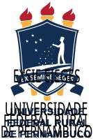
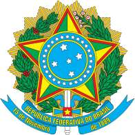
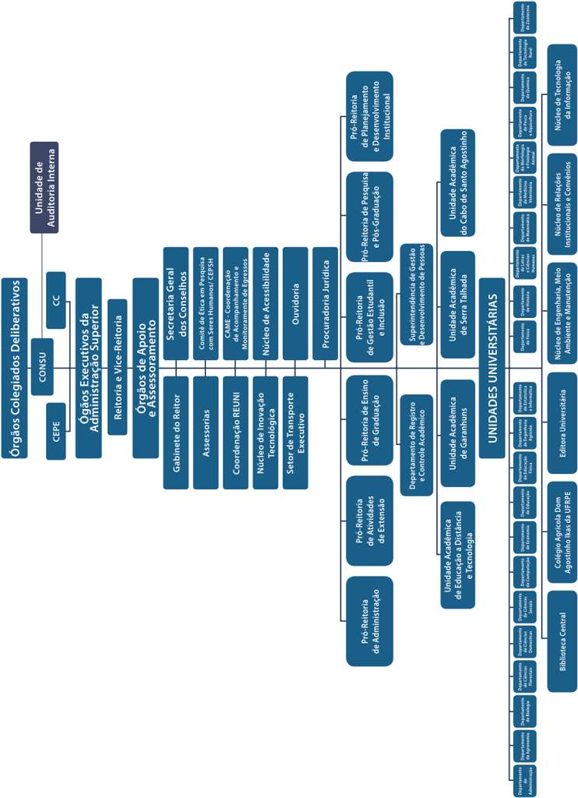
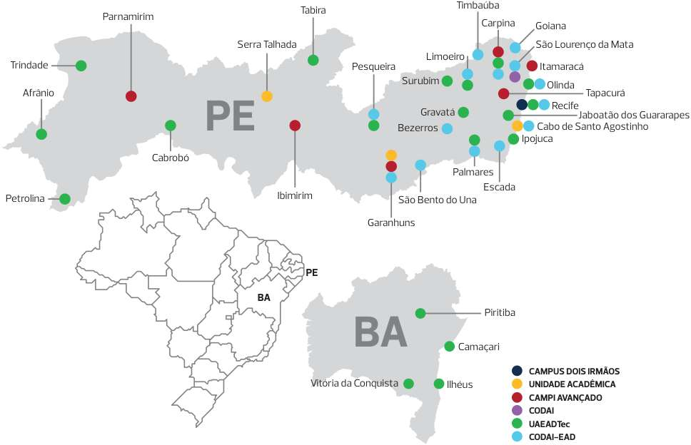
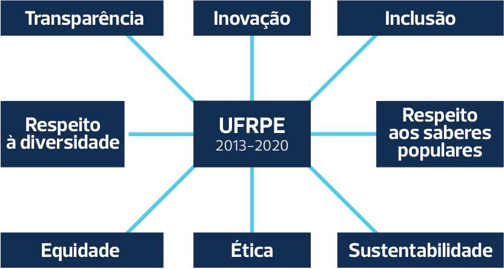
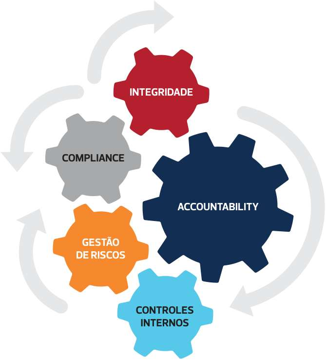
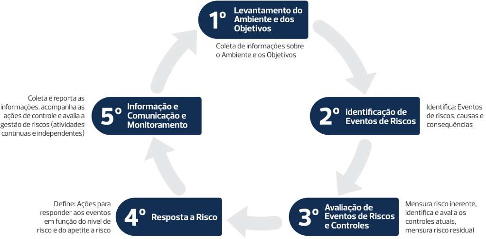
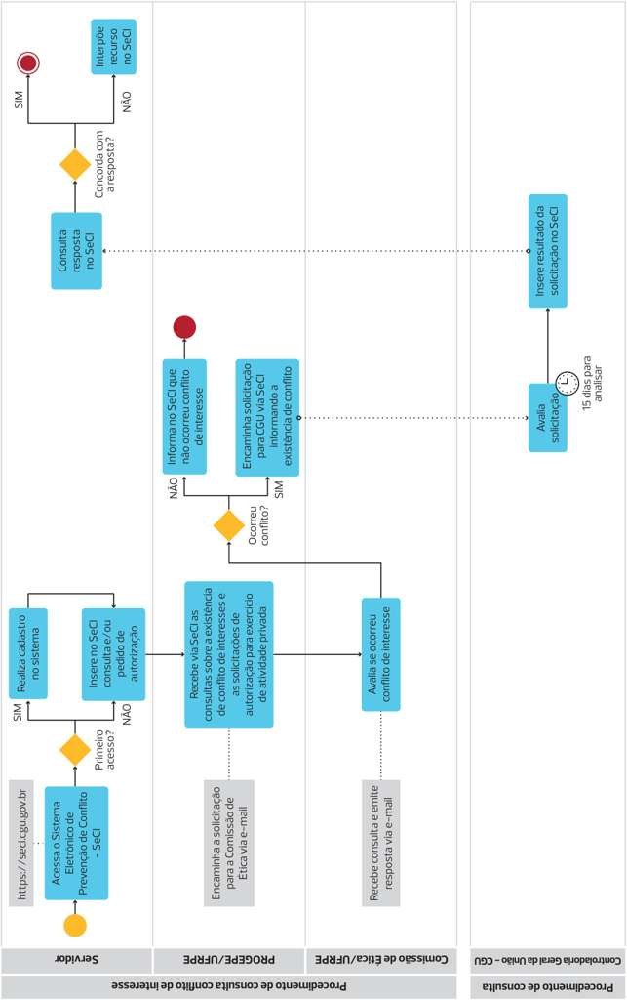

<!-- page 1 -->

## **PLANO DE INTEGRIDADE DA UFRPE** 

<!-- figure p01-fig1 | described_by: agy | ocr_overlap: None | needs_review: false -->
1. **Type of figure:** A small, low-resolution (48 × 29 pixel) cropped flat-colour decorative graphic, icon fragment, or logo element on a white background, with no chart, table, diagram, or photographic content.

2. **Visible text:** None. There is no text, title, label, legend, caption, or symbol inside the image.

3. **Structure:** The image contains no boxes, arrows, axes, rows, columns, or panels. It consists of three solid, flat-shaded geometric shapes against a white background:
   - **Centre:** A large orange/amber T-like or bread-slice-like silhouette tilted slightly upward from left to right (roughly 10°–15° counter-clockwise), composed of a wide top bar with rounded ends extending over a narrower, straight-edged rectangular lower block.
   - **Top-left edge:** A small, cropped horizontal-to-slightly-slanted dark red sliver touching the upper edge of the frame, just above the left side of the orange shape.
   - **Bottom-right corner:** A cropped dark navy-blue diagonal band/wedge entering from the lower middle edge and sloping upward to the right edge, running roughly parallel to the bottom edge of the central orange shape and separated from it by a narrow white gap.

4. **Numbers or data values:** None.

5. **Meaningful colours:** No legend or contextual key is present in the image, so colour meaning cannot be determined; the graphic uses three distinct solid colours (orange/amber, dark red, and dark navy blue) purely as visual contrast against white to separate the three adjacent shapes.

<!-- figure p01-fig3 | described_by: agy | ocr_overlap: None | needs_review: false -->
1. **Figure type:** A low-resolution, tightly cropped graphical fragment (likely part of a decorative illustration, icon, or logo) on a plain white background, rather than a chart, diagram, or table.

2. **Visible text:** None. There are no titles, labels, legends, captions, axis ticks, or cell values in the image.

3. **Structure:** The image consists of three simple flat, blurred solid shapes with no boxes, arrows, axes, rows, columns, or panels:
   - **Center:** A tilted, stout T-shaped or capped-block silhouette sloping downward from left to right, consisting of a wider rounded top bar sitting directly over a narrower rectangular base.
   - **Bottom-left corner:** A cropped diagonal stripe running from the lower-left edge toward the bottom edge, roughly parallel to the tilted base of the central shape and separated from it by a narrow white gap.
   - **Top-right edge:** A small, cropped horizontal-to-slightly-tilted sliver along the top edge to the right of center, separated from the central shape by a narrow white gap.

4. **Numbers and data values:** None.

5. **Colours:** No colour carries an identifiable data or semantic meaning, as there is no legend, label, or accompanying text. (Visually, the central shape is yellow-orange, the bottom-left cropped band is dark navy blue, and the top-right cropped sliver is dark red on a white background.)

<!-- figure p01-fig4 | described_by: agy | ocr_overlap: None | needs_review: false -->
1. **Type of figure**: A very small (27 × 22 pixel), low-resolution decorative icon, logo element, or graphic symbol (resembling a stylized shield, badge, envelope, or open-book motif) rather than a chart, diagram, or table.

2. **Visible text**: None. There are no titles, labels, legends, captions, axis ticks, or cell values in the image.

3. **Structure**: The graphic is vertically symmetrical on a white background and consists of two separate solid shapes with no boxes, arrows, axes, rows, columns, or panels:
   - **Upper element**: A small, centered, downward-pointing triangular/chevron-shaped wedge along the top edge.
   - **Lower element**: A larger solid body occupying most of the frame, separated from the upper element by a narrow white V-shaped gap. Its top edge dips inward in a shallow V shape mirroring the upper wedge, its left and right edges are straight and vertical, and its bottom edge curves smoothly downward into a rounded, shield-like base.

4. **Numbers and data values**: None.

5. **Colours**: The image uses two solid colours on a white background—dark navy blue for the small upper triangular element and warm golden-orange for the larger lower shield-like body. No legend or context is present in the image to indicate whether these colours encode data or are purely decorative/branding elements.

★ ★ 

EX SEMINE SEGES 

UNIVERSIDADE FEDERAL RURAL DE PERNAMBUCO 

**UNIVERSIDADE FEDERAL RURAL DE PERNAMBUCO** Recife, 2018 

<!-- page 2 -->

<!-- figure p02-fig1 | described_by: agy | ocr_overlap: None | needs_review: false -->
1. **Tipo de figura**
   Brasão/logotipo institucional (emblema da Universidade Federal Rural de Pernambuco), com uma camada adicional de texto em preto sobreposta diretamente sobre as inscrições originais (artefato visual de renderização de camada de texto/OCR proveniente do PDF).

2. **Todo o texto visível (verbatim)**
   - **Na faixa (listel) sobre a parte inferior do escudo (texto branco original):**
     `EX SEMINE SEGES`
   - **Sobreposto à faixa (texto preto condensado):**
     `EXSIE EIEGES`
   - **Abaixo do brasão (texto azul-escuro em negrito, em 3 linhas):**
     `UNIVERSIDADE`
     `FEDERAL RURAL`
     `DE PERNAMBUCO`
   - **Sobreposto ao nome institucional abaixo do brasão (texto preto condensado, ligeiramente mais alto e deslocado para cima, em 3 linhas):**
     `UNIVERSIDADE`
     `FEDERAL RURAL`
     `DE PERNAMBUCO`

3. **Estrutura**
   A imagem apresenta uma composição heráldica vertical centralizada sobre fundo branco, sem eixos, tabelas, gráficos, painéis ou setas:
   - **Plano posterior (tochas):** três tochas dispostas em leque atrás do escudo — uma vertical ao centro e duas ligeiramente inclinadas para fora nas laterais. Seus bocais e chamas sobressaem acima da borda superior do escudo, e as três pontas arredondadas de seus cabos aparecem abaixo da ponta inferior do escudo.
   - **Centro (escudo):** escudo com ponta central suave no topo, laterais levemente convergentes para baixo, base em ponta e contorno interno composto por um filete branco. Dentro do campo do escudo:
     - **Superior esquerdo:** cinco estrelas brancas de cinco pontas dispostas em padrão de constelação (semelhante ao Cruzeiro do Sul).
     - **Direita:** silhueta branca de uma figura humana em pé (um semeador) de perfil para a esquerda, com o braço estendido lançando pequenos pontos brancos (sementes) em direção ao solo.
     - **Base interna:** faixas curvas ascendentes da esquerda para a direita sob os pés do semeador, alternando linhas claras e escuras (representando sulcos de terra).
   - **Sobre o terço inferior do escudo (faixa/listel):** fita horizontal curva com as extremidades dobradas para baixo em ambos os lados, contendo o lema `EX SEMINE SEGES`, atravessado pela sobreposição do texto preto `EXSIE EIEGES`.
   - **Base da figura (título institucional):** três linhas centralizadas com o nome da universidade em letras maiúsculas, apresentando sobreposição direta entre o texto original do logotipo e o texto preto da camada de renderização do PDF.

4. **Números e valores de dados**
   Não há números, legendas numéricas, escalas ou dados quantitativos na imagem (apenas elementos gráficos contáveis: 3 tochas e 5 estrelas).

5. **Cores com significado**
   - **Azul-marinho e branco:** identidade visual institucional do brasão (campo do escudo, faixa e tipografia original em azul-marinho; elementos simbólicos — estrelas, semeador, sementes, sulcos, filete interno — e lema em branco).
   - **Amarelo-alaranjado e vermelho:** representam, respectivamente, a estrutura/cabos e as chamas das três tochas.
   - **Preto:** ocorre apenas na camada de texto condensado sobreposta (`EXSIE EIEGES` e `UNIVERSIDADE FEDERAL RURAL DE PERNAMBUCO`), diferenciando visualmente o artefato de texto do PDF em relação à arte gráfica original do brasão.

~~~text ocr
|
~~~

<!-- Start of picture text -->
EXSIE EIEGES UNIVERSIDADE FEDERAL RURAL DE PERNAMBUCO <!-- End of picture text -->

<!-- figure p02-fig2 | described_by: agy | ocr_overlap: None | needs_review: false -->
1. **Tipo de figura:** Ilustração vetorial/emblema heráldico correspondente ao Brasão de Armas da República Federativa do Brasil, sem eixos, gráficos ou tabelas.

2. **Texto visível (verbatim):**
   - Parte central da faixa inferior: `REPÚBLICA FEDERATIVA DO BRASIL`
   - Extremidade inferior esquerda da faixa: `15 de Novembro`
   - Extremidade inferior direita da faixa: `de 1889`

3. **Estrutura e composição:**
   - **Fundo:** Um resplendor circular radiado formado por feixes de linhas e pontas angulares dispostas simetricamente ao redor de toda a figura.
   - **Estrela central:** Sobre o resplendor, uma grande estrela de cinco pontas (uma ponta para cima, duas laterais e duas inferiores), cada ponta dividida ao meio longitudinalmente em duas metades triangulares e contornada por uma moldura dupla.
   - **Escudo circular central:** No meio da estrela de cinco pontas, um disco circular contendo 5 estrelas brancas de cinco pontas dispostas no formato da constelação do Cruzeiro do Sul. Esse disco é cercado por um anel concêntrico delimitado por dois círculos finos, no qual estão distribuídas 27 pequenas estrelas brancas de cinco pontas em volta de toda a circunferência (com uma estrela centrada no topo e simetria bilateral).
   - **Ramos laterais:** Contornando a estrela por trás (entre a estrela e o resplendor) e cruzando-se na base, há dois ramos vegetais: à esquerda, um ramo de café com folhas e cachos de frutos; à direita, um ramo de fumo (tabaco) com folhas alongadas e pequenas flores na extremidade superior.
   - **Espada vertical:** Posicionada no eixo central inferior, por trás da estrela grande e à frente dos ramos, com a lâmina apontada para cima e o punho projetando-se para baixo abaixo da faixa; na interseção (guarda da espada), há uma peça horizontal simétrica com um quadrado central contendo uma pequena estrela de cinco pontas.
   - **Faixa inferior:** Um listel dobrado em formato curvo na parte de baixo, sobreposto à base dos ramos e à espada, com as duas pontas laterais voltadas para cima e recortadas em forma de cauda de andorinha; o texto central acompanha a curvatura superior da faixa, enquanto a data se divide entre as dobras esquerda e direita.

4. **Números e valores presentes:**
   - Valores numéricos escritos: `15` e `1889` (formando a data `15 de Novembro de 1889`).
   - Contagens dos elementos simbólicos: 1 estrela principal de 5 pontas; 5 estrelas no círculo central; 27 estrelas no anel circular externo; 1 estrela no centro da guarda da espada.

5. **Cores com significado:**
   - **Verde e amarelo:** Preenchem de forma alternada as duas metades de cada ponta da estrela principal (cores nacionais do Brasil); o amarelo/dourado também forma o resplendor ao fundo, os contornos circulares, a estrela da guarda da espada e todo o texto da faixa.
   - **Azul-celeste:** Preenche o disco central, o anel das 27 estrelas, a guarda da espada e a faixa com as inscrições.
   - **Branco:** Cor das 5 estrelas do Cruzeiro do Sul, das 27 estrelas do anel externo, da lâmina e do punho da espada e das pétalas das flores do ramo direito.
   - **Vermelho:** Forma a borda interna da estrela principal de cinco pontas, o quadrado central da guarda da espada, os frutos do ramo de café à esquerda e o centro das flores do ramo de fumo à direita.
   - **Verde:** Folhagem dos ramos de café (esquerda) e de fumo (direita).

~~~text ocr
45
!
~~~

**SERVIÇO PÚBLICO FEDERAL MINISTÉRIO DA EDUCAÇÃO UNIVERSIDADE FEDERAL RURAL DE PERNAMBUCO** 

**PLANO DE INTEGRIDADE DA UFRPE** 

**Aprovado conforme Portaria nº 1.485/2018-GR, de 05 de dezembro de 2018** 

**UNIVERSIDADE FEDERAL RURAL DE PERNAMBUCO** Recife, 2018 

<!-- page 3 -->

##### **NOTA DA REITORA** 

É com grande satisfação que estamos disponibilizando aos servidores da UFRPE e à sociedade o Plano de Integridade da Universidade Federal Rural de Pernambuco. 

Sempre guiados pelos valores da Transparência, da Ética, da Inclusão, da Inovação, da Equidade, da Sustentabilidade, do Respeito à Diversidade e aos Saberes Populares, estabelecidos pelos gestores e servidores da UFRPE no Planejamento de Desenvolvimento Institucional (PDI 2013-2020), todos comprometidos com o cumprimento, monitoramento e atualização tempestivos desses valores e das medidas definidas neste Plano, de forma a alcançar o valor público dos resultados esperados pela sociedade. 

É importante ressaltar que a busca pela maturidade nos níveis de Integridade da UFRPE não deve ser considerado impedimento no alcance dos objetivos estratégicos da Universidade. A Integridade é relevante para o adequado gerenciamento dos processos, principalmente no que tange ao levantamento de riscos, sendo uma ferramenta fundamental no auxílio para o cumprimento da missão institucional. Além disso, é por meio dela que nos comprometemos a fazer desta, uma Universidade de excelência e reconhecida pelo cidadão como indutora do conhecimento em nossos principais focos que é Ensino, Pesquisa, Extensão, Gestão e Inovação. 

Acreditamos que a Integridade é essencial para o combate na mitigação de vícios, fraudes e atos de corrupção, e por isso a alta gestão da UFRPE espera o apoio de cada membro da comunidade universitária – gestores, servidores, fornecedores, terceirizados, demais colaboradores – e cidadãos, dentro de sua área de atuação, para atingirmos o importante objetivo que é a implementação deste Plano em nossa instituição. 

Maria José de Sena 

##### **Reitora da UFRPE** 

<!-- page 4 -->

#### **ÍNDICE** 

|1.|INFORMAÇÕES SOBRE A INSTITUIÇÃO|5|
|---|---|---|
|1.1.|Principais competências e serviços prestados|6|
|1.2.|Estrutura regimental|6|
|1.3.|Setor de atuação e principais parcerias|12|
|1.4.|Missão, visão, valores institucionais e diretrizes do Planejamento Estratégico|14|
|1.5.|Principais instrumentos legais internos relativos à área de integridade e estruturas de gestão da integridade|17|
|2.|UNIDADE DE GESTÃO DA INTEGRIDADE|27|
|3.|RISCOS E MEDIDAS DE TRATAMENTO|29|
|4.|MONITORAMENTO E ATUALIZAÇÃO PERIÓDICA|37|
|5.|CONCLUSÃO|40|

<!-- page 5 -->

<!-- figure p05-fig1 | described_by: agy | ocr_overlap: None | needs_review: false -->
1. **Type of figure**: A decorative geometric background graphic featuring an abstract chevron/herringbone pattern, rather than an informational chart, diagram, or table.

2. **Visible text**: None. There are no titles, labels, legends, captions, axis ticks, or cell values anywhere in the image.

3. **Structure**: The image consists of a regular grid of small, angled parallelograms set on a white background. Alternating vertical columns slope upward to the right and downward to the right, combining to form repeated horizontal zigzag (chevron) bands stacked from top to bottom across the full width of the frame. Individual tiles are intermittently omitted across the pattern, with omissions becoming much more frequent toward the bottom edge so that the pattern irregularly fades out into solid white at the bottom. There are no boxes, arrows, connectors, axes, data rows/columns, or separate panels.

4. **Numbers and data values**: None.

5. **Colours**: No colours carry data or semantic meaning; the graphic uses only subtle variations of pale grey on white purely for decorative texture.

~~~text ocr
4
~~~

**1.** 

# **INFORMAÇÕES SOBRE A INSTITUIÇÃO** 

<!-- page 6 -->

#### **1. INFORMAÇÕES SOBRE A INSTITUIÇÃO** 

#### **1.1  Principais competências e serviços prestados** 

A Universidade Federal Rural de Pernambuco originou-se da antiga Escola de Agricultura e Medicina Veterinária “São Bento”, fundada em 1912, na cidade de Olinda, Pernambuco, quando, à época, ofertava apenas dois cursos, Agronomia e Medicina Veterinária. Em 04 de julho de 1955, a Universidade foi federalizada, através da Lei Federal nº 2.524, passando a fazer parte do Sistema Federal de Ensino Agrícola Superior. Por meio do Decreto nº 60.731, de 19 de maio de 1967, a Universidade foi transferida do Ministério da Agricultura para o Ministério da Educação e Cultura, cuja denominação passou a ser Universidade Federal Rural de Pernambuco – UFRPE. 

A UFRPE, sempre comprometida com a excelência, possui como crenças mais fundamentais seus valores: Transparência, Respeito à Diversidade, Inclusão, Equidade, Respeito aos Saberes Populares, Sustentabilidade, Ética e Inovação, definidos em seu Plano de Desenvolvimento institucional 2013-2020 - Revisto e Atualizado. Respaldada nessas convicções orientadoras e inspiradoras, a instituição vem continuamente ampliando suas áreas de atuação, participando ativamente no enfrentamento dos desafios para a promoção do desenvolvimento da Região Nordeste do Brasil. A formação em ciências agrárias, antes a principal finalidade da Universidade, atualmente, é mais uma área da atuação, juntamente com as áreas de Ciências Humanas, Sociais, Biológicas, Exatas e da Terra. Atenta aos anseios da sociedade pernambucana, a UFRPE colocou-se pioneira nos processos de interiorização do ensino superior – primeira Unidade Acadêmica do Programa de Expansão, inaugurada em 2005 na cidade de Garanhuns (Agreste Pernambucano) – na abertura de cursos de ensino a distância e na adoção, já em 2013, do patamar de mais de 50% de vagas destinadas aos candidatos provenientes da rede pública de ensino médio. A oferta de cursos na modalidade a distância, através do Programa Pró-Licenciatura do Ministério da Educação, posiciona a UFRPE, no cenário pernambucano e no âmbito Norte/Nordeste, como uma das instituições pioneiras na oferta de cursos nesta modalidade. Atualmente, a UFRPE desenvolve trabalhos no âmbito da graduação (presencial e à distância), da pós-graduação, com cursos voltados para diversas áreas do conhecimento, bem como do ensino médio e técnico. A universidade desenvolve também suas atividades em “Campi” Avançados, distribuídos em diferentes áreas do Estado, destinados às atividades de pesquisa e extensão. 

#### **1.2  Estrutura regimental** 

A Universidade Federal Rural de Pernambuco é uma autarquia vinculada ao Ministério da Educação e organiza-se administrativamente conforme Estatuto vigente, aprovado através da Resolução nº 95/1975, bem como de resoluções que o alteram. Suas atividades são concentradas na sede, localizada no bairro de Dois Irmãos no município do Recife, nas quatro Unidades Acadêmicas (Unidade Acadêmica de Ensino a Distância e Tecnologia, Unidade Acadêmica de Garanhuns, Unidade Acadêmica de Serra Talhada, Unidade Acadêmica do Cabo de Santo Agostinho) e no Colégio Dom Agostinho Ikas da UFRPE. 

A estrutura regimental da UFRPE compreende instâncias colegiadas deliberativas, órgãos executivos e suplementares. Ambos possuem sua composição, estrutura e atribuições definidas no Estatuto e Regimento da Universidade. A Administração Superior é realizada através dos órgãos de deliberação coletiva e dos órgãos executivos. 

**Órgãos colegiados deliberativos da Administração Superior (art. 10 – Estatuto da UFRPE):** 

**CONSELHO UNIVERSITÁRIO (CONSU):** Conforme Artigo 11 do Estatuto da UFRPE, o CONSU é o ór- 

<!-- page 7 -->

gão deliberativo, normativo e consultivo em assuntos de política e de planejamento universitário, funcionando também como última instância de recurso no âmbito da Universidade; 

**CONSELHO DE ENSINO, PESQUISA E EXTENSÃO (CEPE)** : de acordo com o Artigo 13 do Estatuto da UFRPE, o CEPE é o órgão deliberativo, normativo e consultivo da Universidade para assuntos ligados às atividades de Ensino, Pesquisa e Extensão; 

**CONSELHO DE CURADORES (CC):** Órgão deliberativo, normativo e consultivo para assuntos pertinentes à discriminação, organização e fiscalização econômico-financeira da Universidade (Artigo 16 do Estatuto da UFRPE). 

##### **Órgãos executivos da Administração Superior (art. 10, § 2º– Estatuto da UFRPE):** 

**REITORIA E VICE-REITORIA:** conforme disposto no Artigo 17 do Estatuto da UFRPE, a Reitoria é o órgão executivo superior que coordena, fiscaliza e superintende todas as atividades universitárias com a cooperação direta e efetiva da Vice-Reitoria. 

**PRÓ-REITORIAS:** o Artigo 20 do Estatuto da UFRPE estabelece que as pró-reitorias são diretamente subordinadas à Reitoria e destinam-se ao desempenho das atividades relacionadas com a administração universitária em suas respectivas áreas, estando as atribuições dos Pró-Reitores previstas no Artigo 26 do Regimento Geral da UFRPE. A UFRPE possui 07 Pró-Reitorias, a saber: 

**PRÓ-REITORIA DE ADMINISTRAÇÃO (PROAD):** responsável por supervisionar, coordenar os serviços administrativos; executar processos orçamentários, contábeis e patrimoniais; efetuar licitações e compras; gerir contratos; gerir correspondências e processos administrativos; arquivar documentos. Todas as atividades que viabilizam a adequada consecução das atividades finalísticas da instituição; 

**PRÓ-REITORIA DE ATIVIDADES DE EXTENSÃO (PRAE):** responsável por fomentar, acompanhar, avaliar, articular, registrar e divulgar as ações de extensão no âmbito interno e externo da UFRPE, bem como, propor aos Conselhos Superiores da instituição normas e políticas sobre as ações de extensão universitária; 

**PRÓ-REITORIA DE ENSINO DE GRADUAÇÃO (PREG):** responsável pela coordenação, supervisão, controle das atividades de ensino de graduação. Além disso, acompanha o processo de avaliação do desempenho das atividades docentes da instituição; 

**PRÓ-REITORIA DE GESTÃO ESTUDANTIL E INCLUSÃO (PROGESTI):** responsável por incentivar, apoiar, orientar e acompanhar o estudante em suas múltiplas demandas, no decorrer de sua trajetória estudantil, através de ações afirmativas de permanência nas áreas: social, técnico-científica, cultural, política e esportiva; 

**PRÓ-REITORIA DE PESQUISA E PÓS-GRADUAÇÃO (PRPPG):** responsável por apoiar as atividades de ensino e de pesquisa, bem como, supervisionar os programas de pós-graduação da Universidade; 

**PRÓ-REITORIA DE PLANEJAMENTO E DESENVOLVIMENTO INSTITUCIONAL (PROPLAN):** responsável pela supervisão, coordenação e avaliação do planejamento, informações gerenciais, processos e estruturas organizacionais dos diversos níveis de divisão da Universidade; 

**PRÓ-REITORIA DE GESTÃO DE PESSOAS (PROGEPE):** responsável por gerir e desenvolver ações de recursos humanos voltadas para o crescimento profissional e a melhoria da qualidade de vida dos servidores da Universidade, bem como, elaborar planos, programas e projetos de redimensionamento organizacional, desenvolvimento de competências para o trabalho, apoio psicossocial, saúde ocupacional, controle remuneratório e movimentação de pessoas. 

<!-- page 8 -->

**Órgãos Executivos da Administração Geral - Sistema Básico de Administração (Art. 28 – Regimento Geral da UFRPE):** 

**DEPARTAMENTO DE REGISTRO E CONTROLE ACADÊMICO (DRCA):** Responsável por acompanhar a vida acadêmica dos discentes de Graduação e de Pós-Graduação Stricto. Coordena a execução de registros e controles acadêmicos das atividades discentes, desde a admissão com a matrícula, conferindo declarações, atestados, até a conclusão do curso, com a emissão de certificados de conclusão, expedição e registros de diplomas e vários outros documentos pertinentes. 

**Órgãos Executivos da Administração Geral – Órgãos Suplementares (Art. 33 – Regimento Geral da UFRPE): Os órgãos suplementares, de acordo com o Artigo 45 do Regimento da Reitoria, são diretamente subordinados à Vice-Reitoria e possuem por finalidade apoiar a Administração em seus planos, programas, projetos e atividades. A UFRPE possui os seguintes órgãos suplementares:** 

**BIBLIOTECA CENTRAL (BC):** de acordo com os Artigos 1º e 2º da Resolução Nº 91/2009 do Conselho Universitário, a Biblioteca Central é tecnicamente responsável pelo provimento de informações necessárias às atividades de Ensino, Pesquisa e Extensão da Universidade, bem como, pela coordenação técnica dos setores e dos serviços bibliotecários proporcionados nas diferentes unidades da UFRPE; 

**COLÉGIO DOM AGOSTINHO IKAS (CODAI):** de acordo com o Artigo 50 do Regimento Geral da UFRPE, o CODAI é responsável por proporcionar a formação técnica, profissional e de nível médio. O CODAI, localizado no município de São Lourenço da Mata, oferece cursos regulares de ensino médio, ensino técnico e pós técnico nas modalidades presencial e à distância; 

**EDITORA UNIVERSITÁRIA (EdUFRPE):** de acordo com o Artigo 1º da Resolução nº 65/2006 do Conselho Universitário, a EdUFRPE é um órgão de natureza técnica que abrange toda a comunidade universitária e tem por finalidade a implantação e a execução da política editorial da Universidade; 

**NÚCLEO DE ENGENHARIA, MEIO AMBIENTE E MANUTENÇÃO (NEMAM):** criado pela Resolução nº 90/2013 do Conselho Universitário, o NEMAM é responsável por executar processos que envolvam edificações, manutenção, planejamento e gerenciamento de resíduos da construção da UFRPE; 

**NÚCLEO DE RELAÇÕES INSTITUCIONAIS E CONVÊNIOS (NURIC):** criado pela Resolução nº 90/2013 do Conselho Universitário, o NURIC é responsável pela celebração, execução e acompanhamento de contratos e convênios da Universidade; 

**NÚCLEO DE TECNOLOGIA DA INFORMAÇÃO (NTI):** de acordo com o Artigo 1º da Resolução nº 177/2002 do Conselho Universitário, o NTI tem como finalidade o processo eletrônico de dados referentes às atividades técnicas e administrativas da Universidade, a implantação e o gerenciamento de recursos de informática e, eventualmente, a prestação de serviços a entidade públicas e privadas, mediante contratos e/ou convênios. 

##### **Órgãos de Apoio e Assessoramento (art. 10, § 2º, letra d – Estatuto da UFRPE): Conforme o artigo 27 do Regimento da UFRPE os órgãos de Apoio e Assessoramento, são subordinados diretamente a Reitoria e responsáveis por assessorar a mesma em suas atividades. São eles:** 

**ASSESSORIAS:** Criada através de portaria e deverão ter resolução de criação aprovada pelo CONSU, são elas: Coordenação de Comunicação Social (CCS), Assessoria de Cerimonial e Projetos Sociais (ACPEP), Assessoria de Cooperação Internacional (ACI) e Assessoria de Integração Comunitária (ASSIC); 

**COMITÊ DE ÉTICA EM PESQUISA COM SERES HUMANOS (CEPSH):** Criada através da Resolução CONSU nº 131/2016 e de acordo com o que determina a Resolução 466/2012 do Conselho Nacional 

<!-- page 9 -->

de Saúde do Ministério da Saúde (CNS/MS), visa identificar, analisar e avaliar as implicações éticas nas pesquisas científicas que envolvam seres humanos, bem como prestar orientações que se fizerem necessárias; 

**COORDENAÇÃO DO ACOMPANHAMENTO E MONITORAMENTO DE EGRESSOS (CAME):** de acordo com o Artigo 1º da Resolução nº 263/2012 do Conselho Universitário, responsável por desenvolver uma política de acompanhamento de egressos, considerando oportunidades de formação profissional e educação continuada, de inserção no mundo do trabalho e de implementação de ações; 

**COORDENAÇÃO DO PROGRAMA DE APOIO A PLANOS DE REESTRUTURAÇÃO E EXPANSÃO DAS UNIVERSIDADES FEDERAIS (REUNI):** de acordo com o Artigo 1º da Resolução nº 322/2008 do Conselho Universitário, é responsável por coordenar, supervisionar e acompanhar ações e metas do programa de apoio a planos de reestruturação e expansão das universidades federais; 

**GABINETE DO REITOR (GR):** de acordo com o Artigo 8º do Regimento da Reitoria, é responsável pelo relacionamento, em todos os níveis da administração e com o público em geral, assim como da manutenção dos serviços de expediente, recepção, representação, divulgação e cerimonial; 

**NÚCLEO DE ACESSIBILIDADE (NACES):** de acordo com o Artigo 1º do seu Regimento Interno publicado na Resolução nº 172/2013 do Conselho Universitário, o NACES tem por finalidade atender aos discentes, docentes, técnico-administrativos e terceirizados com deficiência ou com mobilidade reduzida, quanto ao seu acesso e permanência na UFRPE, promovendo e desenvolvendo ações que visem eliminar ou minimizar barreiras físicas, emocionais, pedagógicas e na comunicação e informação que restringem a participação, a autonomia pessoal e o desenvolvimento acadêmico, social e profissional; 

**NÚCLEO DE INOVAÇÃO TECNOLÓGICA (NIT):** estrutura criada através da Resolução CEPE nº 456/2008 e homologada pela Resolução CONSU nº 274/2012, responsável por promover e disseminar a cultura de inovação e transferência de tecnologia, a proteção e licenciamento do produto de pesquisa e defesa dos direitos autorais de obras da UFRPE, fortalecendo as atividades de ensino, pesquisa e extensão na Instituição e efetivando parcerias que venham a contribuir para o desenvolvimento sócio econômico da região; 

**OUVIDORIA:** de acordo com a Resolução nº 148/2005 do Conselho Universitário, a ouvidoria atua como um canal de comunicação aberto entre a sociedade, a comunidade universitária e sua administração, sendo responsável por receber e encaminhar sugestões, reclamações, denúncias, críticas e elogios; 

**PROCURADORIA JURÍDICA (PJ):** de acordo com o Artigo 9º do Regimento da Reitoria, tem por finalidade prestar assistência jurídica aos órgãos executivos e colegiados da Universidade e promover a defesa dos interesses da instituição na esfera judiciária; 

**SECRETARIA GERAL DOS CONSELHOS:** de acordo com o Artigo 7º do Regimento da Reitoria, é responsável por serviços dos Conselhos Universitário; de Ensino, Pesquisa e Extensão; e, de Curadores; 

**SETOR DE TRANSPORTE EXECUTIVO:** órgão de apoio e assessoramento que teve estrutura homologada através da Resolução CONSU nº 90/2013 e é diretamente subordinado à Reitoria da UFRPE. 

##### **Administração departamental (artigo 23, Estatuto da UFRPE):** 

Conforme estabelecido no artigo 23 do Estatuto, os departamentos acadêmicos são as unidades universitárias da UFRPE que são organizados por área de conhecimento, diretamente subordinados à Reitoria e responsáveis pela coordenação e fiscalização das atividades administrativas, didá- 

<!-- page 10 -->

tico-científicas e de extensão nos limites de suas competências. 

A UFRPE possui 22 departamentos acadêmicos, a saber: Administração, Agronomia, Biologia, Ciência Florestal, Ciências Domésticas, Ciências Sociais, Computação, Economia, Educação, Educação Física, Engenharia Agrícola, Estatística e Informática, Física, História, Letras e Ciências Humanas, Matemática, Medicina Veterinária, Morfologia e Fisiologia Animal, Pesca e Aquicultura, Química, Tecnologia Rural e Zootecnia. 

##### **Unidades Acadêmicas fora da sede, com estrutura estabelecida inicialmente através da Resolução nº 117/2007:** 

**UNIDADE ACADÊMICA DO CABO DE SANTO AGOSTINHO (UACSA):** instituída através da Resolução nº 216/2013, a UACSA possui vocação para as áreas de engenharia por estar inserida na região do polo de SUAPE. A fase de implantação e consolidação compreende o período de 2013 a 2016, e a segunda fase da gestão ocorreu a partir de janeiro de 2017. Oferta os cursos de graduação em Engenharia Civil, Engenharia de Materiais, Engenharia Elétrica, Engenharia Eletrônica e Engenharia Mecânica; 

**UNIDADE ACADÊMICA DE GARANHUNS (UAG):** A unidade foi a primeira extensão universitária a ser instalada no País através do REUNI, tendo suas atividades iniciadas no segundo semestre de 2005 e formalizada pela Resolução CONSU nº 044/2005. Oferta os cursos de Agronomia, Ciência da Computação, Engenharia de Alimentos, Licenciatura em Letras, Licenciatura em Pedagogia, Medicina Veterinária e Zootecnia. Além dos cursos de graduação, a unidade oferece cursos de pós-graduação; 

**UNIDADE ACADÊMICA DE SERRA TALHADA (UAST)** : Criada pela Resolução nº 147/2005, a UAST passou a atender a demanda de conhecimento e trabalho de municípios no Sertão do estado de Pernambuco, minimizando a carência de profissionais qualificados na região. Oferta os cursos de Administração, Agronomia, Ciências Biológicas, Ciências Econômicas, Engenharia de Pesca, Licenciatura em Letras, Licenciatura em Química, Sistema da Informação e Zootecnia. Além dos cursos de graduação, a unidade oferece cursos de pós-graduação; 

**UNIDADE ACADÊMICA DE EDUCAÇÃO À DISTÂNCIA E TECNOLOGIA (UAEDTec):** Criada através da Resolução CONSU nº 017/2010, a UAEDTec visa contribuir para o desenvolvimento do Estado de Pernambuco e demais Estados do Nordeste, expandindo o ensino superior às regiões interioranas em que as unidades acadêmicas atuais não conseguem abranger. Possui polos nos estados da Bahia, Ceará, Paraíba, Pernambuco e Tocantins e oferta os cursos de graduação em: Administração Pública, Sistemas de Informação, Licenciatura em Artes Visuais Digitais, Licenciatura em Computação, Licenciatura em Física, Licenciatura em História, Licenciatura em Letras, Licenciatura em Pedagogia e Licenciatura Interdisciplinar em Ciências Naturais. Além dos cursos de graduação, a unidade oferece cursos de aperfeiçoamento, extensão e especialização e mestrado. 

Atualmente a estrutura organizacional da UFRPE se encontra conforme descrita no organograma: 

<!-- page 11 -->

<!-- figure p11-fig1 | described_by: agy | ocr_overlap: 0.0 | needs_review: true -->
### 1. Tipo de figura
Trata-se de um **organograma institucional hierárquico** (da UFRPE, conforme a menção em uma das caixas). No arquivo original, a imagem está rotacionada 90 graus no sentido anti-horário (o topo da hierarquia está à esquerda e a base à direita); para leitura convencional, o diagrama desenvolve-se de cima para baixo ao longo de um eixo vertical central, sem título externo, legenda ou rodapé.

---

### 2. Todo o texto visível (transcrição literal)
Organizado na ordem de leitura convencional (de cima para baixo e, em cada linha, da esquerda para a direita), preservando exatamente a grafia, maiúsculas, acentuação (inclusive eventuais ausências de acento ou erros de digitação presentes na imagem):

**Nível 1 (cabeçalho superior):**
- `Órgãos Colegiados Deliberativos`

**Nível 2 (órgãos colegiados e auditoria):**
- Centro: `CONSU`
- À direita de CONSU: `Unidade de Auditoria Interna`
- Abaixo, à esquerda: `CEPE`
- Abaixo, à direita: `CC`

**Nível 3 (cabeçalho):**
- `Ógãos Executivos da Administração Superior` *(grafado exatamente como "Ógãos", sem o primeiro "r")*

**Nível 4:**
- `Reitoria e Vice-Reitoria`

**Nível 5 (cabeçalho):**
- `Órgãos de Apoio e Assessoramento`

**Nível 6 (duas colunas verticais paralelas — esquerda e direita):**
- Linha 1: `Gabinete do Reitor` | `Secretaria Geral dos Conselhos`
- Linha 2: `Assessorias` | `Comitê de Ética em Pesquisa com Seres Humanos/ CEPSH`
- Linha 3: `Coordenação REUNI` | `CAME - Coordenação de Acompanhamento e Monitoramente de Egressos` *(grafado exatamente como "Monitoramente")*
- Linha 4: `Núcleo de Inovação Tecnológica` | `Núcleo de Acessibilidade`
- Linha 5: `Setor de Transporte Executivo` | `Ouvidoria`
- Linha 6 (somente coluna direita): `Procuradoria Jurídica`

**Nível 7 (fileira de 6 Pró-Reitorias):**
- `Pró-Reitoria de Administração`
- `Pró-Reitoria de Atividades de Extensão`
- `Pró-Reitoria de Ensino de Graduação`
- `Pró-Reitoria de Gestão Estudantil e Inclusão`
- `Pró-Reitoria de Pesquisa e Pós-Graduação`
- `Pró-Reitoria de Planejamento e Desenvolvimento Institucional`

**Nível 8 (fileira de 2 órgãos):**
- `Departamento de Registro e Controle Acadêmico`
- `Superintendência de Gestão e Desenvolvimento de Pessoas`

**Nível 9 (fileira de 4 Unidades Acadêmicas):**
- `Unidade Acadêmica de Educação a Distância e Tecnologia`
- `Unidade Acadêmica de Garanhuns`
- `Unidade Acadêmica de Serra Talhada`
- `Unidade Acadêmica do Cabo de Santo Agostinho`

**Nível 10 (cabeçalho):**
- `UNIDADES UNIVERSITÁRIAS`

**Nível 11 (fileira de 22 Departamentos, em ordem alfabética, divididos em 12 à esquerda e 10 à direita do eixo central):**
*À esquerda do eixo central:*
1. `Departamento de Administração`
2. `Departamento de Agronomia`
3. `Departamento de Biologia`
4. `Departamento de Ciências Florestais`
5. `Departamento de Ciências Domesticas` *(sem acento agudo em "Domesticas")*
6. `Departamento de Ciências Sociais`
7. `Departamento de Computação`
8. `Departamento de Economia`
9. `Departamento de Educação`
10. `Departamento de Educação Fisica` *(sem acento agudo em "Fisica")*
11. `Departamento de Engenharia Agricola` *(sem acento agudo em "Agricola")*
12. `Departamento de Estatística e Informática`

*À direita do eixo central:*
13. `Departamento de Fisica` *(sem acento agudo em "Fisica")*
14. `Departamento de História`
15. `Departamento de Letras e Ciências Humanas`
16. `Departamento de Matemática`
17. `Departamento de Medicina Veterinária`
18. `Departamento de Morfologia e Fisiologia Animal`
19. `Departamento de Pesca e Aquicultura`
20. `Departamento de Quimica` *(sem acento agudo em "Quimica")*
21. `Departamento de Tecnologia Rural`
22. `Departamento de Zootecnia`

**Nível 12 (fileira inferior de 6 unidades/núcleos):**
- `Biblioteca Central`
- `Colégio Agrícola Dom Agostinho Ikas da UFRPE`
- `Editora Universitária`
- `Núcleo de Engenharia, Meio Ambiente e Manutenção`
- `Núcleo de Relações Institucionais e Convênios`
- `Núcleo de Tecnologia da Informação`

---

### 3. Estrutura e conexões
- **Layout geral:** Organograma simétrico em árvore, composto por **60 caixas retangulares de cantos arredondados** ligadas exclusivamente por **linhas retas ortogonais contínuas (horizontais e verticais), sem pontas de seta**. Um único **eixo vertical central** percorre quase toda a altura do diagrama, conectando os blocos principais e ramificando-se lateralmente em barras horizontais. Não há eixos numéricos, tabelas ou painéis separados.
- **Conexões de cima para baixo (orientação convencional):**
  1. `Órgãos Colegiados Deliberativos` liga-se diretamente por baixo ao topo de `CONSU`.
  2. Da lateral direita de `CONSU` parte uma linha horizontal que se liga à lateral esquerda de `Unidade de Auditoria Interna` (posicionada à direita, fora do eixo central).
  3. Da base de `CONSU`, o eixo vertical central desce diretamente até o topo de `Ógãos Executivos da Administração Superior`. Flanqueando esse trecho vertical estão `CEPE` (à esquerda) e `CC` (à direita); ambos conectam-se por suas bordas inferiores através de um colchete/barra horizontal que cruza o eixo central logo acima de `Ógãos Executivos da Administração Superior`.
  4. `Ógãos Executivos da Administração Superior` liga-se verticalmente por baixo a `Reitoria e Vice-Reitoria`, que por sua vez liga-se verticalmente por baixo a `Órgãos de Apoio e Assessoramento`.
  5. A partir da base de `Órgãos de Apoio e Assessoramento`, o eixo vertical central desce entre duas colunas de órgãos de apoio (5 à esquerda e 6 à direita). Cada um dos 5 primeiros pares (`Gabinete do Reitor` / `Secretaria Geral dos Conselhos`; `Assessorias` / `Comitê de Ética em Pesquisa com Seres Humanos/ CEPSH`; `Coordenação REUNI` / `CAME - Coordenação de Acompanhamento e Monitoramente de Egressos`; `Núcleo de Inovação Tecnológica` / `Núcleo de Acessibilidade`; `Setor de Transporte Executivo` / `Ouvidoria`) conecta-se ao eixo central por segmentos horizontais laterais na mesma altura. Na 6ª linha, apenas `Procuradoria Jurídica` (à direita) liga-se ao eixo central por um segmento horizontal.
  6. Abaixo de `Procuradoria Jurídica`, o eixo vertical central cruza uma barra horizontal que se ramifica para baixo até o topo das **6 Pró-Reitorias** (3 à esquerda e 3 à direita do eixo central). O eixo central continua descendo pelo espaço entre `Pró-Reitoria de Ensino de Graduação` e `Pró-Reitoria de Gestão Estudantil e Inclusão`.
  7. Em seguida, o eixo central cruza uma barra horizontal curta que se ramifica para baixo até o topo de `Departamento de Registro e Controle Acadêmico` (à esquerda) e `Superintendência de Gestão e Desenvolvimento de Pessoas` (à direita), continuando a descer entre ambos.
  8. Mais abaixo, o eixo central cruza outra barra horizontal que se ramifica para baixo até o topo das **4 Unidades Acadêmicas** (2 à esquerda e 2 à direita do eixo central), prosseguindo entre `Unidade Acadêmica de Garanhuns` e `Unidade Acadêmica de Serra Talhada` até conectar-se ao topo da caixa-cabeçalho `UNIDADES UNIVERSITÁRIAS`.
  9. Da base de `UNIDADES UNIVERSITÁRIAS`, o eixo central desce e cruza uma longa barra horizontal que se estende por toda a largura do diagrama, ramificando-se por curtos traços verticais até o topo de todos os **22 Departamentos** (12 à esquerda e 10 à direita do eixo central).
  10. O eixo vertical central passa pelo espaço mais largo deixado entre o 12º departamento (`Departamento de Estatística e Informática`) e o 13º (`Departamento de Fisica`) e termina em uma última barra horizontal inferior, da qual partem 6 curtos traços verticais para baixo conectando-se ao topo das **6 caixas da base** (`Biblioteca Central`, `Colégio Agrícola Dom Agostinho Ikas da UFRPE` e `Editora Universitária` à esquerda do eixo; `Núcleo de Engenharia, Meio Ambiente e Manutenção`, `Núcleo de Relações Institucionais e Convênios` e `Núcleo de Tecnologia da Informação` à direita do eixo).

---

### 4. Números e valores de dados
Não há nenhum valor numérico, porcentagem, data, quantidade ou dado estatístico escrito na figura. (Em termos estruturais, o organograma contabiliza 60 caixas no total, distribuídas conforme descrito na seção 3.)

---

### 5. Cores com significado
- **Azul-petróleo médio/escuro com texto branco:** Usado uniformemente em **59 das 60 caixas**, representando todas as unidades e cabeçalhos da estrutura regular do organograma.
- **Azul-acinzentado escuro / índigo acinzentado com texto branco:** Usado exclusivamente na caixa **`Unidade de Auditoria Interna`** (conectada lateralmente ao `CONSU`), destacando-a visualmente das demais unidades da estrutura hierárquica — indicando seu caráter diferenciado de auditoria interna/vinculação especial ao conselho superior.

<!-- page 12 -->

#### **1.3 Setor de atuação e principais parcerias** 

#### **1.3.1 Setor de Atuação** 

A UFRPE dispõe de infraestrutura acadêmica e administrativa composta por cerca de 1.200 docentes, mais de 1.100 técnicos-administrativos e mais de 800 trabalhadores terceirizados, além de cerca de 15.000 discentes. A Universidade oferta cursos de graduação, pós-graduação e de educação básica, técnica e tecnológica, além de desenvolver projetos de ensino, pesquisa e extensão em um leque variado de áreas. A Instituição está presente em todas as regiões do estado de Pernambuco, além de parte da Bahia, por meio de Unidades Acadêmicas, estações de pesquisa e polos de Ensino a Distância (EAD). Isso representa um universo de 31 municípios que, de forma direta, contam com uma ou mais ações da Universidade nos campos do ensino, da pesquisa e da extensão. 

Presença Regional da UFRPE: 

<!-- figure p12-fig1 | described_by: agy | ocr_overlap: 0.92 | needs_review: false -->
**1. Tipo de figura**
Mapa geográfico temático composto (sem título, legenda textual/rodapé, barra de escala ou rosa dos ventos), apresentando a distribuição espacial de unidades/polos por município nos estados brasileiros de Pernambuco (PE) e Bahia (BA), acompanhado de um mapa de localização do Brasil e de uma legenda de categorias por cor.

**2. Todo o texto visível (transcrição literal)**
- **Não há título geral, subtítulo, fonte, nota de rodapé ou eixos numéricos.**
- **Mapa de localização do Brasil (canto inferior esquerdo):** `PE`, `BA`
- **Mapa ampliado de Pernambuco (parte superior):** `PE`, `Trindade`, `Afrânio`, `Petrolina`, `Parnamirim`, `Cabrobó`, `Serra Talhada`, `Ibimirim`, `Tabira`, `Pesqueira`, `Garanhuns`, `São Bento do Una`, `Surubim`, `Gravatá`, `Bezerros`, `Limoeiro`, `Timbaúba`, `Palmares`, `Carpina`, `Escada`, `Goiana`, `São Lourenço da Mata`, `Itamaracá`, `Olinda`, `Tapacurá`, `Recife`, `Jaboatão dos Guararapes`, `Cabo de Santo Agostinho`, `Ipojuca`
- **Mapa ampliado da Bahia (parte inferior central-direita):** `BA`, `Piritiba`, `Camaçari`, `Vitória da Conquista`, `Ilhéus`
- **Legenda (canto inferior direito, de cima para baixo):**
  - `CAMPUS DOIS IRMÃOS`
  - `UNIDADE ACADÊMICA`
  - `CAMPI AVANÇADO`
  - `CODAI`
  - `UAEADTec`
  - `CODAI–EAD`

**3. Estrutura da figura**
A figura é organizada em quatro blocos sem molduras ou setas, sobre fundo branco:

- **Bloco superior — Mapa de Pernambuco (`PE`):** silhueta cinza do estado ocupando toda a largura superior, com a sigla `PE` em letras grandes na porção centro-oeste. Contém 28 localidades identificadas por marcadores circulares coloridos (alguns agrupados em pilhas verticais ou fileiras horizontais quando há mais de uma categoria no mesmo local). Parte dos rótulos conecta-se aos marcadores por linhas retas cinzas de chamada; os demais estão posicionados diretamente ao lado dos círculos, sem linha:
  - `Trindade` (extremo noroeste): linha horizontal à esquerda ligada a 1 círculo verde.
  - `Afrânio` (extremo oeste): linha vertical acima ligada a 1 círculo verde.
  - `Petrolina` (extremo sudoeste): linha horizontal à esquerda ligada a 1 círculo verde.
  - `Parnamirim` (oeste): linha vertical longa acima ligada a 1 círculo vermelho.
  - `Cabrobó` (centro-oeste, borda sul): linha vertical abaixo ligada a 1 círculo verde.
  - `Serra Talhada` (centro): linha vertical acima ligada a 1 círculo amarelo.
  - `Ibimirim` (centro-sul): linha vertical longa abaixo ligada a 1 círculo vermelho.
  - `Tabira` (centro-norte): linha vertical acima ligada a 1 círculo verde.
  - `Pesqueira` (centro-leste): linha vertical acima ligada a uma pilha vertical de 2 círculos (de cima para baixo: azul-claro, verde).
  - `Garanhuns` (sul-leste): linha vertical longa abaixo ligada a uma pilha vertical de 3 círculos (de cima para baixo: amarelo, vermelho, azul-claro).
  - `São Bento do Una` (sul-leste, à direita de Garanhuns): linha vertical abaixo ligada a 1 círculo azul-claro.
  - `Surubim` (leste-norte): texto imediatamente à esquerda (sem linha) de 1 círculo verde.
  - `Gravatá` (leste-centro): texto imediatamente à esquerda (sem linha) de 1 círculo verde.
  - `Bezerros` (leste-centro, abaixo de Gravatá): texto imediatamente à esquerda (sem linha) de 1 círculo azul-claro.
  - `Limoeiro` (leste-norte, à direita de Surubim): linha vertical curta partindo à direita do texto até uma pilha vertical de 2 círculos (de cima para baixo: azul-claro, verde).
  - `Timbaúba` (nordeste): linha vertical longa acima ligada a 1 círculo azul-claro.
  - `Palmares` (sudeste): linha vertical curta abaixo ligada a uma pilha vertical de 2 círculos (de cima para baixo: verde, azul-claro).
  - `Carpina` (nordeste, à direita de Timbaúba): linha vertical acima ligada a uma pilha vertical de 3 círculos (de cima para baixo: vermelho, verde, azul-claro).
  - `Escada` (sudeste, à direita de Palmares): linha vertical longa abaixo ligada a 1 círculo azul-claro.
  - `Goiana` (extremo nordeste): linha diagonal vinda de cima-direita ligada a 1 círculo azul-claro.
  - `São Lourenço da Mata` (leste, abaixo de Goiana): linha diagonal vinda de cima-direita ligada a uma pilha vertical de 2 círculos (de cima para baixo: azul-claro, roxo).
  - `Itamaracá` (litoral nordeste): texto imediatamente à direita (sem linha) de 1 círculo vermelho.
  - `Olinda` (litoral leste, abaixo de Itamaracá): texto imediatamente à direita (sem linha) de uma fileira horizontal de 2 círculos (da esquerda para a direita: verde, azul-claro).
  - `Tapacurá` (leste, a oeste de Recife): linha horizontal longa vinda da direita ligada a 1 círculo vermelho.
  - `Recife` (litoral leste, abaixo de Olinda): texto imediatamente à direita (sem linha) de uma fileira horizontal de 3 círculos (da esquerda para a direita: azul-escuro, verde, azul-claro).
  - `Jaboatão dos Guararapes` (leste, a sudoeste de Recife): linha horizontal longa vinda da direita ligada a 1 círculo verde.
  - `Cabo de Santo Agostinho` (litoral sudeste, abaixo de Recife/Jaboatão): texto imediatamente à direita (sem linha) de uma fileira horizontal de 2 círculos (da esquerda para a direita: amarelo, azul-claro).
  - `Ipojuca` (litoral sudeste, abaixo de Cabo de Santo Agostinho): texto imediatamente à direita (sem linha) de 1 círculo verde.

- **Bloco inferior esquerdo — Mapa de localização do Brasil:** desenho em contorno fino cinza com preenchimento branco mostrando todas as divisões estaduais do Brasil, com apenas dois rótulos em destaque: `PE` (posicionado à direita do estado de Pernambuco) e `BA` (posicionado dentro do estado da Bahia).

- **Bloco inferior central-direita — Mapa da Bahia (`BA`):** silhueta cinza do estado da Bahia com a sigla `BA` em letras grandes ao centro. Contém 4 localidades, todas com 1 círculo verde:
  - `Piritiba` (centro-norte/nordeste): linha horizontal vinda da direita ligada a 1 círculo verde.
  - `Camaçari` (leste/litoral): texto imediatamente à direita (sem linha) de 1 círculo verde.
  - `Vitória da Conquista` (centro-sul): texto imediatamente à esquerda (sem linha) de 1 círculo verde.
  - `Ilhéus` (sudeste/litoral): texto imediatamente à direita (sem linha) de 1 círculo verde.

- **Bloco inferior direito — Legenda:** lista vertical de 6 itens, cada um formado por um círculo colorido à esquerda seguido pelo respectivo rótulo em negrito à direita.

**4. Números e dados**
Não há nenhum número escrito na imagem. Os dados quantitativos representados graficamente pelos marcadores somam **44 ocorrências em 32 localidades** (40 marcadores em 28 localidades de Pernambuco e 4 marcadores em 4 localidades da Bahia), distribuídos da seguinte forma por categoria:
- `CAMPUS DOIS IRMÃOS`: **1** — Recife (PE).
- `UNIDADE ACADÊMICA`: **3** — Serra Talhada (PE), Garanhuns (PE), Cabo de Santo Agostinho (PE).
- `CAMPI AVANÇADO`: **6** — Parnamirim (PE), Ibimirim (PE), Garanhuns (PE), Carpina (PE), Itamaracá (PE), Tapacurá (PE).
- `CODAI`: **1** — São Lourenço da Mata (PE).
- `UAEADTec`: **19** (15 em PE e 4 na BA) — Trindade (PE), Afrânio (PE), Petrolina (PE), Cabrobó (PE), Tabira (PE), Pesqueira (PE), Surubim (PE), Limoeiro (PE), Gravatá (PE), Palmares (PE), Carpina (PE), Olinda (PE), Recife (PE), Jaboatão dos Guararapes (PE), Ipojuca (PE), Piritiba (BA), Camaçari (BA), Vitória da Conquista (BA), Ilhéus (BA).
- `CODAI–EAD`: **14** — Pesqueira (PE), Garanhuns (PE), São Bento do Una (PE), Bezerros (PE), Limoeiro (PE), Timbaúba (PE), Palmares (PE), Carpina (PE), Escada (PE), Goiana (PE), São Lourenço da Mata (PE), Olinda (PE), Recife (PE), Cabo de Santo Agostinho (PE).

**5. Cores com significado**
As seis cores dos círculos codificam exclusivamente as categorias listadas na legenda:
- **Azul-escuro (marinho):** `CAMPUS DOIS IRMÃOS`
- **Amarelo:** `UNIDADE ACADÊMICA`
- **Vermelho (bordô):** `CAMPI AVANÇADO`
- **Roxo:** `CODAI`
- **Verde:** `UAEADTec`
- **Azul-claro (ciano):** `CODAI–EAD`

~~~text ocr
Timbaúba
Tabira
Parnamirim i
Carpina
Serra Talhada São Lourenço da Mata
Limoeiro
Trindade ——@ Pesqueira Itamaracá
Surubim O 00
Afrânio
Recife
E Gravatá O Jaboatão dos Guararapes
Bezerros Cabo de Santo Agostinho
O Ipojuca
Cabrobó
Palmares
Escada
Petrolina Ibimirim São Bento do Una
Garanhuns
Piritiba
BA O Camaçari
@ campus Dols IRMAOS
Vitoria da Conquista O UNIDADE ACADÊMICA
O
O
O
O
~~~

<!-- Start of picture text -->
Timbaúba Tabira Parnamirim Carpina Goiana Serra Talhada São Lourenço da Mata Limoeiro Trindade Pesqueira Itamaracá Surubim Olinda Afrânio Tapacurá Recife Gravatá Jaboatão dos Guararapes PE Bezerros Cabo de Santo Agostinho Ipojuca Cabrobó Palmares Escada Petrolina Ibimirim São Bento do Una Garanhuns PE BA Piritiba BA Camaçari CAMPUS DOIS IRMÃOS Vitória da Conquista Ilhéus UNIDADE ACADÊMICA CAMPI AVANÇADO CODAI UAEADTec CODAI-EAD <!-- End of picture text -->

##### **Ensino** 

O Colégio Agrícola Dom Agostinho Ikas, vinculado à UFRPE, oferece cursos regulares na Educação Básica (Ensino Médio) e na Educação Profissional e Tecnológica. Os cursos técnicos são oferecidos tanto na modalidade presencial quanto a distância, dispondo, nesse último caso, de polos nas cidades pernambucanas de Garanhuns, São Bento do Una, Bezerros, Pesqueira, Goiana, Timbaúba, Limoeiro, Carpina, Cabo de Santo Agostinho, Escada, Palmares, Recife e Olinda. O CODAI também executa o Programa Nacional de Acesso ao Ensino Técnico e Emprego (Pronatec). O Programa objetiva oferecer cursos de educação profissional a estudantes, trabalhadores diversos, pessoas com deficiência e beneficiários dos programas federais de transferência de renda, buscando, assim, a qualificação profissional de trabalhadores com a elevação da sua escolaridade. 

<!-- page 13 -->

A UFRPE possui cursos de graduação, com uma oferta anual de mais de 4.000 vagas distribuídas no campus SEDE, em Dois Irmãos, e nas Unidades acadêmicas de Garanhuns, Serra Talhada e Cabo de Santo Agostinho. Salienta-se a criação de novos cursos que farão parte da nova Unidade Acadêmica da UFRPE, localizada no município de Belo Jardim- PE, cuja resolução, nº 98, foi aprovada pelo Conselho Universitário em 7 de dezembro de 2017. Na modalidade EAD, a UFRPE dispõe, por meio da Unidade Acadêmica de Educação à Distância e Tecnologia (UAEDTec), cursos com ofertas em 20 polos, sendo 16 em Pernambuco e 4 na Bahia. 

##### **Pesquisa** 

A Universidade conta com grupos de pesquisa, além de programas institucionais de fomento e de infraestrutura, como o Centro de Apoio à Pesquisa (CENAPESQ). Também se destacam os campi avançados, como a Clínica de Bovinos e as Estações Ecológicas de Tapacurá, de Agricultura Irrigada de Parnamirim, de Agricultura Irrigada de Ibimirim, Experimentais de Cana-de-açúcar do Carpina e de Pequenos Animais do Carpina, onde são desenvolvidas pesquisas e ações com impacto no desenvolvimento socioeconômico e ambiental, desde a Zona da Mata até o sertão de Pernambuco. 

A UFRPE dispõe de programas de pós-graduação na modalidade stricto sensu e lato sensu, ofertando programas de mestrados acadêmicos, mestrados profissionais e Doutorados. Os cursos promovidos pela Universidade têm cumprido papel relevante na formação de profissionais que atuam nas diferentes áreas de conhecimento. A Universidade, através de seus departamentos, desenvolve cursos votados à comunidade externa, ao ambiente acadêmico, bem como aos servidores federais interessados em aperfeiçoar sua atuação através da discussão e apreensão de novos aportes teóricos e práticos. 

##### **Extensão** 

A UFRPE, por sua longa caminhada, possui destacada presença na região, sobretudo no desenvolvimento de projetos e ações em estreita vinculação com demandas sociais locais, como se pode ter exemplo nos serviços oferecidos pelos campi avançados. A ação da UFRPE destaca-se também no âmbito cultural, com o Coro Universitário, fundado em 1970, e a Escola de Música Naná Vasconcelos, essa última voltada às crianças das comunidades vizinhas à UFRPE. 

A Escola de Conselhos de Pernambuco, surgida em 2008 e considerada uma referência no Brasil, representa outro destaque da Instituição, cujo objetivo é promover a formação dos operadores do Estatuto da Criança e do Adolescente, focando os conselhos de Direitos Tutelares dos 184 municípios do estado e do Distrito de Fernando de Noronha. 

Atenta às demandas sensíveis da sociedade, tais como educação, direitos humanos, saúde, habitação, sustentabilidade, produção de alimentos, geração de emprego e renda, a extensão da UFRPE contempla, a cada ano, projetos oriundos das mais diversas áreas. Neste sentido, destaca-se o Programa Institucional de Bolsa de Extensão (BEXT) que estimula a participação dos estudantes em ações de Extensão, com vistas a promover a cidadania e a inclusão social, bem como a aprendizagem mediante relação teoria e prática. Além disso, o BEXT também apoia projetos desenvolvidos em parceria com representações do poder local dos municípios, em ações de complementaridade a programas integrantes de políticas públicas locais, regionais e/ou nacionais. 

#### **1.3.2 Principais parcerias** 

A UFRPE mantém parcerias e relações com diversas organizações, locais, nacionais e internacionais, sejam na prática da extensão universitária seja em projetos ligados à pesquisa, ao ensino ou ao desenvolvimento de pessoas. 

<!-- page 14 -->

A fim de uniformizar e formalizar a maioria desses processos, foi criado, através da Resolução nº 90/2013 do CONSU, o Núcleo de Relações Institucionais e Convênios (Nuric). O órgão é responsável pela celebração, execução e acompanhamento de contratos e convênios da Universidade, fazendo parte da estrutura organizacional da UFRPE junto à Comissão de Análise de Prestações de Contas (CAPCONT), para fins de análise das prestações de contas dos recursos transferidos à Fundação Apolônio Salles de Desenvolvimento Educacional (Fadurpe). 

O Nuric tem como objetivo gerir todos os acordos da UFRPE com terceiros, abrangendo o planejamento, a execução e a análise e controle dos acordos celebrados a partir de 2013, sendo informatizado pelo Sistema de Gestão de Convênios e Contratos de Repasse (SICONV). Com essa medida, os convênios formalizados saltaram de 02, em 2013, para 13, em 2015. Quanto aos termos de cooperação, foram firmados, um em 2013 e um em 2014, ambos com perspectivas de crescimento até 2020. 

Diretrizes para o incentivo às parcerias com outras organizações: 

• Realizar diagnóstico dos casos de sucesso e insucessos, dos obstáculos burocráticos para a implantação e operacionalização de parcerias; 

• Identificar possíveis redes de parcerias de acordo com as áreas desenvolvidas ou afins dentro da UFRPE; e 

• Apoiar a formalização, junto às fundações de apoio, de eventos que articulem o ensino a pesquisa e a extensão, como maneira de incentivar a produção discente, aproximar a graduação da pós-graduação, e aumentar a publicidade dos resultados oriundos das práticas acadêmicas da UFRPE. 

#### **1.4 Missão, visão, valores institucionais e diretrizes do Planejamento Estratégico.** 

O Planejamento Estratégico (PE) da Universidade Federal Rural de Pernambuco é exercido através do Plano de Desenvolvimento Institucional e engloba todas as Unidades Administrativas e Organizacionais da UFRPE. É o documento norteador, que apresenta o funcionamento atual da Instituição e propõe estratégias e políticas a serem seguidas, servindo de orientação para as ações nas áreas de ensino, pesquisa, extensão, inovação e gestão. 

O Planejamento Estratégico (PE) está voltado a todos os setores da administração. É o instrumento que indica aos gestores onde se pretende chegar e as formas a serem adotadas para isso, além de promover a responsabilidade social, transparência, aproveitamento de oportunidades, direcionamento de esforços, gerando resultados efetivos e um conjunto de mudanças positivas, fatores que potencializam o desenvolvimento institucional, ampliam a divulgação das ações e contribuem para o fortalecimento da gestão estratégica, diferenciando a Instituição das demais. O Planejamento constitui, atualmente, responsabilidade social. 

Os objetivos estratégicos são os referenciais do Planejamento Estratégico. São desdobramentos naturais da missão e estão relacionados aos eixos que constam no mapa estratégico, apoiados na análise de cenários. Os objetivos estratégicos da Universidade Federal Rural de Pernambuco foram elaborados utilizando como elementos norteadores: Ensino, Pesquisa, Extensão, Gestão, Política, Economia, Tecnologia, e Sociedade, conforme segue: 

**Ensino:** Utilizar o seu capital intelectual para promover a qualidade do ensino e a excelência na formação profissional nas diversas áreas do saber e promover a formação continuada dos professores formadores; 

<!-- page 15 -->

**Pesquisa** : Fortalecer e diversificar as atividades de pesquisa através de parcerias no âmbito público e privado; 

**Extensão:** Definir política de ação extensionista que contemple programas e ações institucionais; 

**Gestão:** Criar mecanismos que favoreçam a gestão estratégica na UFRPE e promover a adequada gestão de conhecimento que resulte em maior valor individual e institucional; 

**Política:** Desenvolver estratégias de ensino, pesquisa e extensão fortalecendo sua posição institucional e social; 

**Econômico:** Potencializar o desenvolvimento econômico com bases sociais, ambientais, humanas e tecnológicas a partir da difusão de saberes e conhecimentos; 

**Tecnologia:** Desenvolver tecnologias que promovam, por meio da gestão participativa, o avanço do ensino, pesquisa e extensão; 

**Social:** Ampliar a divulgação para a sociedade dos cursos técnicos, de graduação e de pós-graduação da UFRPE e melhorar a infraestrutura e a comunicação institucional, integrando, de forma sistêmica, todas as áreas, fortalecendo e consolidando o envolvimento da Instituição com a sociedade. 

O Mapa Estratégico faz parte da metodologia _Balanced Scorecard_ (BSC). As ações estratégicas, operacionais e organizacionais que integram o BSC possibilitam o alinhamento da instituição e tem no seu Mapa Estratégico a representação visual da estratégia. Esse mapa tem o papel fundamental de otimizar e consolidar o planejamento. O mapa estratégico da UFRPE traduz os eixos de objetivos estratégicos da Instituição para a ampla clareza e compreensão de toda comunidade universitária e da sociedade de forma geral. 

<!-- page 16 -->

<!-- figure p16-fig1 | described_by: agy | ocr_overlap: None | needs_review: false -->
1. **Type of figure:** A graphic consisting of two vertically stacked, minimalist line-art icons (a target/bullseye-style icon above an eye icon), likely used as decorative or section icons (such as for mission/target and vision) extracted from a document.

2. **Visible text:** None. There are no titles, labels, legends, captions, axis ticks, or other text anywhere in the image.

3. **Structure:** The image is arranged as a single vertical column of two separate circular icons separated by blank space, with no boxes, arrows, axes, connecting lines, or panel borders:
   - **Top icon (target / segmented concentric rings):** Composed of three concentric rings centered on the same point:
     - An innermost solid, unbroken small circle.
     - A middle ring broken into four symmetrical quarter-circle arc segments with rounded ends, with gaps at the 12, 3, 6, and 9 o'clock positions.
     - An outermost ring similarly broken into four symmetrical quarter-circle arc segments with rounded ends, with gaps aligned at the 12, 3, 6, and 9 o'clock positions.
   - **Bottom icon (stylized eye in a circle):** Composed of three nested shapes sharing the same center:
     - An outermost solid, unbroken circle.
     - A middle almond-shaped outline pointing left and right, representing an eye and fitting horizontally inside the outer circle.
     - An innermost solid, unbroken small circle centered inside the almond shape, representing a pupil/iris.

4. **Numbers and data values:** None. There are no numerical values or quantitative data in the image.

5. **Colours:** The icons use two flat colours—dark navy blue (for the innermost circle and outermost ring of both icons) and warm orange-yellow (for the middle segmented ring of the top icon and the almond-shaped eye outline of the bottom icon)—purely for visual styling and figure-ground contrast between nested elements; no colour legend or data meaning is encoded.

<!-- figure p16-fig2 | described_by: agy | ocr_overlap: None | needs_review: false -->
1. **Type of figure:** A flat, minimalist line-art icon (pictogram) depicting a group of three stylized people (representing a team, community, or group of users) enclosed within a circular frame.

2. **Visible text:** None. There are no titles, labels, legends, captions, or characters anywhere in the image.

3. **Structure:**
   - **Outer frame:** A broken circular outline formed by two dark navy blue curved strokes with rounded ends—a large upper arc covering the top and upper sides, and a shorter lower arc curving along the bottom, leaving small gaps on the lower-left and lower-right sides.
   - **Central figure:** Positioned in the foreground at the center, consisting of a large hollow circle (head) above a wide, semicircular arch (shoulders/torso) whose bottom ends meet and connect seamlessly with the lower arc of the outer frame.
   - **Flanking figures:** Two identical, smaller figures positioned symmetrically to the left and right of the central figure. Each consists of a smaller hollow circle (head) above a smaller rounded shoulder arch with a short flat horizontal base segment, visually tucked beside/behind the central figure's shoulders.
   - There are no arrows, boxes, axes, tables, or separate panels.

4. **Numbers or data values:** None (no numerical labels or quantitative data are present; the icon depicts 3 figures).

5. **Colours:** Two flat colours are used on a light/transparent background solely for visual differentiation rather than quantitative encoding—orange-yellow outlines the three circular heads, while dark navy blue forms the shoulder shapes and the outer circular border.

~~~text ocr
6°)
~~~

<!-- figure p16-fig3 | described_by: agy | ocr_overlap: None | needs_review: false -->
1. **Kind of figure:** A simple flat icon/logo graphic depicting a checkmark inside two concentric open circles.
2. **Visible text:** None.
3. **Structure:** The graphic consists of three unconnected thick strokes with rounded ends on a plain background:
   - An outer circular arc that forms an almost complete circle, leaving an opening in the upper-right quadrant (roughly from the 1 o'clock to the 2:30 position).
   - A smaller inner concentric circular arc, also open in the upper-right quadrant (roughly from the 12:30 to the 3 o'clock position).
   - A checkmark positioned at the center, with its shorter left arm angled downward to the center and its longer right arm extending upward and to the right through the aligned gaps of both concentric arcs without touching them.
   - There are no boxes, arrows, axes, rows, columns, or panels.
4. **Numbers or data values:** None.
5. **Colours:** The colours are stylistic rather than data-encoding; the outer arc and checkmark are dark navy blue, and the inner arc is warm orange/amber.

<!-- figure p16-fig4 | described_by: agy | ocr_overlap: None | needs_review: false -->
1. **Figure type:** A minimalist circular icon/symbol depicting a continuous two-step cycle, loop, or exchange.

2. **Visible text:** None. There are no titles, labels, legends, captions, or characters anywhere in the image.

3. **Structure:**
   - **Outer border:** A single, thick, solid circular outline encloses the entire icon.
   - **Inner nodes:** Two small circular ring (donut-shaped) nodes with hollow centers are placed diagonally opposite each other inside the border—one in the upper-right (approximately the 2 o'clock position) and one in the lower-left (approximately the 8 o'clock position).
   - **Connecting arrows:** Two thick, curved, half-barbed arrows form a counterclockwise loop linking the two nodes:
     - The upper-left arrow starts just to the left of the upper-right node (around 1 o'clock), curves counterclockwise over the top-left, and ends with an outward-flaring arrowhead pointing down-left toward the lower-left node (around 9 o'clock).
     - The lower-right arrow starts just to the right of the lower-left node (around 7 o'clock), curves counterclockwise along the bottom-right, and ends with an outward-flaring arrowhead pointing up-right toward the upper-right node (around 3 o'clock).

4. **Numbers or data values:** None.

5. **Meaningful colours:** Two contrasting colours visually separate the nodes from the flow elements:
   - **Dark navy blue:** Outer enclosing circle and both curved directional arrows.
   - **Orange-yellow:** The two circular ring nodes (with white centers) positioned between the arrows.

### **MISSÃO** 

Construir e disseminar conhecimento e inovação, através de atividades de ensino, pesquisa e extensão, atenta aos anseios da sociedade. 

### **VISÃO 2020** 

Consolidar-se como universidade pública de excelência, fundamentada em uma gestão participativa. 

### **SOCIEDADE** 

Estabelecer parcerias institucionais para a formação de uma sociedade crítica e participativa, através da construção e popularização de saberes científicos, tecnológicos e culturais. 

### **RESULTADO INSTITUCIONAL** 

Contribuir com a transformação social sustentável a partir de políticas de melhorias das atividades de ensino, pesquisa e extensão. 

### **PROCESSOS INTERNOS** 

Promover a cultura de planejamento e avaliaçao com visão estratégica participativa na comunidade acadêmica; 

Desenvolver a melhoria dos processos organizacionais e de comunicação; 

Fortalecer e divulgar a imagem da UFRPE de forma transparente e ativa; Estabelecer política de memória institucional. 

<!-- figure p16-fig5 | described_by: agy | ocr_overlap: None | needs_review: false -->
(1) **Figure type:** A minimalist flat graphic icon / pictogram representing growth or upward performance (a stylized ascending bar chart with a rising trend arrow inside an open circular frame).

(2) **Visible text:** None. The image contains no titles, labels, legends, captions, axis ticks, or other text.

(3) **Structure:**
- **Outer frame:** A thick circular ring with rounded ends, broken by a gap in the upper-right quadrant (spanning roughly from the 12 o'clock to the 2 o'clock position).
- **Bars:** Three vertical rounded-cap bars arranged horizontally side by side inside the lower half of the circle, aligned along an implied flat baseline with no drawn axes, gridlines, or tick marks. Their heights increase steadily from left to right (short, medium, tall).
- **Arrow:** Above the bars, a thick upward-trending zigzag arrow begins above the leftmost bar, rises diagonally up and to the right, makes a small sharp dip down and to the right above the middle bar, and then continues diagonally up and to the right, ending in a rounded arrowhead pointing into the upper-right opening of the circular ring.

(4) **Numbers or data values:** None. The chart is purely illustrative and contains no numerical values or scales.

(5) **Meaningful colours:** The icon uses a two-colour contrast to separate elements: dark navy blue for the outer circular ring and the three vertical bars, and bright amber/orange (with a subtle lighter highlight along the upper edges) for the rising zigzag arrow to emphasize the upward growth trajectory.

### **APRENDIZAGEM E CRESCIMENTO** 

Promover a gestão do conhecimento por meio da tecnologia da informação e comunicação; 

Estabelecer política de formação contínua dos servidores; 

Estimular a cooperação nacional e internacional com instituições governamentais e não-governamentais. 

<!-- page 17 -->

#### **Valores** 

<!-- figure p17-fig1 | described_by: agy | ocr_overlap: 1.0 | needs_review: false -->
1. **Tipo de figura:** Diagrama conceitual radial (em formato de estrela) que associa um elemento central a oito conceitos periféricos.

2. **Todo o texto visível (literal):**
   - Caixa central:
     - `UFRPE`
     - `2013–2020`
   - Linha superior (da esquerda para a direita):
     - `Transparência`
     - `Inovação`
     - `Inclusão`
   - Linha do meio (laterais, da esquerda para a direita):
     - `Respeito à diversidade` (em duas linhas: `Respeito` / `à diversidade`)
     - `Respeito aos saberes populares` (em três linhas: `Respeito` / `aos saberes` / `populares`)
   - Linha inferior (da esquerda para a direita):
     - `Equidade`
     - `Ética`
     - `Sustentabilidade`
   - Não há título externo, legenda, rótulos de eixos, notas ou outros textos.

3. **Estrutura:**
   - A figura é composta por 9 caixas retangulares dispostas em uma grade simétrica de 3 linhas por 3 colunas:
     - **Linha superior:** 3 retângulos horizontais de altura reduzida (`Transparência`, `Inovação`, `Inclusão`).
     - **Linha central:** 3 retângulos de maior altura (`Respeito à diversidade` à esquerda, `UFRPE / 2013–2020` no centro e `Respeito aos saberes populares` à direita).
     - **Linha inferior:** 3 retângulos horizontais de mesma proporção que os da linha superior (`Equidade`, `Ética`, `Sustentabilidade`).
   - **Conexões:** 8 linhas retas contínuas, sem pontas de seta, irradiam da caixa central (`UFRPE / 2013–2020`) para cada uma das 8 caixas ao redor:
     - Diagonal superior esquerda ligando a caixa central a `Transparência`.
     - Vertical superior ligando a caixa central a `Inovação`.
     - Diagonal superior direita ligando a caixa central a `Inclusão`.
     - Horizontal esquerda ligando a caixa central a `Respeito à diversidade` (terminando com um pequeno espaço antes de encostar na borda direita desta caixa).
     - Horizontal direita ligando a caixa central a `Respeito aos saberes populares`.
     - Diagonal inferior esquerda ligando a caixa central a `Equidade`.
     - Vertical inferior ligando a caixa central a `Ética`.
     - Diagonal inferior direita ligando a caixa central a `Sustentabilidade`.
   - Não há conexões entre as caixas periféricas, nem eixos, painéis ou subdivisões adicionais.

4. **Números e valores de dados:**
   - Os únicos números exibidos são os anos do intervalo `2013–2020` na caixa central (`2013` e `2020`). Não há outros números, medidas ou dados quantitativos.

5. **Cores com significado:**
   - As cores não codificam categorias, grupos ou valores distintos: todas as 9 caixas têm preenchimento uniforme em azul-marinho escuro com texto branco, e todas as 8 linhas conectoras têm cor uniforme em azul-claro sobre fundo branco, servindo apenas para contraste e distinção estrutural entre os blocos e as ligações.

~~~text ocr
Transparência Inovação
_ Respeito UFRPE
a diversidade 2013-2020 populares
Equidade Ética | Sustentabilidade
~~~

<!-- Start of picture text -->
Transparência Inovação Inclusão Respeito Respeito UFRPE aos saberes à diversidade 2013-2020 populares Equidade Ética Sustentabilidade <!-- End of picture text -->

#### **1.5 Principais instrumentos legais internos relativos à área de integridade e estruturas de gestão da integridade** 

#### **1.5.1 Comissão de Ética e regras de conduta para servidores** 

A Comissão de Ética da UFRPE, instituída pela Resolução nº 176/2008, alterada pela Resolução nº 083/2017, de 03 de novembro de 2017, do Conselho Universitário, é instância consultiva e deliberativa vinculada tecnicamente à Comissão de Ética Pública da Presidência da República, que tem como objetivo promover a gestão da ética no âmbito da Instituição, por meio de orientações, esclarecimentos e recomendações, sobre questões ligadas à conduta profissional dos servidores. Tem missão e atuação educativa e preventiva, todavia, na ocorrência de desvios ou transgressões das normas de conduta, poderá propor a adoção de procedimentos que se façam necessários. 

Dentre as competências da Comissão de Ética está a de zelar pelo cumprimento e aplicação do Código de Ética Profissional do Servidor Público Federal (Decreto nº 1.171, de 22 de junho de 1994), com as prerrogativas de: 

a) submeter, à Comissão de Ética Pública, propostas para seu aperfeiçoamento; 

b) dirimir dúvidas a respeito da interpretação de suas normas e deliberar sobre casos omissos; 

c) apurar, mediante denúncia ou de ofício, conduta em desacordo com as normas éticas pertinentes; 

d) recomendar, acompanhar e avaliar, no âmbito do órgão ou entidade a que estiver vinculada, o desenvolvimento de ações objetivando a disseminação, capacitação e treinamento sobre as normas de ética e disciplina. 

A Portaria nº 07/2017-GR, de 04 de janeiro de 2017, consta a designação dos 04 servidores que compõem a Comissão de Ética da UFRPE pelo período de 03 anos. 

#### **1.5.2 Transparência ativa e acesso à informação** 

O **Serviço de Informação ao Cidadão** – SIC, foi criado através da Resolução nº 112/2013 do Conselho Universitário e tem como finalidades: atender e orientar o público quanto ao acesso à informação; informar sobre a tramitação de documentos nas unidades; receber e registrar pedidos de acesso à informação. 

<!-- page 18 -->

Em atendimento ao art. 40 da Lei 12.527/2011, de 18 de novembro de 2011, através da Portaria nº 1.836/2013, de 06 de novembro de 2013, a UFRPE designou um servidor responsável pelo monitoramento da Lei de Acesso à Informação no órgão, ressaltando que o Sistema e-Sic foi adotado pela UFRPE e se encontra em pleno funcionamento. 

Através da Resolução nº 045/2017, de 03 de agosto de 2017, do Conselho Universitário, foi aprovada a minuta do Plano de Dados Abertos (PDA) 2017-2018, da Universidade Federal Rural de Pernambuco, elaborada pela Comissão designada pela Portaria nº 001/2016-CTI, de 05 de setembro de 2016. O Plano de Dados Abertos (PDA) visa orientar as ações de implementação e promoção de abertura de dados da Universidade Federal Rural de Pernambuco (UFRPE), de forma a facilitar a publicação, o acesso, entendimento e reutilização de dados, não apenas pelos servidores da UFRPE, mas também por qualquer cidadão que tenha interesse em tais dados. 

Em 26 de outubro de 2017, através da Portaria nº 008/2017-CTI, foram designados 05 (cinco) servidores, destes um designado na função de Presidente, para compor o Comitê de Transparência e Dados Abertos (CTDA) da UFRPE, com o objetivo de desempenhar as responsabilidades previstas para a CTDA no Plano de Dados Abertos (PDA) da UFRPE, e atender ao Decreto nº 8.936/2016 o qual institui a Plataforma de Cidadania Digital. 

#### **1.5.3 Tratamento de conflitos de interesses e nepotismo** 

#### **1.5.3.1 Conflito de interesses** 

Conforme expresso no art. 7º, item IX, da Resolução nº 083/2017, a Comissão de Ética da UFRPE tem a responsabilidade, também, de assumir as atribuições relativas ao cumprimento da Lei 12.813, de 16 de maio de 2013 (Lei de Conflito de Interesses), com a incumbência de conhecer, identificar e administrar os conflitos de interesses no âmbito da UFRPE, tendo como premissa básica a conscientização do Servidor Público. 

##### **A) Segue o Fluxo de Conflito de Interesses para a alta gestão da UFRPE:** 

**Lei 12.813, Art. 2o** - Submetem-se ao regime desta Lei os ocupantes dos seguintes cargos e empregos: 

I. de ministro de Estado; 

II. de natureza especial ou equivalentes; 

III. de presidente, vice-presidente e diretor, ou equivalentes, de autarquias, fundações públicas, empresas públicas ou sociedades de economia mista; e 

IV. do Grupo-Direção e Assessoramento Superiores - DAS, níveis 6 e 5 ou equivalentes. 

##### **Observação: a Comissão de Ética Pública da Presidência da República atuará nos casos que envolvam os agentes públicos mencionados acima.** 

No caso da Alta Gestão da UFRPE tiver alguma dúvida sobre consulta de sua situação em relação a conflito de interesses, ou queiram alguma autorização para o exercício de atividade privada, devem se orientar pelo fluxo que segue: 

<!-- page 19 -->

#### **<mark>ETAPA 1</mark>** 

**A alta gestão da UFRPE (reitor(a), vice-reitor(a) e pró-reitor(a)) envia sua consulta sobre Conflito de Interesses ou pedido de autorização para o exercício de atividade privada diretamente para a CEP (Comissão de Ética Pública da Presidência da República) , através do e-mail: etica@presidencia.gov.br** 

#### **<mark>ETAPA 2</mark>** 

**A CEP recebe a consulta e/ou pedido de autorização  da Alta Gestão. Após o período de análise e conclusão a CEP comunica a sua decisão e seu parecer à Alta Gestão que realizou a solicitação.** 

##### **B) Segue o Fluxo de Conflito de Interesses para os demais servidores públicos da UFRPE:** 

Lei **12.813, Art. 2o ,PARÁGRAFO ÚNICO** - Além dos agentes públicos mencionados nos incisos I a IV, sujeitam-se ao disposto nesta Lei os ocupantes de cargos ou empregos cujo exercício proporcione acesso a informação privilegiada capaz de trazer vantagem econômica ou financeira para o agente público ou para terceiro, conforme definido em regulamento. 

##### **Observação: A Controladoria Geral da União atuará nos casos que envolvam os demais agentes públicos, observado o disposto em regulamento.** 

No caso dos servidores da UFRPE tiverem alguma dúvida sobre consulta de sua situação em relação a conflito de interesses, ou queiram alguma autorização para o exercício de atividade privada, devem se orientar pelo fluxo que segue: 

##### **Passo a passo para consulta sobre conflito de interesses e/ou pedido de autorização para exercer atividade privada:** 

1. O servidor que necessitar fazer consultas sobre conflito de interesses e pedir autorização para exercer atividade privada, deve acessar o Sistema Eletrônico de Prevenção de Conflito de Interesses – SeCI no endereço: https://seci.cgu.gov.br/seci ou através da página “Conflito de Interesses” no Portal da CGU, <u>www.cgu.gov.br/conflitodeinteresses/sistema. A consulta deve ser</u> de situação concreta, individualizada, que diga respeito ao servidor e que possa suscitar dúvidas quanto à ocorrência de conflito de interesses, fazendo referência a objeto determinado, com descrição contextualizada dos elementos que suscitam a dúvida. O servidor deverá anexar documentos (até cinco) que instruam o processo que está sendo formatado, como exemplo: minutas de contratos, horários de trabalho previstos, carga horária, entre outros. 

2. No primeiro acesso ao SeCI, o servidor deverá realizar o seu cadastro no sistema (Para maiores informações vide “Manual do Solicitante” disponível no próprio site do SeCI. 

3. A PROGEPE receberá via SeCI as consultas sobre a existência de conflito de interesses e os pedidos de autorização para o exercício de atividade privada, tendo um prazo de até quinze dias para emitir resposta. 

4. Após o recebimento, a PROGEPE encaminha via e-mail a consulta e/ou pedido de autorização para a Comissão de Ética da UFRPE que realizará a análise e se pronunciará por meio de Parecer. 

5. A PROGEPE recebe o Parecer fundamentado, também via e-mail, e realiza a homologação do processo, podendo ainda, caso ache necessário, solicitar informações adicionais da Comissão de Ética. 

6. Após a conclusão final da PROGEPE, o processo terá dois caminhos, conforme descrito a seguir: 

a) Quando for verificada inexistência de conflito de interesses ou sua irrelevância será enviada comuni- 

<!-- page 20 -->

cação via SeCI ao servidor informando-o deste fato. Em caso de pedido de autorização, será disponibilizada uma cópia do documento no sistema que autoriza o servidor a exercer a atividade pretendida. 

b) Verificada a existência de potencial conflito de interesses a PROGEPE encaminhará a solicitação à CGU via sistema SeCI, manifestando as razões pelas quais percebe tal conflito. 

7. A CGU terá o prazo de quinze dias para manifestar-se, prorrogáveis por igual período. Se necessário, a CGU pode solicitar informações adicionais a PROGEPE, que tem 10 dias para resposta. Após a conclusão, a CGU encaminha ao servidor o resultado da análise, devidamente fundamentada, via sistema SeCI. 

8. Caso entenda pela existência de conflito de interesses, a CGU poderá determinar medidas para eliminação ou mitigação, com a possibilidade de concessão de autorização condicionada. 

9. O servidor poderá, no prazo de dez dias contados a partir de sua ciência, interpor recurso contra a decisão que entenda pela existência de conflito de interesses. 

10. O Secretário de Transparência e Prevenção da Corrupção terá cinco dias para reconsiderar sua decisão inicial. Se não houver reconsideração, a solicitação será enviada ao Secretário Executivo da CGU, que terá quinze dias para decidir o recurso. 

11. Sendo o pedido deferido o servidor poderá assumir a atividade privada. 

12. Caso indeferido, o servidor não poderá assumir a atividade privada. 

#### **1.5.3.2 Nepotismo** 

##### **A) Contratação de familiares para cargos em comissão e função de confiança** 

No âmbito de cada órgão e de cada entidade é proibida nomeação ou designação de familiar de Ministro de Estado, de dirigentes ou de ocupantes de cargo em comissão, função de confiança, chefia ou assessoramento para cargo em comissão ou função de confiança. 

Podemos explicar, que em regra geral, é vedado de forma presumida, a nomeação de pessoa sem vínculo algum com a Administração Pública Federal que venha a ocupar CARGO EM COMISSÃO em Órgão ou Entidade, na qual tenha algum familiar por consanguinidade ou afinidade até o terceiro grau, inclusive, em Cargo de Comissão ou Função de Confiança. 

|**SITUAÇÃO**|**AÇÃO**|**RESPONSÁVEL**|**BASE LEGAL**|
|---|---|---|---|
|Nomeação de pessoa para|A pessoa antes da nomea-|PROGEPE|Decreto nº 7.203, de 4|
|Cargo em Comissão, SEM|ção terá que preencher uma||de junho de 2010, Art.|
|vínculo com Administração|Declaração informando sobre||3º, I.|
|Pública Federal.|a existência ou não de vínculo familiar com servidores em Cargo de Comissão ou Função de Confiança na UFRPE.|||
|Nomeação de pessoa para|O Servidor(a) antes da nomea-|PROGEPE|Decreto nº 7.203, de 4|
|Cargo em Comissão ou Função|ção terá que preencher uma||de junho de 2010, Art.|
|de Confiança, COM vínculo com Administração Pública Federal.|Declaração informando sobre a existência ou não de vínculo familiar com servidores em Cargo de Comissão ou Função de Confiança na UFRPE.||3º, I.|

<!-- page 21 -->

##### **B) Contratação de familiares para vagas de estágio e de atendimento a necessidade temporária de excepcional interesse público** 

No âmbito de cada órgão e de cada entidade é proibida a contratação de familiar de Ministro de Estado, de dirigentes ou de ocupantes de cargo em comissão, função de confiança, chefia ou assessoramento, para atendimento a necessidade temporária de excepcional interesse público e para estágio. Contudo, se a contratação tiver sido precedida de regular processo seletivo que assegure o princípio da isonomia entre os concorrentes, não se caracteriza o nepotismo. 

|**SITUAÇÃO**|**AÇÃO**|**RESPONSÁVEL**|**BASE LEGAL**|
|---|---|---|---|
|Contratação de pessoa para|O Estagiário(a) antes da con-|PROGEPE|Decreto nº 7.203, de 4|
|vaga de estágio sem regular|tratação terá que preencher||de junho de 2010, Art.|
|processo seletivo, intermedia-|uma Declaração informando||3º, II e III.|
|do por Agente de Integração.|sobre a existência ou não de vínculo familiar com servidores em Cargo de Comissão ou Fun- ção de Confiança na UFRPE.|||

#### **1.5.4 Funcionamento do canal de denúncias (ouvidoria interna)** 

#### **1.5.4.1 Contexto e funcionamento da Ouvidoria da UFRPE** 

As Ouvidorias Públicas funcionam como instâncias de controle social e de participação democrática, que objetivam o tratamento de reclamações, solicitações, denúncias, sugestões e elogios concernentes às políticas e serviços públicos. Atuam no processo de interlocução entre os cidadãos e a Administração Pública com vistas ao aprimoramento da gestão pública. 

A Ouvidoria da UFRPE foi criada no ano de 2005, através da Resolução nº 148/2005 – Conselho Universitário (CONSU), sendo órgão de apoio e assessoramento, ligado à Reitoria, com atribuições devidamente estabelecidas na respectiva Resolução. Tendo jurisdição em todos os setores acadêmicos e administrativos da sede, das unidades Acadêmicas e dos Campi Avançados da UFRPE. A Ouvidoria da UFRPE tem a finalidade de promover direitos e interesses da comunidade acadêmica e do público externo através de ações preventivas e pedagógicas, que estabelecem elos e desburocratizam os trâmites. É um setor que contribui com a democratização da Universidade e o aperfeiçoamento dos serviços por ela prestados por meio da participação social. 

O atendimento é feito segundo as normas que regem as Ouvidorias Públicas do Poder Executivo Federal, sobretudo a discrição do sigilo, quanto à identificação dos usuários. 

A Ouvidoria da UFRPE através do sistema e-OUV recebe denúncias, reclamações, críticas, sugestões, elogios e solicitações, relacionados a qualquer serviço da Universidade e os faz chegar aos setores competentes. Acompanha a mediação, oferece sugestões, cobra resultados quando esses não são apresentados em tempo razoável, com vistas a garantir que o cidadão receba a resposta à sua manifestação. 

<!-- page 22 -->

A Ouvidoria não tem poder decisório, mas trabalha em regime de plena autonomia e tem acesso a todas as instâncias da Universidade. Não se trata de um campo de litígio, mas de harmonização, assim, o(a) Ouvidor(a) adota uma postura mais pedagógica e preventiva relacionadas às atividades institucionais, assegurando o respeito aos direitos individuais e coletivos da comunidade universitária e da comunidade externa. 

Seus valores são a ética, a transparência e a imparcialidade, utilizando-os na construção permanente da credibilidade e da confiabilidade. 

O quadro a seguir apresenta os conceitos para cada tipo de manifestação e exemplos: 

|**Tipos de** **manifestação**|**Definição IN OGU 01-2014**|**Exemplo de** **manifestação**|**Elementos da resposta** **conclusiva**|
|---|---|---|---|
|Sugestão|Ideia, ou proposta de apri- moramento dos serviços públicos.|Melhoria da acessibilidade do Portal ouvidorias.gov.|Indicar se a sugestão poderá ou não ser atendida, com base na análise prévia rea- lizada pela ouvidoria e con- siderações da área técnica; - -Indicar o prazo previsto para implantação, se houver.|
|Elogio|Demonstração ou reconheci- mento ou satisfação sobre o serviço oferecido ou atendi- mento recebido.|Gostaria de agradecer ao servidor João da Silva pelo atendimento reali- zado no SIC da CGU.|Indicar o recebimento do elogio.|
|Solicitação|Requerimento de adoção de providência por parte da Administração.|Teto da biblioteca da uni- versidade corre risco de desabamento. É urgente uma reforma no espaço!|Informar solução para o pedido ou os motivos de impedimento para atender a solicitação|
|Reclamação|Demonstração de insa- tisfação relativa a serviço público.|Biblioteca da universida- de tem poucos livros e o sistema é lento|Informar as medidas para solução do caso ou o motivo do impedimento.|
|Denúncia|Comunicação de irregula- ridade realizada por agente público que demanda ação de controle ou corregedoria.|Servidora pediu propina para ceder um livro de Cálculo.|Informar as conclusões/ habilitação e encaminha- mentos, se for o caso|

**(Fonte: Guia prático de tratamento de manifestações, CGU, Ouvidoria-Geral da União, Dezembro de 2015)** 

Concluindo, segue um resumo simplificado do fluxo da ouvidoria para tratamento de denúncias e outras manifestações disponibilizadas no sistema e-OUV: 

<!-- page 23 -->

#### **<mark>DEMANDANTE</mark>** 

##### **Realiza a sua manifestação (denúncia, reclamação, solicitação, sugestão, elogio) através do sistema e-OUV** 

#### **<mark>OUVIDORIA DA UFRPE</mark>** 

**1. Recebe a demanda e realiza a análise preliminar** 

**2. Efetua o tratamento com o objetivo de verificar se as informações apresentadas pelo demandante/cidadão possuem elementos de convicção** 

**3. Após o tratamento a demanda é enviada para a UNIDADE DE APURAÇÃO através de e-mail** 

#### **<mark>UNIDADE DE APURAÇÃO</mark>** 

**Recebe a demanda da Ouvidoria e realiza a apuração. Após a conclusão envia o resultado através de e-mail para a Ouvidoria** 

#### **<mark>OUVIDORIA DA UFRPE</mark>** 

**Concluída a apuração, a Ouvidoria inclui as informações no sistema e-OUV, efetua o acompanhamento até a efetivação e encerramento da demanda no Sistema** 

**Modelo de fluxo simplificado para tratamento de denúncias e manifestações** 

#### **1.5.4.2 Comissão Permanente de Processo Administrativo Disciplinar  e Comissão Permanente de Sindicância** 

A Comissão Permanente de Processo Administrativo Disciplinar está vinculada à Reitoria e tem como finalidade tratar de apuração e responsabilidade de servidor pela prática de infração que exceda a finalidade de advertência e suspensão, acima de 30 dias. A Comissão Permanente de Sindicância tem o objetivo de apurar ilícitos puníveis com a pena de advertência ou suspensão de até 30 dias. 

As Comissões Permanentes de Processo Administrativo Disciplinar e de Sindicância da Universidade Federal Rural de Pernambuco foram criadas em decorrência de determinação da Lei n. 8.112 de 11 de dezembro de 1990. Os membros são designados através de ato da Reitoria, mediante portaria. Seus servidores trabalham de forma permanente. As rotinas administrativas são executadas por seus servidores, cabendo a um deles a presidência das duas Comissões. 

Ainda quanto à estrutura organizacional, é importante destacar que a UFRPE também institui Comissões de Processo Administrativo Disciplinar e de Sindicância na forma disciplinada pelo seu Estatuto e Regimento, com a participação de Docentes, Discentes e Técnicos Administrativos. Em alguns desses procedimentos há a participação do(a) servidor(a) que preside as Comissões Permanentes, na qualidade de membro, secretária ou na orientação do rito processual. 

<!-- page 24 -->

#### **1.5.5 Funcionamento de controles internos e cumprimento de recomendações de auditoria** 

A Unidade de Auditoria Interna da Universidade Federal Rural de Pernambuco foi criada pela Resolução do Conselho Universitário nº 130, de 04/11/98. Atualmente está vinculada diretamente ao Conselho Universitário da UFRPE (CONSU/UFRPE), nos termos do § 3º do art. 15 do Decreto 3591/2000. A referida vinculação foi aprovada por meio da Resolução n. 167/2013 de 03/09/2013, expedida pelo Conselho Universitário da UFRPE, a qual aprovou o Regimento Interno da AUDIN, objetivando garantir a independência técnica necessária ao desempenho da atividade de Auditoria. A equipe da Auditoria Interna conta com cinco servidores, sendo: 01(uma) Administradora e 04(quatro) Auditores. 

As atribuições e as formas de atuação estão definidas na INSTRUÇÃO NORMATIVA N.º 03/2017 da Controladoria Geral da União disponível na homepage: <u>http://www.cgu.gov.br/sobre/legislacao/ arquivos/instrucoesnormativas/in_cgu_03_2017.pdf.</u> 

A entidade possui uma unidade de Auditoria Interna no campus Recife (sede). A estratégia de atuação da unidade da Auditoria Interna são as seguintes: 

• Examinar os atos de gestão com base nos registros contábeis e na documentação comprobatória das operações, com o objetivo de verificar a exatidão, a regularidade das contas e comprovação da eficiência, a eficácia, a efetividade na aplicação dos recursos disponíveis; 

• Acompanhar o cumprimento das metas previstas no Plano Plurianual, a execução dos programas e do orçamento; 

• Verificar o cumprimento das diretrizes, normas e orientações emanadas pelos órgãos internos competentes, bem como dos Planos e Programas no âmbito da Instituição; 

• Acompanhar o cumprimento das recomendações e decisões procedentes do Sistema de Controle Interno do Poder Executivo e do Tribunal de Contas da União; 

• Verificar e opinar sobre as contas dos responsáveis pela aplicação, utilização ou guarda de bens e valores e de todo aquele que causar perda, subtração ou dano de valores e de bens materiais de propriedade da Instituição; 

• Verificar a consistência e a segurança dos instrumentos de controle, guarda e conservação dos bens e valores da Instituição ou daqueles pelos quais a unidade seja responsável; 

• Examinar as licitações relativas à aquisição de bens, contratações de serviços, realização de obras e alienações, no âmbito da Instituição; 

• Analisar e avaliar os procedimentos contábeis utilizados, com o objetivo de opinar sobre a qualidade e fidelidade das informações prestadas; 

- Propor instauração de Sindicância e Processo Administrativo Disciplinar, quando da ocorrência de indícios e evidências de irregularidade; 

- Analisar e avaliar os controles internos adotados com vistas a garantir a eficiência e eficácia dos respectivos controles; 

- Elaborar propostas visando o aperfeiçoamento das normas e procedimentos de auditoria e controles adotados com o objetivo de aprimorar o desempenho das unidades auditadas; 

<!-- page 25 -->

• Promover estudos periódicos das normas e orientações internas, objetivando à sua adequação e atualização a situação em vigor; 

• Assessorar o Gestor e Dirigentes no acompanhamento da execução dos programas pertinentes, visando comprovar o nível de execução das metas, o alcance dos objetivos e a adequação ao gerenciamento; 

• Analisar os processos de admissão, desligamento, aposentadorias e pensões de servidores da Instituição; 

• Examinar e emitir parecer prévio sobre a prestação de contas anual e as tomadas de contas especiais; 

• Realizar auditagem obedecendo às atividades previstas no Plano Anual de Atividades de Auditoria Interna previamente aprovada pelo Conselho Universitário; 

• Apoiar o Órgão Central de Controle Interno e o Controle Externo no exercício de sua missão institucional; 

• Elaborar relatórios de auditoria, assinalando as eventuais falhas encontradas, para fornecer aos Dirigentes os subsídios necessários à tomada de decisões; 

• Apresentar sugestões na colaboração de sistematização, padronização e simplificação de normas e procedimentos operacionais de interesse da Instituição; 

• Efetuar exames preliminares das áreas, operações, programas e recursos nas Unidades a serem auditadas, considerando-se a legislação aplicável, normas e instrumentos vigentes, bem como o resultado das últimas auditorias; 

• Avaliar os sistemas contábil, orçamentário, financeiro, patrimonial e operacional das Unidades a serem auditadas; 

• Acompanhar a execução contábil, orçamentária, financeira, patrimonial e operacional, examinando periodicamente o comportamento das receitas e das despesas dentro da Governança e dos níveis autorizados para apurar as correspondências dos lançamentos com os documentos que lhes deram origem, detectando responsabilidades; 

• Assessorar a Administração Superior no atendimento às diligências da Secretaria Federal de Controle Interno e do Tribunal de Contas da União; 

• Identificar os problemas existentes no cumprimento das normas de controle interno relativas à gestão contábil, orçamentária, financeira, patrimonial e operacional, propondo soluções quando cabíveis; 

• Elaborar periodicamente relatórios parciais e globais de auditagem realizada para fornecer aos dirigentes subsídios à tomada de decisões; 

- Emitir parecer sobre matéria de natureza contábil, orçamentária, financeira, patrimonial e operacional a que lhe for submetido a exame, para subsidiar decisão superior; 

• Verificar as contas dos responsáveis pela aplicação, utilização ou guarda de bens e valores da Administração Superior e Unidades descentralizadas; e 

• Avaliar a legalidade, eficiência, eficácia, efetividade, economicidade e qualidade da gestão. 

Durante o exercício a unidade de Auditoria Interna acompanha as atividades da Controladoria Geral da União no âmbito da UFRPE, prestando apoio e assessorando os gestores quanto ao atendimento das Solicitações de Auditoria, Plano de Providências Permanente (Monitor-Web) e outras 

<!-- page 26 -->

atividades, como; denúncia, apurações de irregularidades, etc. A Auditoria Interna intermedeia as ações da CGU, TCU e MPU com a UFRPE, prestando todo suporte logístico e de infraestrutura aos servidores dos órgãos externos. 

A Auditoria Interna presta orientações e alerta a gestora máxima (Presidente do Conselho Universitário) quanto a resolução de pendências das recomendações e determinações dos órgãos externos de controle e da própria Auditoria Interna. Ressaltando também, que o Auditor Titular com o seu corpo técnico, assessora os gestores da instituição quanto a legalidade dos atos administrativos a serem executados, observando sempre os princípios e normas da Administração Pública Federal. 

<!-- page 27 -->

<!-- figure p27-fig1 | same image as p05-fig1 -->

**2.** 

# **UNIDADE DE GESTÃO DE INTEGRIDADE** 

<!-- page 28 -->

#### **2. Unidade de gestão de integridade** 

O Decreto nº 9.203/2017 traz a Integridade como princípio da Governança Pública (art. 3º, inciso II) e reforça a necessidade de criação de um comitê interno de governança para auxiliar a alta administração no desenvolvimento de ações que visem melhorar o desempenho institucional. A Instrução Normativa Conjunta nº 1, de 10 de maio de 2016, determina que os órgãos e entidades do Poder Executivo Federal deverão instituir, pelos seus dirigentes máximos, Comitê de Governança, Riscos e Controles. Na UFRPE foi instituído o Comitê de Governança, Gestão de Riscos e Controle Interno, através da Portaria nº 185/2017-GR, de 14 de fevereiro de 2017, esse mesmo comitê agregou as funções de coordenação, estruturação, execução e monitoramento do Programa de Integridade no âmbito da Universidade Federal Rural de Pernambuco, de acordo com a Portaria nº 561/2018 – GR, conforme determinado pela Portaria n° 1.089, de 25/04/2018, do Ministério da Transparência e Controladoria-Geral da União, ficando responsável por tais ações o(a) Pró-Reitor(a) de Planejamento e Desenvolvimento Institucional. 

O Comitê de Governança, Gestão de Riscos e Controle Interno, é composto pelos gestores das seguintes unidades organizacionais: Reitoria; Vice-Reitoria; Pró-Reitoria de Planejamento e Desenvolvimento Institucional; Pró-Reitoria de Administração; Pró-Reitoria de Atividades de Extensão; Pró-Reitoria de Gestão Estudantil e Inclusão; Pró-Reitoria de Ensino de Graduação; Pró-Reitoria de Pesquisa e Pós-Graduação; Pró-Reitoria de Gestão de Pessoas; Núcleo de Inovação Tecnológica; Núcleo de Relações Institucionais e Convênios; Núcleo de Tecnologia da Informação; Coordenadoria de Comunicação Social; Serviço de Informação ao Cidadão; Núcleo de Engenharia, Meio Ambiente e Manutenção; Departamento de Logística e Serviços; e Ouvidoria, e presidido pelo(a) Reitor(a). Dentre as responsabilidades deste Comitê, destacam-se o gerenciamento do Plano de Gestão de Riscos; a elaboração e revisão da Política de Gestão de Riscos; as competências para aprovar, monitorar, avaliar e aprimorar o Programa de Integridade da UFRPE e demonstrar comprometimento com suas ações. 

<!-- page 29 -->

<!-- figure p29-fig1 | same image as p05-fig1 -->

**3.** 

# **RISCOS E MEDIDAS DE TRATAMENTO** 

<!-- page 30 -->

#### **3. Riscos e medidas de tratamento** 

#### **3.1  Contexto da governança, gestão de riscos e integridade na UFRPE** 

Para falar sobre integridade e gestão de riscos, temos que esclarecer o que seria a Governança Pública. Primeiramente é importante comentarmos que a palavra GOVERNANÇA surgiu, segundo alguns autores, como Kjaer (2004), na Grécia, a partir do verbo _kubernân_ (pilotar/dirigir), tendo sido utilizada por Platão como significado de um sistema de regras. O termo deu origem à palavra latina _gubernare_ , com o significado de pilotar, conduzir, elaborar regras. A expressão _governance_ ,  que segundo o dicionário Oxford, traduzindo, significa “ATO OU MANEIRA DE GOVERNAR UM ESTADO, UMA ORGANIZAÇÃO, começou a ser utilizada mais fortemente na década de 70, nas organizações privadas de países Anglo-Saxões, principalmente nos Estados Unidos e no Reino Unido, com a finalidade de expressar a necessidade de proteção dos interesses de acionistas minoritários. Nos anos 80, o Banco Mundial começou a utilizá-la para expressar “bom governo”, que, para aquela instituição, está relacionado à maneira como o poder é exercido. Segundo a IFAC ( _International Federation of Accountants_ ), governança compreende a estrutura (administrativa, política, econômica, social, ambiental, legal e outras) posta em prática para garantir que os resultados pretendidos pelas partes interessadas sejam definidos e alcançados. 

Prosseguindo em nosso raciocínio, podemos definir a Governança no Setor Público como sendo um conjunto de mecanismos e instrumentos de liderança, estratégia e controle postos em prática para AVALIAR, DIRECIONAR E MONITORAR a gestão, com vistas à condução de políticas públicas, gerando serviços e benefícios à sociedade com redução da incidência de fraudes e corrupção. 

E quais seriam esses instrumentos e mecanismos de liderança, estratégia e controle da Governança no Setor Público? São eles: INTEGRIDADE, COMPLIANCE/CONFORMIDADE, ACCOUNTABILITY, GESTÃO DE RISCOS E CONTROLES INTERNOS. Esses mecanismos tem que estar integrados e funcionando de forma adequada feito uma engrenagem, cujo resultado é a boa Governança Pública. 

<!-- figure p30-fig1 | described_by: agy | ocr_overlap: 1.0 | needs_review: false -->
1. **Tipo de figura:** Diagrama conceitual (infográfico) em formato de conjunto de engrenagens interligadas com setas curvas externas indicando movimento de rotação, sobre fundo branco/transparente. Não há título, legenda, subtítulo, eixos ou tabelas.

2. **Todo o texto visível (verbatim):**
   - `INTEGRIDADE`
   - `COMPLIANCE`
   - `ACCOUNTABILITY`
   - `GESTÃO DE RISCOS` (distribuído em duas linhas: `GESTÃO` acima de `DE RISCOS`)
   - `CONTROLES INTERNOS` (distribuído em duas linhas: `CONTROLES` acima de `INTERNOS`)

3. **Estrutura:**
   - O diagrama é composto por **cinco engrenagens** dispostas de forma adjacente/interligada e **quatro setas curvas** posicionadas externamente ao redor do conjunto:
     - **Engrenagem principal (à direita, maior que as demais, com 9 dentes):** contém o rótulo `ACCOUNTABILITY` ao centro.
     - **Quatro engrenagens menores (de mesmo tamanho entre si, cada uma com 6 dentes):** formam um arco contínuo ao redor das bordas superior, esquerda e inferior da engrenagem `ACCOUNTABILITY`, de cima para baixo na seguinte sequência:
       1. No topo (acima e ligeiramente à esquerda de `ACCOUNTABILITY`): `INTEGRIDADE`, posicionada de modo adjacente a `COMPLIANCE` (abaixo à esquerda) e ao topo de `ACCOUNTABILITY` (abaixo à direita).
       2. À esquerda superior: `COMPLIANCE`, posicionada entre `INTEGRIDADE` (acima à direita), `GESTÃO DE RISCOS` (abaixo) e a lateral superior esquerda de `ACCOUNTABILITY` (à direita).
       3. À esquerda inferior: `GESTÃO DE RISCOS`, posicionada entre `COMPLIANCE` (acima), `CONTROLES INTERNOS` (abaixo à direita) e a lateral inferior esquerda de `ACCOUNTABILITY` (à direita).
       4. Na base (abaixo e ligeiramente à esquerda de `ACCOUNTABILITY`): `CONTROLES INTERNOS`, posicionada de modo adjacente a `GESTÃO DE RISCOS` (acima à esquerda) e à parte inferior de `ACCOUNTABILITY` (acima à direita).
     - **Quatro setas curvas externas (sem rótulos):** acompanham o contorno externo de quatro das engrenagens, indicando sentidos de rotação:
       - Acima e à esquerda de `INTEGRIDADE`: uma seta curva sobe pela esquerda e aponta para a direita no topo (**sentido horário** em torno de `INTEGRIDADE`).
       - Acima e à esquerda de `COMPLIANCE`: uma seta curva parte do topo à esquerda e desce apontando para baixo (**sentido anti-horário** em torno de `COMPLIANCE`).
       - Abaixo e à esquerda de `GESTÃO DE RISCOS`: uma seta curva parte da parte inferior esquerda e sobe apontando para cima (**sentido horário** em torno de `GESTÃO DE RISCOS`).
       - Ao longo de toda a borda direita de `ACCOUNTABILITY`: uma seta curva mais longa que as demais parte da região superior direita (próxima a `INTEGRIDADE`), contorna toda a lateral direita em arco descendente e termina na região inferior direita (próxima a `CONTROLES INTERNOS`) apontando para baixo e para a esquerda (**sentido horário** em torno de `ACCOUNTABILITY`).
       - Não há seta externa dedicada diretamente à engrenagem `CONTROLES INTERNOS`.

4. **Números ou valores de dados:** Não há números, métricas, porcentagens ou valores quantitativos na imagem.

5. **Cores (onde carregam significado):** Não há legenda de cores; cores distintas são usadas apenas para diferenciar visualmente os cinco conceitos e distinguir as engrenagens das setas de movimento:
   - `ACCOUNTABILITY`: azul-marinho escuro com texto branco (o tom escuro, combinado ao tamanho maior, confere destaque visual como peça central do conjunto).
   - `INTEGRIDADE`: vermelho escuro com texto branco.
   - `COMPLIANCE`: cinza médio com texto preto.
   - `GESTÃO DE RISCOS`: laranja com texto branco.
   - `CONTROLES INTERNOS`: azul-claro (ciano) com texto preto.
   - Setas curvas externas: cinza-claro uniforme, diferenciando-as visualmente como indicadores neutros de direção/movimento em relação às engrenagens coloridas.

~~~text ocr
INTEGRIDADE
COMPLIANCE
ACCOUNTABILITY
GESTÃO
DE RISCOS
~~~

<!-- Start of picture text -->
INTEGRIDADE COMPLIANCE ACCOUNTABILITY GESTÃO DE RISCOS CONTROLES INTERNOS <!-- End of picture text -->

<!-- page 31 -->

Em 10 de maio de 2016, foi publicada a Instrução Normativa Conjunta Nº.1, do Ministério do Planejamento, Orçamento e Gestão e Controladoria-Geral da União, a qual institui que os órgãos e entidades do Poder Executivo Federal deverão adotar práticas relacionadas à gestão de riscos, controle interno e governança corporativa. Visando atender à esta IN 01, a UFRPE instituiu o Comitê de Governança, Gestão de Riscos e Controle Interno, por meio da Portaria Nº. 185/2017-GR, de 14 de fevereiro de 2017. Esse Comitê é formado por gestores da UFRPE e presidido pela Reitora. A finalidade principal desse Comitê consistiu na elaboração da Política de Gestão de Riscos (PGRiscos) da UFRPE. Além da elaboração da PGRiscos, esse Comitê tem como objetivo contribuir para o alcance das metas institucionais - por meio da incorporação da visão de riscos para a tomada de decisões - e disseminar práticas da gestão de riscos como apoio à melhoria contínua dos processos organizacionais da UFRPE. A Política de Gestão de Riscos, aprovada pelo Conselho Universitário por meio da Resolução 022/2017-CONSU, tem a finalidade de identificar, avaliar, administrar, tratar, monitorar e comunicar os riscos das atividades da Instituição, fornecendo dessa forma, razoável certeza de que os objetivos institucionais serão alcançados, por meio da incorporação da visão de riscos como subsídio à tomada de decisões em todos os níveis da Instituição, proporcionando avanços significativos nos processos da UFRPE. A Gestão de Riscos na UFRPE deve estar alinhada com os objetivos institucionais, definidos no Plano de Desenvolvimento Institucional (PDI) vigente, regida pelos seguintes princípios: 

I. Gestão de riscos de forma sistemática, estruturada e oportuna, subordinada ao interesse público; 

II. Estabelecimento de níveis de exposição a riscos adequados; 

III. Estabelecimento de procedimentos de controle interno proporcionais ao risco, observada a relação custo-benefício, e destinados a agregar valor à organização; 

IV. Utilização do mapeamento de riscos para apoio à tomada de decisão e à elaboração do planejamento estratégico; e 

V. Utilização da gestão de riscos para apoio à melhoria contínua dos processos organizacionais. 

Em continuidade as ações no que tange a Gestão de Riscos na UFRPE, está em fase de elaboração o Plano de Gestão de Riscos, este plano é um passo a passo que explica as etapas da metodologia do gerenciamento de riscos na instituição, composto de conceitos; princípios; objetivos; estrutura; tipologia, criticidade, matriz e níveis de risco; do apetite e da tolerância aos riscos; do tratamento; controles internos; e responsabilidades.  Podemos resumir a metodologia de Gestão de Riscos da UFRPE na figura a seguir: 

<!-- figure p31-fig1 | described_by: agy | ocr_overlap: 0.97 | needs_review: false -->
1. **Tipo de figura**
Diagrama de processo cíclico (fluxograma circular) composto por cinco etapas sequenciais numeradas, ligadas em ciclo fechado no sentido horário, que representa etapas de gestão de riscos. Não há título geral, legenda, eixos ou rodapé.

2. **Todo o texto visível (transcrição literal)**
- **Etapa 1 (topo, centro):**
  - Dentro da caixa: `1º` | `Levantamento do Ambiente e dos Objetivos`
  - Texto externo (abaixo da caixa): `Coleta de informações sobre o Ambiente e os Objetivos`
- **Etapa 2 (meio, direita):**
  - Dentro da caixa: `2º` | `identificação de Eventos de Riscos` *(grafado com "i" minúsculo em "identificação")*
  - Texto externo (à direita da caixa): `Identifica: Eventos de riscos, causas e consequências`
- **Etapa 3 (base, direita):**
  - Dentro da caixa: `3º` | `Avaliação de Eventos de Riscos e Controles`
  - Texto externo (à direita da caixa): `Mensura risco inerente, identifica e avalia os controles atuais, mensura risco residual`
- **Etapa 4 (base, esquerda):**
  - Dentro da caixa: `4º` | `Resposta a Risco`
  - Texto externo (à esquerda da caixa): `Define: Ações para responder aos eventos em função do nível de risco e do apetite a risco`
- **Etapa 5 (meio, esquerda):**
  - Dentro da caixa: `5º` | `Informação e Comunicação e Monitoramento`
  - Texto externo (à esquerda da caixa): `Coleta e reporta as informações, acompanha as ações de controle e avalia a gestão de riscos (atividades contínuas e independentes)`

3. **Estrutura**
- **Disposição geral:** Cinco caixas retangulares com a extremidade esquerda amplamente arredondada em semicírculo e a extremidade direita com cantos levemente arredondados, distribuídas em arranjo pentagonal/circular sobre fundo branco (1º no topo central; 2º na lateral direita; 3º na parte inferior direita; 4º na parte inferior esquerda; 5º na lateral esquerda). Cada caixa exibe o número ordinal em fonte grande na porção esquerda arredondada e o título da etapa em negrito à direita.
- **Textos explicativos externos:** Cada caixa possui um bloco de texto descritivo posicionado fora dela: abaixo da caixa `1º` (alinhado à esquerda); imediatamente à direita das caixas `2º` e `3º` (alinhados à esquerda); e imediatamente à esquerda das caixas `4º` e `5º` (alinhados à direita).
- **Conexões (setas):** Cinco setas curvas espessas formam um anel direcional contínuo no sentido horário, conectando as etapas na seguinte ordem:
  - `1º Levantamento do Ambiente e dos Objetivos` → `2º identificação de Eventos de Riscos`
  - `2º identificação de Eventos de Riscos` → `3º Avaliação de Eventos de Riscos e Controles`
  - `3º Avaliação de Eventos de Riscos e Controles` → `4º Resposta a Risco`
  - `4º Resposta a Risco` → `5º Informação e Comunicação e Monitoramento`
  - `5º Informação e Comunicação e Monitoramento` → `1º Levantamento do Ambiente e dos Objetivos` (fechando o ciclo)

4. **Números e valores de dados**
Os únicos números presentes são os indicadores ordinais que definem a sequência das cinco etapas do ciclo: `1º`, `2º`, `3º`, `4º` e `5º`. Não há outros valores numéricos, métricas ou escalas.

5. **Cores com significado**
As cores não diferenciam categorias, níveis de risco ou grupos entre as etapas — todas as cinco caixas são idênticas (azul-marinho escuro com texto branco), todas as cinco setas são cinza-claro e todos os textos descritivos externos são cinza-escuro/preto sobre fundo branco. O uso de cor cumpre apenas função de hierarquia visual, separando os títulos das etapas (em destaque nas caixas escuras) do fluxo direcional (setas neutras) e das descrições complementares.

~~~text ocr
Ambiente e dos
Objetivos
1 o Levantamento do
Coleta de informações sobre
o Ambiente e os Objetivos
Coleta e reporta as
informações, acompanha as Informação e Identifica: Eventos
5 de riscos, causas e
consequências
ações de controle e avalia a Comunicação e
gestão de riscos (atividades Monitoramento
continuas e independentes)
2 O identificação de
Eventos de Riscos
Mensura risco inerente,
Avaliação de
(6) identifica e avalia os
controles atuais,
mensura risco residual
Define: Ações para
responder aos eventos
em função do nível de
risco e do apetite a risco
4° Resposta a Risco
e Controles
~~~

<!-- Start of picture text -->
Levantamento do Ambiente e dos 1º Objetivos Coleta de informações sobre o Ambiente e os Objetivos Coleta e reporta as informações, acompanha as  Informação e Identifica: Eventos ações de controle e avalia a  Comunicação e identificação de de riscos, causas e 5º 2º Eventos de Riscos gestão de riscos (atividades  Monitoramento consequências contínuas e independentes) Define: Ações para  Mensura risco inerente, Avaliação de responder aos eventos em função do nível de  4º Resposta a Risco 3º Eventos de Riscos identifica e avalia os controles atuais, e Controles risco e do apetite a risco mensura risco residual <!-- End of picture text -->

<!-- page 32 -->

É importante ressaltar, que no último questionário de autoavaliação sobre o levantamento de governança e gestão pública realizado pelo TCU, referente ao ano de 2017, a UFRPE ficou no nível intermediário no Índice Geral de Governança (IGG), com média no valor de 57%. Foram avaliadas 488 organizações públicas, destas, 58% se encontram no estágio inicial no IGG; 39% no estágio intermediário; e apenas 3% no estágio aprimorado. Em relação as 114 Instituições de Ensino em todo território nacional, a UFRPE ficou na 1ª colocação no estado de Pernambuco, sendo a 3ª de toda a região Nordeste e a 7ª do País. Entre todos os órgãos a UFRPE ficou em 2º lugar no IGG no estado de Pernambuco, dos 488 órgãos que participaram do levantamento em todo o Brasil, a UFRPE ficou na 69º posição. 

#### **3.2 Gerenciamento dos riscos à integridade** 

De acordo com a Organização para a Cooperação e Desenvolvimento Econômico (OCDE), integridade pública refere-se ao alinhamento consistente e à adesão de valores, princípios e normas éticas comuns para sustentar e priorizar o interesse público sobre os interesses privados no setor público. Ainda, conforme a OCDE, a adoção de abordagens tradicionais de combate à corrupção, baseadas na criação de mais regras, conformidade mais rigorosa e cumprimento mais rígido têm eficácia limitada. Nesse sentido, a integridade pública emerge como uma resposta estratégica e sustentável à corrupção que desloca o foco das políticas de integridade _ad hoc_ para uma abordagem dependente do contexto, comportamental e baseada em risco, com ênfase em cultivar uma cultura de integridade em toda a sociedade. 

Existem diversas formas de nomear e conceituar riscos para a integridade: por vezes, são tratados como riscos de corrupção, também aparecem como riscos de integridade ou riscos à integridade. Porém, tais discussões não são particularmente relevantes para o fim último de gerir de forma adequada esses riscos. A definição adotada na Portaria CGU nº 1.089/2018 é: 

_Art. 2º, II – Riscos para a integridade: riscos que configurem ações ou omissões que possam favorecer a ocorrência de fraudes ou atos de corrupção._ 

_Parágrafo único. Os riscos para a integridade podem ser causa, evento ou consequência de outros riscos, tais como financeiros, operacionais ou de imagem._ 

Nesta definição, é importante pontuar que o favorecimento da ocorrência de fraudes e atos de corrupção no contexto da gestão de riscos para a integridade não deve ser entendido apenas em termos de infração de leis, normas, etc., mas como quebras de integridade, expressão que é utilizada de maneira ampla, englobando atos como recebimento/oferta de propina, desvio de verbas, fraudes, abuso de poder/influência, nepotismo, conflito de interesses, uso indevido e vazamento de informação sigilosa e práticas antiéticas. De um modo geral, atos relacionados a quebras de integridade compartilham as seguintes características: 

<!-- page 33 -->

• É um ato quase sempre doloso, à exceção de certas situações envolvendo conflito de interesses, nepotismo, etc. 

• É um ato humano - praticado por uma pessoa ou por um grupo de pessoas. 

• Envolve uma afronta aos princípios da administração pública: legalidade, impessoalidade, moralidade, publicidade e eficiência, mas se destaca mais fortemente como uma quebra à impessoalidade e/ou moralidade. 

• Envolve alguma forma de deturpação, desvio ou negação da finalidade pública ou do serviço público a ser entregue ao cidadão. 

A partir dessas características, podemos identificar alguns dos riscos para a integridade mais relevantes e comuns nas organizações públicas conforme exposto a seguir: 

1. Abuso de posição ou poder em favor de interesses privados; 

2. Nepotismo; 

3. Conflito de interesses; 

4. Pressão interna ou externa ilegal ou antiética para influenciar agente público; 

5. Solicitação ou recebimento de vantagem indevida; e 

6. Utilização de recursos públicos em favor de interesses privados. 

No que tange as orientações da CGU quanto a elaboração do Plano de Integridade, conforme a Portaria CGU nº1.089/2018, foi realizado o gerenciamento de riscos à integridade do processo referente ao Tratamento de Conflito de Interesses. 

Seguem as etapas do gerenciamento realizado: 

<!-- page 34 -->

##### **1. Mapeamento do processo** 

<!-- figure p34-fig1 | described_by: agy | ocr_overlap: 0.0 | needs_review: true -->
### 1. Tipo de figura
Trata-se de um fluxograma de processo com raias (*swimlanes*) e piscinas (*pools*), em notação inspirada em BPMN (*Business Process Model and Notation*), representando o procedimento de consulta sobre conflito de interesse via Sistema Eletrônico de Prevenção de Conflito de Interesses (SeCI) entre um servidor, setores da UFRPE e a CGU. No arquivo original, a imagem está rotacionada 90° no sentido anti-horário (orientação paisagem exibida na vertical, com os cabeçalhos das piscinas e raias na parte inferior e o fluxo avançando de baixo para cima); na orientação natural de leitura (rotacionada 90° no sentido horário), as piscinas ficam empilhadas verticalmente, os cabeçalhos ficam à esquerda e o fluxo progride da esquerda para a direita.

---

### 2. Todo o texto visível (verbatim)

**Piscina 1 — Cabeçalho geral:**
- `Procedimento de consulta conflito de interesse`

**Raia 1.1 (`Servidor`):**
- Cabeçalho da raia: `Servidor`
- Caixa de anotação: `https://seci.cgu.gov.br`
- Caixa de atividade: `Acessa o Sistema Eletrônico de Prevenção de Conflito – SeCI`
- Rótulo do losango de decisão: `Primeiro acesso?`
- Rótulos das ramificações: `SIM` e `NÃO`
- Caixa de atividade: `Realiza cadastro no sistema`
- Caixa de atividade: `Insere no SeCI consulta e/ou pedido de autorização`
- Caixa de atividade: `Consulta resposta no SeCI`
- Rótulo do losango de decisão: `Concorda com a resposta?`
- Rótulos das ramificações: `SIM` e `NÃO`
- Caixa de atividade: `Interpõe recurso no SeCI`

**Raia 1.2 (`PROGEPE/UFRPE`):**
- Cabeçalho da raia: `PROGEPE/UFRPE`
- Caixa de anotação: `Encaminha a solicitação para a Comissão de Ética via e-mail`
- Caixa de atividade: `Recebe via SeCI as consultas sobre a existência de conflito de interesses e as solicitações de autorização para exercício de atividade privada`
- Rótulo do losango de decisão: `Ocorreu conflito?`
- Rótulos das ramificações: `NÃO` e `SIM`
- Caixa de atividade: `Informa no SeCI que não ocorreu conflito de interesse`
- Caixa de atividade: `Encaminha solicitação para CGU via SeCI informando a existência de conflito`

**Raia 1.3 (`Comissão de Ética/UFRPE`):**
- Cabeçalho da raia: `Comissão de Ética/UFRPE`
- Caixa de anotação: `Recebe consulta e emite resposta via e-mail`
- Caixa de atividade: `Avalia se ocorreu conflito de interesse`

**Piscina 2 — Cabeçalho geral:**
- `Procedimento de consulta`

**Raia 2.1 (`Controladoria Geral da União – CGU`):**
- Cabeçalho da raia: `Controladoria Geral da União – CGU`
- Caixa de atividade: `Avalia solicitação`
- Rótulo sob o ícone de relógio: `15 dias para analisar`
- Caixa de atividade: `Insere resultado da solicitação no SeCI`

---

### 3. Estrutura e conexões

A figura é dividida em **duas piscinas horizontais** separadas por um espaço em branco (na orientação natural de leitura, com cabeçalhos verticais à esquerda):
- **Piscina superior (`Procedimento de consulta conflito de interesse`)**, subdividida em três raias horizontais empilhadas de cima para baixo:
  1. `Servidor`
  2. `PROGEPE/UFRPE`
  3. `Comissão de Ética/UFRPE`
- **Piscina inferior (`Procedimento de consulta`)**, composta por uma única raia:
  1. `Controladoria Geral da União – CGU`

Não há eixos, gráficos numéricos, legendas formais nem tabelas. Os elementos do diagrama conectam-se na seguinte sequência:

1. **Início na raia `Servidor`:**
   - Um círculo de evento de início (sem texto) liga-se por seta contínua à direita à caixa `Acessa o Sistema Eletrônico de Prevenção de Conflito – SeCI`.
   - Acima dessa caixa, a caixa de anotação `https://seci.cgu.gov.br` conecta-se à borda superior da atividade por uma linha pontilhada vertical sem seta.
   - Da atividade `Acessa o Sistema Eletrônico de Prevenção de Conflito – SeCI`, uma seta contínua segue à direita até o losango de decisão `Primeiro acesso?`.
   - Do losango `Primeiro acesso?`, o fluxo bifurca-se em duas setas contínuas:
     - Ramo superior (`SIM`): aponta para a caixa `Realiza cadastro no sistema`. A partir da borda direita desta caixa, uma seta contínua desce e vira à esquerda, entrando pela borda direita da caixa `Insere no SeCI consulta e/ou pedido de autorização`.
     - Ramo inferior (`NÃO`): aponta diretamente para a borda esquerda da caixa `Insere no SeCI consulta e/ou pedido de autorização`.

2. **Transição para `PROGEPE/UFRPE`:**
   - Da borda inferior de `Insere no SeCI consulta e/ou pedido de autorização`, uma seta contínua desce para a raia `PROGEPE/UFRPE`, entrando pela borda superior da caixa `Recebe via SeCI as consultas sobre a existência de conflito de interesses e as solicitações de autorização para exercício de atividade privada`.
   - À esquerda dessa caixa, a caixa de anotação `Encaminha a solicitação para a Comissão de Ética via e-mail` liga-se a ela por uma linha pontilhada horizontal sem seta.

3. **Transição para `Comissão de Ética/UFRPE` e retorno a `PROGEPE/UFRPE`:**
   - Da borda inferior de `Recebe via SeCI as consultas sobre a existência de conflito de interesses e as solicitações de autorização para exercício de atividade privada`, uma seta contínua desce para a raia `Comissão de Ética/UFRPE`, entrando pela borda superior da caixa `Avalia se ocorreu conflito de interesse`.
   - À esquerda dessa caixa, a caixa de anotação `Recebe consulta e emite resposta via e-mail` liga-se a ela por uma linha pontilhada horizontal sem seta.
   - Da borda direita de `Avalia se ocorreu conflito de interesse`, uma seta contínua segue à direita, sobe de volta para a raia `PROGEPE/UFRPE` e vira à direita até o vértice esquerdo do losango de decisão `Ocorreu conflito?`.

4. **Decisão em `PROGEPE/UFRPE`:**
   - Do losango `Ocorreu conflito?`, o fluxo bifurca-se em duas setas contínuas:
     - Ramo superior (`NÃO`): aponta para a caixa `Informa no SeCI que não ocorreu conflito de interesse`. Da borda direita dessa caixa, uma seta contínua aponta para um círculo preenchido de evento de fim (encerrando esse caminho).
     - Ramo inferior (`SIM`): aponta para a caixa `Encaminha solicitação para CGU via SeCI informando a existência de conflito`.

5. **Envio de mensagem para a piscina `Controladoria Geral da União – CGU`:**
   - Da borda inferior da caixa `Encaminha solicitação para CGU via SeCI informando a existência de conflito`, parte uma linha pontilhada vertical de fluxo de mensagem (com pequeno círculo vazio na origem e ponta de seta aberta no destino) que atravessa a raia `Comissão de Ética/UFRPE` e o espaço entre piscinas, chegando à borda superior da caixa `Avalia solicitação` na raia `Controladoria Geral da União – CGU`.
   - Anexado à borda inferior direita da caixa `Avalia solicitação`, há um ícone circular de relógio (temporizador/prazo) acompanhado abaixo pelo texto `15 dias para analisar`.
   - Da borda direita de `Avalia solicitação`, uma seta contínua segue para a caixa `Insere resultado da solicitação no SeCI`.

6. **Retorno de mensagem para `Servidor` e etapa final:**
   - Da borda superior de `Insere resultado da solicitação no SeCI`, parte uma linha pontilhada vertical de fluxo de mensagem (com pequeno círculo vazio na origem e ponta de seta aberta no destino) que sobe atravessando o espaço entre piscinas e as raias `Comissão de Ética/UFRPE` e `PROGEPE/UFRPE`, chegando à borda inferior da caixa `Consulta resposta no SeCI` na raia `Servidor`.
   - Da borda direita de `Consulta resposta no SeCI`, uma seta contínua aponta para o losango de decisão `Concorda com a resposta?`.
   - Do losango `Concorda com a resposta?`, o fluxo bifurca-se em duas setas contínuas:
     - Ramo superior (`SIM`): aponta para um círculo de evento de fim com duplo contorno (círculo preenchido envolto por um anel externo fino), encerrando o processo.
     - Ramo inferior (`NÃO`): aponta para a caixa `Interpõe recurso no SeCI`, após a qual não há setas ou elementos subsequentes.

---

### 4. Números e valores de dados
- `15`: único valor numérico presente na figura, exibido no rótulo `15 dias para analisar`, associado ao ícone de temporizador (relógio) na etapa `Avalia solicitação` da raia `Controladoria Geral da União – CGU`.
- Não há outros números, medidas, porcentagens ou valores de dados na imagem.

---

### 5. Cores com significado
- **Amarelo-alaranjado (âmbar):** identifica o evento de início do fluxo (círculo na raia `Servidor`) e todos os pontos de decisão/ramificação (losangos `Primeiro acesso?`, `Ocorreu conflito?` e `Concorda com a resposta?`).
- **Azul-ciano (azul-claro):** identifica todas as caixas retangulares de cantos arredondados que representam atividades ou ações executadas no processo.
- **Cinza-claro:** diferencia os elementos estruturais e informativos das etapas executáveis, sendo usado nas barras laterais de identificação das piscinas e raias e nos blocos retangulares de anotações complementares (`https://seci.cgu.gov.br`, `Encaminha a solicitação para a Comissão de Ética via e-mail` e `Recebe consulta e emite resposta via e-mail`).
- **Vermelho-escuro (bordô):** sinaliza os eventos de encerramento/fim do processo (o círculo preenchido após `Informa no SeCI que não ocorreu conflito de interesse` e o círculo preenchido com anel externo fino após `SIM` em `Concorda com a resposta?`).

<!-- page 35 -->

##### **2. Levantamento do ambiente e dos objetivos** 

No gerenciamento realizado em conjunto com os envolvidos e responsáveis (Comissão de Ética e Pró-Reitoria de Gestão de Pessoas) pelo processo, foi realizado o seguinte levantamento: 

##### a) MACROPROCESSO: Gestão da Integridade 

b) PROCESSO: Consulta sobre a situação de conflito de interesses e/ou autorização para o exercício de atividade privada. 

c) OBJETIVO DO PROCESSO: Dar uma resposta efetiva e dentro da legalidade (Lei nº 12.813, de 16 de maio de 2013, Lei sobre Conflito de Interesses), ao (a) Servidor(a) “solicitante”, no que diz respeito a consulta sobre conflito de interesses e/ou autorização para o exercício de atividade privada. 

##### **3. Identificação e avaliação de eventos de riscos, controles e resposta a riscos** 

Uma vez definido o macroprocesso, processo e o objetivo, aí sim, foi possível identificar os eventos de riscos, realizando a avaliação com as possíveis causas e consequências, analisando o nível e respostas aos riscos, com o levantamento de seus controles e finalmente as respectivas medidas de tratamento. 

Segundo orientação da Divisão de Integridade da CGU, não de faz necessário anexar a planilha de gerenciamento de riscos neste Plano de Integridade, e sim apenas as medidas de tratamento com seus responsáveis, prazos e o status da situação. Isto posto, seguem nossas medidas de tratamento em relação aos eventos de riscos levantados no processo de integridade de conflito de interesses: 

|**MEDIDAS DE TRATAMENTO DE RISCOS À INTE**|**GRIDADE NO PR**|**OCESSO DE CONFLITO**|**DE INTERESSES**|
|---|---|---|---|
|**Medida de Tratamento**|**Responsável**|**Prazo**|**Situação**|
|Acompanhamento por parte da PROGEPE de informações concernentes ao tema conflito de interesses oriundas do Ministério do Planeja- mento, sendo repassadas tempestivamente aos servidores envolvidos no processo.|PROGEPE|Atividade contínua que vem sendo realizada|Em andamento|
|Alertar via e-mail ao servidor(a) solicitante, que qualquer omissão de informação e/ou informa- ções inverídicas, o(a) mesmo(a) poderá sofrer penalidades administrativas, cíveis e/ou penais.|PROGEPE|Março/2019|Não iniciado|
|Ao receber a solicitação, a PROGEPE verifica os dados cadastrais do solicitante.|PROGEPE|Atividade contínua que vem sendo realizada|Em andamento|
|O analista responsável da Comissão de Ética, ao receber a solicitação da PROGEPE, deve verificar se os dados cadastrais do solicitante estão em conformidade.|COMISSÃO DE ÉTICA|Atividade contínua que vem sendo realizada|Em andamento|
|Ampliar a ação de divulgação sobre o tema “Con- flito de Interesses” através do site da PROGEPE e da UFRPE (disponibilizar a cartilha), e também enviar informações sobre o assunto via e-mail a todos os servidores da Instituição.|PROGEPE, PROPLAN E ASCOM|Março/2019|Iniciado|

<!-- page 36 -->

Janeiro/2019 Não iniciado 

PROGEPE 

A PROGEPE ao receber  o parecer final dos analistas da COMISSÃO DE ÉTICA, deve realizar uma revisão/conferência dos dados cadastrais do solicitante, no caso de ter ocorrido alguma alteração, o parecer será devolvido à COMISSÃO DE ÉTICA para uma nova análise. 

Os servidores da Comissão de Ética e da PROGECOMISSÃO Atividade contínua que Em andamento PE responsáveis pela análise, parecer, conclusão DE ÉTICA E vem sendo realizada e deferimento do processo devem comunicar PROGEPE toda e qualquer modificação funcional que venha prejudicar o andamento do mesmo. Os servidores envolvidos no processo (análise, COMISSÃO Atividade contínua que Em andamento parecer e conclusão) devem ter a obrigação (caso DE ÉTICA E vem sendo realizada ocorra) de comunicar qualquer situação de parenPROGEPE tesco e/ou subordinação direta com o servidor solicitante, informando o servidor que irá substituí-lo em suas responsabilidades no rito processual. 

<!-- page 37 -->

<!-- figure p37-fig1 | described_by: agy | ocr_overlap: None | needs_review: false -->
(1) **Kind of figure:** A purely decorative abstract geometric background graphic consisting of a subtle repeating chevron/zigzag (herringbone-style) pattern on a white background. It contains no chart, diagram, photograph, or informational content.

(2) **Visible text:** None. There are no titles, labels, legends, captions, axis ticks, cell values, watermarks, or text of any kind anywhere in the image.

(3) **Structure:** The image is a single wide rectangular panel filled with a regular grid of slanted parallelogram tiles arranged in alternating upward-sloping and downward-sloping vertical columns, creating horizontal zigzag (chevron) bands across the width of the image. The pattern is dense across the top and middle regions, with scattered missing tiles creating small white gaps throughout, and progressively thins out and breaks apart along the bottom edge into open white space, leaving only isolated single tiles and small chevron fragments near the bottom margin. There are no boxes, arrows, connectors, axes, tables, or multiple panels.

(4) **Numbers or data values:** None.

(5) **Colours:** The graphic uses only white and several very pale shades of light gray solely for subtle decorative texture; no colours carry data or semantic meaning.

# **4. MONITORAMENTO, ATUALIZAÇÃO PERIÓDICA E CANAIS DE COMUNICAÇÃO** 

<!-- page 38 -->

#### **4. Monitoramento, atualização periódica e canais de comunicação** 

O monitoramento contínuo do Plano de Integridade é importante para a sua efetividade. Ressaltando que este é um início de um longo trabalho na gestão de integridade da UFRPE. Os processos e funções propostos pela CGU no que se refere a promoção da ética; promoção da transparência e do acesso à informação; tratamento de conflito de interesses e nepotismo; tratamento de denúncias; e gerenciamento de riscos à integridade foram dispostos neste plano no sentido de mostrar o contexto e seus estágios de maturidade. Dentre os processos ligados a gestão da integridade, foi escolhido o processo referente a “ **Conflito de Interesses** ” para a realização do gerenciamento de riscos. A implementação da gestão de riscos para os demais processos de integridade serão efetivados de acordo com a evolução da UFRPE e de seus servidores em relação ao tema, através de um cronograma a ser discutido e definido pelo Comitê de Governança, Gestão de Riscos e Controle Interno da instituição. 

A estratégia de monitoramento e atualização do Plano de Integridade da UFRPE foi definida conforme os quadros seguintes: 

| **AÇÕES DE MONITORAM**|**ENTO DO PLANO DE IN** |**TEGRIDADE DA UFR** |**PE** |
|---|---|---|---|
|**Ações de Monitoramento**|**Responsáveis**|**Prazo**|**Situação**|
|Elaboração e aprovação do Plano de Gestão de Riscos, guia onde terá o passo a passo da metodologia de gerenciamento de riscos da UFRPE.|PROPLAN E COMITÊ DE GOVERNANÇA, GESTÃO DE RISCOS E CONTROLE INTERNO|Junho/2019|Em andamento|
|Elaboração e aprovação do Plano de Inte- gridade da UFRPE.|PROPLAN E COMITÊ DE GOVERNANÇA, GESTÃO DE RISCOS E CONTROLE INTERNO|Novembro/2018|Em andamento|
|Avaliação anual do Plano de Integridade.|PROPLAN E COMITÊ DE GOVERNANÇA, GESTÃO DE RISCOS E CONTROLE INTERNO|Dezembro/2019|Não iniciado|

|**MATR**|**IZ DE COMUNICAÇÃO** |**DO PLANO DE INTE** |**GRIDADE DA UFRP** |**E** |
|---|---|---|---|---|
|**Ações**|**Meio**|**Responsáveis**|**Prazo**|**Situação**|
|Divulgação interna do|Página da UFRPE e da|PROPLAN|Julho/2019|Não iniciado|
|Plano de Gestão de Riscos da UFRPE.|PROPLAN na Internet||||
|Divulgação interna do|Página da UFRPE e da|PROPLAN|Dezembro/2018|Não iniciado|
|Plano de Integridade da UFRPE.|PROPLAN na Internet||||
|Avaliação sobre a exe-|Reuniões com os ges-|PROPLAN E RES-|Semestralmente|Não iniciado|
|cução das medidas de|tores dos processos|PONSÁVEIS PELOS|(final do 1º semes-||
|integridade.||PROCESSOS|tre de 2019)||

<!-- page 39 -->

|**CANAIS DE**|**COMUNICAÇÃO DE INTEGRIDADE**|**DA UFRPE**|
|---|---|---|
|**O quê?**|**Como?**|**Quem?**|
|Apresentar consulta sobre a situação de conflito de interesses e/ou autorização para o exercício de atividade privada.|Sistema Eletrônico de Prevenção de Conflito de Interesses (SeCI)|PROGEPE e Comissão de Ética|
|Apresentar denúncia, sugestão, elogio, reclamação ou solicitação de provi- dência ou de simplificação de serviços.|Sistema Informatizado de Ouvidorias do Poder Executivo Federal (e-OUV)|Ouvidoria Interna|
||Atendimento presencial em sala da Ouvidoria da UFRPE – Telefone (81) 3320 6015||
||ouvidoria.reitoria@ufrpe.br||
|Apresentar requerimentos de acesso a informações|Sistema Eletrônico de Serviço de Informação ao Cidadão (e-SIC)|Ouvidoria Interna|

<!-- page 40 -->

<!-- figure p40-fig1 | same image as p05-fig1 -->

# **5. CONCLUSÃO** 

<!-- page 41 -->

#### **5. Conclusão** 

A UFRPE tem pautado em sua rotina diária a busca pelo conhecimento técnico e a especialização dos seus servidores para melhor servir à sociedade. O trabalho desempenhado em todas as esferas administrativas que rege a entidade vem se aprimorando para atender com êxito as exigências postas por órgãos de controle e por instituições superiores que compõe o Estado brasileiro. O Plano de Integridade diligenciado pelo Ministério da Transparência e Controladoria-Geral da União é mais um instrumento de trabalho que oferece a gestão da instituição um fluxo de processos e controles internos mais eficiente. A elaboração de estratégias e mecanismos no tratamento de riscos que possam afligir a integridade institucional concede a UFRPE melhor desempenho na governança pública, fato que respalda nossa colocação em 1º lugar no estado de Pernambuco no Relatório de Governança e Gestão Pública do TCU, na comparação entre as Instituições de Ensino Superior, ficando também na 3ª colocação na Região Nordeste e entre as 114 Instituições de Ensino Superior de todo País a UFRPE ficou em 7º lugar. A fase de implementação vem despertando esforços das partes envolvidas devido à compreensão de sua importância, sendo notório o desempenho destes agentes no processo.  Bem implementado, ajuda a mitigar situações de nepotismo, conflito de interesses, fraudes e corrupção, além da melhoria da eficiência, eficácia e efetividade dos serviços prestados à sociedade. A construção deste plano é um marco inicial da integridade na instituição e almeja em sua longevidade a excelência, a fim de se tornar referência em integridade, gestão de riscos, governança e controles internos.
