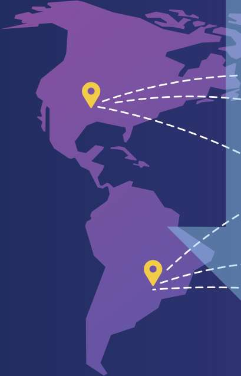
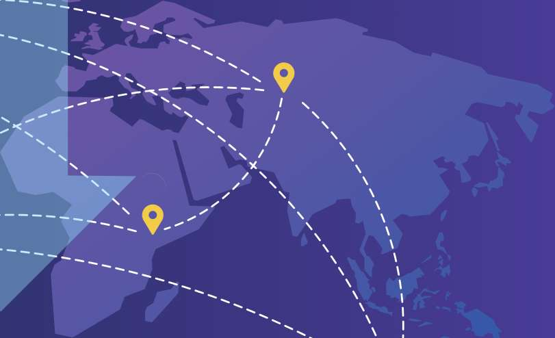
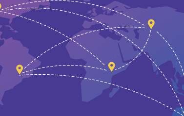
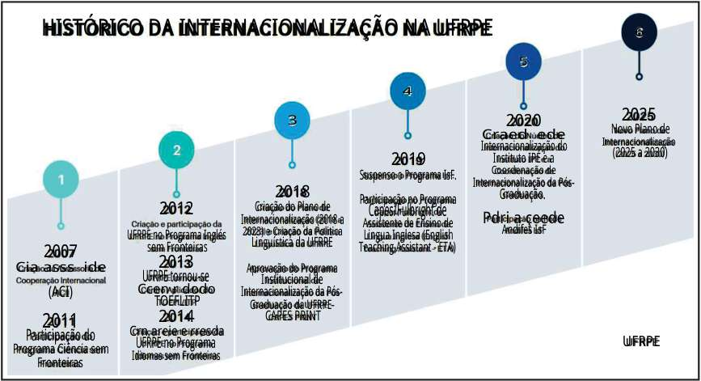
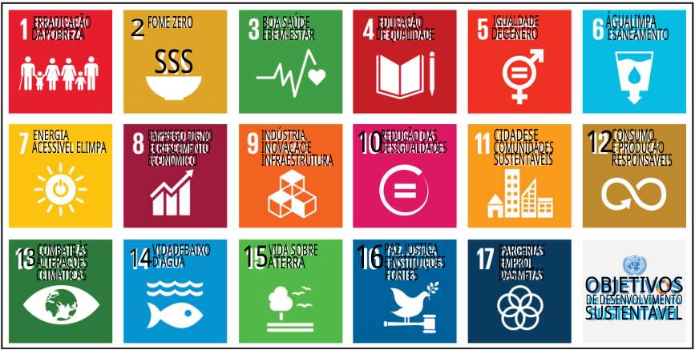
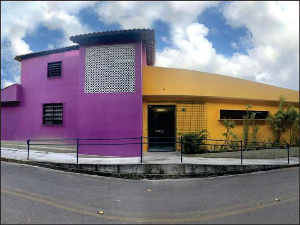
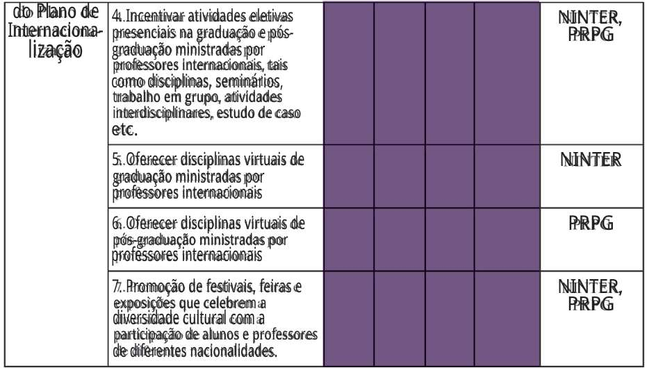
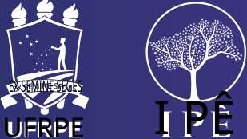

<!-- page 1 -->

x 

EX SEMINE SEGES 

UNIVERSIDADE FEDERAL RURAL DE PERNAMBUCO 

<!-- figure p01-fig1 | described_by: agy | ocr_overlap: None | needs_review: false -->
1. **Type of figure**
A stylized, flat-vector geographic map illustration (a cropped left-hand portion of a world map) depicting the Americas with location pins, outgoing dashed route/connection lines, and a partially visible translucent overlay graphic along the right edge.

2. **Visible text**
None. There is no text, title, label, legend, caption, axis tick, or table cell anywhere in the image.

3. **Structure**
- **Map base**: Displays the Western Hemisphere in simplified polygonal shapes: North America (Alaska, Canada, the Canadian Arctic archipelago, the contiguous United States, Baja California, Mexico, Central America, and Caribbean islands) in the upper half, and South America in the lower half.
- **Location pins**: Two teardrop-shaped map pins with circular center cutouts are placed on the landmasses:
  - **North American pin**: Positioned in the central/south-central United States.
  - **South American pin**: Positioned in central-southern/southeastern South America (roughly the southern Brazil/Paraguay area).
- **Dashed lines**: Six curved dashed lines originate near the tips of the two pins and run rightward off the cropped right edge of the figure (their endpoints are not visible):
  - **3 lines from the North American pin**: one curving gently upward to the upper-right edge, one arching slightly and continuing horizontally to the upper-right edge, and one curving downward toward the middle-right edge.
  - **3 lines from the South American pin**: one angling upward toward the middle-right edge, one curving slightly upward toward the lower-right edge, and one running nearly horizontally toward the lower-right edge.
- **Right-side overlay**: Along the right edge, a cropped semi-transparent shape forms a vertical band from the top edge down to the eastern bulge of South America, where it flares outward to the left and tapers diagonally down-right, forming the left half of a large downward-pointing arrow overlapping eastern Brazil and the eastern segments of the dashed lines.

4. **Numbers and data values**
None. No numerical values, scales, or coordinates appear in the image (visually, there are 2 location pins and 6 dashed connection lines—3 per pin).

5. **Meaningful colours**
- **Dark navy blue**: Background/ocean.
- **Purple**: Landmasses (North and South America).
- **Yellow**: The two location pin markers, distinguishing the focal geographic origins from the map.
- **White**: The dashed connection lines radiating from both pins (tinted pale blue where they pass beneath the right-edge overlay).
- **Semi-transparent light blue**: The cropped downward-pointing arrow overlay on the right edge, visually separating or highlighting that region over the map beneath it.

<!-- figure p01-fig2 | described_by: agy | ocr_overlap: None | needs_review: false -->
1. **Type of figure**
   A stylized, cropped vector world map illustration (conceptual route/network map) depicting the Eastern Hemisphere—specifically Europe, Africa, the Middle East, Asia, and Maritime Southeast Asia—overlaid with two location-pin markers and curved dashed connection lines.

2. **Visible text**
   None. There are no titles, labels, legends, captions, axis ticks, place names, or annotations anywhere in the image.

3. **Structure**
   - **Base map**: A single panel showing simplified, angular landmass silhouettes without country borders, axes, graticules, a scale bar, or a compass rose. Visible regions include Europe (including the British Isles and Scandinavia), the full African continent and Madagascar, the Arabian Peninsula, continental Asia (including India, East Asia, and Japan), and parts of Southeast Asia (Philippines, Indonesian archipelago, and western New Guinea at the bottom right).
   - **Location markers (2 teardrop map pins with circular center cutouts)**:
     - **Pin 1 (upper center)**: Located in Central Asia / northern Kazakhstan (northeast of the Caspian Sea).
     - **Pin 2 (lower left)**: Located in East Africa (around the Horn of Africa / Kenya–Ethiopia region). Directly above this pin is a very faint, thin partial circular outline.
   - **Dashed curved connection lines (8 unlabelled white dashed arcs, with no arrowheads)**:
     - *Pin 1 to top-left edge*: Curves from the top-left edge (above the British Isles), across Northern/Eastern Europe, terminating just upper-left of Pin 1.
     - *Pin 1 to mid-left edge*: Curves from the mid-left edge (over the Atlantic/West Africa), arching upward across North Africa, the Mediterranean, and the Black Sea, terminating just left of Pin 1.
     - *Pin 1 to Pin 2*: Curves downward and leftward from beneath the tip of Pin 1, crossing the Persian Gulf and Arabian Peninsula, terminating just right of Pin 2.
     - *Pin 1 to bottom-right edge*: Curves widely downward and rightward from just lower-right of Pin 1 across China, mainland Southeast Asia, and the Indonesian archipelago, exiting the bottom edge roughly three-quarters across from the left.
     - *Pin 2 to mid-left edge*: Extends from the mid-left edge (crossing the mid-left arc to Pin 1 over West Africa) downward and rightward across West and Central Africa, terminating just upper-left of Pin 2.
     - *Pin 2 to lower-left edge*: Curves gently downward and rightward from the lower-left edge across Central Africa, terminating just left of Pin 2.
     - *Upper-left edge to bottom edge (continuous transit arc, not connected to either pin)*: Enters along the upper-left edge, curves across Europe, the Middle East, the Arabian Sea, and the Indian Ocean west of India, exiting the bottom edge about two-thirds across from the left (to the left of the arc from Pin 1).
     - *Lower-left edge to bottom-center edge (continuous transit arc, not connected to either pin)*: Enters near the lower-left edge, curves across Southern Africa and south of Madagascar, exiting the bottom edge slightly right of center.
   - **Left-edge geometric overlay**: A semi-transparent polygonal overlay covers a vertical strip along the upper-left edge, forms an inward-pointing triangular notch/step across West Africa, and slants diagonally down to the bottom-left corner.

4. **Numbers and data values**
   None. There are no numbers, quantitative scales, coordinates, or data values in the figure.

5. **Meaningful colours**
   - **Dark purple/indigo** represents oceans and water bodies, while **lighter muted purple-to-slate-blue** distinguishes the landmasses.
   - **Bright yellow** highlights the two focal location pins against the darker map background.
   - **White** highlights the dashed route/connection arcs.
   - A **semi-transparent light blue** tint appears only in the decorative geometric overlay on the left side and carries no defined data legend.

**PLANO DE Internacionalização 2025-2030** 

Recife, 2025 

<!-- page 2 -->

**UNIVERSIDADE FEDERAL RURAL DE PERNAMBUCO** 

**Maria José de Sena** Reitora 

**Danielli Matias de Macedo Dantas** Pró-Reitora de Ensino de Graduação - PREG 

**Tália de Azevedo Souto Santo** Pró-Reitora de Gestão Estudantil e Inclusão - PROGESTI 

**Thieres George Freire da Silva** 

Pró-Reitor de Pesquisa - PROPESQ 

**Rodrigo Gayger Amaro** Pró-Reitor de Planejamento e Administração - PROPLAD 

**Rodrigo Felipe Rodrigues do Carmo** Diretor do Núcleo de Internacionalização  - NINTER 

**Edivan Rodrigues de Souza** Coordenador de Internacionalização dos Programas de Pós-Graduação Stricto sensu da PRPG 

#### **Nathanyel Raylson Silva Santos** 

Secretário de Internacionalização dos Programas de Pós-Graduação Stricto sensu da PRPG 

**Miguel Alejandro Zorro Millan** Docente de Representante de Internacionalização da Unidade Acadêmica do Cabo de Santo Agostinho 

#### **Revisão** 

**Julio César Fernandes Vila Nova** Coordenador de Apoio à Internacionalização Institucional do NINTER 

**Maria do Socorro de Lima Oliveira** Vice-Reitora 

**Rinaldo Aparecido Mota** 

Pró-Reitor de Pós-Graduação - PRPG 

**Renata Valéria Regis de Sousa Gomes** Pró-Reitora de Extensão, Cultura e Cidadania - PROEXC 

**Renata Andrade de Lima e Souza** Pró-Reitora de Gestão de Pessoas - PROGEPE 

**Manuela Medeiros Gonçalves** Pró-Reitora de Planejamento e Gestão Estratégica - PROPLAN 

**Julio César Fernandes Vila Nova** Coordenador de Apoio à Internacionalização Institucional do NINTER 

**Geyza Leyde Camello Lustosa** Coordenadora de Cooperação Internacional do NINTER 

#### **Redação e edição** 

Comissão de Elaboração do Plano de Internacionalização ( PORTARIA GR/UFRPE 495/2025, DE 28 DE MAIO DE 2025). 

#### **Kleyton Ricardo Wanderley Pereira** 

Docente e Representante de Internacionalização da Unidade Acadêmica de Serra Talhada 

**Ana Carolina Moura Bezerra Sobral** Pedagoga e Coordenadora Ações Pedagógicas e Regulação da PREG 

Projeto gráfico e diagramação **Juscelino Odilon de Sousa** - IPÊ 

<!-- page 3 -->

<!-- figure p03-fig4 | described_by: agy | ocr_overlap: None | needs_review: false -->
**1. Type of figure**
A stylized, cropped vector world map illustration depicting a global network of locations connected by curved dashed lines. It contains no axes, legends, or data plot elements.

**2. Visible text**
None. There are no titles, labels, legends, captions, axis ticks, or other text anywhere in the image.

**3. Structure**
- **Map frame (single panel):** A cropped view of the world map showing eastern North America and the Caribbean along the top-left edge, eastern and central South America at the bottom-left, Europe at the top-center, Africa (excluding Madagascar) in the center, the Middle East and most of Asia on the right, and the northwestern tip of Australia in the bottom-right corner.
- **Location pins (4 visible nodes):** Four teardrop-shaped map marker icons with a circular cutout in the center:
  - **Pin 1 (top-left edge, partially cropped):** Located on the far-left border in eastern North America (only the right half of the pin is visible).
  - **Pin 2 (bottom-left):** Located in southeastern South America (southeastern Brazil region).
  - **Pin 3 (lower-center):** Located in East Africa (Horn of Africa / Ethiopia–Kenya–Somalia region, south of the Red Sea).
  - **Pin 4 (upper-right):** Located in Central Asia (northeast of the Caspian Sea).
- **Connecting lines (8 curved white dashed arcs, without arrowheads):**
  1. **Pin 1 (North America) to Pin 4 (Central Asia):** Curves upward across the North Atlantic and Northern Europe.
  2. **Pin 1 (North America) to the bottom-right corner (off-screen, toward Australia):** Curves across the North Atlantic, Europe, the Middle East, India, and the Indian Ocean, exiting at the bottom-right corner over northwestern Australia.
  3. **Pin 1 (North America) to Pin 3 (East Africa):** Curves downward and rightward across the Atlantic and West/Central Africa.
  4. **Pin 2 (South America) to Pin 4 (Central Asia):** Curves upward and rightward across the Atlantic, Northwest Africa, and the Mediterranean/Black Sea region.
  5. **Pin 2 (South America) to Pin 3 (East Africa):** Curves gently across the South Atlantic and Central Africa.
  6. **Pin 2 (South America) to the bottom-right corner (off-screen, toward Australia):** Curves across the South Atlantic, Southern Africa, and the Indian Ocean, converging with the line from Pin 1 as it exits at the bottom-right corner over northwestern Australia.
  7. **Pin 3 (East Africa) to Pin 4 (Central Asia):** Curves rightward and upward across the Arabian Sea and Iran/Central Asia.
  8. **Pin 4 (Central Asia) to the right edge (off-screen):** Curves rightward and downward across East/Southeast Asia, exiting the right border roughly two-thirds of the way down.

**4. Numbers and data values**
None. No numerical values, coordinates, scales, or quantitative data are shown.

**5. Meaningful colours**
- **Dark purple (background) vs. lighter purple-to-slate-blue (landmasses):** Distinguishes oceans from continents.
- **Bright yellow:** Highlights the four location pins as distinct geographic nodes against the muted purple-blue map.
- **White (dashed lines):** Distinguishes the network connection arcs linking the pinned locations from the map background and continents.

~~~text ocr
~
1
~~~

# **PLANO DE Internacionalização 2025-2030** 

# **Sumário** 

|**INTRODUÇÃO**……................…………………………………….............…………………….……..……… 05|
|---|
|**1. CONTEXTUALIZAÇÃO DA** **INTERNACIONALIZAÇÃO**....................……………........…… 07|
|**2. INTERNACIONALIZAÇÃO NA UFRPE**……………….....................………………….…….……...12|
|2.1 Histórico …………………………………….........................……………………………………………..12|
|2.2 Estrutura e Competências do Núcleo de Internacionalização (NINTER)............. 20|
|2.3 Objetivos da UFRPE para a Internacionalização ...……...............................…….……26|
|2.4 Documentos: Plano de Desenvolvimento Institucional (PDI) e Resoluções ...... 28|
|2.5 A Política Linguística da UFRPE ………………………………………………………...............… 32|
|**3. EIXOS ESTRATÉGICOS PARA INTERNACIONALIZAÇÃO**………………...…….............…... 34|
|3.1 Mobilidade Acadêmica …………………………………………………....…………….............…... 34|
|3.1.1 Política de Mobilidade Acadêmica ……………………………………..................…… 35|
|3.1.2 Política de Acolhimento a Estudantes Estrangeiros ..........……...............…... 37|
|3.1.3 Internacionalização do Currículo Acadêmico ………………..........................… 39|
|3.1.4 Política de Diversidade, Equidade e Inclusão na Internacionalização ....... 40|
|3.1.4.1 Política Institucional de Internacionalização Inclusiva de Diversidade ......................................................................................................................................…….41|
|3.1.4.2 Inclusão Intencional dos Estudantes com Deficiência nas Iniciativas de Internacionalização  …..............………………………………………………………………………...43|

<!-- page 4 -->

|3.1.4.3 Promoção da Cooperação Internacional em Pesquisa sobre Equidade, Diversidade e Inclusão  ………………………………………………………………………. 44|
|---|
|3.1.4.4  Política de Equidade, Diversidade e Inclusão na Mobilidade de ....... Estudantes com Deficiência …...…………………………………………………………………………… 45|
|.            3.1.4.5 Políticas Adicionais: Estudantes Surdos …...………………………………….. 47|
|3.2 Internacionalização na Pesquisa, Inovação e Extensão …..…………………………….. 48|
|.     3.2.1 Política de Internacionalização na Pesquisa e Inovação,………………………… 48|
|3.2.2 Política de Internacionalização na Extensão ………………………………..……….. 50|
|3.2.3 Política de Internacionalização na Pós-Graduação ………………………………… 52|
|3.3 Internacionalização em Casa /_Internationalization at Home_…….................……….55|
|.     3.3.1 Programa de Mobilidade Virtual …………………………………………………............ 55|
|3.3.2 Cursos e Programas de Idiomas ………………………………………….........………… 56|
|3.4 Redes e parcerias estratégicas ………….....…………………………………………........…….. 57|
|3.4.1 Política de Alianças Estratégicas ………………………………………………................….. 58|
|3.4.2 Política Internacional de_Cross-Border_……..........……………………………………… 60|
|3.4.3 Cátedras de Internacionalização ………………......…………………………………...... 61|
|3.4.4 Rede Andifes Idiomas sem Fronteiras ………………………………………......…….. 62|
|3.4.5 Grupo de Cooperação Internacional de Universidades Brasileiras (GCUB)... 64|
|3.5 Desenvolvimento de Capacidades ……………………………...........…………………………. 65|
|3.5.1 Política para Mobilidade de Servidores Técnico-administrativos …………... 65|
|3.5.2 Política para Mobilidade de Servidores Docentes, Colaboradores e|
|Pesquisadores ....................................................................................................................... 66|

<!-- page 5 -->

|3.6 Sustentabilidade Financeira e Gestão Integrada……………………………………….....… 66|
|---|
|**4. EIXOS TRANSVERSAIS PARA**………………………............................................................…. 67|
|4.1 Proficiência Linguística e Competências Interculturais ……………………..…………… 67|
|4.1.1 Proficiência Linguística ………………………………………………………...............….. 69|
|4.1.2 Disciplinas em Língua Estrangeiras ….........…………………………………………… 71|
|4.1.3 Formação de Bolsistas para o Ensino de Idiomas…..……………………….……..72|
|4.1.4 Produção Acadêmica em Língua Estrangeira…………...……………..…….……….73|
|4.1.5 Tradução em Língua Estrangeira…………………………………………………........... 74|
|4.2 Comunicação……………………………………………………….………………….....................….. 74|
|4.2.1 Comunicação Institucional…………………………………..…………..…..........….….. 74|
|4.2.2  Diretrizes Estratégicas…………………………………..…………..……...…............….. 75|
|4.2.3 Governança e Monitoramento……………..…………..…......….....…………….....…. 79|
|**5. AÇÕES E PRAZOS**………………..……………………………………………………........................….… 80|
|5.1 Eixos Estratégicos: Mobilidade Acadêmica, Internacionalização na Pesquisa, Inovação e Extensão, Internacionalização em Casa, Redes e Parcerias Estratégicas e|
|Desenvolvimento de Capacidades ................................................................................ 80|
|5.2 Eixos Transversais: Competências Linguísticas e Interculturais e Comunicação…...…........................................................................................................….84|
|**6. REFERÈNCIAS**…………………….......................……………………………….……………………....86|

<!-- page 6 -->

**PLANO DE Internacionalização 2025-2030** 

# **INTRODUÇÃO** 

UFRPE 

O Brasil tem desempenhado, ao longo dos últimos anos, importante papel de liderança no cenário geopolítico internacional, sobretudo no que diz respeito às articulações do Sul Global. No âmbito da agenda socioambiental para o combate às ameaças climáticas, por exemplo, nosso país é reconhecido pela sua expressiva biodiversidade e pelas iniciativas de proteção ambiental. Também nos destacamos pela implementação de políticas públicas para o combate às desigualdades socioeconômicas e para a erradicação da pobreza. Entretanto, no atual contexto internacional de avanço de forças neoliberais que atuam em sentido contrário, pregando o enfraquecimento dos setores públicos, vemos hoje evidenciar-se a necessidade de fortalecer o papel das instituições responsáveis pelos avanços sociais, dentre as quais se destaca a Universidade. O desenvolvimento permanente de seus pilares fundamentais – Ensino, Pesquisa e Extensão – é a saída possível para os desafios da globalização, compreendida como o aumento e a intensificação das relações sociais em escala mundial, que ligam localidades distantes de tal forma que os acontecimentos de cada lugar influenciam e são influenciados por eventos que acontecem a quilômetros de distância (Ianni, 1996). O fenômeno pode ser compreendido como um processo e, numa perspectiva econômica, pode ser conceituado assim: “Globalização é um processo de integração mundial que está ocorrendo há pelo menos duas décadas nos setores de comunicação, economia, finanças e comércio”, de acordo com Ludovico (2009, p. 4). 

No contexto da globalização, o movimento de internacionalização dos diversos setores da sociedade pode significar a abertura de novas oportunidades para diferentes setores da economia, para a formação de cidadãos aptos a enfrentar o cenário de novas configurações do mundo do trabalho, pautadas, por exemplo, pela preocupação com a sustentabilidade e com a superação das desigualdades. A Universidade está inserida aí, evidentemente, a partir das transformações 

05 

<!-- page 7 -->

pelas quais deve passar para cumprir seu papel fundamental de promover a ascensão social no país, oferecendo novas oportunidades a jovens estudantes e ajudando a resolver os problemas da sociedade. A internacionalização da universidade “[...] significa que as disciplinas devem ser dadas num contexto mundial e não somente nacional e regional, que um número cada vez maior de estudantes se graduem [...] com capacidade para cooperar e competir no mercado internacional [...].” (Souto; Reinert, 2004 _apud_ Keenan; Vallée, 1994, s.p.). Aqui os autores não falam apenas em processo formativo em outros idiomas, que é um dos pilares da internacionalização, mas também nos aspectos inerentes à experiência de intercâmbio multicultural e global. 

Assim: 

- [...] a internacionalização de uma instituição de ensino superior (IES) pode ter um conceito limitado, como a simples presença de alguns alunos estrangeiros no campus. Por outro lado, a internacionalização pode ser algo contínuo, como um processo sinérgico e transformador, envolvendo os currículos e a pesquisa, influenciando as atividades de alunos, professores, administradores, e toda comunidade em sentido amplo. (Frankenberg, 2010 _apud_ Bartell, 2003, p. 149). 

Com este Plano de Internacionalização, a Universidade Federal Rural de Pernambuco (UFRPE) buscará produzir subsídios com vistas à realização de UFRPE ações concretas, para ampliar as iniciativas de parceria e fortalecer o estabelecimento de convênios e acordos de cooperação, desta forma gerando maior projeção da comunidade acadêmica em âmbito internacional. A UFRPE busca redimensionar seu papel social de proporcionar a qualificação de jovens pesquisadores, preparando-os para a vida profissional e acadêmica, agregando a sua formação uma experiência internacional que favoreça o desempenho para resolução de problemas locais com uma perspectiva global. A UFRPE reconhece, portanto, a inegável UFRPE importância da cooperação internacional no contexto educacional, econômico, social e político atual, e elege a internacionalização como uma das áreas de destaque em seu planejamento estratégico. 

UFRPE I 

06 

<!-- page 8 -->

**PLANO DE Internacionalização 2025-2030** 

## **1.CONTEXTUALIZAÇÃO DA INTERNACIONALIZAÇÃO** 

UFRPE 

No Brasil, cuja formação histórica reflete uma lógica colonial ainda persistente, os espaços formais dedicados ao estímulo da criatividade, do pensamento crítico e da educação cidadã apresentam uma trajetória entrelaçada ao mesmo tempo por conflitos e por sinergias positivas que acompanham a própria evolução histórica do país (Saviani; Duarte, 2012). Entretanto, diferentemente de outros países submetidos ao jugo da colonização, houve no Brasil um atraso na implementação de um ambiente educacional formal em nível superior e no acesso a essas garantias por toda a sociedade (Gisi, 2006), o que por sua vez tem forte relação com o processo de internacionalização dessa  educação superior ainda incipiente. As relações internacionais iniciadas no Brasil Colônia foram pautadas, exclusivamente, no intercâmbio da burguesia dominante para países colonizadores europeus, como Portugal, Inglaterra ou França. A partir de 1808, com a chegada da família real, foram criadas as escolas de ensino superior, como eram chamadas as primeiras instituições. Depois, o que se discutia era o controle do Estado na educação para expansão das universidades. A partir de 1889, com a Constituição da República, descentralizando a educação para os estados, foram criadas mais de 56 escolas de Ensino Superior, na maioria privadas, e a Universidade do Paraná foi a primeira formalmente constituída no Brasil, em 1912, por um governo estadual. A Universidade do Rio de Janeiro é criada em 1920, e a Universidade de São Paulo em 1937, em meio à reconciliação entre as elites paulistas e o governo federal (Sampaio, 1991). 

As múltiplas formas de internacionalização do ensino aparecem em todos os níveis da educação no Brasil, desde sua concepção. No ensino superior, em especial nas principais universidades brasileiras, as ações de internacionalização tiveram início em meados do século XX, com ajuda de missões acadêmicas estrangeiras. Os professores e pesquisadores visitantes que retornaram às suas 

**0** 71 

<!-- page 9 -->

instituições de origem deixaram ex-alunos que mantiveram laços de cooperação acadêmica em projetos conjuntos de investigação científica, conforme Santos Almeida (2012, p. 140). Ainda no século XX, os programas brasileiros de apoio à formação de mestres e doutores no exterior, coordenados pela Coordenação de Aperfeiçoamento de Pessoal de Nível Superior (CAPES) e pelo Conselho Nacional de Desenvolvimento Científico e Tecnológico (CNPq), estabeleceram relações com diversos países, as quais incluíam visitas, estágios, trabalhos de pesquisa conjunta e a vinda de alunos do exterior (Dewes; Rocha, 2001). 

As iniciativas de mobilidade internacional de grupos de pesquisa e programas de pós-graduação brasileira tiveram reflexo no cenário internacional, o que possibilitou e garantiu  ao Brasil “iniciar um experimento políticoacadêmico da mais alta importância, ao organizar universidades federais de vocação internacionalizada” (Santos; Almeida, 2012, p. 142), como é o caso da Universidade da Integração Internacional da Lusofonia Afro-Brasileira (UNILAB), que nasce neste contexto, já no século XXI, criada pela Lei nº 12.289, de 20 de julho de 2010, e instalada em 25 de maio de 2011. 

UFRPE 

A internacionalização do ensino superior é definida por Knight (2004) em termos que valorizam a dimensão internacional relacionando-os com o papel da educação na sociedade, ou seja, “Internacionalização em nível nacional, setorial e institucional é definida como o processo no qual se integra uma dimensão internacional, intercultural ou global nos propósitos, funções e oferta de educação pós-secundária” (Knight, 2020, p. 24). 

Segundo De Wit e Knight (1997), no tocante às razões que conduzem as IES ao processo de Internacionalização, temos: (i) razões políticas (busca pela paz e entendimento mútuo); (ii) razões econômicas (preocupação com a competitividade e crescimento econômico); (iii) razões sócio-culturais (expansão de valores morais e nacionais) e; (iv) razões acadêmicas (qualificação das pessoas para o mercado de trabalho, reputação da instituição de ensino superior (IES), qualidade do ensino, pesquisa e serviços, exposição cultural decorrente da mobilidade de estudantes e professores). Adicionamos, ainda, a esses pontos, o processo formativo qualitativo e a criação de uma proposta de formação do cidadão internacional, o qual carrega consigo sua cultura, bens e valores, mas 

08 

<!-- page 10 -->

<!-- figure p10-fig5 | described_by: agy | ocr_overlap: None | needs_review: false -->
**1. Kind of figure**
A single-panel horizontal colour photograph (stock/editorial style) showing two people seated at a desk writing on paper in a sunlit indoor workspace, with a computer monitor displaying a world map on the left. There are no overlaid graphics, annotations, charts, or captions.

**2. Visible text (verbatim)**
There is no overlaid text, title, caption, legend, or axis label on the photograph. The only text present is printed on the political world map shown on the computer monitor on the left:
- `CHINA` (in spaced uppercase letters across the landmass of China)
- Multiple smaller country and region labels printed across Europe, Africa, Asia, Oceania/Australia, and at the bottom of the map screen: `[illegible]`

**3. Structure and layout**
The image is a single photographic frame with no boxes, arrows, axes, tables, or sub-panels:
- **Left**: A black-bezeled flat-screen computer monitor angled slightly right, displaying the Eastern Hemisphere of a political world map (Europe, Africa, Asia, and Australia/Oceania) against a light grey background. Directly beneath the monitor is a small potted cactus in a white pot and a closed brown notebook on the desk.
- **Center**: A Black man with short curly dark hair wearing an open olive-green short-sleeved shirt over a white T-shirt. He looks down at the desk, holding a blue-and-white pen in his right hand while steadying the paper with his left hand.
- **Right**: A smiling light-skinned woman with shoulder-length straight red/auburn hair wearing an open light-blue denim shirt over a burnt-orange top. She leans slightly forward, looking down at the desk and holding a blue-and-white pen.
- **Foreground (bottom)**: Out-of-focus sheets of white paper on the desk, a blurred blue-sleeved arm and hand of a third person extending from the bottom left toward the papers, and a dark blurred object in the bottom right corner.
- **Background**: Bright sunlit paned windows behind the subjects and plain neutral walls.

**4. Numbers or data values**
None. No numbers, measurements, or data values appear in the image.

**5. Colours that carry meaning**
- On the political world map on the monitor, contrasting flat fill colours (maroon, grey, brown, orange/ochre, olive, blue, purple, and black/dark shades) distinguish neighbouring countries and territories from one another. No legible colour legend is present, so the colours indicate political boundaries rather than a readable quantitative scale.
- All other colours in the photograph are naturalistic and carry no encoded meaning.

amplia os horizontes formativos para a resolução de problemas sociais pautados nas agendas internacionais. Para que haja a inserção da dimensão internacional no ensino e na pesquisa, as IES focalizam suas ações em duas grandes dimensões: parcerias internacionais e ensino. As parcerias internacionais caracterizam-se pelos acordos institucionais, programas de cooperação, pesquisa conjunta, desenvolvimento tecnológico e mobilidade de estudantes/professores; quanto à dimensão do ensino, ela engloba aspectos relacionados ao desenvolvimento da estrutura curricular com conteúdo internacional, a importância da aprendizagem de uma língua estrangeira, a utilização da literatura e a inserção do ensino em língua estrangeira, além do desenvolvimento das competências interculturais. 

UFRPE 

A dimensão abordada aqui é a das parcerias internacionais, incluindo os acordos institucionais e as iniciativas de mobilidade de estudantes e professores. Os acordos internacionais entre instituições acadêmicas têm assumido características de interações globalmente administradas, de caráter bilateral, para a mobilidade, considerando também o reconhecimento mútuo de créditos e certificações. Um exemplo destes acordos são as comissões binacionais que administram as bolsas estadunidenses da Comissão Fulbright. Na Europa, a estrutura de acordos internacionais mais completa é a Declaração de Bolonha, projetada para introduzir mudanças visando à harmonização dos sistemas de educação superior de todos os países membros da União Europeia, especificamente para os programas de intercâmbio e bolsas ERASMUS e SÓCRATES 

09 

<!-- page 11 -->

.No entanto, é preciso observar que a internacionalização tem sido analisada também como um processo de (re)estruturação de poder, servindo à manutenção de desigualdades e assimetrias que favorecem a posição dos países desenvolvidos. Pessoni e Pessoni (2021) explicam essa relação a partir dos conceitos de internacionalização ativa e de internacionalização passiva. Na primeira, as instituições de ensino situadas sobretudo nos países centrais do capitalismo recebem os recursos humanos, por meio das estratégias de atração de estudantes, professores e pesquisadores visitantes; desenvolvem  pesquisas e publicam essa produção em seus veículos de divulgação “além de definir e divulgar os procedimentos burocráticos para a participação dos diferentes agentes nas suas atividades acadêmico-científicas” (Pessoni e Pessoni, 2021, p. 15). Na internacionalização passiva, ocorre a mobilidade de estudantes, docentes e pesquisadores para instituições estrangeiras, com a publicação de sua produção de pesquisa acontecendo em veículos de divulgação externos. Assim, “a internacionalização passiva fica restrita aos países periféricos que se submetem a interesses comerciais reforçando o histórico desequilíbrio existente entre os países do Norte e do Sul” (Pessoni e Pessoni, 2021, p. 15). 

UFRPE 

Percebe-se, assim, que a internacionalização é um processo complexo que mobiliza diversas instâncias de poder público e privado, agências nacionais e internacionais e recursos humanos que atuam não apenas nos domínios estritamente educacionais, acadêmicos e científicos, mas que também busca atender as demandas da sociedade, sejam elas em âmbito social, cultural ou econômico. As instituições  de  ensino  precisam  ficar  atentas  para  que as determinações mercadológicas não se sobreponham aos objetivos precípuos da educação pública, que é a formação e a qualificação dos cidadãos para atuarem no enfrentamento dos desafios da sociedade. A internacionalização precisa ser concebida numa perspectiva de formação humanista, democrática e ética, que prepare discentes e docentes para atuarem em   um mundo multicultural, em que se percebe de modo bastante evidente, neste momento histórico, a necessidade da construção de diálogos que promovam a democratização do acesso às conquistas da ciência, consolidando o espírito cooperativo e uma cultura de intercompreensão e respeito mútuo entre as diversas culturas. 

10 

<!-- page 12 -->

O caminho, nesse sentido, é a construção de políticas de internacionalização de caráter mais ativo, especialmente entre as instituições que abarcam o eixo do Sul Global, que possibilitem a atuação proativa, no desenvolvimento de parcerias interinstitucionais. Este Plano de Internacionalização contempla algum ações estruturantes que já vêm sendo desenvolvidas, ou que têm potencial de desenvolvimento para promover a internacionalização por esse caminho: a atração e acolhimento de estudantes e pesquisadores; a oferta de serviços educacionais no próprio país e no exterior; o envolvimento com a mobilidade de experts – docentes e técnicos – e de discentes em áreas de interesse estratégico; o desenvolvimento de parcerias internacionais em programas de ensino; a criação de programas e projetos de pesquisa em colaboração com instituições estrangeiras de reconhecido prestígio acadêmico; a participação em redes internacionais e o desenvolvimento de políticas públicas e institucionais que visem ao trabalho colaborativo entre instituições nacionais e internacionais. 

UFRPE 

11 

<!-- page 13 -->

**PLANO DE Internacionalização 2025-2030** 

## **2. INTERNACIONALIZAÇÃO na ufrpe** 

### **2.1 Histórico** 

A Universidade Federal Rural de Pernambuco possui mais de 100 anos de tradição em ensino, extensão e pesquisa, com atuação local, regional e nacional. Sua história secular é marcada pela capacidade de inovação ao buscar contribuir com a resolução de problemas socioambientais e, ao mesmo tempo, promover o desenvolvimento sustentável em projetos e pesquisas que envolvem as ciências agrárias, ciências da natureza, ciências humanas, ciências sociais e ciências exatas. 

UFRPE 

Inaugurada em 1912, com os cursos de Medicina Veterinária e Agronomia, o novo perfil da instituição abrange 51 cursos de graduação, incluindo Agronomia, Administração, Economia, Educação Física, Ciências Sociais, Gastronomia, Sistemas de Informação, Ciência da Computação, Medicina Veterinária, Zootecnia, Pedagogia, Ciências Sociais, 16 licenciaturas (Biologia, Química, Física, Computação, Matemática, Letras, História, entre outras) e 14 Engenharias, no _campus_ do Recife e nas Unidades Acadêmicas de Serra Talhada (UAST), do Cabo de Santo Agostinho (UACSA) e de Belo Jardim (UABJ), além da Unidade de Educação a Distância e Tecnologia (UAEADTec). 

Desde a fundação da Escola Superior de Agricultura, em 1912, até os dias atuais, a UFRPE tem se destacado pela sua produção em pesquisa, ensino e extensão. Composta por mais de 1.200 professores, mais de mil técnicos e cerca de 18 mil estudantes, distribuídos ao longo de quatro unidades acadêmicas, 22 departamentos, além do Colégio Agrícola Dom Agostinho Ikas (CODAI), escola de ensino médio e técnico integrada, a UFRPE vem ampliando suas ações de forma a integrar e percolar ainda mais as atividades de internacionalização. A UFRPE possui ainda estações avançadas de pesquisa, ou seja, extensões situadas no 

12 

<!-- page 14 -->

Litoral, na Zona da Mata, no Agreste e no Sertão de Pernambuco. São elas: Estação Ecológica do Tapacurá, em São Lourenço da Mata; Estação Experimental de Cana-de-Açúcar (EECAC) e Estação Experimental de Pequenos Animais (EEPAC), em Carpina; Clínica de Bovinos de Garanhuns (CBG); Estação de Agricultura Irrigada (EAII), em Ibimirim; e a Estação de Agricultura Irrigada (EAIP), em Parnamirim. 

UFRPE 

A pós-graduação da UFRPE teve início em 1973 e atualmente possui  42 Programas de Pós-Graduação Acadêmicos e Profissionais, com um total 61 cursos, sendo 23 de doutorado e 38 de mestrado. Nos últimos 14 anos, houve um crescimento de 170% no número de discentes matriculados, além de um avanço na qualidade dos programas, conforme avaliação da CAPES. Dos 42 programas, quatro possuem a nota 6 (nível de excelência internacional), dez programas possuem nota 5 (nível de excelência nacional), 15 programas são avaliados com nota 4, e nove programas com nota 3, o que coloca a pós-graduação da UFRPE em posição de destaque nacional nas diversas áreas de conhecimento relacionadas pela CAPES. Um dos fatores preponderantes para a melhoria da avaliação dos cursos de pós-graduação é o eixo da internacionalização, cuja ampliação e consolidação têm sido reconhecidas notoriamente. Ainda há espaço, evidentemente, para ampliação da internacionalização nos programas com menores notas, assim como para sua consolidação nos programas com notas 5 e 6. Este Plano de Internacionalização é um instrumento importante e necessário para nortear as políticas de internacionalização da UFRPE, alinhadas com os critérios definidos pelas CAPES, de modo a contemplar os 42 Programas Acadêmicos e Profissionais. 

A UFRPE oferece anualmente mais de 4 mil vagas para o ingresso de novos discentes. A seleção é feita, majoritariamente, por meio do Exame Nacional do Ensino Médio (ENEM), com o Sistema de Seleção Unificada (SISU). No entanto, o estudante também pode ingressar como portador de diploma ou por meio de outros procedimentos. A integração entre o corpo discente e o corpo docente - quase todo constituído por mestres e doutores com formação em universidades renomadas - e a intensa atividade de pesquisa fazem da universidade um centro de excelência nacional nas áreas em que ela atua. 

13 

<!-- page 15 -->

Em relação a sua infraestrutura, a UFRPE possibilita a toda comunidade acadêmica o acesso ao acervo de milhares de títulos de suas bibliotecas, através do Sistema Integrado de Bibliotecas (SIB). A Biblioteca Central (BC), situada no _campus_ sede, no bairro de Dois Irmãos, no Recife, está equipada com totens digitais de consulta a publicações e a outras informações institucionais, bem como computadores que possibilitam a operação dos equipamentos através de sons, além de impressora em braile e outros aparatos para alunos com limitações visuais. 

A estrutura do _campus_ de Dois Irmãos também inclui: Centro Esportivo com piscina semiolímpica, quadra coberta, campo de futebol e pista de atletismo; residência estudantil; núcleo de serviços de saúde para consultas médicas, odontológicas, psicológicas, análises laboratoriais e clínicas, assistência social e enfermagem a servidores, estudantes e comunidade circunvizinha. A universidade também tem um Hospital Veterinário, que realiza, em média, 1.200 atendimentos mensais, entre consultas, exames e cirurgias em animais de pequeno e médio porte. 

Dentre as Instituições de Ensino Superior (IES) brasileiras, cerca de 60 trabalham com internacionalização e possuem um setor destinado à mediação das políticas públicas e fomentação de atividades e ações voltadas para mobilidade estudantil e outras iniciativas de internacionalização, segundo o Conselho de Gestores de Relações Internacionais das Instituições Federais de Ensino Superior (CGRIFES), vinculado à Associação Nacional dos Dirigentes das Instituições Federais de Ensino Superior (ANDIFES). Outros órgãos de articulação de políticas para internacionalização em âmbito nacional são a Associação Brasileira de Educação Internacional (FAUBAI) e o Grupo de Cooperação Internacional de Universidades Brasileiras (GCUB). 

UFRPE Conselho de Gestores de Relações Internacionais das Instituições Federais de Ensino Superior (CGRIFES), vinculado à Associação Nacional dos Dirigentes das Instituições Federais de Ensino Superior (ANDIFES). Outros órgãos de articulação de políticas para internacionalização em âmbito nacional são a Associação Brasileira de Educação Internacional (FAUBAI) e o Grupo de Cooperação Internacional de Universidades Brasileiras (GCUB). No ano de 2007 foi criada a Assessoria de Cooperação Internacional (ACI) da UFRPE, vinculada ao Gabinete da Reitoria, cuja finalidade precípua era a de ampliar e consolidar a internacionalização e os laços de cooperação interinstitucionais da universidade. Foi criada a partir da necessidade crescente de unificar ações existentes de cooperação internacional vigentes, bem como 

14 

<!-- page 16 -->

estabelecer novos convênios, de acordo com as demandas institucionais, proporcionando à comunidade acadêmica oportunidades de usufruir da mobilidade como forma de fortalecer o desempenho acadêmico e fomentar experiências interculturais. 

A ACI participou ativamente do Ciência sem Fronteiras (CsF), programa de mobilidade discente desenvolvido pelo Governo Federal do Brasil, a partir de 2011. Em janeiro de 2018, foi aprovado pelo colegiado da UFRPE o Plano para Implantação de uma Política de Internacionalização, compilando a instrumentalização legal para as ações em prol do avanço dos processos construtivos da comunidade acadêmica, do ponto de vista internacional, além de estabelecer as diretrizes voltadas para o reposicionamento da UFRPE nas agendas globais. Esse trabalho constante dentro da ACI culminou com a criação da Resolução Nº 089, em abril de 2018, oficializando o Plano de Implantação de uma Política de Internacionalização, para o período de 2018 a 2023. Em 2020, a ACI tornou-se Núcleo de Internacionalização (NINTER), vinculado ao Instituto de Inovação, Pesquisa, Empreendedorismo, Internacionalização e Relações Institucionais (IPÊ), de acordo com a Resolução Nº <u>027/2020</u> do Conselho de Ensino, Pesquisa e Extensão (CEPE) da UFRPE. 

O NINTER tem o objetivo de garantir visibilidade internacional à UFRPE, UFRPE trazendo benefícios para a participação efetiva de pesquisadores, educadores e extensionistas em editais de fomento e integração com órgãos internacionais, facilitando a captação e alocação destes recursos dentro da Instituição. Também tem o intuito de formar redes de colaboração, pesquisa com geração de produtos, patentes e _royalties_ como forma de uma internacionalização ativa, além de subsidiar a internacionalização em casa e a internacionalização passiva como meios de obtenção de melhores resultados para o desenvolvimento acadêmico e tecnológico da UFRPE. A cooperação científica internacional também é essencial para mobilizar competências no Brasil e no exterior, contribuindo para a qualificação de pessoas e para a promoção de pesquisa, desenvolvimento e inovação, conforme a Estratégia Nacional de Ciência, Tecnologia e Inovação (BRASIL, 2017). 

15 

<!-- page 17 -->

Nesta perspectiva, a UFRPE estabelece, por intermédio do NINTER, relações e convênios de cooperação interinstitucional com universidades e centros de ensino e produção científica de diversos países. Por meio de projetos voltados à troca de experiência de estudantes e professores de diferentes nacionalidades, a UFRPE firma acordos, promove a mobilidade acadêmica e orienta a comunidade universitária acerca de oportunidades de bolsas, cursos e eventos internacionais. Também incentiva e facilita a vinda de pesquisadores e discentes de outros países para enriquecimento mútuo. Dessa forma, a internacionalização desempenha um papel estratégico fundamental na promoção e ampliação de parcerias interinstitucionais, com participação de diversos atores sociais em todo o mundo, visando ao melhoramento dos processos formativos e ao desenvolvimento de tecnologias sociais, contribuindo para o posicionamento da universidade como importante _player_ nas agendas geopolíticas globais. 

UFRPE 

Em 2018, a UFRPE aprovou o <u>Programa Institucional de Internacionalização CAPES/Print, um marco para o crescimento da internacionalização no âmbito da</u> Pós-Graduação.  A UFRPE foi uma das 36 IES brasileiras que tiveram a proposta aprovada, sendo considerada à época como uma das propostas mais robustas em âmbito nacional. A execução do projeto iniciou-se em 2019 e foi concluída em 2024. A proposta foi acompanhada por um Comitê Gestor que geriu, em consonância com a Pró-Reitoria de Pós-Graduação (PRPG), todos os editais de mobilidade docente e discente internacional durante esse período, a exemplo das modalidades de Professor Visitante no Exterior (Júnior e Sênior); Professor Visitante do Exterior (pesquisadores estrangeiros que vieram para missões presenciais nos programas de pós-graduação); Doutorado Sanduíche no Exterior, Missões de Trabalho no Exterior e Jovem Talento do Exterior. A expressividade e os resultados das ações de internacionalização do CAPES Print foram descritos nos relatórios de avaliação quadrienal dos Programas de PósGraduação (2021-2024). As ações de internacionalização geradas pelo CAPES Print resultaram em parcerias sólidas, sustentáveis e de impacto no processo de internacionalização da UFRPE. 

Em 2020, foi criada a Coordenação de Internacionalização dos Programas de Pós-Graduação _Stricto Sensu_ da PRPG, pela resolução 030-A/2020, que 

16 

<!-- page 18 -->

regulamenta a estrutura organizacional da UFRPE. A criação de uma coordenação especializada em tratar de pautas que envolvam ações de internacionalização desenvolvidas no âmbito dos programas de pós-graduação _stricto sensu_ da UFRPE se deu devido à necessidade de ampliar e consolidar esse tipo de ação nos programas de pós-graduação, uma vez que está diretamente relacionada com a qualidade da pesquisa e da nota dos cursos avaliados pela CAPES. 

Ainda no contexto histórico da segunda década deste século XXI, surge o Programa Inglês sem Fronteiras (IsF), instituído em dezembro de 2012, através da Portaria MEC nº 1.466 (18/12/2012), a partir das demandas provenientes do Programa Ciência sem Fronteiras (CsF), criado em julho de 2011. A UFRPE começa então a atuar como Centro Aplicador do _Test of English as a Foreign English_ (TOEFL/ITP) em abril de 2013, sendo oficialmente inserida no Programa Inglês sem Fronteiras (IsF) através de proposta em atendimento à chamada pública 001/2013 MEC/CAPES/SESu. O documento de adesão foi assinado pela Reitora, Profª Maria José de Sena, em 30 de julho de 2013. Além da aplicação do TOEFL, como estratégia diagnóstica dos níveis de proficiência em língua inglesa no ensino superior do país, o Programa IsF passou a oferecer o curso a distância _My English Online_ e cursos presenciais de inglês abertos a toda a comunidade acadêmica das universidades participantes. 

##### UFRPE 

A partir das articulações do IsF com a área de Letras das IES e com parceiros internacionais, para a oferta de cursos de outros idiomas, o programa foi ampliado e rebatizado de Idiomas sem Fronteiras (com a mesma sigla IsF), instituído no ano seguinte, 2014 (Portaria MEC nº. 973/2014), com o objetivo de “propiciar a formação e a capacitação em idiomas de estudantes, professores e corpo técnico-administrativo das Instituições de Ensino Superior Públicas e Privadas - IES e de professores de idiomas da rede pública de educação básica, bem como a formação e a capacitação de estrangeiros em língua portuguesa.” (BRASIL, 2014). 

Após um período de suspensão do Programa, em 2016,  foi publicado em 17 de abril de 2017 o edital com chamada pública para recredenciamento das universidades ao Idiomas sem Fronteiras, agora incluindo a área de português como língua estrangeira/língua adicional. A UFRPE submeteu sua proposta em 03 

17 

<!-- page 19 -->

de maio de 2017 e foi recredenciada, passando a oferecer, além do curso _My English Online_ , das aplicações do TOEFL/ITP  e das aulas presenciais de língua inglesa nas Unidades Acadêmicas de Garanhuns (UAG) e de Serra Talhada (UAST), também aulas presenciais de língua espanhola, de português como língua estrangeira/adicional e de francês no _campus_ sede, com a participação de discentes do curso de Letras bolsistas aprovados em seleção para atuarem como professores do programa e, no caso do francês, com a participação de uma professora visitante, através do programa Leitores Franceses, com apoio da Embaixada da França. 

O Programa IsF foi novamente suspenso em 2019, e desta vez abandonado pelo MEC. Apesar  disso,  os números  expressivos  e  a  excelente  avaliação  do  1 programa  garantiram  a  sua continuidade, contando com o apoio da Associação Nacional dos Dirigentes das Instituições Federais de Ensino Superior (ANDIFES), que institui, por meio da Resolução 01/2019 do Conselho Pleno da instituição (em 12/11/2019), a Rede Andifes Nacional de Especialistas em Língua Estrangeira Idiomas sem Fronteiras, denominada <u>Rede Andifes IsF.</u> 

UFRPE 

Em março de 2020 foi lançado o Edital de Chamada às Instituições Federais de Ensino Superior para adesão à Rede Andifes IsF. A UFRPE foi então credenciada, e vem oferecendo semestralmente os cursos do Catálogo da Rede, com enfoque na internacionalização. Além disso, vem paulatinamente ampliando a sua equipe de especialistas orientadores e de bolsistas que atuam como professores pré-serviço. Ao longo de toda a trajetória do IsF na UFRPE, a área de Letras tem desempenhado papel essencial, contribuindo para a formação linguística da comunidade acadêmica da universidade e para o aprimoramento da formação docente dos estudantes que atuam como bolsistas ou voluntários no programa (Vila Nova, 2021). 

A aprovação do projeto intitulado Ações Interculturais e Internacionalização para a Formação Docente da UFRPE, em 2019, também evidencia a qualidade do trabalho de formação na área de língua inglesa na UAST. 

> 1. <http://isf.mec.gov.br/historico-botoes/pesquisas-e-relatorios/33-pesquisas-e-relatorios/199-relatorionacional> Acesso em 20maio2025. 

18 

<!-- page 20 -->

UFRPE 

<!-- figure p20-fig5 | described_by: agy | ocr_overlap: 1.0 | needs_review: false -->
**1. Tipo de figura**
Infográfico de linha do tempo cronológica ascendente, dividido em seis etapas numeradas sequencialmente (de 2007 a 2025), emoldurado por uma borda retangular preta fina. A imagem apresenta um artefato de renderização de PDF em que uma camada de texto preto ligeiramente maior (aparentemente gerada por OCR) está sobreposta, com leve deslocamento, ao texto original do gráfico — o que duplica visualmente quase todo o texto e introduz sequências corrompidas sobre cinco linhas específicas.

**2. Todo o texto visível (ipsis litteris)**
* **Título (canto superior esquerdo):** `HISTÓRICO DA INTERNACIONALIZAÇÃO NA UFRPE`
* **Etapa 1** (número no marcador circular: `1`):
  * `2007`
  * `Criação da Assessoria de Cooperação Internacional (ACI)` *(sobre a linha `Criação da Assessoria de`, a camada de texto sobreposta exibe `Cia asss ide`)*
  * `2011`
  * `Participação do Programa Ciência sem Fronteiras`
* **Etapa 2** (número no marcador circular: `2`):
  * `2012`
  * `Criação e participação da UFRPE no Programa Inglês sem Fronteiras`
  * `2013`
  * `UFRPE tornou-se Centro Aplicador do TOEFL ITP` *(sobre a linha `Centro Aplicador do`, a camada de texto sobreposta exibe `Ccen n dodo`; na linha seguinte, a camada sobreposta exibe `TOEFLITP`)*
  * `2014`
  * `Criação e participação da UFRPE no Programa Idiomas sem Fronteiras` *(sobre a linha `Criação e participação da`, a camada de texto sobreposta exibe `Crn areje e rresda`)*
* **Etapa 3** (número no marcador circular: `3`):
  * `2018`
  * `Criação do Plano de Internacionalização (2018 a 2028) e Criação da Política Linguística da UFRPE` *(na camada sobreposta, `Politica` aparece sem acento agudo)*
  * `Aprovação do Programa Institucional de Internacionalização da Pós-Graduação da UFRPE- CAPES PRINT`
* **Etapa 4** (número no marcador circular: `4`):
  * `2019`
  * `Suspenso o Programa IsF.`
  * `Participação no Programa Capes/Fulbright de Assistente de Ensino de Língua Inglesa (English Teaching Assistant - ETA)` *(na camada sobreposta, `Lingua` aparece sem acento agudo)*
* **Etapa 5** (número no marcador circular: `5`):
  * `2020`
  * `Criação do Núcleo de Internacionalização do Instituto IPE e a Coordenação de Internacionalização da Pós-Graduação.` *(sobre a linha `Criação do Núcleo de`, a camada de texto sobreposta exibe `Graed ede`)*
  * `Participação na Rede Andifes IsF` *(sobre a linha `Participação na Rede`, a camada de texto sobreposta exibe `Pdri a çeede`)*
* **Etapa 6** (número no marcador circular: `6`):
  * `2025`
  * `Novo Plano de Internacionalização (2025 a 2030)`
* **Rótulo no canto inferior direito (fora da faixa das etapas):** `UFRPE`
* Não há legendas, eixos rotulados ou notas de rodapé.

**3. Estrutura**
* A figura é cercada por uma moldura retangular fina em fundo branco.
* No topo, alinhado à esquerda sobre o fundo branco, figura o título principal em letras maiúsculas, estendendo-se da coluna 1 até acima da coluna 5.
* O corpo do infográfico forma uma grande faixa diagonal ascendente da esquerda para a direita, subdividida verticalmente por finas linhas brancas em 6 colunas (painéis) contíguas, todas com borda superior inclinada para cima. Nas colunas 1 e parte da coluna 2, a base é reta e encosta próxima à margem inferior da moldura; da coluna 2 até a coluna 6, a borda inferior também sobe em paralelo à borda superior, formando painéis em formato de paralelogramo e deixando uma área branca triangular crescente no canto inferior direito.
* No topo central de cada uma das 6 colunas, apoiado sobre a borda superior inclinada, há um marcador em forma de alfinete: um círculo sólido contendo o número da etapa (`1` a `6`), ligado a uma haste vertical reta que penetra no painel e termina em um pequeno círculo vazado logo acima do primeiro ano listado naquela coluna.
* Dentro de cada painel, o conteúdo é centralizado e organizado verticalmente:
  * **Coluna 1:** dois blocos cronológicos empilhados (`2007` e `2011`), cada um com ano em destaque seguido de descrição.
  * **Coluna 2:** três blocos cronológicos empilhados (`2012`, `2013` e `2014`), cada um com ano seguido de descrição.
  * **Colunas 3, 4 e 5:** um único ano no topo (`2018`, `2019` e `2020`, respectivamente), seguido de dois parágrafos descritivos separados por espaço vertical.
  * **Coluna 6:** um único ano no topo (`2025`) seguido de um único bloco descritivo.
* Não há setas, eixos coordenados nem conexões horizontais explícitas além da disposição sequencial ascendente da esquerda para a direita.
* No canto inferior direito, na região branca abaixo da coluna 6, está posicionada a sigla `UFRPE`.

**4. Todos os números e valores de dados**
* Números sequenciais das etapas nos marcadores circulares: `1`, `2`, `3`, `4`, `5`, `6`.
* Anos de marco cronológico (em ordem de leitura): `2007`, `2011`, `2012`, `2013`, `2014`, `2018`, `2019`, `2020`, `2025`.
* Períodos citados nas descrições: `2018 a 2028` (na etapa 3) e `2025 a 2030` (na etapa 6).
* Não há outros dados numéricos, quantidades ou escalas na figura.

**5. Cores com significado**
Os 6 marcadores circulares numerados (junto às suas hastes e pequenos anéis inferiores) seguem uma escala cromática progressiva de tons frios que escurecem gradualmente da esquerda para a direita — começando em verde-água claro (etapa 1), passando por turquesa (etapa 2), azul-celeste (etapa 3), azul médio (etapa 4), azul-royal escuro (etapa 5) até o azul-marinho muito escuro (etapa 6) — reforçando visualmente a progressão temporal e evolutiva das etapas. O fundo cinza-azulado claro dos painéis, o fundo branco externo e o texto preto (bem como os números brancos nos círculos, com sobreposição de dígitos pretos nos círculos `3` a `6` pelo artefato de texto) não codificam categorias adicionais além de contraste e delimitação das colunas.

~~~text ocr
HISTÓRICO DA INTERNACIONALIZAÇÃO NA hd
2019
9
2013
1
2014
do UFRPE
~~~

Submetido no âmbito do Edital Nº 16/2019 Programa Capes/Fulbright de Assistente de Ensino de Língua Inglesa (English Teaching Assistant – ETA) para Projetos Institucionais, o projeto contou com apoio da ACI/NINTER, estendendose até o ano de 2024. Durante esse período, a UFRPE recebeu na UAST assistentes de ensino de língua inglesa estadunidenses, que trabalharam acompanhando as atividades do professores do curso de Letras na unidade e também oferecendo a oportunidade de aprimoramento da proficiência no idioma a toda comunidade acadêmica da universidade, em atividades a distância. Essa experiência credencia a universidade a participar de novos projetos, com apoio da Comissão Fulbright ou de outras agências. 

<!-- Start of picture text -->
HISTÓRICO DA INTERNACIONALIZAÇÃO NA UFRPE 6 5 4 3 2020 2025 Novo Plano de Craed  ede Internacionalização do Internacionalização 2019 Instituto IPÉ e a (2025 a 2030) Suspenso o Programa IsF. Coordenação de Internacionalização da Pós- 2018 Participação no Programa Graduação. 2012 Criação do Plano de Capes/Fulbright de Internacionalização (2018 a Assistente de Ensino de Pdri a çeede UFRPE no Programa Inglés 2023) e Criação da Politica Lingua Inglesa (English Andifes IsF 2007 sem Fronteiras Linguística da UFRPE Teaching Assistant - ETA) Cia asss  ide 2013 Aprovação do Programa UFRPE tornou-se Institucional de (ACI) Ccen r dodo Internacionalização da Pós- TOEFLITP Graduação da UFRPE- 2011 2014 CAPES PRINT Participação do Crn areie e rresdaUFRPE no Programa UFRPE Programa Ciéncia sem Idiomas sem Fronteiras Fronteiras <!-- End of picture text -->

**Figura 01.** Cronologia das ações de institucionalização da Internacionalização. (Fonte: Elaborados pelos Autores, 2025). 

Um ponto central da abordagem de internacionalização adotada pela UFRPE é o diálogo constante, em escala local, regional, nacional e global, alinhado com os 17 objetivos globais para o desenvolvimento sustentável (ODS) definidos pela Agenda das Nações Unidas, em vigor a partir de 2016, com metas bastante audaciosas (Figura 02). A configuração dos ODS se dá com base no “comprometimento com uma educação inclusiva e equitativa de qualidade [de modo a que] todas as pessoas tenham acesso a oportunidades de aprendizagem ao longo da vida que as ajudem a adquirir os conhecimentos e habilidades 

19 

<!-- page 21 -->

<!-- figure p21-fig5 | described_by: agy | ocr_overlap: 0.67 | needs_review: false -->
**1. Tipo de figura**

Trata-se de um infográfico em grade (painel de cartões/ícones) que apresenta os 17 Objetivos de Desenvolvimento Sustentável (ODS) da Organização das Nações Unidas (ONU) em português, acompanhados de um 18.º quadro com o logotipo oficial dos ODS. A figura foi extraída de um PDF e exibe uma camada visível de texto em preto (com aparência de texto extraído/sobreposto por OCR) sobreposta e ligeiramente deslocada em relação ao texto original em branco (nos quadros 1 a 17) e em azul (no 18.º quadro), o que faz com que alguns trechos apareçam sem espaços entre palavras, sem acentos ou parcialmente sobrepostos ao texto subjacente.

---

**2. Todo o texto visível (verbatim)**

Não há título externo, legenda, rodapé nem rótulos de eixos fora da grade. Todo o texto está contido nos 18 quadros, lidos da esquerda para a direita, linha por linha. Abaixo reproduz-se literalmente a camada de texto frontal (em preto para os títulos e em branco ou preto sobre branco para os números, conforme indicado); o texto branco ou azul subjacente repete os mesmos títulos ligeiramente deslocados e parcialmente cobertos pela camada preta:

- **Linha 1, coluna 1:**
  `1`
  `ERRADICAÇÃO`
  `DAPOBREZA`
- **Linha 1, coluna 2:**
  `2`
  `FOME ZERO`
  `SSS` *(texto em preto sobreposto diretamente às três linhas brancas onduladas de vapor acima da tigela)*
- **Linha 1, coluna 3:**
  `3`
  `BOA SAÚDE`
  `EBEM-ESTAR`
- **Linha 1, coluna 4:**
  `4`
  `EDUCAÇÃO`
  `DE QUALIDADE`
- **Linha 1, coluna 5:**
  `5`
  `IGUALDADE`
  `DEGENERO`
- **Linha 1, coluna 6:**
  `6`
  `ÁGUALIMPA`
  `ESANEAMENTO`
- **Linha 2, coluna 1:**
  `7`
  `ENERGIA`
  `ACESSIVEL ELIMPA`
- **Linha 2, coluna 2:**
  `8`
  `EMPREGO DIGNO`
  `ECRESCIMENTO`
  `ECONOMICO`
- **Linha 2, coluna 3:**
  `9`
  `INDÚSTRIA,`
  `INOVAÇÃOE`
  `INFRAESTRUTURA`
- **Linha 2, coluna 4:**
  `10`
  `REDUÇÃO DAS`
  `DESIGUALDADES`
- **Linha 2, coluna 5:**
  `11`
  `CIDADESE`
  `COMUNIDADES`
  `SUSTENTÁVEIS`
- **Linha 2, coluna 6:**
  `12`
  `CONSUMO`
  `E PRODUÇÃO`
  `RESPONSÁVEIS`
- **Linha 3, coluna 1:**
  `13`
  `COMBATE ÀS`
  `ALTERAÇÕES`
  `CLIMÁTICAS`
- **Linha 3, coluna 2:**
  `14`
  `VIDADEBAIXO`
  `D'AGUA`
- **Linha 3, coluna 3:**
  `15`
  `VIDA SOBRE`
  `ATERRA`
- **Linha 3, coluna 4:**
  `16`
  `PAZ, JUSTIÇA`
  `EINSTITUIÇÕES`
  `FORTES`
- **Linha 3, coluna 5:**
  `17`
  `PARCERIAS`
  `EMPROL`
  `DASMETAS`
- **Linha 3, coluna 6:**
  `OBJETIVOS`
  `DE DESENVOLVIMENTO`
  `SUSTENTÁVEL`

---

**3. Estrutura**

A figura é delimitada por uma borda retangular externa fina de cor preta sobre fundo branco. No interior, organiza-se como uma matriz regular de **3 linhas por 6 colunas**, totalizando **18 quadros quadrados** de mesmo tamanho separados por margens brancas uniformes. Não há eixos, setas ou conectores ligando um quadro a outro.

Os 17 primeiros quadros seguem o mesmo leiaute interno: no canto superior esquerdo aparece o número do objetivo; ao lado direito do número, na parte superior, figura o título em letras maiúsculas condensadas (em 1 a 3 linhas); e na metade inferior centralizada encontra-se um pictograma branco estilizado:

- **Quadro 1 (linha 1, col. 1):** silhueta de seis pessoas lado a lado (da esquerda para a direita: um adulto com bengala, uma criança pequena, duas mulheres adultas, uma criança pequena e um homem adulto).
- **Quadro 2 (linha 1, col. 2):** tigela rasa encimada por três linhas onduladas verticais representando vapor (sobrepostas pelas letras pretas `SSS`).
- **Quadro 3 (linha 1, col. 3):** linha de eletrocardiograma (pulso cardíaco) que termina à direita em um coração preenchido.
- **Quadro 4 (linha 1, col. 4):** livro aberto à esquerda acompanhado por um lápis vertical apontando para baixo à direita.
- **Quadro 5 (linha 1, col. 5):** círculo contendo o sinal de igual (`=`) no centro, com uma cruz para baixo (símbolo feminino) e uma seta apontando para o canto superior direito (símbolo masculino).
- **Quadro 6 (linha 1, col. 6):** recipiente trapezoidal contendo água com uma gota recortada no centro e uma seta apontando para baixo na base.
- **Quadro 7 (linha 2, col. 1):** sol estilizado com 12 raios curtos e um símbolo de botão ligar/desligar recortado no centro.
- **Quadro 8 (linha 2, col. 2):** três barras verticais de alturas crescentes da esquerda para a direita (formando um pequeno gráfico de colunas) sob uma linha quebrada com seta apontando para o canto superior direito.
- **Quadro 9 (linha 2, col. 3):** três cubos em perspectiva isométrica dispostos em pirâmide (um no topo e dois na base).
- **Quadro 10 (linha 2, col. 4):** sinal de igual (`=`) dentro de um anel circular com abertura no quadrante superior direito.
- **Quadro 11 (linha 2, col. 5):** conjunto de edificações urbanas lado a lado (uma casa pequena, um prédio alto retangular com janelas, um prédio de cobertura inclinada com janelas e um edifício menor com janelas).
- **Quadro 12 (linha 2, col. 6):** símbolo do infinito (`∞`) com uma ponta de seta integrada na parte inferior esquerda do laço, indicando ciclo contínuo.
- **Quadro 13 (linha 3, col. 1):** olho aberto estilizado cuja íris central mostra o globo terrestre com contornos de continentes.
- **Quadro 14 (linha 3, col. 2):** duas linhas onduladas paralelas (ondas) acima da silhueta de um peixe voltado para a direita.
- **Quadro 15 (linha 3, col. 3):** árvore à esquerda, três pássaros estilizados voando à direita e duas linhas horizontais paralelas abaixo representando o solo.
- **Quadro 16 (linha 3, col. 4):** pomba em voo voltada para a direita segurando um ramo de oliveira no bico, posicionada acima de um martelo de juiz (malhete) apoiado em sua base.
- **Quadro 17 (linha 3, col. 5):** cinco círculos/anéis entrelaçados dispostos em formato radial (flor).
- **Quadro 18 (linha 3, col. 6 — painel de título/identidade):** contém, na parte superior central, o emblema da ONU (mapa-múndi em projeção circular ladeado por ramos de oliveira) e, na metade inferior, o texto em três linhas `OBJETIVOS` / `DE DESENVOLVIMENTO` / `SUSTENTÁVEL`, tendo uma pequena roda circular segmentada posicionada atrás do segundo `O` de `OBJETIVOS` (substituindo essa letra na camada original subjacente).

---

**4. Todos os números ou valores de dados**

Não há dados quantitativos, medidas, porcentagens ou valores estatísticos na figura. Os únicos números presentes são os identificadores ordinais dos 17 objetivos, numerados sequencialmente de **1** a **17**:

`1`, `2`, `3`, `4`, `5`, `6`, `7`, `8`, `9`, `10`, `11`, `12`, `13`, `14`, `15`, `16`, `17`.

---

**5. Cores onde carregam significado**

Na identidade visual dos Objetivos de Desenvolvimento Sustentável, cada um dos 17 quadros utiliza uma cor sólida de fundo própria para distinguir individualmente cada objetivo:

1. Vermelho vivo
2. Amarelo-mostarda (ocre claro)
3. Verde médio
4. Vermelho escuro
5. Vermelho-alaranjado
6. Azul-ciano (turquesa)
7. Amarelo vivo
8. Vinho (bordô)
9. Laranja
10. Magenta (rosa escuro)
11. Laranja-amarelado (âmbar)
12. Ocre-marrom (dourado escuro)
13. Verde escuro
14. Azul médio
15. Verde claro (verde-folha)
16. Azul escuro (azul-petróleo)
17. Azul-marinho

No **18.º quadro**, o fundo cinza muito claro destaca o painel como título/logotipo institucional do conjunto (e não como um objetivo numerado); o emblema da ONU e o texto original subjacente aparecem em azul-claro (cor institucional da ONU), e o anel no lugar do segundo `O` de `OBJETIVOS` é dividido em pequenos segmentos multicoloridos correspondentes às cores dos 17 objetivos, simbolizando sua integração. Por fim, o texto em preto sobreposto ao texto branco (quadros 1 a 17) e azul (quadro 18) não tem valor semântico próprio, tratando-se de sobreposição de camada de texto resultante da renderização do PDF.

~~~text ocr
2 FOMEZERO
ENERGIA
ACESSIVEL ELIMPA
<>
4
INDUSTRIA,
INFRAESTRUTURA
~
~
a =
—
17
~~~

necessários para explorar as oportunidades e participar plenamente da sociedade” (ONU Brasil, 2015). São estes os objetivos globais: 

<!-- Start of picture text -->
DAPOBREZAERRADICAÇÃO 2 FOME ZERO BOA SAÚDEEBEM-ESTAR DE QUALIDADEEDUCAÇÃO DEGÉNEROIGUALDADE ÁGUALIMPAESANEAMENTO SSS ACESSÍVEL ELIMPAENERGIA EMPREGO DIGNOECRESCIMENTO INDÚSTRIA,INOVAÇÃOE 10DESIGUALDADESREDUÇÃO DAS CIDADESECOMUNIDADES 12CONSUMOE PRODUÇÃO ECONÔMICO INFRAÉSTRUTURA SUSTENTÁVEIS RESPONSÄVEIS COMBATE ÀS VIDADEBAIXO VIDA SOBRE PAZ, JUSTIÇA PARCERIAS 13ALTERAÇÕES 14D'ÁGUA 15ATERRA 16EINSTITUIÇÕES EMPROL CLIMÁTICAS FORTES DASMETAS OBJETIVOS DE DESENVOLVIMENTO SUSTENTÁVEL <!-- End of picture text -->

**Figura 02** . 17 ODS objetivos globais para o desenvolvimento sustentável. (Fonte: ONU, 2015). 

UFRPE 

Para uma análise mais aprofundada e detalhada do histórico da internacionalização, bem como seu diagnóstico institucional sobre o atual estágio da internacionalização da UFRPE, disponibilizamos, **<u>a partir deste link (será anexado quando o relatório for finalizado)</u>** <u>, de forma objetiva e</u> sistemática o Relatório Técnico específico da internacionalização, elaborado com base em dados institucionais, indicadores avaliativos da CPA e critérios estabelecidos por órgãos como o MEC e a CAPES. Este documento traz uma análise abrangente dos avanços, desafios e oportunidades no processo de internacionalização da Universidade, considerando o período de 2011 a 2025 

### **2.2 Estrutura e Competências do NINTER** 

O Núcleo de Internacionalização do Instituto Ipê é composto pelas seguintes coordenadorias: (1) Coordenadoria de Apoio à Internacionalização Institucional (CAINTER); (2) Coordenadoria de Cooperação Internacional (COOPINT) e (3) Coordenadoria de Acessibilidade Linguística (COOACESS), as quais exercem papéis específicos e complementares quanto aos objetivos gerais do NINTER para a UFRPE. De modo geral, o NINTER oferece à comunidade da UFRPE, e ao público internacional atuando na universidade, serviços como 

20 

<!-- page 22 -->

orientação a docentes, discentes e corpo técnico-administrativo da UFRPE e de instituições estrangeiras quanto a: (i) definição de normas e regulamentos para acordos, projetos ou programas de cooperação internacional; (ii) procedimentos legais para entrada, manutenção e saída em programas de mobilidade, com observância das diferenças culturais entre os países; (iii) recepção e apoio a especialistas em reuniões ou visitas técnicas e de cortesia, bem como a delegações internacionais, autoridades e estudantes estrangeiros; (iv) divulgação de oportunidades acadêmicas internacionais junto à comunidade universitária, bem como das atividades da Universidade em outros países; (v) assessoramento de docentes, discentes e técnicos de instituições internacionais interessados em estudar, desenvolver pesquisas ou outras atividades de caráter acadêmicocientífico e cultural na UFRPE; (vi) apoio à UFRPE em negociações internacionais, para execução de instrumentos de cooperação internacional de interesse para a instituição; (vii) coordenação de atividades voltadas ao desenvolvimento de programas e ações integradas de cooperação técnico-científico-cultural com organismos internacionais, nas áreas de competência do NINTER. 

Por meio de suas coordenadorias, o NINTER é capaz de promover a ampliação da internacionalização da UFRPE, considerando os objetivos específicos apresentados a seguir. 

##### UFRPE 

###### 

### **Cabe ao NINTER, por meio de sua diretoria:** 

1. gerir a governança da internacionalização da UFRPE, articulando as ações do sistema de internacionalização e suas capilaridades institucionais; 

2. realizar a interlocução com organizações internacionais, públicas ou privadas, para prospectar oportunidades nas áreas institucionais de ensino, pesquisa, extensão, inovação, empreendedorismo e desenvolvimento institucional; 

3. realizar a interlocução com o governo, indústria e instituições de ciência e tecnologia sobre oportunidades de internacionalização das áreas de pesquisa, inovação e empreendedorismo; 

4. prospectar oportunidades de captação de recursos internacionais, de 

21 

<!-- page 23 -->

      - origem pública e privada, para desenvolvimento de projetos acadêmicos; 

   5. promover e executar mecanismos de governança da área de internacionalização, baseado nos princípios de transparência, accountability (prestação de contas e responsabilização), probidade, eficiência e responsabilidade; 

   6. implementar programas e projetos da área de internacionalização em alinhamento à estratégia do Instituto IPÊ e da UFRPE; 

   7. gerenciar as metas e ações, de responsabilidade da área de internacionalização, para garantir o alcance dos objetivos estratégicos do Instituto IPÊ e da UFRPE; 

   8. gerenciar os riscos que podem afetar o desempenho da área de internacionalização; 

   9. elaborar, revisar e submeter para avaliação os instrumentos normativos institucionais da área de internacionalização, em consonância com a legislação federal em vigor; 

   10. elaborar, revisar e submeter para avaliação a política de internacionalização institucional; 

   11. garantir a conformidade (compliance) dos processos e atividades desenvolvidos no âmbito do núcleo com as regulamentações e normativas internas e legais relacionadas à área de internacionalização; 

- UFRPE 12. monitorar,  revisar  e  reportar  o  progresso  das  ações  institucionais  da área  de internacionalização; 

13. garantir a eficiência administrativa da área de internacionalização; 

14. articular e manter a comunicação com as partes interessadas ( _stakeholders_ ), internas e externas à UFRPE, nas ações institucionais da área de internacionalização; 

15. avaliar o desempenho da área de internacionalização e realizar ações corretivas, quando necessário; 

16. promover a articulação e a sinergia entre as respectivas coordenadorias para garantir o alcance da visão do Instituto IPÊ, em consonância com os objetivos institucionais da UFRPE; 

17. cooperar com as demais unidades organizacionais do Instituto IPÊ e da UFRPE para melhoria do desempenho institucional; 

22 

<!-- page 24 -->

18. monitorar o sistema de requisições (chamados) quanto às demandas de internacionalização; 

19. administrar e gerenciar o conteúdo do portal web de programas e serviços de internacionalização; 

20. apoiar e participar de negociações internacionais de interesse da UFRPE; 

21. acompanhar a execução de instrumentos de parceria internacional de interesse da UFRPE; 

22. acompanhar e analisar o cenário internacional de ciência, tecnologia, inovação e empreendedorismo; 

23. planejar, coordenar e apoiar as missões institucionais ao exterior; 

24. analisar e resolver demandas e problemas registrados no sistema de requisições (chamados); 

25. responder às auditorias relativas à área de internacionalização; e 

26. monitorar continuamente os sistemas de informação dos órgãos de controle internos e externos, e responder às Solicitações de Auditoria (SA) e Recomendações de Auditoria (RA) referentes à área de internacionalização. 

- **À Coordenadoria de Apoio à Internacionalização Institucional (CAINTER) compete:** 

UFRPE 

1. apoiar o processo de mobilidade acadêmica internacional em nível de graduação e de pós-graduação em colaboração com as coordenadorias e unidades institucionais competentes; 

2. apoiar parcerias de dupla diplomação e cotutelas em nível de graduação e de pós-graduação, em colaboração com as unidades competentes; 

3. realizar a interlocução com estrangeiros interessados em estudar e desenvolver projetos acadêmicos e culturais na UFRPE; 

4. realizar a interlocução com discentes, docentes e servidores técnicoadministrativos da UFRPE interessados em estudar no exterior; 

5. apoiar a internacionalização de ações institucionais acadêmicas, científicas, artísticas e culturais; 

6. apoiar a internacionalização do ensino, pesquisa e extensão, em 

23 

<!-- page 25 -->

colaboração com as unidades institucionais competentes; 

7. manter e divulgar repositório digital dos resultados das ações de internacionalização na universidade; 

8. promover eventos institucionais para divulgar temas voltados à internacionalização e mobilidade internacional; 

9. promover oficinas técnico-científicas sobre as experiências de mobilidade internacional compartilhadas por discentes, docentes e servidores técnico-administrativos; 

10. promover capacitações presenciais ou à distância de curta duração em relações internacionais; 

11. apoiar atividades linguísticas, envolvendo cursos em línguas estrangeiras, que favoreçam ações de internacionalização da universidade; 

12. contribuir para o alcance dos objetivos institucionais previstos na Política Linguística da UFRPE; 

13. desenvolver material multilíngue sobre oportunidades internacionais, envolvendo ensino, pesquisa, extensão, inovação e empreendedorismo, para divulgação nos canais de comunicação do Instituto IPÊ e da UFRPE; 

14. apoiar a produção de material informativo multilíngue para orientar as condições de ingresso na UFRPE e a vida no Brasil; 

UFRPE 

15. apoiar a recepção de pesquisadores, professores, autoridades e delegações estrangeiras que venham a participar de visitas e eventos oficiais na instituição; 

16. apoiar a recepção e a adaptação de estudantes estrangeiros _inbound_ em mobilidade acadêmica; 

17. apoiar a internacionalização da produção científica e tecnológica da instituição; 

18. analisar e resolver demandas e problemas registrados no sistema de requisições (chamados); 

19. gerenciar os programas e projetos institucionais de ensino de idiomas, incluindo a elaboração e gestão da chamadas internas; 

20. exercer outras atividades correlatas. 

24 

<!-- page 26 -->

### **Os objetivos e da Coordenadoria de Cooperação Internacional (COOPINT) são:** 

1. procurar, divulgar, articular e apoiar a participação institucional, em colaboração com o núcleo de Empreendedorismo e Inovação (NEI) do Instituto IPÊ e com demais unidades da UFRPE competentes, em: 

   - a. oportunidades internacionais (editais, chamadas, auxílios, projetos, programas, etc.) de fomento à pesquisa, à inovação, ao empreendedorismo e à mobilidade acadêmica; 

   - b. ações institucionais de captação de recursos internacionais de pessoas físicas ou jurídicas, para financiamento de projetos acadêmicos; e 

   - c. redes de cooperação internacionais de ensino, de pesquisa, de extensão, de inovação e de empreendedorismo; 

2. realizar a interlocução com discentes, docentes e servidores técnicoadministrativos da UFRPE interessados em captar recursos do exterior para financiamento de projetos acadêmicos; 

3. incentivar e articular  processos de mobilidade acadêmica internacional em nível de graduação e de pós-graduação, em colaboração com as coordenadorias e unidades institucionais competente; 

UFRPE 

4. auxiliar, junto às coordenadorias e unidades competentes, a formação continuada dos recursos humanos lotados no NINTER 

5. realizar a interlocução com as _startups_ incubadas na instituição interessadas em captar recursos do exterior para financiamento de projetos de desenvolvimento de produtos ou soluções; 

6. apoiar a internacionalização dos negócios das _startups_ incubadas na instituição; 

7. apoiar o ciclo de vida (celebração, acompanhamento e fiscalização da execução e prestação de contas) de parcerias institucionais, incluindo programas de intercâmbio, firmados com pessoas físicas ou jurídicas internacionais, em colaboração com o Núcleo de Relações Institucionais (NURI) do Instituto Ipê; 

8. elaborar e gerenciar editais de cooperação internacional; 

25 

<!-- page 27 -->

9. analisar e resolver demandas e problemas registrados no sistema de requisições (chamados); e 

10. exercer outras atividades correlatas. 

**Por fim, à Coordenadoria de Acessibilidade Linguística (COOACESS) compete:** 

1. prover tradução e interpretação, garantindo que todos os documentos e comunicações institucionais sejam acessíveis em diferentes idiomas; 

2. coordenar a oferta de serviços de interpretação simultânea durante conferências, seminários e eventos internacionais organizados pela universidade, assegurando que a comunicação seja acessível a todos os participantes; 

3. auxiliar na tradução de documentos acadêmicos e administrativos para apoiar a internacionalização da universidade; 

4. coordenar a adaptação linguística de materiais e documentos necessários para programas de dupla titulação, acordos bilaterais e outras parcerias internacionais, garantindo conformidade com os requisitos linguísticos de todas as partes envolvidas; 

UFRPE 

5. colaborar com outros setores para promover programas e iniciativas que incentivem a aprendizagem de idiomas estrangeiros entre estudantes e servidores, facilitando a comunicação com parceiros internacionais e promovendo a interculturalidade; 

6. colaborar com outros setores do IPÊ para criar e adaptar materiais informativos e educacionais em múltiplos idiomas, facilitando a integração de estudantes e pesquisadores internacionais; 

7. garantir que as plataformas digitais e tecnologias utilizadas no contexto da internacionalização sejam acessíveis a usuários de diferentes idiomas; 

8. promover a diversidade linguística e cultural, organizando eventos e atividades que incentivem a troca intercultural e o respeito às diferenças linguísticas; 

9. fornecer suporte técnico e consultoria em acessibilidade linguística para programas de internacionalização, garantindo que todos os processos e 

26 

<!-- page 28 -->

comunicações sejam acessíveis e inclusivos para públicos de diferentes origens linguísticas; 

   10. acompanhar e avaliar o impacto das iniciativas de acessibilidade linguística na internacionalização da universidade, utilizando mecanismos para melhorar continuamente os serviços oferecidos; 

   11. analisar e resolver demandas e problemas registrados no sistema de requisições (chamados); e 

   12. exercer outras atividades correlatas. 

- **2.3 Objetivos da UFRPE para a Internacionalização.** 

**Objetivo Geral:** implementar uma política de internacionalização da UFRPE como parte do processo de busca pela excelência acadêmica dentro do cenário nacional e internacional. <mark>_</mark> **Objetivos específicos:** 

1. promover a internacionalização _in_ e _out_ da UFRPE, nas modalidades presencial e virtual; 

2. participar de redes internacionais visando à ampliação de parcerias; 

3. realizar o mapeamento das relações internacionais da UFRPE; 

UFRPE 

4. promover e desenvolver as relações internacionais da UFRPE, por meio da divulgação de oportunidades e de eventos internacionais de caráter acadêmico-científicos e culturais; 

5. participar de iniciativas em instâncias de fomento à 

internacionalização e capacitação em gestão de assuntos internacionais; 

6. promover acordos e parcerias com instituições internacionais em todos os continentes; 

7. promover ações de educação linguística, numa perspectiva multilíngue, visando ao aperfeiçoamento da proficiência e das competências interculturais da comunidade acadêmica; 

8. internacionalizar a grade curricular dos cursos de graduação e de pós-graduação; 

9. criar programas e projetos de pesquisa em colaboração com instituições estrangeiras; 

27 

<!-- page 29 -->

10. desenvolver ações de extensão em parceria com instituições internacionais; 

11. desenvolver ações de acolhimento aos estrangeiros na UFRPE; 

12. elaborar um perfil institucional no cenário global; 

13. oferecer serviços educacionais na UFRPE e no exterior; 

14. promover a mobilidade de experts em áreas de interesse estratégico, com capacitação direta dos servidores que trabalham com internacionalização. 

### **2.4 Documentos: PDI e Resoluções** 

UFRPE 

Este Plano de Internacionalização está vinculado ao Plano de Desenvolvimento Institucional (PDI) da UFRPE para o período de 2023 a 2030, o qual aborda as ações e metas da internacionalização da UFRPE definidas nos documentos apresentados abaixo (Tabela 1). Além de ter como parâmetro as metas do PDI, este Plano propõe melhorias de programas e projetos existentes, além de novas ações para o fortalecimento da internacionalização na UFRPE. Associado ao PDI, a Resolução de Mobilidade Acadêmica (MAI) de Nº 233/2022, aprovada pelo Conselho Universitário (CONSU) em 11 de outubro de 2022, regulamenta as diretrizes para realização de intercâmbios de curta e longa duração, seja de caráter acadêmico, de pesquisa ou de estágio, para estudantes de graduação e de pós-graduação, e servidores da UFRPE. Trata-se de um documento fundamental para direcionar à comunidade acadêmica da UFRPE e a estudantes e pesquisadores estrangeiros oportunidades de inclusão cultural e linguística provenientes da experiência com os parceiros internacionais, através da mobilidade física ou remota. 

Para o aperfeiçoamento da proficiência linguística e das competências interculturais da comunidade acadêmica, como suporte essencial neste diálogo com o mundo global, foi criada a Resolução PROENID, n° 283/2023, aprovada pelo CONSU em 04 de abril de 2023, que regulamenta o funcionamento de projetos e programas voltados ao ensino de idiomas na UFRPE. O documento prevê o funcionamento de projetos e programas elaborados pela própria universidade, ou em parceria com outras instituições, incluindo-se aí o Programa Rede Andifes 

28 

<!-- page 30 -->

Idiomas sem Fronteiras (IsF), o Programa de Ensino Presencial e Remoto de Idiomas (PEPRI), o Programa _Time to Talk_ / _Hora de Hablar_ , entre outros (Tabela 2). Outro importante instrumento foi a criação do Programa de Apoio a Internacionalização dos Programas de Pós-Graduação _Stricto Sensu_ da UFRPE, com a Resolução  582  do CEPE/UFRPE, em 17 de maio de 2023. 

**Tabela 1.** Relação entre Objetivos de Internacionalização da UFRPE e Estratégias do PDI (2021–2030) 

UFRPE 

|OBJETIVO DE INTERNACIONALIZAÇÃO|METAS E ESTRATÉGIAS DO PDI|OBJETIVOS NO PDI|
|---|---|---|
|1. Promover a internacionalização  in e out, presencial e virtual|Mobilidade acadêmica internacional (virtual e presencial); disciplinas em outros idiomas; cursos de idiomas com foco em certificações|Objetivo 99|
|2. Participar de redes internacionais para ampliar parcerias|Fomento à participação em redes de P&D&I; Cooperação com centros de pesquisa internacionais; mediação com instituições estrangeiras|Objetivo 100|
|3. Realizar o mapeamento das relações internacionais da UFRPE|Monitoramento de  indicadores de mobilidade e cooperação; formalização de convênios e parcerias|Objetivo 100 |
|4. Promover eventos e divulgar oportunidades internacionais|Divulgação e prospecção de oportunidades internacionais; eventos e capacitações linguísticas e culturais (PEPRI e IsF)|Objetivo 99 |
|5. Participar de iniciativas de fomento à internacionalização e capacitação|Participação em programas como IsF; criação de cursos e ações de capacitação em idiomas e gestão internacional|Objetivo 99|
|6. Promover acordos com instituições internacionais em todos os continentes|Formalização de cooperações internacionais em todos os níveis de ensino e pesquisa|Objetivo 100|

29 

<!-- page 31 -->

||7. Promover educação linguística multilíngue para proficiência e competências interculturais|Cursos do Núcleo de Idiomas (NID), Idiomas sem Fronteiras (IsF), Programa de Ensino Remoto em Idiomas (PERI)|Objetivo 99|
|---|---|---|---|
||8. Internacionalizar a grade dos -uo  uraoo o sro graduação|Oferecimento de disciplinas em outros idiomas; curricularização da extensão com componente internacional|Objetivo 99 Objetivo 27|
||9. Criar programas e projetos de pesquisa em colaboração com instituições estrangeiras|Apoio a redes de pesquisa; Projetos de cooperação internacional; coautorias em artigos e patentes internacionais|Objetivo 27|
||10. Desenvolver ações de extensão em parceria com instituições internacionais|Participação em redes interinstitucionais nacionais e internacionais; Ações de extensão com impacto social e articulação internacional|Eixo Extensão – PROExC e Universitas|
||11. Desenvolver ações de acolhimento aos estrangeiros| Ações de recepção institucional e mobilidade internacional de incoming students; Valorização da diversidade e apoio|Eixo Mobilidade Internacional e Relações Humanas|
|||psicossocial||
|**| 2025-2030** UFRPE|12. Elaborar um perfil institucional no cenário global|Elaboração e promoção do Plano de Internacionalização; Criação da Resolução nº 089/2018; Participação em rankings e projetos globais|Resolução e Plano de Internacionalização|
|**o** **i** **nalização**|13. Oferecer serviços educacionais na UFRPE e no exterior|Programas de intercâmbio virtual e presencial; Mobilidade docente e discente; Criação de|Objetivo 27 Objetivo 99|
|**ac**||programas bilíngues||
|**PLANO DE**  **I** **ntern**|14. Promover a mobilidade de experts e capacitação dos servidores em gestão internacional| Capacitação de técnicos e docentes; Participação em eventos e formações sobre internacionalização institucional; Promoção da mobilidade docente|Objetivo 99|

30 **Fonte:** Elaborado pelos Autores, 2025 

<!-- page 32 -->

**Tabela 2** . Documentos e Resoluções 

UFRPE 

|DOCUMENTO|OBJETIVO|ACESSO|
|---|---|---|
|Plano de Internacionalização 2018 /2022 - Resolução No 089/2028 - CEPE de 13 de abril de 2018.|Plano de Implantação de uma Política de Internacionalização (2018/2023), na Universidade Federal Rural de Pernambuco, como parte do processo de busca pela excelência acadêmica dentro do cenário nacional e internacional.|https://seg.ufrpe.br/content/re s-no-0892018|
|Plano de Desenvolvimento Institucional da UFRPE (PDI) 2023- 2030|Plano de Desenvolvimento Institucional (PDI) como instrumento capaz de evidenciar à sociedade como se organiza e atua.  Apresenta-se, dentre outras, missão, visão e os valores organizacionais; bem como sua estrutura, áreas de atuação, objetivos, indicadores e metas.|http://ww2.proplan.ufrpe.br/s ites/ww2.proplan.ufrpe.br/fil es/PDI-UFRPE-2021-  2030.pdf|
|Resolução Mobilidade Acadêmica Internacional (MAI), Resolução Consu  UFRPE No 233/2022, de 11 de outubro De 2022|Regulamenta a Mobilidade  Acadêmica Internacional - MAI e os programas de apoio: Feels Like Home, Hospeda Rural, UFRPE pelo Mundo e Mobilidade Virtual da UFRPE.|https://seg.ufrpe.br/content/re s-no-2332022|
|Resolução Programas e Projetos de Ensino de Idiomas (PROENID), RESOLUÇÃO CONSU/UFRPE No 283, DE 4 DE ABRIL DE 2023.|Regulamenta funcionamento de Programas e Projetos de Ensino de Idiomas – PROENID da Universidade Federal Rural de Pernambuco.|https://seg.ufrpe.br/content/re s-no-2832023|
|**Fonte:**Elaborado pelos Autores, 2025 Resolução N° 582 do CEPE/UFRPE  em 17 de maio de 2023.|Criação do Programa de Apoio a  Internacionalização dos Programas  de Pós-Graduação Stricto Sensu da  Universidade Federal Rural de Pernambuco|https://prpg.ufrpe.br/sites/def  ault/files/legislacao/RECEPE  582.2023 PROGRAMA DE APOIO A INTRNACION ALIZAO DOS PPGs.pdf|

31 

<!-- page 33 -->

### **2.5 A Política Linguística da UFRPE** 

A definição de uma política linguística institucional para a Universidade tem o objetivo geral de atender aos pressupostos da internacionalização do ensino, pesquisa, extensão e gestão universitária, valorizando as relações interculturais com enfoque plurilíngue/multilíngue e a inclusão social, tomando como referência a formação global, o respeito à diversidade e a solidariedade. 

UFRPE 

No caso da UFRPE, a elaboração de um documento com as diretrizes para as ações na área de idiomas, com enfoque no processo de internacionalização, foi uma demanda do Núcleo Gestor do Programa Idiomas sem Fronteiras para todas as universidades participantes, por ocasião do recredenciamento delas ao programa. Conforme o Edital IsF n.º 29/2017, as instituições deveriam apresentar um documento de Política Linguística aprovado pelas instâncias superiores, além de comprometer-se a oferecer cursos de português como língua estrangeira/adicional. Segundo o edital, a política linguística institucional poderia incluir, entre outros pontos: a valorização da diversidade linguística e cultural por meio da oferta de cursos, oficinas, formação e atendimento em diferentes idiomas; a criação de canais de comunicação variados em diferentes idiomas; a democratização do acesso ao ensino de idiomas; a oferta de português como língua estrangeira  para os estrangeiros; a ampliação de espaços formativos de professores de línguas estrangeiras e de português como língua estrangeira na IES ou em parceria com outras IES. 

A UFRPE cumpriu todas as exigências do Edital e foi recredenciada ao Programa IsF. Depois de submetido à discussão entre os especialistas da área de Letras, a Política Linguística institucional da UFRPE foi aprovada pelo Conselho Superior, com a Resolução nº. 121, de 28 de agosto de 2018, tendo como princípios: o acesso democrático ao ensino de língua como parte da formação cidadã dos aprendizes; o respeito à diversidade linguística e cultural; a inclusão social da comunidade acadêmica; a difusão internacional da produção acadêmica, científica, artística e cultural desenvolvida na UFRPE; a liberdade de atuação de professores e pesquisadores no que tange às orientações teóricas e/ou metodológicas adotadas no ensino, na pesquisa e na extensão. 

32 

<!-- page 34 -->

### Entre os objetivos da Política Linguística da UFRPE, destacam-se os seguintes: 

- favorecer as ações de ensino, pesquisa e extensão nas áreas de línguas estrangeiras, Língua Brasileira de Sinais (LIBRAS) e português como língua estrangeira/adicional, em consonância com as diretrizes do Projeto Pedagógico do curso de Letras; 

- ampliar a atuação por meio de ações de extensão voltadas para a formação linguística continuada de profissionais da educação básica, especialmente os professores de línguas estrangeiras das redes municipais e estadual; 

- apoiar as ações de internacionalização da universidade, em articulação com as instâncias diretamente envolvidas com a sua implementação; 

- apoiar ações que favoreçam a mobilidade internacional dos membros da comunidade acadêmica da UFRPE (estudantes de graduação e de pós-graduação, servidores docentes e técnico-administrativos), bem como as ações de acolhimento a estudantes e professores estrangeiros na universidade; 

- apoiar o desenvolvimento de ações acadêmicas e culturais visando à integração entre os membros da comunidade acadêmica da UFRPE, bem como entre esses e a comunidade internacional, no âmbito do ensino, da pesquisa e da extensão; 

- contribuir para a divulgação internacional da produção acadêmica, científica, artística e cultural desenvolvida na UFRPE, inclusive através do apoio para tradução; 

- oferecer oportunidades de estudos em língua portuguesa e cultura brasileira a imigrantes e refugiados (UFRPE, 2018. Resolução n.º 121/2018). 

##### UFRPE 

A Política Linguística foi implementada e executada pela Comissão Institucional de Política Linguística (CIPL), tendo como incumbência apresentar normativas para regulamentar ações para fortalecer tal política e o processo de internacionalização da instituição. Nomeada pela Reitora da UFRPE através da Portaria nº 065/2020-GR, de 14 de janeiro de 2020, a Comissão foi composta por uma equipe diversa, democrática e participativa com: um representante do curso de Letras de cada unidade acadêmica; um coordenador do Programa IsF na UFRPE; um coordenador pedagógico de cada idioma participante do Programa IsF na universidade; um coordenador do NID; um representante da ACI; um representante da Pró-Reitoria de Graduação; um representante da Pró-Reitoria de Pesquisa e Pós-Graduação; cada integrante com mandato de dois anos, podendo ser reconduzido por mais um mandato. 

33 

<!-- page 35 -->

**PLANO DE Internacionalização 2025-2030** 

## **3. EIXOS ESTRATÉGICOS PARA INTERNACIONALIZAÇÃO** 

### **3.1 Mobilidade Acadêmica** 

A mobilidade acadêmica é um dos pilares da internacionalização universitária e refere-se à circulação de estudantes, docentes e técnicos entre instituições de ensino e pesquisa, no Brasil e no exterior, com o objetivo de promover o intercâmbio acadêmico e intercultural, por meio da troca de conhecimentos, experiências e práticas acadêmicas. Essa mobilidade pode ocorrer em diferentes níveis — ensino de graduação, de pós-graduação, pesquisa ou extensão — e em modalidades como intercâmbios, estágios, missões de estudo, doutorado sanduíche e programas de curta ou de longa duração. 

UFRPE 

Numa leitura crítica sobre os diferentes contextos da internacionalização no mundo, a partir dos conceitos de internacionalização ativa e internacionalização passiva, Pessoni e Pessoni (2021) chamam a atenção para os riscos de que os interesses mercantilistas sobreponham-se aos objetivos fundamentais da educação superior, sobretudo a educação pública. Os autores lembram que, historicamente, às instituições localizadas em países da periferia do capitalismo coube o papel da internacionalização passiva, que ocorre com a mobilidade de pesquisadores,  docentes  e discentes para instituições estrangeiras e pela publicação da sua produção acadêmica em veículos de divulgação externos. Uma mudança de paradigma, para a internacionalização ativa, sobretudo no eixo do Sul Global, pressupõe uma política de mobilidade com atuação proativa, no desenvolvimento de parcerias interinstitucionais, que evidenciem os aspectos positivos da internacionalização. Ao proporcionar vivências multiculturais e acesso a diferentes perspectivas científicas e pedagógicas, a mobilidade acadêmica contribui significativamente para a formação integral da comunidade acadêmica, fortalece redes de cooperação internacional e amplia a projeção da universidade no cenário global. Nesse sentido, a UFRPE abriga uma série de 

34 

<!-- page 36 -->

UFRPE 

<!-- figure p36-fig5 | described_by: agy | ocr_overlap: None | needs_review: false -->
1. **Kind of figure:** A single-panel, wide-angle (slightly fisheye-distorted) color exterior photograph of a building facade framed by a thin black border, viewed from across an asphalt street under a partly cloudy sky.

2. **Visible text:** There are no figure titles, captions, labels, legends, axes, or overlaid annotations. Within the photograph itself, the only potentially textual elements are too small and low-resolution to read: a small dark-blue square plaque mounted on the wall to the upper right of the entrance doorway (behind a metal grid gate) containing `[illegible]`, and small decals/stickers at mid-height on the glass entrance door containing `[illegible]`.

3. **Structure:** The image consists of a single photographic panel (no boxes, arrows, axes, rows, columns, or sub-panels) arranged horizontally across three depth layers:
   - **Foreground:** An asphalt street spans the bottom edge, curving outward slightly due to wide-angle distortion, with double center lines and two small raised road reflectors. Behind the street is a weathered concrete curb supporting a concrete sidewalk/access ramp. A continuous dark tubular metal handrail (two horizontal rails supported by six vertical posts) runs along the front edge of the sidewalk from left to right.
   - **Midground (building facade):** The building is divided near the center into two contrasting architectural volumes:
     - *Left volume (two-story, pitched clay-tile roof):* On the far left, a small rectangular projection extends from the side wall. Next to it is a two-story wall with two vertically aligned rectangular windows fitted with dark horizontal security bars (a smaller upper window and a larger louvered lower window). Adjacent to the center is a projecting two-story vertical block under a pitched clay-tile eave; its upper half contains a large rectangular screen of perforated geometric ventilation blocks (cobogós), while its lower half is a solid blank wall.
     - *Right volume (single-story, modern flat/sloping overhanging fascia):* Immediately to the right of the projecting center-left block is a recessed rectangular glass entrance doorway opening into a dim interior with an overhead light fixture. To the right of the door, a sliding metal wire-grid security gate sits retracted against the wall on an overhead track (covering the small square plaque). Further right, a long, narrow horizontal strip window with dark glass is recessed into the wall. Along the base of this right wing, behind a low sloping concrete retaining wall beside the ramp, is a planter bed containing a low bushy palm-like plant near the doorway and several slender leafy shrubs stretching to the right edge.
   - **Background:** A daytime sky filled with large cumulus clouds above the roofline.

4. **Numbers and data values:** None are present or legible (the small plaque to the right of the doorway, possibly a building number or notice, is `[illegible]`).

5. **Colours carrying meaning:** Color is used architecturally to sharply delineate the two sections of the building—the left two-story pitched-roof section is painted solid vibrant purple/magenta (contrasted with white perforated ventilation blocks and dark window grilles), while the right single-story modern wing is painted solid mustard/ochre yellow—visually separating the two structural volumes. The road bears double yellow center lines indicating traffic division.

~~~text ocr
“a
~~~

programas de mobilidade acadêmica, nas diferentes modalidades e níveis (de graduação e de pós-graduação), com objetivos diversos. 

### **3.1.1 Políticas de Mobilidade Acadêmica** 

O NINTER, juntamente com a Coordenação de Internacionalização da Pós-Graduação, administra mais de dez programas de mobilidade, que estão relacionados na Tabela 3, abaixo,  com seus respectivos objetivos. Levando em consideração  as especificidades de cada programa, o NINTER e a Coordenação de Internacionalização da Pós-Graduação trabalham para que a experiência de mobilidade internacional seja sempre muito positiva para os estudantes, desde as etapas iniciais, de preparação, até a conclusão, viabilizando o aproveitamento e o reconhecimento institucional dos estudos realizados em outra instituição. 

A preparação inclui a oferta de oportunidades para o aprimoramento da proficiência linguística em idiomas, com cursos de línguas nas modalidades presencial e virtual; inclui o trabalho de orientação para a mobilidade, com a verificação das disciplinas que os alunos irão cursar, visando ao o melhor aproveitamento acadêmico possível; e inclui também a orientação prática para as providências de documentação, necessárias nos trâmites da mobilidade. 

**Prédio do IPÊ/NINTER** 

35 

<!-- page 37 -->

**Tabela 3** . Programas de Mobilidade Acadêmica 

UFRPE 

|MODALIDADE|PROGRAMA DE MOBILIDADE ACADÊMICA|OBJETIVOS DO PROGRAMA|
|---|---|---|
|Graduação|Programa CAPES Brasil França (BRAFAGRI)|O programa consiste em projetos de parcerias universitárias nas áreas de ciências agronômicas, agroalimentares e veterinária, disciplinas correlatas, exclusivamente em nível de graduação. Visa a fomentar o intercâmbio em ambos os países (Brasil e França) e estimular a aproximação das estruturas curriculares, inclusive a equivalência e o reconhecimento mútuo de créditos obtidos nas instituições participantes.|
|Graduação e Pós- Graduação|Programa de Educação Superior Brasil-México (BRAMEX)|O BRAMEX tem por objetivo estimular o intercâmbio de estudantes de graduação, pós- graduação e pesquisadores(as) de universidades brasileiras associadas ao Grupo de Cooperação Internacional de Universidades Brasileiras (GCUB) e de Universidades Mexicanas.|
|Graduação|Programa Brasil Colômbia (BRACOL)|O BRACOL tem como principal objetivo promover a cooperação acadêmica entre o Brasil e a Colômbia. Trata-se, portanto, de um Programa de Mobilidade bilateral, o qual consiste na mobilidade de estudantes brasileiros e colombianos de cursos de graduação, de qualquer área de conhecimento, por um semestre acadêmico|
|Graduação|Programa Bolsas Ibero- Americanas Santander|É um programa acadêmico cujo objetivo é promover a mobilidade internacional de um semestre para estudantes brasileiros de graduação em renomadas universidades ibero-americanas conveniadas ao Programa Santander|
|Graduação|Programa de Estudante- Convênio de Pós- Graduação (PEC-G)|O PEC-G objetiva a formação de recursos humanos, com vistas a possibilitar cidadãos oriundos de países em desenvolvimento a realização de estudos de graduação em Instituição de Ensino Superior (IES), brasileira.|
|Pós-Graduação|Programa de Estudante- Convênio de Pós- Graduação (PEC-PG)|O PEC-PG objetiva a formação de recursos humanos, com vistas a possibilitar a cidadãos oriundos de países em desenvolvimento a realização de estudos de pós-graduação em Instituição de Ensino Superior brasileira.|
|Pós-Graduação|Programa CAPES MOVE LA AMERICA|O Programa Move La America tem como objetivo complementar os esforços de internacionalização das Instituições de Ensino Superior brasileiras por meio da atração de discentes vinculados a instituições de ensino e pesquisa estrangeiras da América Latina e Caribe, permitindo-se o fortalecimento dos Programas de Pós-Graduação da IFES.|

36 

<!-- page 38 -->

|Pós-Graduação|Grupo de Cooperação Internacional de Universidades Brasileiras (GCUB) Mob|Neste Programa as Universidades oferecem cotas de bolsas integrais de Mestrado e Doutorado para que o GCUB Mob execute um Edital conjunto para atração de discentes estrangeiros em Universidades Brasileiras. A UFRPE participa deste edital e oferece anualmente dezenas de bolsas integrais.|
|---|---|---|
|Pós-Graduação|Programa Institucional de Doutorado Sanduíche no Exterior (PDSE) da CAPES|O PDSE é um programa institucional da CAPES com o objetivo de apoiar a formação de recursos humanos de alto nível por meio da concessão de cotas de  bolsas de doutorado sanduíche às IES que possuam curso de doutorado reconhecido pelo sistema federal.|
|Pós-Graduação|Programa de Mobilidade da  FACEPE|O objetivo do acordo é facilitar e apoiar a colaboração efetiva entre os dois países para cooperação científica, tecnológica e de inovação por meio da mobilidade de pesquisadores de mestrado, doutorado e pós-doutorado do Brasil para as universidades estrangeiras.|
|Pós-Graduação|Programa de Formação de Professores de Educação Superior de Países Africanos (ProAfri)|Tem como objetivo apoiar o Plano Estratégico do Ensino Superior de Moçambique (PEES:2012-2020), em suas metas de expansão do acesso e melhoria da qualidade do ensino universitário no país. Para tanto, o Programa oferece pós-graduação stricto sensu para docentes de educação superior de universidades de Moçambique, mediante a concessão de bolsas acadêmicas ofertadas por universidades brasileiras associadas ao GCUB, para cursos de Mestrado e Doutorado devidamente reconhecidos pelo Ministério da Educação do Brasil.|

**Fonte:** Elaborado pelos Autores, 2025 

### **3.1.2 Política de Acolhimento a Estudantes Internacionais** 

- O NINTER, em parceria com a Coordenação de Internacionalização da Pós- 

- Graduação, propõe aprimorar as ações já existentes para o acolhimento a estudantes estrangeiros na UFRPE, a saber: 

1. apoio e orientação para a obtenção de vistos; 2. emissão de ofício às representações consulares brasileiras no exterior, para requisição do visto necessário às atividades na UFRPE; 3. registro de vínculo com a UFRPE para estudantes de graduação, pósgraduação e pesquisadores colaboradores oriundos de outros países; 4. orientação e prestação de esclarecimentos sobre outras exigências para o ingresso no país (a exemplo do registro de estrangeiros junto à Polícia 

4. orientação e prestação de esclarecimentos sobre outras exigências para o ingresso no país (a exemplo do registro de estrangeiros junto à Polícia Federal), bem como apoio em trâmites burocráticos na universidade 

37 

<!-- page 39 -->

(como matrícula em disciplinas) e emissão de documentos (como histórico escolar, declarações atestando o resultado de disciplinas cursadas etc.); 

5. designação de estudantes voluntários para auxiliar estudantes internacionais em sua integração à UFRPE; 

6. realização de Encontro de Estudantes Estrangeiros para integração e esclarecimento de dúvidas e orientações. Nesse encontro, os discentes têm a oportunidade de conhecer os serviços e programas desenvolvidos na UFRPE, como cursos de idiomas; 

7. elaboração do Guia de Orientação sobre a UFRPE, em espanhol e inglês, voltado para o público estrangeiro, com informações sobre a mobilidade, visto, serviços oferecidos pela universidade, detalhes sobre a cidade e outras informações essenciais; 

8. diminuição dos efeitos do choque cultural através de cursos específicos de língua portuguesa com enfoque na cultura brasileira; 

9. realização de encontros sociais que favoreçam a adaptação de alunos e professores visitantes estrangeiros na UFRPE. 

Além das ações já existentes, este Plano de Internacionalização prevê a criação de um mecanismo institucional de acolhimento e suporte aos estudantes estrangeiros, denominado de Programa RAÍZES. O programa consistirá na designação de membros da comunidade acadêmica - preferencialmente UFRPE estudantes voluntários capacitados - para atuar como tutores ou embaixadores responsáveis por acompanhar os estudantes internacionais desde sua chegada à UFRPE até o encerramento de sua estadia. Esses tutores oferecerão apoio em aspectos acadêmicos, administrativos e culturais, contribuindo para uma integração mais acolhedora, segura e efetiva dos estudantes estrangeiros à vida universitária e à sociedade local. 

Em relação à recepção dos estudantes estrangeiros, a UFRPE tem promovido um trabalho colaborativo envolvendo docentes e representantes estudantis brasileiros, com o foco no acolhimento e integração intercultural. Com o objetivo de fortalecer esse processo, este Plano prevê a implementação de ações específicas para garantir um suporte qualificado desde o momento de chegada dos estudantes ao Brasil. Dentre essas ações, destaca-se a recepção no 

38 

<!-- page 40 -->

aeroporto, com a designação prévia de um representante da universidade - preferencialmente vinculado ao programa de acolhimento institucional - responsável por buscar o estudante, conduzi-lo com segurança até sua residência temporária e oferecer orientações iniciais sobre a universidade e a cidade. Essa iniciativa visa a promover uma experiência de chegada mais acolhedora, segura e eficiente, facilitando a adaptação dos estudantes internacionais à vida acadêmica e social na UFRPE 

Um ponto importante na tática de acolhimento da UFRPE é a disponibilidade de vagas exclusivas na moradia universitária para estudantes internacionais que têm assegurado acolhimento residencial nos convênios de intercâmbio em que há cláusula de reciprocidade para moradia. Além disso, por ocasião dos períodos de férias, as vagas de moradia alocadas a estudantes internacionais têm o potencial de serem aproveitadas para oferta de moradia a estudantes estrangeiros que participem de cursos de curta duração. 

### **3.1.3 Internacionalização do Currículo** 

UFRPE 

Comparar a internacionalização da grade curricular dos cursos de graduação e pós- graduação não é uma tarefa fácil, já que alguns países, como o Brasil e outros da América Latina, tratam as disciplinas curriculares de forma ampla, oferecendo disciplinas obrigatórias, eletivas e optativas. Nesse sentido, o NINTER tem como linha de atuação a tradução da grade curricular de todos os cursos, o que facilitará a emissão do _transcript_ (histórico escolar) quando o aluno de outra instituição internacional finalizar a mobilidade na UFRPE. 

A ampliação da oferta de disciplinas em língua estrangeira, especialmente em inglês e espanhol, será uma das estratégias centrais da política de internacionalização da UFRPE, com foco tanto na graduação quanto na pós-graduação. Essa ação visa a aprimorar a competência linguística da comunidade acadêmica, especialmente para leitura de bibliografia especializada, participação em treinamentos técnicos, programas de intercâmbio, e inserção em cursos de pós-graduação no exterior. Atualmente, alguns programas de pós-graduação da UFRPE já ofertam disciplinas em inglês. Este Plano prevê o estímulo sistemático à expansão dessa prática, incentivando 

39 

<!-- page 41 -->

todos os programas de pós-graduação a incluírem, em sua matriz curricular, disciplinas ministradas em língua estrangeira. Na graduação, ações semelhantes serão iniciadas de forma gradual e articuladas com políticas institucionais de formação docente e capacitação linguística. 

Além disso, ao longo do período que compreende este Plano, será promovida a oferta de disciplinas internacionais por meio do Programa de Mobilidade Virtual, com destaque para metodologias colaborativas como o _Collaborative Online International Learning_ (COIL), que permitem o desenvolvimento de atividades acadêmicas conjuntas entre estudantes da UFRPE e de universidades parceiras, em diferentes idiomas. Essa estratégia fortalecerá a internacionalização do currículo, estimulará a presença de estudantes internacionais em nossas turmas e ampliará os ambientes multiculturais já presentes em diversos cursos da UFRPE, consolidando a universidade como um espaço de formação globalizada, inclusiva e conectada às redes internacionais de ensino superior. Ainda, em função da crescente necessidade de fazer com que os Programas de Pós-graduação _stricto sensu_ realizem parcerias junto a grandes centros produtores de conhecimento, a UFRPE encontra-se engajada em vários programas  nacionais e internacionais, que tem como objetivo a internacionalização da Pós- Graduação brasileira. 

UFRPE 

### **3.1.4 Política de Equidade, Diversidade e Inclusão na Internacionalização** 

Como parte do compromisso com a excelência inclusiva, este Plano de Internacionalização define ações estratégicas para promover a equidade, a diversidade e a inclusão (EDI) nas ações de internacionalização, as quais envolvem iniciativas linguísticas e de mobilidade internacional (majoritariamente) da Universidade Federal Rural de Pernambuco, com foco especial no fortalecimento da participação de grupos sub-representados (na academia) e do corpo docente, discente e técnico-administrativo com deficiência. A política EDI aqui apresentada está alinhada com marcos nacionais e internacionais sobre educação inclusiva e direitos humanos, reforçando a missão institucional de garantir o acesso equitativo às experiências acadêmicas globais e estabelecer políticas de permanência nesses espaços. 

40 

<!-- page 42 -->

### **3.1.4.1 Política Institucional de Internacionalização Inclusiva da Diversidade da UFRPE** 

Em consonância com seus valores de equidade, direitos humanos e excelência acadêmica, a UFRPE reafirma seu compromisso institucional de garantir que as iniciativas de internacionalização sejam inclusivas e intencionalmente concebidas para refletir e respeitar a plena diversidade da sua comunidade (corpo discente, docente e técnico). Isso inclui, mas não se limita a, pessoas de diferentes religiões, origens étnico-raciais, identidades de gênero, orientações sexuais e faixas etárias, bem como de pessoas com deficiência. Nesse contexto, esta política estabelece os princípios e ações destinados a promover a inclusão intencional de pessoas da comunidade acadêmica da UFRPE pertencentes a grupos historicamente sub-representados ou marginalizados nos programas de mobilidade e cooperação internacional. Dessa maneira, assegurase o acesso equitativo às oportunidades de internacionalização, alinhado à Política Linguística e às experiências acadêmicas internacionais. As diretrizes são as seguintes: 

### **1) Medidas Proativas de Inclusão** 

UFRPE 

A universidade adotará, em todas as etapas dos programas de internacionalização, desde a divulgação e seleção até a implementação e reintegração, estratégias proativas para engajar e apoiar estudantes de grupos minoritários e historicamente excluídos, por meio de busca ativa e publicização de espaços ativos de acolhimento desses grupos nos editais internos. 

### **2) Adaptações Contextualizadas e Mecanismos de Apoio** 

Serviços de apoio específicos e adaptações serão desenvolvidos com base nas necessidades de cada grupo estudantil, incluindo, mas não se limitando a: a) adequações alimentares relacionadas a práticas religiosas durante a mobilidade; b) opções de moradia sensíveis à questão de gênero; c) garantia de proteção contra discriminação no exterior; c) mediação intercultural e apoio psicológico a estudantes LGBTQIAPN+; d) programas que abordem barreiras relacionadas à idade na mobilidade acadêmica. 

41 

<!-- page 43 -->

### **3) Parcerias e Acordos Internacionais Inclusivos** 

As parcerias internacionais serão avaliadas e priorizadas com base na adesão aos princípios de diversidade, equidade e inclusão. Os acordos com instituições anfitriãs deverão garantir, de forma explícita, ambientes seguros, respeitosos e acessíveis para estudantes de todas as identidades. 

### **4) Sensibilização e Capacitação** 

Docentes, técnicos e coordenadores envolvidos em programas internacionais serão estimulados à participação de formações voltadas ao desenvolvimento de competências interculturais, práticas antidiscriminatórias e planejamento inclusivo da mobilidade internacional. Esta diretriz requer o alinhamento com departamentos parceiros do NINTER, como o Departamento de Qualidade de Vida (DQV), o Núcleo de Acessibilidade (NACES), a Pró-Reitoria de Ensino de Graduação (PREG), a Pró-Reitoria de Pós-Graduação (PRPG) e a PróReitoria de Extensão e Cultura (PROExC). 

### **5) Monitoramento de Dados e Avaliação de Políticas** 

A universidade estabelecerá mecanismos para a coleta e análise de dados desagregados sobre a participação docente e discente (principalmente) em UFRPE programas internacionais, com o objetivo de monitorar barreiras enfrentadas por grupos específicos e ajustar as práticas continuamente, de modo a aprimorar a equidade e a representatividade desta ocupação. 

UFRPE 

### **6) Governança Colaborativa e Participação Estudantil** 

Esta política será implementada por meio de um comitê intersetorial que contará com representantes de unidades relevantes da universidade (como Núcleo de Internacionalização, Pró-Reitoria de Pós-Graduação, Núcleo de Acessibilidade da UFRPE, Departamento de Qualidade de Vida, Pró-Reitoria de Gestão Estudantil) e de organizações estudantis representativas da diversidade populacional. 

42 

<!-- page 44 -->

Por meio da promoção da Política Institucional de Internacionalização Inclusiva da Diversidade da UFRPE, reforçamos a missão de construir um ambiente acadêmico verdadeiramente inclusivo que transcenda as fronteiras nacionais, garantindo que a comunidade acadêmica (corpo docente, discente e técnico-administrativo) - independentemente de sua identidade - tenham condições equitativas e apoio necessário para participar e se beneficiar de experiências de educação internacional. 

### **3.1.4.2 Inclusão Intencional dos Estudantes com Deficiência nas Iniciativas de Internacionalização** 

Como expressão de seu compromisso com a inclusão plena de estudantes com deficiência nas iniciativas de internacionalização, e garantindo o acesso equitativo às oportunidades acadêmicas internacionais, além de assegurar as adaptações necessárias para a efetiva participação deste público, a UFRPE propõe: 

### **1) Promoção Ativa da Participação de Estudantes com Deficiência** 

Todos os programas de internacionalização deverão ser concebidos de forma a incluir, de maneira explícita e intencional, a participação de estudantes com deficiência. Isso inclui ações afirmativas de divulgação, inscrição acessível e UFRPE comunicação inclusiva, em parceria com departamentos como NACES, DQV, PREG e PRPG. **2) Garantia de Acessibilidade e Adaptações Razoáveis** 

UFRPE 

### **2) Garantia de Acessibilidade e Adaptações Razoáveis** 

A universidade assegurará o direito a adaptações individualizadas, tais como tecnologias assistivas, intérpretes de Libras, materiais didáticos acessíveis, moradia adaptada, transporte adequado e flexibilização curricular, conforme as necessidades de cada estudante. **3) Articulação Intersetorial e Suporte Integrado** O Núcleo de Internacionalização e a Coordenadoria de Internacionalização 

O Núcleo de Internacionalização e a Coordenadoria de Internacionalização da Pós-Graduação atuarão em conjunto com o NACES, coordenadores 

43 

<!-- page 45 -->

acadêmicos e setores de apoio estudantil para fornecer um acompanhamento abrangente e contínuo ao estudante em mobilidade internacional. 

### **4) Parcerias Inclusivas com Instituições Anfitriãs** 

As parcerias internacionais priorizam instituições que compartilhem os princípios da educação inclusiva e estejam dispostas a oferecer condições adequadas de acessibilidade para estudantes com deficiência. 

### **5) Capacitação da Comunidade Acadêmica** 

Servidores envolvidos com programas internacionais serão capacitados em inclusão, acessibilidade e atendimento à diversidade, contribuindo para a construção de uma cultura institucional empática e preparada. 

### **6) Avaliação e Melhoria Contínua** 

A universidade implementará mecanismos de acompanhamento e avaliação do impacto desta política, por meio de indicadores de inclusão, relatos dos estudantes e recomendações de melhorias permanentes. 

### **3.1.4.3 Promoção da Cooperação Internacional em Pesquisa sobre Equidade, Diversidade e Inclusão** 

##### UFRPE 

Em consonância com sua missão de promover a responsabilidade social, os direitos humanos e a produção de conhecimento crítico, a UFRPE propõe o estabelecimento da presente política de incentivo à cooperação internacional em pesquisa sobre Equidade, Diversidade e Inclusão (EDI). 

### **1) Fomentar Redes de Pesquisa Inclusivas** 

Incentivar a criação de redes e consórcios de pesquisa internacionais com foco em EDI, especialmente nos temas de populações marginalizadas, educação inclusiva, estudos sobre deficiência, raça, gênero, sexualidade, interseccionalidade e epistemologias decoloniais. 

44 

<!-- page 46 -->

### **2) Priorizar Temas de EDI em Editais de Fomento** 

As chamadas internas e externas para financiamento de pesquisa darão prioridade a projetos que tenham EDI como tema central e que envolvam pesquisadores de populações sub-representadas e instituições do Sul Global. 

### **3) Promover Intercâmbio de Saberes e Formação de Redes Globais** 

A universidade organizará seminários, encontros e publicações conjuntas com parceiros internacionais para compartilhar experiências e fortalecer o diálogo intercultural sobre inclusão. 

### **4) Integrar a EDI em Programas de Pós-Graduação Internacionais** 

Os programas de pós-graduação em cooperação com instituições estrangeiras serão incentivados a incluir temas de EDI em suas agendas curriculares e de pesquisa, promovendo coorientações e projetos conjuntos. 

### **5) Monitorar Resultados e Garantir Melhoria Contínua** 

UFRPE 

O Núcleo de Internacionalização em articulação com a Pró-Reitoria de Pesquisa e os Comitês de EDI, acompanhará e divulgará relatórios sobre o impacto das cooperações internacionais em EDI, orientando ajustes e avanços nas políticas. 

### **3.1.4.4 Política de Equidade, Diversidade e Inclusão na Mobilidade de Estudantes com Deficiência** 

Como parte do compromisso com a excelência inclusiva, este Plano de Internacionalização define ações estratégicas para promover a equidade, a diversidade e a inclusão (EDI) nas iniciativas de mobilidade internacional da UFRPE, com foco especial no fortalecimento da participação de estudantes com deficiência. O plano está alinhado com marcos nacionais e internacionais sobre educação inclusiva e direitos humanos, reforçando a missão institucional de garantir o acesso equitativo às experiências acadêmicas globais. 

45 

<!-- page 47 -->

### **1) Desenvolvimento de Política de Mobilidade Inclusiva** 

A universidade desenvolverá e implementará uma Política de Mobilidade Inclusiva que aborde explicitamente os direitos, as necessidades e as adaptações necessárias para a participação de estudantes com deficiência em programas de mobilidade internacional. Essa política será construída em colaboração com o Núcleo de Acessibilidade, representantes estudantis e instituições parceiras internacionais, assegurando a conformidade legal e ética. 

### **2) Parcerias Internacionais Acessíveis** 

Serão priorizadas parcerias com instituições estrangeiras que compartilhem o compromisso com a acessibilidade e a inclusão. Os acordos firmados incluirão cláusulas de apoio mútuo para adaptações razoáveis, moradia acessível e infraestrutura inclusiva. Um banco de dados com instituições parceiras acessíveis será disponibilizado para orientar os estudantes com deficiência na escolha de destinos. 

### **3) Apoio Financeiro e Logístico Específico** 

A universidade disponibilizará auxílios financeiros direcionados, como bolsas de mobilidade com recursos adicionais para cobrir necessidades UFRPE específicas, como, por exemplo, acompanhante pessoal, tecnologias assistivas, transporte adaptado, entre outras. O suporte logístico será coordenado por assessores de mobilidade capacitados em acessibilidade, garantindo a viabilidade da participação desses estudantes. 

### **4) Formação de Equipes e Capacitação em Inclusão** 

As equipes do Núcleo de Internacionalização e docentes coordenadores de mobilidade participarão regularmente de formações em práticas inclusivas, direitos das pessoas com deficiência e acessibilidade intercultural. As instituições parceiras também serão convidadas a integrar essas formações, promovendo uma rede internacional comprometida com a mobilidade inclusiva. 

46 

<!-- page 48 -->

### **5) Monitoramento, Avaliação e Melhoria Contínua** 

A participação de estudantes com deficiência será acompanhada por meio de indicadores institucionais e mecanismos de _feedback_ . Relatórios anuais serão elaborados para avaliar os resultados, divulgar boas práticas e propor ajustes, garantindo a melhoria contínua das políticas de internacionalização inclusiva 

### **3.1.4.5 Políticas Adicionais: Estudantes Surdos** 

### **1) Oferta de Interpretação em Língua de Sinais e Apoio à Comunicação** 

A universidade garantirá o acesso de estudantes surdos à interpretação em Língua Brasileira de Sinais (Libras) e outros apoios à comunicação (como transcrição em tempo real) durante todas as etapas da mobilidade internacional, inclusive nas atividades acadêmicas no exterior. Quando possível, será assegurado suporte na língua de sinais do país de destino, sem prejuízo do uso da Libras. 

**2) Formação Multilíngue em Línguas de Sinais para a Comunidade Acadêmica** 

UFRPE 

Em parceria com os cursos de Letras e de Educação, o NINTER desenvolverá programa de formação sobre línguas de sinais internacionais - a exemplo da _American Sign Language_ (ASL), _Irish Sign Language_ (ISL) e _British Sign Language_ (BSL) e aspectos culturais das comunidades surdas em diferentes países. O programa será aberto a estudantes surdos e ouvintes, promovendo o preparo linguístico e cultural para a mobilidade. 

**3) Planejamento Acadêmico Inclusivo e Flexibilidade Curricular** 

Os planos acadêmicos de estudantes surdos contemplarão a flexibilidade na escolha de disciplinas, validação de créditos e metodologias acessíveis de ensino-aprendizagem. A universidade atuará junto às instituições anfitriãs para garantir a acessibilidade de materiais didáticos (por exemplo, vídeos legendados, transcrições) e práticas pedagógicas inclusivas. 

47 

<!-- page 49 -->

### **3.2 Internacionalização na Pesquisa, Inovação e Extensão** 

### **3.2.1 Política de Internacionalização na Pesquisa e Inovação** 

A Universidade Federal Rural de Pernambuco vem consolidando sua posição como instituição de excelência em pesquisa científica e tecnológica, com forte aderência aos Objetivos de Desenvolvimento Sustentável (ODS) e alinhamento estratégico às geopolíticas globais voltadas à inovação, sustentabilidade e equidade. As pesquisas desenvolvidas na UFRPE abrangem temas de alta relevância internacional, como segurança alimentar, energias renováveis, mudanças climáticas, biodiversidade, tecnologias sociais e transformação digital no campo. A política institucional de internacionalização fortalece essa vocação por meio da criação de laboratórios de pesquisa com parcerias internacionais, da promoção de ambientes favoráveis à inovação e transferência de tecnologia, e da atração de centros internacionais de Pesquisa e Desenvolvimento (P&D). Ao estimular a cooperação com setores públicos e privados e discutir a gestão de propriedade intelectual e modelos ágeis de governança para projetos científicos internacionais, a UFRPE reafirma seu compromisso com a produção de conhecimento de impacto global, com soluções baseadas em ciência para os desafios sociais, ambientais e econômicos contemporâneos. 

UFRPE Esta política visa a nortear ações que contribuam para o desenvolvimento institucional por meio de iniciativas que valorizem o avanço do conhecimento e da inovação. Tem em seu conteúdo a ênfase que focaliza a excelência científica e tecnológica, na consolidação da indústria inovadora e na capacidade de enfrentar com conhecimento os desafios impostos à sociedade. As diretrizes informando esta política são as seguintes: 1. estabelecimento de laboratórios de pesquisa internacionais para fomentar pesquisas de ponta; 2. promoção de estudos, estabelecimento de estratégias e proposta de diretrizes internacionais sobre temas referentes aos ambientes favoráveis à inovação, às atividades de transferência de tecnologia e tópicos inerentes ao estímulo à atividade de inovação na UFRPE, inclusive para a 

48 

<!-- page 50 -->

atração, a constituição e a instalação de centros de pesquisa, desenvolvimento e inovação e de parques e polos tecnológicos; 

3. discussão de estratégias referentes ao registro, manutenção e licenciamento da Propriedade Intelectual na esfera internacional na UFRPE; 

4. ampliação da discussão sobre a cooperação e interação internacional entre a UFRPE e os setores público e privado, bem como a constituição de ambientes favoráveis à inovação e às atividades de transferência de tecnologia; 

5. proposta de modelos simplificados e validados de procedimentos para gestão de projetos internacionais de ciência, tecnologia e inovação no âmbito da UFRPE. 

UFRPE 

A internacionalização na UFRPE está diretamente alinhada com a promoção do empreendedorismo e da inovação, ao integrar estratégias que valorizam o protagonismo estudantil - tanto de estudantes da casa quanto estrangeiros - em iniciativas que conectam conhecimento acadêmico, mercado e inclusão global. Um exemplo dessa sinergia é a proposta da criação da _Startup_ de Tradução e Acessibilidade Linguística (STAL), coordenada pelo NINTER, em articulação com o Núcleo de Empreendedorismo e Inovação (NEI), que visa não apenas a oferecer serviços de tradução de artigos, livros, históricos, diplomas e outros documentos, mas também a capacitar estudantes dos cursos de Letras como tradutores profissionais e a fomentar o desenvolvimento de soluções em inteligência artificial voltadas à otimização desses serviços. Essa iniciativa articula-se com cursos das áreas de computação, linguística e comunicação, fortalecendo ambientes de inovação e aprendizagem prática, ao mesmo tempo em que contribui para a inserção acadêmica da UFRPE no cenário global, promovendo acessibilidade linguística, autonomia estudantil e colaboração intercultural. 

A partir da consolidação de uma cultura de internacionalização voltada à inovação e ao protagonismo estudantil, abre-se espaço para o fortalecimento de estratégias de aderência com a sociedade civil organizada, o terceiro setor e atores empreendedores, com vistas à construção de parcerias que promovam uma formação mais assertiva, interdisciplinar e socialmente engajada. A 

49 

<!-- page 51 -->

mentalidade empreendedora que emerge de iniciativas como a _Startup_ de Tradução e Acessibilidade Linguística (STAL) pode ser ampliada para outras áreas do conhecimento, criando ecossistemas colaborativos entre universidade e comunidade, capazes de gerar soluções inovadoras para desafios sociais e, simultaneamente, captar recursos por meio de editais, serviços especializados, convênios e investimentos externos. Essa articulação estratégica fortalece a presença da UFRPE como agente ativo no desenvolvimento regional com perspectiva internacional, e potencializa a formação cidadã e profissional de seus estudantes, por meio de experiências práticas, engajadas e conectadas aos grandes temas globais. 

### **3.2.2 Política de Internacionalização na Extensão** 

A Extensão Universitária é conceituada, de acordo com o Fórum Nacional de Pró-Reitores de Extensão das Universidades Públicas Brasileiras, como um processo educativo, cultural e científico que articula o ensino e a pesquisa de forma indissociável e viabiliza a relação transformadora entre a universidade e a sociedade (FORPROEX, 1987). Os Programas de Extensão são um conjunto articulado de projetos e outras ações (cursos, eventos, prestação de serviços), preferencialmente integrando as ações de extensão, pesquisa e ensino. Têm caráter orgânico-institucional, clareza de diretrizes e orientação para um objetivo comum, sendo executado a médio e longo prazo. 

UFRPE 

Dessa maneira, a natureza das atividades de extensão na UFRPE tende a estimular a participação nas questões sociais e políticas, sobretudo as que envolvem saúde, educação, cultura, tecnologia, direitos humanos, trabalho, meio ambiente e comunicação. O propósito é despertar e promover entre alunos, técnicos, professores e comunidade uma consciência humana e cidadã, comprometida com a construção de uma sociedade globalizada. Da mesma forma, como em uma via de mão dupla, a UFRPE abre-se à sociedade para receber contribuições de suas vivências e experiências historicamente construídas, inclusive em âmbito internacional, através de metodologias participativas, favoráveis à democratização do conhecimento. 

Diante do exposto, o NINTER pretende desenvolver parcerias com instituições públicas e privadas internacionais, objetivando a operacionalização 

50 

<!-- page 52 -->

de programas e projetos voltados à produção do conhecimento científico, tecnológico, cultural e artístico. A proposta de realização de cursos e eventos com temáticas internacionais contribui para agregar conhecimento, valores e experiências para a sociedade . 

O NINTER, em parceria com a Pró-Reitoria de Extensão e Cultura (PROExC), propõe implementar diversas ações de extensão com o intuito de estabelecer conexão entre as comunidades internacionais da UFRPE e a sociedade civil. Em parceria com a Coordenação de Internacionalização da PRPG, o NINTER já realiza o Fórum de Internacionalização, a Feira de Internacionalização da UFRPE e a comemoração do Dia do Estudante Internacional, a fim de divulgar as múltiplas oportunidades de mobilidade, fomentar o debate sobre a internacionalização acadêmica e apresentar iniciativas bem-sucedidas no âmbito da internacionalização da UFRPE. Porém, como política de internacionalização na extensão, este Plano propõe outras ações, descritas abaixo. 

1. Cursos de idiomas com impacto social: expansão da oferta de cursos de idiomas (inglês, espanhol, francês e português como língua de acolhimento) gratuitos ou com bolsas sociais para comunidades do entorno da UFRPE, com participação de estudantes e professores estrangeiros em intercâmbio, promovendo a troca intercultural e o desenvolvimento de competências linguísticas acessíveis a todos. 

UFRPE 

   2. Projeto “Comunidades Globais”: criação de grupos de convivência e oficinas multiculturais entre estudantes internacionais e moradores das comunidades locais, com atividades como rodas de conversa, oficinas gastronômicas, musicais e de narrativas orais, valorizando o diálogo de saberes e o respeito à diversidade cultural. 

3. Fórum de Internacionalização com Ações Itinerantes: interiorização do Fórum de Internacionalização com edições realizadas em unidades acadêmicas descentralizadas da sede da UFRPE, articulando, também, universidades parceiras locais e internacionais, movimentos sociais e agentes públicos locais para debater temas globais em contextos locais. 

4. Feira de Oportunidades Internacionais e Inclusivas: ampliação da Feira de 

   4. Feira de Oportunidades Internacionais e Inclusivas: ampliação da Feira de Internacionalização da UFRPE com estandes multilíngues, mentorias com 

51 

<!-- page 53 -->

ex-intercambistas, workshops sobre bolsas internacionais e oficinas de preparação de documentos, com foco especial na inclusão de estudantes cotistas e de baixa renda. 

5. Programa RAÍZES: realização do “Dia do Estudante Internacional” como evento permanente no calendário da UFRPE, integrando apresentações culturais, exposições, e debates sobre o papel das universidades na construção de sociedades mais justas, inclusivas e sustentáveis. 

6. Conexão Extensão Global: estabelecimento de parcerias entre programas de extensão já existentes na UFRPE e iniciativas de universidades estrangeiras, promovendo projetos conjuntos em temas como agroecologia, educação ambiental, saúde comunitária e tecnologias sociais. 

### **3.2.3 Política de Internacionalização na Pós-Graduação** 

UFRPE 

A internacionalização da pós-graduação na UFRPE é um eixo institucional fundamental para a promoção da excelência acadêmica, ampliação da visibilidade internacional da pesquisa e contribuição para o desenvolvimento sustentável. A política de internacionalização da UFRPE está alinhada com as <u>Diretrizes Comuns da Avaliação de Permanência dos Programas de Pós-Graduação Stricto Sensu</u> referente ao ciclo avaliativo 2025-2028 da CAPES, incluindo os ODS da Agenda 2030 da ONU. 

Nesse contexto, a UFRPE percola suas ações de internacionalização para a esfera da pós-graduação através da Coordenadoria de Internacionalização dos Programas de Pós-Graduação _Stricto Sensu_ da Pró-Reitoria de Pós-Graduação. Cabe a essa coordenadoria, portanto: 

1. definir, gerenciar e fortalecer políticas de internacionalização para os programas de pós-graduação _stricto sensu;_ 

2. gerenciar os programas de internacionalização de agências de fomento à pesquisa nacionais (CNPq e CAPES), da Fundação de Amparo à Ciência e Tecnologia do Estado de Pernambuco (FACEPE) e demais agências que possam fomentar ações de internacionalização de interesse da UFRPE; 

52 

<!-- page 54 -->

3. captar e divulgar oportunidades de intercâmbios; 

4. estimular o intercâmbio de professores e discentes para consolidar e fortalecer a internacionalização da Pós-Graduação e, consequentemente, da UFRPE; 

5. dar suporte aos programas de pós-graduação _stricto sensu_ em ações relativas à internacionalização; 

6. analisar termos de cooperação acadêmica, inclusive de cotutela de doutorado e dupla titulação, com vistas a consolidar redes de parcerias internacionais; 

7. acompanhar e orientar o procedimento de reconhecimento de títulos obtidos no exterior pelos programas de pós-graduação _stricto sensu_ ; 

8. gerenciar o processo de aplicação de testes de proficiência em língua estrangeira e português para estrangeiros dos programas de pósgraduação _stricto sensu_ em parceria com o NINTER do Instituto de Inovação, Parcerias, Empreendedorismo e Internacionalização (Instituto IPÊ): 

9. estimular e promover junto ao NINTER a institucionalização dos projetos de pesquisa, ensino e/ou extensão que envolvam parceiros internacionais; 

10. encaminhar, para conhecimento, ao NINTER, as ações que envolvam a internacionalização da Pós-Graduação, tais como mobilidade acadêmica de discentes e docentes, testes de proficiência, eventos científicos, tecnológicos, extensionistas ou afins, projetos de pesquisa, ensino e/ou extensão dos programas de pós-graduação da UFRPE. 

UFRPE 

extensão dos programas de pós-graduação da UFRPE. Dentre os critérios de avaliação da qualidade da Pós-Graduação brasileira, envolvendo o processo de formação de recursos humanos e o impacto da produção científica brasileira no mundo, a CAPES tem considerado a Dimensão da Internacionalização como estratégica dentro da avaliação, de acordo com o <u>Grupo de Trabalho de Internacionalização. Nesse contexto, a UFRPE também</u> reconhece a importância da consolidação e da expansão de programas e ações que incentivem a mobilidade estudantil e docente, a cooperação internacional e a inserção da pesquisa brasileira no cenário global em alinhamento direto. A política de internacionalização da pós-graduação da UFRPE contempla as seguintes diretrizes: 

53 

<!-- page 55 -->

1. Promoção da mobilidade acadêmica: incentivar a participação de discentes, docentes, pesquisadores, gestores e corpo técnico em programas de intercâmbio, doutorado sanduíche e estágios de pesquisa em instituições estrangeiras, bem como receber estudantes e pesquisadores internacionais, fortalecendo a troca de conhecimentos e experiências. 

2. Estabelecimento de parcerias estratégicas: firmar acordos de cooperação com universidades e centros de pesquisa de excelência no exterior, visando ao desenvolvimento de projetos conjuntos, programas de dupla titulação e cotutela, e à participação em redes internacionais de pesquisa. 

3. Produção intelectual internacionalizada: ampliar a publicação de artigos em periódicos ou em anais de eventos científicos, livros e capítulos de livros, produção técnica/tecnológica e produção artístico-cultural em veículos internacionais ou em coautoria com pesquisadores estrangeiros. 

4. Internacionalização do currículo: incorporar componentes curriculares com enfoque internacional, como disciplinas ministradas em línguas estrangeiras, cursos de português para estrangeiros, seminários com convidados internacionais e projetos colaborativos, promovendo uma formação acadêmica globalizada. 

UFRPE 

5. Fortalecimento das políticas linguísticas: desenvolver ações para aprimorar a proficiência em línguas estrangeiras da comunidade acadêmica, facilitando a comunicação e a integração em ambientes internacionais. 

6. Captação de recursos para a internacionalização: buscar apoio e financiamento de agências nacionais e internacionais para viabilizar projetos de pesquisa, eventos e mobilidade acadêmica, ampliando as oportunidades de internacionalização. 

7. Internacionalização em casa: promover seminários, congressos, conferências, reuniões das redes, aulas magnas, colóquios, acolhimento de estrangeiros e promoção de atividades internacionais no _campus_ . 

8. Internacionalização com setor não acadêmico: promover ações de internacionalização com setor não acadêmico com foco no ensino, pesquisa, extensão, inovação, liderança, empreendedorismo, economia criativa, sustentabilidade econômica, consciência social e ambiental. 

9. Governança e compromisso institucional com a internacionalização **:** o 

54 

<!-- page 56 -->

compromisso institucional da UFRPE em ações de internacionalização pode ser conferido no arcabouço de resoluções descrito na tabela 1. 

A implementação dessas diretrizes visa a consolidar a UFRPE como uma instituição de referência na formação de profissionais e pesquisadores comprometidos com os desafios globais, promovendo a excelência acadêmica e contribuindo para o desenvolvimento científico e tecnológico em âmbito internacional. 

### **3.3 Internacionalização em casa** 

A internacionalização em casa envolve a criação de um ambiente acadêmico internacionalizado. Essa dimensão refere-se a todas as atividades de internacionalização que ocorrem nos _campi_ universitários: seminários, congressos, conferências, reuniões das redes, aulas magnas, colóquios, acolhimento de estrangeiros e promoção de atividades internacionais. As ações de internacionalização em casa não envolvem a mobilidade de saída. O ambiente de internacionalização em casa é essencial para alcançar aqueles que não podem participar de mobilidade física para o exterior, promovendo a inclusão e a diversidade. 

### **3.3.1 Programa de Mobilidade Virtual** 

UFRPE 

O Programa de Mobilidade Virtual do NINTER tem o objetivo de oferecer disciplinas de várias áreas do conhecimento, em nível de graduação e de pósgraduação, ministradas em língua estrangeira (inglês, espanhol, francês) ou em língua portuguesa a parceiros internacionais. As disciplinas ofertadas poderão ser as mesmas da grade curricular do curso ou poderão ser criadas especificamente para o programa, podendo ter o enfoque inter ou transdisciplinar. 

O Programa de Mobilidade Virtual compreende duas modalidades de aulas virtuais: 

- a)..Mobilidade Acadêmica Virtual: é a oferta de disciplinas da grade curricular da Graduação e da Pós-Graduação, em língua estrangeira 

55 

<!-- page 57 -->

ou em língua portuguesa, aos estudantes de graduação ou de pósgraduação dos parceiros internacionais e aos estudantes de graduação ou de pós-graduação da UFRPE, na modalidade virtual, de forma a proporcionar aos participantes uma experiência de internacionalização e vivência global. A disciplina poderá ser criada pelo departamento ao qual está vinculada, seguindo os trâmites da criação de uma disciplina optativa, com aprovação do Colegiado de Coordenação Didática (CCD) do Departamento. 

- b) .Aula Global / _Collaborative Online International Learning (COIL):_ é a oferta de disciplinas em língua estrangeira, ministradas por docentes da UFRPE em parceria com docentes de instituições estrangeiras, tendo como público-alvo estudantes de graduação das instituições envolvidas. As disciplinas serão oferecidas na modalidade virtual, de forma a proporcionar aos participantes uma experiência de imersão em diferentes aspectos acadêmicos e interculturais. 

### **3.3.2 Cursos e Programas de Idiomas (** **_Time to Talk/Hora de Hablar_ ,** **_Teletandem_ )** 

Visando a aprimorar a proficiência linguística e as competências UFRPE interculturais da comunidade acadêmica da UFRPE e dos parceiros internacionais, o NINTER trabalha, em parceria com o Departamento de Letras (DL), o Núcleo de Idiomas (NID), o Núcleo Integrado de Inglês, suas Literaturas e Ensino (NILLE/UAST) e a Unidade Acadêmica de Educação a Distância e Tecnologia (UAEADTec), na oferta de cursos de espanhol, inglês e português como língua estrangeira, com calendário semestral. Esses cursos de idiomas, com enfoque comunicativo, aborda temas pertinentes à internacionalização (como a compreensão de aspectos interculturais, a preparação para apresentação de trabalhos acadêmicos, a preparação para realização de testes de proficiência, entre outros) e são ministrados por estudantes de Letras, bolsistas selecionados e orientados por professores do curso, no âmbito do Programa de Ensino Presencial e Remoto de Idiomas (PEPRI) e da Rede Andifes Idiomas sem Fronteiras (IsF) . 

56 

<!-- page 58 -->

O Programa _Time to Talk / Hora de Hablar_ é um programa gratuito oferecido aos estudantes da UFRPE, visando ao aprimoramento das habilidades comunicativas e das competências interculturais em língua inglesa e/ou língua espanhola, contribuindo também para o aprendizado e aprimoramento de estudantes internacionais que aprendem a língua portuguesa fora do Brasil. O programa é desenvolvido em parceria com a Utah Valley University (UVU), dos Estados Unidos, podendo ser realizado com outros parceiros internacionais, de língua inglesa e de língua espanhola. Os estudantes da UFRPE são selecionados por meio de editais específicos, e o programa tem carga horária total de 8h, com encontros semanais de 1h, com as interações divididas em 30 minutos de conversa em língua portuguesa e 30 minutos de conversa na língua inglesa ou espanhola. 

UFRPE 

O Programa _Teletandem_ é baseado no <u>Projeto Teletandem Brasil,</u> originalmente desenvolvido pela Universidade Estadual Paulista (UNESP). É estruturado de maneira semelhante ao _Time to Talk_ , com a aprendizagem baseada na definição de pares de falantes de diferentes línguas trabalhando de forma colaborativa, a fim de aprender a língua um do outro. A UFRPE tem como instituição parceira a Georgetown University, dos Estados Unidos, podendo também incluir outros parceiros. Alguns dos benefícios dos dois programas para interação de falantes de dois idiomas incluem: melhorar a fluência, melhorar a pronúncia, praticar a língua sem medo de errar, ouvir sotaques diferentes, praticar a língua em contexto real, estar exposto à linguagem formal e informal (expressões coloquiais, gírias etc), aprender sobre uma cultura estrangeira, ensinar sobre a cultura brasileira, ter a oportunidade de conhecer pessoas de diferentes países e conversar com elas, interagir com uma nova pessoa de uma cultura diferente. 

### **3.4 Redes e Parcerias Estratégicas** 

A internacionalização vem se consolidando, nos últimos vinte anos, como uma agenda de grande relevância para as Instituições de Ensino Superior (IES) brasileiras e estrangeiras. As universidades buscam ampliar o alcance de suas ações, ressaltando seu papel não apenas junto à comunidade acadêmica, mas 

57 

<!-- page 59 -->

também à sociedade como um todo. Sendo assim, a compreensão do processo de internacionalização das instituições vai além do dimensionamento da universidade a nível internacional, atingindo os aspectos socioculturais, acadêmicos, de investigação científica, extensão e no processo de oferta de serviços da Universidade. 

A cooperação internacional ocorre de diversas formas entre as universidades, não somente através da mobilidade passiva de estudantes, gestores e professores com o desenvolvimento de uma elite intelectual, mas também de forma ativa, através da implantação de políticas institucionais. A internacionalização ativa pressupõe a cooperação em todas as suas formas: cooperação científica, tecnológica, acadêmica; e em seus diferentes níveis, tanto a cooperação horizontal como a vertical, também a colaboração bilateral e multilateral, entre outras, no âmbito das relações interinstitucionais. 

### **3.4.1 Política de Alianças Estratégicas** 

A UFRPE participa de associações nacionais e internacionais, com o objetivo de ampliar e fortalecer parcerias interinstitucionais. São elas: 

UFRPE 

1. Brazilian Association for International Education (Associação Brasileira de Educação Internacional - FAUBAI) - organização fundada em 1988, que reúne cerca de 180 instituições de ensino superior brasileiras com o intuito de promover a integração de seus membros, além do intercâmbio e da cooperação internacional como instrumentos para a melhoria do ensino, da pesquisa, da extensão e da administração das instituições filiadas; 

2. Conselho de Gestores de Relações Internacionais das IFES (CGRIFES) - criado no ano de 2011, tem como finalidade regulamentar a organização e o funcionamento dos setores de relações internacionais junto à Associação Nacional dos Dirigentes das Instituições Federais de Ensino Superior (ANDIFES); 

3. Grupo de Cooperação Internacional de Universidades Brasileiras (GCUB) - promove seminários que reúnem pesquisadores de áreas prioritárias para a ciência, no Brasil e nos países parceiros; participa na organização de missões internacionais dirigidas a representantes das universidades 

58 

<!-- page 60 -->

UFRPE 

associadas; promove cursos de formação de líderes em cooperação internacional universitária; além de receber delegações de reitores e autoridades dos países com os quais mantém acordos de cooperação. 

4. Organização Universitária Interamericana (OUI) - fundada em Québec (Canadá), em 1979, é uma associação internacional que incentiva a cooperação entre as instituições universitárias e o desenvolvimento do ensino superior nas Américas. 

5. <u>Institute of International Education</u> (IEE) - organização sem fins lucrativos, fundada em 1919, que atua na promoção do intercâmbio internacional e da mobilidade acadêmica. O Instituto administra o Programa _Fulbright_ em nome do Departamento de Estado dos EUA. Patrocinado pelo governo dos Estados Unidos, o programa tem o objetivo de promover o entendimento mútuo entre os EUA e outros países, por meio de intercâmbios educacionais e culturais. 

6. Escritório Regional de Língua Inglesa (RELO) da Embaixada dos EUA em Brasília - órgão financiado pelo Departamento de Estado dos EUA, Escritório de Assuntos Educacionais e Culturais, Escritório de Programas de Língua Inglesa, que oferece desenvolvimento profissional e intercâmbio educacional para professores e estudantes de inglês, aumentando o entendimento mútuo EUABrasil. 

7. Núcleo de Internacionalização do Estado de Pernambuco (NINTER PE) - grupo formado por representantes dos setores de relações internacionais de universidades do estado de Pernambuco e representante do setor de internacionalização do Governo de Pernambuco. 

Essas parcerias garantem maior visibilidade aos seus membros, com a participação em eventos como feiras, conferências e fóruns de discussão sobre a educação no cenário internacional. Inserida nessas redes estratégicas, a UFRPE potencializa sua atuação no enfrentamento de desafios e na busca de soluções para atender melhor os anseios da comunidade acadêmica e da sociedade como um todo. 

A possibilidade de implementar uma política de internacionalização 

59 

<!-- page 61 -->

depende de uma série de fatores como a qualificação acadêmica de discentes, gestores, professores e servidores; da infraestrutura disponível e da rede de colaboração, que são determinantes para o avanço da internacionalização e para a inovação. Ter um controle que facilita visualizar esses fatores e as relações estabelecidas entre os segmentos pode contribuir para a realização de futuras parcerias. 

Nesse sentido, este Plano de Internacionalização prevê a realização de um mapeamento das ações já desenvolvidas por pesquisadores, servidores e estudantes da UFRPE, com o objetivo de estruturar o planejamento de novas ações e o direcionamento de futuras parcerias. Analisando esse cenário, considerando tanto o movimento da nossa comunidade indo para o exterior quanto a vinda de pesquisadores e alunos para a UFRPE, é possível avaliar, por exemplo, as áreas em que ainda há lacunas a preencher, com a necessidade de estabelecer novas parcerias. 

UFRPE 

Com a finalidade de incrementar as relações internacionais, o NINTER da UFRPE está atento aos programas e editais de internacionalização abertos sobretudo pelo setor público, através das agências de fomento, visando, entre outras ações, à realização de visitas técnicas de docentes da UFRPE a instituições estrangeiras com a finalidade de estreitar laços de cooperação. A partir daí, é possível a criação de novos projetos de ensino e de pesquisa que eventualmente incluam a mobilidade discente e docente entre as instituições parceiras envolvidas. 

### **3.4.2 Política de** **_Cross-Border_ (transfronteiriças)** 

A internacionalização ocorre de diversas formas entre as universidades, principalmente através da cooperação internacional, que inclui a mobilidade de estudantes, gestores e professores, entre outras atividades. Docentes, técnicos administrativos e discentes da UFRPE, através de convênios com  universidades estrangeiras, podem elaborar programas e projetos de pesquisa com o objetivo de trabalhar em conjunto com essas instituições. Este Plano de Internacionalização constitui um esforço de estruturação das condições para a ampliação do número de convênios e projetos, otimizando a dinâmica da internacionalização da UFRPE. Atualmente, com o registro de 65 parcerias já 

60 

<!-- page 62 -->

estabelecidas, diversas atividades acadêmicas já vêm sendo realizadas. 

A UFRPE visa a estabelecer atividades de natureza virtual que promovam parcerias de capacitação, a criação de _hubs_ educacionais, e a expansão de suas próprias atividades de âmbito local e nacional em atividades de _cross-border_ (transfronteiriças) _,_ com vistas a atender suas necessidades, assim como as de potenciais parceiros estrangeiros. Dentre as possíveis diretrizes, destacam-se: 

1. desenvolvimento de programas e cursos conjuntos com parceiros internacionais; 

2. programas do tipo “ _e-learning_ ”, com oferta de cursos entre as instituições estrangeiras; 

3. mobilidade de experts em áreas de interesse estratégico; 

4. capacitação dos servidores. 

### **3.4.3 Cátedras de Internacionalização** 

UFRPE 

O NINTER tem interesse em estimular a criação de Cátedras por áreas afins, para servir como ponte de diálogos e conexões estratégicas na internacionalização. Essas pontes serão direcionadas aos parceiros que têm interesse em realizar projetos conjuntos de pesquisa, ensino e extensão, ou até mesmo como fonte de compartilhamento de conhecimento aplicado no Brasil para desenvolvimento das mesmas técnicas em países em desenvolvimento. Neste sentido, a UFRPE facilitará o diálogo entre as universidades estrangeiras, conectando pesquisadores para realização de projetos conjuntos, tendo em vista que vários editais de financiamento preveem a integração interdisciplinar, com universidades de perfis distintos. 

A universidade tem também o compromisso de promover a internacionalização das Cátedras existentes, consolidando as parcerias para fortalecimento das iniciativas de pesquisa, ensino e extensão. Um bom exemplo é a Cátedra Paulo Freire, coordenada pela Prof.ª Mônica Lopes Folena Araújo, do Departamento de Educação (DEd), que através de parcerias internacionais com 

61 

<!-- page 63 -->

universidades brasileiras e estrangeiras, como a Universidade Federal da Integração Latino-Americana (UNILA) e Universidad Nacional de Educación (UNAE), do Equador,  vem desenvolvendo projetos de ensino, pesquisa e extensão envolvendo pesquisadores da área de educação e estudantes de pósgraduação, em um diálogo mais global. 

Destacamos, ainda, o Instituto Menino Miguel (IMM), criado em 2020, com a finalidade de desenvolver ações de pesquisa, ensino e extensão nas áreas sociais, especialmente em Direitos Humanos, voltadas para a comunidade acadêmica e para sociedade. O IMM abriga quatro coordenadorias: a Escola de Conselhos de Pernambuco, o Núcleo do Cuidado Humano, o Núcleo do Envelhecimento e o Observatório da Família, que desenvolvem atividades voltadas ao cuidado humano, à proteção das infâncias, das adolescências, das juventudes e das famílias. O IMM foi batizado em homenagem a Miguel Otávio Santana da Silva, morto aos cinco anos de idade, no Recife, vítima de homicídio culposo num caso que ganhou notoriedade nacional. O estabelecimento de parcerias internacionais pode resultar no significativo fortalecimento do IMM e na ampliação de suas atividades. 

### **3.4.4 Rede Andifes Idiomas sem Fronteiras** 

UFRPE 

A Rede Andifes Idiomas sem Fronteiras (IsF) foi instituída oficialmente pela Resolução 01/2019, do Conselho Pleno da instituição, de 12 de novembro de 2019, com os objetivos de propiciar a formação inicial e continuada de professores de idiomas para atuarem em processos de internacionalização; promover o desenvolvimento da proficiência linguística da comunidade acadêmica das IES; e fomentar trabalho em rede para o desenvolvimento de políticas linguísticas no ensino superior brasileiro. A iniciativa é um desdobramento do Programa Inglês sem Fronteiras, criado em 2012 e depois ampliado para Programa Idiomas sem Fronteiras. 

A UFRPE tem participação efetiva em todas as etapas desse programa, que é considerado uma política linguística nacional exitosa para a área de línguas. Criado como um programa de apoio ao Ciência sem Fronteiras (CsF), programa de 

62 

<!-- page 64 -->

mobilidade internacional em áreas estratégicas para o país, o IsF foi concebido para atender a demanda de ampliação do nível de proficiência da comunidade acadêmica do país, para que ela pudesse participar do CsF. Outro propósito fundamental do IsF é a formação docente na área de Letras. Estudantes bolsistas e voluntários são selecionados para atuarem na oferta dos cursos, sob supervisão e orientação dos professores do curso de Letras, nos idiomas oferecidos por cada universidade - no caso da UFRPE, espanhol, inglês e português como língua estrangeira. 

No entanto, qualquer pessoa da comunidade acadêmica das universidades que integram a Rede IsF pode matricular-se em cursos dos demais idiomas: alemão, francês, italiano, japonês. Como o enfoque do programa é a internacionalização, o Catálogo de Cursos do IsF é estruturado em quatro macrocategorias (Exames, Internacionalização, Cultura e Áreas Específicas), cada uma incluindo um número de cursos com propósitos distintos. A seguir, estão alguns exemplos de cursos, de acordo com essas categorias. 

1. Exames - Preparação ao DELF (francês), IELTS: preparatório (inglês); TOEFL IBT: Estratégias (inglês); Exames de Proficiência: Familiarização (inglês); _Corso preparazione agli esami di certificazione linguística_ (italiano); Exames de proficiência em espanhol. 

UFRPE 

2. Internacionalização - Compreensão de textos acadêmicos em espanhol; Introdução à mobilidade acadêmica em país de língua francesa; Projeto de mobilidade em países de língua francesa: preparação e apresentação oral (francês); Alemão instrumental para fins de leitura; Escrita acadêmica em inglês; Gêneros textuais e escrita criativa (inglês); Compreensão oral: palestras e aulas (inglês); Estratégias de leitura de documentos para a internacionalização (italiano); Japonês para fins acadêmicos: primeiros contatos; Leitura e produção de textos em situação de imersão (português). 

3. Cultura - Aspectos da cultura brasileira (português); Conhecer um pouco da Itália pela gastronomia (italiano); Comunicação intercultural (inglês); Cine debate em língua espanhola; Literatura e cultura dos países falantes de língua alemã; Variedades da língua inglesa. 

63 

<!-- page 65 -->

4. Áreas Específicas - Inglês para fins específicos (direito, saúde, humanidades, tecnologia, literatura); Francês para engenharia: apresentação de seminários. 

### **3.4.5 Grupo de Cooperação Internacional de Universidades Brasileiras (GCUB)** 

O Grupo de Cooperação Internacional de Universidades Brasileiras (GCUB) é uma associação acadêmica, científica e cultural, sem fins lucrativos, composta atualmente por 95 instituições de ensino superior do Brasil. Desde sua fundação em 2008, o GCUB atua na promoção de relações internacionais estratégicas por meio de programas, projetos e ações de cooperação bilateral e multilateral, com destaque para o fortalecimento da educação superior, da ciência e da cultura. 

UFRPE 

A UFRPE, como instituição associada ao GCUB, integra uma rede nacional de cooperação internacional que amplia significativamente suas oportunidades de inserção global. A participação ativa da UFRPE nesse grupo reforça seu compromisso com a internacionalização universitária, alinhada com sua missão institucional de contribuir para o desenvolvimento sustentável, inclusivo e inovador, especialmente no contexto nordestino e semiárido. Entre os anos de 2011 e 2024, a UFRPE ofertou 86 bolsas de Mestrado e 36 bolsas de doutorado para a captação de estudantes estrangeiros, contabilizando um total de 122 discentes estrangeiros na pós-graduação de mais de 30 nacionalidades, tais como Estados Unidos, França, Colômbia, Peru, Argentina, Bélgica, Peru, Haiti, Angola, Benin, dentre outras. . É importante destacar que a oferta das cotas de bolsas integrais de mestrado e doutorado pelos diferentes programas de pósgraduação para o GCUB executar o edital de captação de discentes estrangeiros é um mecanismo estratégico que possibilita o recebimento desses discentes. A presença de discentes estrangeiros têm demonstrado a importância da diversidade cultural no processo de ensino-aprendizagem da pós-graduação na UFRPE. 

Entre as iniciativas promovidas pelo GCUB, destacam-se: 

Programas de Mobilidade Acadêmica – como o Programa GCUB de Mobilidade Internacional (GCUB-Mob), que oferece oportunidades de formação em nível de mestrado e doutorado a estudantes estrangeiros em universidades 

64 

<!-- page 66 -->

brasileiras, fortalecendo a UFRPE como polo de atração internacional no ensino de pós-graduação; 

Eventos e Fóruns Internacionais – o GCUB organiza eventos acadêmicos e seminários que promovem o intercâmbio de experiências e o diálogo entre universidades e instituições internacionais, com foco em temas como democracia, sustentabilidade, ciência aberta e cooperação Sul-Sul; 

Parcerias com Organismos Internacionais – a atuação do GCUB junto a entidades como a UNESCO, a Organização dos Estados Americanos (OEA) e diversas redes universitárias internacionais amplia o alcance das universidades associadas, permitindo que a UFRPE participe de agendas estratégicas de desenvolvimento global. 

A inserção da UFRPE no GCUB representa uma plataforma robusta para ampliar sua presença em redes globais de ensino, pesquisa e extensão, fomentar a mobilidade de docentes, discentes e técnicos, e consolidar parcerias internacionais voltadas à inovação, à equidade e à transformação social. Neste Plano de Internacionalização, o GCUB é reconhecido como um ator-chave na construção de pontes entre a UFRPE e o mundo, fortalecendo a política institucional de internacionalização orientada para a justiça social, a ciência de impacto e a valorização da diversidade. 

### **3.5 Desenvolvimento de Capacidades** 

##### UFRPE 

### **3.5.1 Política para mobilidade de servidores técnico-administrativos** 

O Núcleo de Internacionalização criará uma _Faculty and Staff Opportunities_ (FASO) que disponibilizará à comunidade universitária todas as opções para internacionalização de sua pesquisa e/ou seus produtos. Neste sentido, será disponibilizado à comunidade acadêmica fomento para apresentar trabalhos científicos em conferência internacional. Outra oportunidade será proporcionar ao _Staff_ da UFRPE um estágio administrativo em outras Universidades parceiras estrangeiras, com intuito de compartilhar processos e experiências, otimizando a Internacionalização da Universidade de uma forma global. 

Além disso, em conjunto com outras Instituições de Ensino Superior (IES), fomentar e promover um Programa de Capacitação em Relações Internacionais, 

65 

<!-- page 67 -->

que tem como objetivo apresentar a dinâmica das relações internacionais aplicada às IES para gestores públicos, servidores da administração superior, diretores de Unidades Universitárias e coordenadores de cursos de graduação e pós-graduação. 

### **3.5.2 Política para mobilidade de servidores docentes, colaboradores e pesquisadores** 

O Núcleo de Internacionalização promoverá programas que financiem visitas técnicas de professores e servidores da UFRPE a instituições estrangeiras e fomentem o desenvolvimento de atividades como pesquisas, ensino e extensão com parceiros internacionais. 

### **3.6 Sustentabilidade Financeira e Gestão Integrada** 

UFRPE 

Para garantir a efetiva execução das metas e ações propostas neste Plano de Internacionalização, todas as iniciativas aqui delineadas seguirão de forma articulada o que está previsto no Plano de Desenvolvimento Institucional (PDI) da UFRPE, respeitando suas diretrizes e objetivos estratégicos. Além disso, a execução das ações será realizada em alinhamento estreito com a gestão orçamentária da Universidade, sob a coordenação da Pró-Reitoria de Planejamento e Administração (PROPLAD). Destaca-se, nesse contexto, a necessidade de criação e consolidação de um orçamento próprio e contínuo voltado à internacionalização, construído a partir da cooperação estratégica entre o Núcleo de Internacionalização (NINTER) e a PROPLAD. Essa integração permitirá maior assertividade na aplicação dos recursos, favorecendo a sustentabilidade financeira das ações e contribuindo diretamente para a elevação dos indicadores institucionais, tanto em âmbito nacional quanto internacional. 

66 

<!-- page 68 -->

**PLANO DE Internacionalização 2025-2030** 

## **4. EIXOS TRANSVERSAIS PARA internacionalização** 

### **4.1 Proficiência Linguística e Competências Interculturais** 

**UFRPE** 

A internacionalização do ensino superior exige o desenvolvimento da proficiência linguística e das competências interculturais por parte da comunidade acadêmica. A identificação dos níveis de proficiência linguística é feita por meio do <u>Quadro Europeu Comum de Referência</u> (QECR) para  línguas. Tratase de um marco internacional que descreve os diferentes níveis de proficiência linguística com base na capacidade de compreensão e de produção nas quatro habilidades linguísticas, a saber: escuta, leitura, fala e escrita. Os níveis são identificados assim: A1/A2 (nível de usuário iniciante); B1/B2 (nível de usuário independente); C1/C2 (nível de usuário proficiente). Por sua vez, a noção de competência intercultural enfatiza o reconhecimento da riqueza das culturas no mundo hoje, bem como o respeito mútuo que deve prevalecer entre elas, tendo em mente a importância da construção de diálogos pacíficos. Segundo a Unesco (2013),  competências interculturais são habilidades para navegar com destreza em ambientes complexos marcados por uma crescente diversidade de povos, culturas e estilos de vida 

Na UFRPE, os projetos e programas de formação em línguas estrangeiras/adicionais têm buscado garantir o acesso democrático e inclusivo, promovendo um ambiente plurilíngue e multicultural, com base nos princípios de respeito à diversidade, solidariedade e formação cidadã. As ações na área de idiomas têm sido realizadas por meio da parceria do NINTER com o Núcleo de Idiomas (NID) do curso de Letras/Sede (Licenciatura em Português e Espanhol); com o Núcleo Integrado de Língua Inglesa, suas Literaturas e Ensino (NILLE), do curso de Letras (Licenciatura em Português e Inglês) da Unidade Acadêmica de Serra Talhada (UAST); e com apoio da Unidade Acadêmica de Educação a Distância e Tecnologia (UAEADTec). A oferta de cursos de idiomas tem o objetivo 

67 

<!-- page 69 -->

de fortalecer o currículo acadêmico de estudantes e servidores da UFRPE e, ao mesmo tempo, capacitá-los a vivenciar uma experiência de mobilidade internacional. 

Um aspecto essencial do trabalho nessa área é a formação docente inicial dos estudantes do curso de Letras, que atuam ministrando as aulas, sob orientação e supervisão de professores do cursos. Esses alunos são selecionados para atuarem como bolsistas ou como voluntários, assumindo a responsabilidade de participarem das reuniões de orientação e de formação, para o planejamento das aulas, a elaboração de materiais didáticos, a regência das atividades e a avaliação dos participantes dos cursos. 

UFRPE 

Em 2020, a emergência da pandemia de COVID-19 e o cancelamento das atividades presenciais nos _campi_ da universidade impuseram o enorme desafio de continuar oferecendo à comunidade da UFRPE as oportunidades de estudos em línguas estrangeiras, na modalidade virtual. Assim, foi elaborado pelo NINTER o “Projeto-Piloto para Ensino de Idiomas a Distância na UFRPE”, instituído pela Resolução 082/2020, de 7 de maio de 2020, atendendo naquele momento à necessidade de adaptação total para o ensino remoto. Foram oferecidos cursos de francês e inglês. Os selecionados tiveram aulas a partir de junho de 2020, e novas turmas foram oferecidas no segundo semestre, em outubro, com um total de 350 pessoas inscritas naquele ano. Esse projeto foi o embrião do Programa de Ensino Remoto de Idiomas (PERI), instituído no ano seguinte pela Resolução 234/2021, de 11 de janeiro de 2021 (que revogava a Resolução 082/2020). 

Posteriormente, o programa foi reformulado e passou a se chamar Programa de Ensino Presencial e Remoto de Idiomas (PEPRI), para a retomada das atividades presenciais. Semestralmente são publicados editais com a oferta de cursos de inglês, espanhol, francês e português como língua estrangeira para a comunidade acadêmica. No caso da língua francesa, as aulas são ministradas por um assistente de ensino de francês, no âmbito do programa Assistentes de Ensino, da Embaixada da França. 

Além disso, são lançados também semestralmente os editais nacionais da Oferta Coletiva da Rede Andifes Idiomas sem Fronteiras, incluindo os sete 

68 

<!-- page 70 -->

idiomas da Rede: alemão, espanhol, francês, inglês, italiano, japonês e português como língua estrangeira. Qualquer pessoa da comunidade acadêmica da UFRPE pode participar dos cursos oferecidos pelas universidades que integram a Rede, todos com enfoque voltado à internacionalização. No caso do português como língua estrangeira, os cursos são abertos a qualquer pessoa estrangeira, mesmo que não tenha vínculo institucional com alguma universidade. Trata-se de uma decisão política do programa, que pode atender, por exemplo, imigrantes e refugiados. 

### **4.1.1 Proficiência Linguística** 

O NINTER vem promovendo, em parceria com os outros setores envolvidos no processo de internacionalização, como os núcleos de idiomas, ações para a melhoria da proficiência linguística, considerando que se trata de uma das metas mais importantes para o fortalecimento da internacionalização das universidades. Os esforços envidados para a consecução dessa meta incluem a oferta de cursos de idiomas abertos a toda comunidade da UFRPE e a aplicação de testes de proficiência para estudantes da pós-graduação. 

UFRPE 

Os servidores docentes, técnico-administrativos em educação e discentes, sobretudo no nível da graduação, ainda enfrentam dificuldades para superar a barreira linguística do monolinguismo, sobretudo no que diz respeito ao uso do inglês e do espanhol como línguas francas para a produção de conhecimento científico e colaboração internacional. A solução é uma expansão da oferta de cursos de línguas estrangeiras, que tem sido possível graças ao fortalecimento e a institucionalização das atividades da Rede Andifes Idiomas sem Fronteiras (IsF) e do PEPRI. 

Toda a comunidade acadêmica da universidade se beneficia da oferta dos cursos de idiomas. No caso do público discente da pós-graduação, a sua participação resulta num benefício adicional, que é a preparação para a realização dos testes de proficiência em língua estrangeira, uma exigência dos programas de pós-graduação. A oferta dos testes é uma ação incluída na Resolução PROENID N° 283/2023, aprovada pelo CONSU de 04 de abril de 2023, que regulamenta o funcionamento de programas e projetos de ensino de 

69 

<!-- page 71 -->

Idiomas na UFRPE e suas unidades acadêmicas. A mesma Resolução dispõe sobre o funcionamento da Rede Andifes IsF e do PEPRI. 

De acordo com a Tabela 03, abaixo, identificamos todos os testes de proficiência, com enfoque na habilidade de leitura e de conhecimentos linguísticos nos idiomas inglês, espanhol e francês. As aplicações totalizaram 675 testes, nos anos de 2020 e 2021. 

|ANO|TESTES INGLÊS|TESTES ESPANHOL|TESTES FRANCÊS|
|---|---|---|---|
|2020|100|50|0|
|2021.1|150|110|7|
|2021.2|150|58|2|
|2021.3|29|17|2|
|TOTAL|429|235|11|

**Tabela 03.** Testes de Proficiência aplicados pelo NINTER. (Fonte: Elaborado pelos Autores, 2025). 

A partir do primeiro semestre de 2022, a Pró-Reitoria de Pós-Graduação, em parceria com o NINTER e o NID, passou a administrar as aplicações do teste de UFRPE proficiência para os estudantes da pós-graduação da UFRPE. O objetivo foi padronizar a prova, que antes era aplicada por cada programa de forma individualizada. Desde então, já foram realizadas seis edições do teste, com duas aplicações por ano (2022 a 2024), totalizando 1.972 testes aplicados, de inglês, espanhol e português como língua estrangeira. 

70 

<!-- page 72 -->

|ANO|TESTES INGLÊS|TESTES ESPANHOL|TESTES PORTUGUÊS PARA ESTRANGEIROS|
|---|---|---|---|
|2022.1|179|102|0|
|2022.2|150|55|0|
|2023.1|287|94|6|
|2023.2|278|75|2|
|2024.1|183|40|4|
|2014.2|414|91|12|
|TOTAL|1491|457|24|

**Tabela 04** .  Testes de de Proficiência aplicados pelo NINTER e PRPG         . (Fonte: Elaborado pelos Autores, 2025). 

### **4.1.2 Disciplinas em línguas estrangeiras** 

UFRPE 

Com a finalidade de atrair os estudantes estrangeiros para atividades de curto, médio e longo prazo, a universidade precisa garantir a oferta de cursos de português como língua adicional para os estudantes estrangeiros da graduação ou da pós-graduação plena. Os cursos são oferecidos semestralmente, tanto pela Rede Andifes IsF como pelo PEPRI. A oferta de disciplinas ministradas em línguas estrangeiras na UFRPE também amplia o potencial de atração de estudantes estrangeiros, para percursos de curta ou média duração. Estimula-se a oferta de disciplinas em línguas estrangeiras através do Programa de Mobilidade Virtual, realizado com o objetivo de receber os estudantes estrangeiros para participação de atividades acadêmicas na modalidade remota, contribuindo assim para promover um ambiente multilíngue e intercultural na universidade. 

A revisão de marcos institucionais legais, como o Regulamento Geral da Graduação (RGG), instituído pela Resolução CEPE nº 744/2024, tem possibilitado a flexibilização curricular, de modo a facilitar, por exemplo, o aproveitamento de estudos realizados no exterior, questão essencial para contemplar atividades desenvolvidas pelos discentes que realizaram intercâmbio. Abre-se também a 

71 

<!-- page 73 -->

UFRPE 

possibilidade para criação de disciplinas em língua estrangeira, sobretudo em inglês ou espanhol, nos cursos de graduação e de pós-graduação; neste último nível, as ofertas começaram como disciplinas optativas e já estão sendo incluídas na estrutura curricular como atividades permanentes. 

### **4.1.3 Formação dos Bolsistas de Idiomas** 

A formação dos estudantes bolsistas que trabalham na oferta dos cursos de idiomas da Rede Andifes IsF e no PEPRI é um processo fundamental para o sucesso de programas de mobilidade. Esse trabalho, coordenado pelo NINTER, conta com a participação dos professores do curso de Letras que compõem a equipe da Rede Andifes IsF e os núcleos de idiomas NID e NILLE, como parte da formação inicial docente. O principal objetivo da formação é qualificar a atuação pré-serviço dos bolsistas responsáveis pela regência das aulas, capacitando-os para o ensino de línguas com enfoque na internacionalização, numa perspectiva multicultural. Nos encontros são discutidos temas como, por exemplo, metodologias para o ensino de línguas estrangeiras/adicionais; elaboração e adaptação de materiais didáticos; escrita e oralidade com diferentes gêneros textuais; interculturalidade e ensino de línguas estrangeiras/adicionais; planejamento e avaliação. 

### **Alguns resultados esperados da formação incluem:** 

- 1) aperfeiçoamento da proficiência linguística (oral e escrita) no idiomaalvo; 

- 2) capacitação didático-pedagógica, com foco em estratégias de ensino comunicativo e inclusivo, voltado aos objetivos da internacionalização; 

- 3) aperfeiçoamento das competências interculturais, com a abordagem de temas que favoreçam o debate sobre a importância da valorização e do respeito às diferenças; 

- 4) formação ética, com ênfase em responsabilidade social, respeito à diversidade e atuação como embaixadores culturais. 

72 

<!-- page 74 -->

Além da formação inicial, os bolsistas também participam de _workshops_ , seminários, conferências e encontros preparatórios que possibilitem o intercâmbio de experiências com ex-bolsistas, docentes e especialistas da área. Essas atividades contribuem para a construção de uma rede de apoio fundamental, que reforça a autoconfiança dos participantes e os prepara para uma atuação mais sensível e alinhada ao contexto intercultural em que irão atuar. 

Durante o período da bolsa, os estudantes bolsistas são estimulados a participarem das oportunidades de aperfeiçoamento acadêmico e profissional, como a participação em eventos, cursos e projetos colaborativos. Esse processo formativo abrangente transforma os bolsistas em protagonistas do ensino de idiomas e também em agentes ativos da cooperação internacional, fortalecendo os laços entre os estudantes da UFRPE e os estudantes internacionais, por meio da educação e do diálogo intercultural. 

### **4.1.4 Produção Acadêmica em Línguas Estrangeiras** 

UFRPE 

A produção acadêmica em línguas estrangeiras desempenha um papel central nos processos de internacionalização do ensino superior. Publicar e comunicar resultados de pesquisa em idiomas amplamente utilizados na comunidade científica global contribuem significativamente para ampliar o alcance e o impacto do conhecimento gerado em diferentes contextos nacionais. 

Ao produzir em língua estrangeira, pesquisadores e instituições tornam-se mais visíveis internacionalmente, participam de redes globais de colaboração e contribuem ativamente para os debates acadêmicos em suas áreas de atuação. Essa visibilidade é um dos pilares da internacionalização, pois promove o intercâmbio de ideias, fomenta parcerias entre universidades e estimula a mobilidade acadêmica. 

Além disso, a produção em línguas estrangeiras facilita o acesso a periódicos e eventos internacionais de alto impacto, essenciais para a consolidação de carreiras acadêmicas e para o reconhecimento institucional. Também contribui para que os conhecimentos produzidos localmente tenham 

73 

<!-- page 75 -->

relevância global, fortalecendo a posição dos países no cenário científico internacional. 

Incentivar o desenvolvimento da competência linguística dos acadêmicos e a formação de pesquisadores capazes de escrever e comunicar-se em outros idiomas é, portanto, uma estratégia essencial para instituições que buscam uma inserção mais efetiva no contexto internacional. Por meio da produção acadêmica em língua estrangeira, o conhecimento ultrapassa fronteiras, promovendo uma ciência mais aberta, colaborativa e conectada com os desafios globais. 

### **4.1.5  Tradução em línguas estrangeiras** 

Para além das ações de proficiência linguística, por meio do ensino de idiomas para fins acadêmicos, faz-se necessário adotar procedimentos internos de apoio à publicação da produção acadêmica em veículos estrangeiros. Nesse sentido, é fundamental o apoio institucional na aplicação de recursos em chamadas internas para a tradução e revisão de artigos a serem submetidos a periódicos de impacto das várias áreas do conhecimento. 

O trabalho cotidiano de tradução de documentos e o trabalho eventual de interpretação, em eventos com convidados estrangeiros, estão entre as UFRPE atribuições precípuas da Coordenadoria de Acessibilidade Linguística (COOACESS) do NINTER. Além dessas, outras atribuições da COOACESS incluem, por exemplo, a produção de materiais informativos e educacionais em diferentes idiomas. No entanto, a demanda por publicações em idiomas estrangeiros da produção acadêmico-científica da universidade cresce à medida que se ampliam as iniciativas de cooperação e parcerias internacionais, exigindo, portanto, o apoio institucional da UFRPE para o atendimento dessa demanda. 

### **4.2 Comunicação** 

### **4.2.1 Comunicação Institucional** 

Com mais de um século de história, a UFRPE firmou-se como instituição de excelência, ampliando sua atuação em diversas áreas do conhecimento. Destacase pela formação de professores em múltiplas licenciaturas, pelo trabalho de 

74 

<!-- page 76 -->

extensão em constante diálogo com a sociedade e pela pesquisa financiada por parcerias e programas de fomento nacionais e internacionais, alinhando-se às demandas de uma sociedade globalizada. 

A promoção da inserção internacional é uma prioridade estratégica, pautada por princípios de transparência, reciprocidade, sustentabilidade e planejamento estratégico. A comunicação institucional é a principal ferramenta para construir, sustentar e ampliar o perfil e a presença internacional da universidade, garantindo que suas competências, oportunidades e seu ambiente acolhedor sejam visíveis e acessíveis para a comunidade acadêmica global e para a sociedade. 

O <u>Portal da Internacionalização, website do NINTER, contém informações</u> sobre programas de mobilidade, acordos de cooperação e oportunidades de bolsas de estudo; procedimentos para recepção de estrangeiros e envio de estudantes ao exterior; relatos de experiências e projetos de internacionalização em andamento; e contato do Núcleo de Internacionalização. A página inicial apresenta um vídeo institucional narrado em português, inglês, espanhol e francês, e a área “Sobre” tem um texto de apresentação da UFRPE nesses quatro idiomas. 

UFRPE 

Nesse sentido, o objetivo Geral da Comunicação é posicionar a UFRPE nacional e internacionalmente como uma instituição de excelência, inclusiva, vibrante e acolhedora, valorizando vocações em Ciências Agrárias, Ambientais, Biológicas, Humanas e Tecnológicas, mas igualmente promovendo seu impacto científico, sua diversidade cultural e seu compromisso com a construção de uma atuação global. 

### **4.2.2  Diretrizes Estratégicas** 

A estratégia de comunicação para a internacionalização será orientada pelos seguintes eixos: 

Eixo 1: Identidade e Narrativa Internacional ( _branding_ ) 

a) Definir e promover uma narrativa institucional ( _storytelling_ ) que 

75 

<!-- page 77 -->

destaque os diferenciais da UFRPE: seus nichos de excelência acadêmica, sua localização estratégica em Pernambuco — um pólo de cultura e inovação — e seu compromisso com a sustentabilidade; 

- b) distribuir em _newsletter_ periódica, no formato digital, a divulgação de missões, projetos de destaque, editais internos e conquistas das parcerias internacionais; 

- c) manter e atualizar continuamente um portfólio de materiais de divulgação de alta qualidade (vídeos institucionais, folders digitais e impressos) que retratem o potencial e a qualidade do ensino, da pesquisa, da extensão e da inovação desenvolvidos na UFRPE. 

Eixo 2: Plataformas Digitais e Presença Multilíngue 

a) Consolidar, promover e atualizar o <u>Portal de Internacionalização</u> como plataforma centralizadora, com identidade visual e navegação intuitiva, servindo como vitrine e principal canal de informação para a comunidade interna e parceiros internacionais; 

b) garantir que todo o conteúdo estratégico do portal e dos materiais de divulgação seja disponibilizado integralmente em português, inglês, espanhol e, eventualmente, outros idiomas considerados estratégicos; 

UFRPE 

c) gerenciar de forma integrada os canais de mídias sociais e outras plataformas digitais, a exemplo do <u>Instagram UFRPE</u> e do <u>Instagram Ipê, para</u> segmentar a comunicação, alcançar diferentes públicos e promover uma dinâmica imagem da vida acadêmica e cultural na UFRPE. 

Eixo 3: Comunicação Interna e Engajamento da Comunidade - fortalecimento da comunicação interna como pilar para o sucesso do Plano de Internacionalização, com o objetivo de: 

- a) informar estudantes, docentes e técnicos sobre programas de intercâmbio, editais, eventos e oportunidades de capacitação de forma clara, acessível e contínua; 

76 

<!-- page 78 -->

UFRPE 

b) engajar os diferentes setores da instituição no planejamento e execução das ações internacionais, fomentando a colaboração; 

c) promover uma cultura de internacionalização, incentivando o aprendizado de línguas, a participação em projetos multiculturais e a valorização da diversidade; 

d) dar visibilidade às iniciativas em andamento, foZ comunidade. 

Eixo 4: Acolhimento e Infraestrutura Visível 

a) Reforçar o compromisso da UFRPE com a inclusão e a interculturalidade por meio da implementação de uma infraestrutura física e digital acolhedora. 

b) Implementar um projeto de sinalização multilíngue (português, inglês e espanhol) em pontos estratégicos dos _campi_ , incluindo: 

I. Identificação de prédios, laboratórios e departamentos. 

II. Placas de orientação em áreas de grande circulação (bibliotecas, restaurantes universitários, auditórios). 

III. Informações essenciais sobre segurança, serviços e acessibilidade. 

c) Atualizar, continuamente, no <u>Portal da Internacionalização</u> com: 

1. Uma seção dedicada ao acolhimento da comunidade internacional, contendo material de suporte para acolhimento de estrangeiros (mobilidade _inbound_ ): 

I. guias de boas-vindas ( _welcome guides_ ): documentos completos e multilíngues com informações práticas sobre visto, moradia, custo de vida, cultura local, sistema de saúde, transporte etc; 

II. procedimentos de recepção: _checklists_ e passo-a-passo claros sobre matrícula, documentação necessária e os primeiros passos na universidade; 

77 

<!-- page 79 -->

UFRPE 

III. contatos úteis e redes de apoio: informações sobre o Programa de Apadrinhamento ( _Buddy Program_ ) e contatos de emergência. 

2. Uma seção dedicada ao acolhimento da comunidade internacional, contendo material de suporte e outros recursos para apoiar estudantes (mobilidade _outbound_ ) e servidores da comunidade da UFRPE em suas experiências internacionais, incluindo: 

I. informações detalhadas sobre universidades parceiras e programas de intercâmbio; 

II. guias de candidatura, modelos de documentos e dicas para a preparação da viagem; 

III. espaço para relatos de experiências que inspirem e orientem futuros candidatos. 

d) Estruturar a presença digital internacional da UFRPE, integrada e multilíngue, desenvolvendo e mantendo estrategicamente a vitrine da UFRPE para o mundo e como ferramenta de apoio para a comunidade acadêmica. Essa estrutura se compõe de: 

I. <u>website institucional da UFRPE: o site principal da universidade deve</u> refletir o caráter internacional da instituição, mantendo o link de destaque, permanente e de fácil visualização em seu menu principal ( _International_ ), que direcione o usuário ao Portal da Internacionalização. 

II. Portal da Internacionalização: este portal deve funcionar como o balcão _one-stop-shop_ para todos os assuntos relacionados à internacionalização. Sua estrutura deve ser: - multilíngue por definição: todo o conteúdo deve ser integralmente mantido e replicado em português, inglês e espanhol; 

- orientada ao público: a navegação principal deve ser segmentada para atender às necessidades de cada usuário: 

78 

<!-- page 80 -->

estudantes internacionais ( _incoming_ ), comunidade UFRPE ( _outgoing_ ) e pesquisadores e parceiros; 

- rica em conteúdo e recursos: deve oferecer _tours_ virtuais, vídeos institucionais, depoimentos de estudantes e catálogos multilíngues de disciplinas abertas a estrangeiros, além de notícias e divulgações como oportunidades e editais. 

### **4.2.3 Governança e Monitoramento** 

O NINTER, alinhado à Coordenação de Comunicação e Marketing do Instituto Ipê, será a unidade gestora da estratégia de comunicação para a internacionalização, atuando em colaboração permanente e articulada com a Assessoria de Comunicação (ASCOM) da UFRPE. 

Deverão ser alocados, no planejamento orçamentário, recursos para a produção de conteúdo, tradução de materiais, gestão de plataformas e desenvolvimento de campanhas de comunicação. 

UFRPE 

O desempenho das ações de comunicação será monitorado por meio de indicadores-chave (por exemplo, tráfego no portal, engajamento nas redes sociais, número de candidaturas internacionais e inscrições nos cursos de idiomas feedback da comunidade), visando ao aprimoramento contínuo das estratégias. 

79 

<!-- page 81 -->

# **PLANO DE Internacionalização 2025-2030** 

## **5. AÇÕES E PRAZOS** 

Nas tabelas a seguir estabelecemos as ações e prazos a serem executados, para atingir os objetivos dos eixos estratégicos e transversais, contemplando ensino, pesquisa e extensão na internacionalização. Ainda, em consonância com os princípios de planejamento estratégico adotados pela UFRPE, todas as ações, metas e indicadores definidos neste Plano de Internacionalização estão diretamente vinculados ao Plano de Desenvolvimento Institucional (PDI) da Universidade, evitando-se, assim, redundâncias na apresentação de diretrizes já estabelecidas no âmbito institucional. Essa vinculação assegura alinhamento estrutural, coerência programática e fortalecimento das direções estratégicas da instituição. 

UFRPE 

O monitoramento da execução deste plano será realizado de forma anual pelas coordenadorias e setores responsáveis por cada ação. Com base nesse acompanhamento contínuo, será produzido um Relatório Anual de Internacionalização, o qual reunirá informações sobre o progresso das metas, desafios encontrados, resultados alcançados e eventuais ajustes necessários. Essa sistemática permite um monitoramento progressivo e adaptativo, essencial para a identificação de riscos e proposição de estratégias de contingência oportunas, promovendo maior previsibilidade, eficácia e transparência no processo de internacionalização da UFRPE. 

### **5.1 Eixos Estratégicos** 

Os eixos estratégicos abordados neste Plano de Internacionalização são os seguintes: Mobilidade Acadêmica, Internacionalização na Pesquisa, Inovação e Extensão, Internacionalização em Casa, Redes e Parcerias estratégicas e Desenvolvimento de Capacidades. Cada eixo estratégico está alinhado aos respectivos objetivos deste Plano de Internacionalização (Tabela 1), indicados na primeira coluna das tabelas 5 a 11 abaixo. 

80 

<!-- page 82 -->

UFRPE 

As ações abaixo descritas, definidas para cada eixo estratégico e alinhadas aos objetivos n.º 27, 99 e 100 do Plano de Desenvolvimento Institucional (ver Tabela 1 acima), serão avaliadas com periodicidade anual, a partir de relatórios elaborados pelos setores responsáveis, indicados na última coluna de cada uma das tabelas (5 a 11) abaixo). 

|Eixos Estratégicos|Ações|Pr|azos|Responsável|
|---|---|---|---|---|
||2025/  2026|2027/   2028|2029/   2030|Contínuo|
|Mobilidade Acadêmica|1. Promover a mobilidade para estudantes de graduação ativos(as) em mobilidades acadêmicas no exterior.|||NINTER|
|Objetivos 1 e 14 do Plano de|2.Promover a mobilidade para estudantes de pós-graduação ativos(as) em mobilidades acadêmicas no exterior.|||PRPG|
|Internaciona-  lização|3.Estimular a promoção da mobilidade para servidores de graduação ativos(as) em mobilidades acadêmicas no exterior.|||NINTER, PRPG|
||4. Receber estudantes estrangeiros de graduação na UFRPE.|||NINTER|
||5. Receber estudantes estrangeiros de pós-graduação na UFRPE|||NINTER, PRPG|
||6. Promover programas de dupla titulação para estudantes de graduação.|||NINTER|
||7. Promover programas de cotutela para estudantes de pós-graduação.|||PRPG|

**Tabela 5.** Mobilidade Acadêmica.  (Fonte: Elaborado pelos Autores, 2025). 

81 

<!-- page 83 -->

|Eixos Estratégicos|Ações|Pr|azos|Responsável|
|---|---|---|---|---|
|||2025/ 20271  2026 2028|2029/ Contínuo  2030||
|Internacio- nalização na  Pesquisa,|1.Incentivar a publicação da produção científica de  pesquisadores da UFRPE com parceiros internacionais.|||PRPG|
|Inovação e Extensão |2. Incentivar atividades de extensão com presença de parceiros internacionais.|||PROEXT|
|Objetivos 2, 6, 8, 9, 10|3. Incentivar a produção intelectual com países do Sul Global e dos  BRICS.|||PRPG|
|do Plano de Internaciona-  lização|4. Incentivar a criação de projetos  de inovação com a presença de parceiros internacionais.|||NINTER, IPÊ|

**Tabela 6** . Internacionalização na Pesquisa, Inovação e Extensão. (Fonte: Elaborado pelos Autores, 2025). 

UFRPE 

|Eixos Estratégicos|Ações|Pr|azos|Responsável|
|---|---|---|---|---|
||2025/  2026|2027/   2028|2029/   2030|Contínua|
|Internacio- nalização |1. Promover eventos internos para discussão sobre o fortalecimento da internacionalização na UFRPE|||NINTER, PRPG|
|em Casa|2. Promover ações de ensino com parcerias internacionais.|||NINTER, PRPG|
||3. Realizar palestras e conferências presenciais ministradas por professores e pesquisadores estrangeiros no Brasil.|||NINTER, PRPG|

82 

<!-- page 84 -->

UFRPE 

<!-- figure p84-fig5 | described_by: agy | ocr_overlap: 0.9 | needs_review: false -->
1. **Tipo de figura:** Fragmento (continuação) de uma tabela matricial de plano de ações/cronograma, sem linha de cabeçalho, título ou legenda visíveis (provavelmente a continuação de uma tabela iniciada em página anterior do PDF). Todo o texto apresenta um leve efeito de sobreposição/duplicação deslocada (artefato de renderização do PDF), mas permanece legível.

2. **Todo o texto visível (verbatim):**
   - **Não há** título, cabeçalhos de coluna, legenda, rótulos de eixo ou notas de rodapé visíveis.
   - **Coluna 1 (célula mesclada verticalmente ao longo das 4 linhas):**
     `do Plano de`
     `Internaciona-`
     `lização`
   - **Linha 1:**
     - **Coluna 2:** `4. Incentivar atividades eletivas presenciais na graduação e pós-graduação ministradas por professores internacionais, tais como disciplinas, seminários, trabalho em grupo, atividades interdisciplinares, estudo de caso etc.`
     - **Colunas 3, 4, 5 e 6:** *(sem texto)*
     - **Coluna 7:** `NINTER, PRPG` (com quebra de linha após a vírgula: `NINTER,` / `PRPG`)
   - **Linha 2:**
     - **Coluna 2:** `5. Oferecer disciplinas virtuais de graduação ministradas por professores internacionais`
     - **Colunas 3, 4, 5 e 6:** *(sem texto)*
     - **Coluna 7:** `NINTER`
   - **Linha 3:**
     - **Coluna 2:** `6. Oferecer disciplinas virtuais de pós-graduação ministradas por professores internacionais`
     - **Colunas 3, 4, 5 e 6:** *(sem texto)*
     - **Coluna 7:** `PRPG`
   - **Linha 4:**
     - **Coluna 2:** `7. Promoção de festivais, feiras e exposições que celebrem a diversidade cultural com a participação de alunos e professores de diferentes nacionalidades.`
     - **Colunas 3, 4, 5 e 6:** *(sem texto)*
     - **Coluna 7:** `NINTER, PRPG` (com quebra de linha após a vírgula: `NINTER,` / `PRPG`)

3. **Estrutura:**
   - Trata-se de uma grade retangular delimitada por linhas pretas finas, composta por **4 linhas** e **7 colunas** (sem setas, gráficos ou painéis adicionais):
     - **Coluna 1 (extrema esquerda):** uma única célula mesclada verticalmente abrangendo todas as 4 linhas, com texto centralizado horizontalmente e alinhado ao topo.
     - **Coluna 2 (larga):** dividida em 4 linhas independentes, cada uma contendo um item numerado de ação, com texto alinhado à esquerda e ao topo.
     - **Colunas 3, 4, 5 e 6 (quatro colunas estreitas de larguras iguais):** divididas em 4 linhas (formando uma matriz de 4 × 4 = 16 células), sem texto interno.
     - **Coluna 7 (extrema direita):** dividida em 4 linhas correspondentes às ações da coluna 2, contendo siglas de setores/órgãos responsáveis centralizadas horizontalmente e alinhadas ao topo.

4. **Números e valores de dados:**
   - Os únicos números explícitos são os numeradores sequenciais das ações na coluna 2: `4.`, `5.`, `6.` e `7.`.
   - Em termos de dados matriciais, todas as **4** colunas intermediárias (colunas 3 a 6) estão marcadas/preenchidas em todas as **4** linhas (total de 16 de 16 células preenchidas).

5. **Cores com significado:**
   - **Roxo escuro (preenchimento sólido):** aplicado a todas as 16 células das colunas 3, 4, 5 e 6 (nas 4 linhas), indicando células marcadas/selecionadas na matriz (como períodos de execução em um cronograma; o significado exato de cada coluna não aparece por ausência de cabeçalho e legenda).
   - As células das colunas 1, 2 e 7 possuem fundo branco com texto preto.

~~~text ocr
do Plano de
Internaciona-
lização
4 Incentivar atividades eletivas
presenciais na graduação e pós-
graduação ministradas por
Professores Internacionais, tais
como disciplinas,
trabalho em grupo, atividades
interdisciplinares, estudo de caso
ete.
5.Oferecer disciplinas virtuais de
graduação ministradas por
s
disciplinas virtuais de
ção ministradas por
professores
de festivals feirase
ue celebrem a
coma
participação de alunos e professores
de diferentes nacionalidades.
~~~

<!-- Start of picture text -->
do Plano de 4. Incentivar atividades eletivas NINTER, Internaciona- presenciais na graduação e pós- PRPG lização graduação ministradas por professores internacionais, tais como disciplinas, seminários, trabalho em grupo, atividades interdisciplinares, estudo de caso etc. 5. Oferecer disciplinas virtuais de NINTER graduação ministradas por professores internacionais 6. Oferecer disciplinas virtuais de PRPG pós-graduação ministradas por professores internacionais 7. Promoção de festivais, feiras e NINTER, exposições que celebrem a PRPG diversidade cultural com a participação de alunos e professores de diferentes nacionalidades. <!-- End of picture text -->

**Tabela 7** . Internacionalização em Casa. (Fonte: Elaborado pelos Autores, 2025). 

|Eixos Estratégicos|Ações|Pr|azos|Responsável|
|---|---|---|---|---|
||2025/  2026|2027/   2028|2029/   2030|Contínua|
|Redes e parcerias |1. Fomentar parcerias e convênios com instituições internacionais de ensino e de pesquisa. |||NINTER|
|estratégicas  Objetivos 2,3,9, 10, |2. Promover eventos visando ao fortalecimento da cooperação internacional, da educação linguística e das competências interculturais.|||NINTER, PRPG|
|12 do Plano de|3. Ampliar a participação de redes internacionais de ensino e pesquisa.|||NINTER|
| Internaciona-  lização|4. Participar de associações que promovam a internacionalização da educação superior|||NINTER|

**Tabela 8** . Redes e parcerias estratégicas. (Fonte: Elaborado pelos Autores, 2025). 

83 

<!-- page 85 -->

Dois eixos transversais foram abordados neste Plano de Internacionalização: I- Competências Linguísticas e Interculturais e II - UFRPE Comunicação. Eixos Ações Prazos Responsável Transversais 2025/ 2027/ 2029/ Contínuo 2026 2028 2030 1. Oferecer disciplinas NINTER, Competênciasobrigatórias e optativas da PREG Linguísticas egraduação ministradas em outro idioma. Interculturais 2. Oferecer disciplinas de pósPRPG Objetivos graduação ministradas em outro idioma. 

|Eixos Estratégicos|Ações|Pr|azos|Responsável|
|---|---|---|---|---|
||2025/  2026|20271   2028|2029/ Contínua  2030||
|Desenvolvi- mento de|1.Elaborar política de incentivos para promover a capacitação dos  servidores na esfera internacional|||NINTER|
|Capacidades  Objetivos  4,5, 7, 13, 14 do Plano de Internaciona- lização|2. Elaborar política de incentivo para mobilidade de servidores docentes, colaboradores e pesquisadores|||NINTER|
|**Tabela 9**. Desenvo **5.2 Eixos Tra** Dois Internaciona Comunicação Eixos Transversais|lvimento de Capacidades. (Fonte: Elaborad **nsversais** eixos transversais foram lização: I- Competências Lin . Ações|o pelos abor guísti Pr|Autores, 2025). dados nest cas e Intercul azos|e Plano d turais e II Responsável|
||2025/  2026|2027/   2028|2029/ Contínuo  2030||
|Competências  Linguísticas e  Interculturais|1. Oferecer disciplinas  obrigatórias e optativas da  graduação ministradas em outro idioma.|||NINTER, PREG|
|Objetivos|2. Oferecer disciplinas de pós- graduação ministradas em outro idioma.|||PRPG|

**Tabela 9** . Desenvolvimento de Capacidades. (Fonte: Elaborado pelos Autores, 2025). 

84 

<!-- page 86 -->

UFRPE 

|3. Estruturar a oferta de cursos de idiomas, no âmbito da Rede Andifes Idiomas sem Fronteiras e do PEPRI.|NINTER|
|---|---|
|4. Promover interações linguísticas com parceiros internacionais para desenvolver a proficiência nos idiomas estrangeiros.|NINTER|
|5. Estabelecer um programa permanente de formação docente para o desenvolvimento linguístico e intercultural dos programas de ensino de línguas estrangeiras/adicionais|NINTER|

**Tabela 10** . Competências Linguísticas e Interculturais. (Fonte: Elaborado pelos Autores, 2025). 

|Eixos Transversais|Ações|Pr|azos|Responsável|
|---|---|---|---|---|
||2025/  2026|20271   2028|2029/ Contínuo  2030||
|Comunicação |1. Promover a divulgação do processo de internacionalização da universidade.|||NINTER, PRPG|
|Objetivos 4, 12, |2. Atualizar materiais de divulgação (vídeos e folders) em línguas estrangeiras|||NINTER|
|do Plano de Internaciona- lização|3. Atualizar o Portal da Internacionalização|||NINTER|
||4. Promover sinalização trilíngue na UFRPE|||NINTER|

**Tabela 11** . Comunicação. (Fonte: Elaborado pelos Autores, 2025). 

85 

<!-- page 87 -->

### **REFERÊNCIAS** 

BRASIL. Ministério da Educação. **Portaria MEC nº. 973/2014, de 14 de novembro de 2014** . Institui o Programa Idiomas sem Fronteiras. 2014 Disponível em <http://isf.mec.gov.br/images/pdf/novembro/Portaria_973_Idiomas_sem_Fronteiras.p <u>df> Acesso em: 09 jun. 2025.</u> 

BRASIL. Ministério da Ciência, Tecnologia, Inovações e Comunicações. **Estratégia Nacional de Ciência, Tecnologia e Inovação 2016-2022** . Brasília, DF: MCTIC, 2017. D i s p o n í v e l e m < <u>h t t p : / / w w w . fi n e p . g o v . b r / i m a g e s / a</u> - <u>finep/Politica/16_03_2018_Estrategia_Nacional_de_Ciencia_Tecnologia_e_Inovacao_201 6_2022.pdf></u> 

FORPROEX – **Fórum dos Pró-Reitores de Extensão das Universidades Públicas Brasileiras (FORPROEX)** . I Encontro Nacional, Brasília, UnB, 1987. Disponível em: <https://www.ufmg.br/proex/renex/images/documentos/1987-I-Encontro-Nacional- <u>do-FORPROEX.pdf>. Acesso em: 02 jul.2025.</u> 

FRANKENBERG, C. L. **Internacionalização na formação pessoal e acadêmica do Engenheiro formado na PUCRS** . In: AUDY, J. L. N.; MOROSINI, M. C. (Orgs.). Inovação, universidade e internacionalização: boas práticas na PUCRS. Porto Alegre: EDIPUCRS, 2010. p. 143-152. 

UFRPE 

GISI, Maria Lourdes. **A educação superior no Brasil e o caráter de desigualdade do acesso e da permanência.** Rev. Diálogo Educ., Curitiba , v. 06, n. 17, p. 97-112, Abr. 2006. Disponível em: <http://educa.fcc.org.br/scielo.php?script=sci_arttext&pid=S1981- <u>416X2006000100008&lng=en&nrm=iso>. Acesso em: 23 jan. 2024.</u> 

IANNI, O. **A era do globalismo** . Rio de Janeiro: Civilização Brasileira, 1996. 

KNIGHT, Jane. **Internacionalização da Educação Superior** : conceitos, tendências e desafios. 2. ed.; e-book, São Leopoldo: Oikos, 2020. 

LUNA, J. M. F. de. **A cooperação acadêmica interinstitucional:** do referencial de tendência de educação superior à estruturação de programas. 2000. Monografia (Especialização em Administração Universitária) – Organização Universitária Interamericana e Universidade Católica de Goiás, Goiânia, 2000. 

LUDOVICO, N. **Como preparar uma empresa para o comércio exterior** . São Paulo: Saraiva, 2009. 

ONU Brasil. **Objetivos de Desenvolvimento Sustentável** . 2015. Disponível em 

86 

<!-- page 88 -->

<u><https://nacoesunidas.org/pos2015/agenda2030/> Acesso em 09 jun. 2025.</u> 

PESSONI, Rosemeire Bom; PESSONI, Arquimedes. **Internacionalização do ensino superior e a mobilidade acadêmica.** Educação (UFSM), Santa Maria, RS, v. 46, n. 87, p. 1- 32, jan/dez. 2021. Disponível em: <https://periodicos.ufsm.br/reveducacao/ article/view/43070>. Acesso em: 20 jul. 2022. 

SAVIANI, Demerval; DUARTE, Newton (orgs). **Pedagogia histórica crítica e luta de classes na educação escolar.** Campinas, SP: Autores Associados, 2012. 

SAMPAIO, H. **Evolução do ensino superior brasileiro, 1808-1990** . Disponível em: <https://sites.usp.br/nupps/wp-content/uploads/sites/762/2020/12/dt9108.pdf> Acesso em: 15 abr. 2025. 

SANTOS, F. S; ALMEIDA, N de Fº. **A quarta missão da universidade:** internacionalização universitária na sociedade do conhecimento. Brasília: Editora Universidade de Brasília; Coimbra: Imprensa da Universidade de Coimbra, 2012. 

SOUTO, A. J.; REINERT, J. N. **Cooperação internacional interuniversitária:** o caso da UFSC. In: COLÓQUIO DE GESTÃO UNIVERSITÁRIA NA AMÉRICA DO SUL, 4., 2004. Anais. Florianópolis, 2004. 

UNESCO. **Intercultural Competences** . Conceptual and Operational Framework. 2013. Disponível em <https://unesdoc.unesco.org/ark:/48223/pf0000219768> Acesso em 15 mai. 2025. 

UNIVERSIDADE FEDERAL RURAL DE PERNAMBUCO. Conselho Universitário. **Resolução CONSU nº 121/2018, de 28 de agosto de 2018** : institui a Política Linguística institucional, com as diretrizes para ações na área de idiomas, considerando o processo de internacionalização da universidade. Disponível em: <https://seg.ufrpe.br/ <u>sites/seg.ufrpe.br/files/resolucoes/recu121.2018_ad_ref._politica_linguistica_ufrpe.pdf</u> > 

UFRPE 

UNIVERSIDADE FEDERAL RURAL DE PERNAMBUCO. Conselho Universitário. **Resolução CONSU nº 027, de 08 de junho de 2020** : Aprova criação do Instituto de Inovação, Pesquisa, Empreendedorismo, Internacionalização e Relações Institucionais (IPÊ) desta Universidade, bem como o seu Regimento Interno e Estrutura Organizacional e dá outras providências. Disponível em: <http://www.nuric.ufrpe.br/sites/nuric.ufrpe.br http://www.nuric.ufrpe.br/sites/nuric.ufrpe.br <u>/files/RECU027.2020%20CRIACAO%20E%20REGIMENTO%20DO%20IPE.pdf>iles/RECU027.2020%20CRIACAO%20E%20REGIMENTO%20DO%20IPE.pdf>les/RECU027.2020%20CRIACAO%20E%20REGIMENTO%20DO%20IPE.pdf>></u> 

UNIVERSIDADE FEDERAL RURAL DE PERNAMBUCO. Conselho Universitário. **Resolução CONSU nº 027, de 08 de junho de 2020** : Aprova criação do Instituto de Inovação, Pesquisa, Empreendedorismo, Internacionalização e Relações Institucionais (IPÊ) desta Universidade, bem como o seu Regimento Interno e Estrutura Organizacional e dá outras providências. Disponível em: <http://www.nuric.ufrpe.br/sites/nuric.ufrpe.br http://www.nuric.ufrpe.br/sites/nuric.ufrpe.br <u>/files/RECU027.2020%20CRIACAO%20E%20REGIMENTO%20DO%20IPE.pdf>iles/RECU027.2020%20CRIACAO%20E%20REGIMENTO%20DO%20IPE.pdf>les/RECU027.2020%20CRIACAO%20E%20REGIMENTO%20DO%20IPE.pdf>></u> UNIVERSIDADE FEDERAL RURAL DE PERNAMBUCO. Conselho Universitário. **Resolução CONSU nº 233, de 11 de outubro de 2022.** Regulamenta a Mobilidade Acadêmica Internacional - MAI e os programas de apoio: Feels Like Home, Hospeda Rural, UFRPE p e l o M u n d o e M o b i l i d a d e V i r t u a l d a U F R P E . D i s p o n í v e l e m : <https://seg.ufrpe.br/content/res-no-2332022>. Acesso em 10 jun. 2025. 

87 

<!-- page 89 -->

UNIVERSIDADE FEDERAL RURAL DE PERNAMBUCO. Conselho Universitário. **Resolução CONSU nº 283, de 4 de abril de 2023.** Regulamenta o funcionamento de Programas e Projetos de Ensino de Idiomas – PROENID da Universidade Federal Rural de Pernambuco. Disponível em: <https://seg.ufrpe.br/content/res-no-2832023>. Acesso em 10 jun. 2025. 

UNIVERSIDADE FEDERAL RURAL DE PERNAMBUCO. Conselho de Ensino, Pesquisa e Extensão. **Resolução CEPE nº 582, de 17 de maio de 2023** . Aprova Programa de  Apoio à Internacionalização dos Programas de Pós-Graduação Stricto Sensu da Universidade Federal Rural de Pernambuco. Disponível em < <u>https://prpg.ufrpe.br/ sites/default/files/legislacao/RECEPE582.2023_PROGRAMA_DE_APOIO_A_INTRNACION ALIZAO_DOS_PPGs.pdf</u> > Acesso em: 04 jun. 2025. 

UNIVERSIDADE FEDERAL RURAL DE PERNAMBUCO. Conselho de Ensino, Pesquisa e Extensão. **Resolução CEPE nº 744, de 22 de agosto de 2024** . Aprova a atualização do Regulamento Geral de Graduação (RGG) da Universidade Federal Rural de Pernambuco e dá outras providências. Disponível em <https://seg.ufrpe.br/content/res-no-7442024 > Acesso em: 04 jun. 2025. 

VILA NOVA, J. C. . (2021). **O Programa Idiomas Sem Fronteiras na UFRPE** : histórico e desdobramentos. Encontros De Vista, 26(2), 77–89. Disponível em <https://www.journals.ufrpe.br/index.php/encontrosdevista/article/view/4788 > 

UFRPE 

88 

<!-- page 90 -->

x 

O 

<!-- figure p90-fig1 | described_by: agy | ocr_overlap: None | needs_review: false -->
1. **Tipo de figura:** Logotipo composto (imagem institucional) contendo dois brasões/emblemas lado a lado sobre um fundo uniforme azul-escuro, sem gráficos, tabelas, eixos ou legendas.

2. **Todo o texto visível (transcrição literal):**
   - Na faixa do emblema à esquerda: `EX SEMINE SEGES` (aparece duas vezes sobrepostas com leve deslocamento: uma acompanhando a curvatura da faixa em azul-escuro e outra na horizontal em preto, sobreposta).
   - Abaixo do emblema à esquerda: `UFRPE` (aparece duas vezes sobrepostas com leve deslocamento: em branco ao fundo e em preto ligeiramente deslocado para cima e para a esquerda).
   - Abaixo do emblema à direita: `I PÊ` (com espaçamento entre `I` e `PÊ`, aparecendo duas vezes sobrepostas com leve deslocamento: em letras serifadas brancas ao fundo e em letras pretas ligeiramente deslocadas para cima e para a esquerda, com o acento circunflexo bem visível sobre o `Ê`).
   - Não há títulos adicionais, legendas, notas de rodapé, rótulos de eixos ou valores de células.

3. **Estrutura:**
   - A imagem é organizada em dois elementos visuais independentes dispostos horizontalmente lado a lado, sem caixas delimitadoras, setas, linhas divisórias, eixos, linhas ou colunas:
   - **Lado esquerdo (emblema da UFRPE):** Um escudo heráldico contornado em branco, atravessado verticalmente por trás por três tochas acesas (cujas chamas aparecem acima da borda superior do escudo e cujas bases arredondadas despontam abaixo da borda inferior). No interior do escudo: à esquerda superior, cinco estrelas brancas de cinco pontas dispostas em formato de cruz (Cruzeiro do Sul); à direita, a silhueta branca de uma figura humana em pé voltada para a esquerda, com o braço estendido espalhando pequenos pontos brancos (sementes) em direção ao solo; na parte inferior interna, faixas curvas brancas representando o terreno arado. Cruzando a parte inferior do escudo há uma faixa/pergaminho branca com pontas dobradas nas extremidades contendo `EX SEMINE SEGES`. Abaixo do escudo posiciona-se o texto `UFRPE`.
   - **Lado direito (emblema do IPÊ):** Um círculo contornado em branco contendo a silhueta branca de uma árvore estilizada, com tronco partindo da base interna do círculo e se ramificando em galhos finos cobertos por agrupamentos densos de pequenos pontos brancos formando a copa. Diretamente abaixo do círculo posiciona-se o texto `I PÊ`.

4. **Números ou dados quantitativos:**
   - Não há nenhum número ou valor de dado na imagem. (Como elementos puramente gráficos contáveis, há 2 emblemas, 3 tochas e 5 estrelas no escudo à esquerda.)

5. **Cores com significado:**
   - As cores não codificam variáveis ou categorias de dados: o fundo azul-escuro e os traços/silhuetas em branco servem apenas para contraste e identidade visual institucional, enquanto o texto em preto constitui uma camada de texto duplicada e ligeiramente deslocada sobreposta ao texto original em branco e azul-escuro.

<!-- Start of picture text -->
EX SEMINE SEGES UFRPE I PÊ <!-- End of picture text -->

www.ipe 

**www.ufrpe.br @ipeufrpe**
