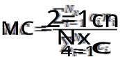
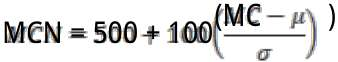
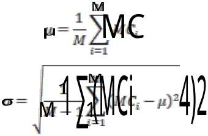
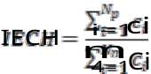
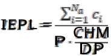
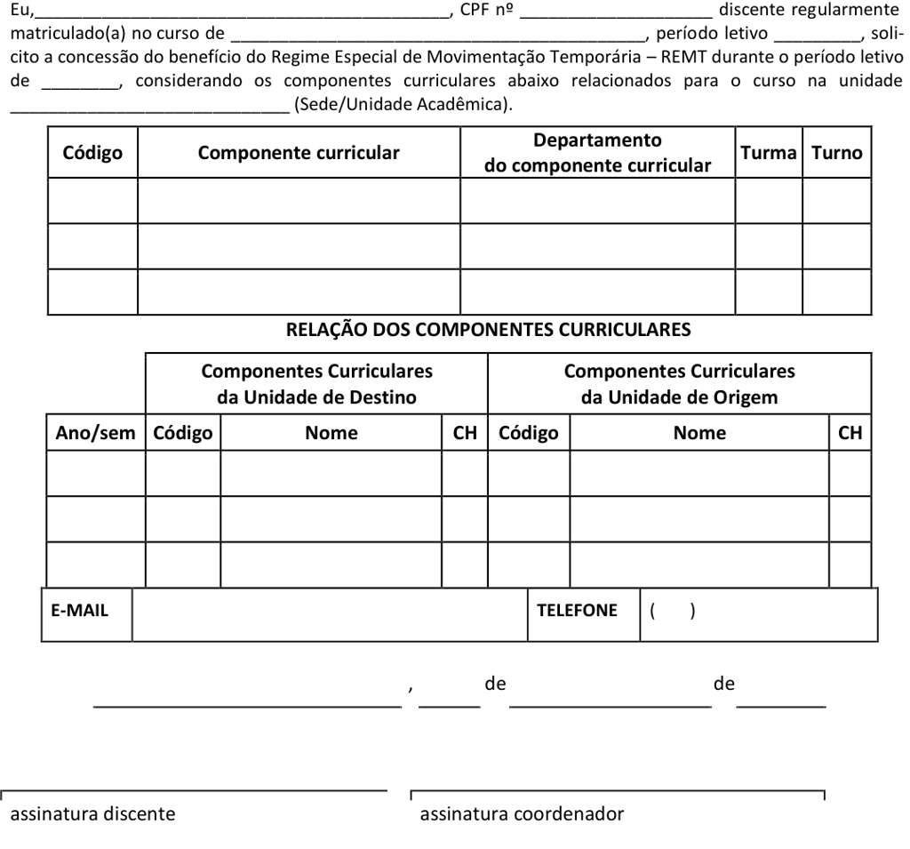
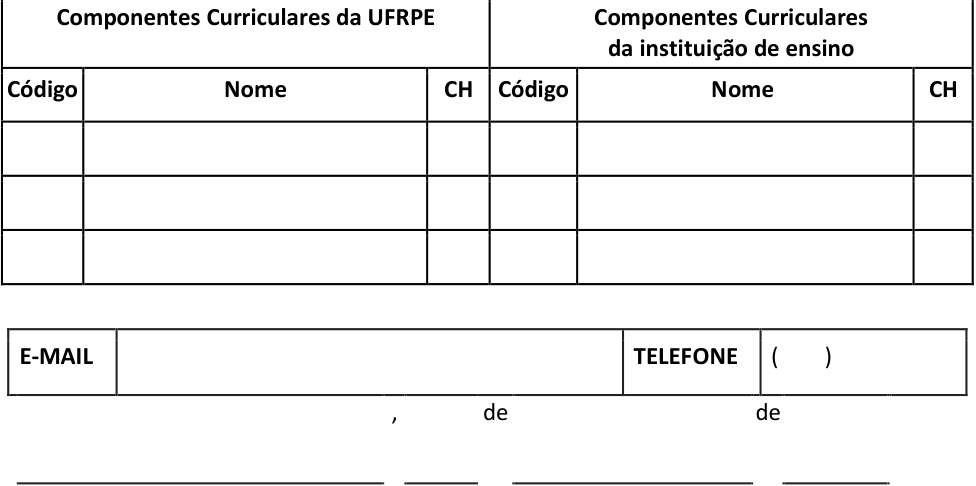
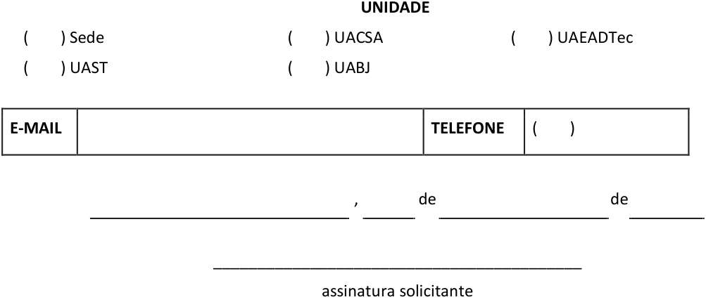
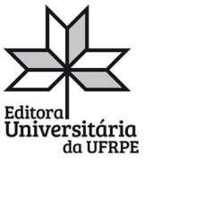

<!-- page 1 -->

UNIVERSIDADE FEDERAL RURAL EX SEMINE SEGES DE PERNAMBUCO Regulamento Geral de Graduação da Universidade Federal Rural de Pernambuco 

<!-- page 2 -->

#### **REITORIA** 

EX SEMINE SEGES 

Professora Dra. Maria José de Sena 

preg 

UFRPE 

#### **VICE-REITORIA** 

UFRPE 

Professora Dra. Maria do Socorro de Lima Oliveira 

**Pró-Reitora de Ensino de Graduação** Profª Drª Danielli Matias de Macedo Dantas 

**Coordenação Geral de Cursos de Graduação** 

Profª Drª Herica Karina Cavalcanti de Lima 

**Coordenação Geral de Estágios - CGE** Joselma Maria da Silva 

##### **Coordenação de Ações Pedagógicas e Regulação - CAPR** 

Carolina Moura Bezerra Sobral 

**Coordenação de Apoio aos Cursos de Licenciatura - CACL** Profª. Drª. Thais Ludmila da Silva Ranieri 

##### **Coordenação de Planejamento e Gestão Acadêmico -  (CPGA)** 

Camila da Conceição Papa 

**Coordenação de Acompanhamento e Monitoramento de Egressos** era Lúcia Pereira de Souza 

**Comissão de  atualização  do Regulamento Geral da Graduação** PORTARIA PREG/UFRPE Nº 009/2024, DE 15 DE JULHO DE 2024. 

Danielli Matias de Macedo Dantas - Matrícula SIAPE: 2240916 - Presidente; Hérica Karina Cavalcanti de Lima - matrícula SIAPE: 2650265 - membro; Edilma Pereira Oliveira - Matrícula SIAPE: 1241529 - membro; Eduardo de Castro Aguiar - Matrícula SIAPE: 1753889 - membro; Fernando Leandro dos Santos - Matrícula SIAPE: 384978 - membro; Flavia Cristiane Vieira da Silva - Matrícula SIAPE: 2971180 - membro; Keynis Cândido de Souto - Matrícula SIAPE: 1547429 - membro; Marcelo Batista de Lima - Matrícula SIAPE: 2241657 - membro; Marta Margarida de Andrade Lima - Matrícula SIAPE: 1551664 - membro; Maurício Pimenta Cavalcanti - Matrícula SIAPE: 1166926 - membro; Robson Wagner Albuquerque de Medeiros - Matrícula SIAPE: 1871315 - membro; Camila da Conceição Papa - Matrícula SIAPE: 1719218 - membro; Ana Cristina Martins de Lemos - Matrícula SIAPE: 0382958 - membro; Bartolomeu Mendes da Silva - SIAPE: 1159171 - membro. 

Dados Internacionais de Catalogação na Publicação (CIP) Sistema Integrado de Bibliotecas da UFRPE Biblioteca Central, Recife-PE, Brasil 

A168p Universidade Federal Rural de Pernambuco. Pró-Reitoria de Ensino de Graduação. Regulamento geral de graduação da Universidade Federal Rural de Pernambuco / Danielli Matias de Macedo Dantas .. (et al.). - Recife : EDUFRPE, 2025. 88 p.: il. ISBN: Anexos: p. 80-89. 

1. Ensino superior - Legislação 2. Orientação educacional no ensino superior 3. Universidades e faculdades – Legislação I. Universidade Federal Rural de Pernambuco – UFRPE II. Dantas, Danielli Matias de Macedo III. Título. 

CDD 378.026 

<!-- page 3 -->

## **PREFÁCIO** 

É com grande satisfação que apresentamos a atualização do **Regulamento Geral de Graduação** da **Universidade Federal Rural de Pernambuco (UFRPE)** , que visa consolidar a normatização acadêmica nos cursos de graduação da instituição. Este documento reflete o compromisso da UFRPE com a qualidade acadêmica, a inovação pedagógica e a inclusão, assegurando que os cursos de graduação, nas modalidades presencial e a distância, sejam conduzidos com transparência e alinhamento ao planejamento estratégico da graduação. 

O regulamento é uma ferramenta fundamental para o estabelecimento de normas e diretrizes que orientam a gestão acadêmica e os discentes na trajetória da graduação, estabelecendo parâmetros claros em questões como: construção e reformulação dos projetos pedagógicos dos cursos, acompanhamento pedagógico, processos de ingresso de discentes, coordenação de programas institucionais de ensino de graduação, entre outros aspectos essenciais. 

Este regulamento não apenas normatiza, mas também orienta a convivência acadêmica, buscando garantir o respeito à diversidade, a inclusão e a promoção de um ambiente de aprendizado colaborativo e inovador. Ele é fruto do esforço coletivo de docentes, discentes e técnicos(as) em educação, que contribuíram para o desenvolvimento de uma base sólida para o ensino de graduação na UFRPE, respeitando sempre os princípios da autonomia universitária e da gestão democrática. 

Que este Regulamento seja, portanto, mais do que um conjunto de regras: que ele seja um guia que acompanha estudantes, docentes e gestores na construção de um ambiente acadêmico justo, acessível, inovador e de excelência. 

**Profª Maria José de Sena** Reitora da UFRPE 

<!-- page 4 -->

### **MINISTÉRIO DA EDUCAÇÃO UNIVERSIDADE FEDERAL RURAL DE PERNAMBUCO SECRETARIA GERAL DOS CONSELHOS DA ADMINISTRAÇÃO SUPERIOR CONSELHO DE ENSINO, PESQUISA E EXTENSÃO** 

RESOLUÇÃO CEPE/UFRPE Nº 744, DE 22 DE AGOSTO DE 2024. 

Aprova atualização do Regulamento Geral de Graduação da Universidade Federal Rural de Pernambuco (UFRPE) e dá outras providências. 

A Presidente do Conselho de Ensino, Pesquisa e Extensão da Universidade Federal Rural de Pernambuco, no uso de suas atribuições e tendo em vista o disposto no Parágrafo 6º do Artigo 15 do Estatuto desta Universidade e considerando os termos da Decisão Nº 010/2024 da Câmara de Ensino de Graduação deste Conselho, em sua III Reunião Ordinária, realizada no dia 16 de agosto de 2024, exarada no Processo UFRPE Nº 23082.018708/2024-35, 

CONSIDERANDO a necessidade de consolidar a normatização acadêmica dos cursos de graduação da Universidade Federal Rural de Pernambuco (UFRPE) em um único documento normativo; 

CONSIDERANDO  a portaria MEC nº 2.117, de 6 de dezembro de 2019 que dispõe sobre a oferta de carga horária na modalidade de Ensino a Distância - EaD em cursos de graduação presenciais ofertados por Instituições de Educação Superior - IES pertencentes ao Sistema Federal de Ensino; 

CONSIDERANDO a resolução CNE/CES nº 02/2007 de 18 de junho de 2007 que dispõe sobre carga horária mínima e procedimentos relativos à integralização e duração dos cursos de graduação, bacharelados, na modalidade presencial; 

CONSIDERANDO a resolução CNE/CP nº 04/2024 de 29 de maio de 2024 que dispõe sobre as Diretrizes Curriculares Nacionais para a Formação Inicial em Nível Superior de Profissionais do Magistério da Educação Escolar Básica (cursos de licenciatura, cursos de formação pedagógica para graduados não licenciados e cursos de segunda licenciatura); 

CONSIDERANDO a resolução CNE/CES nº 07/2018 de 18 de dezembro de 2018 que estabelece as Diretrizes para a Extensão na Educação Superior Brasileira e regimenta o disposto na Meta 12.7 de Lei nº 13.005/2014, que aprova o Plano Nacional de Educação - PNE 2014 - 2024 e dá outras providências; 

CONSIDERANDO a resolução CEPE/UFRPE nº 552/2022 de 29 de maio de 2024 que dispõe sobre regulamentação da Inserção das Atividades Curriculares de Extensão (ACE) para integralização nos currículos dos Cursos de Graduação, nas modalidades presencial e a distância da Universidade Federal Rural de Pernambuco. 

### **RESOLVE** 

Confere com o original assinado pela Reitora e arquivado nesta Secretaria Geral. 

<!-- page 5 -->

Art. 1º  Aprovar, em sua área de competência, a atualização do Regulamento Geral de Graduação da Universidade Federal Rural de Pernambuco (UFRPE), conforme consta do Processo acima mencionado e de acordo com o anexo. 

Art. 2º  Este Regulamento entra em vigor no dia 22 de agosto de 2024, revogando, a partir da data desta Resolução, os seguintes documentos: 

Resoluções CEPE/UFPRE Nº 235/2017; 220/2020; 183/2018; 526/2022 e 552/2022. 

Parágrafo único. Tornar sem efeito a Resolução CEPE/UFRPE Nº 704/2024, datada de 22 de abril de 2024, que trata da alteração do referido Regulamento Geral de Graduação. 

SALA DOS CONSELHOS SUPERIORES DA UFRPE. 

**Profª Maria José de Sena** PRESIDENTE 

<!-- page 6 -->

## **SUMÁRIO** 

|**TÍTULO I - DAS DISPOSIÇÕES PRELIMINARES ......................................................................................... 8**|
|---|
|**TÍTULO II - DA EXECUÇÃO, DO REGISTRO E DO CONTROLE DAS ATIVIDADES ACADÊMICAS ................... 8**|
|**TÍTULO III - DOS CURSOS DE GRADUAÇÃO ............................................................................................ 8**|
|**CAPÍTULO I - DA CARACTERIZAÇÃO DOS CURSOS .............................................................................. 8**|
|**CAPÍTULO II - DA CRIAÇÃO E DA CLASSIFICAÇÃO DOS CURSOS .......................................................... 9**|
|**CAPÍTULO III - DO PROJETO PEDAGÓGICO ....................................................................................... 10**|
|**CAPÍTULO IV - DA GESTÃO ACADÊMICA DOS CURSOS DE GRADUAÇÃO ........................................... 14**|
|**TÍTULO IV - DOS COMPONENTES CURRICULARES ................................................................................ 18**|
|**CAPÍTULO I - DAS RELAÇÕES ENTRE COMPONENTES CURRICULARES ............................................... 20**|
|**CAPÍTULO II - DAS DISCIPLINAS, DOS MÓDULOS E DOS BLOCOS ...................................................... 22**|
|**CAPÍTULO III - DAS ATIVIDADES ACADÊMICAS ................................................................................. 23**|
|**Seção I - Das Atividades Autônomas ............................................................................................ 24**|
|**Seção II - Das Atividades de Orientação Individual ....................................................................... 25**|
|**Seção III - Das Atividades Coletivas .............................................................................................. 25**|
|**Seção IV - Do Estágio.................................................................................................................... 26**|
|**Subseção I - Das Condições de Realização do Estágio ............................................................... 27**|
|**Subseção II - Do Registro do Estágio ............................................................................................... 29**|
|**Subseção III - Das Atribuições das Partes ..................................................................................... 29**|
|**Subseção IV - Da Duração do Estágio .............................................................................................. 31**|
|**Subseção V - Do Desligamento do Estagiário ............................................................................... 31**|
|**Seção V - Do Trabalho de Conclusão de Curso ou Projeto Final de Curso ...................................... 32**|
|**Seção VI - Das Atividades Integradoras de Formação ................................................................... 32**|
|**TÍTULO V - DOS PERÍODOS LETIVOS .................................................................................................... 32**|
|**TÍTULO VI - DA AVALIAÇÃO DA APRENDIZAGEM E DA ASSIDUIDADE .................................................. 33**|
|**CAPÍTULO I - DA AVALIAÇÃO DA ASSIDUIDADE EM DISCIPLINAS E EM MÓDULOS ........................... 35**|
|**CAPÍTULO II - DA AVALIAÇÃO DA APRENDIZAGEM E DA ASSIDUIDADE EM BLOCOS ........................ 36**|
|**CAPÍTULO III - DA AVALIAÇÃO DA APRENDIZAGEM EM ATIVIDADES ACADÊMICAS .......................... 36**|
|**CAPÍTULO IV - DA AVALIAÇÃO DA ASSIDUIDADE EM ATIVIDADES ACADÊMICAS.............................. 36**|
|**TÍTULO VII - DA MENSURAÇÃO DO RENDIMENTO ACADÊMICO ACUMULADO .................................... 36**|
|**TÍTULO VIII - DAS FORMAS DE INGRESSO ............................................................................................ 37**|
|**CAPÍTULO I - FORMAS PRINCIPAIS DE INGRESSO ............................................................................. 38**|
|**CAPÍTULO II - DA REOCUPAÇÃO DE VAGAS ...................................................................................... 38**|
|**CAPÍTULO III - DA REINTEGRAÇÃO PARA EFEITO DE CONCLUSÃO DE CURSO.................................... 39**|

<!-- page 7 -->

|**CAPÍTULO IV - DA TRANSFERÊNCIA COMPULSÓRIA ......................................................................... 40**|
|---|
|**TÍTULO IX - DOS ALUNOS ESPECIAIS DE GRADUAÇÃO ......................................................................... 41**|
|**CAPÍTULO I - DO ALUNO ESPECIAL ORDINÁRIO ................................................................................ 42**|
|**CAPÍTULO II - DO ALUNO ESPECIAL EM MOBILIDADE ....................................................................... 43**|
|**Seção I - Da Mobilidade Internacional .......................................................................................... 44**|
|**Seção II - Da Mobilidade Nacional ................................................................................................ 45**|
|**CAPÍTULO III - DO ALUNO ESPECIAL EM COMPLEMENTAÇÃO DE ESTUDOS ...................................... 46**|
|**CAPÍTULO IV - DO REGIME ESPECIAL DE MOVIMENTAÇÃO TEMPORÁRIA ........................................ 47**|
|**TÍTULO X - DA PERMISSÃO PARA CURSAR COMPONENTES CURRICULARES EM MOBILIDADE .............. 48**|
|**TÍTULO XI - DOS PROCEDIMENTOS ACADÊMICOS ................................................................................ 48**|
|**CAPÍTULO I - DO CADASTRAMENTO E DA CONFIRMAÇÃO DE VÍNCULO ........................................... 48**|
|**CAPÍTULO II - DO PROGRAMA ......................................................................................................... 48**|
|**CAPÍTULO III - DA DETERMINAÇÃO DO PERFIL INICIAL ..................................................................... 48**|
|**CAPÍTULO IV - DA CRIAÇÃO DE TURMAS.......................................................................................... 49**|
|**CAPÍTULO V - DA MATRÍCULA.......................................................................................................... 49**|
|**CAPÍTULO VI - DO PREENCHIMENTO DE VAGAS NAS TURMAS ......................................................... 50**|
|**CAPÍTULO VII - DO AJUSTE DE TURMAS ........................................................................................... 51**|
|**CAPÍTULO VIII - DO PROCESSAMENTO ............................................................................................. 51**|
|**CAPÍTULO IX - DA REMATRÍCULA ..................................................................................................... 51**|
|**CAPÍTULO X - DA MATRÍCULA EXTRAORDINÁRIA............................................................................. 51**|
|**CAPÍTULO XI - DO TRANCAMENTO DE MATRÍCULA EM COMPONENTE CURRICULAR ....................... 52**|
|**CAPÍTULO XII - DO CANCELAMENTO DE MATRÍCULA ....................................................................... 52**|
|**CAPÍTULO XIII - DA SUSPENSÃO DE PROGRAMA .............................................................................. 52**|
|**CAPÍTULO XIV - DA CONSOLIDAÇÃO DE TURMAS ............................................................................ 54**|
|**CAPÍTULO XV - DA MATRÍCULA E DA CONSOLIDAÇÃO DAS ATIVIDADES ACADÊMICAS .................... 54**|
|**CAPÍTULO XVI - DA MATRÍCULA NOS PERÍODOS LETIVOS ESPECIAIS DE FÉRIAS ............................... 55**|
|**CAPÍTULO XVII - DA COLAÇÃO DE GRAU .......................................................................................... 55**|
|**Seção I - Da Colação de Grau Unificada ........................................................................................ 55**|
|**Seção II - Da Colação de Grau Antecipada .................................................................................... 56**|
|**Seção III - Da Láurea Acadêmica ................................................................................................... 56**|
|**TÍTULO XII - DAS SITUAÇÕES ESPECIAIS ............................................................................................... 56**|
|**CAPÍTULO I - DO TRATAMENTO EXCEPCIONAL DE FALTAS ............................................................... 56**|
|**CAPÍTULO II - DO APROVEITAMENTO DE ESTUDOS .......................................................................... 58**|
|**CAPÍTULO III - DA INCORPORAÇÃO DE ESTUDO ............................................................................... 59**|

<!-- page 8 -->

|**CAPÍTULO IV - DO EXAME DE SUFICIÊNCIA ...................................................................................... 59**|
|---|
|**CAPÍTULO V - DA ABREVIAÇÃO DE CURSO ....................................................................................... 60**|
|**CAPÍTULO VI - DA EQUIVALÊNCIA EXCEPCIONAL ............................................................................. 62**|
|**CAPÍTULO VII - DA RENOVAÇÃO DE PROGRAMA ............................................................................. 63**|
|**CAPÍTULO VIII - DA MUDANÇA DE TURNO ....................................................................................... 64**|
|**CAPÍTULO IX - DA MUDANÇA DE POLO ............................................................................................ 64**|
|**CAPÍTULO X - DA RETIFICAÇÃO DE REGISTROS DE NOTA .................................................................. 65**|
|**CAPÍTULO XI - DO REGIME DE OBSERVAÇÃO DO DESEMPENHO ACADÊMICO .................................. 65**|
|**CAPÍTULO XII - DO CANCELAMENTO DE PROGRAMA ....................................................................... 66**|
|**Seção I - Do Abandono de Curso .................................................................................................. 66**|
|**Seção II - Do Decurso de Prazo Máximo ....................................................................................... 67**|
|**Seção III - Do Desempenho Acadêmico Insuficiente ..................................................................... 67**|
|**Seção IV - Das Outras Formas de Cancelamento de Programa ...................................................... 68**|
|**CAPÍTULO XIII - DOS DISCENTES COM NECESSIDADES EDUCACIONAIS ESPECIAIS ............................. 68**|
|**TÍTULO XIII - DOS DOCUMENTOS E REGISTROS OFICIAIS ..................................................................... 69**|
|**CAPÍTULO I - DOS DOCUMENTOS EXPEDIDOS .................................................................................. 69**|
|**CAPÍTULO II - DOS DOCUMENTOS DE REGISTRO .............................................................................. 70**|
|**CAPÍTULO III - DO NOME SOCIAL ..................................................................................................... 71**|
|**CAPÍTULO IV - DA GUARDA DE DOCUMENTOS................................................................................. 71**|
|**TÍTULO XIV - DOS PROGRAMAS DA PREG ............................................................................................ 72**|
|**CAPÍTULO I - DA MONITORIA .......................................................................................................... 72**|
|**CAPÍTULO II - DA TUTORIA DISCENTE............................................................................................... 74**|
|**CAPÍTULO III - DAS PRÁTICAS DE VIVÊNCIAS INTERDISCIPLINARES ................................................... 77**|
|**CAPÍTULO IV - DO PROGRAMA DE ATIVIDADES INTERDISCIPLINARES .............................................. 78**|
|**TÍTULO XV - DAS DISPOSIÇÕES FINAIS E TRANSITÓRIAS ...................................................................... 78**|
|**ANEXO I - DISTRIBUIÇÃO SEMANAL DOS HORÁRIOS DE AULAS ........................................................... 80**|
|**ANEXO II - CÁLCULO DOS INDICADORES DE RENDIMENTO ACADÊMICO ACUMULADO ....................... 81**|
|**ANEXO III - REQUERIMENTO DE TRANSFERÊNCIA COMPULSÓRIA ....................................................... 83**|
|**ANEXO IV - REQUERIMENTO PARA REGIME ESPECIAL DE MOVIMENTAÇÃO TEMPORÁRIA ................. 84**|
|**ANEXO V - REQUERIMENTO PARA CURSAR COMPONENTES CURRICULARES EM MOBILIDADE ............ 85**|
|**ANEXO VI - REQUERIMENTO PARA SOLICITAÇÃO DE GRAU ANTECIPADA ........................................... 86** **ANEXO VII - GLOSSÁRIO ...................................................................................................................... 87**|

<!-- page 9 -->

### **ATUALIZAÇÃO DO REGULAMENTO GERAL DA GRADUAÇÃO** 

### **TÍTULO I** 

### **DAS DISPOSIÇÕES PRELIMINARES** 

Art. 1º  O Regulamento Geral de Graduação da Universidade Federal Rural de Pernambuco (UFRPE) tem por objetivo consolidar a normatização acadêmica dos cursos de graduação nas modalidades presencial e a distância. 

### **TÍTULO II** 

### **DA EXECUÇÃO, DO REGISTRO E DO CONTROLE DAS ATIVIDADES ACADÊMICAS** 

Art. 2º  As atividades de execução, de registro e de controle das atividades acadêmicas são de responsabilidade dos Departamentos/Unidades Acadêmicas, das Coordenações de Curso, dos(as) Docentes, do Departamento de Controle e Registro Acadêmico (DRCA) e da Pró-Reitoria de Ensino de Graduação (PREG). 

Art. 3º  As rotinas administrativas, os formulários e os relatórios relacionados com a operacionalização das atividades acadêmicas dos cursos de graduação da UFRPE serão processados pelo(s) sistema(s) de gestão acadêmica em uso. 

Parágrafo único.  Compete à Secretaria de Tecnologias Digitais (STD) da UFRPE, sob a supervisão da PREG e em consonância com o DRCA, o suporte ao uso do sistema referido no caput deste artigo. 

### **TÍTULO III** 

### **DOS CURSOS DE GRADUAÇÃO** 

### **CAPÍTULO I DA CARACTERIZAÇÃO DOS CURSOS** 

Art. 4º  A caracterização de um curso de graduação compreende nome, unidades de vinculação (SEDE ou Unidades Acadêmicas), município sede, modalidade e grau concedido. 

Art. 5º  A UFRPE oferece cursos de graduação nas modalidades presencial e a distância com a utilização de metodologias e estratégias didático-pedagógicas diversas, planejadas de forma a garantir a articulação entre a teoria e a prática em atividades de ensino, pesquisa e extensão. 

§ 1º  Cursos presenciais são realizados a partir de processos de ensino-aprendizagem realizados de forma presencial e compostos majoritariamente por atividades desenvolvidas nos ambientes físicos da UFRPE. 

§ 2º  Cursos a distância são caracterizados por processos de ensino-aprendizagem realizados em Ambiente Virtual de Aprendizagem (AVA) com a utilização de dispositivos e ferramentas de Tecnologia Digital da Informação e Comunicação (TDIC) com discentes e docentes desenvolvendo atividades, majoritariamente, em lugares e em tempos diversos. 

Art. 6º  Quanto ao grau acadêmico, os cursos superiores podem ser de bacharelado, de licenciatura ou de tecnologia. 

§ 1º  O bacharelado é um curso superior de caráter generalista, de formação científica e humanística, que confere ao diplomado competências em determinado campo do saber para o exercício de atividade profissional, acadêmica ou cultural, concedendo o grau de bacharel ou, quando houver legislação específica que assim o determine, o título específico relacionado à formação. 

8 

<!-- page 10 -->

§ 2º  A licenciatura é um curso superior de formação inicial de professores para a atuação na educação básica com o grau de licenciado, cujo exercício profissional inclui o ensino e a gestão educacional, os processos educativos escolares e não escolares, a produção e difusão do conhecimento científico, tecnológico e educacional. 

§ 3º  Os cursos superiores de tecnologia dão formação especializada em áreas científicas e tecnológicas, que conferem ao diplomado competências para atuar em áreas profissionais específicas, caracterizadas por eixos tecnológicos, com o grau de tecnólogo. 

### **CAPÍTULO II** 

### **DA CRIAÇÃO E DA CLASSIFICAÇÃO DOS CURSOS** 

Art. 7º  A decisão de criação de um novo curso de graduação é da Reitoria da UFRPE, por iniciativa própria ou por solicitação, que deve encaminhar o processo à PREG, a fim de que seja constituída uma comissão para a elaboração do Projeto Pedagógico do Curso (PPC) e posterior aprovação nos conselhos superiores da UFRPE. 

§ 1º  Compete à Reitoria: 

I - avaliar a solicitação de criação de novos cursos; 

II - encaminhar à PREG o processo de criação de novos cursos; 

III - analisar o processo com PPC elaborado encaminhado pela PREG; e 

IV - enviar o processo para apreciação nos conselhos superiores. 

§ 2º  Compete à PREG: 

I - criar a comissão para a elaboração do PPC; 

II - prestar assessoramento didático-pedagógico durante a elaboração do projeto de criação do curso; 

III - emitir parecer quanto à sua criação; 

IV - devolver o processo à Reitoria com o PPC proposto; e 

V - receber o processo aprovado pelos conselhos superiores para inclusão no e-MEC e no sistema de gestão acadêmica em uso. 

§ 3º  Compete aos conselhos superiores, a saber, Conselho de Ensino, Pesquisa e Extensão (CEPE) e Conselho Universitário (CONSU): 

I - emitir a decisão final sobre a criação do curso; e 

II - encaminhar o processo aos setores competentes para vinculação do novo curso à estrutura organizacional e pedagógica da UFRPE. 

§ 4º  Após a consolidação do processo de criação de um novo curso e de sua oferta, o curso será considerado ativo. 

Art.  8º Os cursos criados pela UFRPE podem ser classificados como ativo, suspenso, inativo ou extinto. 

§ 1º  Curso ativo é aquele em funcionamento regular, que tenha ofertado vagas iniciais de ingresso em algum dos últimos dois anos, exceto para EAD. 

§ 2º  Curso suspenso é aquele que não tenha disponibilizado vagas iniciais nos dois últimos anos, mantendo obrigatoriamente atividades acadêmicas que propiciem a conclusão para o(a/os/as) discente(s) ativo(a/os/as) ), exceto para EAD. 

9 

<!-- page 11 -->

§ 3º  Curso inativo é aquele que deixou de ofertar vagas iniciais e não possui discente(s) ativo(s)/a(s) no período letivo de referência, mas pode ser reativado a qualquer momento, a critério da instituição. 

§ 4º  Curso extinto é aquele que não oferece novas vagas para qualquer processo seletivo, não possui discente(s) ativo(s)/a(s) e não será reativado. 

Art. 9º.  Os cursos de graduação da UFRPE devem ter oferta mínima de 40 (quarenta) vagas semestrais para o ingresso de discentes. 

Parágrafo único.  A oferta mínima de vagas pode ser flexibilizada, observando a infraestrutura necessária para a organização pedagógica e curricular do curso, bem como a legislação vigente. 

Art. 10.  Os cursos de graduação presenciais funcionam nos turnos matutino, vespertino, noturno ou integral, conforme previsto no seu PPC. 

Parágrafo único.  Não se aplica a definição de turnos aos cursos oferecidos na modalidade a distância. 

### **CAPÍTULO III DO PROJETO PEDAGÓGICO** 

Art. 11.  O Projeto Pedagógico de Curso (PPC) é o instrumento de gestão de natureza acadêmica, com dimensões sociopolíticas, que reflete as concepções pedagógicas e formativas, com base nas Diretrizes Curriculares Nacionais (DCN) e demais normativas, internas e externas à UFRPE, orientando o currículo para o perfil do egresso e profissional desejado, além das estratégias para o ensino, a aprendizagem e a avaliação. 

§1° A atualização da proposta do Projeto Pedagógico do Curso é de responsabilidade do Núcleo Docente Estruturante (NDE), aprovada pelo Colegiado de Coordenação Didática do Curso (CCD) de Graduação, que deverá ser supervisionado pela Pró-Reitoria de Ensino de Graduação e aprovado pela Câmara de Ensino de Graduação do Conselho de Ensino, Pesquisa e Extensão – CEPE. 

§2° A elaboração de um novo Projeto Pedagógico de Curso, vinculado à criação de um novo curso de graduação, é de responsabilidade da comissão de elaboração do projeto pedagógico, que deverá ser supervisionado pela Pró-Reitoria de Ensino de Graduação e aprovado pela Câmara de Ensino de Graduação do Conselho de Ensino, Pesquisa e Extensão – CEPE, bem como pelo Conselho Universitário - CONSU e demais instâncias da Universidade. 

§3° Para novos cursos, será designada pela Pró-Reitoria de Ensino de Graduação (PREG) uma comissão para elaboração do Projeto Pedagógico. 

§4° Em se tratando de novos cursos, deverá constar no campo “justificativa de oferta do curso”, no PPC, um diagnóstico fundamentado com a pertinência e relevância da oferta do curso e a justificativa em relação às demandas sociais, de mercado de trabalho e institucionais para o curso, incluindo dados estatísticos, socioeconômicos, ofertas similares por outras IES e as demandas que justificam a oferta do curso. 

§5° Para além dos aspectos pontuados no Art. 11, parágrafo 3º, o curso deverá apresentar uma estimativa da demanda didática acrescida à carga horária docente, a quantidade de docentes prevista para o curso, a infraestrutura e os laboratórios didáticos necessários. 

Art. 12.  A elaboração ou atualização do Projeto Pedagógico do Curso de Graduação deve obser- 

var: 

I - as Diretrizes Curriculares Nacionais para o curso; 

10 

<!-- page 12 -->

II- os instrumentos de avaliação externa da educação superior; 

III- as legislações das entidades de classe e outros órgãos reguladores; 

IV- os marcos regulatórios da UFRPE; 

V- os mecanismos de autoavaliação institucional e do curso; 

VI- a infraestrutura da UFRPE; 

VII- a demanda didática relacionada à carga horária docente; 

VIII- as especificidades relacionadas à carga horária de educação a distância em cursos presenciais, quando for o caso; e 

IX- a curricularização da extensão. 

Parágrafo único.  Os PPC dos cursos da Unidade de Educação a Distância e Tecnologia devem apresentar, além dos itens I a IX, elementos que caracterizam suas especificidades, como por exemplo: 

- (i) apresentação e/ou histórico dos polos UAB; 

- (ii) infraestrutura dos polos; 

(iii); composição do corpo docente por professores e tutores bolsistas CAPES; 

- (iv) equipe multidisciplinar; 

- (v) equipe de gestão do curso; 

- (vi) usos de plataformas virtuais de aprendizagem 

Art. 13.  O Projeto Pedagógico dos Cursos de Graduação deve possuir elementos pré-textuais e textuais, contendo os dados gerais do curso e a informação sobre a organização estrutural, conforme modelo disponibilizado pela PREG. 

Art. 14.  O perfil profissional do(a) egresso(a) deve estar de acordo com as DCN (quando houver), proporcionando aos/às discentes, durante toda a sua formação, o desenvolvimento de competências tanto gerais quanto específicas de acordo com as áreas de atuação do curso. Tais competências devem ser definidas a partir das necessidades locais e regionais, considerando as demandas apresentadas pelo mundo do trabalho. 

Art. 15.  A distribuição dos conteúdos deve estar alinhada com o perfil do(a) egresso(a) e com as respectivas competências estabelecidas no Projeto Pedagógico, considerando a flexibilidade, a interdisciplinaridade, a transdisciplinaridade em relação aos conteúdos de Educação em Direitos Humanos, Educação das Relações Étnico-Raciais e Educação Ambiental, bem como a acessibilidade metodológica, a articulação entre teoria e prática durante todo o percurso de formação, apresentando elementos comprovadamente inovadores. 

Art. 16.  Os objetivos do curso devem estar alinhados à definição do perfil do(a) egresso(a), indicando os perfis formativos adequados à estrutura curricular. 

Art. 17.  As estruturas curriculares serão construídas de modo a: 

I - funcionar como um fluxo articulado de aquisição de saberes, em um período delimitado de tempo, tendo como base a flexibilidade, a diversidade e o dinamismo do conhecimento, da ciência e da prática profissional; 

II - oferecer ao/à discente orientação e flexibilidade para definir seu percurso formativo; 

III - oferecer condições de acesso simultâneo a conhecimentos, a habilidades específicas na sua área profissional; e 

11 

<!-- page 13 -->

IV - possibilitar o aproveitamento de variadas atividades acadêmicas para fins de integralização da carga horária. 

Art. 18.  Os componentes curriculares, relativos à estrutura curricular, podem ser: 

I - obrigatórios, quando o seu cumprimento é indispensável à integralização curricular; 

II - optativos, quando integram a respectiva estrutura curricular, devendo ser cumpridos pelo(a) discente mediante escolha, a partir de um conjunto de opções, e totalizando uma carga horária mínima para integralização curricular estabelecida no projeto pedagógico do curso; 

III - eletivos, quando não integram a estrutura curricular; ou 

IV - complementares, quando visam ao enriquecimento do processo de ensino-aprendizagem, promovendo o relacionamento do(a) discente com a ética, a realidade social, econômica, cultural e profissional e a iniciação ao ensino, à pesquisa e à extensão. 

Art. 19.  Os componentes curriculares obrigatórios devem contemplar os conteúdos básicos, os específicos e os profissionais, quando estabelecidos nas DCN. 

§ 1º  Os componentes curriculares obrigatórios podem correlacionar de forma inter, multi e transdisciplinar os conteúdos básicos, específicos e profissionais. 

§ 2º  Os componentes curriculares obrigatórios, excluídos o Estágio Supervisionado Obrigatório (ESO) e atividades autônomas, deverão compreender, no mínimo, 50% (cinquenta por cento) da carga horária total do curso. 

§ 3º  Os conteúdos programáticos associados à Metodologia Científica são obrigatórios e transversais para todos os cursos de modo a possibilitar ao/à discente a formação e o instrumental necessário ao seu desenvolvimento acadêmico. 

§ 4º  Os temas “Educação Ambiental” e “Direitos Humanos” são obrigatórios para as Licenciaturas, Bacharelados e Tecnólogos,  abordados de modo transversal e interdisciplinar. 

§ 5º  Nos cursos de Licenciatura é obrigatório: 

I - como componentes curriculares: 

a) Educação das Relações Étnicos Raciais; 

b) Libras; 

c) Produção de Texto Acadêmico; 

d) Fundamentos da Educação 

e) Educação Brasileira: legislação, organização e políticas 

f)  Didática 

g) Psicologia I 

h) Psicologia II 

i) Metodologia de ensino (conteúdo específico) 

j) ESO 

II - como componentes curriculares ou temas transversais: 

a) diversidade de gênero e sexualidade; 

b) diversidade religiosa; 

12 

<!-- page 14 -->

c) diversidade de faixa geracional; 

d) educação inclusiva; 

e) direitos educacionais de adolescentes e jovens em cumprimento de medidas socioeducativas e gestão educacional; e 

III - Prática como Componente Curricular (PCC) integrada ao perfil curricular, durante todo o cur- 

so. 

Art. 20.  Os componentes curriculares optativos são constituídos por áreas de aprofundamento e de livre escolha do(a) discente e devem: 

I - corresponder a, no mínimo, 5% (cinco por cento) e no máximo 35% (trinta e cinco por cento) da carga horária total do curso; 

II - garantir a flexibilidade curricular; e 

III - possibilitar a construção de perfis formativos variados. 

Art. 21.  Os componentes curriculares “Libras” e “Educação das Relações Étnico-Raciais” devem fazer parte do conjunto de optativas dos cursos de Bacharelado e Tecnólogo. 

Art. 22.  Os componentes curriculares eletivos podem ser cursados e contabilizados como carga horária optativa até o limite máximo fixado no PPC, não podendo esse limite ser inferior a 60 (sessenta) horas. 

Art. 23.  As atividades autônomas integram a carga horária total do curso e são realizadas pelos(as) discentes na forma de atividades autônomas (atividades não obrigatórias profissionais, tecnológicas, incluindo Estágio Não Obrigatório (ENO) e participação em empresa júnior, produção técnica, científica ou artística, participação em evento ou seminário técnico, científico, artístico e/ou esportivo; ou outras atividades estabelecidas pelo projeto pedagógico do curso). 

§ 1º A normatização das atividades autônomas deve estar descrita no projeto pedagógico do curso e seguir as orientações das DCN. 

§ 2º A carga horária total das atividades autônomas, definida no Projeto Pedagógico de Curso, pode ser fracionada de acordo com sua natureza. 

§ 3º Os componentes curriculares específicos, módulo ou bloco e atividades do tipo trabalho de conclusão de curso ou Estágio Supervisionado Obrigatório não podem ser incluídos na contabilização da carga horária complementar. 

§ 4º Nos cursos de Licenciatura, a parcela de carga horária prevista para atividades autônomas deverá alcançar, no mínimo, 120h. 

§ 5º A carga horária das atividades que forem utilizadas na contabilização das atividades autônomas não deverá ser considerada para equiparação de Estágio Supervisionado Obrigatório. 

Art. 24.  A matriz curricular de cada curso deverá demonstrar a distribuição das atividades acadêmicas curriculares obrigatórias e optativas com suas respectivas cargas horárias por períodos letivos, além de explicitar a carga horária, em atividades autônomas a ser cumprida. 

Parágrafo único.  A matriz curricular deve apresentar a carga horária total do curso, a partir do somatório de toda a organização curricular. 

Art. 25.  Na organização curricular dos cursos de graduação em modalidade presencial, poderão ser ofertados componentes curriculares a distância, integral ou parcialmente, desde que esta oferta não 

13 

<!-- page 15 -->

ultrapasse 40% (quarenta por cento) da carga horária total do curso e cumpra com os critérios estabelecidos nos marcos legais. 

Parágrafo único.  O disposto no caput não se aplica ao curso de Medicina Veterinária, conforme legislação em vigor. 

Art. 26.  Os cursos de graduação presenciais com oferta de carga horária a distância (parcial ou integral) deverão prever, no PPC e no Plano de Ensino do componente curricular, as estratégias e práticas de ensino-aprendizagem mediadas pelas TDIC, bem como o uso do ambiente virtual institucional, produção de material didático específico, equipe multidisciplinar, tutoria e experiência do corpo docente em Educação a Distância para alcançar os objetivos pedagógicos e atender ao Instrumento de Avaliação dos Cursos de Graduação e o Referencial de Qualidade da Educação a Distância. 

Art. 27.  Para efeito do estabelecimento da carga horária mínima do Curso, deve ser observado o disposto nas Diretrizes Curriculares Nacionais correspondentes. 

<mark>Art. 28.  A</mark> carga horária total do curso deve contemplar um mínimo de 10% (dez por cento) de carga horária extensionista, obedecendo o disposto nas normativas vigentes. 

Art. 29.  O período máximo para integralização da estrutura curricular dos cursos de Graduação não excederá 70% (setenta por cento) além do prazo para conclusão do curso, conforme previsto no perfil curricular ao qual o(a) discente encontra-se vinculado. 

### **CAPÍTULO IV DA GESTÃO ACADÊMICA DOS CURSOS DE GRADUAÇÃO** 

Art. 30.  A gestão acadêmica dos cursos de graduação é de responsabilidade da PREG, das Coordenações Gerais dos Cursos de Graduação e das Coordenações de Curso. 

§ 1º  Compete à PREG: 

I - responder institucionalmente pelas questões relacionadas à graduação nos conselhos superiores, em entidades representativas e em órgãos do Ministério da Educação (MEC), principalmente no que diz respeito ao cadastro de cursos, às normas da graduação, ao controle acadêmico, aos processos seletivos, à regulação, à supervisão e à avaliação dos cursos de graduação; 

II - agregar os Cursos de Graduação da UFRPE; 

III - orientar a construção e a reformulação dos Projetos Pedagógicos dos Cursos de Graduação e submetê-los à Câmara de Ensino de Graduação do Conselho de Ensino Pesquisa e Extensão (CEPE); 

IV - elaborar as propostas de criação, de reformulação e de extinção de cursos de graduação e submetê-las à Câmara de Ensino de Graduação; 

V - estabelecer critérios de seleção para preenchimento de vagas existentes nos cursos; 

VI - coordenar os programas acadêmicos de graduação; 

VII - elaborar editais relativos aos programas acadêmicos destinados à graduação, envolvendo docentes e discentes dos curso, e publicá-los; 

VIII - orientar e esclarecer a comunidade interna e externa sobre aspectos relacionados à graduação; 

IX - realizar o planejamento de ensino de graduação no que concerne à execução dos períodos letivos; e 

X - emitir portarias que sejam da esfera de competência da PREG. 

14 

<!-- page 16 -->

§ 2º  Compete à Coordenação Geral dos Cursos de Graduação (CGCG), da SEDE e das Unidades Acadêmicas, sendo atribuição do(a) coordenador(a): 

I - auxiliar o(a) Pró-Reitor(a) na coordenação e supervisão das atividades de Ensino de Graduação; 

II - superintender as Coordenações dos Cursos de Graduação e apoiá-las; 

III - promover o acompanhamento pedagógico do processo acadêmico através da análise dos cursos, da avaliação de disciplinas e da atualização de currículos; 

IV - coordenar Programas Institucionais de ensino de graduação e assessorá-los; 

V - atender o corpo discente, docente e a comunidade externa sobre aspectos relacionados à graduação e orientá-lo; 

VI - participar das reuniões da Câmara de Ensino de Graduação e do Conselho de Ensino Pesquisa e Extensão (CEPE); 

VII - no caso dos(a)s coordenadore(a)s gerais das Unidades Acadêmicas, convocar e presidir as reuniões do Colegiado Geral de Coordenação Didática (CGCD); e 

<mark>VIII - no caso dos(as) coordenadores(as) gerais das Unidades Acadêmicas, acompanhar os procedimentos de matrícula a cada período letivo.</mark> 

§ 3º  Compete à Coordenação de Curso, sendo atribuição do(a) coordenador(a): 

I - supervisionar o funcionamento e zelar pela qualidade do curso; 

II - acompanhar as atividades de matrícula, ingresso extra, de estágio e de trabalho de conclusão de curso; 

III - avaliar as atividades autônomas desenvolvidas pelo(a)s discentes, assessorada por uma comissão caso julgue necessário, e validá-las; 

IV - avaliar o aproveitamento de componentes curriculares solicitado pelo(a)s discentes, a partir de, caso necessário, parecer emitido por docentes com conhecimento específico nas áreas dos componentes curriculares em questão, e validá-los; 

V - <mark>participar das reuniões da Câmara de Ensino de Graduação e do Conselho de Ensino Pesquisa e Extensão (CEPE);</mark> 

VI - atender o corpo discente, docente e a comunidade externa sobre aspectos relacionados ao curso, bem como orientá-lo; 

VII - convocar as reuniões do Colegiado de Coordenação Didática (CCD), e dos órgãos consultivos do curso, Núcleo Docente Estruturante (NDE) e Comissão de Orientação e Acompanhamento Acadêmico (COAA) e presidi-las; e 

VIII - representar o CCD junto ao CGCD da Unidade Acadêmica. 

<mark>Art. 31.  O Colegiado de Coordenação Didática (CCD) é o órgão deliberativo da coordenação de curso, tendo por atribuições:</mark> 

<mark>I - avaliar as atualizações e reformulações do PPC elaboradas pelo NDE;</mark> 

<mark>II - promover, através de propostas elaboradas em conjunto com o NDE, a melhoria contínua do curso;</mark> 

<mark>III - estudar e analisar, em cada período letivo, os planos de curso dos componentes curriculares ofertados, sugerindo as modificações julgadas necessárias;</mark> 

15 

<!-- page 17 -->

<mark>IV -  exercer as demais funções que lhe são deferidas em lei definida no Estatuto e Regimento da UFRPE; e</mark> 

<mark>V - deliberar sobre os casos omissos na esfera de sua competência.</mark> 

<mark>Art. 32.  N</mark> as Unidades Acadêmicas, o CCD é composto pelo(a) coordenador(a) (presidente), pelo(a) substituto eventual (vice-presidente), docentes dos primeiros quatro períodos do curso (quatro representantes) e do quinto ao último período do curso (cinco representantes), que ministram componentes curriculares no curso e por representante(s) do corpo discente de graduação. 

Parágrafo único. Os critérios para composição do CCD poderão ser flexibilizados conforme disponibilidade do corpo docente dos cursos, mantendo a proporcionalidade indicada no Caput. 

<mark>Art. 33.  N</mark> a Sede, o CCD é composto pelo coordenador(a) (presidente), pelo(a) substituto eventual (vice-presidente), por um ou mais docentes de cada Departamento que participa do Curso e por representante(s) do corpo discente de graduação e de pós-graduação, escolhidos na forma da legislação vigente. 

Parágrafo único. Os Departamentos responsáveis por mais de 5 (cinco) componentes curriculares obrigatórios em um Curso da Graduação têm maior representação no Colegiado correspondente, de acordo com normas constantes do Regimento Geral. 

<mark>Art. 34.  Nas Unidades Acadêmicas, a gestão dos cursos é compartilhada com o Colegiado Geral de Coordenação Didática da Unidade Acadêmica (CGCD), sendo suas atribuições:</mark> 

<mark>I - avaliar modificações no PPC elaboradas pelo curso e encaminhá-las à PREG;</mark> 

<mark>II - promover a melhoria contínua do(s) curso(s) através de propostas elaboradas em conjunto com a(s) Coordenação(ões) de Curso(s), devidamente justificadas, ao Conselho de Ensino, Pesquisa e Extensão;</mark> 

<mark>III - estudar e analisar, em cada período letivo, os planos de curso dos componentes curriculares ofertados, sugerindo as modificações julgadas necessárias;</mark> 

<mark>IV - coordenar o processo eletivo para composição da lista tríplice para Coordenador(a) de Curso de Graduação e seu substituto eventual;</mark> 

<mark>V - estabelecer a distribuição das tarefas de ensino (aulas, atendimento aos discentes e preparação de aulas), pesquisa, extensão e outros, entre os docentes que integram a Unidade Acadêmica, conciliando, dentro do possível os interesses da Unidade com as preocupações científico-culturais dominantes dos referidos docentes;</mark> 

<mark>VI - exercer as demais funções que lhe são deferidas em lei, no Estatuto da UFRPE e no Regimento da Unidade Acadêmica; e</mark> 

<mark>VII - deliberar sobre os casos omissos na esfera de sua competência.</mark> 

Art. 35.  O Núcleo Docente Estruturante (NDE) é um órgão consultivo constituído por no mínimo 5 (cinco) e no máximo 10 (dez) docentes com atuação no curso e tem como atribuições: 

I - propor atualizações no Projeto Pedagógico do Curso (PPC); 

II - conduzir trabalhos de reestruturação curricular para aprovação no colegiado competente sempre que necessário; 

III - zelar pela integração curricular entre os diferentes componentes curriculares e as atividades de ensino contempladas no PPC; 

IV - zelar pelo cumprimentos das Diretrizes Curriculares Nacionais (DCN); 

16 

<!-- page 18 -->

V - indicar formas de incentivo ao desenvolvimento de linhas de pesquisa e extensão, oriundas de necessidades da graduação, de exigências do mercado de trabalho e afinadas com as políticas públicas relativas à área de conhecimento do curso; e 

VI - acompanhar sistematicamente o desempenho do curso considerando os indicadores de qualidade da graduação. 

Art. 36.  O NDE terá em sua composição: 

I - o(a) coordenador(a) do curso como presidente; 

II - apenas docentes efetivos com titulação **stricto sensu** ; 

III - mínimo de 25% (vinte e cinco por cento) de membros com Doutorado; e 

IV - mínimo de 60% (sessenta por cento) de docentes com dedicação exclusiva. 

Art. 37.  Cabe à presidência do NDE encaminhar as discussões e recomendações do NDE aos órgãos colegiados competentes. 

Art. 38.  Os membros do NDE serão indicados pelo Colegiado de Coordenação Didática (CCD) do curso. 

§ 1º  Os membros do NDE têm mandato de dois anos. 

§ 2º  A renovação dos membros do NDE deve ser, quando possível, parcial, de forma que parte de seus membros sejam reconduzidos a um novo mandato, garantindo sua continuidade de atuação. 

Art. 39.  A Comissão de Orientação e Acompanhamento Acadêmico (COAA) é um órgão consultivo constituído por no mínimo 3 (três) e no máximo 6 (seis) docentes com atuação no curso e 1 (um) discente do curso. 

§ 1º  A COAA tem por finalidade acompanhar o(a)s discentes, visando a seu melhor desempenho e sucesso acadêmico e orientá-los. 

§ 2º  Os membros da COAA serão indicados pelo Colegiado de Coordenação Didática (CCD) do cur- 

so. 

§ 3º  Os membros da COAA têm mandato de dois anos, sendo permitida a recondução. 

Art. 40.  A Comissão de Orientação e Acompanhamento Acadêmico, articular-se-á com as diversas instâncias da UFRPE (PROGESTI, Núcleo de Acessibilidade, Departamento de Qualidade de Vida, Núcleo do Cuidado Humano, entre outros), buscando atender, em tempo hábil, o acompanhamento específico de discentes em situação de fragilidade acadêmica, prevenindo situações de risco de cancelamento de programa com a intervenção no âmbito acadêmico. 

§ 1º  As instâncias referidas neste artigo deverão fornecer relatórios periódicos às coordenações dos cursos de graduação da UFRPE, quando solicitados pela COAA, visando ao atendimento pontual dos(as) discentes por esta comissão 

§ 2º  A COAA, numa articulação conjunta com as demais instâncias da UFRPE, contribuirá para a superação dos fatores que originam a retenção e a evasão, promovendo ações que revelem os possíveis problemas no âmbito do curso, buscando sua minimização ou superação. 

Art. 41.  São atribuições da Comissão de Orientação e Acompanhamento Acadêmico: 

I - acompanhar o desempenho acadêmico dos(as) discentes descritos no Art. 40; 

II - emitir parecer circunstanciado sobre o rendimento acadêmico insuficiente e o prazo de integralização curricular, após apreciação das justificativas por escrito do(a) discente; 

17 

<!-- page 19 -->

III - apreciar os requerimentos de dilatação de prazo, devidamente instruídos, para justificar casos e situações especiais dos(as) discentes que não conseguirão concluir o curso dentro do prazo legal; 

IV - encaminhar às instâncias competentes quaisquer problemas de origem didático-pedagógica observados pelos membros da comissão; 

V - realizar pelo menos uma reunião por período letivo com os(as) discentes em Regime de Observação do Desempenho Acadêmico (RODA) para discussão de seus resultados; e 

VI - atuar junto ao Diretório Acadêmico na elaboração e realização de atividades que visem à integração dos(as) discentes. 

Art. 42.  Ao Departamento de Registro e Controle Acadêmico-DRCA, através da diretoria e seu substituto, auxiliada pelas Unidades Organizacionais do DRCA, compete: 

I - representar o Departamento junto aos órgãos executivos da UFRPE; 

II - emitir pareceres sobre matéria de sua competência; 

III - planejar, programar, supervisionar os registros das atividades discentes; 

IV - aplicar normas acadêmicas dentro dos fundamentos da legislação vigente; 

V - supervisionar dados estatísticos, registros e emissão de documentos pertinentes aos(às) discentes, desde a admissão, com a análise documental e coordenação da matrícula, e no decorrer do vínculo, até a conclusão dos cursos e registros de diplomas; 

VI - prestar informações e contribuições para a elaboração de Projetos Pedagógicos dos Cursos; 

VII - propor ações que contribuam para a melhoria das taxas acadêmicas e resultados Institucio- 

nais; 

VIII - gerir atividades programadas e realizar acompanhamento e orientação às Unidades Organizacionais do DRCA com o controle constante das informações dos sistemas de dados; 

IX - promover o aperfeiçoamento das metodologias dos registros, controles acadêmicos e do atendimento, referentes aos discentes dos cursos de Graduação e de Pós-Graduação, <mark>presenciais e a distância da UFRPE;</mark> 

X - auxiliar o(a) Pró-Reitor(a) na supervisão das atividades de Ensino de Graduação; e 

XI - manter a Reitoria permanentemente informada sobre os assuntos que mereçam atenção imediata. 

### **TÍTULO IV DOS COMPONENTES CURRICULARES** 

Art. 43.  Os componentes curriculares são as unidades didático-pedagógicas que formam a estrutura curricular de um curso. 

§ 1º Os componentes curriculares são de responsabilidade da sua unidade de vinculação (Departamentos ou Unidades Acadêmicas). 

§ 2º Os programas dos componentes curriculares ficarão sob guarda da unidade de vinculação (Departamentos ou Unidades Acadêmicas) para serem disponibilizados em caso de solicitação. 

Art. 44.  Os componentes curriculares podem ser dos seguintes tipos: 

I - disciplina; 

II - módulo; 

18 

<!-- page 20 -->

III - bloco; ou 

IV - atividade acadêmica. 

Art. 45.  A caracterização de um componente curricular contém obrigatoriamente: 

I - código; 

II - nome; 

III - unidade de vinculação; 

IV - carga horária; 

V - ementa ou descrição; 

VI - modalidade de oferta; e 

VII - eventuais pré-requisitos, correquisitos e equivalências. 

§ 1º  O código, o nome, a carga horária e a modalidade de oferta são inalteráveis. 

§ 2º  Carga horária é a quantidade total de horas a serem cumpridas pelo(a) discente para integralização do componente curricular, podendo ser segmentada, a depender do tipo de componente curricular, em carga horária teórica, prática ou extensionista. 

§ 3º  Ementa é a descrição resumida do conteúdo a ser desenvolvido ou das atividades a serem executadas no componente curricular. 

§ 4º  Modalidade é a indicação do formato de oferta do componente curricular, sendo presencial ou a distância. 

§ 5º  A definição do modelo de codificação e o registro dos componentes curriculares são de competência da PREG 

§ 6º  Os componentes curriculares de cursos de Licenciatura poderão conter a carga horária de Prática como Componente Curricular (PCC) quando existir. 

Art. 46.  Cada componente curricular do tipo disciplina, módulo ou bloco deve ser detalhado por um programa que contenha: 

I - caracterização, conforme definido no Art. 45; 

II - objetivos; 

III - conteúdo; e 

IV - bibliografia básica e complementar. 

§ 1º  O programa do componente curricular deve ser implantado pelo Departamento/Unidade Acadêmica no sistema de gestão acadêmica em uso, após aprovação pela unidade de vinculação, assim como todas as modificações posteriores. 

§ 2º  A aprovação de um novo programa ou de modificações do programa anterior não elimina o registro dos programas precedentes, mantendo-se todos eles no sistema de gestão acadêmica em uso com a informação dos respectivos períodos letivos de vigência. 

Art. 47.  Para os componentes curriculares nos quais há formação de turmas, cada turma deve ser detalhada por um plano de curso que contenha: 

I - metodologia; 

II - procedimentos de avaliação da aprendizagem; 

19 

<!-- page 21 -->

III - horário de atendimento aos/às discentes; 

IV - bibliografia complementar; e 

V - cronograma das aulas e avaliações. 

§ 1º  O Núcleo de Acessibilidade (NACES) deve notificar as coordenações de curso e os(as) docentes, após o processamento de matrícula, sobre as turmas que possuam pessoas com deficiência. 

§ 2º  Os(As) docentes deverão adaptar o plano de curso conforme as orientações disponibilizadas pelo NACES. 

Art. 48.  O(A) docente deverá cadastrar, no sistema de gestão acadêmica em uso, o plano de curso do componente curricular sob sua responsabilidade em um prazo de até 5 (cinco) dias úteis após o início das aulas de acordo com o Calendário Acadêmico vigente. 

Parágrafo único: Nos cursos da Unidade de Educação a Distância e Tecnologia os planos de ensino deverão ser disponibilizados quando da abertura da sala virtual da disciplina no AVA. 

### **CAPÍTULO I** 

### **DAS RELAÇÕES ENTRE COMPONENTES CURRICULARES** 

Art. 49.  Os componentes curriculares podem ter as seguintes relações com outros componentes curriculares: 

I - pré-requisito; 

II - correquisito; ou 

III - equivalência. 

Art. 50.  É opcional a inclusão de componentes curriculares em língua estrangeira nos PPC dos cursos de Graduação da UFRPE diante das seguintes condições: 

§ 1º  A criação de componente curricular obrigatório em língua estrangeira só poderá ocorrer em paralelo à criação de componente curricular equivalente em língua portuguesa; para o componente curricular optativo não há necessidade da oferta do componente curricular equivalente em língua portuguesa; 

§ 2º  As bibliografias básicas dos componentes curriculares em língua estrangeira deverão conter ao menos um livro-texto, ou obra com função equivalente, publicado em língua portuguesa; e 

§ 3º As propostas de criação de componentes curriculares em língua estrangeira deverão esclarecer se as avaliações de aprendizagens ocorrerão, alternativamente: 

a) também em língua estrangeira, e 

b) bilíngue, com a livre escolha. 

Art. 51.  Um componente curricular é pré-requisito de outro quando o conteúdo ou as atividades do primeiro são indispensáveis para o aprendizado do conteúdo ou para a execução das atividades do segundo. 

§ 1º  A matrícula, no segundo componente curricular, é condicionada à aprovação no primeiro, excetuando-se a situação prevista no Art. 52. 

§ 2º  O segundo componente curricular só pode ser incluído em uma estrutura curricular, se o primeiro também estiver incluído em nível anterior da mesma estrutura curricular. 

20 

<!-- page 22 -->

Art. 52.  Admite-se a matrícula em um componente curricular sem a aprovação prévia em um prérequisito quando satisfeitas todas as seguintes condições: 

I - o(a) discente está matriculado(a) no pré-requisito faltante no mesmo período letivo, sendo vedado o seu trancamento ou exclusão; 

II - em algum dos 2 (dois) períodos letivos regulares imediatamente anteriores, o(a) discente cursou o pré-requisito sem obter êxito, mas satisfazendo os critérios de assiduidade e obtendo nota final igual ou superior a 3,0 (três), excetuando-se essa última exigência se o componente curricular não tiver rendimento acadêmico expresso de forma numérica; 

III - as demais condições de matrícula são satisfeitas, inclusive eventuais outros pré-requisitos e correquisitos; 

IV - a matrícula com flexibilização do pré-requisito, prevista neste artigo, está sendo utilizada para um único componente curricular no mesmo período letivo; e 

V - o componente curricular é obrigatório na estrutura curricular. 

§ 1º  A exigência do inciso II do **caput** deste artigo é dispensada se o componente curricular para o qual se pleiteia a matrícula for o único que falta ser acrescentado ao plano de matrícula, para a conclusão do curso no período letivo. 

§ 2º  A matrícula com flexibilização do pré-requisito, prevista neste artigo, só pode ser utilizada umaúnica vez ao longo do curso em um mesmo componente curricular ou em um componente curricular equivalente. 

Art. 53.  Um componente curricular é correquisito de outro quando o conteúdo ou as atividades do segundo complementam os do primeiro. 

§ 1º  A matrícula no segundo componente curricular é condicionada à confirmação da matrícula no primeiro. 

§ 2º  A exclusão da matrícula ou trancamento do primeiro componente curricular implica a exclusão ou trancamento do segundo. 

Art. 54. Um componente curricular se diz equivalente a outro quando o cumprimento do primeiro componente curricular tem o mesmo efeito na integralização da estrutura curricular que o cumprimento do segundo. 

§ 1º  As equivalências não são necessariamente recíprocas, de tal forma que o fato do primeiro componente curricular ser equivalente ao segundo não implica que obrigatoriamente o segundo é equivalente ao primeiro. 

§ 2º  Um componente curricular pode ser considerado equivalente a outro se: 

I - o primeiro tiver carga horária igual ou superior ao segundo; e 

II - o conteúdo do primeiro cumpra o mesmo objetivo pedagógico na estrutura curricular que o segundo. 

§ 3º  O(A) discente não pode se matricular em componente curricular se já integralizou seu equivalente. 

§ 4º  O cumprimento de um componente curricular que é equivalente a um segundo permite a matrícula nos componentes curriculares que têm o segundo como pré-requisito ou correquisito, desde que eventuais outras exigências sejam cumpridas. 

21 

<!-- page 23 -->

Art. 55. Quanto à abrangência, a equivalência que diz respeito a um componente curricular pode 

ser: 

I - global, quando é válida para todas as estruturas curriculares que incluem aquele componente, e que se destina a estabelecer uma similaridade funcional entre dois componentes curriculares; ou 

II - específica, quando se aplica apenas a uma estrutura curricular de um curso, e que se destina principalmente a permitir a migração de discentes entre estruturas curriculares. 

Art. 56.  As mudanças nos pré-requisitos, correquisitos e nas equivalências globais, bem como em outros elementos de caracterização de um componente curricular são discutidas e propostas pelo NDE de cada curso e apreciadas pelo respectivo CCD. 

### **CAPÍTULO II** 

### **DAS DISCIPLINAS, DOS MÓDULOS E DOS BLOCOS** 

Art. 57.  Disciplina é um instrumento de ensino-aprendizagem que envolve um conjunto sistematizado de conhecimentos a serem ministrados por um(a) ou mais docentes, sob a forma de aulas, com uma carga horária semanal e semestral pré-determinada, em um período letivo. 

§ 1º  Só podem ser cadastrados como disciplinas presenciais os componentes curriculares em que sejam oferecidas aulas semanais em horário fixo ao longo de todo o período letivo e em local prédeterminado, com presença obrigatória do(a) docente e dos(as) discentes nas aulas, não sendo permitido o cadastramento como disciplinas de componentes tais como estágios e trabalhos de conclusão de curso. 

§ 2º As disciplinas dos cursos na modalidade a distância possuem atividades assíncronas, síncronas e/ou presenciais, sendo as atividades assíncronas realizadas em AVA, sem horário fixo; e as atividades síncronas e presenciais com horário fixo, local físico ou virtual pré-determinado e presença obrigatória do(a) docente e dos(as) discentes nas aulas. 

§ 3º O tempo de duração de uma aula dos cursos diurnos, vespertinos e integral é sessenta (60) minutos. 

§ 4º Quando a duração da aula for noturna terá a duração de (50) minutos e deverá haver compensação aumentando-se o número de aulas até a integralização da carga horária total do componente curricular. 

Art. 58. <mark>No caso de uma disciplina presencial ser ofertada nas modalidades presencial e a distância simultaneamente é necessário:</mark> 

<mark>I - que a carga horária presencial e a distância seja definida no PPC;</mark> 

<mark>II - as atividades presenciais devem ocorrer e</mark> m horário fixo ao longo de todo o período letivo e em local pré-determinado, com presença obrigatória do(a) docente e dos(as) discentes; e 

III - as atividades a distância poderão ser organizadas de forma síncrona ou assíncrona, conforme o plano de curso do(a) docente. 

Art. 59.  A criação de um componente curricular é proposta a um(a) Departamento/Unidade Acadêmica por solicitação do CCD. 

§ 1º  O(A) proponente de um novo componente curricular deve abrir processo à Coordenação do Curso, solicitando a sua criação, com ofício e programa sugerido, em conformidade com o art. 46 e o art. 47 deste Regulamento, exceto o que se refere à especificação do código da disciplina. 

22 

<!-- page 24 -->

§ 2º  A coordenação de curso deve encaminhar o processo para consulta ao NDE, análise e deliberação pelo CCD e posterior apreciação e homologação pelo Conselho Técnico Administrativo (CTA) da unidade de vinculação. 

§ 3º  Caso a criação do componente curricular seja homologada pelo CTA, a unidade de vinculação deve encaminhar o processo para a Coordenação de Planejamento e Gestão Acadêmica (CPGA) na PREG para análise, criação, inclusão na estrutura curricular e arquivamento na CPGA, após ciência da Coordenação do Curso. 

§ 4º  A criação de um componente curricular obrigatório sem um equivalente gera uma nova estrutura curricular, sendo necessário observar as definições do Capítulo III do Título III deste Regulamento que trata de Projeto Pedagógico de Curso. 

Art. 60.  O componente curricular fica associado à unidade de vinculação que aprovou a sua criação. 

Art. 61.  A carga horária total do componente curricular é sempre múltipla de 15 (quinze) horas. 

§ 1º A soma de 1 hora de aula ministrada semanalmente corresponde ao total de 15h semestrais. 

§ 2º A carga horária docente nas disciplinas e nos módulos é igual ao número de aulas realizadas pelo docente no cumprimento da carga horária total desses componentes. 

§ 3º A carga horária das disciplinas e dos módulos  é detalhada, de acordo com sua modalidade de educação, em carga horária presencial e a distância e, de acordo com o tipo, em teórica, prática e extensionista, sendo livre essa distribuição. 

Art. 62.  Módulo é o componente curricular padrão que possui criação e caracterização análoga à disciplina, com as seguintes ressalvas: 

I - não requer carga horária semanal determinada; e 

II - pode formar turmas cuja duração não coincida integralmente com a do período letivo vigente, não sendo obrigatório iniciar junto com este, desde que não ultrapasse a data de término do período letivo prevista no Calendário Acadêmico. 

Art. 63.  O bloco é composto de subunidades articuladas que funcionam, no que couber, com características de disciplinas ou módulos. 

Art. 64.  O bloco é caracterizado como os demais componentes curriculares, com alguns elementos adicionais que caracterizam as subunidades. 

§ 1º  São subunidades de um bloco: disciplinas ou módulos. 

§ 2º  As subunidades se caracterizam por nome, carga horária e ementa, de livre definição, por um código derivado do código do bloco e pelas demais características que serão idênticas às definidas para o bloco. 

§ 3º  A carga horária do bloco é a soma das cargas horárias das subunidades e sua descrição engloba as ementas das subunidades. 

Art. 65.  Aplicam-se aos blocos e suas subunidades, no que couber, todas as disposições deste Regulamento relativas a disciplinas ou módulos. 

### **CAPÍTULO III DAS ATIVIDADES ACADÊMICAS** 

23 

<!-- page 25 -->

Art. 66.  As atividades acadêmicas são aquelas que, em articulação com os demais componentes curriculares, integram a formação do(a) discente, conforme previsto no projeto pedagógico do curso. 

Parágrafo único.  As atividades acadêmicas diferem das disciplinas, módulos e blocos por não serem utilizadas aulas como o instrumento principal de ensino-aprendizagem, exceto nos Estágios Supervisionados Obrigatórios  das Licenciaturas, nos quais se incluem as aulas. 

Art. 67.  A competência para a proposição de criação de uma atividade acadêmica é do Departamento/Unidade Acadêmica. 

§ 1º Atividades acadêmicas que não formam turmas também podem ser propostas pela coordenação do curso. 

§ 2º Atividades acadêmicas que correspondem a projetos ou a ações institucionais também podem ser propostas pelas Pró-Reitorias de natureza acadêmica da Universidade. 

§ 3º  A atividade acadêmica fica vinculada ao órgão ou unidade de vinculação que a criou. 

Art. 68.  A atividade acadêmica é caracterizada como os demais componentes curriculares, observando as suas especificidades. 

§ 1º  A descrição compreende as ações previstas a serem desenvolvidas pelo(a) discente, podendo ser dimensionadas de modo a oferecer várias formas de agir para o seu cumprimento, conforme normatização do órgão que a criou. 

§ 2º  A carga horária é detalhada em carga horária discente, que é o número de horas que são adicionadas ao processo de integralização curricular do(a) discente após o cumprimento da atividade, e docente, que representa o total de horas de trabalho do(a) docente. 

Art. 69.  As atividades acadêmicas podem ser de três tipos: 

I - atividade autônoma; 

II - atividade de orientação individual; ou 

III - atividade coletiva. 

Art. 70.  Quanto à função que desempenham na estrutura curricular, as atividades acadêmicas podem ter as seguintes naturezas: 

I - estágio supervisionado; 

II - trabalho de conclusão de curso; ou 

III - atividade integradora de formação. 

### **Seção I** 

### **Das Atividades Autônomas** 

Art. 71.  Atividades autônomas correspondem a componentes curriculares complementares, como descrito no Art. 23, e dizem respeito a atividades que o(a) discente deve realizar a partir de seu interesse individual e que sejam relevantes para a sua formação acadêmica. 

Art. 72.  As atividades autônomas, quanto ao seu tipo, são classificadas em: atividades de Ensino, de Pesquisa ou de Extensão, podendo ser categorizadas conforme descritas no Art. 23. 

Art. 73.  O(A) discente deverá solicitar a análise de suas atividades autônomas através do sistema de gestão acadêmica em uso no decorrer do curso. 

24 

<!-- page 26 -->

§ 1º Para registro das atividades autônomas os(as) discentes deverão apresentar certificados ou declarações em que conste a carga horária cumprida em cada atividade e outros documentos que podem ser exigidos conforme PPC do curso. 

§ 2º O discente da Unidade Acadêmica de Educação a Distância e Tecnologia deverá solicitar a análise de suas atividades autônomas por meio de processo eletrônico, contendo requerimento e documentação comprobatória direcionada à Coordenação do Curso para validação. 

Art. 74.  Cabe ao(à) Coordenador(a) do Curso de Graduação analisar as atividades autônomas, submetidas pelo(a) discente no sistema de gestão acadêmica em uso e validá-las. 

Art. 75.  O(A) Coordenador(a) do Curso de Graduação deve cadastrar no sistema de gestão acadêmica em uso, os tipos de atividades autônomas de acordo com o projeto pedagógico ou de acordo com o que foi aprovado pelo colegiado do curso. 

§ 1º  As atividades autônomas não possuem carga horária docente associada. 

§ 2º  As atividades autônomas que contam com a participação ou orientação docente têm carga horária registradas por outros meios no sistema de gestão acadêmica em uso. 

### **Seção II** 

### **Das Atividades de Orientação Individual** 

Art. 76.  As atividades de orientação individual são as atividades acadêmicas que o(a) discente desempenha individualmente sob a orientação de um(a) docente da UFRPE e que, no entendimento do projeto pedagógico do curso, são obrigatórias ou contribuem para sua formação e devem ser registradas no histórico escolar. 

§ 1º  São caracterizadas como atividades de orientação individual o estágio supervisionado orientado de forma individual, o trabalho de conclusão de curso e o projeto final de curso,  além de outras atividades acadêmicas que se enquadrem nas condições previstas no caput deste artigo. 

§ 2º  As atividades de orientação individual têm cargas horárias discente e docente definidas, <mark>sendo a primeira superior à segunda.</mark> 

§ 3º  Não são previstas aulas e nem formação de turmas nas atividades de orientação individual. 

### **Seção III** 

### **Das Atividades Coletivas** 

Art. 77.  As atividades coletivas são aquelas apresentadas no projeto pedagógico do curso em que um grupo de discentes cumpre as atividades previstas para aquele componente curricular sob a condução de um(a) ou mais docentes da UFRPE. 

§ 1º  São caracterizadas como atividades coletivas o estágio supervisionado orientado de forma coletiva e as atividades integradoras de formação envolvendo grupos de discentes, além de outras atividades acadêmicas que se enquadrem nas condições previstas no **caput** deste artigo. 

§ 2º  São formadas turmas para cumprimento das atividades coletivas. 

Art. 78.  As atividades coletivas têm participação de discentes e docentes, sendo possível a realização de aulas. 

§ 1º  A carga horária discente corresponde à carga horária total do componente. 

§ 2º  A carga horária total do componente pode ser distribuída entre o número de horas ministradas sob a forma de aulas e outras atividades. 

25 

<!-- page 27 -->

§ 3º  A carga horária docente será igual à carga horária discente na parte que é ministrada sob a forma de aulas, caso previstas, ou inferior à carga horária discente no restante das atividades. 

Art. 79.  Para a carga horária de aulas nas turmas de atividades coletivas, aplicam-se os mesmos procedimentos e normas previstos para os componentes curriculares do tipo módulo. 

Art. 80.  A carga horária das atividades coletivas de campo não terá horário definido no sistema de gestão acadêmica em uso. 

### **Seção IV Do Estágio** 

Art. 81.  Estágio é uma atividade acadêmica definida como o ato educativo escolar supervisionado, desenvolvido no ambiente de trabalho, que visa à preparação do(a) educando(a) para o trabalho profissional. 

Parágrafo único.  O estágio pode ser realizado em duas modalidades: 

I - estágio obrigatório, definido como Estágio Supervisionado Obrigatório (ESO) no projeto pedagógico do curso, constituindo-se como componente curricular indispensável para a integralização curricular; e 

II - estágio não obrigatório (ENO), previsto no projeto pedagógico do curso no âmbito das atividades autônomas. 

Art. 82.  O Estágio obrigatório tem por objetivo: 

I - proporcionar ao/à discente vivências profissionais a partir dos perfis formativos indicados no 

PPC; 

II - possibilitar ao(à) discente a imersão no ambiente de trabalho a partir do desenvolvimento de atividades teórico-práticas supervisionadas.; e 

III - viabilizar a iniciação profissional qualificada, promovendo a interlocução entre a UFRPE e os campos de estágio, contribuindo para revisão das práticas e dos PPC dos cursos. 

Art. 83.  O estágio não obrigatório tem por objetivo: 

I - proporcionar a iniciação da prática profissional; 

II - oportunizar ao/à discente vivências profissionais complementares aos perfis formativos do cur- 

so; e 

III - qualificar o(a) discente para o desenvolvimento de competências. 

Art. 84.  A realização do estágio não obrigatório deve obedecer, ainda, às seguintes determina- 

ções: 

I - as atividades cumpridas no estágio devem ser compatíveis com o horário de aulas; e 

II - o estágio deve ser desenvolvido na área de atuação do perfil profissional previsto no PPC do curso no qual o(a) discente está matriculado. 

Art. 85.  Os projetos pedagógicos de curso devem regulamentar as especificidades relativas ao estágio obrigatório e não obrigatório, indicando as atividades que <mark>poderão ser desenvolvidas.</mark> 

§ 1º  O PPC deverá determinar a partir de que período o(a) discente poderá realizar o estágio supervisionado obrigatório e não obrigatório. 

26 

<!-- page 28 -->

§ 2º  Caso não conste no PPC, o Estágio Não Obrigatório poderá ocorrer a partir do primeiro período do curso. 

Art. 86.  As instituições de ensino e as partes concedentes de estágio podem, a seu critério, recorrer a serviços de agentes de integração públicos e privados, mediante condições acordadas em instrumento jurídico apropriado, devendo ser observada, no caso de contratação com recursos públicos, a legislação que estabelece as normas gerais de licitação. 

Art. 87.  O estágio é caracterizado como uma atividade acadêmica de um dos seguintes tipos, de acordo com sua natureza: 

I - atividade de orientação individual, quando cada discente dispõe do(a) seu(sua) próprio(a) orientador(a) e executa o estágio de forma individual; ou 

II - atividade coletiva, quando o(a) docente orienta coletivamente um grupo de discentes em atividades de preparação ou prática para o exercício profissional. 

Parágrafo único. Os Estágios Supervisionados Obrigatórios   dos cursos de licenciatura, que são atividades de orientação coletiva, ocorrerão no espaço da sala de aula na UFRPE e no campo de estágio. 

### **Subseção I** 

### **Das Condições de Realização do Estágio** 

Art. 88.  O estágio pode ser realizado na própria UFRPE, na comunidade em geral ou junto a pessoas jurídicas de direito público ou privado, sob a responsabilidade e coordenação da UFRPE. 

§ 1º Para os estágios desenvolvidos junto a pessoas jurídicas de direito público ou privado, é facultativa a formalização de convênio a ser firmado diretamente com a UFRPE ou com agentes de integração com ela conveniados. 

§ 2º O Estágio Obrigatório pode ser equiparado às atividades de ensino, pesquisa e extensão ou outras possibilidades definidas no projeto pedagógico do curso, incluindo o estágio não-obrigatório, observando as seguintes condições: 

I - a carga horária da atividade desenvolvida seja, ao menos, igual àquela exigida para o Estágio Obrigatório pelo PPC; 

II - o(a) discente deve apresentar um relatório documentando as atividades desenvolvidas, que deve ser apreciado pelo CCD do curso a fim de que a equiparação seja concedida; e 

III- no caso dos ESO dos cursos de Licenciatura, apenas a parte prática da carga horária pode ser equiparada, desde que seja observada a ementa do ESO a que se direciona a solicitação da equiparação. 

§ 3º O Estágio Obrigatório poderá ser equiparado às atividades profissionais desenvolvidas por discentes que possuem vínculo empregatício desde que sejam satisfeitas as seguintes condições: 

I - as atividades exercidas no local de trabalho deverão ser compatíveis com os objetivos preconizados pelo PPC do curso, estando de acordo com a especificidade da sua área de formação; 

II - as referidas atividades deverão ser supervisionadas por funcionário da equipe de trabalho que possua formação ou experiência profissional na área de conhecimento desenvolvida no curso do estagiário; 

III - as atividades tenham sido realizadas após o cumprimento, pelo(a) discente, dos pré-requisitos para realização da atividade de Estágio Obrigatório; 

IV - a carga horária da atividade desenvolvida seja, ao menos, igual àquela exigida para o estágio 

27 

<!-- page 29 -->

### obrigatório pelo PPC; e 

V - as atividades devem ser documentadas em relatório elaborado pelo(a) discente com supervisão de profissional da equipe de trabalho. 

Art. 89.  A realização de estágio junto a pessoas jurídicas de direito público ou privado se dá mediante termo de compromisso, celebrado entre o(a) discente, a parte concedente e a UFRPE, e plano de atividades do(a) estagiário(a). 

§ 1º  Cabe à Coordenação Geral de Estágios na Sede ou ao Setor de Estágio nas Unidades Acadêmicas representar a UFRPE na formalização do termo de compromisso. 

§ 2º  Cabe ao/à orientador(a) de estágio representar a UFRPE na definição do plano de atividades do(a) estagiário(a). 

Art. 90.  O estágio somente pode ocorrer em unidades concedentes que tenham condições de: 

I - proporcionar experiências práticas na área de formação do(a) estagiário(a); e 

II - <mark>dispor de um(a) profissional para assumir a supervisão</mark> do(a) estagiário(a) <mark>, observando as peculiaridades e legislação específica de cada curso, especialmente aqueles que formam para o exercício de profissões regulamentadas.</mark> 

Parágrafo único.  Não é permitido o encaminhamento para o estágio, nem a permanência em estágio já iniciado, de discente que esteja sem vínculo com a UFRPE. 

Art. 91.  O estágio curricular, para a sua regularidade, envolve: 

I - orientador(a) de estágio; e 

II - supervisor(a) de campo. 

§ 1º  O(A) orientador(a) do estágio é um(a) docente da UFRPE responsável pelo acompanhamento didático-pedagógico do(a) discente durante a realização dessa atividade, seja ela individual ou coletiva. 

§ 2º  O(A) supervisor(a) de campo é um(a) profissional vinculado à unidade de realização do estágio, dentro ou fora da UFRPE, responsável no local pelo acompanhamento do(a) discente durante o desenvolvimento dessa atividade, e que possua formação ou experiência profissional na área de conhecimento desenvolvida no curso do estagiário. 

Art. 92.  Quando o curso considerar necessária a existência de um(a) <mark>coordenador(a) para o conjunto das atividades de estágio</mark> , pode nomear um(a) docente do quadro efetivo como responsável pela administração desta atividade, atribuindo as funções da coordenação de curso em relação ao estágio. 

Art. 93.  O acompanhamento e a avaliação do estágio são de responsabilidade do(a) docente orientador(a), sendo solicitada a participação do(a) supervisor(a) de campo. 

Art. 94.  O(A) discente deverá entregar um relatório final à unidade concedente onde se realiza o estágio e ao/à docente orientador(a). 

§ 1º  Caso a duração do estágio seja superior a 1 (um) semestre, o(a) discente também deverá entregar relatórios parciais a cada 6 (seis) meses. 

§ 2º  O(A) docente orientador(a) deve receber, da unidade concedente, avaliações e frequência do(a) estagiário(a) assinadas pelo(a) supervisor(a) de campo. 

Art. 95.  O estágio não cria vínculo empregatício de qualquer natureza. 

Art. 96. O(A) estagiário(a) deve, em qualquer situação, estar segurado(a) contra acidentes pesso- 

ais. 

28 

<!-- page 30 -->

§ 1º  Nos estágios desenvolvidos na UFRPE, a obrigatoriedade do seguro é da própria UFRPE. 

§ 2º  Nos estágios obrigatórios, a UFRPE pode, se julgar conveniente, assumir a contratação do seguro pessoal do(a) estagiário(a). 

§ 3º  Nos estágios não obrigatórios, o seguro é de responsabilidade da unidade concedente. 

### **Subseção II** 

### **Do Registro do Estágio** 

Art. 97.  O estágio obrigatório deve ser registrado no histórico escolar do(a) discente. 

Art. 98. O Estágio Não Obrigatório (ENO) pode ser registrado no histórico escolar do(a) discente como Componente Curricular Complementar, caso seja previsto no PPC quando atendidas as condições para tal, seguindo os procedimentos de registro definidos para esses componentes no sistema de gestão acadêmica em uso. 

Parágrafo único. A carga horária cumprida no ENO poderá ser aproveitada para o cômputo de componente curricular complementar ou equiparação de ESO. 

Art. 99.  O estágio caracterizado como atividade coletiva é registrado no sistema de gestão acadêmica em uso como uma turma do componente curricular correspondente. 

§ 1º  O(A) docente da turma desempenha a função de orientador(a) de estágio. 

§ 2º  A descrição do componente curricular e o plano de curso da turma cumprem o papel de plano de atividades do(a) estagiário(a). 

§ 3º  Relatórios de estágio ou diferentes produtos definidos no PPC do curso servem como base para avaliação do aprendizado na turma. 

Art. 100.  O estágio caracterizado como atividade de orientação individual é registrado pela coordenação do curso no período letivo de sua realização. 

### **Subseção III** 

### **Das Atribuições das Partes** 

Art. 101. Compete à Coordenação Geral de Estágios: 

I - assessorar a PREG na elaboração de normas internas e diretrizes gerais para o estágio curricular considerando a legislação vigente; 

II - manter comunicação com as instituições e campos de estágios; 

III - acompanhar a formalização dos estágios; 

IV - fornecer e orientar os(as) discentes para o correto preenchimento de formulários/documentos relativos ao estágio; 

V - providenciar o seguro de acidentes pessoais em favor do(a) estagiário(a), conforme termo de compromisso, quando a UFRPE for a concedente; 

VI - dar parecer nas questões de estágios; e 

VII - exercer outras atribuições diretamente relacionadas no âmbito de sua competência. 

Parágrafo único: Nas Unidades Acadêmicas a realização das atividades no **caput** deste artigo compete aos setores de estágio. 

Art.  102. Compete ao/à Coordenador(a) de cada Curso: 

29 

<!-- page 31 -->

I - verificar o desenvolvimento da supervisão e da orientação do estágio de acordo com o que está estabelecido no PPC; 

II - orientar os(as) discentes na escolha da área e/ou campo de estágio; 

III - dar parecer nas questões de estágio do Curso; e 

IV - exercer outras atribuições diretamente relacionadas ao âmbito de sua competência. 

Art. 103.  Compete ao/à orientador(a) do estágio: 

I - auxiliar na elaboração do plano de estágio; 

II - exercer a orientação através de visitas, contatos, entrevistas e reuniões com supervisor(es) e estagiário(s) na unidade concedente; 

III - orientar a elaboração do relatório final de estágio; 

IV - participar de outras atividades relacionadas à orientação de estágio, se for necessário; e 

V - orientar os(as) discentes para o correto preenchimento de termo de compromisso e relatório de estágio. 

Art. 104.  Compete ao/à estagiário(a): 

I - observar as normas e regulamentos da UFRPE; 

II - acatar as normas da empresa ou instituição concedente do estágio; 

III - respeitar as cláusulas do termo de compromisso; 

IV - solicitar cadastramento de seguro contra acidentes pessoais junto à Coordenação Geral de Estágios de acordo com o Calendário Acadêmico da UFRPE; 

V - elaborar relatórios final ou diferentes produtos definidos no PPC do curso, junto ao(à) orientador(a) e ao(à) supervisor(a) da concedente do estágio; e 

VI - apresentar o relatório de estágio, conforme previsto no PPC. 

Art. 105.  Compete ao/à Supervisor(a) de estágio: 

I - promover a integração do(a) estagiário(a) no local ou campo de estágio; 

II - contactar o(a) docente orientador(a) de estágio da UFRPE, quando necessário; 

III - elaborar e assinar o Plano de Estágio; 

IV - supervisionar o(a) estagiário(a) durante o seu período de estágio; 

V - avaliar as atividades realizadas pelo(a) estagiário(a); 

VI - elaborar a declaração de estágio; e 

<mark>VII - orientar os(as) discentes para o correto preenchimento de termo de compromisso e relatório de estágio.</mark> 

Art. 106.  Compete à unidade concedente de estágio: 

I - firmar com o estagiário o termo de compromisso; 

II - informar ao/à estagiário(a) as normas da empresa ou instituição; 

III - designar um(a) supervisor(a) vinculado(a) à instituição concedente com formação ou experiência profissional em áreas de conhecimento do curso ao qual o(a) estagiário(a) está vinculado(a); 

30 

<!-- page 32 -->

IV - contactar a Coordenação Geral de Estágio da UFRPE para qualquer necessidade de alteração no termo de compromisso celebrado, para que seja providenciado um termo aditivo; 

V - contratar em favor do(a) estagiário(a) seguro contra acidentes pessoais, cuja apólice seja compatível com valores de mercado, para realização do estágio não obrigatório; 

VI - observar o que a legislação relacionada à segurança no trabalho se aplica ao/à estagiário(a); e 

<mark>VII - orientar os(as) discentes para o correto preenchimento de formulários/ documentos relativos ao estágio.</mark> 

### **Subseção IV Da Duração do Estágio** 

Art. 107.  O tempo previsto para estágio só passará a ser computado a partir da assinatura do Termo de Compromisso. 

§ 1º É vedado o início do estágio sem a assinatura do Termo de Compromisso de Estágio pela concedente e pela UFRPE. 

§ 2º Não será realizada a assinatura de termos retroativos. 

Art. 108.  A jornada diária do Estágio será definida de comum acordo entre a instituição de ensino, a parte concedente e o(a) estagiário(a)o ou seu(sua) representante legal, devendo: 

I - constar no termo de compromisso; 

II - ser compatível com as atividades acadêmicas; e 

III - não ultrapassar 6 (seis) horas diárias e 30 (trinta) horas semanais. 

Parágrafo único.  Nos casos em que o(a) discente esteja matriculado(a) apenas no ESO, a jornada de estágio poderá ser de até 40 (quarenta) horas semanais, desde que isso esteja previsto no PPC. 

### **Subseção V Do Desligamento do Estagiário** 

Art. 109.  O desligamento do(a) estagiário(a) ocorrerá automaticamente ao término da vigência estipulada no termo de compromisso. 

Art. 110.  O(A) estagiário(a) poderá ser desligado(a) antes do encerramento do período de estágio previsto, nos seguintes casos: 

I - a pedido do(a) estagiário(a), com prévia comunicação a todos os envolvidos no termo de compromisso; 

II - por iniciativa da empresa ou instituição, quando o(a) estagiário(a) deixar de cumprir alguma cláusula do termo de compromisso; ou 

III - por iniciativa da UFRPE, quando a empresa ou instituição deixar de cumprir obrigações previstas no termo de compromisso ou houver constatação de inadequação no cumprimento do estabelecido no termo de compromisso. 

Parágrafo único.  O pedido de desligamento deverá ser feito com pelo menos 05 (cinco) dias úteis de antecedência através de termo de rescisão. 

31 

<!-- page 33 -->

### **Seção V** 

### **Do Trabalho de Conclusão de Curso ou Projeto Final de Curso** 

Art. 111.  O trabalho de conclusão de curso (TCC) ou projeto final de curso (PFC) corresponde a uma produção acadêmica que consolida os conhecimentos e habilidades construídos durante o curso de graduação. 

Art. 112.  O PPC deve regulamentar o TCC ou PFC quanto aos seguintes aspectos: 

I - formato do trabalho: o PPC deve estabelecer quais são as possibilidades de elaboração de TCC ou PFC, sendo exemplos: monografia, artigo, relatório de estágio, entre outros; e 

II - formato de apresentação do trabalho: o PPC do curso deve detalhar as regras para a formação da banca, tempo de apresentação e outras informações relevantes para a apresentação do trabalho. 

Art. 113.  O TCC ou PFC deve ser desenvolvido sob a orientação de um(a) docente de curso da UFRPE designado(a) para esse fim, sendo possível a participação de um(a) coorientador(a). 

Parágrafo único. O(A) coorientador(a) pode ser vinculado(a) a uma instituição de ensino externa ou à empresa/instituição da área de atuação do curso, desde que previsto no PPC. 

Art. 114.  O TCC ou  PFC é registrado como atividade de orientação individual no sistema de gestão acadêmica em uso. 

Art. 115.  Os cursos devem indicar em seus PPC a carga horária docente do TCC ou PFC. 

### **Seção VI** 

### **Das Atividades Integradoras de Formação** 

Art. 116.  As atividades integradoras de formação são aquelas previstas no PPC como componentes curriculares obrigatórios ou optativos e que possuem estruturas particulares de formação de turma, de modalidade de ensino e carga horária que não se enquadram como disciplinas, módulos ou blocos e não têm a natureza de estágio, TCC ou PFC. 

Art. 117.  Quanto à forma de participação, as atividades integradoras de formação podem ser individuais, coletivas ou autônomas. 

Art. 118.  As atividades integradoras de formação podem ser presenciais ou a distância. 

Art. 119.  Os cursos devem indicar em seus PPC a carga horária docente relativa à orientação de cada atividade integradora de formação. 

### **TÍTULO V DOS PERÍODOS LETIVOS** 

Art. 120.  Os cursos de graduação se desenvolvem anualmente em dois períodos letivos semestrais regulares definidos no Calendário Acadêmico. 

§ 1º  Componentes curriculares podem ser ofertados em períodos letivos especiais de férias entre os períodos letivos regulares. 

§ 2º Os períodos letivos regulares têm duração mínima de 100 dias de trabalho acadêmico efetivo. 

§ 3º  Os períodos letivos especiais de férias têm duração mínima de 3 (três) semanas. 

§ 4º  Não é possível que haja integralização de curso em período letivo de férias. 

32 

<!-- page 34 -->

Art. 121.  O calendário acadêmico é proposto pela PREG e apresentado à Câmara de Ensino de Graduação do Conselho de Ensino Pesquisa e Extensão (CEPE) da UFRPE com antecedência mínima de 2 (dois) meses em relação ao início do primeiro período letivo regular do ano por ele regulado. 

Parágrafo único.  O calendário acadêmico é de abrangência anual e deve indicar datas e eventos de atividades que compõem o planejamento e a execução dos procedimentos acadêmicos ao longo dos períodos letivos. 

Art. 122.  Os horários de aula no semestre letivo são especificados sistema de gestão acadêmica em uso de acordo com o código indicado no Anexo I deste regulamento. 

### **TÍTULO VI** 

### **DA AVALIAÇÃO DA APRENDIZAGEM E DA ASSIDUIDADE** 

Art. 123.  Entende-se por avaliação da aprendizagem o processo formativo contínuo que compreende diagnóstico, acompanhamento e aquisição de conhecimentos, habilidades e atitudes pelo(a) discente, mediado pelo(a) docente em situação de ensino, expressa em seu rendimento acadêmico e na assiduidade. 

Art. 124.  Entende-se por rendimento acadêmico o somatório do resultado do desenvolvimento processual da participação do(a) discente nos procedimentos e instrumentos avaliativos desenvolvidos em cada componente curricular representado em forma numérica. 

Parágrafo único.  Os registros do rendimento acadêmico são realizados individualmente, independentemente dos instrumentos utilizados. 

Art. 125.  Entende-se por assiduidade do(a) discente a frequência às aulas e às demais atividades exigidas em cada componente curricular. 

Parágrafo único. Para os componentes curriculares na modalidade a distância, a presença é computada a partir da entrega de atividades pelo(a)s discentes ou seus acessos e interações no ambiente virtual. 

Art. 126.  A aprovação em um componente curricular está condicionada à obtenção do rendimento acadêmico mínimo exigido na avaliação da aprendizagem, quando previsto, e à frequência mínima exigida. 

Parágrafo único. A aprovação implica na contabilização de sua carga horária e consequente integralização do componente curricular. 

Art. 127.  Os procedimentos e instrumentos que compõem a avaliação da aprendizagem devem observar o desenvolvimento dos conhecimentos e habilidades e versar sobre os objetivos e os conteúdos propostos no programa do componente curricular. 

Parágrafo único.  Os critérios utilizados na avaliação devem ser divulgados pelo(a) docente de forma clara para os(as) discentes e constar no plano de curso. 

Art. 128.  O tipo de instrumento utilizado pelo(a) docente para avaliação da aprendizagem deve considerar a sistemática de avaliação definida no projeto pedagógico do curso, de acordo com a natureza do componente curricular e especificidades da turma. 

Art. 129.  O(A) docente deve discutir os resultados obtidos em cada procedimento e instrumento de avaliação junto aos/às discentes, esclarecendo as dúvidas relativas às notas, aos conhecimentos, às habilidades, aos objetivos e aos conteúdos avaliados. 

33 

<!-- page 35 -->

Parágrafo único.  A discussão pode ser realizada presencialmente ou utilizando outros mecanismos que permitam a divulgação de expectativas de respostas e os questionamentos por parte dos(as) discentes. 

Art. 130.  O rendimento acadêmico nas disciplinas e nos módulos deve ser expresso em valores numéricos de 0 (zero) a 10 (dez), permitindo seu fracionamento em décimos. 

Art. 131.  Com o fim de sistematizar as atividades a serem desenvolvidas na disciplina ou módulo, o período letivo é dividido em 2 (duas) unidades. A cada unidade deve ser atribuída uma avaliação de aprendizagem (1ª V.A e 2ª V.A.). 

Art. 132.  A Verificação de Aprendizagem poderá ser feita através de uma única atividade avaliativa ou através de avaliações parciais. 

Parágrafo único. Compete ao(à) docente responsável pela oferta da disciplina ou módulo fixar no plano de curso as estratégias avaliativas e a metodologia aplicada, tais como, provas, trabalhos escritos ou orais, atividades práticas, relatórios, seminários, entre outros, realizados individualmente, em dupla ou em grupos sob orientação docente, considerando a natureza do componente curricular. 

Art. 133.  É obrigatória a divulgação da nota de cada verificação de aprendizagem pelo(a) docente da disciplina ou módulo em até 5 (cinco) dias úteis após sua realização, sendo possível a flexibilização deste prazo para os cursos na modalidade a distância conforme especificidades da organização didáticopedagógica do componente curricular. 

§ 1º A divulgação das notas deve ser obrigatoriamente apenas através do sistema de gestão acadêmica em uso. 

§ 2º No ato da divulgação das notas de um componente curricular, o(a) docente já deve ter registrado no sistema de gestão acadêmica em uso as presenças e ausências do(a) discente naquele componente curricular. 

§ 3º A nota é considerada oficialmente divulgada apenas quando atendidos os requisitos do **caput** e dos parágrafos 1º e 2º. 

§ 4º É vedado ao(à) discente fazer avaliação de aprendizagem após ter atingido o limite máximo de faltas. 

Art. 134.  Deverá ser respeitado um período de no mínimo 3 (três) dias úteis entre a divulgação da nota de uma verificação de aprendizagem e aplicação de uma outra verificação de aprendizagem do mesmo componente curricular. 

Art. 135.  É permitido ao/à discente, mediante abertura de processo, solicitar revisão de nota obtida em qualquer instrumento de verificação de aprendizagem. 

§ 1º  A revisão de nota é requerida à unidade de vinculação do componente, no prazo máximo de 2 (dois) dias úteis a contar do dia seguinte da discussão ou divulgação que trata o Art. 129, com a justificativa do pleito. 

§ 2º  A revisão de nota é realizada pelo(a) docente responsável pelo componente curricular. 

§ 3º  O(A) docente deverá anexar ao processo o instrumento avaliativo do(a) discente juntamente com seu parecer, sendo vetada a redução da nota. 

§ 4º  Caso a discordância permaneça, o(a) discente poderá solicitar uma reavaliação à unidade de vinculação do componente, que será realizada por uma banca composta por dois(duas) docentes designados(as) pela unidade de vinculação. 

34 

<!-- page 36 -->

Art. 136.  Além das verificações de aprendizagem correspondentes a cada unidade, o(a) discente tem direito a fazer uma terceira verificação de aprendizagem (3ª V.A.), que tem caráter substitutivo e de reposição, devendo contemplar todo o conteúdo programático do componente curricular. 

Parágrafo único. Somente terá direito a terceira verificação de aprendizagem (3ª V.A.), ao(à) discente que realizou pelo menos 01 (uma) das avaliações de aprendizagem. 

Art. 137.  A média parcial do(a) discente é dada pela média aritmética das duas maiores notas dentre as três verificações de aprendizagem (1ª V.A., 2ª V.A. e 3ª V.A.), sendo considerado(a) aprovado(a), quanto à avaliação de aprendizagem, o(a) discente que tem média parcial igual ou superior a 7,0 (sete). 

Parágrafo único.  O rendimento acadêmico final (média final) para os(as) discentes aprovados(as) de acordo com os critérios deste artigo é igual à média parcial. 

Art. 138.  O(A) discente que não atinge os critérios de aprovação definidos no art. 137 tem direito à realização de uma prova final se todas as seguintes condições forem atendidas: 

I - o critério de aprovação por assiduidade é satisfeito; e 

II - o(a) discente tem média parcial igual ou superior a 3,0 (três). 

Parágrafo único.  O(A) discente que não atende às condições para realizar a prova de final é considerado(a) reprovado(a), com rendimento acadêmico final (média final) igual à média parcial. 

Art. 139.  Para o(a) discente que realiza prova final, sua média final é calculada como a média aritmética entre a média parcial e a nota da prova final, e será considerado(a) aprovado(a), quanto à avaliação de aprendizagem, se a média final for igual ou superior a 5,0 (cinco). 

Art. 140.  Não há mecanismo de reposição para o(a) discente que faltar à prova final. 

Art. 141.  Decorrido o prazo de 5 (cinco) dias úteis após a divulgação de notas no sistema de gestão acadêmica em uso, o(a) discente poderá requerer suas provas ao(à) docente. 

§ 1º  Transcorrido o período letivo, o(a) docente enviará as provas que não foram solicitadas pelo(a) discente, para guarda da unidade de vinculação. 

§ 2º  A unidade de vinculação guardará as referidas provas por até 1 (um) ano. 

Art. 142.  Ao/À discente que não participar de qualquer avaliação será registrada a nota 0,0 (zero). 

### **CAPÍTULO I DA AVALIAÇÃO DA ASSIDUIDADE EM DISCIPLINAS E EM MÓDULOS** 

Art. 143.  Na carga horária presencial das disciplinas ou módulos, a assiduidade do(a) discente é registrada por sua frequência em cada hora-aula. 

Art. 144.  Não existe abono de faltas, ressalvados os casos previstos em: decreto-lei nº 1.044 de 21 de outubro de 1969 – incapacidade física; lei nº 6.202 de 17 de abril de 1975 – discente em estado de gestação; decreto-lei nº 715 de 30 de julho de 1969 – militar por força no exercício de manobras e lei nº <mark>13.796 de 3 de janeiro de 2019 - guarda religiosa.</mark> 

Parágrafo único. Nesses casos, previstos por lei, o(a) discente pode solicitar tratamento excepcional de faltas a partir da data constante no atestado, declaração religiosa como membro da congregação religiosa, médico ou militar direcionado à Coordenação de Curso com documentação comprobatória. 

35 

<!-- page 37 -->

Art. 145.  Para ser aprovado(a) em uma disciplina ou módulo, o(a) discente deve cumprir, no mínimo, 75% (setenta e cinco porcento) da carga horária presencial do componente curricular, a partir da frequência registrada. 

### **CAPÍTULO II DA AVALIAÇÃO DA APRENDIZAGEM E DA ASSIDUIDADE EM BLOCOS** 

Art. 146.  Para aprovação em um bloco, o(a) discente deve satisfazer, pelo mesmo critério aplicado às disciplinas e módulos, os requisitos de aprovação tanto na avaliação de aprendizagem quanto na de assiduidade em cada uma de suas subunidades. 

§ 1º  A média de aprovação no bloco será a média ponderada das aprovações nas subunidades, considerando como pesos suas respectivas cargas horárias. 

§ 2º  A não aprovação no bloco implica a necessidade de repetição de todas as subunidades em outro período letivo. 

### **CAPÍTULO III DA AVALIAÇÃO DA APRENDIZAGEM EM ATIVIDADES ACADÊMICAS** 

Art. 147.  A nota mínima para aprovação nas atividades de orientação individual (ESO e TCC) é 7,0 (sete). 

Art. 148.  As disposições relativas à avaliação da aprendizagem para as disciplinas e módulos aplicam-se às atividades coletivas que formam turmas e preveem aulas. 

Art. 149.  As atividades coletivas que não preveem aulas têm rendimento acadêmico expresso sob a forma numérica, sendo 7,0 (sete) a nota mínima para aprovação. 

### **CAPÍTULO IV DA AVALIAÇÃO DA ASSIDUIDADE EM ATIVIDADES ACADÊMICAS** 

Art. 150.  Nas atividades acadêmicas que requerem o cumprimento pelo(a) discente de uma carga horária pré-determinada e que não são ministradas sob a forma de aulas, tais como estágios caracterizados como atividades de orientação individual, a aprovação no componente curricular depende da integralização de toda a carga horária exigida. 

Art. 151.  As mesmas disposições relativas à avaliação da assiduidade para os componentes curriculares que formam turmas se aplicam às atividades acadêmicas coletivas que formam turmas e preveem aulas, podendo as unidades de vinculação estabelecer normas adicionais e não contrárias a este Regulamento. 

### **TÍTULO VII** 

### **DA MENSURAÇÃO DO RENDIMENTO ACADÊMICO ACUMULADO** 

Art. 152.  São calculados os seguintes índices numéricos para avaliação do rendimento acadêmico acumulado do(a) discente: 

36 

<!-- page 38 -->

- I - Média de Conclusão (MC); 

II - Média de Conclusão Normalizada (MCN); 

III - Índice de Eficiência em Carga Horária (IECH); 

IV - Índice de Eficiência em Períodos Letivos (IEPL); 

V - Índice de Eficiência Acadêmica (IEA); e 

VI - Índice de Eficiência Acadêmica Normalizado (IEAN). 

Art. 153.  A Média de Conclusão (MC) é a média do rendimento acadêmico final obtido pelo(a) discente nos componentes curriculares integralizados, ponderadas pela carga horária discente dos(as) componentes, conforme procedimento de cálculo definido no Anexo II deste Regulamento. 

Art. 154.  O cálculo da Média de Conclusão Normalizada (MCN) corresponde à normalização da MC do(a) discente, considerando-se a média e o desvio-padrão das MC de todos(as) os(as) discentes que concluíram o mesmo curso nos últimos 5 (cinco) anos, conforme procedimento de cálculo definido no Anexo II deste Regulamento. 

Parágrafo único.  A MCN tem valores mínimo e máximo limitados a 0 (zero) e 1000 (mil), respectivamente. 

Art. 155.  O Índice de Eficiência em Carga Horária (IECH) é a divisão da carga horária com aprovação pela carga horária matriculada, conforme procedimento de cálculo definido no Anexo II do presente Regulamento. 

Parágrafo único.  O IECH tem valor mínimo limitado a 0,3 (três décimos). 

Art. 156.  O Índice de Eficiência em Períodos Letivos (IEPL) é a divisão da carga horária acumulada pela carga horária esperada, conforme procedimento de cálculo definido no Anexo II do presente Regulamento. 

Parágrafo único.  O IEPL tem valores mínimo e máximo limitados a 0,3 (três décimos) e 1,1 (um inteiro e um décimo), respectivamente. 

Art. 157.  O Índice de Eficiência Acadêmica (IEA) é o produto da MC pelo IECH e pelo IEPL, conforme procedimento de cálculo definido no Anexo II do presente Regulamento. 

Art. 158.  O Índice de Eficiência Acadêmica Normalizado (IEAN) é o produto da MCN pelo IECH e pelo IEPL, conforme procedimento de cálculo definido no Anexo II do presente Regulamento. 

### **TÍTULO VIII** 

### **DAS FORMAS DE INGRESSO** 

Art. 159.  O acesso ao ensino de graduação na UFRPE se dá através das formas regulares e especiais de ingresso. 

- § 1º  Consideram-se formas regulares de ingresso as que estabelecem vínculo com curso de gra- 

- duação. 

- § 2º  Consideram-se formas especiais de ingresso as que não estabelecem vínculos com os cursos, 

- permitindo, unicamente, a matrícula em componentes curriculares isolados de graduação. 

Art. 160.  São formas regulares de ingresso: 

I - Sistema de Seleção Unificada(SiSU); 

II - reocupação de vagas; 

37 

<!-- page 39 -->

III - transferência compulsória; e 

IV - outras formas de ingresso, definidas mediante editais e convênios. 

### **CAPÍTULO I** 

### **FORMAS PRINCIPAIS DE INGRESSO** 

Art. 161.  A UFRPE adota como forma principal de ingresso: 

I - o sistema de seleção estabelecido pelo Ministério da Educação para este fim, atualmente correspondente ao Sistema de Seleção Unificada (SiSU), para os cursos de graduação presencial; e 

II - editais específicos publicados pela Pró-Reitoria de Ensino de Graduação para os cursos de graduação à distância. 

### **CAPÍTULO II DA REOCUPAÇÃO DE VAGAS** 

Art. 162.  A reocupação de vagas ociosas ocorrerá por meio de processos seletivos através de editais publicados pela Pró-Reitoria de Ensino de Graduação (PREG), sendo o edital de Ingresso Extra a principal forma de seleção. 

Art. 163.  A seleção por meio do edital de Ingresso Extra ocorrerá regularmente em data prevista no calendário acadêmico. 

§1º  As modalidades para Ingresso Extra são: 

I - transferência interna; 

II - transferência externa; 

III - reintegração; e 

IV - portador de diploma. 

§2º  O número de vagas disponíveis para ingresso extra nos cursos de graduação da UFRPE será estabelecido com base na definição das vagas ociosas em cada curso. 

§3º <mark>O(A) candidato(a) poderá fazer sua inscrição no curso pretendido de acordo com edital, nas vagas ofertadas por curso e por turno.</mark> 

§4º  A ordem de prioridade de preenchimento das vagas será: 

I- reintegração; 

II- transferência externa; 

III-  transferência interna; e 

IV- portador de diploma. 

§5º <mark>O(A) candidato(a)</mark> poderá se inscrever em apenas uma modalidade. 

§6º  Não poderão concorrer ao Ingresso Extra os(as) candidatos(as) que tenham sido desligados(as) de algum curso da UFRPE. 

Art. 164.  Os(As) candidatos(as) aprovados(as) no Ingresso Extra serão matriculados(as) no período letivo imediatamente seguinte à data do deferimento. 

38 

<!-- page 40 -->

Art. 165.  O(A) candidato(a) admitido(a) passará a integrar o curso pretendido no perfil curricular mais recente, e no turno ou polo escolhido na seleção. 

Parágrafo único. O prazo para integralização curricular será definido pelo sistema de gestão acadêmica em uso a partir da determinação do perfil inicial do(a) ingressante. 

Art. 166.  O(A) candidato(a) que ingressar na UFRPE mediante o processo seletivo de reocupação de vagas ociosas não poderá pleitear vaga na modalidade transferência interna, exceto o(a) discente de curso de graduação na modalidade a distância, que poderá concorrer à mudança de polo. 

Art. 167.  Poderão concorrer na modalidade Transferência Externa ou Portador de diploma candidatos(as) de curso de graduação de Instituição de Ensino Superior (IES) autorizado ou reconhecido pelo Conselho Nacional de Educação (CNE). 

Art. 168.  A modalidade Transferência Interna é destinada a discentes da UFRPE que tenham cursado no máximo 70% (setenta por cento) da carga horária prevista no PPC do curso de origem, exceto nos casos de transferência de polo para discentes dos cursos da modalidade a distância. 

Art. 169.  Os(As) candidatos(as) solicitantes de ingresso na modalidade Transferência Interna ou Externa devem possuir vínculo ativo (matriculado, matrícula vínculo ou trancado) na IES de origem e ter cumprido um mínimo de 20% (vinte por cento) da carga horária referente aos componentes curriculares previstos no PPC/Perfil Curricular de origem. 

Art. 170.  O(A) candidato(a) à Transferência Interna ou Externa poderá escolher como curso pretendido: 

I - o mesmo curso de origem; ou 

II - área afim. 

Parágrafo único.  Para efeitos da modalidade Transferência Interna e Transferência Externa, considera-se como área afim a área de conhecimento em que os cursos de graduação serão associados, conforme classificação de área de conhecimento proposta pela Coordenação de Aperfeiçoamento de Pessoal, fundação vinculada ao Ministério da Educação (Capes), a saber, Ciências Exatas e da Terra; Ciências Biológicas; Engenharias; Ciências da Saúde; Ciências Agrárias; Ciências Sociais Aplicadas; Ciências Humanas; Linguística, Letras e Artes; Multidisciplinar. 

Art. 171.  A Reintegração somente poderá ser autorizada para o seu curso de origem no perfil curricular mais recente. 

Parágrafo único. Não serão apreciados requerimentos de candidatos(as) que tenham sido reintegrados anteriormente, exceto quando se tratar da reintegração para efeitos de colação de grau, descrito seus critérios e procedimentos no Capítulo III do Título IX deste Regulamento. 

Art. 172.  O(A) candidato(a) a Portador de Diploma poderá escolher como curso pretendido qualquer curso com vagas disponíveis ofertadas. 

### **CAPÍTULO III** 

### **DA REINTEGRAÇÃO PARA EFEITO DE CONCLUSÃO DE CURSO** 

Art. 173.  A reintegração para efeito de conclusão de curso não faz parte do edital de seleção de Ingresso Extra e deve ser solicitada diretamente à Pró-Reitoria de Ensino de Graduação, através de processo eletrônico, em data prevista em Calendário Acadêmico. 

Art. 174.  Os(As) discentes podem solicitar Reintegração para efeito de conclusão de curso nos seguintes casos: 

39 

<!-- page 41 -->

I - faltar apenas a apresentação do trabalho, referente ao componente curricular Estágio Supervisionado Obrigatório, Monografia, Trabalho de Conclusão de Curso ou Projeto Final de Curso; ou 

II - tenham cursado componentes curriculares pendentes, e/ou possuíam pendência documental que não conseguiram apresentar à época da colação de Grau. 

### **CAPÍTULO IV** 

### **DA TRANSFERÊNCIA COMPULSÓRIA** 

Art. 175.  Transferência compulsória é o ato decorrente da transferência do vínculo que o(a) discente de curso de graduação mantém com a instituição de origem nacional ou estrangeira, independentemente da existência de vaga e de prazo para solicitação. 

§ 1º Define-se por instituição de origem aquela à qual o(a) discente se encontra vinculado(a) por ocasião da solicitação. 

§ 2º Pode ser concedida transferência compulsória a um(a) discente vinculado(a) a um curso de um município sede para curso em outro município sede desde que sejam preenchidos os mesmos requisitos exigidos para transferência compulsória entre instituições distintas. 

§ 3º Quando a transferência compulsória é concedida após o prazo limite para que os componentes curriculares possam ser cursados com êxito, o vínculo inicia-se no período letivo seguinte. 

§ 4º A Transferência compulsória deve ser solicitada diretamente, via processo, à Pró-Reitoria de Ensino de Graduação. 

Art. 176. <mark>Os(As) candidatos(as)</mark> provenientes de instituições estrangeiras devem comprovar as exigências legais quanto: 

I - à revalidação da comprovação de conclusão do ensino médio ou equivalente, quando for o ca- 

so; 

II - ao reconhecimento, pela representação brasileira com sede no país onde funciona o estabelecimento de ensino que a expediu, da documentação relativa ao ensino superior; e 

III - à tradução oficial de toda a documentação apresentada. 

Art. 177.  A transferência compulsória é concedida quando atendidos os seguintes requisitos: 

I - trata-se de comprovada transferência ou remoção **ex officio** , de caráter compulsório e não por solicitação ou escolha do(a) interessado(a), de servidor público federal ou militar das Forças Armadas, acarretando mudança de residência da região onde tinha o vínculo atual com o curso de graduação para a área de atuação da UFRPE; 

II - a transferência ou remoção **ex officio** de que trata o inciso I tiver ocorrido após o ingresso do(a) discente na instituição de origem; 

III - o(a) interessado(a) na transferência não estiver se deslocando para assumir cargo público em razão de concurso público, cargo comissionado ou função de confiança; e 

IV - o curso do(a) requerente na instituição de origem for legalmente reconhecido ou autorizado. 

Parágrafo único.  Entende-se por servidor público federal de que trata o inciso I o ocupante de cargo da administração direta, autarquia ou fundação, criada e mantida pelo poder público federal. 

40 

<!-- page 42 -->

Art. 178.  O benefício do Art. 175 é extensivo a dependente de servidor público federal ou militar das Forças Armadas que for discente universitário(a) e que viver em sua companhia na data da transferência ou remoção **ex officio** , nos termos do referido artigo. 

Parágrafo único.  Entende-se por dependente do servidor: 

I -  cônjuge ou companheiro(a) em união estável; 

II -  filhos(as), com idade até 24 (vinte e quatro) anos; ou 

III -  tutelados(as) e curatelados(as), com idade até 24 (vinte e quatro) anos. 

Art. 179.  O(A) interessado(a) em transferência compulsória deve providenciar os seguintes documentos: 

<mark>I - histórico escolar do ensino superior com ato oficial de autorização ou reconhecimento do curso</mark> (original, autenticado pela Instituição de Ensino Superior - IES - de origem); 

<mark>II - certificado de conclusão do ensino médio ou certidão de exame supletivo do ensino médio ou certificação de ensino médio através do Exame Nacional do Ensino Médio (ENEM) ou documento equi-</mark> valente; 

III - histórico escolar do ensino médio ou equivalente; 

IV- registro de nascimento ou certidão de casamento; 

<mark>V - Cadastro de Pessoa Física (CPF) - dispensável caso a carteira de identidade contenha o número</mark> do CPF; 

VI - carteira de identidade válida e com foto recente (RG) (frente e verso); 

<mark>VII- comprovante de quitação com o Serviço Eleitoral no último turno de votação ou certidão de</mark> quitação eleitoral; 

<mark>VIII - comprovante de quitação com o serviço militar, para candidatos do sexo masculino, que te-</mark> nham de 18 a 45 anos (frente e verso); 

IX - uma foto 3x4 atual; 

<mark>X - declaração de regularidade do(a) discente na IES de origem (original, autenticada pela IES de</mark> origem); 

XI - declaração constando o ano e período letivo do ingresso no curso de origem; 

<mark>XII - declaração de regularidade com o Exame Nacional de Desempenho dos Estudantes (ENADE),</mark> emitida pela IES de origem, para o caso de discentes originários(as) de IES brasileira; 

<mark>XIII - exemplar do Diário Oficial da União, ou Boletim de Serviço, em que foi publicado o ato de</mark> transferência de servidor federal ou membro das forças armadas; 

<mark>XIV - declaração (original, datada e autenticada pelo órgão que expediu) do(a) dirigente responsável pelo setor onde o servidor está lotado, comprovando a remoção ou transferência de ofício que acarrete mudança de domicílio para o município onde se situe a unidade da UFRPE, ou para localidade mais</mark> próxima desta; e 

<mark>XV - formulário de solicitação de transferência compulsória disponível no Anexo III.</mark> 

### **TÍTULO IX DOS ALUNOS ESPECIAIS DE GRADUAÇÃO** 

41 

<!-- page 43 -->

Art. 180.  O(A) discente de graduação admitido(a) através de qualquer uma das formas especiais de ingresso, que não estabelecem vínculo com curso, será denominado(a) aluno especial de graduação. 

§ 1º  O(A) aluno(a) especial perde esta condição quando se cadastrar como aluno(a) regular de graduação. 

§ 2º  A aceitação como aluno(a) especial não dá nenhuma garantia de futura matrícula ou de existência de vaga nas turmas dos componentes curriculares pretendidos. 

§ 3º  A condição de aluno(a) especial tem duração limitada a quatro períodos letivos consecutivos. 

Art. 181.  Os(As) alunos(as) especiais não podem: 

I - solicitar trancamento de matrícula; 

II - solicitar suspensão de programa; 

III - receber bolsas, auxílios financeiros ou outras formas de assistência estudantil com recursos da UFRPE; e 

IV - solicitar aproveitamento ou incorporação de estudos. 

Art. 182.  A solicitação de matrícula em componentes curriculares isolados de graduação pelos(as) alunos(as) especiais é feita no sistema de gestão acadêmica em uso, a cada período letivo e nos prazos estabelecidos pelo Calendário Acadêmico. 

§ 1º  O sistema de gestão acadêmica em uso não verifica o cumprimento de pré-requisitos ou correquisitos na solicitação de matrícula dos(as) alunos(as) especiais, sendo a análise sobre a capacidade do(a) discente em acompanhar a turma feita no deferimento da solicitação de matrícula, obedecendo aos prazos estabelecidos pelo Calendário Acadêmico. 

§ 2º  Não é necessário o deferimento da solicitação de matrícula nas turmas dos componentes curriculares que fazem parte do plano de estudos apresentado previamente pelo(a) discente e que tenham sido registrados no sistema de gestão acadêmica em uso como deferidos. 

§ 3º  O deferimento da solicitação de matrícula pela unidade de vinculação não garante obtenção de vaga na turma. 

Art. 183. A integralização de componentes curriculares isolados, na condição de aluno(a) especial, não assegura direito à obtenção de diploma ou certificado de graduação, exceto nos casos em que haja acordos específicos de mobilidade com dupla titulação. 

Art. 184.  Os(As) alunos(as) especiais, a depender da forma de ingresso, são categorizados como: 

I - aluno(a) especial ordinário; 

II - aluno(a) especial em mobilidade nacional e internacional; 

III - aluno(a) especial em regime de movimentação temporária; ou 

IV - aluno(a) especial em complementação de estudos. 

### **CAPÍTULO I DO ALUNO ESPECIAL ORDINÁRIO** 

Art. 185. É permitido o ingresso na UFRPE sob a condição de aluno(a) especial ordinário(a), aos(às) portadores(as) de diploma superior ou vinculados a outras IES em cursos de graduação legalmente reconhecidos, mediante aprovação em seleção. 

42 

<!-- page 44 -->

Art. 186.  O ingresso como aluno(a) especial ordinário deve ser solicitado ao DRCA, no prazo definido no Calendário Acadêmico e através de processo eletrônico, mediante apresentação dos seguintes documentos: 

I - diploma ou certificado de conclusão (para diplomados); 

II - histórico escolar; 

III - declaração de vínculo (para vinculados a outras instituições); 

IV - comprovação legal de reconhecimento do curso; 

V - plano de estudos pretendido, limitado a no máximo 2 (dois) componentes curriculares por período letivo; e 

VI - taxa de inscrição. 

§ 1º  A análise da solicitação para admissão de novos(as) alunos(as) especiais ordinários é feita pela Coordenação de Curso relativa aos componentes curriculares que o interessado pretende cursar, levando em conta o interesse e a disponibilidade da unidade de vinculação e a análise dos documentos apresentados. 

§ 2º  O indeferimento da admissão deve ser justificado pela coordenação de curso responsável pela análise. 

§ 3º  O(A) interessado(a) pode listar componentes curriculares de no máximo dois departamentos ou unidades acadêmicas, sendo possível que o ingresso seja aceito por apenas um deles. 

§ 4º  O ingresso de novos(as) alunos(as) especiais ordinários pode ser suspenso por tempo determinado ou indeterminado. 

Art. 187.  Para os(as) alunos(as) especiais ordinários, o limite máximo de solicitações de matrícula em componentes curriculares isolados é de 2 (dois) por período letivo. 

Art. 188.  O processamento da matrícula dos(as) alunos(as) especiais ordinários(as), com a consequente definição sobre a obtenção de vagas, é feito durante o período de processamento da rematrícula dos alunos regulares. 

Parágrafo único.  No preenchimento das vagas, os(as) alunos(as) especiais ordinários têm a mesma prioridade que os(as) discentes solicitando matrícula em disciplinas eletivas, integrando o grupo V definido no Art. 235. 

Art. 189.  Os(As) alunos(as) especiais ordinários, além das restrições que se aplicam a todos(as) os(as) alunos(as) especiais, definidas no Art. 181, não podem: 

I - solicitar empréstimo de livros ou outros bens da UFRPE; 

II- realizar estágio; 

III- matricular-se em componentes curriculares que sejam caracterizados como atividades dos tipos atividade autônoma ou atividade de orientação individual ou que tenham as naturezas de trabalho de conclusão de curso ou estágio supervisionado; 

IV- matricular-se em turmas oferecidas nos períodos letivos especiais de férias; e 

V- receber nenhum documento que ateste vínculo como discente de graduação da UFRPE. 

### **CAPÍTULO II DO ALUNO ESPECIAL EM MOBILIDADE** 

43 

<!-- page 45 -->

Art. 190. É permitido o ingresso na UFRPE, sob a condição de aluno(a) especial em mobilidade, aos/às discentes amparados(as) por acordos ou convênios celebrados para esse fim pela UFRPE com outras instituições de ensino superior, nacionais ou estrangeiras, ou aos/às discentes vinculados(as) a um campus da que pretendem realizar parte da formação em outro campus da UFRPE. 

Art. 191.  O acompanhamento acadêmico e o deferimento das solicitações de matrícula dos(as) alunos(as) especiais em mobilidade são feitos pela coordenação do curso equivalente ou mais aproximado ao seu curso na instituição de origem. 

Art. 192. O processamento da matrícula dos(as) alunos(as) especiais em mobilidade, com a consequente definição sobre a obtenção de vagas, é feito durante o período de processamento da matrícula dos(as) alunos(as) regulares. 

Parágrafo único.  No preenchimento das vagas, o(a) aluno(a) especial em mobilidade tem as seguintes prioridades, conforme a definição do Art. 235: 

I - para os componentes que fazem parte do plano de estudos, a mesma prioridade que os(as) discentes nivelados(as) (grupo I); e 

II - para os componentes que não fazem parte do plano de estudos, a mesma prioridade que os(as) discentes em recuperação (grupo III). 

Art. 193. Os(As) alunos(as) especiais em mobilidade, embora não possam solicitar o oferecimento, podem se matricular em turma que venha a ser oferecida nos períodos letivos especiais de férias, desde que o componente curricular integre seu plano de estudos. 

Art. 194.  De acordo com a instituição de origem do(a) discente, a mobilidade é caracterizada co- 

mo: 

I - internacional, para discentes oriundos(as) de outro país; ou 

II - nacional, para discentes oriundos(as) de outra instituição brasileira. 

### **Seção I Da Mobilidade Internacional** 

Art. 195.  O(A) discente estrangeiro(a) será orientado(a) em relação à matrícula na UFRPE, conforme o disposto abaixo: 

I - poderá se matricular em até 6 (seis) componentes curriculares de graduação ofertadas em diferentes cursos; 

II - será de responsabilidade do(a) discente a verificação da equivalência quanto ao rendimento acadêmico e à carga horária cursada na UFRPE, para fins de aproveitamento em sua instituição de origem; 

III - o Núcleo de Internacionalização do Instituto Inovação, Pesquisa, Empreendedorismo, Internacionalização e Relações Institucionais (NINTER/IPÊ) da UFRPE orientará os(as) discentes a fazerem a matrícula no Curso de Português como Língua Estrangeira ofertado em parceria com o Núcleo de Idiomas (NID) da UFRPE e com a Rede Andifes-IsF; 

IV - o(a) discente deverá providenciar toda documentação necessária para a matrícula, conforme orientações do NINTER/IPÊ; 

V - o NINTER/IPÊ enviará o processo de matrícula à PREG, que solicitará a ciência dos(as) coordenadores(as) dos cursos dos componentes curriculares a serem realizados pelo(a) discente estrangeiro(a) e depois enviará para o Departamento de Registro Acadêmico (DRCA) da UFRPE; e 

44 

<!-- page 46 -->

VI - ao final da sua estadia, o NINTER/IPÊ solicitará ao DRCA da UFRPE o histórico escolar do(a) discente com as notas e componentes curriculares cursados. 

Parágrafo único.  A matrícula deste discente não está condicionada à existência de vaga no componente curricular. 

Art. 196.  O(A) discente estrangeiro(a) poderá realizar a mobilidade acadêmica na UFRPE, sendo vinculado a um programa de mobilidade internacional ou a uma Instituição parceira da UFRPE. 

Art. 197.  Para recebimento de discente estrangeiro(a) vinculado à Instituição parceira da UFRPE, o instrumento mínimo exigido é o Protocolo de Intenções ou Memorando de Entendimento (MOU) assinado por ambas as instituições. 

Art. 198.  O(A) discente estrangeiro(a) deverá entrar em contato antecipadamente com o NINTER/IPÊ informando seu interesse e enviando digitalmente sua candidatura com as seguintes documentações exigidas para realizar a mobilidade na UFRPE: 

I - comprovante de vínculo com a Instituição de origem; 

II - histórico escolar (Universidade de origem); 

III - passaporte, com visto obtido junto ao Consulado Brasileiro; 

IV - plano de estudos com equivalência das disciplinas; 

V - seguro saúde; 

VI - atestado de proficiência no idioma (português) ou uma declaração que possui proficiência na língua portuguesa; e 

VII - formulário de candidatura, disponibilizado pelo NINTER/IPÊ. 

Art. 199.  O(a) discente estrangeiro(a) poderá vir para a UFRPE realizar estágio supervisionado em caráter de curta duração, de 3 (três) a 6 (seis) meses, sendo sua vinda já vinculada ao seu(sua) orientador(a) na UFRPE, através de convênio formalizado entre as Instituições pelo(a) próprio(a) docente orientador(a). 

### **Seção II** 

### **Da Mobilidade Nacional** 

Art. 200.  O(A) discente vinculado(a) a uma instituição pública federal será orientado(a) em relação à matrícula na UFRPE, conforme o disposto abaixo: 

I - poderá se matricular em até 6 (seis) componentes curriculares de graduação ofertados em diferentes cursos; 

II - será de responsabilidade do(a) discente a verificação da equivalência quanto ao rendimento acadêmico e à carga horária cursada na UFRPE, para fins de aproveitamento em sua instituição de origem; e 

III - o(a) discente enviará o processo de matrícula para a Pró-Reitoria de Graduação, que solicitará a ciência dos(as) coordenadores(as) dos cursos das disciplinas a serem realizadas pelo(a) discente estrangeiro(a) e depois enviará para o Departamento de Registro e Controle Acadêmico da UFRPE. 

§ 1º A matrícula deste(a) discente não está condicionada à existência de vaga no componente curricular, devendo ocorrer no período letivo seguinte à aprovação de sua solicitação de mobilidade. 

45 

<!-- page 47 -->

§ 2º A Mobilidade Acadêmica é possível entre discentes regularmente matriculados em cursos de graduação de Universidades Federais participantes do Convênio Andifes de Mobilidade Acadêmica. 

Art. 201.  O(A) discente deverá entrar em contato antecipadamente com a PREG informando seu interesse e enviando através de processo eletrônico sua solicitação com as seguintes documentações exigidas para realizar a mobilidade na UFRPE: 

I- comprovante de vínculo com a Instituição de origem; 

II- histórico escolar (Universidade de origem); 

III- Matriz curricular do curso de origem; 

IV-  plano de estudos com equivalência dos componentes curriculares; 

V- formulário de candidatura, disponibilizado pela PREG; e 

VI- carteira de identidade (RG) e cadastro de pessoa física (CPF); 

Art. 202.  O(A) discente poderá vir para a UFRPE realizar estágio supervisionado em caráter de curta duração, de 3 (três) a 6 (seis) meses, sendo sua vinda já vinculada ao/à seu(sua) orientador(a) na UFRPE, através de convênio formalizado entre as Instituições pelo(a) próprio(a) docente orientador(a). 

### **CAPÍTULO III DO ALUNO ESPECIAL EM COMPLEMENTAÇÃO DE ESTUDOS** 

Art. 203. É permitido o ingresso na UFRPE, sob a condição de aluno(a) especial em complementação de estudos, aos/às portadores(as) de diploma de graduação emitidos no exterior que solicitam revalidação do diploma na UFRPE e que, após conclusão do processo de análise, recebem parecer indicando a necessidade de complementar os estudos cursando componentes curriculares isolados. 

§ 1º  O fato de solicitar revalidação de diploma estrangeiro e de receber parecer indicando necessidade de estudos complementares não garante a admissão como aluno(a) especial em complementação de estudos nem a existência de vaga nas turmas, caso admitido. 

§ 2º  Não pode ser admitido como aluno(a) especial em complementação de estudos o portador de diploma que solicita revalidação de diploma em outra instituição, exceto mediante autorização da PREG. 

Art. 204.  O ingresso como aluno(a) especial em complementação de estudos deve ser solicitado à PREG, no prazo definido no Calendário Acadêmico, mediante apresentação dos seguintes documentos e informações: 

I - diploma objeto da revalidação; 

II - histórico escolar na instituição de origem; 

III - parecer da comissão de revalidação, indicando a necessidade de complementação; 

IV - plano de estudos pretendido; e 

V - duração pretendida para os estudos, limitada ao máximo de 2 (dois) períodos letivos consecutivos ou à duração máxima prevista no parecer da comissão de revalidação, o que for menor. 

Art. 205.  O acompanhamento acadêmico e o deferimento das solicitações de matrícula dos(as) alunos(as) especiais em complementação de estudos são feitos pela coordenação do curso que analisou o pedido de revalidação. 

46 

<!-- page 48 -->

Art. 206. O processamento da matrícula dos(as) alunos(as) especiais em complementação de estudos, com a consequente definição sobre a obtenção de vagas, é feito durante o período de processamento da matrícula dos(as) alunos(as) regulares. 

Parágrafo único.  No preenchimento das vagas, o(a) aluno(a) especial em complementação de estudos tem as seguintes prioridades, conforme a definição do Art. 235: 

I - para os componentes que fazem parte do plano de estudos, a mesma prioridade que os(as) discentes concluintes (grupo II); e 

II - para os componentes que não fazem parte do plano de estudos, a mesma prioridade que os(as) discentes adiantados(as) (grupo IV). 

Art. 207. Os(As) alunos(as) especiais em complementação de estudos podem se matricular em turma que venha a ser oferecida nos períodos letivos especiais de férias, desde que o componente curricular integre seu plano de estudos. 

Art. 208. Os(As) alunos(as) especiais em complementação de estudos, além das restrições que se aplicam a todos os(as) alunos(as) especiais, definidas no Art. 181, não podem receber nenhum documento que ateste vínculo como discente de graduação da UFRPE. 

### **CAPÍTULO IV DO REGIME ESPECIAL DE MOVIMENTAÇÃO TEMPORÁRIA** 

Art. 209. O Regime Especial de Movimentação Temporária (REMT) pertence à categoria de aluno especial e permite que discentes da UFRPE cursem componentes curriculares em unidade de vinculação diferente da qual está matriculado(a). 

Art. 210.  Poderão ser beneficiados(as) pelo REMT os(as) discentes da UFRPE regularmente matriculados(as) em um dos cursos de graduação, que tenham cursado pelo menos 20% (vinte por cento) da carga horária total do curso integralizada na Unidade a qual está vinculado(a). 

Art. 211.  O(A) discente que usufruir do REMT poderá ficar nesse regime por até dois períodos letivos consecutivos ou não. 

Art. 212.  Ao solicitar sua inscrição no REMT, o(a) discente deve ter cumprido os pré-requisitos necessários para cursar o(s) componente(s) curricular(es) de interesse. 

Art. 213. A solicitação de inscrição no REMT deve ser realizada com requerimento acompanhado de plano de estudos (Anexo IV) contendo os componentes curriculares que pretende cursar, elaborado em conjunto com o(a) coordenador(a) do curso ao qual o(a) discente está vinculado(a). 

Parágrafo único. Para o aproveitamento do(s) componente(s) curricular(es) cursado(s) no REMT, deverão ser observados os critérios para aproveitamento de estudos deste Regulamento. 

Art. 214. A solicitação do REMT deverá ser feita via processo eletrônico com um mínimo de 60 dias de antecedência em relação ao período de matrícula regular do período letivo no qual o(a) discente pretende usufruir do regime. 

Art. 215. A solicitação do REMT deve ser encaminhada para a PREG que emitirá parecer quanto à viabilidade da implementação do REMT. 

Art. 216. Todos os componentes curriculares da UFRPE devem assegurar, no mínimo, 3 (três) vagas reservadas para o REMT. 

47 

<!-- page 49 -->

### **TÍTULO X** 

### **DA PERMISSÃO PARA CURSAR COMPONENTES CURRICULARES EM MOBILIDADE** 

Art. 217. É permitido ao(à) discente de graduação da UFRPE cursar componentes curriculares isolados de graduação, regularmente ofertados, em outra instituição de ensino superior legalmente reconhecida. 

Art. 218.  O(A) discente interessado(a) em cursar componente curricular em outra instituição deve encaminhar os seguintes documentos à Coordenação de Curso ao qual está vinculado(a): 

I - requerimento de solicitação para cursar componente curricular em outra instituição de ensino superior (Anexo V); e 

II - conteúdo programático do componente curricular oferecido pela outra instituição para que seja apreciada a possibilidade de aproveitamento. 

Art. 219.  Ao término do período letivo, o(a) discente deve solicitar o aproveitamento de estudos do componente curricular. 

### **TÍTULO XI DOS PROCEDIMENTOS ACADÊMICOS** 

### **CAPÍTULO I** 

### **DO CADASTRAMENTO E DA CONFIRMAÇÃO DE VÍNCULO** 

Art. 220.  A matrícula do(a) ingressante na UFRPE se dará a partir dos seguintes atos: 

I - cadastramento, que é o ato pelo qual o(a) candidato(a) envia os documentos requeridos para análise e validação em conformidade com as exigências para ingresso na UFRPE no processo seletivo ao qual concorreu; 

II - confirmação de vínculo, caso prevista em edital de seleção, que é o procedimento no qual o(a) ingressante confirma o interesse e a disponibilidade de frequentar as aulas e as demais atividades acadêmicas, de acordo com o Projeto Pedagógico do Curso (PPC). 

Art. 221.  A confirmação de vínculo é feita pelo(a) ingressante em conformidade com as datas e as normas do processo seletivo descritas em edital. 

Parágrafo único. A não confirmação de vínculo no período indicado em edital extingue o vínculo com o curso e com a UFRPE, permitindo a realização de nova chamada para ocupação da vaga. 

### **CAPÍTULO II DO PROGRAMA** 

Art. 222.  Programa é o vínculo do(a) discente ao curso/matriz curricular. 

Parágrafo único.  O(A) discente não pode estar vinculado(a) simultaneamente a mais de um curso de graduação na UFRPE nem a mais de uma matriz curricular. 

### **CAPÍTULO III** 

### **DA DETERMINAÇÃO DO PERFIL INICIAL** 

48 

<!-- page 50 -->

Art. 223. <mark>O(A) discente cadastrado(a) que já tenha cursado componentes curriculares em outros programas da UFRPE ou outras instituições e, por esse motivo, inicie seu curso com parte da carga horária cumprida, terá como perfil inicial o resultado da divisão entre a carga horária média do programa por período e a carga horária cumprida. Caso o resultado da divisão não seja um número inteiro, o perfil inicial será dado por um arredondamento para o maior número inteiro menor que o resultado da divisão.</mark> 

§ 1º  Para discentes a quem é atribuído um perfil inicial diferente de 0 (zero), o número de períodos adicionais é descontado do prazo máximo para conclusão do curso. 

§ 2º A pedido do(a) discente, o perfil inicial pode ser reavaliado pela coordenação e, quando viável, aumentado de forma irreversível. 

§ 3º O perfil inicial não pode ser reduzido. 

### **CAPÍTULO IV DA CRIAÇÃO DE TURMAS** 

Art. 224.  A Coordenação de Curso deve solicitar, através do sistema de gestão acadêmica em uso, a abertura de turma dos componentes curriculares às unidades de vinculação (Departamentos) por eles responsáveis, informando horário pretendido e número de vagas necessárias. 

Parágrafo único. No caso das Unidades Acadêmicas, essa solicitação fica a cargo da escolaridade. 

Art. 225.  A unidade de vinculação responde, pelo sistema de gestão acadêmica em uso, à Coordenação de Curso a demanda de criação das turmas, não sendo possível a recusa da oferta de componentes curriculares obrigatórios em período regular. 

Parágrafo único.  A unidade de vinculação deve garantir a oferta de vagas solicitada pela Coordenação do Curso, para um componente curricular obrigatório, em um mesmo período letivo, tendo no mínimo o número de vagas iniciais constantes no PPC. 

Art. 226.  Os prazos de solicitação de turma, de resposta acerca da solicitação e de cadastro dos componentes curriculares são definidos pelo calendário acadêmico. 

Art. 227.  É competência da unidade de vinculação determinar o(a) docente, o espaço físico e a quantidade de vagas concedidas, bem como garantir a reserva das vagas para o curso/matriz curricular que as solicitou. 

Art. 228.  O cadastramento das turmas no sistema de gestão acadêmica em uso é realizado pela unidade de vinculação. 

### **CAPÍTULO V DA MATRÍCULA** 

Art. 229. É de responsabilidade da PREG e do DRCA o planejamento e a coordenação dos procedimentos de matrícula da UFRPE. 

Art. 230. É de responsabilidade do(a) discente regular a realização da matrícula no período definido em Calendário Acadêmico. 

§ 1º Os(As) discentes ingressantes, via SISU,  serão matriculados(as) automaticamente pela PREG. A matrícula automática não garante o vínculo do (a) discente, que deve realizar a confirmação do vínculo após a matrícula, mediante os termos do edital de ingresso. 

§ 2º A não confirmação de vínculo no sistema de gestão acadêmica em uso pelo discente ingressante, gera o cancelamento de matrícula. 

49 

<!-- page 51 -->

Art. 231.  O(A) discente que não realizar matrícula em períodos regulares e não estiver em mobilidade em outra instituição ou com seu programa suspenso terá seu vínculo com a UFRPE cancelado por abandono de curso. 

Art. 232.  A carga horária máxima semanal em período letivo regular em que o(a) discente poderá se matricular é definida no PPC. 

§ 1º  O maior valor da carga horária discente semanal é: 

I - 40 (quarenta) horas em cursos integrais ou cursos da educação a distância; 

II - 36 (trinta e seis) horas em cursos matutinos ou vespertinos; e 

III - 28 (vinte e oito) horas em cursos noturnos. 

Parágrafo único.  O limite de carga horária tratado no **caput** deste artigo não engloba a carga horária semanal destinada às atividades de orientação individual, atividades autônomas, bem como a fração de carga horária de atividades coletivas que não é ministrada no formato de aula. 

Art. 233. Em casos excepcionais, o limite de carga horária semanal pode ser extrapolado desde que haja anuência do(a) coordenador(a) de curso. 

Art. 234. É vedada ao/à discente a participação nas atividades relativas aos componentes nos quais não está matriculado(a). 

### **CAPÍTULO VI DO PREENCHIMENTO DE VAGAS NAS TURMAS** 

Art. 235.  O preenchimento das vagas nas turmas oferecidas nos períodos letivos regulares, tanto durante o período de matrícula quanto na rematrícula, deve ser realizado: inicialmente, são consideradas apenas as vagas reservadas e os discentes do curso ou matriz curricular a que se refere a reserva. Em seguida, todas as vagas restantes e discentes são incluídas no processo, obedecendo em cada um desses dois momentos a seguinte ordem de prioridade: 

I - Discente nivelado(a): corresponde àquele(a) cujo(a) componente curricular objeto da matrícula é, na estrutura curricular à qual está vinculado, do nível correspondente ao número de períodos letivos do(a) discente. Também é incluído neste grupo de prioridades o(a) discente que está no período letivo regular imediatamente seguinte ao seu retorno de mobilidade em outra instituição, em todos os componentes curriculares nos quais esteja pleiteando vaga. 

II - Discente concluinte: corresponde àquele(a) não nivelado(a), mas cuja matrícula no conjunto de componentes curriculares solicitados o(a) torna apto(a) a concluir o curso no período letivo da matrícula. 

III - Discente em recuperação: corresponde ao/à discente não concluinte cujo componente curricular objeto da matrícula é, na estrutura curricular à qual está vinculado(a), de um nível anterior ao número de períodos letivos do(a) discente. Também é incluído neste grupo de prioridades o(a) discente que está solicitando matrícula em um componente curricular que pertence à sua estrutura curricular, mas sem ser vinculado(a) a um nível específico, tais como os componentes curriculares optativos ou complementares. 

IV - Discente adiantando: corresponde ao/à discente não concluinte cujo componente curricular objeto da matrícula é, na estrutura curricular à qual está vinculado(a), de um nível posterior ao número de períodos letivos do(a) discente. 

V - Discente cursando componente curricular eletivo: corresponde ao/à discente não concluinte cujo componente curricular objeto da matrícula não pertence à estrutura curricular à qual está vincula- 

50 

<!-- page 52 -->

do(a) o(a) discente, mesmo quando o componente curricular objeto da matrícula é equivalente a outro componente curricular que pertence à estrutura curricular. 

§ 1º  O número de períodos letivos do(a) discente, a que fazem referência os incisos I, III e IV do **caput** deste artigo, é a soma do perfil inicial com o número de períodos letivos regulares cursados na UFRPE, relativos ao programa atual e excluindo-se os períodos letivos em que o programa foi suspenso e aqueles durante os quais o(a) discente esteve em mobilidade em outra instituição. 

§ 2º  É garantida a prioridade dos(as) discentes ingressantes do SISU, nos cursos presenciais regulares sobre os(as) demais discentes para os componentes curriculares do primeiro nível da estrutura curricular à qual estão vinculados. 

§ 3º  Em cada nível da ordem de prioridades, têm preferência os(as) discentes que nunca trancaram ou foram reprovados(as) por falta no componente curricular; em seguida, o IEA é o critério de desempate. 

### **CAPÍTULO VII DO AJUSTE DE TURMAS** 

Art. 236. O ajuste de turmas consiste em alterar o número de vagas em um mesmo componente curricular, transferir discentes entre turmas e dividir, juntar ou excluir turmas antes do processamento das matrículas dos(as) discentes. 

Art. 237. O ajuste de turma é feito pela unidade de vinculação após a solicitação de matrícula e de rematrícula, em datas definidas no Calendário Acadêmico. 

### **CAPÍTULO VIII DO PROCESSAMENTO** 

Art. 238.  A matrícula é efetivada através do processamento eletrônico com a aplicação dos critérios de preenchimento de vagas em período definido no Calendário Acadêmico. 

Art. 239.  É dever do(a) discente conferir a sua situação definitiva de matrícula nas turmas de componentes curriculares após o processamento da matrícula e da rematrícula. 

Art. 240.  As turmas de componentes curriculares optativos que contarem com menos de 5 (cinco) discentes matriculados(as) serão canceladas caso não haja justificativa pedagógica para a oferta da turma com esse quantitativo de discentes. 

### **CAPÍTULO IX DA REMATRÍCULA** 

Art. 241. A rematrícula é efetuada no período estabelecido no Calendário Acadêmico e corresponde à possibilidade do(a) discente efetuar ajustes na sua matrícula ou efetivá-la caso não a tenha feito no período de matrícula. 

Parágrafo único.  Cabe ao/à discente decidir sobre a conveniência da rematrícula, levando em conta que são registradas faltas nas aulas ocorridas até o dia da efetivação da matrícula e que não se prevê a reposição do conteúdo e das avaliações já ministradas. 

Art. 242. Aplicam-se à rematrícula as mesmas disposições relativas à matrícula, no que couber. 

### **CAPÍTULO X** 

### **DA MATRÍCULA EXTRAORDINÁRIA** 

51 

<!-- page 53 -->

Art. 243.  Concluído o processamento da rematrícula, faculta-se ao/à discente a possibilidade de ocupação de vagas ainda existentes nas turmas, através da matrícula extraordinária, em período definido no Calendário Acadêmico. 

Parágrafo único.  Cabe ao/à discente decidir sobre a conveniência da matrícula extraordinária, levando em conta que são registradas faltas nas aulas ocorridas até o dia da efetivação da matrícula e que não se prevê a reposição do conteúdo e das avaliações já ministradas. 

Art. 244.  A matrícula extraordinária é efetuada pelo(a) discente no sistema de gestão acadêmica em uso. 

§ 1º  A matrícula é feita em uma única turma por vez, não sendo possível a utilização da matrícula extraordinária em turmas de componentes curriculares que exigem a matrícula simultânea em mais de uma turma, tais como componentes curriculares que são mutuamente correquisitos. 

§ 2º  A ocupação da vaga existente acontece imediatamente, não havendo processamento da matrícula nem prioridade na ocupação da vaga. 

§ 3º  Só é permitido acrescentar matrículas em turmas, não sendo possível excluir, modificar ou substituir matrículas já deferidas. 

### **CAPÍTULO XI** 

### **DO TRANCAMENTO DE MATRÍCULA EM COMPONENTE CURRICULAR** 

Art. 245. Trancamento de matrícula em um componente curricular significa a desvinculação voluntária do(a) discente da turma referente ao componente curricular em que se encontra matriculado(a). 

§ 1º  O trancamento de matrícula em disciplina e módulo será concedido em data estabelecida no Calendário Acadêmico. 

§ 2º  O trancamento de matrícula em módulo deve ser solicitado até, no máximo, a data de cumprimento de 1/3 (um terço) da carga horária prevista. 

§ 3º  É permitido o trancamento de matrícula do bloco como um todo, não se admitindo o trancamento de subunidade isolada, aplicando-se ao bloco o prazo referente à sua subunidade que tiver o menor prazo de trancamento. 

§ 4º  Aplica-se ao trancamento de matrícula em atividades coletivas que preveem aulas o mesmo prazo previsto para o trancamento de matrícula em módulo, tomando-se como base apenas a carga horária ministrada sob a forma de aulas para determinação do prazo para trancamento da atividade. 

§ 5º  As atividades coletivas que não preveem aulas, as atividades de orientação individual e as atividades autônomas não podem ser trancadas. 

Art. 246. O trancamento de matrícula em um componente curricular só é efetivado 1 (um) dia após a solicitação, mesmo que a data de efetivação ocorra após o encerramento do prazo previsto no Art. 245, sendo facultado ao(à) discente desistir do trancamento durante este período. 

### **CAPÍTULO XII** 

### **DO CANCELAMENTO DE MATRÍCULA** 

Art. 247.  Cancelamento de matrícula é a desvinculação compulsória do(a) discente da turma referente ao componente curricular em que se encontra matriculado(a). 

### **CAPÍTULO XIII DA SUSPENSÃO DE PROGRAMA** 

52 

<!-- page 54 -->

Art. 248.  A suspensão de programa é a interrupção das atividades acadêmicas do(a) discente durante um período letivo regular, garantindo a manutenção do vínculo ao curso de graduação. 

§ 1º  O limite máximo para suspensões de programa é de 4 (quatro) períodos letivos regulares, consecutivos ou não. 

§ 2º  A suspensão de programa deve ser solicitada a cada período letivo, dentro do prazo fixado no Calendário Acadêmico, correspondente a 12 (doze) semanas após o início do período letivo regular. 

§ 3º  A suspensão de programa acarreta o cancelamento da matrícula do(a) discente em todos os componentes curriculares nos quais está matriculado(a). 

§ 4º  Os períodos correspondentes à suspensão de programa não são computados para efeito de contagem da duração máxima para integralização curricular. 

Art. 249. A PREG pode conceder a suspensão de programa por um número de períodos superior ao limite fixado no § 1º do Art. 248 em casos justificados. 

Art. 250. Não pode ser solicitada suspensão de programa no período letivo de ingresso do(a) discente no programa. 

Parágrafo único.  A suspensão de programa no primeiro período do curso pode ser concedido nos seguintes casos: 

I - motivo de saúde, devidamente comprovado pela Junta Médica da UFRPE; 

II - prestação de serviço militar obrigatório, comprovado pela autoridade correspondente; ou 

III - através da suspensão de programa **a posteriori** , quando satisfeitas as condições do Art. 248. 

Art. 251. A suspensão de programa é solicitada pelo(a) discente no sistema de gestão acadêmica em uso e, somente, é realizada se comprovada a quitação do(a) discente com todas as obrigações relativas ao sistema de bibliotecas e demais serviços da UFRPE. 

Parágrafo único.  A suspensão de programa só é efetivada 03 (três) dias após a solicitação, mesmo que a data de efetivação ocorra após o encerramento do prazo previsto no § 2º do Art. 248, sendo facultado ao(à) discente desistir da suspensão durante esse período. 

Art. 252. A suspensão de programa referente a um período letivo regular também pode ser solicitada **a posteriori** , desde que as seguintes condições sejam todas satisfeitas: 

I - o(a) discente não conseguiu adicionar nenhuma carga horária ao seu processo de integralização curricular no período, em razão de insucesso em todos os componentes curriculares nos quais se matriculou; 

II - em ao menos um dos componentes curriculares no qual estava matriculado, o(a) discente satisfez tanto o critério de assiduidade quanto obteve média final maior que 0,0 (zero); 

III - o limite máximo para suspensões previsto no § 1º do Art. 248 é observado; e 

IV - o pedido de suspensão de programa **a posteriori** é feito no período determinado no Calendário Acadêmico. 

Parágrafo único.  A matrícula no período letivo em ao menos uma atividade acadêmica que não forma turma e cuja matrícula é feita pela coordenação elimina a exigência de cumprimento da condição do inciso II deste artigo. 

Art. 253. O período para suspensão de programa **a posteriori** é fixado no Calendário Acadêmico, iniciando-se após o final do prazo para consolidação das turmas e terminando antes do processamento da matrícula para o período letivo seguinte. 

53 

<!-- page 55 -->

§ 1º  A suspensão de programa **a posteriori** é solicitada pelo(a) discente no sistema de gestão acadêmica em uso, e somente é realizada se comprovada a quitação do(a) discente com todas as obrigações relativas ao sistema de bibliotecas e demais serviços da UFRPE. 

§ 2º  A suspensão de programa **a posteriori** é efetivada imediatamente, no momento da solicitação. 

Art. 254.  A suspensão de programa pode ser realizada após o prazo previsto no Calendário Acadêmico (suspensão extemporânea), nas seguintes condições: 

I - motivo de saúde, devidamente comprovado pela Junta Médica da UFRPE; 

II - prestação de serviço militar obrigatório, comprovado pela autoridade correspondente; 

III - motivo de trabalho; ou 

IV - outras situações que a coordenação de curso julgue pertinente. 

### **CAPÍTULO XIV DA CONSOLIDAÇÃO DE TURMAS** 

Art. 255. Consolidação de turmas é o ato de inserir, no sistema de gestão acadêmica em uso, as notas e frequências obtidas pelo(a)s discentes. 

§ 1º  Para cada turma devem ser feitas duas consolidações, a consolidação parcial e a consolidação final, obedecendo aos prazos estabelecidos para cada uma delas no Calendário Acadêmico. 

§ 2º  Na consolidação parcial são inseridos os dados de frequência e os resultados das três verificações de aprendizagem. 

§ 3º  Na consolidação final são inseridas as notas da prova final. 

§ 4º  Caso não haja discentes aptos(as) a fazer prova final, o(a) docente não precisa realizar a consolidação final. 

Art. 256. Compete a um(a) dos(as) docentes responsáveis pela turma fazer a consolidação da turma. 

Art. 257. A operação de consolidação final não pode ser revertida pelo(a) docente. Caso seja necessário realizar alguma retificação o(a) docente: 

I - informa ao departamento, que solicita a alteração junto ao DRCA. 

### **CAPÍTULO XV** 

### **DA MATRÍCULA E DA CONSOLIDAÇÃO DAS ATIVIDADES ACADÊMICAS** 

Art. 258. A matrícula em atividade de orientação individual é de competência da coordenação do curso e feita para cada discente. 

Parágrafo único.  A matrícula em atividade acadêmica que não forma turmas não obedece necessariamente ao prazo de matrícula regular previsto para as turmas no Calendário Acadêmico, podendo ser realizada ao longo do período letivo regular, desde que sejam observadas as condições para cumprimento da carga horária da atividade ainda durante o período letivo corrente. 

Art. 259. A consolidação da atividade de orientação individual é feita pela coordenação do curso. 

Parágrafo único.  A consolidação de atividade de orientação individual deve ser feita durante o período letivo ao qual ela está associada, sendo cancelada a matrícula do(a) discente na atividade caso se inicie a vigência do período letivo seguinte sem que o componente seja consolidado. 

54 

<!-- page 56 -->

Art. 260.  Aplicam-se às atividades coletivas todas as disposições sobre formação e consolidação de turmas. 

### **CAPÍTULO XVI DA MATRÍCULA NOS PERÍODOS LETIVOS ESPECIAIS DE FÉRIAS** 

Art. 261. A oferta de componentes curriculares durante o período letivo especial de férias obedece a procedimentos de solicitação e concessão de vagas, cadastramento de turmas, processamento das matrículas e preenchimento de vagas similares no que couber aos adotados nos períodos letivos regulares, respeitando-se os prazos específicos fixados no Calendário Acadêmico. 

Parágrafo único.  Não há rematrícula nem matrícula extraordinária em período letivo especial de férias. 

Art. 262. No processamento das matrículas do período letivo especial de férias, a ordem de prioridades indicada no Art. 248 obedece à sequência II, III, I, IV e V. 

Parágrafo único.  Para efeito de definição da ordem de prioridades em que o(a) discente se enquadra no processamento das matrículas em turmas de férias, considera-se a situação referente ao período letivo regular que antecede o período letivo especial de férias em questão. 

Art. 263.  O número de aulas, por componente curricular, em um período letivo especial de férias, não pode exceder o limite de 4 (quatro) horas por turno e 8 (oito) horas diárias. 

Parágrafo único.  Só podem ser oferecidos em período letivo especial de férias os componentes curriculares cuja carga horária possa ser cumprida dentro do prazo previsto no Calendário Acadêmico para as turmas de férias. 

Art. 264. Cada discente pode obter matrícula em apenas um componente curricular por período letivo especial de férias. 

Parágrafo único.  Não é permitido o trancamento de matrícula em período letivo especial de férias, nem a exclusão ou substituição de turmas matriculadas. 

Art. 265.  Não se aplicam às turmas oferecidas nos períodos letivos especiais de férias as exigências e prazos previstos nos Art. 48, 133 e 134 deste Regulamento. 

### **CAPÍTULO XVII DA COLAÇÃO DE GRAU** 

Art. 266.  Colação de grau é o ato pelo qual é outorgado o grau correspondente ao curso concluído pelo(a) discente e pode ocorrer nas seguintes formas: 

I - unificada; ou 

II - antecipada. 

Art. 267.  O(A) discente que recebeu a outorga do grau em colação de grau antecipada não pode recebê-la novamente na colação de grau unificada, embora possa participar da solenidade da turma do seu período letivo, caso comunique este desejo em tempo hábil. 

### **Seção I** 

### **Da Colação de Grau Unificada** 

Art. 268.  O período para realização da colação de grau unificada será fixado no Calendário Acadêmico. 

55 

<!-- page 57 -->

Art. 269.  A colação de grau unificada é organizada pela Reitoria, Secretaria Geral dos Conselhos da Administração Superior, Assessoria de Cerimonial, o DRCA e as Coordenações de Curso, em conjunto com os(as) concluintes, observadas as normas vigentes. 

### **Seção II** 

### **Da Colação de Grau Antecipada** 

Art. 270.  As sessões de colação de grau antecipada podem ser realizadas fora do período especificado no Art. 268 deste Regulamento, quando devidamente justificadas pelo(a) requerente e deferidas pela Secretaria Geral dos Conselhos da Administração Superior, observadas as normas vigentes. 

Art. 271.  A colação de grau antecipada deverá ser solicitada pelo(a) discente, por processo eletrônico direcionado à Reitoria da UFRPE, constando requerimento (Anexo VI) e documentos comprobatórios de: 

I - nomeação em concurso público; 

II - contratação por empresa pública ou privada; ou 

III - aprovação em curso de pós-graduação externo à UFRPE a ser comprovada através da apresentação dos editais de seleção e convocação. 

Art. 272.  A colação de grau antecipada é realizada no gabinete do(a) reitor(a) ou do(a) diretor(a) da unidade acadêmica, ou na sala de reuniões da Secretaria Geral dos Conselhos da Administração Superior, ou em outro local autorizado pela Reitoria da UFRPE. 

### **Seção III** 

### **Da Láurea Acadêmica** 

Art. 273.  Ao/À discente de cada curso que obtiver o maior IEAN, dentre os aptos à colação de grau em um determinado período letivo regular, a UFRPE concede a láurea acadêmica. 

§ 1º  A concessão da láurea acadêmica só ocorre caso, da turma concluinte do período letivo regular, haja algum(a) discente com IEAN igual ou superior a 700 (setecentos). 

§ 2º  Concorrem à láurea acadêmica os(as) discentes da turma concluinte do período letivo regular cujo percentual de carga horária integralizada no vínculo atual com o curso da UFRPE seja igual ou superior a 90% (noventa por cento). 

§ 3º  O(A) discente de período letivo anterior ou posterior não pode concorrer ou receber a láurea acadêmica. 

§ 4º  Em caso de discentes com o mesmo IEAN, considerando-se o valor inteiro arredondado, serão observados os critérios de desempate indicados abaixo: 

I - menor tempo de integralização; 

II - menor número de reprovação; e 

III - maior número de aprovação por média. 

### **TÍTULO XII** 

### **DAS SITUAÇÕES ESPECIAIS** 

### **CAPÍTULO I DO TRATAMENTO EXCEPCIONAL DE FALTAS** 

56 

<!-- page 58 -->

Art. 274.  O tratamento excepcional de faltas como compensação da ausência às aulas se aplica: 

I - à discente gestante, durante 90 (noventas) dias, a partir do 8º (oitavo) mês de gestação, desde que comprovado por atestado médico; 

II - militares em exercício de manobra militar - decreto-lei nº 715 de 30 de julho de 1969; 

III - à discente adotante, durante 90 (noventas) dias, a partir da data da guarda, desde que comprovada por decisão judicial; 

IV - ao/à discente com afecção que gera incapacidade física relativa, incompatível com a frequência aos trabalhos escolares, desde que se verifique a conservação das condições intelectuais e emocionais necessárias para o prosseguimento da atividade escolar em novos moldes (Decreto-Lei nº 1.044 de 21 de outubro de 1969); e 

V - ao/à discente que, segundo os preceitos de sua religião, seja vedado o exercício de atividades acadêmicas nos moldes da lei nº 13.796 de 3 de janeiro de 2019. 

Parágrafo único. Devidamente comprovadas por laudo emitido pela Perícia Médica da UFRPE, o período de tratamento excepcional de faltas pode ser prorrogado, nas situações especificadas nos incisos I e IV deste artigo, ou solicitado antes do prazo, apenas na situação especificada no inciso I deste artigo. 

Art. 275.  O tratamento excepcional de faltas é requerido pelo(a) interessado(a) à Coordenação do Curso através de processo eletrônico. 

§ 1º  Para os(as) discentes com afecções, o requerimento de que trata o **caput** deste artigo deve ser providenciado tão logo seja atestada a afecção, tendo como prazo máximo de cinco dias úteis. 

§ 2º  A Perícia Médica da UFRPE deve ser ouvida nos casos de estudantes com afecções. 

§ 3º  Compete à Coordenação do Curso apreciar a solicitação do requerente. 

§ 4º  Em caso de deferimento, a Coordenação do Curso notifica os(as) docentes responsáveis pelos componentes curriculares nos quais o(a) discente encontra-se matriculado(a). 

Art. 276.  Para atender às especificidades do tratamento excepcional de faltas, os(as) docentes elaboram um programa especial de estudos a ser cumprido pelo(a) discente compatível com sua situação. 

§ 1º  O programa especial de estudos de que trata o **caput** deste artigo abrange a programação do componente curricular durante o período do tratamento excepcional de faltas. 

§ 2º  O prazo máximo para elaboração do programa especial de estudos é de 5 (cinco) dias úteis após a notificação pela coordenação de curso. 

§ 3º  Em nenhuma hipótese, o programa especial de estudos elimina as verificações de aprendizagem. 

<mark>§ 4º  O docente deve registrar as faltas no período de tratamento excepcional em seu diário eletrônico.</mark> 

<mark>§ 5º  O programa especial de estudos não se configura como elemento de abono de faltas, apenas como fator de justificativa às faltas.</mark> 

Art. 277.  O programa especial de estudos previsto para o tratamento excepcional de faltas não pode prever procedimentos que impliquem exposição do(a) discente a situações incompatíveis com seu estado nem atividades de caráter experimental ou de atuação prática que não possam ser executadas pelo(a) discente. 

57 

<!-- page 59 -->

§ 1º  O programa especial de estudos deve prever outros formatos para que sejam cumpridos os objetivos de ensino-aprendizagem, compatíveis com a situação do(a) discente. 

§ 2º  Não existindo alternativas, os procedimentos e atividades incompatíveis com o estado do(a) discente devem ser efetuados após o encerramento do período de tratamento excepcional de faltas. 

Art. 278.  Encerrado o regime de tratamento excepcional de faltas, o(a) discente fica obrigado(a) a realizar as avaliações para verificação do rendimento acadêmico que não tenham sido realizadas. 

Art. 279.  Decorrido o prazo do regime de tratamento excepcional de faltas, ainda dentro do período letivo, o(a) discente se reintegra ao regime regular do curso, submetendo-se à frequência e avaliações dos componentes curriculares. 

Art. 280.  Para o(a) discente amparado pelo regime de tratamento excepcional de faltas que não tenha se submetido às avaliações necessárias até o término do período letivo, são atribuídos resultados provisórios – frequência e média final igual a 0 (zero) – para efeito de consolidação da turma do componente curricular no sistema de gestão acadêmica em uso. 

Parágrafo único.  Os resultados provisórios são posteriormente retificados. 

### **CAPÍTULO II DO APROVEITAMENTO DE ESTUDOS** 

Art. 281.  Os estudos realizados por discentes em instituições de ensino superior, nacionais ou estrangeiras, em cursos de graduação ou pós-graduação em **stricto sensu** , podem ser aproveitados pela UFRPE. 

§ 1º  Não pode haver aproveitamento de atividades acadêmicas sejam elas autônomas ou de orientação individual ou coletiva. 

§ 2º  Os cursos nacionais de graduação a que se refere o **caput** deste artigo devem ser legalmente reconhecidos ou autorizados para que se proceda o aproveitamento. 

§ 3º  Os cursos estrangeiros de graduação a que se refere o **caput** deste artigo devem ser analisados pela Coordenação de Curso para que se proceda o aproveitamento. 

Art. 282. O requerimento do(a) interessado(a), solicitando aproveitamento de estudos, deverá ser instruído com: 

I - histórico escolar atualizado, no qual constem os componentes curriculares cursados com suas respectivas cargas horárias e resultados obtidos; 

II - programa dos componentes curriculares cursados com aprovação; 

III - prova de autorização ou reconhecimento do curso, quando realizado no Brasil; e 

IV - documento emitido por órgão competente, do país de origem, que comprove ser estudo em curso de graduação de instituição de ensino superior quando realizado no exterior. 

§ 1º  Quando se tratar de documento oriundo de instituição estrangeira, é obrigatória autenticação pelo representante diplomático brasileiro do país em que foi expedido e a tradução oficial juramentada em português. 

§ 2º  Os componentes curriculares são registrados com código e carga horária dos seus correspondentes na UFRPE, com a menção de que foram aproveitados e não sendo atribuídas nota, frequência e período letivo de integralização. 

Art. 283.  O aproveitamento de estudos deve ser solicitado através do portal do discente do sistema de gestão acadêmica em uso. 

58 

<!-- page 60 -->

§ 1º  O(A) coordenador(a) do curso pode solicitar apreciação do pedido de aproveitamento a um(a) docente especialista, caso julgue necessário. 

§ 2º  O aproveitamento é deferido quando o programa do componente curricular cursado na instituição de origem corresponde a, no mínimo, 80% (oitenta por cento) do conteúdo programático e sua carga horária é igual ou superior à carga horária do componente curricular da UFRPE. 

§ 3º  É permitida a combinação de mais de um componente curricular cursado na instituição de origem, ou de partes deles, para atender às condições de aproveitamento. 

§ 4º  Após a análise do pedido de aproveitamento pelo(a) coordenador(a), o processo segue para o CCD que apreciará a questão e encaminhará para o DRCA, no caso dos cursos da sede, e para o setor de Escolaridade, no caso das Unidades Acadêmicas, para registro no sistema de gestão acadêmica em uso. 

§ 5º  Os processos de aproveitamento devem ser arquivados no DRCA. 

Art. 284.  Quando se trata de estudos de graduação realizados na própria UFRPE, pode ser solicitado o aproveitamento automático dos componentes curriculares equivalentes, de acordo com as informações constantes no sistema de gestão acadêmica em uso. 

Parágrafo único.  Para estudos realizados na própria UFRPE cujo aproveitamento não seja feito de forma automática, o(a) discente pode solicitar aproveitamento segundo as normas estabelecidas neste Regulamento. 

Art. 285.  A solicitação de aproveitamento de estudos obedece aos prazos definidos no Calendário Acadêmico. 

### **CAPÍTULO III DA INCORPORAÇÃO DE ESTUDOS** 

Art. 286.  Os estudos realizados por discentes com permissão para cursar componentes curriculares em mobilidade podem ser incorporados ao seu histórico escolar, nos termos deste Regulamento. 

Parágrafo único.  Os componentes curriculares são incorporados ao histórico escolar no período letivo em que foram integralizados na outra instituição, com código e carga horária dos seus correspondentes na UFRPE e não sendo atribuídas nota e frequência. 

### **CAPÍTULO IV** 

### **DO EXAME DE SUFICIÊNCIA** 

Art. 287.  O(A) discente poderá solicitar o aproveitamento de componentes curriculares de língua estrangeira, de caráter instrumental, a partir da aprovação em exame de suficiência em língua estrangeira (ESLE). 

Art. 288.  O ESLE constará de uma prova objetiva ou discursiva que abrangerá os conteúdos programáticos dos componentes curriculares de Língua Estrangeira a serem avaliadas. 

§ 1º  Poderão ser aplicados exames de suficiência em língua estrangeira para todos os componentes curriculares de Língua Estrangeira com caráter instrumental. 

§ 2º  A avaliação deverá ocorrer em data fixada pela Coordenação Geral dos Cursos de Graduação nas Unidades Acadêmicas ou pela Coordenação do Curso, na Sede. 

§ 3º  Os termos da avaliação e realização do ESLE serão normatizados através de edital elaborado por uma comissão específica formada por, no mínimo, dois(duas) docentes de Língua Estrangeira e di- 

59 

<!-- page 61 -->

vulgado pela Coordenação de Curso, na Sede, ou pela Coordenação Geral dos Cursos de Graduação nas Unidades Acadêmicas. 

Art. 289. Somente será considerado aprovado(a) o(a) discente que obtiver nota igual ou superior a 7,0 (sete). 

Art. 290. Os(As) discentes aprovados(as) no ESLE devem solicitar aproveitamento de estudos, anexando a lista de aprovados no exame. 

### **CAPÍTULO V** 

### **DA ABREVIAÇÃO DE CURSO** 

Art. 291. O(A) discente regularmente matriculado(a) em Curso de Graduação presencial da UFRPE que demonstre extraordinário aproveitamento nos estudos poderá solicitar abreviação da duração de seu Curso. 

Parágrafo único.  Será considerado de extraordinário aproveitamento o(a) discente que comprove deter as competências e habilidades exigidas no PPC, através de exame de avaliação definido por Banca Examinadora Especial. 

Art. 292.  A Banca Examinadora Especial é constituída por, no mínimo, 3 (três) docentes com o título de doutor(a), vinculados(as) ao Curso, com reconhecida qualificação nas áreas a serem analisadas no exame de avaliação. 

§ 1º  Os(As) docentes da Banca Examinadora Especial serão designados(as) pela Coordenação do Curso. 

§ 2º  A Banca Examinadora Especial será homologada pelo Colegiado de Coordenação Didática (CCD). 

Art. 293.  O exame de avaliação para averiguação de extraordinário aproveitamento nos estudos será aplicado pela Banca Examinadora Especial e pode ser composto por prova(s) escrita(s) e/ou de arguição oral pública, podendo, complementarmente, ser utilizada prova prática e avaliação do Currículo Lattes, a critério da Banca Examinadora Especial. 

Art. 294.  A abreviação da duração do Curso de Graduação não exime o(a) discente da realização das atividades acadêmicas autônomas e de orientação individual e coletiva, previstas no PPC. 

Parágrafo único.  No ano em que o Curso for contemplado no ciclo avaliativo do Exame Nacional de Desempenho dos Estudantes (ENADE), o(a) discente deverá encontrar-se em situação regular junto ao Instituto Nacional de Estudos e Pesquisas Educacionais Anísio Teixeira (INEP). 

Art. 295. Poderá solicitar abreviação da duração do curso o(a) discente que atender aos seguintes requisitos: 

I - ter cursado no mínimo 60% (sessenta por cento) das unidades curriculares do Curso de Graduação ao qual está vinculado(a); 

II - não ter nenhuma reprovação; 

III - apresentar média de conclusão no curso de, no mínimo, 8,0 (oito); 

IV - caso possua aproveitamento de estudos registrado em seu histórico escolar, que esse percentual não ultrapasse 20% (vinte por cento) da carga horária total do curso; 

V - não possuir suspensão de programa em seu histórico escolar; e 

IV - não possuir nenhum processo disciplinar. 

60 

<!-- page 62 -->

Art. 296.  O(A) discente interessado(a) na abreviação da duração do Curso de Graduação, através do extraordinário aproveitamento de estudos, deve encaminhar requerimento, por meio de processo eletrônico, à Coordenação de seu Curso, no qual conste justificativa para o pedido, lista de componentes curriculares a serem avaliadas, documentação que comprove o cumprimento dos requisitos listados no Art. 295 deste Regulamento, bem como de outros documentos citados na justificativa apresentada no requerimento. 

Art. 297. O(A) discente poderá requerer a realização de exame para comprovação de extraordinário aproveitamento nos estudos uma única vez, para um mesmo curso. 

Art. 298.  Caberá à Banca Examinadora Especial: 

I - definir e elaborar o(s) instrumento(s) de avaliação a serem aplicados e os procedimentos para sua realização; 

II - definir os critérios avaliativos e de composição da nota final; 

III - aplicar os instrumentos de avaliação definidos, avaliar as respostas e o desempenho do(a) candidato(a), atribuindo-lhe nota; 

IV - registrar em ata o processo de avaliação e seu resultado; e 

V - anexar a documentação e a ata ao processo e encaminhá-lo à Coordenação do Curso. 

Art. 299.  A avaliação será realizada pela Banca Examinadora Especial em dia(s), hora e local, de acordo com o cronograma elaborado e divulgado com antecedência mínima de 5 (cinco) dias corridos. 

§ 1º  A avaliação abrangerá todo o conteúdo programático do(s) componentes(s) curricular(es) a ser(em) avaliado(s), conforme previsto no PPC. 

§ 2º  A Banca Examinadora Especial deverá apresentar os resultados da avaliação através de ata com o nome do(a) candidato(a) submetido(a) à avaliação, listas dos componentes curriculares que foram alvo da avaliação e nota final do(a) candidato(a). 

§ 3º  Após a realização da avaliação, o resultado final deve ser divulgado em até 72 (setenta e duas) horas úteis. 

§ 4º  Terá comprovado extraordinário aproveitamento de estudos o(a) discente que obtiver, como resultado da avaliação de seu desempenho na(s) prova(s), no mínimo, a média 7,0 (sete). 

§ 5º  O(A) discente poderá solicitar recurso à Banca Examinadora Especial no prazo máximo de até dois dias úteis contados a partir da data de divulgação da nota, tendo a Banca dois dias úteis para se pronunciar. 

§ 6º  O não comparecimento do(a) interessado(a) no dia, hora e local designados para a avaliação equivalerá à desistência do pedido, sem direito à segunda chamada. 

§ 7º  O(A) discente que obtiver aprovação, mas não tiver cumprido os demais requisitos previstos no PPC, deve providenciar a realização das atividades acadêmicas faltantes, para fazer jus ao grau acadêmico. 

§ 8º  O(A) discente que obtiver aprovação na avaliação, tendo cumprido os demais requisitos previstos no PPC, é considerado(a) apto(a) a colar grau. 

Art. 300.  Ao final da avaliação, a Coordenação do Curso deverá encaminhar o processo, com toda a documentação apensada, incluindo as avaliações e pareceres para a Pró-Reitoria de Ensino de Graduação para homologação do resultado na Câmara de Ensino de Graduação do Conselho de Ensino, Pesquisa e Extensão (CEPE), em seguida o processo será encaminhado ao DRCA para inclusão da dispensa do(s) componente(s) curricular(es). 

61 

<!-- page 63 -->

### **CAPÍTULO VI DA EQUIVALÊNCIA EXCEPCIONAL** 

Art. 301. O(A) discente vinculado(a) a um curso de graduação presencial ou a distância da UFRPE que tenha cumprido um mínimo de 80% (oitenta por cento) da carga horária referente aos componentes curriculares previstos no PPC do seu curso poderá solicitar, em caráter excepcional, equivalência entre atividades pedagógicas, vivências acadêmicas e vivências profissionais, e componentes curriculares de seu curso. 

§ 1º  A Equivalência Excepcional de atividades pedagógicas deve ser para todos os componentes curriculares restantes à integralização do curso no qual o(a) discente está vinculado(a), exceto Educação Física A, ESO e PFC/TCC/Monografia. 

§ 2º  Poderão ser integralizadas, por meio da Equivalência Excepcional, 375 (trezentas e setenta e cinco) horas em componentes curriculares. 

§ 3º Poderão ser utilizadas, no processo de equivalência excepcional, vivências anteriores de ensino, pesquisa e/ou extensão, ou atividades pedagógicas sugeridas por uma Banca Examinadora Especial. 

Art. 302.  A Equivalência Excepcional não exime o(a) discente da realização das atividades acadêmicas autônomas e de orientação individual e coletiva, e de estar em situação regular junto ao Instituto Nacional de Estudos e Pesquisas Educacionais Anísio Teixeira (INEP). 

Parágrafo único.  O(A) discente interessado(a) em solicitar Equivalência Excepcional deverá estar inscrito no Exame Nacional de Desempenho dos Estudantes (ENADE) no ano em que o curso for contemplado no ciclo avaliativo. 

Art. 303.  Para solicitar a Equivalência Excepcional, o(a) discente deve encaminhar requerimento disponível no endereço eletrônico da PREG, por meio de processo eletrônico, à coordenação de seu curso, com a lista de componentes curriculares para avaliação e documentação que comprove o cumprimento dos requisitos listados no Art. 301, conforme prazos estabelecidos em calendário acadêmico. 

Art. 304.  O(A) discente poderá solicitar a Equivalência Excepcional uma única vez por curso. 

Art. 305.  O processo de avaliação será realizado pela Banca Examinadora Especial, constituída por, no mínimo, 3 (três) docentes, vinculados(as) ao curso, com reconhecida qualificação nas áreas dos componentes curriculares para os quais foi solicitada a Equivalência Excepcional. Essa banca será designada pela coordenação do curso e homologada pelo CCD do respectivo curso. 

Art. 306.  Caberá à Banca Examinadora Especial: 

I - definir e elaborar o(s) instrumento(s) de avaliação a serem aplicados e os procedimentos para sua realização; 

II - definir os critérios avaliativos e de composição da nota final; 

III - aplicar os instrumentos de avaliação definidos, avaliar as respostas e o desempenho do(a) candidato(a), atribuindo-lhe nota; 

IV - anexar a documentação comprobatória e a ata ao processo e encaminhá-lo à coordenação do curso; 

V - registrar as atividades pedagógicas relativas aos componentes curriculares requeridos no processo de equivalência excepcional e atribuir carga horária equivalente; 

VI - avaliar a necessidade de complemento de carga horária para o cômputo da carga horária total de cada componente curricular e propor novas atividades pedagógicas, se necessário; e 

62 

<!-- page 64 -->

VII - registrar em ata o processo de avaliação e de equivalência excepcional entre as atividades pedagógicas e componentes curriculares e seu resultado. 

Art. 307.  A Banca Examinadora Especial deverá avaliar se a documentação apresentada abrange 80% (oitenta por cento) do conteúdo programático e 100% (cem por cento) da carga horária de cada componente curricular para as quais foi solicitada a Equivalência Excepcional. 

Parágrafo único.  Caso a documentação apresentada não cumpra os requisitos de carga horária e conteúdo para a Equivalência Excepcional, a Banca Examinadora Especial deverá incluir, no processo avaliativo, a solicitação de atividades pedagógicas a fim de complementar estes requisitos. 

Art. 308.  A Equivalência Excepcional poderá ser realizada caso, além dos requisitos citados no Art. 301, o(a) discente obtenha a nota mínima de 5,0 (cinco) nas atividades avaliativas propostas pela Banca Examinadora Especial. 

§ 1º  As atividades pedagógicas utilizadas para o cômputo de carga horária também poderão ser utilizadas como instrumentos de avaliação. 

§ 2º  A documentação comprobatória da equivalência de atividades pedagógicas e componentes curriculares deve ser entregue à coordenação do curso. 

§ 3º  A Banca Examinadora Especial deverá apresentar os resultados da avaliação da Equivalência Excepcional através de ata com o nome do(a) discente submetido à avaliação, lista dos componentes curriculares que foram alvo da avaliação, atividades pedagógicas incluídas na análise da equivalência excepcional e nota final. 

Art. 309.  A avaliação será realizada pela Banca Examinadora Especial, de acordo com o cronograma elaborado e divulgado pela coordenação do curso com antecedência mínima de 10 (dez) dias. 

§ 1º  Após a finalização do processo avaliativo, o resultado deverá ser divulgado pela coordenação do curso em até 72 (setenta e duas) horas úteis. 

§ 2º  O(A) discente poderá solicitar recurso à Banca Examinadora Especial no prazo máximo de até dois dias úteis contados a partir da data de divulgação da nota, tendo a Banca dois dias úteis para se pronunciar. 

§ 3º  O(A) discente que não cumprir os prazos determinados pela Banca Examinadora Especial para avaliação terá o ônus da desistência do pedido, sem direito à segunda chamada. 

§ 4º  O(A) discente que obtiver aprovação nos componentes curriculares constantes no processo de Equivalência Excepcional, tendo cumprido os requisitos previstos no PPC e demais exigências, será considerado(a) apto(a) a colar grau. 

Art. 310.  Ao final da avaliação, a coordenação do curso deverá encaminhar o processo, homologado pelo CCD do curso, ao DRCA para inclusão de dispensa do(os) componente(s) curricular(es). 

### **CAPÍTULO VII** 

### **DA RENOVAÇÃO DE PROGRAMA** 

Art. 311. A renovação de programa consiste na modificação de algumas características do programa do(a) discente regular de graduação da que venha ser aprovado(a), por meio de processo seletivo, para ingresso no mesmo curso em que já possui programa ativo. 

Parágrafo único.  Não é permitido o estabelecimento de novo programa no mesmo curso com o qual o(a) discente já possui programa ativo, devendo nesse caso o programa anteriormente vigente ser renovado. 

63 

<!-- page 65 -->

Art. 312.  O(a) discente classificado em processo seletivo para ocupar uma vaga no mesmo curso permanece vinculado(a) ao programa anterior ao processo seletivo, observando as seguintes características: 

I - o número de matrícula, o ano/período e a forma de ingresso, o perfil inicial, o registro dos períodos letivos trancados, eventuais observações inseridas no histórico escolar e a lista de componentes curriculares cursados, incluindo os insucessos, permanecem inalterados; 

II - a estrutura curricular é modificada para a mais recente, com a consequente redefinição das exigências que faltam para conclusão do curso; e 

III - o prazo limite para a conclusão do curso é fixado como sendo o mais vantajoso para o(a) discente dentre as duas opções a seguir: 

a) manutenção do prazo limite anterior à renovação do programa; ou 

b) estabelecimento de novo prazo equivalente à duração padrão do curso, após a renovação do programa. 

§ 1º  É inserida no histórico escolar do(a) discente a observação de que o vínculo foi renovado. 

§ 2º  A vaga não ocupada no processo seletivo é destinada à convocação de suplente. 

Art. 313. É permitido o estabelecimento de novo programa para um(a) discente que já tem ou teve vínculo com curso de graduação da UFRPE nas seguintes situações: 

I - o novo vínculo é em outro curso; ou 

II - o vínculo anterior foi cancelado com ao menos um período letivo regular de intervalo entre a extinção do programa anterior e o início do novo. 

### **CAPÍTULO VIII DA MUDANÇA DE TURNO** 

Art. 314.  A mudança de turno consiste na alteração de turno de um discente vinculado em um curso diante das seguintes hipóteses: 

I- mudança de turno entre dois(duas) discentes vinculados(as) a turnos distintos de um mesmo curso; ou 

II - existência de vaga ociosa no turno de destino. 

Art. 315. A mudança de turno é concedida uma única vez e somente pode ocorrer caso os(as) interessados(as) tenham integralizado pelo menos 15% (quinze por cento) da carga horária mínima da estrutura curricular a que estão vinculados(as). 

Art. 316. Cabe ao DRCA apreciar a solicitação e, em caso de deferimento, efetivar os registros da mudança de turno. 

Parágrafo único.  A mudança de turno entra em vigor a partir do período de recesso escolar imediatamente posterior. 

### **CAPÍTULO IX** 

### **DA MUDANÇA DE POLO** 

Art. 317.  A mudança de polo, restrita aos/às discentes dos cursos na modalidade a distância, consiste na desvinculação do(a) discente de seu polo de origem e sua vinculação a outro polo para realização das atividades presenciais do mesmo curso. 

64 

<!-- page 66 -->

Parágrafo único.  Entende-se por polo o espaço geográfico definido por um município no qual os(as) discentes contam com uma infraestrutura que viabiliza as atividades propostas no decorrer do curso. 

Art. 318.  A mudança de polo será realizada via ingresso através de Edital Extra, na categoria transferência interna, devendo-se observar a existência de vaga no polo de destino, de acordo com a oferta inicial estabelecida no edital de ingresso. 

Parágrafo único. As vagas serão preenchidas mediante de acordo com o coeficiente de rendimento constante no histórico escolar do(a) candidato(a); 

### **CAPÍTULO X** 

### **DA RETIFICAÇÃO DE REGISTROS DE NOTA** 

Art. 319. A retificação de registros acadêmicos, relativos ao desempenho do(a) discente em componentes curriculares, somente pode ocorrer quando constatada divergência entre os assentamentos oficiais ou erros do(a) docente responsável, caso tenha ultrapassado o período determinado no Calendário Acadêmico vigente. 

Parágrafo único. Cabe ao(à) docente responsável pela turma requerer a retificação pretendida à Unidade de Vinculação responsável pelo componente curricular que encaminhará ao DRCA. 

### **CAPÍTULO XI** 

### **DO REGIME DE OBSERVAÇÃO DO DESEMPENHO ACADÊMICO** 

Art. 320.  O regime de observação do desempenho acadêmico (RODA) tem como objetivo oferecer orientação acadêmica mais efetiva ao/à discente com dificuldades na evolução da sua integralização curricular, alertando sobre os riscos de cancelamento de programa e, assim, contribuir para a melhoria do desempenho do corpo discente da Universidade. 

§ 1º O RODA tem a duração de um período letivo regular e do período letivo especial de férias subsequente, podendo ser prolongado ou restabelecido em outros períodos letivos caso as condições para entrada no regime se repitam. 

§ 2º O RODA é registrado no histórico escolar do(a) discente, sendo o registro suprimido após a integralização do curso. 

Art. 321.  É enquadrado(a) no RODA o(a) discente que, no período letivo regular anterior, houver incorrido em insucesso (trancamento e/ou reprovação) pela terceira vez ou mais, consecutiva ou não, em um mesmo componente curricular obrigatório ou seus equivalentes. 

Art. 322.  A solicitação de matrícula em componentes curriculares, de trancamento de matrícula ou de suspensão de programa do(a) discente em regime de observação do desempenho acadêmico só é efetivada após deferimento pelo(a) coordenador(a) do curso no prazo estabelecido em Calendário Acadêmico. 

Parágrafo único.  O(A) coordenador(a) do curso deve discutir com o(a) discente o seu plano de matrícula e os pedidos de trancamento de matrícula ou suspensão de programa, presencialmente ou por meio eletrônico. 

Art. 323.  No que diz respeito à preferência no preenchimento das vagas a que se refere o § 3º do Art. 235 deste Regulamento, o IEA dos(as) discentes em regime de observação do desempenho acadêmico é levado em conta acrescido de um bônus de 100% (cem por cento) nos componentes curriculares obrigatórios nos quais o(a) discente esteja em recuperação (incluído no grupo de prioridade III) e que tenham sido indicados como prioritários para serem cursados no período letivo em questão. O(a) coor- 

65 

<!-- page 67 -->

denador(a) deverá atribuir o bônus aos componentes curriculares que levaram o(a) discente a ser enquadrado(a) no RODA. 

§ 1º  A indicação dos eventuais componentes curriculares prioritários é feita no momento do deferimento das solicitações de matrícula pelo(a) coordenador(a) do curso. 

§ 2º  O número de componentes curriculares prioritários tem limite máximo de 4 (quatro). 

### **CAPÍTULO XII** 

### **DO CANCELAMENTO DE PROGRAMA** 

Art. 324. Cancelamento de programa é a desvinculação de aluno regular do curso de graduação sem que tenha cumprido as exigências para sua conclusão. 

Parágrafo único.  O cancelamento de programa acarreta o cancelamento da matrícula em todos os componentes curriculares nos quais o(a) discente está matriculado(a). 

Art. 325. O cancelamento de programa ocorre nas seguintes situações: 

I - abandono de curso; 

II - decurso de prazo máximo para conclusão do curso; 

III - insuficiência de desempenho acadêmico; 

IV - solicitação espontânea; 

V - transferência para outra IES; 

VI - não regularização de transferência de outra IES para a UFRPE; 

VII - efetivação de novo cadastro; 

VIII - decisão administrativa; ou 

IX - falecimento do(a) discente. 

Parágrafo único. Nos casos dos incisos IV e V, o cancelamento de programa não é efetivado se o(a) discente estiver respondendo a processo disciplinar. 

Art. 326. O cancelamento de programa não isenta o(a) discente do cumprimento de obrigações eventualmente contraídas com o sistema de bibliotecas e outros serviços da UFRPE. 

### **Seção I** 

### **Do Abandono de Curso** 

Art. 327. Caracteriza-se abandono de curso por parte do(a) discente quando, em um período letivo regular no qual o programa não está suspenso, o discente não solicita matrícula. 

§ 1º  O abandono de curso acarreta o cancelamento de programa no período letivo regular em que ele é caracterizado. 

§ 2º  O abandono de curso por não efetivação de matrícula é caracterizado após o término do prazo estabelecido no Calendário Acadêmico para suspensão de programa. 

§ 3º  O cancelamento por abandono de curso é efetivado após notificação do(a) discente, feita através do mecanismo previsto para tal no sistema de gestão acadêmica em uso e transcurso de um prazo mínimo de uma semana para que o(a) discente possa apresentar recurso, caso deseje. 

§ 4º  A solicitação de recurso para permanência no curso deve ser através de processo eletrônico, destinado à Coordenação de Curso, com requerimento substanciado por justificativa. 

66 

<!-- page 68 -->

§ 5º  O recurso deve ser avaliado pela COAA, com decisão do CCD do curso. 

### **Seção II** 

### **Do Decurso de Prazo Máximo** 

Art. 328.  Tem o seu programa cancelado o(a) discente cuja integralização curricular não ocorrer na duração máxima estabelecida pela estrutura pedagógica do curso a que está vinculado. 

§ 1º  O decurso de prazo máximo é caracterizado após o término do último período letivo regular que corresponde à duração máxima para integralização curricular, admitindo-se que o(a) discente conclua o período letivo especial de férias imediatamente subsequente, caso esteja matriculado(a). 

§ 2º  O cancelamento por decurso de prazo máximo é efetivado após notificação do(a) discente, feita através do mecanismo previsto para tal no sistema de gestão acadêmica em uso e transcurso de um prazo mínimo de uma semana para que o(a) discente possa apresentar recurso, caso deseje. 

§ 3º  A solicitação de recurso para permanência no curso deve ser através de processo eletrônico com requerimento substanciado por justificativa. 

§ 4º  O recurso deve ser avaliado pela COAA, com decisão do CCD do curso. 

Art. 329.  No período letivo regular correspondente à duração máxima para integralização curricular, a PREG pode conceder ao(à) discente prorrogação do limite para conclusão do curso, na proporção de: 

I - até 50% (cinquenta por cento) da duração padrão fixada para a conclusão do curso, para os(as) discentes com necessidades educacionais especiais ou com afecções congênitas ou adquiridas, que importem na necessidade de um tempo maior para conclusão do curso, mediante avaliação do NACES ou da Junta Médica da UFRPE; ou 

II - até 2 (dois) períodos letivos, nos demais casos. 

§ 1º  A prorrogação só pode ser concedida caso a COAA consiga elaborar um cronograma que demonstre a viabilidade de conclusão no prazo definido no inciso I ou II deste artigo, sem incluir a necessidade de cursar componentes curriculares em períodos letivos especiais de férias e levando em conta as exigências de pré-requisitos e correquisitos. 

§ 2º  Os eventuais períodos letivos adicionais de suspensão de programa, concedidos em caráter excepcional, são abatidos do limite máximo previsto no inciso I deste artigo. 

### **Seção III** 

### **Do Desempenho Acadêmico Insuficiente** 

Art. 330. Desempenho acadêmico é considerado insuficiente para conclusão do curso ao qual está vinculado quando, em um período letivo regular no qual o programa não está suspenso, ocorre insucesso (trancamento e/ou reprovação) pela quarta vez ou mais, consecutivo ou não, em um mesmo componente curricular obrigatório ou seus equivalentes. 

§ 1º  O desempenho acadêmico insuficiente é caracterizado após o término do período letivo regular em que ocorreu a situação descrita no **caput** deste artigo. 

§ 2º  O cancelamento por desempenho acadêmico insuficiente é efetivado após notificação do(a) discente, feita através do mecanismo previsto para tal no sistema de gestão acadêmica em uso e transcurso de um prazo mínimo de uma semana para que o(a) discente possa apresentar recurso, caso deseje. 

67 

<!-- page 69 -->

§ 3º  A solicitação de recurso para permanência no curso deve ser através de processo eletrônico, destinado à Coordenação de Curso, com requerimento substanciado por justificativa. 

§ 4º  O recurso deve ser avaliado pela COAA, com decisão do CCD do curso. 

### **Seção IV** 

**Das Outras Formas de Cancelamento de Programa** 

Art. 331. O(A) discente pode solicitar, espontaneamente, o cancelamento do seu programa, em caráter irrevogável, mediante requerimento formulado ao DRCA e comprovação de quitação com o sistema de bibliotecas e demais serviços da UFRPE. 

Art. 332. Tem seu programa cancelado o(a) discente que é transferido(a) para outra IES. 

Art. 333. É cancelado o programa do(a) discente transferido(a), voluntariamente ou compulsoriamente, com vínculo efetivado por meio de cadastramento e confirmação de presença, cuja documentação de transferência não foi recebida pela UFRPE no prazo legalmente determinado. 

Art. 334.  O programa é cancelado caso o(a) discente efetue novo cadastro na UFRPE. 

Parágrafo único.  Quando o novo cadastro corresponde a programa cujas atividades serão iniciadas em período letivo futuro, o cancelamento só ocorre no período letivo de início efetivo das atividades. 

Art. 335. Tem seu programa cancelado por decisão administrativa o(a) discente que é excluído(a) da UFRPE como forma de penalidade prevista no Estatuto. 

Art. 336. O programa é cancelado em caso de falecimento do(a) discente. 

### **CAPÍTULO XIII DOS DISCENTES COM NECESSIDADES EDUCACIONAIS ESPECIAIS** 

Art. 337. São considerados(as) discentes com deficiência e/ou com necessidades educacionais específicas (NEE) aqueles(as) que necessitam de procedimentos ou recursos educacionais decorrentes de: 

I - deficiência nas áreas auditiva, visual, física, intelectual ou múltipla; 

II - Transtorno do Espectro Autista (TEA); 

III - Transtorno de Déficit de Atenção e Hiperatividade (TDAH), Dislexia e outros transtornos de aprendizagem; e 

IV - altas habilidades e/ou superdotação. 

Parágrafo único. O registro das necessidades educacionais específicas do(a) discente é de competência do Núcleo de Acessibilidade (NACES) e das Seções de Acessibilidade presentes nas unidades acadêmicas, e é realizado através de entrevistas e da análise de laudos emitidos por profissionais habilitados, em parceria com o Departamento de Qualidade de Vida (DQV). 

Art. 338.  Sobre o acompanhamento dos discentes com NEE: 

I- O planejamento e a execução das ações de acessibilidade para acompanhamento dos estudantes com NEE ocorrerão de forma contínua, articulada e transversal aos diversos setores da UFRPE; 

II - O acompanhamento de discentes com NEE deve visar adaptações físicas, atitudinais e pedagógicas que garantam a acessibilidade e inclusão desses discentes à comunidade acadêmica; 

III - No caso das unidades acadêmicas, esse acompanhamento e orientação junto ao(à) discente e às coordenações de curso são realizados pelas Seções de Acessibilidade de cada unidade, com o 

68 

<!-- page 70 -->

apoio e participação do NACES; 

IV - Quando for necessário a realização de análise e homologação de laudos, devem ser realizadas pelos médicos vinculados ao Departamento de Qualidade de Vida (DQV) e, no caso das unidades acadêmicas, pelos médicos vinculados ao Núcleo de Assistência e Promoção à Saúde (NAPS); 

V - É responsabilidade das coordenações de curso e docentes atentarem às demandas dos alunos com NEE que necessitem de acessibilidade; 

VI - Esse acompanhamento deve ocorrer de modo a combater ações capacitistas. 

Art. 339. Com relação ao ensino de graduação, são assegurados aos(às) discentes com NEE os direitos previstos na Política de Acessibilidade da UFRPE assim como os seguintes direitos: 

I - atendimento educacional condizente com suas especificidades; 

II - mediadores para a compreensão da comunicação nas atividades acadêmicas, no caso de estudantes surdos(as) usuários(as) da Libras, através do serviço de tradução e interpretação em Libras; 

III - adaptação do material pedagógico e dos equipamentos; 

IV - metodologia de ensino adaptada; 

V - formas adaptadas de avaliação do rendimento acadêmico de acordo com a NEE; 

VI - tempo adicional de, no mínimo, 50% (cinquenta por cento) para a realização das atividades de avaliação que têm duração limitada, de acordo com a NEE especificada; 

VII - Ampliação no tempo para integralização do curso conforme análise da PREG em articulação com a COAA e o NACES/Seções de Acessibilidade; 

VIII- Empréstimos de tecnologia assistiva de acordo com a NEE apresentada e a disponibilidade da instituição. 

Parágrafo Único. O gozo destes direitos é uma escolha do(a) discente com NEE. 

### **TÍTULO XIII** 

### **DOS DOCUMENTOS E REGISTROS OFICIAIS** 

Art. 340.  Os documentos oficiais relativos à graduação são de dois tipos: 

I - documentos expedidos; e 

II - documentos de registro. 

### **CAPÍTULO I** 

### **DOS DOCUMENTOS EXPEDIDOS** 

Art. 341.  Os documentos oficiais expedidos pela UFRPE concernentes ao ensino de graduação 

são: 

I - diploma de conclusão de curso; 

II - certificado de conclusão de curso; 

- III - diploma de mérito acadêmico; 

- IV - histórico escolar; 

V - atestado de matrícula; e 

VI - declarações e certidões. 

69 

<!-- page 71 -->

§ 1º  A forma e o conteúdo dos documentos referidos nos incisos deste artigo, com exceção dos relativos ao inciso VI, têm padronização definida pelo DRCA, de acordo com as prescrições legais. 

§ 2º  A expedição dos documentos listados nos incisos I e II deste artigo é de competência exclusiva do DRCA. 

§ 3º  A expedição do diploma de mérito acadêmico é de competência exclusiva da Reitoria. 

§ 4º  A expedição dos documentos listados nos incisos IV e V é de responsabilidade do próprio interessado, utilizando os recursos de emissão e autenticação de documentos no sistema de gestão acadêmica em uso. 

Art. 342.  Diploma de conclusão de curso é o documento expedido em formato digital, conferindo ao discente o titulo respectivo, após cumpridas as exigências para o registro do diploma. Será expedido pelo sistema que dará acesso ao (à) discente após colação de grau em determinado curso. 

Art. 343. O diploma de láurea acadêmica é o documento que comprova a obtenção do mérito acadêmico. 

Art. 344. O certificado de conclusão de curso é o documento expedido provisoriamente em substituição ao diploma de conclusão de curso. 

Parágrafo único.  O certificado de conclusão de curso tem validade de 6 (seis) meses, contados a partir da data de sua expedição. 

Art. 345. O histórico escolar é o documento que contém as informações essenciais relativas à trajetória acadêmica do(a) discente do curso de graduação. 

Parágrafo único.  Constam no histórico escolar do(a) discente a Média de Conclusão (MC) e a Média de Conclusão Normalizada (MCN). 

Art. 346.  Declarações e certidões são expedidas para atestar situações relativas a discentes de cursos de graduação. 

Art. 347.  O atestado de matrícula é o documento que comprova a matrícula do(a) discente em um determinado período letivo regular ou especial de férias. 

### **CAPÍTULO II DOS DOCUMENTOS DE REGISTRO** 

Art. 348. Os documentos oficiais de registro concernentes ao ensino de graduação são emitidos pelo sistema de gestão acadêmica em uso e podem ser de duas categorias: 

I - diários de turma; e 

II - relatórios. 

Art. 349. Os diários de turma são documentos de preenchimento obrigatório, em que se registram informações referentes à frequência, notas dos(as) discentes e conteúdos ministrados em cada turma, no decorrer do período letivo. 

Art. 350.  O preenchimento dos diários de turma, realizado no sistema de gestão acadêmica em uso, é de responsabilidade dos(as) docentes cadastrados(as) na turma. 

Parágrafo único.  As informações referentes a conteúdo e frequência de uma aula devem ser registradas pelo(a) docente antes da divulgação do resultado da unidade da qual a aula faz parte. 

70 

<!-- page 72 -->

Art. 351.  Os relatórios emitidos pelo sistema de gestão acadêmica em uso são os únicos documentos válidos de registro e comprovação, relativos ao ensino de graduação, nos assuntos de domínio do referido sistema. 

Art. 352. A forma e o conteúdo de outros documentos necessários para registro e comprovação de informações, não cobertas pelo sistema de gestão acadêmica em uso, têm padronização definida pelo DRCA, de acordo com as prescrições legais. 

### **CAPÍTULO III DO NOME SOCIAL** 

Art. 353.  É garantido ao/à discente o direito à inclusão e ao uso do nome social nos registros acadêmicos da UFRPE, nos termos deste Regulamento. 

§ 1º  Nome social é o modo como a pessoa é reconhecida, identificada e denominada na sua comunidade e no meio social, uma vez que o nome civil não reflete sua identidade de gênero. 

§ 2º  A inclusão ou retirada do nome social é solicitada pelo(a) discente que se enquadra na situação prevista no § 1º ao DRCA, a qualquer tempo durante a manutenção do vínculo ativo com a UFRPE. 

§ 3º  Nos casos de menores de dezoito anos, a inclusão do nome social deve ser requerida mediante a apresentação de autorização, por escrito, dos pais ou dos responsáveis legais. 

Art. 354.  O DRCA pode registrar, mediante solicitação justificada, o nome social de discentes que não se enquadram na situação prevista no Art. 353. 

Art. 355.  O nome social é o único exibido em documentos de uso interno, tais como diários de classe, fichas e cadastros, formulários, listas de presença, divulgação de notas e resultados de editais, tanto os impressos quanto os emitidos eletronicamente pelo sistema de gestão acadêmica em uso. 

Parágrafo único.  Garante-se ao/à discente o direito de sempre ser chamado(a) oralmente pelo nome social, sem menção ao nome civil, inclusive na frequência de classe e em solenidades como colação de grau, defesa de monografia, entrega de certificados, declarações e eventos congêneres. 

<mark>Art. 356.  O diploma de conclusão, os certificados, certidões e demais documentos oficiais são emitidos apenas com o nome civil.</mark> 

<mark>Parágrafo único.  Nos casos do histórico e atestado de vínculo, é possível emitir documentação com o nome social ao lado do nome civil mediante solicitação formal ao DRCA.</mark> 

### **CAPÍTULO IV DA GUARDA DE DOCUMENTOS** 

Art. 357.  Na UFRPE, a guarda de documentos relativos ao ensino de graduação é responsabilidade das seguintes instâncias acadêmico-administrativas: 

I - DRCA; 

II - PREG; 

III - Seção de arquivo da Pró-Reitoria de Administração (PROAD); 

IV - Departamentos Acadêmicos e Unidades Acadêmicas; e 

V - Coordenações de cursos. 

71 

<!-- page 73 -->

Parágrafo único.  A guarda de documentos deve ser preferencialmente feita em formato eletrôni- 

co. 

Art. 358. Compete ao DRCA manter sob sua guarda: 

I - documentos referentes ao cadastramento de discentes; 

II - históricos escolares de ingressantes a partir de 1970 (mil novecentos e setenta), cujos dados não estejam inseridos no sistema de gestão acadêmica em uso; 

III - livros de registro de diplomas; 

IV - livros de apostila de habilitações; e 

V - autos de processos e requerimentos em que ele seja a última instância de tramitação. 

Art. 359. Compete à PREG manter sob sua guarda: 

I - projetos pedagógicos dos cursos de graduação e suas alterações; 

II - registro de currículos extintos dos cursos de graduação; e 

III - documentos relativos a programas por ela coordenados. 

Art. 360. Compete aos Departamentos e Unidades Acadêmicas manter sob sua guarda: 

I - autos de processos e requerimentos em que eles sejam a última instância de tramitação; 

II- diários de turma emitidos em forma não eletrônica e que não estejam incorporados ao sistema de gestão acadêmica em uso. 

III- Guarda de Programas dos componentes curriculares e disciplina. 

Art. 361.  Compete às coordenações de curso manter sob sua guarda: 

I - autos de processos e requerimentos em que elas sejam a última instância de tramitação; 

II - documentos referentes ao colegiado de curso; e 

III - documentos referentes ao NDE. 

### **TÍTULO XIV DOS PROGRAMAS DA PREG** 

### **CAPÍTULO I DA MONITORIA** 

Art. 362.  O programa de monitoria tem como objetivo estimular a cooperação entre o corpo discente e docente da UFRPE, fomentando o interesse dos discentes na carreira acadêmica e aperfeiçoando as atividades didático-pedagógicas do componente curricular monitorado. 

Art. 363.  A seleção, admissão e exercício das atividades de monitor são orientados e supervisionados, no âmbito da UFRPE, pela Coordenação Geral de Cursos de Graduação (CGCG) da PREG. 

§ 1º  No âmbito das Unidades Acadêmicas, as atribuições a que se refere o **caput** são de responsabilidade da sua respectiva Coordenação Geral dos Cursos de Graduação. 

§ 2º Para a escolha dos componentes curriculares contemplados com monitores(as), os Departamentos Acadêmicos, na Sede, e a Coordenação Geral, nas Unidades Acadêmicas, devem levar em consideração os seguintes aspectos do componente curricular (ANEXOS VII e VIII): 

I - carga horária prática semanal; 

72 

<!-- page 74 -->

II - razão discente/docente; e 

III - histórico de índice de retenção. 

Art. 364.  A atividade de monitoria não gera vínculo empregatício, previdenciário ou estatutário com a UFRPE. 

Art. 365.  Os(As) monitores(as) podem receber uma bolsa (monitores(as) bolsistas) ou não receber bolsa (monitores(as) voluntários). 

Art. 366.  O período de monitoria iniciará no ato de assinatura do termo de compromisso e terá a duração de acordo com o prazo do edital, esse será de até 1 ano contados a partir do segundo dia útil da homologação pelo CTA, podendo ser prorrogado por igual período. 

<mark>Parágrafo único.  H</mark> avendo substituição de monitor, ou sua desvinculação, seja por sua vontade ou feita por seu orientador, a vaga será preenchida respeitando a ordem de classificação do edital. 

Art. 367.  Os(As) discentes podem ser selecionados para um componente curricular específico ou para um conjunto de componentes curriculares relacionados entre si de acordo com a proposta do edital. 

Art. 368. Para a seleção de monitores(as), o diretor de Departamento (na Sede) e a Coordenação Geral (nas Unidades Acadêmicas) deve designar ao docente responsável pela monitoria a realização do processo seletivo conforme edital. 

Art. 369.  A nota final (NF) da seleção será dada pela média aritmética das três notas a seguir (anexo IX): 

I - nota atribuída pela banca examinadora na ocasião da seleção através da aplicação de prova teórica, prova prática, prova didática ou outro instrumento avaliativo que a banca julgue pertinente conforme especificado em edital; 

II - média de conclusão (MC) do(a) discente; e 

III - nota do(a) discente (NE) no componente curricular objeto da seleção. Caso o(a) discente tenha sido dispensado de cursar o componente curricular por motivo de aproveitamento, é necessário que o(a) discente apresente o histórico que deu origem ao aproveitamento para que a nota seja computada. Caso ainda o objeto de seleção seja dado por um conjunto de componentes curriculares, a NE será dada pela média aritmética das notas do discente em cada um dos componentes curriculares cursados, conforme edital. 

Art. 370.  São aprovados(as) no processo seletivo os(as) discentes que obtiverem NF superior a 7,0 (sete). 

Parágrafo único. Em caso de empate, serão observados os seguintes critérios em ordem de prioridade: 

I - discente com maior MC; 

II - maior carga horária integralizada; 

III - estudante mais idoso; e 

IV - sorteio. 

Art. 371.  É considerado(a) apto a participar da seleção de monitoria o(a) discente que atender aos seguintes critérios: 

I - apresentar MC igual ou superior a 7,0 (sete); 

73 

<!-- page 75 -->

II - apresentar NE igual ao superior a 7,0 (sete); 

III - ter disponibilidade de 12 (doze) horas para desenvolver as atividades de monitoria; e 

IV - não ter sido desligado(a) do programa em edições anteriores, com exceção dos casos em que 

o desligamento tenha ocorrido a partir do consenso entre o(a) discente e o(a) orientador(a). 

Art. 372.  O prazo de validade do Edital de seleção se encerrará ao completar 2 (dois) anos. 

Art. 373.  Os(As) monitores(as) terão as seguintes atribuições: 

I - auxiliar os(as) docentes em tarefas passíveis de serem executadas por discentes que já tenham sido aprovados nos respectivos componentes curriculares; 

II- auxiliar os(as) discentes, orientando-os(as) em trabalhos de laboratório, de biblioteca, de campo, e outras compatíveis com o seu nível de conhecimento e experiência no(s) componente(s) curricular(es); 

III - constituir um elo entre docentes e discentes, visando o melhor ajustamento entre a execução dos programas e o desenvolvimento natural da aprendizagem; e 

<mark>IV - participar em projetos ou iniciativas, quando houver, que valorizem a aplicação e/ou vivências práticas dos conteúdos programáticos previstos no(s) componente(s) curricular(es).</mark> 

Art. 374.  As atividades do monitor obedecerão a um plano de trabalho com cronograma (disponível no site da PREG), elaborado pelo(a) docente orientador(a), exigido no ato de solicitação de seleção para Monitoria e aprovado pelo respectivo Departamento/Coordenação Geral de Cursos. 

Art. 375.  Os(As) orientadores(as) terão as seguintes atribuições: 

I - elaborar o plano de trabalho do(a) monitor(a); 

II - orientar e acompanhar a execução do plano de trabalho do(a) monitor(a); 

III - estar sempre presente nas atividades didáticas auxiliadas pelo(a) monitor(a); 

IV - atestar a frequência do(a) monitor(a), enviando-a ao Departamento Acadêmico ou Coordenação Geral dos cursos nas Unidades Acadêmicas; 

V - participar da apresentação dos trabalhos do(a) monitor(a) na Reunião Anual de Iniciação à Docência; 

VI - encaminhar ao Departamento ou Coordenação Geral dos cursos nas Unidades Acadêmicas os Termos de compromisso dos(as) novos(as) monitores(as) que foram selecionados(as); e 

VII- avaliar e emitir parecer sobre relatório final de atividades elaborado pelo(a) monitor(a). 

Art. 376.  É vedada a concessão de vagas de monitoria para orientadores(as) inadimplentes com o Programa de Monitoria. 

Parágrafo único. Caso a vaga seja para monitor(a) bolsista, o(a) candidato(a) não pode ser bolsista de um outro programa, seja na UFRPE ou em outra instituição, e nem ter vínculo empregatício. 

### **CAPÍTULO II** 

### **DA TUTORIA DISCENTE** 

Art. 377.  O Programa de Tutoria Discente tem como objetivo combater os índices de retenção e de evasão da UFRPE a partir de atividade(s) realizadas por tutor(es) discentes. 

74 

<!-- page 76 -->

Parágrafo único.  A atividade de tutor(a) discente é auxiliar o docente, em sua unidade de atuação, junto aos/às discentes, colaborando no processo de ensino-aprendizagem. 

Art. 378.  A fim de reduzir os índices de retenção e evasão, o(a) orientador(a) docente e o(a) tutor(a) discente poderão desenvolver: 

I - estratégias didáticas diversificadas; 

II - projetos ou iniciativas que valorizem a aplicação e/ou vivências práticas dos conteúdos programáticos previstos no(s) componente(s) curricular(es); 

III - práticas interdisciplinares; e 

IV - metodologias ativas de aprendizagem que tornem o processo de ensino/aprendizagem mais dinâmico e efetivo. 

Art. 379.  Para a escolha das áreas ou dos componentes curriculares que poderão ser contemplados com o Programa de Tutoria Discente, os Departamentos, na sede, e a CGCG, nas Unidades Acadêmicas, devem levar em consideração, a partir da demanda das coordenações de cursos, os seguintes critérios, observando esta ordem de prioridade: 

I - histórico de retenção e evasão no(s) componente(s) curricular(es); 

II - razão discente/docente por componente(s) curricular(es); 

III - razão turmas por docente; 

IV - razão discente por turma; e 

V - carga horária semanal do(s) componente(s) curricular(es). 

Art. 380.  Para a seleção de tutores(as) discentes, os Departamentos, na sede, e a CGCG, nas Unidades Acadêmicas, devem atribuir ao/à orientador(a) docente do(s) componente(s) curricular(es) selecionado(s) a condução do processo avaliativo. 

Art. 381.  A seleção do(a) tutor(a) discente será conduzida pelo(a) orientador(a) docente e deverá ser composta por: 

I - divulgação de chamada pública para tutor(a) discente; 

II - análise dos itens que compõem o art. 382; e 

III - avaliação didática ou outro instrumento avaliativo que o(a) orientador(a) docente julgue pertinente. 

Art. 382.  Para participação no Programa de Tutoria, o(a) discente precisa: 

I - apresentar média no(s) componente(s) curricular(es) da área igual ou superior a 7,0 (sete); 

II - estar regularmente matriculado(a) no período letivo vigente em curso de graduação da unidade de vinculação ofertante do componente curricular; 

III - não estar matriculado(a) nos últimos dois períodos letivos do curso; e 

IV - em caso de empate, serão observados os seguintes critérios em ordem de prioridade: 

a. discente com maior MC; 

b. maior carga horária integralizada; 

- c. estudante mais idoso; e 

- d. sorteio. 

75 

<!-- page 77 -->

Parágrafo único. Caso o(a) discente tenha sido dispensado(a) de cursar o(s) componente(s) curricular(es) por motivo de aproveitamento, é necessário que o(a) discente apresente o histórico que deu origem ao aproveitamento para que a nota seja computada. 

Art. 383.  Os(As) tutores(as) discentes podem ser bolsistas, quando remunerados(as), ou voluntários(as). 

Parágrafo único.  Caso a vaga disponível seja para tutor(a) bolsista, o(a) candidato(a) não pode ser bolsista de um outro programa acadêmico, seja na UFRPE ou de outra Instituição, nem possuir vínculo empregatício. 

Art. 384.  Só poderá haver disponibilidade de 1 (uma) cota de bolsa por orientador(a) docente. 

Art. 385.  Será permitido a cada orientador(a) docente dispor de até 2 (dois) tutores(as) por componente curricular. 

Parágrafo único.  A possibilidade de 2 (dois) tutores(as) por componente curricular deve ser justificada pelo número de discentes matriculados(as) por componente curricular. 

Art. 386.  Compete ao/à orientador(a) docente: 

I - realizar o processo de seleção do(a) tutor(a) discente; 

II - elaborar o plano de trabalho e propor as atividades do(s)/da(s) tutor(es)(as) discente(s); 

III - orientar o(a) tutor(a) discente no desenvolvimento de suas atividades, bem como na elaboração do seu relatório final anual; e 

IV - enviar a frequência de atividades de cada tutor(a) discente para a CGCG da PREG na Sede ou à CGCG nas Unidades Acadêmicas em datas previstas no calendário acadêmico. 

Art. 387.  Compete ao/à tutor(a) discente: 

I - realizar as suas atividades de acordo com o plano de trabalho elaborado pelo(a) seu(sua) orientador(a) docente; 

II - cumprir com a carga horária de 12 (doze) horas semanais, conforme orientação estabelecida em plano de trabalho; e 

III - desenvolver e encaminhar o seu relatório final anual, com a ciência do(a) orientador(a) docente, à CGCG da PREG na Sede ou à CGCG nas Unidades Acadêmicas, em acordo com o apresentado no cronograma do seu plano de trabalho. 

Parágrafo único.  O não cumprimento de qualquer inciso deste artigo acarretará no desligamento do Programa de Tutoria Discente. 

Art. 388.  A solicitação de desligamento do(a) tutor(a) discente deverá ser encaminhada para a CGCG, nas Unidades, e à PREG, na Sede, via ofício do(a) orientador(a) docente devidamente justificado. 

Art. 389.  No caso de desligamento do(a) tutor(a) discente, o(a) orientador(a) docente poderá abrir nova seleção para preencher vaga, caso não haja outros(as) candidatos(as) aprovados(as) na seleção anterior. 

Art. 390.  Compete ao/à orientador(a) docente enviar à CGCG, nas Unidades, e à PREG, na sede, os seguintes documentos para efetivação da bolsa: 

I - ofício informando o resultado da seleção com os dados pessoais do(s)/da(s) discente(s); 

II - documentação do(s)/da(s) discente(s); e 

III - plano individual de trabalho do(a) tutor(a) discente. 

76 

<!-- page 78 -->

Art. 391.  O período de vigência da bolsa de tutoria discente será de 12 (doze) meses, podendo ser renovado por igual período. 

Parágrafo único.  A renovação da bolsa se dará de forma automática, caso não haja indicação de desistência ou substituição do(a) tutor(a) discente, sendo necessária a entrega de novo plano de trabalho. 

Art. 392.  Em caso de impossibilidade de permanência, durante a vigência da tutoria discente, o(a) orientador(a) docente poderá ser substituído(a). 

Parágrafo único.  Caberá aos Departamentos, na sede, e à CGCG, nas Unidades Acadêmicas, redirecionar o(s)/a(s) tutor(es)(as) discente(s) a um(a) novo(a) orientador(a) docente. 

Art. 393.  A atividade de tutoria discente não gera vínculo empregatício, previdenciário ou estatutário com a UFRPE. 

### **CAPÍTULO III DAS PRÁTICAS DE VIVÊNCIAS INTERDISCIPLINARES** 

Art. 394.  A Prática de Vivências Interdisciplinares (PraVIn) consiste na realização de atividades práticas relacionadas aos componentes curriculares e perfis formativos previstos nos PPC dos cursos de graduação presenciais e a distância da UFRPE, que promovam uma aprendizagem significativa, considerando uma abordagem ampla e experimental acerca do conhecimento. 

§ 1º A PraVIn é opcional e voluntária e poderá ser ofertada pelos Departamentos/Unidades Acadêmicas ou Coordenações de curso para discentes da UFRPE. 

§ 2º A PraVIn poderá ser realizada por um(a) ou mais docentes da mesma ou de diferentes áreas. 

§ 3º As atividades poderão ser realizadas nos espaços da UFRPE e/ou nos polos de apoio presencial, no caso dos cursos da modalidade a distância, assim como, através de visitas técnicas e aulas de campo. 

§ 4º A PraVIn é caracterizada como atividade de orientação coletiva. 

§ 5º O período e os critérios de inscrição dos(as) discentes ao PraVIn, bem como a carga horária das atividades serão estabelecidos no plano de Práticas de Vivências Interdisciplinares. 

Art. 395.  Cabe ao(s)/à(s) docente(s): 

I - elaborar o Plano de Prática de Vivências Interdisciplinares à unidade de vinculação e encaminhá-lo; 

II - executar o Plano de Prática de Vivências Interdisciplinares; 

III - elaborar relatório final, apontando o cumprimento da PraVIn proposta, juntamente com a lista de discentes que a concluíram; e 

IV - encaminhar o relatório final, através de ofício, para a unidade de vinculação. 

Art. 396.  Cabe ao/à Departamento/Unidade Acadêmica: 

I - encaminhar o processo para ser avaliado pela sua Comissão de Ensino; 

II - homologar o Plano de Prática de Vivências Interdisciplinares, pelo CTA; 

III - emitir a certificação dos(as) discentes que concluíram a PraVIn, contendo carga horária e período de realização; 

IV - emitir declaração de cumprimento de carga horária para docente(s) responsável(eis) pela PraVIn; e 

77 

<!-- page 79 -->

V - anexar o relatório final ao processo para seu arquivamento. 

### **CAPÍTULO IV** 

### **DO PROGRAMA DE ATIVIDADES INTERDISCIPLINARES** 

Art. 397.  O Programa de Atividades de Vivência Interdisciplinar (PAVI) é opcional e voluntário e tem o objetivo de oportunizar e promover, dentro do processo ensino-aprendizagem, o aperfeiçoamento das aptidões e habilidades técnicas dos(as) discentes da UFRPE, sob orientação docente, por meio da interconexão entre os conteúdos teórico-práticos dos diversos componentes curriculares, sobretudo práticos, envolvendo as diversas áreas do conhecimento presente nos PPC. 

Art. 398.  A seleção de candidatos(as) ao PAVI será realizada pelos(as) docentes dos Departamentos Acadêmicos e Unidades Acadêmicas. 

Parágrafo único. A seleção levará em consideração o desempenho acadêmico dos(as) candidatos(as), mediante o histórico escolar, dando-se ênfase aos componentes curriculares correlacionados com a área de conhecimento pretendida. 

Art. 399. O período e os critérios de seleção de discentes ao PAVI, bem como a carga horária das atividades serão estabelecidos no plano de trabalho. 

Parágrafo único. O requerimento de inscrição dos(as) discentes selecionados(as) ao PAVI deverá ser encaminhado à PREG. 

Art. 400.  Poderá participar do PAVI qualquer discente de graduação da UFRPE, regularmente matriculado(a) no período vigente, sendo vedada a participação de discentes que se encontram em suspensão de programa no período letivo. 

Art. 401.  O(A) discente participante do PAVI terá um(a) orientador(a), que será um(a) docente lotado na UFRPE. 

Art. 402.  Cabe ao/à orientador(a): 

I - elaborar o plano de trabalho; 

II - acompanhar o desenvolvimento das atividades do(a) discente; 

III - controlar a frequência do(a) discente nas atividades; e 

IV - orientar a elaboração do relatório final do(a) discente. 

Art. 403.  A jornada de atividades do(a) discente não poderá ser superior a 4 (quatro) horas diárias, perfazendo um total de 20 (vinte) horas semanais e tendo duração máxima de 2 (dois) anos. 

Art. 404.  Os certificados de realização do PAVI serão emitidos pela PREG, por meio da CGCG, mediante a entrega do relatório do(a) discente, devidamente assinados pelo orientador(a). 

Art. 405.  O desligamento pode ser solicitado à PREG por iniciativa do(a) discente e/ou do orientador(a). 

Art. 406.  Em caso de vacância, a substituição do(a) discente poderá ser feita mediante seleção vigente ou através de nova seleção. 

Art. 407.  É vedada a utilização do PAVI para atividades que não sejam compatíveis com o perfil formativo descrito no PPC. 

### **TÍTULO XV DAS DISPOSIÇÕES FINAIS E TRANSITÓRIAS** 

78 

<!-- page 80 -->

Art.  408.  Os PPC dos cursos devem ser atualizados para se adequarem a este Regulamento. 

Art. 409.  As situações excepcionais e os casos omissos, não explicitamente previstos neste Regulamento, podem ser tratados pela Câmara de Ensino de Graduação do CEPE. 

SALA DOS CONSELHOS SUPERIORES DA UFRPE. 

### **Profa. Maria José de Sena** 

### **PRESIDENTE** 

79 

<!-- page 81 -->

### **ANEXO I - DISTRIBUIÇÃO SEMANAL DOS HORÁRIOS DE AULAS** 

Os horários dos componentes curriculares com carga horária de aula são estabelecidos de acordo com um código alfanumérico dividido em 3 (três) partes. 

A 1ª parte consiste em um ou mais números que indicam o dia da semana em que ocorre a aula. Seus valores variam de 2 (dois) a 7 (sete) e representam os dias da semana de acordo com a tabela: 

|2|segunda-feira|
|---|---|
|3|terça-feira|
|4|quarta-feira|
|5|quinta-feira|
|6|sexta-feira|
|7|sábado|

A 2ª parte é composta por uma letra e indica o turno: 

|M|manhã|
|---|---|
|T|tarde|
|N|noite|

A 3ª parte apresenta números que apontam os horários em que o componente é ofertado durante o dia, podendo assumir os valores indicados na tabela: 

||manhã||tarde||noite|
|---|---|---|---|---|---|
|1|07h - 08h|1|13h - 14h|1|18h30min - 19h20min|
|2|08h - 09h|2|14h - 15h|2|19h20min - 20h10min|
|3|09h - 10h|3|15h - 16h|3|20h10min - 21h|
|4|10h - 11h|4|16h - 17h|4|21h - 21h50min|
|5|11h - 12h|5|17h - 18h|||
|6|12h - 13h|6||||

80 

<!-- page 82 -->

### **ANEXO II - CÁLCULO DOS INDICADORES DE RENDIMENTO ACADÊMICO ACUMULADO** 

A **Média de Conclusão (MC)** é a média ponderada do rendimento acadêmico final nos componentes curriculares em que o discente conseguiu êxito ao longo do curso, obtida pela seguinte fórmula: 

<!-- figure p82-fig1 | described_by: none | why: score 0.29 -->

São contabilizados os Nπ componentes curriculares concluídos com êxito, após o início do curso, sendo nía nota (rendimento acadêmico) final obtida no -ésimo componente curricular e Cia carga horária discente do -ésimo componente curricular. São excluídos do cálculo os componentes curriculares trancados, cancelados, reprovados, aproveitados, incorporados e dispensados e os componentes curriculares cujo rendimento acadêmico não é expresso de forma numérica. 

A **Média de Conclusão Normalizada (MCN)** é a MC do discente normalizada em relação à média (μ) e desvio padrão amostral (σ) das MC dos concluintes do mesmo curso, obtida pela seguinte fórmula: 

<!-- figure p82-fig2 | described_by: none | why: score 0.21 -->

~~~text ocr
MEN = Hy)
~~~

Nessa fórmula, MC é a Média de Conclusão do discente para o qual está sendo calculada a MCN. A média (μ) e desvio padrão amostral (σ) são calculados pelas seguintes fórmulas: 

<!-- figure p82-fig3 | described_by: agy | ocr_overlap: None | needs_review: false -->
**(1) Type of figure**
A mathematical equations figure displaying two stacked formulas (arithmetic mean $\mu$ and sample standard deviation $\sigma$). The image exhibits a rendering/extraction artifact in which a misaligned, oversized solid-black sans-serif text layer is superimposed on top of an underlying rasterized, subpixel-antialiased serif equation image.

**(2) Visible text (verbatim)**
There are no titles, captions, legends, axes, or labels—only the two equations and the overlaid text layer.

*Underlying equations (serif mathematical typography):*
- Top equation: `μ = (1 / M) ∑_{i=1}^{M} MC_i` (i.e., $\mu = \frac{1}{M}\sum_{i=1}^{M} MC_i$)
- Bottom equation: `σ = √( (1 / (M - 1)) ∑_{i=1}^{M} (MC_i - μ)² )` (i.e., $\sigma = \sqrt{\frac{1}{M - 1}\sum_{i=1}^{M} (MC_i - \mu)^2}$)

*Overlaid artifact glyphs (solid-black sans-serif, reading left to right):*
- Over top equation: `μ`, `M` (at top of summation), `MC`
- Over bottom equation: `σ`, `M`, `1`, `∑`, `1`, `M` (at top of summation), `(`, `MCi`, `4)2`

**(3) Structure**
The figure consists of two horizontally centered mathematical equations stacked vertically on a plain white background, with no boxes, borders, arrows, axes, grids, or panels:
- **Top row:** `μ`, followed by `=`, followed by the vertical fraction `1` over `M`, followed by a capital sigma summation symbol `∑` with lower limit `i = 1` below it and upper limit `M` above it, followed by `MC` with subscript `i`. Overlaid directly on this row are a bold `μ` over the underlying `μ`, a black `M` over the upper summation limit `M`, and an oversized `MC` spanning from the right half of `∑` across `MC_i`.
- **Bottom row:** `σ`, followed by `=`, followed by a long square-root radical (`√`) whose horizontal vinculum extends over the entire right-hand expression: the vertical fraction `1` over `M - 1`, followed by a summation `∑` with lower limit `i = 1` below and upper limit `M` above, followed by `(MC_i - μ)` raised to the superscript `2`. Overlaid on this row are: a bold italic `σ` over the underlying `σ`; a black `M` over the `M` in `M - 1`; a very tall vertically stretched `1` whose stem cuts straight down through the fraction bar and the `-` sign of `M - 1`; a very tall `∑` shifted left of the underlying `∑` (crossing the `1` in `M - 1`); a smaller black `1` over the lower-left of the underlying `∑`; a black `M` over the upper summation limit `M`; a very tall `(` through the center of the underlying `∑`; a very tall, vertically stretched `MCi` overlapping `(MC_i`; and a very tall, vertically stretched `4)2` extending to the right past the end of the radical bar and the underlying `)²`.

**(4) Numbers and data values**
- Underlying top equation: `1` (fraction numerator), `1` (in summation lower limit `i = 1`).
- Underlying bottom equation: `1` (fraction numerator), `1` (in denominator `M - 1`), `1` (in summation lower limit `i = 1`), `2` (exponent in `(MC_i - μ)²`).
- Overlaid artifact layer (bottom equation): `1` (tall, over the fraction), `1` (smaller, over the lower-left of the underlying `∑`), `4` (tall, right of `)²`), `2` (tall, at far right).

**(5) Colours**
No colours carry meaning. The figure is black text on a white background; the faint orange/brown and blue edges on the underlying serif formulas are purely subpixel antialiasing artifacts.

~~~text ocr
A
~~~

São contabilizados os Mdiscentes que concluíram o mesmo curso nos últimos 5 (cinco) anos, sendo MC a Média de Conclusão final obtida pelo -ésimo concluinte. São excluídos do cálculo os discentes que não concluíram com êxito o curso por qualquer motivo. 

Para os cursos com mais de um turno ou mais de uma habilitação ou ênfase, a média e desvio padrão amostral são os mesmos para todos os discentes das diferentes matrizes curriculares. A média e desvio padrão são calculados para os cursos que têm discentes concluintes há pelo menos 5 (cinco) anos ou em número superior a 100 (cem). Caso contrário, utilizam-se os valores médios do centro acadêmico do curso ou, caso impossível, do centro com maior similaridade. 

O **Índice de Eficiência em Carga Horária (IECH)** é o percentual da carga horária utilizada pelo discente que se converteu em aprovação, obtido pela seguinte fórmula: 

<!-- figure p82-fig4 | described_by: none | why: score 0.29 -->

São contabilizados no numerador os Np componentes curriculares nos quais o discente obteve aprovação ou integralizou após o início do curso, incluindo-se os componentes incorporados depois do início do curso e excluindo-se os componentes aproveitados, cursados antes do início do curso, e os dispensados. 

81 

<!-- page 83 -->

São contabilizados no denominador os componentes curriculares nos quais o discente teve a matrícula efetuada após o início do curso, incluindo-se os componentes incorporados após o início do curso e os trancamentos, reprovações e cancelamentos de matrícula e excluindo-se os componentes curriculares aproveitados, cursados antes do início do curso, e os dispensados. 

ci é a carga horária discente do -ésimo componente curricular. O **Índice de Eficiência em Períodos Letivos (IEPL)** é a divisão da carga horária acumulada pela carga horária esperada, obtida pela seguinte fórmula: 

<!-- figure p83-fig1 | described_by: agy | ocr_overlap: None | needs_review: false -->
1. **Figure type:** A standalone mathematical equation (formula) defining `IEPL` as a compound fraction containing a summation in the numerator and a product with a nested fraction in the denominator.

2. **Visible text (verbatim):**
   - Complete equation:
     $$\mathrm{IEPL} = \frac{\sum_{i=1}^{N_a} c_i}{P \cdot \frac{\mathrm{CHM}}{\mathrm{DP}}}$$
   - Plain-text transcription of all symbols and labels:
     - Left-hand side: `IEPL`
     - Operator: `=`
     - Main numerator: `∑` with upper limit `N_a` and lower limit `i=1`, followed by `c_i`
     - Main denominator: `P`, centered dot `·`, nested numerator `CHM`, nested denominator `DP`
   - There are no titles, captions, legends, equation numbers, units, or other text elements.

3. **Structure:**
   - The figure consists of a single inline-layout equation with no boxes, arrows, panels, axes, or tables.
   - Reading left to right: `IEPL` is placed to the left of an equals sign (`=`), which is aligned vertically with a main horizontal fraction bar to its right.
   - Above the main fraction bar (numerator) sits the summation operator (`∑`), with its limits positioned to the right of the symbol (`N_a` at the top right, `i=1` at the bottom right), followed immediately to the right by `c_i`.
   - Below the main fraction bar (denominator) sits `P`, followed by a centered multiplication dot (`·`), followed by a nested fraction separated by a shorter horizontal fraction bar with `CHM` above the bar and `DP` below it.

4. **Numbers and data values:**
   - `1` (the starting value of the summation index in `i=1`).
   - No other numeric values or data points appear; all other terms are symbolic (`IEPL`, `N_a`, `i`, `c_i`, `P`, `CHM`, `DP`).

5. **Meaningful colours:**
   - None. The formula is rendered in black on a white background (visible faint orange/blue fringing along glyph edges is purely subpixel anti-aliasing from rasterization and carries no meaning).

~~~text ocr
Ls G
=
P CHI
~~~

são contabilizados no numerador todos os componentes curriculares nos quais o discente a cumulou carga horária após o início do curso, incluindo-se os componentes curriculares incorporados após o início do curso e excluindo-se os componentes curriculares aproveitados, cursados antes do início do curso, e os dispensados. 

Ci é a carga horária discente do -ésimo componente curricular. 

P é o número de períodos já cursados pelo discente, excluindo-se os períodos letivos nos quais o programa foi suspenso e aqueles durante os quais o discente esteve realizando mobilidade acadêmica em outra instituição, não incluindo também os períodos letivos contados no perfil inicial. 

CHMe DP são a carga horária mínima e a duração padrão, respectivamente, para integralização da estrutura curricular do discente. 

O **Índice de Eficiência Acadêmica (IEA)** é o produto da MC pelo IECH e pelo IEPL, conforme a seguinte fórmula: IEA = MC - IECH - IEPL 

O **Índice de Eficiência Acadêmica Normalizado (IEAN)** é o produto da MCN pelo IECH e pelo IEPL, conforme a seguinte fórmula:IEAN = MCN - IECH - IEPL 

82 

<!-- page 84 -->

### **ANEXO III - REQUERIMENTO DE TRANSFERÊNCIA COMPULSÓRIA** 

**MINISTÉRIO DA EDUCAÇÃO UNIVERSIDADE FEDERAL RURAL DE PERNAMBUCO** Rua Dom Manuel de Medeiros, s/n - Dois Irmãos, Recife - PE, 52171-900 

**REQUERIMENTO TRANSFERÊNCIA COMPULSÓRIA** Eu, ____________________________________________________________________, CPF nº ______________________, discente regularmente matriculado(a) no curso de ______________________________________________ da instituição de Ensino Superior _____________________________________________, venho requerer **TRANSFERÊNCIA COMPULSÓRIA** para esta instituição no curso de ___________________________________________________ ____________________________________. 

|**E-MAIL**|**TELEFONE** (        )|
|---|---|

, de de 

<mark>assinatura do solicitante</mark> 

83 

<!-- page 85 -->

<!-- figure p85-fig2 | described_by: agy | ocr_overlap: 1.0 | needs_review: false -->
(1) **Tipo de figura:**  
Trata-se de um formulário acadêmico administrativo em branco (modelo de requerimento de solicitação do Regime Especial de Movimentação Temporária – REMT), composto por um parágrafo declaratório com lacunas para preenchimento, duas tabelas em branco para registro de componentes curriculares, uma faixa retangular para dados de contato, uma linha de local e data e dois espaços para assinatura.

(2) **Todo o texto visível, literalmente (de cima para baixo e da esquerda para a direita):**

- **Parágrafo inicial (com lacunas representadas por linhas horizontais):**  
  `Eu,______________________________________, CPF nº ___________________ discente regularmente`  
  `matriculado(a) no curso de ______________________________________, período letivo ________, soli-`  
  `cito a concessão do benefício do Regime Especial de Movimentação Temporária – REMT durante o período letivo`  
  `de ________, considerando os componentes curriculares abaixo relacionados para o curso na unidade`  
  `_________________________ (Sede/Unidade Acadêmica).`

- **Cabeçalho da primeira tabela:**  
  - Coluna 1: `Código`  
  - Coluna 2: `Componente curricular`  
  - Coluna 3 (em duas linhas): `Departamento` / `do componente curricular`  
  - Coluna 4: `Turma`  
  - Coluna 5: `Turno`  
  - Demais células da tabela: vazias.

- **Título centralizado entre as tabelas:**  
  `RELAÇÃO DOS COMPONENTES CURRICULARES`

- **Cabeçalho superior da segunda tabela:**  
  - Agrupamento das colunas 2 a 4 (em duas linhas): `Componentes Curriculares` / `da Unidade de Destino`  
  - Agrupamento das colunas 5 a 7 (em duas linhas): `Componentes Curriculares` / `da Unidade de Origem`

- **Subcabeçalho da segunda tabela:**  
  - Coluna 1: `Ano/sem`  
  - Coluna 2: `Código`  
  - Coluna 3: `Nome`  
  - Coluna 4: `CH`  
  - Coluna 5: `Código`  
  - Coluna 6: `Nome`  
  - Coluna 7: `CH`  
  - Demais células da tabela: vazias.

- **Faixa de contato (logo abaixo da segunda tabela):**  
  - Célula 1: `E-MAIL`  
  - Célula 2: vazia  
  - Célula 3: `TELEFONE`  
  - Célula 4: `(      )` (parênteses vazios com espaço interno para o código de área, seguidos de espaço em branco)

- **Linha de local e data:**  
  `______________________________ , ______ de ____________________ de _________`

- **Rótulos das assinaturas (na parte inferior):**  
  - À esquerda: `assinatura discente`  
  - À direita: `assinatura coordenador`

(3) **Estrutura:**  
A figura organiza-se verticalmente em seis blocos principais, sem setas ou diagramas:

1. **Bloco de texto introdutório:** parágrafo justificado ocupando toda a largura superior, contendo seis lacunas horizontais sublinhadas para inserção de nome, CPF, curso, período letivo atual, período letivo do benefício e unidade acadêmica.
2. **Primeira tabela:** grade retangular com bordas pretas finas, composta por 5 colunas e 4 linhas (1 linha de cabeçalho em negrito e centralizado + 3 linhas de dados em branco). As colunas `Componente curricular` e `Departamento do componente curricular` são mais largas; `Código`, `Turma` e `Turno` são mais estreitas.
3. **Título intermediário:** `RELAÇÃO DOS COMPONENTES CURRICULARES` em letras maiúsculas e negrito, centralizado acima da segunda tabela.
4. **Segunda tabela:** grade com 7 colunas e 5 níveis verticais:
   - **Linha 1 (cabeçalho agrupado):** não há célula nem bordas acima da primeira coluna (canto superior esquerdo aberto); a primeira célula mesclada abrange as colunas 2 a 4 (`Componentes Curriculares da Unidade de Destino`) e a segunda abrange as colunas 5 a 7 (`Componentes Curriculares da Unidade de Origem`), ambas em negrito e centralizadas.
   - **Linha 2 (subcabeçalho):** 7 células em negrito e centralizadas (`Ano/sem`, `Código`, `Nome`, `CH`, `Código`, `Nome`, `CH`).
   - **Linhas 3 a 5:** 3 linhas idênticas com todas as 7 colunas em branco para preenchimento, sendo as colunas `Nome` as mais largas e as colunas `CH` as mais estreitas.
5. **Caixa de contato:** retângulo de 1 linha e 4 colunas encostado diretamente na borda inferior da segunda tabela, ligeiramente mais largo que ela nas extremidades esquerda e direita. Contém o rótulo `E-MAIL` (em negrito, alinhado à esquerda) seguido de uma célula longa vazia, e o rótulo `TELEFONE` (em negrito, alinhado à esquerda) seguido de uma célula média contendo `(      )`.
6. **Fechamento (data e assinaturas):**
   - Abaixo da caixa de contato, centralizada, há uma linha de datação formada por quatro traços horizontais separados por vírgula e pelas preposições `de` e `de`.
   - Na base da imagem, lado a lado, há duas linhas horizontais para assinatura: a da esquerda possui um pequeno traço vertical descendente na extremidade esquerda e o texto `assinatura discente` logo abaixo; a da direita possui pequenos traços verticais descendentes em ambas as extremidades (como a borda superior de uma caixa aberta embaixo) e o texto `assinatura coordenador` logo abaixo.

(4) **Números e valores de dados:**  
Não há nenhum número nem valor de dado preenchido na figura; todos os campos de texto, parênteses de telefone e células de dados das tabelas estão em branco.

(5) **Cores com significado:**  
Nenhuma cor carrega significado; a imagem é inteiramente monocromática, com texto e linhas pretas sobre fundo branco.

~~~text ocr
Eu,
, CPF nº
matriculado(a) no curso de
discente regularmente
período letivo soli-
cito a concessão do benefício do Regime Especial de Movimentação Temporária — REMT durante o período letivo
de , considerando os componentes curriculares abaixo relacionados para o curso na unidade
(Sede/Unidade Acadêmica).
Código Componente curricular Departamento Turno
do componente curricular
RELAÇÃO DOS COMPONENTES CURRICULARES
Componentes Curriculares Componentes Curriculares
da Unidade de Destino da Unidade de Origem
Ano/sem | Código Nome CH | Código Nome | cH
E-MAIL TELEFONE ( ) |
de de
assinatura discente
assinatura coordenador
~~~

### **ANEXO IV - REQUERIMENTO PARA REGIME ESPECIAL DE MOVIMENTAÇÃO TEMPORÁRIA MINISTÉRIO DA EDUCAÇÃO** 

### **UNIVERSIDADE FEDERAL RURAL DE PERNAMBUCO** 

Rua Dom Manuel de Medeiros, s/n - Dois Irmãos, Recife - PE, 52171-900 

### **REQUERIMENTO REGIME ESPECIAL DE MOVIMENTAÇÃO TEMPORÁRIA** 

<!-- Start of picture text -->
Eu,___________________________________________, CPF nº ____________________ discente regularmente matriculado(a) no curso de ___________________________________________, período letivo _________, soli- cito a concessão do benefício do Regime Especial de Movimentação Temporária – REMT durante o período letivo de ________, considerando os componentes curriculares abaixo relacionados para o curso na unidade _____________________________ (Sede/Unidade Acadêmica). Departamento Código Componente curricular Turma Turno do componente curricular RELAÇÃO DOS COMPONENTES CURRICULARES Componentes Curriculares   Componentes Curriculares da Unidade de Destino da Unidade de Origem Ano/sem Código Nome CH Código Nome CH E-MAIL  TELEFONE (        ) ,  de  de assinatura discente  assinatura coordenador <!-- End of picture text -->

84 

<!-- page 86 -->

### **ANEXO V - REQUERIMENTO PARA CURSAR COMPONENTES CURRICULARES EM MOBILIDADE** 

<!-- figure p86-fig2 | described_by: agy | ocr_overlap: 1.0 | needs_review: false -->
**(1) Tipo de figura**
Trecho de um formulário em branco composto por três seções dispostas verticalmente: uma tabela superior para registro de componentes curriculares (sem dados preenchidos), uma tabela intermediária de linha única para informações de contato e uma linha inferior com espaços sublinhados para preenchimento de local e data.

**(2) Todo o texto visível (verbatim)**

* **Tabela superior**
  * Linha de cabeçalho 1 (duas células):
    * `Componentes Curriculares da UFRPE`
    * `Componentes Curriculares`
      `da instituição de ensino`
  * Linha de cabeçalho 2 (seis células, da esquerda para a direita):
    * `Código` | `Nome` | `CH` | `Código` | `Nome` | `CH`
  * Linhas de preenchimento (3 linhas abaixo do cabeçalho): sem texto (todas as células estão vazias).

* **Tabela intermediária (contato)**
  * Da esquerda para a direita (quatro células):
    * `E-MAIL` | *(vazio)* | `TELEFONE` | `(     )`

* **Linha inferior (local e data)**
  * Da esquerda para a direita, intercalando os quatro traços horizontais vazios:
    * `________________ , ____ de ______________ de ____`
    * Caracteres literais visíveis: `,`, `de`, `de`.

**(3) Estrutura**

* **Seção superior (tabela de componentes curriculares):**
  * Grade retangular com 5 linhas e 6 colunas (divididas em dois blocos simétricos de 3 colunas cada). As bordas verticais externas e internas, assim como as bordas horizontais internas e a borda inferior, são linhas pretas contínuas; a borda horizontal superior não aparece (a imagem inicia diretamente no topo da primeira linha).
  * **Linha 1 (cabeçalho agrupador):** 2 células mescladas de igual largura, cada uma abrangendo 3 colunas. A célula esquerda contém `Componentes Curriculares da UFRPE` (centralizado, em negrito, em uma linha) e a célula direita contém `Componentes Curriculares da instituição de ensino` (centralizado, em negrito, quebrado em duas linhas).
  * **Linha 2 (subcabeçalho):** 6 células com texto centralizado em negrito, organizadas simetricamente em ambos os blocos: coluna estreita (`Código`), coluna larga (`Nome`) e coluna estreita (`CH`).
  * **Linhas 3, 4 e 5:** 3 linhas idênticas e completamente vazias, com 6 células cada (18 células vazias no total), alinhadas às colunas do subcabeçalho.

* **Seção intermediária (caixa de contato):**
  * Separada da tabela superior por um espaço em branco horizontal e ligeiramente recuada em relação às margens esquerda e direita da tabela superior.
  * Tabela de 1 linha e 4 colunas com todas as bordas externas e divisórias internas fechadas:
    * Coluna 1 (estreita): rótulo `E-MAIL` em negrito, alinhado à esquerda.
    * Coluna 2 (larga): célula vazia para preenchimento.
    * Coluna 3 (estreita): rótulo `TELEFONE` em negrito, alinhado à esquerda.
    * Coluna 4 (média): célula contendo um par de parênteses com espaço interno `(     )` alinhado à esquerda, seguido de espaço livre para o número.

* **Seção inferior (local e data):**
  * Posicionada diretamente abaixo da tabela de contato, alinhada à sua margem esquerda e terminando pouco antes da margem direita.
  * Composta por 4 linhas horizontais inferiores (espaços para preenchimento) separadas por texto alinhado na parte superior de cada intervalo, da esquerda para a direita:
    1. Traço longo (para localidade), seguido de `,`.
    2. Traço curto (para o dia), seguido de `de`.
    3. Traço médio (para o mês), seguido de `de`.
    4. Traço curto (para o ano).

**(4) Números e valores de dados**
Não há nenhum número nem dado preenchido na figura; todos os campos destinados à inserção de valores estão em branco.

**(5) Cores com significado**
A figura é inteiramente em preto sobre fundo branco; não há cores utilizadas com função semântica.

~~~text ocr
Componentes Curriculares da UFRPE
Componentes Curriculares
da instituição de ensino
Código
Nome
CH
Código
Nome
cH
E-MAIL
TELEFONE
de
~~~

### **MINISTÉRIO DA EDUCAÇÃO UNIVERSIDADE FEDERAL RURAL DE PERNAMBUCO** 

Rua Dom Manuel de Medeiros, s/n - Dois Irmãos, Recife - PE, 52171-900 

### **REQUERIMENTO PARA CURSAR COMPONENTES CURRICULARES EM MOBILIDADE** 

|À Coordenação do curso de ___________|_____________|___________|_____.||
|---|---|---|---|---|
|Eu,_______________________________|_____________|___, CPF nº _|__________|_____, discente re-|
|gularmente matriculado(a) no curso de|_____________|____________|______, soli|cito permissão para|
|cursar os componentes|curriculares|abaixo|listados|na institui-|
|ção_______________________________|___________.||||

<!-- Start of picture text -->
Componentes Curriculares da UFRPE Componentes Curriculares da instituição de ensino Código Nome CH Código Nome  CH E-MAIL  TELEFONE (        ) ,  de  de <!-- End of picture text -->

### <mark>assinatura do solicitante</mark> 

85 

<!-- page 87 -->

### **ANEXO VI - REQUERIMENTO PARA SOLICITAÇÃO DE GRAU ANTECIPADA** 

<!-- figure p87-fig2 | described_by: agy | ocr_overlap: 0.83 | needs_review: false -->
**(1) Tipo de figura**
Trecho de um formulário em branco para preenchimento, composto por uma seção de seleção de unidade, uma tabela de uma linha para dados de contato (e-mail e telefone), uma linha de local e data e uma linha de assinatura.

**(2) Todo o texto visível (verbatim)**
- Título superior: `UNIDADE`
- Opções de seleção (primeira linha): `(     ) Sede` | `(     ) UACSA` | `(     ) UAEADTec`
- Opções de seleção (segunda linha): `(     ) UAST` | `(     ) UABJ`
- Célula 1 da tabela: `E-MAIL`
- Célula 2 da tabela: *(vazia)*
- Célula 3 da tabela: `TELEFONE`
- Célula 4 da tabela: `(     )`
- Linha de local e data: `,` — `de` — `de` (intercalados por linhas horizontais em branco)
- Rótulo abaixo da linha de assinatura: `assinatura solicitante`

**(3) Estrutura**
A figura é organizada verticalmente em quatro blocos principais, sem setas ou painéis separados:
1. **Bloco de seleção de unidade (topo):**
   - Cabeçalho `UNIDADE` em negrito, centralizado no topo.
   - Abaixo, cinco opções com parênteses vazios para marcação, dispostas em uma grade de 2 linhas por 3 colunas:
     - Linha 1: coluna 1 `(     ) Sede`; coluna 2 `(     ) UACSA`; coluna 3 `(     ) UAEADTec`.
     - Linha 2: coluna 1 `(     ) UAST` (alinhada sob `Sede`); coluna 2 `(     ) UABJ` (alinhada sob `UACSA`); coluna 3 vazia.
2. **Tabela de contato (centro-superior):**
   - Uma caixa retangular com borda preta contínua, formando uma tabela de 1 linha e 4 colunas:
     - Coluna 1 (estreita): rótulo `E-MAIL` em negrito, alinhado à esquerda.
     - Coluna 2 (larga): campo em branco para preenchimento.
     - Coluna 3 (média-estreita): rótulo `TELEFONE` em negrito, alinhado à esquerda.
     - Coluna 4 (média): parênteses vazios `(     )` alinhados à esquerda (para DDD), seguidos de espaço em branco para o número.
3. **Linha de local e data (centro-inferior):**
   - Sequência horizontal composta por quatro linhas sublinhadas em branco separadas por pontuação e preposições: uma linha longa (local), seguida de vírgula `,`, uma linha curta (dia), a palavra `de`, uma linha média (mês), a palavra `de` e uma linha curta (ano).
4. **Bloco de assinatura (parte inferior):**
   - Uma linha horizontal centralizada para assinatura, com o texto `assinatura solicitante` centralizado logo abaixo dela.

**(4) Números ou valores de dados**
Não há números nem dados preenchidos na imagem; todos os campos do formulário estão em branco.

**(5) Cores com significado**
Não há cores com significado; toda a figura é monocromática, com texto e linhas em preto sobre fundo branco.

~~~text ocr
UNIDADE
(| JUACSA
( ) UAST ( ) UABJ
, de de
assinatura solicitante
~~~

### **MINISTÉRIO DA EDUCAÇÃO UNIVERSIDADE FEDERAL RURAL DE PERNAMBUCO** 

Rua Dom Manuel de Medeiros, s/n - Dois Irmãos, Recife - PE, 52171-900 

### **REQUERIMENTO** 

### **SOLICITAÇÃO DE COLAÇÃO DE GRAU ANTECIPADA** 

Ao(à) Senhor(a) reitor(a) ____________________________________. 

Eu,_______________________________________________, CPF nº________________, concluinte do curso de _______________________________________ desta Universidade, referente ao semestre ____________, solicito **COLAÇÃO DE GRAU ANTECIPADA** , pelo motivo abaixo especificado, conforme documentação comprobatória anexada a este Requerimento, pelo que assumo total responsabilidade pela sua veracidade. 

### **MOTIVO DA SOLICITAÇÃO** 

(        ) Nomeação em concurso público; (        ) Contratação por empresa pública ou privada; ou 

(        ) aprovação em curso de pós-graduação externo à UFRPE a ser comprovada através da apresentação dos editais de seleção e convocação. 

<!-- Start of picture text -->
UNIDADE (        ) Sede  (        ) UACSA  (        ) UAEADTec (        ) UAST  (        ) UABJ E-MAIL  TELEFONE (        ) ,  de  de __________________________________________ assinatura solicitante <!-- End of picture text -->

86 

<!-- page 88 -->

**ANEXO VII - GLOSSÁRIO** 

|Abandono de Curso|Caracteriza-se abandono de curso por parte do(a) discente quando, em um período letivo regular no qual o programa não está suspenso, ocorre uma das seguintes situações: I - não efetivação de matrícula; ou II - nenhuma integralização de carga horária, gerada pelo trancamento de matrícula e/ou reprovação em todos os componentes curriculares nos quais o(a) discente está matriculado(a).|
|---|---|
|Abreviação de Curso|Possibilidade de abreviação da duração de seu curso concedida ao discente que demonstre extraordinário aproveitamento nos estudos.|
|Aproveitamento de Es- tudos|Possibilidade de aproveitar os estudos realizados por discentes em institui- ções de ensino superior, nacionais ou estrangeiras, em cursos de graduação ou pós-graduação em stricto sensu pela UFRPE.|
|Atividade Autônoma|Atividade autônoma é o termo técnico utilizado no SIGAA para componentes curriculares complementares. Como descrito no art. 24, são as atividades acadêmicas que o discente deve desempenhar a partir de seu interesse indi- vidual, que sejam relevantes para sua formação acadêmica, previstas no projeto pedagógico ou aprovadas pelo colegiado do curso e que são incluí- das no processo de integralização curricular.|
|Atividade Coletiva|As atividades coletivas são aquelas apresentadas no projeto pedagógico do curso em que um grupo de discentes cumpre as atividades previstas para aquele componente curricular sob a condução de um(a) ou mais docentes da UFRPE.|
|Atividade Individual|As atividades de orientação individual são as atividades acadêmicas que o(a) discente desempenha individualmente sob a orientação de um(a) docente da UFRPE e que, no entendimento do projeto pedagógico do curso, são obrigatórias ou contribuem para sua formação e devem ser registradas no histórico escolar.|
|Bloco|Composto de subunidades articuladas que funcionam, no que couber, com características de disciplinas ou módulos.|
|Cancelamento de matrí- cula|Cancelamento de matrícula é a desvinculação compulsória do(a) discente da turma referente ao componente curricular em que se encontra matricula- do(a).|
|Cancelamento de Pro- grama|Desvinculação de discente regular do curso de graduação sem que tenha cumprido as exigências para sua conclusão|
|Consolidação de turmas|Consolidação de turmas é o ato de inserir, no SIGAA, as notas e frequências obtidas pelo(a)s discentes.|

87 

<!-- page 89 -->

|Decurso de Prazo Má- ximo|O decurso de prazo máximo é caracterizado após o término do último perío- do letivo regular que corresponde à duração máxima para integralização curricular.|
|---|---|
|Desempenho Acadêmi- co Insuficiente|Desempenho acadêmico é considerado insuficiente para conclusão do curso ao qual está vinculado quando, em um período letivo regular no qual o pro- grama não está suspenso, ocorre insucesso (trancamento e/ou reprovação) pela quarta vez ou mais, consecutiva ou não, em um mesmo componente curricular obrigatório ou seus equivalentes.|
|Disciplina|Instrumento de ensino-aprendizagem que envolve um conjunto sistematiza- do de conhecimentos a serem ministrados por um(a) ou mais docentes, sob a forma de aulas, com uma carga horária semanal e semestral pré- determinada, em um período letivo.|
|Equivalência Excepcio- nal|Possibilidade de solicitação, em caráter excepcional, de equivalência entre atividades pedagógicas, vivências acadêmicas e vivências profissionais, e componentes curriculares de seu curso de acordo com as normas do regu- lamento.|
|Exame de Suficiência|Exame a partir do qual o discente pode solicitar o aproveitamento de com- ponentes curriculares de língua estrangeira, de caráter instrumental.|
|Incorporação de Estu- dos|Incorporação de estudos realizados por discentes com permissão para cursar componentes curriculares em mobilidade ao seu histórico escolar.|
|Índice de Eficiência Acadêmica (IEA)|Índice acadêmico definido como o produto entre o IECH, o IEPL e a MC - consultar anexo II|
|Índice de Eficiência de Carga Horária (IECH)|Índice acadêmico definido como o percentual da carga horária utilizada pelo discente que se converteu em aprovação - consultar anexo II|
|Índice de Eficiência de Período Letivo (IEPL)|Índice acadêmico definido como a divisão da carga horária acumulada pela carga horária esperada.  consultar anexo II|
|Matrícula Extraordinária| Período de matrícula, previsto em calendário acadêmico, após o processa- mento de rematrícula, destinado ao preenchimento de vagas residuais em componentes curriculares. Nesta etapa, o preenchimento de vagas se dá por ordem de pedido, sem que haja processamento.|
|Média de Conclusão (MC)|Índice acadêmico definido como a média ponderada do rendimento acadê- mico final nos componentes curriculares em que o discente conseguiu êxito ao longo do curso - consultar anexo II|
||O componente curricular que possui criação e caracterização análoga à dis- ciplina, com as seguintes ressalvas:|
|Módulo|I - não requer carga horária semanal determinada; e II - pode formar turmas cuja duração não coincida integralmente com a do período letivo vigente, desde que não ultrapasse a data de término do perí-|

88 

<!-- page 90 -->

||odo prevista no Calendário Acadêmico.|
|---|---|
|Programa|O vínculo do(a) discente ao curso/matriz curricular.|
|Projeto Pedagógico do Curso (PPC)|Instrumento de gestão de natureza acadêmica, com dimensões sociopolíti- cas, que reflete as concepções pedagógicas e formativas, com base nas Dire- trizes Curriculares Nacionais (DCN) e demais normativas, internas e externas à UFRPE.|
|Regime de Observação e Desempenho Acadê- mico (RODA)|O discente que tiver acumulado 3 insucessos, consecutivos ou não, em um dado componente curricular passará a integrar o RODA e será acompanhado de acordo com os procedimentos descritos no regulamento.|
|Rematrícula|Período de matrícula, previsto em calendário acadêmico, após o processa- mento de matrícula do período regular. Após a rematrícula, há um novo processamento para a confirmação da matrícula dos discentes nas turmas de acordo com o critério de preenchimento de vaga descrito no regulamen- to.|
|Renovação de Programa|Modificação de algumas características do programa do(a) discente regular de graduação da que venha ser aprovado(a), por meio de processo seletivo, para ingresso no mesmo curso em que já possui programa ativo.|
|Suspensão de programa|A interrupção das atividades acadêmicas do(a) discente durante um período letivo regular, garantindo a manutenção do vínculo ao curso de graduação. (antigo trancamento de curso)|
|Trancamento de matrí- cula|Trancamento de matrícula em um componente curricular significa a desvin- culação voluntária do(a) discente da turma referente ao componente curri- cular em que se encontra matriculado(a) (antigo trancamento com ônus).|

89 

<!-- page 91 -->

<!-- figure p91-fig1 | described_by: agy | ocr_overlap: 0.33 | needs_review: true -->
1. **Tipo de figura:** Logotipo institucional em preto, cinza e branco sobre fundo branco (sem moldura, gráfico ou elementos de diagrama de dados).

2. **Todo o texto visível (verbatim):**
   - `Editora`
   - `Universitária`
   - `da UFRPE`

3. **Estrutura:**
   - **Símbolo gráfico (parte superior):** Figura geométrica estilizada composta por três elementos simétricos que lembram simultaneamente uma folha de três pontas e três livros abertos convergindo para um único ponto central — um orientado para cima, um para a esquerda e um para a direita. Cada um dos três elementos é formado por dois paralelogramos unidos por uma aresta comum (formando um recorte em "V" na extremidade externa), totalizando seis polígonos com contornos pretos espessos. A partir do ponto central onde todos os elementos se encontram, uma haste vertical preta estende-se para baixo.
   - **Bloco de texto (parte inferior):** Texto em fonte serifada preta disposto em três linhas, sem caixas, setas, eixos ou tabelas:
     - Linha 1: `Editora`, alinhada à esquerda, posicionada abaixo do elemento esquerdo do símbolo e imediatamente à esquerda da haste vertical.
     - Linha 2: `Universitária`, em tamanho maior, alinhada à esquerda com `Editora` e estendendo-se para a direita sob a haste vertical até aproximadamente o limite direito do símbolo.
     - Linha 3: `da UFRPE`, em tamanho semelhante ao de `Editora`, alinhada à direita com o final de `Universitária`.
   - O logotipo ocupa a porção esquerda/superior da imagem, com margem em branco à direita e abaixo.

4. **Números e valores de dados:** Não há números nem valores de dados na imagem.

5. **Cores com significado:** A imagem é monocromática (preto, cinza claro e branco) e não utiliza cores para codificar dados ou categorias; os seis paralelogramos do símbolo apenas alternam preenchimento branco e cinza claro em sentido horário (no elemento superior: esquerdo branco, direito cinza; no direito: superior branco, inferior cinza; no esquerdo: inferior branco, superior cinza) para criar contraste visual e efeito de sombreamento.

~~~text ocr
Editoral .
Universitaria
da UFRPE
~~~

w
