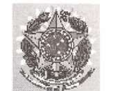

<!-- page 1 -->

<!-- figure p01-fig1 | described_by: agy | ocr_overlap: None | needs_review: false -->
1. **Figure type:** A low-resolution, monochrome grayscale (scanned/halftone) heraldic emblem depicting the Coat of Arms of the Federative Republic of Brazil, set inside a light gray rectangular background with white margins.

2. **Visible text:** There are no titles, labels, legends, captions, axis ticks, or cell values. Along the curved ribbon/scroll at the bottom of the emblem, there are faint, heavily pixelated markings corresponding to inscribed text, all of which are unreadable: `[illegible]`.

3. **Structure:** The figure consists of a single centered emblem with no boxes, arrows, axes, rows, columns, or multiple panels. Its visual elements are arranged symmetrically from outer to inner layers as follows:
   - **Frame:** A speckled light gray rectangular background bounded by a narrow white margin on the top and left and a wider white margin on the right.
   - **Outer rays:** A circular ring of short, light-colored radiating rays projecting outward behind the emblem.
   - **Central star:** A large five-pointed star (one point pointing straight up, two pointing left and right, two pointing down-left and down-right), with each point divided longitudinally into lighter and darker shaded halves.
   - **Central circular shield:** Centered over the star, composed of a ringed border containing small light dots surrounding a dark inner circle that contains five small light spots arranged in a cross-like constellation pattern.
   - **Framing wreath:** Two dark, textured curved botanical branches wrapping around the left and right sides of the star and meeting near the bottom.
   - **Vertical hilt:** A vertical sword element aligned along the central axis below the shield and star, with its hilt visible above the bottom ribbon.
   - **Bottom ribbon:** A curved scroll draped beneath the wreath and hilt with forked ends curling upward on the left and right, bearing `[illegible]` text markings along its length.

4. **Numbers and data values:** None. There are no legible numbers or data values in the image (any numerals that may belong to the bottom ribbon inscription are `[illegible]`).

5. **Colours:** The image is entirely monochrome grayscale (white, shades of gray, and black). No colours carry data or semantic meaning; tonal variations are used solely for shading, contrast, and depicting the shapes of the emblem.

# **MINISTÉRIO DA EDUCAÇÃO UNIVERSIDADE FEDERAL RURAL DE PERNAMBUCO SECRETARIA GERAL DOS CONSELHOS DA ADMINISTRAÇÃO SUPERIOR CONSELHO DE ENSINO, PESQUISA E EXTENSÃO** 

RESOLUÇÃO N° 016/2012. 

EMENTA: Aprova alteração das normas gerais do Programa de Pós-Graduação _Stricto Sensu_ desta Universidade. 

O Presidente do Conselho de Ensino, Pesquisa e Extensão da Universidade Federal Rural de Pernambuco, no uso de suas atribuições e tendo em vista o disposto no Parágrafo 6o do Art. 15 do Estatuto da Universidade e considerando os termos da Decisão N° 007/2012 da Câmara de Pesquisa e Pós-Graduação deste Conselho, em sua I Reunião Ordinária, realizada no dia 09 de fevereiro de 2012, exarada no Processo UFRPE N° 23082.006303/2011, 

# R E S O L V E : 

Art. Io - Aprovar, em sua área de competência, a alteração realizada no § 3o Art. 54 do Capítulo VII, das Normas Gerais do Programa de Pós-Graduação _Stricto Sensu_ desta Universidade, permanecendo inalterados os demais artigos, conforme consta no Processo acima mencionado. 

Onde se lê: _Para os casos em que haja necessidade de reformulação e/ou correção sugerida pela Banca Examinadora, será concedido um prazo máximo de 30 (trinta) dias, no caso de Bolsista do CNPq, ou 60 (sessenta) dias, para os demais casos, para a mesma ser executada. Caso este prazo não seja cumprido, o aluno perderá o direito a receber a Certidão e/ou Diploma._ 

Leia-se: **_Para os casos em que haja necessidade de reformulação e/ou correção sugerida pela Banca Examinadora, será concedido um prazo máximo de 60 (sessenta) dias, para a entrega da Dissertação ou Tese, e um prazo de até 120 (centro e vinte) dias para a entrega do comprovante da submissão do (s) artigo (s) científico (s) referente à Dissertação ou Tese. Caso este prazo não seja cumprido, o aluno perderá o direito a receber a Certidão e/ou Diploma._** 

Art. 2o - Revogam-se as disposições em contrário. 

SALA DOS CONSELHOS DA UFRPE, em 14 de fevereiro de 2012. 

PROF. REGINALDO BARROS = VICE-PRESIDENTE = 

**Confere com o original assinado peio Reitor e arquivado nesta Secretaria Gera1**
