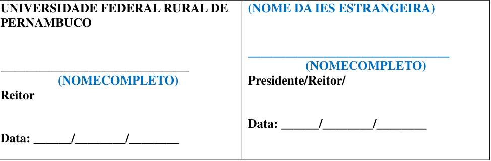
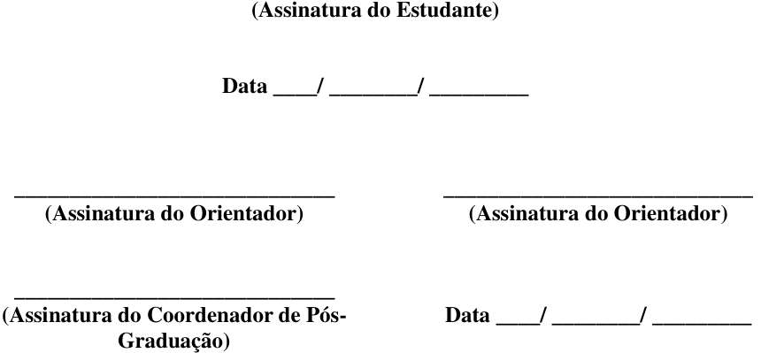

<!-- page 1 -->

## **MINISTÉRIO DA EDUCAÇÃO UNIVERSIDADE FEDERAL RURAL DE PERNAMBUCO SECRETARIA GERAL DOS CONSELHOS DA ADMINISTRAÇÃO SUPERIOR CONSELHO DE ENSINO, PESQUISA E EXTENSÃO** 

RESOLUÇÃO Nº  201/2016. 

EMENTA: Normas para regulamentação da formação pósgraduada com dupla titulação, no âmbito da UFRPE. 

A Presidente do Conselho de Ensino, Pesquisa e Extensão da Universidade Federal Rural de Pernambuco, no uso de suas atribuições e tendo em vista o disposto no Parágrafo 6° do artigo 15 do Estatuto da Universidade e considerando os termos da Decisão Nº 038/2016 da Câmara de Pesquisa e Pós-Graduação deste Conselho, em sua I Reunião Ordinária, realizada no dia 12 de setembro de 2016, exarada no Processo UFRPE Nº 23082.009720/2015-68, 

R E S O L V E: 

Art. 1º - Aprovar, em sua área de competência, na forma do anexo, a criação das normas que deverão disciplinar a formação pós-graduada com dupla titulação, realizada em conjunto com universidades estrangeiras, no âmbito da Universidade Federal Rural de Pernambuco e de acordo com o Processo acima mencioando. 

Art. 2º – Esta Resolução entra em vigor nesta data revogando-se as disposições em contrário. 

SALA DOS CONSELHOS DA UFRPE, em  16 de setembro de 2016. 

## **PROFA. MARIA JOSÉ DE SENA** = PRESIDENTE = 

Confere com o original assinado pela Reitora e arquivado nesta Secretaria Geral. 

<!-- page 2 -->

## **MINISTÉRIO DA EDUCAÇÃO UNIVERSIDADE FEDERAL RURAL DE PERNAMBUCO SECRETARIA GERAL DOS CONSELHOS DA ADMINISTRAÇÃO SUPERIOR CONSELHO DE ENSINO, PESQUISA E EXTENSÃO** 

(ANEXO DA RESOLUÇÃO Nº  201/2016  DO CEPE) 

## **NORMAS PARA REGULAMENTAÇÃO DA FORMAÇÃO PÓS-GRADUADA COM DUPLA TITULAÇÃO, NO ÂMBITO DA UNIVERSIDADE FEDERAL RURAL DE PERNAMBUCO.** 

Art. 1º - A UFRPE poderá conceder titulação, em regime de cotutela com outras Instituições de Ensino Superior (IES) estrangeiras conveniadas através de seus Programas de Pós-graduação S _tricto sensu_ , conduzindo, assim, à dupla titulação. 

Parágrafo único - Para efeito do disposto no _caput_ deste artigo, a cotutela é definida como modalidade de desenvolvimento de atividades vinculadas à pós-graduação _Stricto sensu_ , que permite ao estudante cursar mestrado ou doutorado em um dos programas da UFRPE e em uma Instituto de Ensino Superior (IES) estrangeira, onde existam programas reconhecidos como semelhantes pelas duas instituições. 

Art. 2º - A regulamentação da Formação Pós-Graduada com Dupla Titulação compreende as normas e as modalidades de desenvolvimento de atividades, no âmbito da Pós-Graduação _Stricto sensu_ , permitindo aos alunos da UFRPE e de instituições estrangeiras em parceria de cotutela com a UFRPE, a obtenção concomitante de diploma nesta Universidade e em outra Instituição estrangeira congênere. 

Parágrafo único - Os alunos regularmente matriculados em instituições estrangeiras congêneres, recebidos na UFRPE através de convenções de cotutela e de expedição de diploma com dupla titulação, devem estar sujeitos às regras previstas no instrumento jurídico de cotutela para que a validação de seus títulos seja possível. 

Art. 3º - As atividades de cotutela ficam condicionadas à existência de instrumento jurídico específico onde sejam definidas as condições particulares para a cotutela e expedição de diploma, devidamente aprovada pela instituição estrangeira envolvida e pela UFRPE. 

§1º- A Convenção acadêmica para cotutela de dissertação ou tese 

disciplinará: 

- I. O tempo previsto para a realização do curso, bem como o período de permanência em cada universidade, o qual não poderá ser inferior a seis meses, no caso de mestrado, nem inferior a doze meses, no caso de doutorado. 

- II. A publicação dos resultados de pesquisa, exploração  e proteção autoral de patentes; 

- III. O  idioma, o local e a forma de defesa da dissertação ou da tese; 

Confere com o original assinado pela Reitora e arquivado nesta Secretaria Geral. 

<!-- page 3 -->

## **MINISTÉRIO DA EDUCAÇÃO UNIVERSIDADE FEDERAL RURAL DE PERNAMBUCO SECRETARIA GERAL DOS CONSELHOS DA ADMINISTRAÇÃO SUPERIOR CONSELHO DE ENSINO, PESQUISA E EXTENSÃO** 

(ANEXO DA RESOLUÇÃO Nº  201/2016  DO CEPE) 

- IV. As obrigações financeiras assumidas pelas partes; 

- V. As exigências específicas a serem cumpridas pelos estudantes. 

Parágrafo único - Todos os trâmites para regulamentação do instrumento jurídico deverão ocorrer antes da defesa do trabalho de conclusão de curso. Em nenhuma hipótese um instrumento jurídico poderá ser regulamentado se encaminhado depois de ocorrida a defesa do trabalho de conclusão do curso nas instituições envolvidas. Para aderir à Convenção de Cotutela, conforme Art.3º , o estudante originário da UFRPE deverá atender aos critérios abaixo: 

I. estar matriculado há, no máximo, oito meses, no caso de curso de mestrado; 

II. estar matriculado há, no máximo, dezoito meses, no caso de curso de doutorado; 

III. não ter reprovação em disciplinas. 

Art. 4º - A Coordenação do Programa, através de seu Colegiado de Coordenação Didática (CCD) , poderá estabelecer outros critérios para adesão de alunos à Convenção acadêmica para cotutela de dissertação e tese, respeitando os critérios acima estabelecidos, e deverá encaminhar os processos administrativos de cotutela e expedição de diploma com dupla titulação para  esse colegiado, contendo, para cada aluno: 

I – a lista de atividades a serem desenvolvidas, incluindo o projeto de pesquisa, em cada uma das instituições; 

II - a relação de atividades já desenvolvidas, quando for o caso, em cada uma das instituições; 

III - o cronograma para o desenvolvimento das atividades, tanto na UFRPE como na instituição estrangeira, e o tempo previsto para a integralização do curso; 

IV - carta de aceite dos orientadores em ambas as instituições participantes; 

V - <mark>o(s) idioma(s) definido(s) para a redação do trabalho final (dissertação ou tese), a forma de apresentação, local e demais detalhes pertinentes;</mark> 

VI - as obrigações financeiras a serem assumidas pelas partes envolvidas, na forma da Lei; 

VII - a documentação necessária à matrícula, nos casos em que a UFRPE seja a instituição de acolhimento; 

VIII - demais exigências específicas a serem cumpridas pelo aluno, incluindo a titulação a ser conferida nos respectivos sistemas educacionais, aos quais cada instituição se vincula. 

Confere com o original assinado pela Reitora e arquivado nesta Secretaria Geral. 

<!-- page 4 -->

## **MINISTÉRIO DA EDUCAÇÃO UNIVERSIDADE FEDERAL RURAL DE PERNAMBUCO SECRETARIA GERAL DOS CONSELHOS DA ADMINISTRAÇÃO SUPERIOR CONSELHO DE ENSINO, PESQUISA E EXTENSÃO** 

(ANEXO DA RESOLUÇÃO Nº  201/2016  DO CEPE) 

§1º - O estudante originário de universidade estrangeira deverá solicitar sua matrícula, na UFRPE, dentro dos prazos previstos na Convenção, apresentando os documentos solicitados pelo Programa de Pós-Graduação da UFRPE, inclusive deverão estar com situação migratória devidamente regularizada. O <mark>diploma de graduação ou mestrado</mark> anexado à solicitação de diploma em regime de cotutela deverá ser formalmente reconhecido pelo Colegiado do Programa de Pós-Graduação, exclusivamente para o ingresso do aluno no programa, não conferindo esse procedimento validade nacional ao título. 

§ 2º - O CCD de cada Programa emitirá decisão sobre os processos de cotutela. 

§ 3º - Toda a documentação de matrícula em língua estrangeira deverá ser traduzida por tradutor juramentado. 

Art. 5º - Todos os instrumentos jurídicos de cotutela e expedição de diploma com dupla titulação deverão ter origem no Programa de Pós-Graduação envolvido e serem aprovados pelo CCD do Programa e homologados pelo Conselho de Ensino, Pesquisa e Extensão da UFRPE. 

Art. 6º - Durante o tempo de permanência no exterior, previsto no inciso III do Art. 4º, a Coordenação do Programa de Pós-Graduação realizará a matrícula vínculo do aluno na UFRPE, conservando seu vínculo com a Universidade. 

Parágrafo único - Os alunos regularmente matriculados em instituições estrangeiras congêneres em cotutela na UFRPE terão seu ingresso regularizado através da Coordenação do Programa de Pós-Graduação. 

Art. 7º - Aos alunos que cumprirem as condições definidas pelo instrumento jurídico Convenção Acadêmica de cotutela, bem como os requisitos regimentais dos respectivos Programas de Pós-Graduação, terão o diploma da UFRPE com dupla titulação. 

Parágrafo único - Cada estudante beneficiado pelo regime de cotutela contará com um orientador em sua universidade de origem e um orientador na universidade acolhedora. Nos Históricos Escolares conferidos pela UFRPE aos diplomados, constarão a nominativa, os créditos e os conceitos das disciplinas cursadas na UFRPE e/ou na instituição estrangeira, bem como menção de que as demais exigências do currículo do curso foram atendidas. 

Art. 8º - O financiamento das atividades relativas ao regime de cotutela e das respectivas defesas não são de responsabilidade da UFRPE. A defesa da dissertação ou tese  acontecerá em  uma das universidades, ou  em ambas, d e acordo  com  o  estabelecido na 

Confere com o original assinado pela Reitora e arquivado nesta Secretaria Geral. 

<!-- page 5 -->

## **MINISTÉRIO DA EDUCAÇÃO UNIVERSIDADE FEDERAL RURAL DE PERNAMBUCO SECRETARIA GERAL DOS CONSELHOS DA ADMINISTRAÇÃO SUPERIOR CONSELHO DE ENSINO, PESQUISA E EXTENSÃO** 

(ANEXO DA RESOLUÇÃO Nº  201/2016  DO CEPE) 

Convenção acadêmica para cotutela de dissertação ou tese. A comissão examinadora será constituída conforme as normas vigentes em cada universidade, devendo haver participação de docentes de ambas as instituições, sendo preferencialmente por vídeo conferência. 

§ 1º - Caso o aluno matriculado em regime de cotutela seja servidor docente ou técnico-administrativo da UFRPE, os custos relativos ao deslocamento e estada dos docentes da UFRPE que compõem a banca examinadora da defesa poderão ser financiados com recursos desta Universidade. 

§ 2º - O apoio financeiro mencionado no parágrafo anterior deverá ser solicitado pela Coordenação do Programa de Pós-Graduação que estiver envolvida em regime de cotutela no prazo de até doze meses antes da data prevista para a defesa do trabalho de conclusão de curso. 

Art. 9º- É necessária a celebração da Convenção Acadêmica instrumento jurídico de cooperação prévio ao Termo de Cotutela, no qual terá como fundamento indispensável para concessão de cotutela os princípios de reciprocidade e cooperação. 

Art.10 - A Convenção Acadêmica para cotutela de dissertação e de tese, bem como o termo de compromisso referente à mesma devem seguir os modelos constantes nos anexos 1 e 2 desta Resolução. 

Art. 11 - Estas Normas, revogadas as disposições em contrário, entrarão 

em vigor nesta data. 

SALA DOS CONSELHOS DA UFRPE, em  16 de setembro de 2016. 

## **PROFA. MARIA JOSÉ DE SENA** = PRESIDENTE = 

Confere com o original assinado pela Reitora e arquivado nesta Secretaria Geral. 

<!-- page 6 -->

## **MINISTÉRIO DA EDUCAÇÃO UNIVERSIDADE FEDERAL RURAL DE PERNAMBUCO SECRETARIA GERAL DOS CONSELHOS DA ADMINISTRAÇÃO SUPERIOR CONSELHO DE ENSINO, PESQUISA E EXTENSÃO** 

(ANEXO DA RESOLUÇÃO Nº  201/2016  DO CEPE) 

## **<u>ANEXO 1</u>** 

## **CONVENÇÃO ACADÊMICA PARA COTUTELA DE DISSERTAÇÃO E DE TESE** 

**CONVENÇÃO** **_que celebram a UNIVERSIDADE FEDERAL RURAL DE PERNAMBUCO (BRASIL) e a (NOME OFICIAL E COMPLETO, ESCRITO NO IDIOMA OFICIAL DO PAÍS), (PAÍS) no interesse do DEPARTAMENTO / INSTITUTO / ESCOLA / UNIDADE DA INSTITUIÇÃO ESTRANGERIA – quando for o caso, visando à cooperação acadêmica para fins de cotutela de dissertação e de tese e dupla titulação._** 

Pela presente Convenção, de um lado a **UNIVERSIDADE FEDERAL RURAL DE PERNAMBUCO (UFRPE)** , Brasil, representada por seu (sua) Reitor(a) ( **NOME COMPLETO DO REITOR)** e, de outro lado, a **(NOME OFICIAL E COMPLETO DA INSTITUIÇÃO ESTRANGEIRA, ESCRITO NO IDIOMA OFICIAL DO PAÍS DA INSTITUIÇÃO ESTRANGEIRA), (SIGLA OFICIAL DA INSTITUIÇÃO ESTRANGEIRA, caso exista uma sigla oficial), (PAÍS)** , neste ato representada por seu (sua) Reitor(a)/(Presidente), **(NOME COMPLETO DO DIRIGENTE DA INSTITUIÇÃO ESTRANGEIRA), NO INTERESSE DO DEPARTAMENTO/INSTITUTO/ESCOLA/UNIDADE DA INSTITUIÇÃO ESTRANGERIA – quando for o caso,** representada por seu (sua) Diretor(a) **(NOME COMPLETO DO DIRIGENTE DA UNIDADE DE ENSINO DA INSTITUIÇÃO ESTRANGEIRA)** ,  têm entre si justo e acertado o que segue, de acordo com as cláusulas e condições abaixo: 

**CLÁUSULA PRIMEIRA – OBJETO** 

A presente Convenção tem por objeto promover a cooperação acadêmica entre o Programa de Pós-Graduação em **XXXXXXXXX DA UFRPE** e a ( **NOME E SIGLA DA INSTITUIÇÃO ESTRANGEIRA)** , **no interesse do (DEPARTAMENTO/INSTITUTO/ESCOLA/UNIDADE DA INSTITUIÇÃO ESTRANGERIA – quando for o caso)** , por meio da coorientação de estudantes de Mestrado e de Doutorado das respectivas instituições, visando à preparação de dissertação de mestrado e/ou tese de doutorado e duplatitulação, cuja realização e defesa se efetuarão sob a responsabilidade conjunta das duas instituições, segundo as cláusulas aqui estabelecidas. 

Confere com o original assinado pela Reitora e arquivado nesta Secretaria Geral. 

<!-- page 7 -->

## **MINISTÉRIO DA EDUCAÇÃO UNIVERSIDADE FEDERAL RURAL DE PERNAMBUCO SECRETARIA GERAL DOS CONSELHOS DA ADMINISTRAÇÃO SUPERIOR CONSELHO DE ENSINO, PESQUISA E EXTENSÃO** 

(ANEXO DA RESOLUÇÃO Nº  201/2016  DO CEPE) 

## **CLÁUSULA SEGUNDA - METAS E FORMA DA COOPERAÇÃO** 

**2.1.** Os estudantes do Programa de Pós-Graduação em **XXXXXXXXX DA UFRPE** ou do Curso de ( **NOME DO CURSO E DA INSTITUIÇÃO ESTRANGEIRA** ) podem pleitear a coorientação para preparação de uma dissertação de mestrado e/ou de uma tese de doutorado visando à dupla titulação, desde que regularmente matriculados em uma dessas instituições. 

**2.2.** O estudante será indicado por sua instituição de origem através de **Termo de Compromisso** indicando adesão à presente Convenção, termo que deve especificar o nome do aluno, título do projeto que será desenvolvido, título previsto para a tese, nomes dos orientadores em ambas as Instituições e nome do Programa de Pós-Graduação e respectiva Área de Concentração, se pertinente e deve estar acompanhado de um plano de atividades. O Termo de Compromisso deve ser apreciado pelos órgãos competentes da Pós-Graduação das instituições envolvidas nesta Convenção. 

**2.3.** Cada estudante deverá seguir um programa desenvolvido conjuntamente entre as duas instituições e acordado entre os respectivos orientadores, os quais se comprometem a exercer plenamente a função de orientador do aluno. 

**2.4.** O tempo de preparação da dissertação e/ou da tese deve ser repartido entre as duas instituições envolvidas na coorientação, por períodos alternados em cada um dos dois países. O período total de permanência em um dos dois países não deve ser inferior a seis meses, no caso de mestrado, nem inferior a doze meses, em caso de doutorado; 

**2.5.** Os procedimentos para coorientação de alunos de Mestrado e de Doutorado visando à dupla titulação devem obedecer o disposto nas normas de Pós-Graduação da instituição de origem do aluno. 

**2.6.** O estudante aceito pela instituição acolhedora será considerado aluno de programa de intercâmbio devendo ter os mesmos direitos de seus alunos regulares. 

**2.7.** A dissertação e/ou a tese devem ser redigidas em Português ou se apresentada na INSTITUIÇÃO ESTRANGEIRA, o idioma deverá ser o da IES estrangeira. A dissertação ou a tese redigida em uma destas duas línguas será completada por um resumo na outra língua, além de um resumo na língua inglesa. 

**2.8.** A dissertação ou a tese será defendida, de comum acordo, em uma das instituições convenentes ou em ambas, conforme definido no termo de compromisso de cada estudante. A dissertação ou a tese defendida em **(IDIOMA DA DISSERTAÇÃO/TESE)** será completada pela apresentação de um resumo oral na outra língua. 

**2.9.** A comissão julgadora da dissertação ou da tese será designada de 

Confere com o original assinado pela Reitora e arquivado nesta Secretaria Geral. 

<!-- page 8 -->

## **MINISTÉRIO DA EDUCAÇÃO UNIVERSIDADE FEDERAL RURAL DE PERNAMBUCO SECRETARIA GERAL DOS CONSELHOS DA ADMINISTRAÇÃO SUPERIOR CONSELHO DE ENSINO, PESQUISA E EXTENSÃO** 

(ANEXO DA RESOLUÇÃO Nº  201/2016  DO CEPE) 

comum acordo entre as duas instituições conveniadas e será constituída por membros dos dois países obedecendo-se o disposto nas normas da instituição em que a dissertação ou a tese for apresentada para a defesa, incluindo-se entre estes, obrigatoriamente, os orientadores. 

**2.10.** A publicação, a exploração e a proteção do tema da tese e dos resultados da pesquisa são asseguradas pelos dois Programas de Pós-Graduação envolvidos, de acordo com os procedimentos específicos de cada país. 

**2.11.** O seguro saúde deverá ser providenciado pelo aluno no país de origem, antes de sua chegada à instituição acolhedora. 

## **CLÁUSULA TERCEIRA – SUPORTE FINANCEIRO** 

O estudante envolvido no intercâmbio deverá pagar as taxas acadêmicas, quando existentes, em sua instituição de origem. As demais despesas (viagem, hospedagem, etc.) poderão ser financiadas por órgãos externos, pelas instituições conveniadas ou ficarão a cargo do próprio estudante. A existência da presente Convenção não implica compromisso de suporte financeiro obrigatório por conta das instituições conveniadas. 

## **CLÁUSULA QUARTA – OBRIGAÇÕES DA UFRPE E DA NOME** **<u>OU SIGLA DA INSTITUIÇÃO ESTRANGEIRA</u>** 

**4.1.** As duas instituições procurarão alcançar reciprocidade nas atividades 

contempladas por esta Convenção. 

**4.2.** Ao final da estada do estudante, a instituição acolhedora enviará ao órgão apropriado da instituição de origem documento oficial, especificando as atividades desenvolvidas e a avaliação recebida, quando for o caso. 

**4.3.** As duas instituições se comprometem a promover a integração dos estudantes na vida acadêmica da instituição acolhedora. 

**4.4.** A instituição acolhedora deverá prover condições de pesquisa e local apropriados para o trabalho do estudante, na medida de suas possibilidades. 

**4.5.** As duas instituições reconhecem a validade da coorientação realizada e a da dissertação ou da tese defendida e aprovada, e se comprometem nos termos da legislação vigente, a outorgar o título de Doutor ao candidato com validade no Brasil e **PAÍS DA INSTITUIÇÃO ESTRANGEIRA** . 

## **CLÁUSULA QUINTA – COORDENAÇÃO DA CONVENÇÂO** 

**5.1.** Para constituir a Coordenação técnica e administrativa da presente 

Confere com o original assinado pela Reitora e arquivado nesta Secretaria Geral. 

<!-- page 9 -->

## **MINISTÉRIO DA EDUCAÇÃO UNIVERSIDADE FEDERAL RURAL DE PERNAMBUCO SECRETARIA GERAL DOS CONSELHOS DA ADMINISTRAÇÃO SUPERIOR CONSELHO DE ENSINO, PESQUISA E EXTENSÃO** 

(ANEXO DA RESOLUÇÃO Nº  201/2016  DO CEPE) 

Convenção são indicados pela **NOME DO PROGRAMA DE PÓS-GRADUAÇÃO DA UFRPE** , o(a) Professor(a) **NOME COMPLETO DO DOCENTE** e pela **NOME DA INSTITUIÇÃO ESTRANGEIRA** , o(a) Professor(a) **NOME COMPLETO DO  DOCENTE/DIREITOR/PRESIDENTE** . 

**5.2.** Caberá à referida Coordenação a busca de soluções e o encaminhamento de questões acadêmicas e administrativas que surgirem durante a vigência da presente convenção, bem como a supervisão das atividades. 

## **CLÁUSULA SEXTA – PROPRIEDADE INTELECTUAL** 

Os direitos de propriedade intelectual derivados dos trabalhos realizados no âmbito desta Convenção estarão sujeitos às disposições legais vigentes nos países das instituições participantes. 

## **CLÁUSULA SÉTIMA – RESPONSABILIDADE CIVIL** 

As partes signatárias não assumirão a responsabilidade civil por danos e prejuízos decorrentes de casos fortuitos ou de força maior. 

## **CLÁUSULA OITAVA – VIGÊNCIA** 

A presente Convenção vigorará pelo prazo de **5 (cinco) anos** , a partir da data em que for assinado pelos representantes de ambas as partes. Quaisquer mudanças nos termos desta Convenção deverão ser efetuadas através de Termo Aditivo, devidamente acordado entre as partes signatárias. 

## **CLÁUSULA NONA – DENÚNCIA** 

A presente Convenção poderá ser denunciado a qualquer momento, por qualquer das partes, mediante comunicação expressa, com antecedência mínima de 90 (noventa) dias. Caso haja pendências, as partes definirão, mediante Termo de Encerramento da Convenção, as responsabilidades pela conclusão de cada um dos trabalhos e todas as demais pendências, respeitadas as atividades em curso. 

## **CLÁUSULA DÉCIMA – RESOLUÇÃO DE CONTROVÉRSIAS** 

Para dirimir dúvidas que possam ser suscitadas na execução e interpretação da presente Convenção, as partes envidarão esforços na busca de uma solução consensual. Na impossibilidade de consenso, as convenentes indicarão, de comum acordo, um terceiro, pessoa física, para atuar como mediador. 

E por estarem assim justas e acordadas, as partes assinam o presente termo em duas (2) vias idênticas de cada versão, em português e **IDIOMA DA IES ESTRANGEIRA** , de igual teor e para um só efeito. 

Confere com o original assinado pela Reitora e arquivado nesta Secretaria Geral. 

<!-- page 10 -->

<!-- figure p10-fig2 | described_by: agy | ocr_overlap: 1.0 | needs_review: false -->
**1. Tipo de figura**
Trata-se de uma tabela (bloco de assinaturas) de um modelo de documento institucional ou convênio, composta por 1 linha e 2 colunas, destinada ao preenchimento das assinaturas, nomes, cargos e datas dos representantes de duas instituições.

**2. Texto visível (verbatim)**
Todo o texto está em fonte serifada e em negrito.

- **Coluna esquerda:**
  `UNIVERSIDADE FEDERAL RURAL DE`
  `PERNAMBUCO`
  `___________________________` *(linha contínua de sublinhados para assinatura)*
  `(NOMECOMPLETO)`
  `Reitor`
  `Data: _____/_______/_______`

- **Coluna direita:**
  `(NOME DA IES ESTRANGEIRA)`
  `_____________________________` *(linha contínua de sublinhados para assinatura)*
  `(NOMECOMPLETO)`
  `Presidente/Reitor/`
  `Data: _____/_______/_______`

*(Observações literais: em ambas as colunas, `(NOMECOMPLETO)` está escrito sem espaço entre as palavras; na coluna direita, há uma barra `/` ao final de `Presidente/Reitor/`.)*

**3. Estrutura**
A figura é uma tabela retangular simples de 1 linha por 2 colunas de larguras aproximadamente iguais, sem setas, eixos ou legendas. As bordas superior, inferior, direita e a linha divisória vertical central são traços finos e contínuos na cor preta; a borda vertical esquerda não está visível no recorte da imagem.

Em cada coluna, os elementos estão empilhados verticalmente de cima para baixo, alinhados à esquerda (com exceção dos marcadores `(NOMECOMPLETO)`, posicionados centralizadamente sob as respectivas linhas de assinatura):
1. Identificação da instituição no topo (ocupando 2 linhas na coluna esquerda e 1 linha na coluna direita);
2. Espaço em branco seguido de uma linha horizontal de assinatura;
3. Marcador `(NOMECOMPLETO)` logo abaixo da linha de assinatura;
4. Indicação do cargo (`Reitor` à esquerda; `Presidente/Reitor/` à direita);
5. Espaço em branco seguido do campo `Data:` com três lacunas sublinhadas separadas por duas barras (`/`).

Como o cabeçalho da coluna esquerda ocupa duas linhas e o da direita apenas uma, a linha de assinatura, o cargo e o campo `Data:` da coluna esquerda ficam posicionados ligeiramente mais abaixo do que os elementos correspondentes na coluna direita.

**4. Números e valores de dados**
Não há nenhum número ou valor de dado na figura; os campos de data encontram-se em branco para preenchimento.

**5. Cores com significado**
Sobre fundo branco, duas cores distinguem o texto fixo dos campos editáveis do modelo:
- **Azul:** indica elementos variáveis (campos/marcadores a serem preenchidos ou substituídos), aplicados em `(NOMECOMPLETO)` na coluna esquerda e em `(NOME DA IES ESTRANGEIRA)`, na linha de assinatura e em `(NOMECOMPLETO)` na coluna direita.
- **Preto:** indica o texto fixo e os elementos estruturais do modelo (`UNIVERSIDADE FEDERAL RURAL DE PERNAMBUCO`, a linha de assinatura da coluna esquerda, `Reitor`, `Presidente/Reitor/`, os campos `Data:` com suas lacunas e barras, e as bordas da tabela).

~~~text ocr
UNIVERSIDADE FEDERAL RURAL DE
PERNAMBUCO
(NOMECOMPLETO)
Reitor
Data: / /
(NOME DA IES ESTRANGEIRA)
(NOMECOMPLETO)
Presidente/Reitor/
Data: / /
~~~

## **MINISTÉRIO DA EDUCAÇÃO UNIVERSIDADE FEDERAL RURAL DE PERNAMBUCO SECRETARIA GERAL DOS CONSELHOS DA ADMINISTRAÇÃO SUPERIOR CONSELHO DE ENSINO, PESQUISA E EXTENSÃO** 

(ANEXO DA RESOLUÇÃO Nº  201/2016  DO CEPE) 

<!-- Start of picture text -->
UNIVERSIDADE FEDERAL RURAL DE  (NOME DA IES ESTRANGEIRA) PERNAMBUCO ________________________________ ______________________________  (NOMECOMPLETO) (NOMECOMPLETO)  Presidente/Reitor/ Reitor Data: ______/________/________ Data: ______/________/________ <!-- End of picture text -->

Confere com o original assinado pela Reitora e arquivado nesta Secretaria Geral. 

<!-- page 11 -->

## **MINISTÉRIO DA EDUCAÇÃO UNIVERSIDADE FEDERAL RURAL DE PERNAMBUCO SECRETARIA GERAL DOS CONSELHOS DA ADMINISTRAÇÃO SUPERIOR CONSELHO DE ENSINO, PESQUISA E EXTENSÃO** 

(ANEXO DA RESOLUÇÃO Nº  201/2016  DO CEPE) 

## **<u>ANEXO 2</u>** 

## **(MODELO)** **<u>TERMO DE COMPROMISSO</u>** 

|O (A) estudante _______________________________________________**(Nome completo)**,|
|---|
|matriculado(a) no Curso de ___________________________ do Programa |
|______________________________, Área de Concentração ________________ da|
|___________________________**(Nome completo da instituição)**, cuja orientação será|
|assegurada pelo Prof. ________________________________ **(Nome completo)** da|
|Universidade Federal Rural de Pernambuco (UFRPE) e pelo Prof. _________________________________________________________**(Nome completo)**da|
|______________________________________**(Nome completo da instituição estrangeira)**|
|**( _____ ) (sigla, se houver)**, efetuará suas pesquisas por períodos alternados em ambas as instituições. O título do projeto que será desenvolvido é _______________________________|
|___________________________________________________________________________ ________________________________________________________________, cujo plano de|
|trabalho está devidamente anexado a este termo.|
|Conforme disposto na CLÁUSULA ______________ da Convenção Acadêmica para Cotutela|
|de Dissertação e de Tese celebrado entre a UFRPE e a _______**(Nome ou sigla da instituição** **estrangeira)**, a tese será redigida e defendida em _________________**(idioma)**, com defesa a ser realizada na ____________________________**(instituição)**. O título previsto para tese é ___________________________________________________________ ____________________________________________________________________________ _________________________________________________________________________|

O seguro saúde deverá ser providenciado pelo aluno no país de origem, antes de sua chegada à instituição receptora. 

O estudante e os dois orientadores se comprometem a realizar todas as atividades determinadas na Convenção Acadêmica para Cotutela de Dissertação e de Tese celebrado entre a UFRPE e a _______ **(Nome ou sigla da instituição estrangeira)** e se comprometem a prestar informações ou esclarecimentos sobre qualquer óbice que porventura interfiram no cumprimento das atividades previstas na Convenção. O estudante e os dois orientadores certificam que tem ciência do inteiro teor da respectiva Convenção. 

E por estarem assim justas e acordadas, as partes assinam o presente termo em duas (2) vias idênticas, em português e em ____________________ **(idioma)** , de igual teor e para um só efeito. 

Confere com o original assinado pela Reitora e arquivado nesta Secretaria Geral. 

<!-- page 12 -->

<!-- figure p12-fig2 | described_by: agy | ocr_overlap: 1.0 | needs_review: false -->
1. **Tipo de figura:** Bloco de campos de assinatura e data extraído de um formulário ou documento acadêmico, composto exclusivamente por texto em fonte serifada em negrito e linhas horizontais em branco para preenchimento manual.

2. **Todo o texto visível (transcrição literal, de cima para baixo e da esquerda para a direita):**
   - `(Assinatura do Estudante)`
   - `Data ____/ ________/ _________`
   - `_____________________________`
     `(Assinatura do Orientador)`
   - `_____________________________`
     `(Assinatura do Orientador)`
   - `_____________________________`
     `(Assinatura do Coordenador de Pós-`
     `Graduação)`
   - `Data ____/ ________/ _________`

3. **Estrutura:** Não há caixas, bordas, setas, eixos nem painéis delimitados. Os elementos distribuem-se sobre fundo branco em quatro fileiras horizontais:
   - **1ª fileira (centralizada no topo):** apresenta apenas o rótulo `(Assinatura do Estudante)`, sem linha de assinatura visível acima dele.
   - **2ª fileira (centralizada abaixo da 1ª):** contém o campo `Data` seguido de três traços horizontais para preenchimento separados por duas barras (`/`), sendo o primeiro traço mais curto e o segundo e o terceiro mais longos.
   - **3ª fileira (duas colunas, esquerda e direita):**
     - **Coluna esquerda:** uma linha horizontal longa acima do rótulo centralizado `(Assinatura do Orientador)`.
     - **Coluna direita:** uma linha horizontal longa acima do rótulo centralizado idêntico `(Assinatura do Orientador)`.
   - **4ª fileira (duas colunas, alinhadas sob as colunas da 3ª fileira):**
     - **Coluna esquerda:** uma linha horizontal longa acima do rótulo centralizado em duas linhas: `(Assinatura do Coordenador de Pós-` na linha superior e `Graduação)` na linha inferior.
     - **Coluna direita:** o campo `Data` seguido de três traços horizontais separados por duas barras (`/`), alinhado horizontalmente à primeira linha do rótulo da coluna esquerda.

4. **Números e valores de dados:** Não há nenhum número ou valor numérico na figura; todos os campos de assinatura e data encontram-se em branco.

5. **Cores com significado:** Nenhuma; a figura é monocromática (texto e linhas pretos sobre fundo branco), sem uso de cores para transmitir significado.

~~~text ocr
(Assinatura do Estudante)
Data / /
(Assinatura do Orientador) (Assinatura do Orientador)
(Assinatura do Coordenador de Pés- Data / /
Graduação)
~~~

## **MINISTÉRIO DA EDUCAÇÃO UNIVERSIDADE FEDERAL RURAL DE PERNAMBUCO SECRETARIA GERAL DOS CONSELHOS DA ADMINISTRAÇÃO SUPERIOR CONSELHO DE ENSINO, PESQUISA E EXTENSÃO** 

(ANEXO DA RESOLUÇÃO Nº  201/2016  DO CEPE) 

<!-- Start of picture text -->
(Assinatura do Estudante) Data ____/ ________/ _________ _____________________________  ____________________________ (Assinatura do Orientador)  (Assinatura do Orientador) _____________________________ (Assinatura do Coordenador de Pós- Data ____/ ________/ _________ Graduação) <!-- End of picture text -->

SALA DOS CONSELHOS DA UFRPE, em  16 de setembro de 2016. 

**PROFA. MARIA JOSÉ DE SENA** = PRESIDENTE = 

Confere com o original assinado pela Reitora e arquivado nesta Secretaria Geral.
