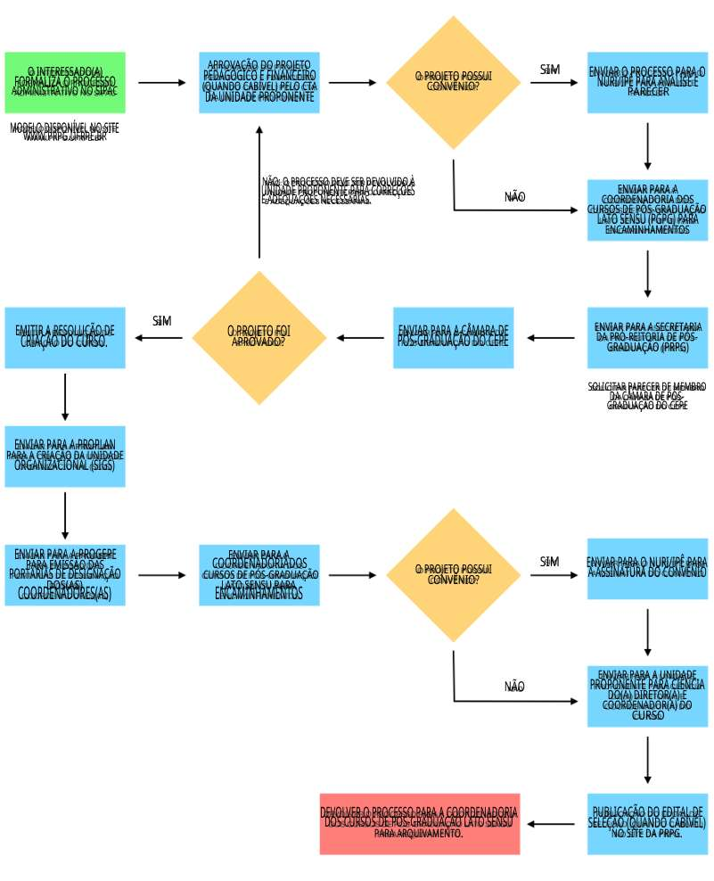

<!-- page 1 -->

# **MINISTÉRIO DA EDUCAÇÃO UNIVERSIDADE FEDERAL RURAL DE PERNAMBUCO SECRETARIA GERAL DOS CONSELHOS DA ADMINISTRAÇÃO SUPERIOR CONSELHO DE ENSINO, PESQUISA E EXTENSÃO** 

RESOLUÇÃO CEPE/UFRPE Nº 904, DE 13 DE JUNHO DE 2025. 

Aprova novas Normas Gerais dos cursos e programas de Pós-graduação **lato sensu** (cursos de especialização, aperfeiçoamento, cursos livres, cursos **In company** , cursos MBA e programas de residência) desta Universidade Federal Rural de Pernambuco – UFRPE. 

A Presidente do Conselho de Ensino, Pesquisa e Extensão da Universidade Federal Rural de Pernambuco, no uso de suas atribuições estatutárias, tendo em vista o disposto no Parágrafo 6º do Art. 15 do Estatuto da Universidade e considerando os termos da Decisão nº 22/2025 da Câmara de Pós-Graduação deste Conselho em sua IV Reunião Ordinária, realizada no dia 10 de junho de 2025, exarada no Processo UFRPE Nº 23082.011161/2025-28, 

CONSIDERANDO a reestrutura da PRPG (aprovada no Processo Nº 23082.024509/2024-66). 

CONSIDERANDO a expansão da Coordenadoria **lato sensu** e a oferta de novas modalidades de pós-graduação lato sensu não previstas na resolução vigente. 

CONSIDERANDO o grande número de situações tratadas como casos omissos pela Coordenadoria de Pós-graduação **lato sensu** , devido à ausência de regulamentação na Norma Geral vigente. 

# **RESOLVE** 

Art. 1º  Aprovar, em sua área de competência, as novas Normas Gerais dos cursos e programas de Pós-graduação **lato sensu** (cursos de especialização, aperfeiçoamento, cursos livres, cursos **In company** , cursos MBA e programas de residência), desta Universidade Federal Rural de Pernambuco – UFRPE, conforme consta do Processo acima mencionado. 

Art. 2º  Em decorrência do Artigo 1º, ficam revogadas: a Resolução nº 226/2020, datada de 23 de dezembro de 2020, a qual altera a Resolução nº 293/2019, datada de 15 de outubro de 2019, que tratam do mesmo assunto, Normas Gerais dos cursos de Pós-graduação **Lato sensu** , ambas do Conselho de Ensino, Pesquisa e Extensão. 

Art. 3º  Esta Resolução entra em vigor em 13 de junho de 2025. 

SALA DOS CONSELHOS SUPERIORES DA UFRPE. 

# **Profa. Maria José de Sena** PRESIDENTE 

Confere com o original assinado pela Reitora e arquivado nesta Secretaria Geral. 

<!-- page 2 -->

# **MINISTÉRIO DA EDUCAÇÃO UNIVERSIDADE FEDERAL RURAL DE PERNAMBUCO SECRETARIA GERAL DOS CONSELHOS DA ADMINISTRAÇÃO SUPERIOR CONSELHO DE ENSINO, PESQUISA E EXTENSÃO** 

(ANEXO DA RESOLUÇÃO CEPE/UFRPE Nº 904, DE 13 DE JUNHO DE 2025). 

# **NORMAS GERAIS DOS CURSOS E PROGRAMAS DE PÓS-GRADUAÇÃO LATO SENSU DA UNIVERSIDADE FEDERAL RURAL DE PERNAMBUCO** 

# **CAPÍTULO I** 

# **DEFINIÇÃO, OBJETIVO, SUBORDINAÇÃO E IMPLANTAÇÃO.** 

Art. 1º  Os Cursos e programas de pós-graduação **lato sensu** são atividades pedagógicas sistematizadas e se destinam, nos termos do artigo 51 do Estatuto e do artigo 45 do Regimento Geral da Universidade Federal Rural de Pernambuco (UFRPE), a graduados e graduadas de cursos superiores reconhecidos pelo Ministério de Educação (MEC), visando à formação de especialistas, com o objetivo de elevar o nível de capacitação e a formação de recursos humanos. 

§ 1º A pós-graduação **lato sensu** é subordinada à Pró-Reitoria de Pós-graduação (PRPG), de acordo com o artigo 45, § 1°, do Regimento Geral da UFRPE e gerido pela Coordenadoria dos Cursos de Pós-graduação **lato sensu** . 

§ 2º A pós-graduação **lato sensu** se divide em modalidades distintas, com propósitos claros e objetivos específicos: cursos de especialização, cursos de qualificação, cursos livres, cursos **In company** , programas de residência e cursos de MBA ( **Master Business Administration** ). 

§ 3° Cada modalidade possui suas normatizações específicas. As normas para os cursos de especialização, cursos de qualificação, cursos livres, cursos de MBA ( **Master Business Administration** ) e cursos **In company** estão apresentadas no Capítulo IV. 

§ 4º Os programas de residência possuem normatizações e resoluções específicas aprovadas pela Universidade Federal Rural de Pernambuco, obedecendo à legislação específica em nível federal, bem como as normas desta Resolução. 

§ 5º Cada curso ou programas de Pós-graduação **lato sensu** deverá ser oferecidos por a- penas 1 (uma) unidade proponente da UFRPE. 

§ 6º São unidades proponentes os Departamentos Acadêmicos, as Unidades Acadêmicas, o Colégio Agrícola Dom Agostinho Ikas (CODAI), a Clínica de Bovinos de Garanhuns (CBG) e as unidades experimentais. 

Art. 2º  É possível a criação de convênios e/ou parcerias entre a UFRPE e órgãos externos (e.g., prefeituras, governos estaduais, fundações). Neste caso, as normas vigentes estabelecidas pelo Núcleo de Relações Institucionais (NURI) do Instituto de Inovação, Pesquisa e Empreendimento (IPÊ) da UFRPE precisam ser consultadas e atendidas. 

Parágrafo único.  Cursos de especialização provenientes de editais externos (e.g., CAPES, MEC, INCRA) precisam ser aprovados pelo CTA da unidade proponente e o projeto pedagógico Confere com o original assinado pela Reitora e arquivado nesta Secretaria Geral. 

<!-- page 3 -->

# **MINISTÉRIO DA EDUCAÇÃO UNIVERSIDADE FEDERAL RURAL DE PERNAMBUCO SECRETARIA GERAL DOS CONSELHOS DA ADMINISTRAÇÃO SUPERIOR CONSELHO DE ENSINO, PESQUISA E EXTENSÃO** 

(ANEXO DA RESOLUÇÃO CEPE/UFRPE Nº 904, DE 13 DE JUNHO DE 2025). 

deve ser elaborado respeitando as normas do edital externo. Após a aprovação pelo CTA, o projeto deverá ser analisado pela Pró-Reitoria de Pós-graduação (PRPG), respeitando o fluxo apresentado no Anexo I. 

Art. 3º  A pós-graduação **lato sensu** está vinculada, em termos administrativos, à direção da unidade proponente. Já a gerência financeira do projeto (quando cabível) deverá ocorrer por meio de convênio com a Fundação de Apoio da UFRPE, desde que atendam às normas aqui presentes. 

Art. 4º  É vedada a abertura de projetos de novos cursos com o mesmo nome e/ou objetivos de cursos já aprovados pela Pró-Reitoria de Pós-graduação (PRPG). Esta proibição não se aplica aos cursos presenciais e semipresenciais com lotação em cidades diferentes. 

Parágrafo único.  o artigo 4° não se aplica aos novos cursos provenientes de editais externos (e.g., CAPES, MEC, INCRA etc.) e cursos **In company** . 

Art. 5º  Havendo desmembramento ou dissolução da unidade proponente, o curso deverá ser vinculado à unidade organizacional do(a) Coordenador(a) do curso. 

Art. 6º  Aos(Às) discentes da pós-graduação **lato sensu** se aplica o disposto no artigo 83 do Estatuto da UFRPE, na condição de alunos(as) especiais. 

Art. 7º  Para implantação de uma pós-graduação **lato sensu** será exigido um projeto pedagógico e financeiro (quando cabível) aprovado pelo CTA da unidade proponente. O fluxo dos trâmites administrativos está apresentado no Anexo I. 

§ 1º Apenas cursos provenientes de convênios entre a UFRPE e outras entidades precisam ser avaliados pelo Núcleo de Relações Institucionais (NURI) do Instituto de Pesquisa, Empreendedorismo e Inovação (IPÊ). 

§ 2º Após a resolução de aprovação da pós-graduação **lato sensu** pelo CEPE, o Processo deverá ser enviado para a PROGEPE para o assentamento funcional dos coordenadores (as) e a designação das funções administrativas nos Sistemas de Gestão Acadêmica (SIGs) da pósgraduação **lato sensu** . 

§ 3° O projeto pedagógico deverá ser elaborado seguindo o modelo disponível no site da PRPG (www.prpg.ufrpe.br). 

§ 4°  Para os cursos de especialização ofertados por meio do programa Universidade A- berta do Brasil (UAB/CAPES), não é necessária a indicação do corpo docente no projeto pedagógico. A indicação ocorrerá após a aprovação da proposta na UAB/CAPES e no CEPE. 

Art. 8º  A proposta de criação de uma nova pós-graduação **lato sensu** deverá ser obrigatoriamente formalizada via processo administrativo (SIPAC). 

Art. 9º  É proibido ofertar um curso ou programa de pós-graduação **lato sensu** , em quaisquer modalidades, sem os trâmites administrativos apresentados nesta resolução. O descumpriConfere com o original assinado pela Reitora e arquivado nesta Secretaria Geral. 

<!-- page 4 -->

# **MINISTÉRIO DA EDUCAÇÃO UNIVERSIDADE FEDERAL RURAL DE PERNAMBUCO SECRETARIA GERAL DOS CONSELHOS DA ADMINISTRAÇÃO SUPERIOR CONSELHO DE ENSINO, PESQUISA E EXTENSÃO** 

(ANEXO DA RESOLUÇÃO CEPE/UFRPE Nº 904, DE 13 DE JUNHO DE 2025). 

mento deste artigo acarretará em medidas legais e administrativas. 

Art. 10.  A proposta de criação de uma nova pós-graduação **lato sensu** será apreciada pela Câmara de Pós-graduação (CEPE). A análise será realizada com base nos seguintes critérios: 

I - relevância dos objetivos e viabilidade do projeto pedagógico e financeiro (quando cabí- 

vel); 

II - atualidade e adequação do conteúdo programático das disciplinas ofertadas; 

III - qualificação do corpo docente na área de conhecimento do curso (exceto nos itens tratados no Art. 4º, § 4º); 

IV - infraestrutura para o funcionamento do curso; e 

V - adequação orçamentária para a manutenção das atividades do curso. 

Art. 11.  Em caso de abertura de novas turmas, a direção da unidade proponente deverá solicitar ao CTA, via Processo, a autorização para a nova oferta. Em seguida o processo deverá ser encaminhado para a Coordenadoria de Pós-graduação **lato sensu** para análise e providências. 

§ 1º Havendo necessidade de alterar o projeto pedagógico do curso, as modificações deverão ser formalmente encaminhadas para o CTA da unidade proponente e, em seguida, para a Coordenadoria dos Cursos de Pós-graduação **lato sensu** que apreciará, julgando a necessidade de encaminhamento (ou não) para o CEPE. 

§ 2º No caso de mudança na gestão do curso, o Processo deverá voltar para unidade organizacional de origem para a aprovação dos(as) novos(as) coordenadores(as) pelo CTA da unidade proponente. 

§ 4º No caso de modificações em cursos ou programas em andamento, a Coordenadoria dos Cursos de Pós-graduação **lato sensu** deverá ser consultada formalmente. 

# **CAPÍTULO II** 

# **DA ORGANIZAÇÃO ADMINISTRATIVA** 

Art. 12.  Os cursos de especialização, cursos de qualificação, cursos livres, cursos **In company** e cursos de MBA ( **Master Business Administration** ) são geridos por um(a) coordenador(a) de curso e um(a) coordenador(a) pedagógico(a). Na ausência do(a) coordenador(a), o(a) coordenador(a) pedagógico(a) exercerá a função de coordenador(a). 

Art. 13.  Os programas de residência são geridos por um(a) coordenador(a) e um(a) eventual-coordenador(a). Na ausência do(a) coordenador(a), o(a) eventual-coordenador(a) exercerá a função de coordenador(a). 

Art. 14.  Compete à direção da unidade proponente: 

Confere com o original assinado pela Reitora e arquivado nesta Secretaria Geral. 

<!-- page 5 -->

# **MINISTÉRIO DA EDUCAÇÃO UNIVERSIDADE FEDERAL RURAL DE PERNAMBUCO SECRETARIA GERAL DOS CONSELHOS DA ADMINISTRAÇÃO SUPERIOR CONSELHO DE ENSINO, PESQUISA E EXTENSÃO** 

(ANEXO DA RESOLUÇÃO CEPE/UFRPE Nº 904, DE 13 DE JUNHO DE 2025). 

I - apresentar a proposta de criação do curso via processo administrativo (SIPAC); e 

II - designar os(as) gestores(a) do curso, de acordo com os artigos 12° e 13°. 

Art. 15.  A estrutura administrativa dos cursos de especialização, cursos de qualificação, cursos livres, cursos **In company** e cursos de MBA ( **Master Business Administration** ) é composta pela coordenação do curso, o Colegiado de Coordenação Didática (CCD) e a Secretaria do Curso. 

§ 1º A composição e as atribuições do CCD, assim como as atribuições da coordenação de curso, constam na Seção V do Capítulo I, Título II do Regimento Geral da UFRPE, complementadas por esta Resolução. 

§ 2º Os nomes dos(as) docentes membros do CCD deverão constar no Projeto Pedagógico do curso e serem nomeados por portaria de designação solicitada pelo coordenador do curso, posteriormente à sua criação. 

§ 3º Nos programas de residência multiprofissionais em saúde o órgão que exerce a função do CCD é o NDAE (Núcleo Docente Assistencial Estruturante). 

Art. 16.  O(A) coordenador(a) do curso ou programa de pós-graduação **lato sensu** deverá ser um(a) servidor(a) ativo(a) do quadro permanente desta UFRPE e portador(a) de título de Mestre(a) ou Doutor(a), submetidos à aprovação do CTA da unidade proponente e designado(a) pelo(a) Reitor(a). 

Art. 17.  São atribuições do coordenador(a) de curso: 

I - viabilizar os recursos humanos, financeiros e materiais necessários para a execução do projeto do curso; 

II - fazer a gestão de dados e registros acadêmicos no SIGAA; 

III - supervisionar o desenvolvimento didático-científico do curso; 

IV - manter contatos com outras instituições com o objetivo de aprimorar o desenvolvimento do curso; 

V - encaminhar à Coordenadoria dos Cursos de Pós-graduação **lato sensu** o Relatório A- cadêmico Final e o Relatório Financeiro Final (quando cabível) no prazo máximo de 60 (sessenta) dias após o encerramento do curso (os modelos do Relatório Acadêmico Final e Relatório Financeiro Final encontram-se disponíveis no site da PRPG: www.prpg.ufrpe.br); 

VI - ao final do curso, se solicitado, deverá disponibilizar aos(às) concluintes uma declaração de conclusão de curso e, também, uma cópia do histórico escolar; 

VII - o(a) Coordenador(a) será o(a) responsável por emitir a declaração de conclusão de curso aos(às) concluintes até a aprovação do Relatório Final do curso pelo CEPE; e 

VIII - assinar os certificados de conclusão e históricos do curso emitidos pela PRPPG. 

Confere com o original assinado pela Reitora e arquivado nesta Secretaria Geral. 

<!-- page 6 -->

# **MINISTÉRIO DA EDUCAÇÃO UNIVERSIDADE FEDERAL RURAL DE PERNAMBUCO SECRETARIA GERAL DOS CONSELHOS DA ADMINISTRAÇÃO SUPERIOR CONSELHO DE ENSINO, PESQUISA E EXTENSÃO** 

(ANEXO DA RESOLUÇÃO CEPE/UFRPE Nº 904, DE 13 DE JUNHO DE 2025). 

Art. 18.  São atribuições do Coordenador(a) Pedagógico: 

I - organizar o calendário acadêmico do curso; 

II - administrar o desenvolvimento didático-científico do curso; 

III - estabelecer uma interlocução permanente com os(as) discentes e docentes no sentido de viabilizar o bom andamento das atividades acadêmicas; 

IV - organizar atividades didáticas do curso (viagens, aulas de campo, eventos etc.); e 

V - na ausência ou impedimento do gerenciamento do curso pelo(a) coordenador(a), assumir a coordenação do curso. 

§ 1º É vedada a designação de não-integrantes dos quadros funcionais efetivos da UFRPE para os cargos de Coordenador(a), Coordenador(a) Pedagógico(a) e eventual-coordenador(a) de uma pós-graduação **lato sensu** . 

§ 2º Será permitida a coordenação simultânea de até quatro cursos de especialização. 

§ 3º Quando o curso ou programa envolver mais de uma unidade organizacional, a coordenação será discutida e decidida entre as unidades. Apenas uma unidade poderá ser a proponente. Deverão constar no projeto pedagógico os demais setores envolvidos. 

Art. 19.  Compete à Coordenadoria dos Cursos de Pós-graduação **lato sensu** o acompanhamento dos cursos em andamento e, havendo a necessidade, poderá solicitar informações complementares à direção da unidade proponente. 

Art. 20.  Compete ao coordenador do curso a elaboração do Relatório Acadêmico Final e do Relatório Financeiro Final (quando cabível). 

§ 1º O Relatório Acadêmico Final será apreciado pelo CTA da unidade proponente, com emissão de parecer acerca dos aspectos pedagógicos e objetivos do curso. Posteriormente, o relatório será encaminhado para a Coordenadoria dos Cursos de Pós-graduação **lato sensu** para análise e, em seguida, encaminhamento à Câmara de Pós-graduação do CEPE para aprovação. 

§ 2º O Relatório Financeiro Final (quando cabível) será enviado ao NURI para a emissão de parecer acerca da prestação de contas. Em seguida, o relatório será enviado para o CTA da unidade proponente, e posteriormente encaminhado para a Coordenadoria dos Cursos de Pósgraduação **lato sensu** para análise e encaminhamento à Câmara de Pós-graduação do CEPE para aprovação. 

§ 3º A aprovação do Relatório Acadêmico Final compete à Câmara de Pós-graduação (CEPE), sendo condição obrigatória para a apreciação de novos projetos submetidos pelos(as) mesmos(as) Coordenadores(as) proponentes, bem como para a expedição dos certificados de conclusão do curso. 

§ 4º A coordenação de curso que não enviar o Relatório Final do Curso e/ou Relatório FiConfere com o original assinado pela Reitora e arquivado nesta Secretaria Geral. 

<!-- page 7 -->

# **MINISTÉRIO DA EDUCAÇÃO UNIVERSIDADE FEDERAL RURAL DE PERNAMBUCO SECRETARIA GERAL DOS CONSELHOS DA ADMINISTRAÇÃO SUPERIOR CONSELHO DE ENSINO, PESQUISA E EXTENSÃO** 

(ANEXO DA RESOLUÇÃO CEPE/UFRPE Nº 904, DE 13 DE JUNHO DE 2025). 

nanceiro Final do Curso (quando cabível) estarão impedidos de ofertar novas turmas até o cumprimento de todas as pendências. Após 90 dias, caso as pendências persistam, o(a) coordenador(a) poderá responder administrativa pelo descumprimento desta Resolução. 

# **CAPÍTULO III** 

# **DA ORGANIZAÇÃO ACADÊMICA** 

Art. 21.  A estrutura curricular das pós-graduações **lato sensu** deverá ser organizada de acordo com os objetivos e metas individuais de cada curso ou disciplina. 

Art. 22.  A oferta das disciplinas deverá ocorrer semestralmente. A natureza de cada disciplina (e.g., aulas teóricas, práticas de laboratório, aulas de campo) podem variar de acordo com a natureza de cada curso. 

Art. 23.  Deverá constar no projeto do curso o número de créditos necessários à integralização da matriz curricular, garantindo a carga horária mínima de 360 (trezentos e sessenta) horas para curso de especialização, 180 (cento e oitenta) para curso de aperfeiçoamento e 30 horas para os cursos livres. 

Parágrafo único: Os cursos livres terão carga horária mínima de 30 (trinta) horas e carga horária máxima de 60 (sessenta) horas. 

Art. 24.  Cada crédito corresponderá a 15 (quinze) horas de aulas, não sendo permitido o fracionamento de créditos. 

Art. 25.  O programa de cada disciplina deverá constar de: 

I - ementa; 

II - objetivos; 

III - carga horária; 

IV - créditos em aulas teóricas e/ou práticas; 

V - conteúdo programático; 

VI - metodologia; 

VII - critérios de avaliação; e 

VIII - bibliografia atualizada. 

Art. 26.  A duração total de uma pós-graduação **lato sensu** não irá considerar o tempo de estudo individual ou em grupo sem assistência docente. 

§ 1º As pós-graduações **lato sensu** poderão ser ofertadas em qualquer época do ano, em uma ou mais etapas, com duração mínima de 6 (seis) meses, não excedendo o prazo máximo de 2 Confere com o original assinado pela Reitora e arquivado nesta Secretaria Geral. 

<!-- page 8 -->

# **MINISTÉRIO DA EDUCAÇÃO UNIVERSIDADE FEDERAL RURAL DE PERNAMBUCO SECRETARIA GERAL DOS CONSELHOS DA ADMINISTRAÇÃO SUPERIOR CONSELHO DE ENSINO, PESQUISA E EXTENSÃO** 

(ANEXO DA RESOLUÇÃO CEPE/UFRPE Nº 904, DE 13 DE JUNHO DE 2025). 

(dois) anos consecutivos para o cumprimento da carga horária mínima, incluindo a defesa do Trabalho de Conclusão de Curso (TCC), em conformidade com o que foi estabelecido no Projeto Pedagógico. 

§ 2º No caso das pós-graduações **lato sensu** associadas aos editais externos (e.g., CAPES, MEC, INCRA etc.), será considerado o prazo final estabelecido no Edital. 

Art. 27.  Nos cursos presenciais, cada turma terá, no máximo, 75 (setenta e cinco) estudantes matriculados (as), mediante disponibilidade da estrutura física (sala de aula disponível com a capacidade necessária para o curso). 

Art. 28.  Não será admitido o trancamento do curso. 

# **CAPÍTULO IV** 

# **DAS MODALIDADES DA PÓS-GRADUAÇÃO** lato sensu 

Art. 29.  Conforme consta no artigo 1°, §2°, A pós-graduação **lato sensu** se divide em modalidades distintas, com propósitos claros e objetivos específicos: cursos de especialização, cursos de qualificação, cursos livres, cursos **In company** , programas de residência e cursos de MBA ( **Master Business Administration** ). 

Art. 30.  Os cursos de especialização são voltados ao aprofundamento teórico-prático em áreas específicas, visando qualificar profissionais para atuação especializada. Sua finalidade é atualizar e aprimorar competências técnicas, científicas ou pedagógicas, alinhadas às demandas do mercado e necessidades sociais. 

§ 1º  Os cursos de especialização terão carga horária mínima de 360 (trezentos e sessenta) horas, distribuídas em, no mínimo, 12 (doze) meses. 

§ 2º  Os cursos de especialização terão, obrigatoriamente, no mínimo, 6 (seis) disciplinas. 

Art. 31.  Os cursos de aperfeiçoamento são formações de curta duração destinadas à atualização ou aprofundamento de competências em áreas específicas. Sua finalidade é promover a qualificação contínua de profissionais. 

§ 1º  Os cursos de aperfeiçoamento terão carga horária mínima de 180 horas, distribuídas em, no mínimo, 6 meses. 

§ 2º  Os cursos de especialização terão, obrigatoriamente, no mínimo, 3 (três) disciplinas. 

Art. 32.  Os cursos livres são disciplinas independentes, de curta duração, destinadas à formação profissional com flexibilidade curricular e aplicabilidade prática, sem a necessidade de uma correlação direta com um projeto pedagógico de um curso ou programa regular. Sua importância reside na adaptação ágil às demandas do mercado e na oferta de conhecimento especializado, alinhado a inovações e necessidades de setores emergentes. 

Confere com o original assinado pela Reitora e arquivado nesta Secretaria Geral. 

<!-- page 9 -->

# **MINISTÉRIO DA EDUCAÇÃO UNIVERSIDADE FEDERAL RURAL DE PERNAMBUCO SECRETARIA GERAL DOS CONSELHOS DA ADMINISTRAÇÃO SUPERIOR CONSELHO DE ENSINO, PESQUISA E EXTENSÃO** 

(ANEXO DA RESOLUÇÃO CEPE/UFRPE Nº 904, DE 13 DE JUNHO DE 2025). 

Parágrafo único.  Os cursos livres terão carga horária mínima de 30 (trinta) horas e máxima de 90 (noventa) horas e deverão ser cursados obrigatoriamente ao longo de um único semestre letivo. 

Art. 33.  Os programas de residência são destinados à capacitação prática e especializada de profissionais em diferentes áreas do saber, com destaque para os programas de saúde e residências agrárias e pedagógica. Os programas de residência visam aprimorar competências técnicas que assegurem a formação qualificada para o exercício profissional, integrando teoria e prática. 

Parágrafo único.  Os programas de residência são divididos em módulos e devem possuir, no mínimo, 12 (doze) meses de duração. 

Art. 34.  O curso **In company** é uma modalidade relevante para alinhar demandas do setor público ou privado (de cunho corporativo) à formação especializada de profissionais que já estão inseridos no mercado de trabalho e buscam uma formação continuada. Os cursos **In company** priorizam a aplicação prática de conteúdos do conhecimento técnico-operacional, mediante parcerias estratégicas entre a UFRPE e o setor produtivo, visando à educação continuada. 

Parágrafo único.  Os cursos **In company** devem possuir, no mínimo, 4 (quatro) disciplinas e duração mínima de 6 (seis) meses. 

Art. 35.  Os cursos de MBA ( **Master Business Administration** ) constituem uma modalidade essencial para a capacitação de profissionais em gestão estratégica, liderança e inovação, alinhando a formação profissional voltada principalmente às demandas dinâmicas do mercado financeiro. 

Parágrafo único.  Os cursos de MBA ( **Master Business Administration** ) devem possuir, no mínimo, 6 (seis) disciplinas e duração mínima de 12 (doze) meses. 

# **CAPÍTULO V** 

# **DAS TRILHAS FORMATIVAS** 

Art. 36.  As trilhas formativas são alternativas que visam flexibilizar a conclusão de cursos de especialização e/ou aperfeiçoamento, dando ao (à) aluno(a) maior liberdade para cursar as disciplinas (cursos livres) de acordo com sua aptidão ou disponibilidade de tempo, flexibilizando o cumprimento dos créditos. 

Art. 37.  A trilha formativa deve estar prevista no projeto pedagógico do curso de especialização e/ou aperfeiçoamento, sendo vedada a adesão de cursos não planejados e elaborados para este propósito. 

Parágrafo único.  os cursos vigentes, caso queiram aderir ao modelo de trilha formativa, devem atualizar seus projetos pedagógicos, prevendo a flexibilização do cumprimento de créditos. 

Confere com o original assinado pela Reitora e arquivado nesta Secretaria Geral. 

<!-- page 10 -->

# **MINISTÉRIO DA EDUCAÇÃO UNIVERSIDADE FEDERAL RURAL DE PERNAMBUCO SECRETARIA GERAL DOS CONSELHOS DA ADMINISTRAÇÃO SUPERIOR CONSELHO DE ENSINO, PESQUISA E EXTENSÃO** 

(ANEXO DA RESOLUÇÃO CEPE/UFRPE Nº 904, DE 13 DE JUNHO DE 2025). 

Art. 38.  Os cursos de especialização poderão ser estruturados de maneira que sejam compostos por dois ou mais cursos de aperfeiçoamento. Neste caso, o(a) aluno(a) que cursar os cursos de aperfeiçoamento, previstos no projeto pedagógico do curso, poderá solicitar o certificado de especialista. 

Parágrafo único.  O projeto pedagógico do curso de especialização deverá prever o modelo de trilha formativa, flexibilizando o acesso do aluno ao certificado de especialista. 

Art. 39.  Os cursos de aperfeiçoamento poderão ser estruturados de maneira que sejam compostos por três ou mais cursos livres. Neste caso, o(a) aluno(a) que cursar os cursos livres, previstos no projeto pedagógico do curso, poderá solicitar o certificado de conclusão do curso de aperfeiçoamento. 

Parágrafo único.  O projeto pedagógico do curso de aperfeiçoamento deverá prever o modelo de trilha formativa, flexibilizando o acesso do aluno ao certificado de conclusão de curso de aperfeiçoamento. 

Art. 40.  O(a) aluno(a) que se matricular em diferentes cursos livres poderá, a qualquer momento, solicitar o certificado equivalente ao curso de aperfeiçoamento ou especialização que seja equivalente ao conteúdo cursado e previsto no projeto pedagógico. 

Art. 41.  É vedado o modelo de trilha formativo ao(à) aluno(a) que solicitar aproveitamento de crédito em duas ou mais disciplinas. 

# **CAPÍTULO VI** 

# **DO CORPO DOCENTE** 

Art. 42.  O corpo docente das pós-graduações **lato sensu** deverá observar as seguintes regras e condições: 

I - ser constituído por professores (as) responsáveis pelas disciplinas indicadas no projeto do curso, com a formação acadêmica mínima de Mestre(a), obtida em programa de pósgraduação **stricto sensu** reconhecido pelo MEC ou em instituições estrangeiras, desde que devidamente reconhecido por instituição autorizada pela CAPES. 

II - ser formado, no mínimo, por 60% (sessenta por cento) de servidores (as) ativos(as) com vínculo permanente na UFRPE, ou pró-sênior, devendo ser obedecido o percentual mínimo de 50% (cinquenta por cento) de doutores da totalidade dos(as) professores(as) de cada curso. 

§ 1º É permitido ao servidor técnico administrativo atuar como docente na pós-graduação **lato sensu** , não havendo distinções entre o servidor técnico e o servidor docente em direitos e deveres. 

§ 2º A participação de mestres ou doutores (as) que não integram o quadro de pessoal 

Confere com o original assinado pela Reitora e arquivado nesta Secretaria Geral. 

<!-- page 11 -->

# **MINISTÉRIO DA EDUCAÇÃO UNIVERSIDADE FEDERAL RURAL DE PERNAMBUCO SECRETARIA GERAL DOS CONSELHOS DA ADMINISTRAÇÃO SUPERIOR CONSELHO DE ENSINO, PESQUISA E EXTENSÃO** 

(ANEXO DA RESOLUÇÃO CEPE/UFRPE Nº 904, DE 13 DE JUNHO DE 2025). 

permanente da UFRPE é limitada a 30% (trinta por cento) da carga horária total do curso, podendo, excepcionalmente, extrapolar o referido limite, na hipótese de não haver professores (as) na UFRPE aptos(as) a ministrar determinadas disciplinas do curso. Esta situação deverá ser atestada pelo(a) Diretor(a) da unidade proponente e aprovada pelo CTA. 

§ 3º No caso das pós-graduações **lato sensu** associadas aos editais externos (e.g., CAPES, MEC, INCRA etc.), será desconsiderado o artigo 29, § 1°. 

Art. 43.  A substituição de docente pode ocorrer mediante autorização do CCD do curso, que deverá comunicar formalmente o Diretor(a) da unidade proponente. 

Art. 44.  O(A) docente que for submetido ao regime de Dedicação Exclusiva somente poderá participar dos cursos regidos por esta Resolução de forma esporádica e mediante autorização expressa da Reitoria, nos termos do artigo 14 do Decreto No. 94.664/87. 

Art. 45.  É vedado ao(à) docente ministrar mais de 30% (trinta por cento) da carga horária em um mesmo curso. Havendo a necessidade, o docente deverá apresentar justificativa no projeto pedagógico do curso que será analisada na Câmara de Pós-graduação do CEPE. 

Art. 46.  É vedada a participação na Pós-graduação **lato sensu** de servidores da UFRPE que estejam afastados de sua lotação na unidade proponente. 

Parágrafo único.  No caso das pós-graduações **lato sensu** associadas aos editais externos (e.g., CAPES, MEC, INCRA etc.), o artigo 46° não se aplica. 

Art. 47.  As atividades de docência ou de quaisquer coordenações em pós-graduação **lato sensu** não serão utilizadas para fins de redução de carga horária nos serviços institucionais. 

# **CAPÍTULO VII** 

# **DO REGIME DIDÁTICO** 

Art. 48.  O(A) discente será avaliado(a) pelo(a) professor(a) responsável pela disciplina, ao término de cada disciplina, atribuindo notas de 0,0 à 10,0 expressos com apenas 1 casa decimal. 

Art. 49.  Os critérios de avaliação deverão constar no programa da disciplina e ser apresentado aos(as) alunos(as) no primeiro dia de aula. 

Art. 50.  Será aprovado o(a) aluno(a) que alcançar nota maior ou igual a 7 (sete). 

Parágrafo único.  Os programas de residência podem possuir um regime didático próprio e, neste caso, os critérios de aprovação deverão constar nas normas específicas do programa de residência. 

Art. 51.  No caso que o(a) aluno(a) obter nota inferior a 7(sete), ficará a critério do(a) professor(a) responsável pela disciplina a realização de atividade de recuperação. As regras para apli- 

Confere com o original assinado pela Reitora e arquivado nesta Secretaria Geral. 

<!-- page 12 -->

# **MINISTÉRIO DA EDUCAÇÃO UNIVERSIDADE FEDERAL RURAL DE PERNAMBUCO SECRETARIA GERAL DOS CONSELHOS DA ADMINISTRAÇÃO SUPERIOR CONSELHO DE ENSINO, PESQUISA E EXTENSÃO** 

(ANEXO DA RESOLUÇÃO CEPE/UFRPE Nº 904, DE 13 DE JUNHO DE 2025). 

cação deverão ser claras e divulgadas com antecedência para a turma. 

Parágrafo único.  Os programas de residência podem possuir um regime didático próprio e, neste caso, os critérios de aprovação deverão constar nas normas específicas do programa de residência. 

Art. 52.  A média final do curso será calculada por meio da média aritmética da soma dos pontos obtidos nas disciplinas. 

Art. 53.  As regras para o Trabalho de Conclusão de Curso (TCC) deverão estar no projeto pedagógico do curso e ser apresentadas para os(as) alunos(as) no primeiro dia de aula. As regras para o TCC constam no Capítulo VIII desta Resolução. 

Art. 54.  O(A) aluno(a) terá sua frequência contabilizada pelo professor(a) de cada disciplina. O critério de falta ou presença deverá constar no projeto pedagógico e ser apresentado para os(as) alunos(as) no primeiro dia de aula. 

Parágrafo único  Será oferecido tratamento especial de faltas seguindo as mesmas regras estabelecidas no Regimento Geral dos Cursos de Graduação da UFRPE. 

Art. 55. Será desligado do curso, o(a) aluno(a) que: 

I - obter nota menor que 7 (sete) em qualquer disciplina; 

II - abandonar ao menos uma disciplina; 

III - apresentar frequência inferior a 75% (setenta e cinco por cento) em cada disciplina; V - obter nota menor que 7 (sete) no Trabalho de Conclusão do Curso (TCC); 

VI - não entregar o TCC dentro do prazo estabelecido no projeto pedagógico do curso; 

VII - apresentar TCC com comprovação de plágio e/ou uso inadequado de inteligência artificial na escrita do texto; e 

VIII - apresentar, em qualquer momento, documento falso ou adulterado. 

§ 1º Caracteriza o abandono do curso o estudante que, por qualquer motivo, não justificado apresentar falta superior à 14 (quartoze) dias corridos nas atividades didáticas, respeitando os critérios de presença determinados pelo projeto pedagógico do curso. 

§ 2º Os programas de residência podem possuir critérios de desligamento específicos e deverão constar nas normas específicas do programa de residência. 

Art. 55.  O(A) aluno(a) que já cursou alguma disciplina em outro curso de especialização, nesta ou em outra instituição, poderá pedir o aproveitamento dos créditos. 

§ 1º A solicitação para aproveitamento de crédito deverá ser realizada em até 14 (quartoze) dias antes do início das aulas, respeitando o calendário acadêmico. 

Confere com o original assinado pela Reitora e arquivado nesta Secretaria Geral. 

<!-- page 13 -->

# **MINISTÉRIO DA EDUCAÇÃO UNIVERSIDADE FEDERAL RURAL DE PERNAMBUCO SECRETARIA GERAL DOS CONSELHOS DA ADMINISTRAÇÃO SUPERIOR CONSELHO DE ENSINO, PESQUISA E EXTENSÃO** 

(ANEXO DA RESOLUÇÃO CEPE/UFRPE Nº 904, DE 13 DE JUNHO DE 2025). 

§ 2º A solicitação de aproveitamento de crédito deverá ser realizada via Processo (SIPAC), apresentando o formulário disponível no site da PRPG (www.prpg.ufrpe.br), o histórico do curso anterior (documento oficial, com assinatura digital) e as ementas de ambas as disciplinas. O processo deverá ser encaminhado para a Coordenação do curso e, em seguida, avaliado pelo CCD. 

§ 3º Para ser aprovado o aproveitamento de créditos, as ementas deverão contemplar um mínimo de 75% (setenta e cinco por cento) do conteúdo e 100% (cem por cento) da carga horária. 

§ 4º O aproveitamento de créditos não isenta o(a) aluno(a) do pagamento das taxas e mensalidades totais do curso. 

# **CAPÍTULO VIII** 

# **DO TRABALHO DE CONCLUSÃO DE CURSO (TCC)** 

Art. 56.  São consideradas formas de Trabalho de Conclusão de Curso (TCC) a monografia, relatórios técnicos, relatório de vivência em sala de aula, revisões bibliográficas e relatório de atividade profissional em empresa pública ou privada (incluindo escolas, hospitais, etc.). Outros casos deverão ser avaliados pelo CCD do curso. 

§ 1º O TCC pode ser individual ou em grupo de até 3 (três) alunos(as) (a depender da á- rea, avaliados pelo CCD do curso). 

§ 2º O TCC deverá ter um prazo mínimo de 6 (seis) meses para a elaboração e apresenta- 

ção. 

§ 3º Os programas de residência podem possuir critérios próprios para elaboração e apresentação do TCC e deverão constar nas normas específicas do programa de residência. 

Art. 57.  Cada discente terá um(a) orientador(a <mark>) designado(a) pelo CCD do curso e, no máximo, 1 (um) coorientador(a), indicado(a) pelo(a) orientador(a). Esta designação deverá ocorrer em até 6 (seis) meses após o início das aulas.</mark> 

§ 1º Cada orientador(a) poderá orientar no máximo 8 (oito) estudantes por curso. 

§ 2º É possível a substituição do(a) orientador(a) por iniciativa própria do(a) docente ou do(a) discente, mediante requerimento dirigido ao CCD do curso. Compete ao CCD designar o(a) substituto(a) com a concordância das partes interessadas: discente, orientador(a) designado(a) e orientador(a) substituído(a). 

Art. 58.  São atribuições do(a) orientador(a): 

I - organizar um plano individual de estudo do(a) discente; 

II - auxiliar na elaboração e apresentação do TCC; 

Confere com o original assinado pela Reitora e arquivado nesta Secretaria Geral. 

<!-- page 14 -->

# **MINISTÉRIO DA EDUCAÇÃO UNIVERSIDADE FEDERAL RURAL DE PERNAMBUCO SECRETARIA GERAL DOS CONSELHOS DA ADMINISTRAÇÃO SUPERIOR CONSELHO DE ENSINO, PESQUISA E EXTENSÃO** 

(ANEXO DA RESOLUÇÃO CEPE/UFRPE Nº 904, DE 13 DE JUNHO DE 2025). 

III - presidir a sessão de defesa do TCC; 

III - motivar o(a) discente a participar de eventos técnico-científicos; e 

IV - motivar o(a) discente a publicar trabalhos científicos. 

# **CAPÍTULO IX** 

# **DA CONTESTAÇÃO E REVISÃO DE NOTA** 

Art. 59.  O(A) estudante tem direito de contestar a nota obtida em uma avaliação ou a- presentação/entrega de trabalho. 

§ 1º  O (A) estudante deverá comunicar o(a) docente, via e-mail institucional, e manifestar sua contestação. Quando não for atendida pelo(a) professor(a), o estudante deverá comunicar o(a) coordenador do curso que deverá instruir a abertura de um processo administrativo (via SIPAC) com formulário próprio (site), a fim de manifestar sua solicitação. 

§ 2º O pedido de revisão deverá ser apresentado à Coordenação do Curso em até 72 (setenta e duas) horas após a divulgação da nota no SIGAA. Passado esse prazo, o requerente não mais terá direito ao pedido de revisão. 

§ 3º O pedido de revisão será indeferido pelo(a) coordenador(a) caso o requerente não especifique, de forma evidente e bem fundamentada, qual o conteúdo o(a) estudante julgar-se prejudicado. 

Art. 60.  Caso o(a) coordenador(a) acolha o pedido de recurso, a revisão da avaliação será realizada por banca constituída por 3 (três) professores(as), designados(as) pelo CCD do curso. 

§ 1º A análise do pedido será lavrada em ata, que será juntada ao processo de revisão de nota do(a) requerente. 

§ 2º O resultado da revisão deverá ser divulgado no prazo máximo de 7 (sete) dias úteis, a partir da solicitação do(a) aluno(a). 

Art. 61.  A contestação de nota não se aplica à avaliação do Trabalho de Conclusão de Curso (TCC). 

# **CAPÍTULO X** 

# **DOS CERTIFICADOS** 

Art. 62.  Após o recebimento do Relatório Acadêmico Final, a PRPG terá o prazo máximo de 90 (noventa) dias para conferir, tramitar nas instâncias superiores e emitir os certificados de conclusão do curso. 

Confere com o original assinado pela Reitora e arquivado nesta Secretaria Geral. 

<!-- page 15 -->

# **MINISTÉRIO DA EDUCAÇÃO UNIVERSIDADE FEDERAL RURAL DE PERNAMBUCO SECRETARIA GERAL DOS CONSELHOS DA ADMINISTRAÇÃO SUPERIOR CONSELHO DE ENSINO, PESQUISA E EXTENSÃO** 

(ANEXO DA RESOLUÇÃO CEPE/UFRPE Nº 904, DE 13 DE JUNHO DE 2025). 

§ 1º Os certificados de conclusão de pós-graduação **lato sensu** devem mencionar a área de conhecimento do curso. 

§ 2º O histórico escolar também deve ser entregue pela Coordenadoria dos Cursos de Pós-Graduação **lato sensu** e deve constar, obrigatoriamente: 

I - nome do(a) aluno(a), filiação, naturalidade, documento de identidade e órgão emissor; 

II - relação das disciplinas com nome, carga horária, nota e nome (com a titulação) dos(as) docentes responsáveis; 

III - critérios adotados para a avaliação do aproveitamento; 

IV - período em que o curso foi realizado e a sua duração total (em horas de efetivo trabalho acadêmico); 

V - título do Trabalho de Conclusão do Curso (TCC) com a nota obtida pelo(a) aluno(a), a- lém do nome e a titulação do(a) orientador(a); 

VI - área de conhecimento conforme dados do registro do curso; e 

VII - número da Resolução do CEPE que aprovou o curso ou projeto original. 

§ 3º Os certificados serão assinados pelo (a) Pró-Reitor(a) de Pós-graduação e pelo(a) coordenador(a) do curso. 

§ 4º No caso de segunda via, os certificados serão assinados apenas pelo(a) Pró-Reitor(a) de Pós-Graduação (PRPG) e pelo(a) Coordenador(a) dos Cursos de Pós-graduação **lato sensu** (PRPG). 

Art. 63.  Os(As) discentes aptos(as) a receberem os certificados e, por conseguinte, o título de especialista, são os(as) que atenderem os seguintes requisitos: 

I - ter integralizado com desempenho suficiente os créditos em disciplinas; 

II - ter cumprido frequência superior a 75% (setenta e cinco por cento) dos créditos de cada disciplina; 

III - ter sido aprovado no Trabalho de Conclusão de Curso; e 

IV - não possuir qualquer pendência de natureza acadêmica ou financeira com relação ao 

curso. 

# **CAPÍTULO XI** 

# **DA AVALIAÇÃO DOS CURSOS** 

Art. 64.  A pós-graduação **lato sensu** requer uma dinâmica avaliativa de caráter contínuo, considerando as participações e produções vivenciadas durante o período letivo, sejam elas indiConfere com o original assinado pela Reitora e arquivado nesta Secretaria Geral. 

<!-- page 16 -->

# **MINISTÉRIO DA EDUCAÇÃO UNIVERSIDADE FEDERAL RURAL DE PERNAMBUCO SECRETARIA GERAL DOS CONSELHOS DA ADMINISTRAÇÃO SUPERIOR CONSELHO DE ENSINO, PESQUISA E EXTENSÃO** 

(ANEXO DA RESOLUÇÃO CEPE/UFRPE Nº 904, DE 13 DE JUNHO DE 2025). 

viduais ou coletivas. 

Art. 65.  O processo de avaliação é feito por meio de formulário próprio disponibilizado no SIGAA. 

Parágrafo único: O Relatório de Avaliação (disponibilizado pelo SIGAA) deverá compor o Relatório Acadêmico Final e utilizado para o aperfeiçoamento contínuo e permanente da Pósgraduação **lato sensu** . 

# **CAPÍTULO XII** 

# **DO PROCESSO SELETIVO** 

Art. 66.  O processo seletivo deverá ser obrigatoriamente realizado via SIGs (Sistemas Integrados de Gestão) da UFRPE. 

Art. 67.  As inscrições apenas poderão ser abertas após aprovação do projeto pedagógico e financeiro (quando cabível) pelo CEPE e mediante publicação do edital de seleção no site da PRPG (www.prpg.ufrpe.br), contendo as seguintes informações: 

I - nome do curso; 

II - carga horária; 

III - período de inscrição; 

IV - número de vagas; 

V - critérios de seleção, observando o disposto no respetivo projeto pedagógico, e forma de divulgação; 

VI - período e condições da matrícula; e 

VII - informações de contato. 

§ 1º Os cursos de especialização, aperfeiçoamento, cursos livres e MBA deverão destinar um determinado número de vagas para candidatos negros, quilombolas, indígenas, PCDs e pessoas trans, respeitando as normas vigentes da UFRPE. Além disso, 10% (dez por cento) do quantitativo de vagas deverão ser destinadas aos servidores técnicos administrativos ativos da UFRPE. As vagas não preenchidas por cotistas deverão ser destinadas à ampla concorrência. 

§ 2º Aos programas de residência e aos cursos provenientes de editais externos deverá ser aplicado o parágrafo anterior, exceto os 10% destinados aos servidores técnicos administrativos ativos da UFRPE, prevalecendo às regras de seleção do edital externo. 

§ 3º Os cursos **In company** não possuem reversas de vagas para alunos(as) cotistas, uma vez que a seleção dos(as) estudantes será de responsabilidade da empresa contratante e as vagas destinadas aos seus(suas) funcionários(as) ou colaboradores(as). Confere com o original assinado pela Reitora e arquivado nesta Secretaria Geral. 

<!-- page 17 -->

# **MINISTÉRIO DA EDUCAÇÃO UNIVERSIDADE FEDERAL RURAL DE PERNAMBUCO SECRETARIA GERAL DOS CONSELHOS DA ADMINISTRAÇÃO SUPERIOR CONSELHO DE ENSINO, PESQUISA E EXTENSÃO** 

(ANEXO DA RESOLUÇÃO CEPE/UFRPE Nº 904, DE 13 DE JUNHO DE 2025). 

Art. 68.  Os critérios adotados para definir os servidores isentos de taxas e os candidatos cotistas deverão constar no edital de seleção do curso. 

Art. 69.  Somente poderão participar do processo seletivo: 

I - os(as) portadores(as) de diploma ou declaração de conclusão de cursos de graduação e tecnólogo reconhecidos pelo MEC nas áreas indicadas no projeto pedagógico do curso; e 

II - os(as) portadores(as) de diploma de cursos de graduação realizados no exterior, desde que o revalidado por instituição nacional. 

Parágrafo único: A declaração de conclusão de curso deverá ter sido emitida nos últimos 6 meses e constar a data da colação de grau. 

Art. 70.  Não havendo o completo preenchimento das vagas, poderá ocorrer a prorrogação do prazo de inscrição, à critério do CCD. 

Art. 71.  O cancelamento do edital de seleção poderá ser solicitado pelo CCD do curso, pelo CTA da unidade proponente, ou estância da Administração Superior da UFRPE. 

# **CAPÍTULO XIII** 

# **DOS RECURSOS FINANCEIROS** 

Art. 72.  Os recursos financeiros utilizados na execução da pós-graduação **lato sensu** poderão ser oriundos da cobrança de taxas dos(as) discentes e/ou de parcerias firmadas com entidades públicas ou privadas, mediante convênio específico, captada pelo(a) Coordenador(a) por órgão de fomento (cursos **In company** ). 

Parágrafo único.  É permitida a cobrança de taxa de inscrição dos candidatos inscritos. 

Art. 73.  A execução dos recursos financeiros da pós-graduação **lato sensu** deverá estar de acordo com a Resolução da UFRPE vigente e respeitar às normas de relacionamento entre a Universidade Federal Rural de Pernambuco (UFRPE) e as gestoras dos recursos financeiros. 

§ 1º O valor pago pelas aulas ministradas, coordenação, orientação e secretariado não poderão ser superiores ao que estabelece esta resolução. 

§ 2º Os valores pagos pelas aulas ministradas, coordenação, orientação e secretariado estão previstos no Anexo II. 

Art. 74.  Na hipótese de os recursos advirem do pagamento de taxas, os valores devem estar definidos no Projeto Pedagógico do Curso, com previsão da forma de pagamento, que poderá ser em parcelas mensais, desde que não ultrapasse o período previsto para a integralização da carga horária do curso. 

Parágrafo único.  É vedado ao curso alterar quaisquer rubricas de seu planejamento or- 

Confere com o original assinado pela Reitora e arquivado nesta Secretaria Geral. 

<!-- page 18 -->

# **MINISTÉRIO DA EDUCAÇÃO UNIVERSIDADE FEDERAL RURAL DE PERNAMBUCO SECRETARIA GERAL DOS CONSELHOS DA ADMINISTRAÇÃO SUPERIOR CONSELHO DE ENSINO, PESQUISA E EXTENSÃO** 

(ANEXO DA RESOLUÇÃO CEPE/UFRPE Nº 904, DE 13 DE JUNHO DE 2025). 

çamentário sem parecer favorável do CTA da unidade proponente. 

# **CAPÍTULO XIV** 

# **DA REMUNERAÇÃO** 

Art. 75.  Os envolvidos na coordenação do curso, nas atividades de docência, orientação e secretariado podem atuar no formato remunerado ou sem remuneração adicional, na forma de colaborador. 

§ 1º O docente externo à UFRPE, advindo de outra entidade, atuando como colaborador ou não, fica ciente de que sua atuação e o pagamento de quaisquer recursos financeiros pagos pela UFRPE não estabelece vínculo empregatício com a Instituição e seus setores administrativos. 

§ 2º O(A) professor(a) colaborador(a) terá direito apenas à declaração de colaborador voluntário. 

Art. 76.  O formato remuneratório se aplica a todas as formas de pós-graduação **lato sen-** 

**su** . 

§ 1º Os cursos **In company** poderão prever em seu convênio a concessão de bolsas para as pessoas envolvidas (coordenação do curso, nas atividades de docência, orientação e secretariado). Os valores máximos permitidos estão previstos no Anexo II. 

§ 2º Os cursos de especialização, cursos de aperfeiçoamento, cursos livres, MBA e programas de residência, poderão prever um valor recebido por pagamento efetuado por aluno matriculado e adimplente, em porcentagem dos valores recolhidos pela fundação gestora dos recursos. Os valores percentuais pagos serão determinados pelo Anexo II, que também prevê os valores máximos permitidos. 

Art. 77.  Os valores pagos (Anexo II) levam em consideração os princípios de proporcionalidade e razoabilidade. A remuneração regular do beneficiário, somada aos valores recebidos, no âmbito da Pós-graduação **lato sensu** , não pode exceder o valor do teto do funcionalismo público federal de acordo com a norma vigente do Tribunal de Contas da União (TCU). 

# **CAPÍTULO XV** 

# **DAS DISPOSIÇÕES GERAIS** 

Art. 78.  Estas Normas Gerais da Pós-graduação **lato sensu** poderão ser modificadas mediante proposta do(a) Pró-Reitor(a) de Pós-graduação (PRPG), elaborada pela Coordenadoria dos Cursos de Pós-graduação **lato sensu** , aprovadas pela Câmara de Pós-graduação do CEPE e homologadas pelo CONSU. 

Confere com o original assinado pela Reitora e arquivado nesta Secretaria Geral. 

<!-- page 19 -->

<!-- figure p19-fig2 | described_by: agy | ocr_overlap: None | needs_review: false -->
1. **Kind of figure:** A blank, narrow horizontal white rectangular image (1028 × 84 pixels) containing no visual content—likely an empty spacer, background element, or blank crop extracted from the PDF rather than a chart, diagram, table, or illustration.

2. **Visible text:** None. There are no titles, labels, legends, captions, axis ticks, cell values, or other characters anywhere in the image.

3. **Structure:** None. There are no boxes, arrows, connectors, axes, rows, columns, panels, or visible lines. Visually, the image is completely uniform white (pixel values are pure white RGB 255, 255, 255 throughout, except for two imperceptible 1-pixel-tall horizontal lines at rows 0 and 50 across columns 0–1026 with RGB 254, 254, 254).

4. **Numbers and data values:** None.

5. **Meaningful colours:** None; the image is visually solid white and uses no colour to convey information.

# **MINISTÉRIO DA EDUCAÇÃO UNIVERSIDADE FEDERAL RURAL DE PERNAMBUCO SECRETARIA GERAL DOS CONSELHOS DA ADMINISTRAÇÃO SUPERIOR CONSELHO DE ENSINO, PESQUISA E EXTENSÃO** 

(ANEXO DA RESOLUÇÃO CEPE/UFRPE Nº 904, DE 13 DE JUNHO DE 2025). 

Art. 79.  As unidades proponentes poderão estabelecer Normas Internas específicas para seus Cursos de Pós-graduação **lato sensu** , após consulta formal à PRPG, desde que não conflitem com estas Normas Gerais. 

Art. 80.  Os casos omissos nestas Normas Gerais deverão ser destinados à Coordenadoria **lato sensu** e, se necessário, submetidos por meio de processo administrativo (via SIPAC), à deliberação da Câmara de Pós-Graduação (CEPE). 

Art. 81.  Esta Resolução entra em vigor em 13 de junho de 2025, revogando-se as Resoluções nº 226/2020, datada de 23 de dezembro de 2020 e nº 293/2019, datada de 15 de outubro de 2019, ambas deste Conselho e que tratam do mesmo assunto. 

SALA DOS CONSELHOS SUPERIORES DA UFRPE. 

# **Profa. Maria José de Sena** 

# PRESIDENTE 

Confere com o original assinado pela Reitora e arquivado nesta Secretaria Geral. 

<!-- page 20 -->

<!-- figure p20-fig2 | described_by: agy | ocr_overlap: None | needs_review: false -->
### 1. Tipo de figura
Fluxograma administrativo em orientação vertical (em formato de serpentina/zigue-zague) que representa as etapas de tramitação, análise, aprovação, formalização e arquivamento de um processo administrativo de criação de curso de pós-graduação *lato sensu* na UFRPE. A figura não possui título, legenda ou numeração externa.

### 2. Todo o texto visível (transcrição literal)
Todo o texto aparece em letras maiúsculas, organizado abaixo na ordem do fluxo do processo (com observações externas indicadas junto aos respectivos blocos):

* **Bloco 1 (retângulo verde, canto superior esquerdo):**
  `O INTERESSADO(A) FORMALIZA O PROCESSO ADMINISTRATIVO NO SIPAC`
* **Texto solto abaixo do Bloco 1:**
  `MODELO DISPONÍVEL NO SITE WWW.PRPG.UFRPE.BR`
* **Bloco 2 (retângulo azul, linha 1, coluna 2):**
  `APROVAÇÃO DO PROJETO PEDAGÓGICO E FINANCEIRO (QUANDO CABÍVEL) PELO CTA DA UNIDADE PROPONENTE`
* **Decisão 1 (losango amarelo, linha 1, coluna 3):**
  `O PROJETO POSSUI CONVÊNIO?`
* **Rótulo da seta à direita da Decisão 1:**
  `SIM`
* **Rótulo da seta abaixo da Decisão 1:**
  `NÃO`
* **Bloco 3 (retângulo azul, linha 1, coluna 4):**
  `ENVIAR O PROCESSO PARA O NURI/IPÊ PARA ANÁLISE E PARECER`
* **Bloco 4 (retângulo azul, linha 2, coluna 4):**
  `ENVIAR PARA A COORDENADORIA DOS CURSOS DE PÓS-GRADUAÇÃO LATO SENSU (PGPG) PARA ENCAMINHAMENTOS`
* **Bloco 5 (retângulo azul, linha 3, coluna 4):**
  `ENVIAR PARA A SECRETARIA DA PRÓ-REITORIA DE PÓS-GRADUAÇÃO (PRPG)`
* **Texto solto abaixo do Bloco 5:**
  `SOLICITAR PARECER DE MEMBRO DA CÂMARA DE PÓS-GRADUAÇÃO DO CEPE`
* **Bloco 6 (retângulo azul, linha 3, coluna 3):**
  `ENVIAR PARA A CÂMARA DE PÓS-GRADUAÇÃO DO CEPE`
* **Decisão 2 (losango amarelo, linha 3, coluna 2):**
  `O PROJETO FOI APROVADO?`
* **Rótulo da seta ascendente da Decisão 2:**
  `NÃO: O PROCESSO DEVE SER DEVOLVIDO À UNIDADE PROPONENTE PARA CORREÇÕES E ADEQUAÇÕES NECESSÁRIAS.`
* **Rótulo da seta à esquerda da Decisão 2:**
  `SIM`
* **Bloco 7 (retângulo azul, linha 3, coluna 1):**
  `EMITIR A RESOLUÇÃO DE CRIAÇÃO DO CURSO.`
* **Bloco 8 (retângulo azul, linha 4, coluna 1):**
  `ENVIAR PARA A PROPLAN PARA A CRIAÇÃO DA UNIDADE ORGANIZACIONAL (SIGS)`
* **Bloco 9 (retângulo azul, linha 5, coluna 1):**
  `ENVIAR PARA A PROGEPE PARA EMISSÃO DAS PORTARIAS DE DESIGNAÇÃO DOS(AS) COORDENADORES(AS)`
* **Bloco 10 (retângulo azul, linha 5, coluna 2):**
  `ENVIAR PARA A COORDENADORIA DOS CURSOS DE PÓS-GRADUAÇÃO LATO SENSU PARA ENCAMINHAMENTOS`
* **Decisão 3 (losango amarelo, linha 5, coluna 3):**
  `O PROJETO POSSUI CONVÊNIO?`
* **Rótulo da seta à direita da Decisão 3:**
  `SIM`
* **Rótulo da seta abaixo da Decisão 3:**
  `NÃO`
* **Bloco 11 (retângulo azul, linha 5, coluna 4):**
  `ENVIAR PARA O NURI/IPÊ PARA A ASSINATURA DO CONVÊNIO`
* **Bloco 12 (retângulo azul, linha 6, coluna 4):**
  `ENVIAR PARA A UNIDADE PROPONENTE PARA CIÊNCIA DO(A) DIRETOR(A) E COORDENADOR(A) DO CURSO`
* **Bloco 13 (retângulo azul, linha 7, coluna 4):**
  `PUBLICAÇÃO DO EDITAL DE SELEÇÃO (QUANDO CABÍVEL) NO SITE DA PRPG.`
* **Bloco 14 (retângulo vermelho/salmão, linha 7, à esquerda do Bloco 13):**
  `DEVOLVER O PROCESSO PARA A COORDENADORIA DOS CURSOS DE PÓS-GRADUAÇÃO LATO SENSU PARA ARQUIVAMENTO.`

### 3. Estrutura e conexões
O diagrama dispõe 17 formas geométricas sem borda (1 retângulo inicial verde, 12 retângulos azuis de etapa/ação, 3 losangos amarelos de decisão e 1 retângulo final vermelho/salmão mais largo), distribuídas em 4 colunas e 7 faixas horizontais, ligadas por setas pretas retas ou em ângulo reto (L):

1. **Início (linha 1, da esquerda para a direita):**
   * O retângulo verde (`O INTERESSADO(A) FORMALIZA O PROCESSO ADMINISTRATIVO NO SIPAC`), que tem logo abaixo a nota `MODELO DISPONÍVEL NO SITE WWW.PRPG.UFRPE.BR`, conecta-se por uma seta para a direita ao retângulo azul `APROVAÇÃO DO PROJETO PEDAGÓGICO E FINANCEIRO (QUANDO CABÍVEL) PELO CTA DA UNIDADE PROPONENTE`.
   * Esse retângulo conecta-se por uma seta para a direita ao primeiro losango de decisão `O PROJETO POSSUI CONVÊNIO?`.
2. **Primeira bifurcação de convênio (colunas 3 e 4, linhas 1 e 2):**
   * Ramo `SIM` (seta para a direita): vai do losango para o retângulo `ENVIAR O PROCESSO PARA O NURI/IPÊ PARA ANÁLISE E PARECER`, que por sua vez tem uma seta para baixo até `ENVIAR PARA A COORDENADORIA DOS CURSOS DE PÓS-GRADUAÇÃO LATO SENSU (PGPG) PARA ENCAMINHAMENTOS`.
   * Ramo `NÃO` (seta em L, descendo da ponta inferior do losango e dobrando para a direita): vai diretamente para `ENVIAR PARA A COORDENADORIA DOS CURSOS DE PÓS-GRADUAÇÃO LATO SENSU (PGPG) PARA ENCAMINHAMENTOS`, convergindo ambos os caminhos nesse bloco.
3. **Encaminhamento para deliberação (coluna 4 para coluna 2, linhas 2 e 3):**
   * De `ENVIAR PARA A COORDENADORIA DOS CURSOS DE PÓS-GRADUAÇÃO LATO SENSU (PGPG) PARA ENCAMINHAMENTOS`, uma seta para baixo leva a `ENVIAR PARA A SECRETARIA DA PRÓ-REITORIA DE PÓS-GRADUAÇÃO (PRPG)` (que tem abaixo a nota `SOLICITAR PARECER DE MEMBRO DA CÂMARA DE PÓS-GRADUAÇÃO DO CEPE`).
   * Daí, uma seta para a esquerda vai para `ENVIAR PARA A CÂMARA DE PÓS-GRADUAÇÃO DO CEPE`.
   * Desse bloco, outra seta para a esquerda chega ao segundo losango de decisão `O PROJETO FOI APROVADO?`.
4. **Decisão de aprovação e laço de retorno (linha 3 e retorno à linha 1):**
   * Ramo `NÃO` (seta reta apontando para cima, com o texto `NÃO: O PROCESSO DEVE SER DEVOLVIDO À UNIDADE PROPONENTE PARA CORREÇÕES E ADEQUAÇÕES NECESSÁRIAS.` posicionado à sua direita): retorna da ponta superior do losango para a parte inferior do retângulo `APROVAÇÃO DO PROJETO PEDAGÓGICO E FINANCEIRO (QUANDO CABÍVEL) PELO CTA DA UNIDADE PROPONENTE`, formando um ciclo de correção.
   * Ramo `SIM` (seta para a esquerda): leva ao retângulo `EMITIR A RESOLUÇÃO DE CRIAÇÃO DO CURSO.`.
5. **Formalização institucional (coluna 1 descendo, depois linha 5 para a direita):**
   * De `EMITIR A RESOLUÇÃO DE CRIAÇÃO DO CURSO.`, uma seta para baixo liga-se a `ENVIAR PARA A PROPLAN PARA A CRIAÇÃO DA UNIDADE ORGANIZACIONAL (SIGS)`.
   * Daí, uma seta para baixo vai para `ENVIAR PARA A PROGEPE PARA EMISSÃO DAS PORTARIAS DE DESIGNAÇÃO DOS(AS) COORDENADORES(AS)`.
   * Desse bloco, uma seta para a direita conecta-se a `ENVIAR PARA A COORDENADORIA DOS CURSOS DE PÓS-GRADUAÇÃO LATO SENSU PARA ENCAMINHAMENTOS`.
   * Daí, outra seta para a direita leva ao terceiro losango de decisão `O PROJETO POSSUI CONVÊNIO?`.
6. **Segunda bifurcação de convênio (colunas 3 e 4, linhas 5 e 6):**
   * Ramo `SIM` (seta para a direita): vai ao retângulo `ENVIAR PARA O NURI/IPÊ PARA A ASSINATURA DO CONVÊNIO`, que se conecta por uma seta para baixo a `ENVIAR PARA A UNIDADE PROPONENTE PARA CIÊNCIA DO(A) DIRETOR(A) E COORDENADOR(A) DO CURSO`.
   * Ramo `NÃO` (seta em L, descendo da ponta inferior do losango e dobrando para a direita): vai diretamente para `ENVIAR PARA A UNIDADE PROPONENTE PARA CIÊNCIA DO(A) DIRETOR(A) E COORDENADOR(A) DO CURSO`, onde os dois ramos se reúnem.
7. **Conclusão e arquivamento (coluna 4 para colunas 2–3, linhas 6 e 7):**
   * De `ENVIAR PARA A UNIDADE PROPONENTE PARA CIÊNCIA DO(A) DIRETOR(A) E COORDENADOR(A) DO CURSO`, uma seta para baixo leva a `PUBLICAÇÃO DO EDITAL DE SELEÇÃO (QUANDO CABÍVEL) NO SITE DA PRPG.`.
   * Por fim, uma seta para a esquerda conecta esse bloco ao retângulo final vermelho/salmão `DEVOLVER O PROCESSO PARA A COORDENADORIA DOS CURSOS DE PÓS-GRADUAÇÃO LATO SENSU PARA ARQUIVAMENTO.`.

### 4. Números e valores de dados
Não há números, valores quantitativos, datas, prazos ou escalas numéricas na figura.

### 5. Cores com significado
As cores das formas distinguem o papel de cada elemento no fluxograma:
* **Verde claro** (retângulo): indica o ponto de início do processo.
* **Azul claro** (retângulos): indica as etapas intermediárias de execução, encaminhamento ou ação administrativa.
* **Amarelo/laranja claro** (losangos): indica pontos de decisão binária (`SIM` / `NÃO`).
* **Vermelho claro / salmão** (retângulo mais largo): indica o ponto final/encerramento do processo (devolução para arquivamento).

~~~text ocr
PARECER DE MEMBRO
~~~

# **MINISTÉRIO DA EDUCAÇÃO UNIVERSIDADE FEDERAL RURAL DE PERNAMBUCO SECRETARIA GERAL DOS CONSELHOS DA ADMINISTRAÇÃO SUPERIOR CONSELHO DE ENSINO, PESQUISA E EXTENSÃO** 

# (ANEXO DA RESOLUÇÃO CEPE/UFRPE Nº 904, DE 13 DE JUNHO DE 2025). 

# **ANEXO I.** 

# **Fluxo processual** 

<!-- Start of picture text -->
ADMINISTRATIVO NO SIPACFORMALIZA O PROCESSOO INTERESSADO(A) (QUANDO CABÍVEL) PELO CTAPEDAGÓGICO E FINANCEIRODA UNIDADE PROPONENTEAPROVAÇÃO DO PROJETO O PROJETO POSSUICONVÊNIO? SIM ENVIAR O PROCESSO PARA ONURI/IPÊ PARA ANÁLISE EPARECER MODELO DISPONÍVEL NO SITE WWW.PRPG.UFRPE.BR NÃO: O PROCESSO DEVE SER DEVOLVIDO À E ADEQUAÇÕES NECESSÁRIAS.UNIDADE PROPONENTE PARA CORREÇÕES NÃO COORDENADORIA DOSENVIAR PARA A CURSOS DE PÓS-GRADUAÇÃO LATO SENSU (PGPG) PARA ENCAMINHAMENTOS SIM EMITIR A RESOLUÇÃO DECRIAÇÃO DO CURSO. O PROJETO FOIAPROVADO? PÓS-GRADUAÇÃO DO CEPEENVIAR PARA A CÅMARA DE ENVIAR PARA A SECRETARIADA PRÓ-REITORIA DE PÓS-GRADUAÇÃO (PRPG) SOLICITAR PARECER DE MEMBRO DA CÅMARA DE PÓS- GRADUAÇÃO DO CEPE ENVIAR PARA A PROPLAN PARA A CRIAÇÃO DA UNIDADE ORGANIZACIONAL (SIGS) ENVIAR PARA A PROGEPE ENVIAR PARA A PARA EMISSÃO DAS COORDENADORIADOS SIM ENVIAR PARA O NURI/IPÊ PARA PORTARIAS DE DESIGNAÇÃODOS(AS) CURSOS DE PÓS-GRADUAÇÃOLATO SENSU PARA O PROJETO POSSUICONVÊNIO? A ASSINATURA DO CONVÊNIO COORDENADORES(AS) ENCAMINHAMENTOS ENVIAR PARA A UNIDADE NÃO PROPONENTE PARA CIÊNCIA DO(A) DIRETOR(A) E COORDENADOR(A) DO CURSO DEVOLVER O PROCESSO PARA A COORDENADORIA PUBLICAÇÃO DO EDITAL DE DOS CURSOS DE PÓS-GRADUAÇÃO LATO SENSU SELEÇÃO (QUANDO CABÍVEL) PARA ARQUIVAMENTO. NO SITE DA PRPG. <!-- End of picture text -->

Confere com o original assinado pela Reitora e arquivado nesta Secretaria Geral. 

<!-- page 21 -->

# **MINISTÉRIO DA EDUCAÇÃO UNIVERSIDADE FEDERAL RURAL DE PERNAMBUCO SECRETARIA GERAL DOS CONSELHOS DA ADMINISTRAÇÃO SUPERIOR CONSELHO DE ENSINO, PESQUISA E EXTENSÃO** 

# **ANEXO II.** 

**Pagamentos e repasses pagos nos cursos de pós-graduação lato sensu** 

Os valores pagos ao(à) coordenador(a), secretário(a) e professor(a) serão calculados com base no valor pago pelo aluno(a) à gestora financeira da pós-graduação **lato sensu** , já descontadas as taxas da entidade gestora. Os repasses serão semestrais em data definida entre a gestora e a coordenação do curso. 

Os trâmites administrativos, envolvendo o pagamento ou repasse, são de responsabilidade da gestora financeira da pós-graduação **lato sensu** , assim como as responsabilidades legais e administrativas. 

Os pagamentos, com base no valor total pago pelo(a) aluno(a) adimplente, serão: 

a) Funções administrativas: 

I - Coordenador(a) do curso: 10% 

II - Secretário(a) do curso: 2% 

b) Função docente: 

I - Professor(a): 75% 

II - Orientador(a) de Trabalho de Conclusão de Curso (TCC): 5% 

Os valores pagos aos (às) professores(as) deverão ser divididos respeitando a carga horária ministrada na pós-graduação **lato sensu** . 

Os valores pagos por orientação serão individuais, por aluno(a) orientado(a). 

Os repasses, com base no valor total pago pelo aluno(a), serão: 

c) Repasses institucionais: 

I - Reitoria: 2% 

II - Pró-reitoria de Pós-graduação (PRPG): 2% 

III - Unidade proponente: 4% 

Confere com o original assinado pela Reitora e arquivado nesta Secretaria Geral.
