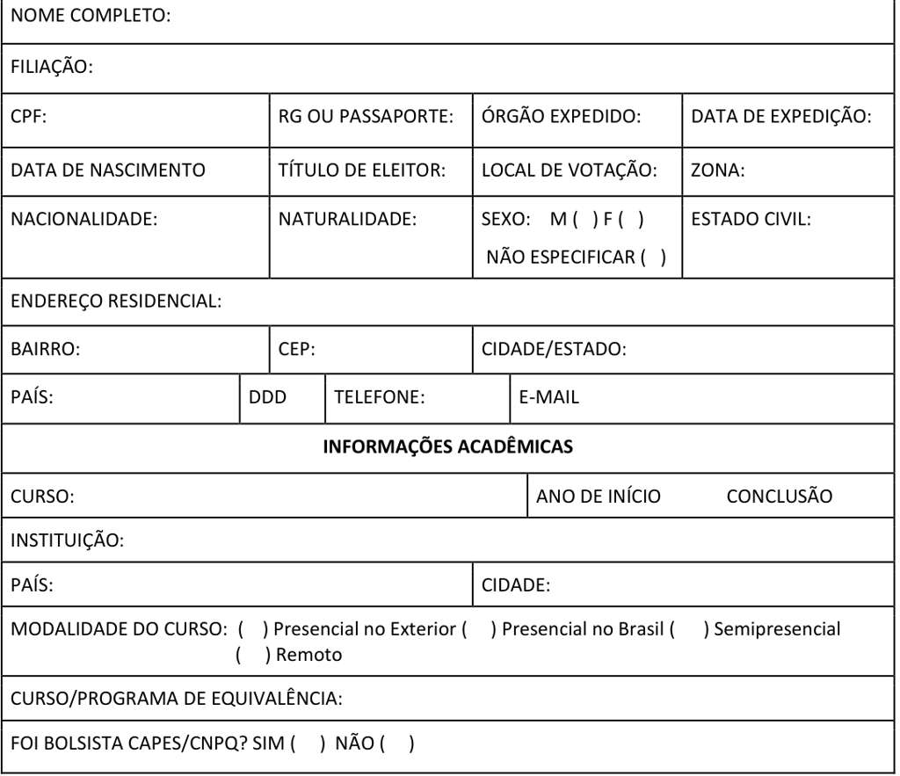

<!-- page 1 -->

## **MINISTÉRIO DA EDUCAÇÃO UNIVERSIDADE FEDERAL RURAL DE PERNAMBUCO SECRETARIA GERAL DOS CONSELHOS DA ADMINISTRAÇÃO SUPERIOR CONSELHO DE ENSINO, PESQUISA E EXTENSÃO** 

RESOLUÇÃO CEPE/UFRPE Nº 926, 19 DE AGOSTO DE 2025. 

Revoga a Resolução Nº 049/2017 do Pleno do CEPE, que disciplina o art. 166 do Regimento Geral da UFRPE e aprova novas normas para Revalidação de diplomas de Graduação e Reconhecimento de diplomas de Pós-Graduação **Stricto sensu** expedidos por estabelecimentos estrangeiros de Ensino Superior. 

A Presidente em exercício do Conselho de Ensino, Pesquisa e Extensão da Universidade Federal Rural de Pernambuco, no uso de suas atribuições e tendo em vista a Decisão Nº 16/2025 deste Conselho, em sua IV Reunião Ordinária, realizada no dia 18 de agosto de 2025, exarada no Processo UFRPE Nº 23082.031101/2024-41, 

CONSIDERANDO a competência atribuída às universidades públicas que oferecem cursos devidamente reconhecidos e avaliados de revalidar e reconhecer os diplomas de Graduação e de PósGraduação S **tricto sensu** (mestrado e doutorado) expedidos por estabelecimentos estrangeiros de ensino superior. 

CONSIDERANDO, principalmente, a necessidade de adequação das normas vigentes às novas realidades e à legislação do ensino de graduação e pós-graduação no país e de estabelecimento dos mecanismos para a tramitação dos processos de solicitação de revalidação de diplomas de Graduação e reconhecimento de diplomas de Pós-Graduação **Stricto sensu** , expedidos por estabelecimentos estrangeiros de ensino superior, sob as orientações gerais estabelecidas pelo Ministério da Educação (MEC), por meio da Secretaria de Educação Superior (SESu). 

CONSIDERANDO a Resolução CNE/CES Nº 2, de 19 de dezembro de 2024, que dispõe sobre normas referentes à revalidação de diplomas de cursos de graduação e ao reconhecimento de diplomas de pós-graduação **Stricto sensu** (mestrado e doutorado), expedidos por estabelecimentos estrangeiros de ensino superior. 

CONSIDERANDO a Portaria Nº 1.151, de 19 de junho de 2023 do Ministério da Educação, que dispõe sobre a revalidação de diplomas de graduação expedidos por estabelecimentos de ensino superior estrangeiro e dá outras providências, e 

CONSIDERANDO o Decreto nº 12.456, de 19 de maio de 2025, que dispõe sobre a oferta de educação a distância por instituições de educação superior em cursos de graduação e altera o Decreto nº 9.235, de 15 de dezembro de 2017, que dispõe sobre o exercício das funções de regulação, supervisão e 

Confere com o original assinado pela Reitora em exercício e arquivado nesta Secretaria Geral. 

<!-- page 2 -->

## **MINISTÉRIO DA EDUCAÇÃO UNIVERSIDADE FEDERAL RURAL DE PERNAMBUCO SECRETARIA GERAL DOS CONSELHOS DA ADMINISTRAÇÃO SUPERIOR CONSELHO DE ENISNO, PESQUISA E EXTENSÃO** 

(CONTINUAÇÃO DA RESOLUÇÃO CEPE/UFRPE Nº 926 DE 19 DE AGOSTO DE 2025) 

avaliação das instituições de educação superior e dos cursos superiores de graduação e de pósgraduação no Sistema Federal de Ensino. 

## **RESOLVE** 

Art. 1º  Aprovar, em sua área de competência, as novas normas que disciplinam os procedimentos administrativos referentes aos processos de revalidação de diplomas de Graduação e reconhecimento de diplomas de Pós-Graduação S **tricto sensu** (mestrado e doutorado), expedidos por Instituições Estrangeiras de Ensino Superior e conforme consta no Processo acima mencionado. 

Art. 2º Os diplomas de cursos de graduação e de pós-graduação **Stricto sensu** (mestrado e doutorado), expedidos por instituições estrangeiras de educação superior e pesquisa legalmente constituída para esse fim em seus países de origem, poderão ser declarados equivalentes pela UFRPE e hábeis para os fins previstos em lei, mediante processo de revalidação ou reconhecimento, respectivamente, nos termos da presente Resolução. 

§ 1º Os processos de revalidação e de reconhecimento devem ser fundamentados em análise relativa ao mérito e às condições acadêmicas do programa efetivamente cursado pelo (a) interessado (a), levando em consideração diferenças existentes entre as formas de funcionamento dos sistemas educacionais, das instituições e dos cursos em países distintos; 

§ 2º A solicitação de revalidação ou de reconhecimento de diploma obtidos no exterior será admitida a qualquer data e concluída no prazo de até 180 (cento e oitenta) dias para tramitação normal e de até 90 (noventa) dias para tramitação simplificada; 

§ 3º A UFRPE, dentro do prazo previsto no § 2º, deverá proceder ao exame da solicitação, elaborar parecer circunstanciado, bem como informar ao requerente o resultado da análise, que poderá ser pelo deferimento total, deferimento parcial ou indeferimento da revalidação ou do reconhecimento do diploma; 

§ 4º Após recebimento da solicitação de revalidação ou de reconhecimento, acompanhada da respectiva documentação de instrução, a UFRPE procederá, no prazo de 30 (trinta) dias, o exame preliminar da solicitação e emitirá despacho saneador acerca da adequação da documentação exigida ou da necessidade de complementação, bem como da existência de curso de mesmo nível ou área equivalente; 

§ 5º Verificada a adequação da documentação, o solicitante deverá comprovar o pagamento das taxas incidentes sobre o pedido em até 30 (trinta) dias corridos; 

Confere com o original assinado pela Reitora em exercício e arquivado nesta Secretaria Geral. 

<!-- page 3 -->

## **MINISTÉRIO DA EDUCAÇÃO UNIVERSIDADE FEDERAL RURAL DE PERNAMBUCO SECRETARIA GERAL DOS CONSELHOS DA ADMINISTRAÇÃO SUPERIOR CONSELHO DE ENISNO, PESQUISA E EXTENSÃO** 

(CONTINUAÇÃO DA RESOLUÇÃO CEPE/UFRPE Nº 926 DE 19 DE AGOSTO DE 2025) 

§ 6º O não cumprimento do estabelecido no parágrafo anterior motivará o cancelamento da solicitação; 

§ 7º A inexistência de curso de graduação na mesma área ou em área equivalente ou de curso de Pós-Graduação **Stricto sensu** na mesma área, do mesmo nível ou superior, inviabilizará a abertura do processo para Graduação e para Pós-Graduação, respectivamente, e deverá ser comunicada ao requerente no prazo previsto no § 4º; 

§ 8º Para a apresentação do pedido de revalidação ou reconhecimento, o requerente deverá assinar o termo de aceite de condições e compromissos, o qual incluirá: 

I. declaração de autenticidade da documentação e veracidade das informações; e 

II. termo de exclusividade, informando que não está submetendo o mesmo diploma a processo de revalidação ou reconhecimento em outra instituição de forma concomitante; 

§ 9º Caberá à UFRPE solicitar ao requerente, quando julgar necessário, a tradução dos documentos que acompanham o pedido de revalidação ou de reconhecimento: 

I. a tradução para língua portuguesa da documentação original em língua estrangeira, especificamente o Diploma, o Histórico e o Projeto Pedagógico ou a Integralização Curricular, será feita por Tradutor Público Juramentado e deverá constar das folhas imediatamente seguintes ao documento traduzido; e 

II. o disposto não se aplica aos documentos em inglês, francês e espanhol, desde que sejam esses os idiomas do documento original. 

§ 10. O Núcleo de Internacionalização - NINTER - da UFRPE prestará assistência, sempre que solicitada pela Pró-Reitoria de Ensino de Graduação ou pela Pró-Reitoria de Pós-Graduação, na tradução de documentos nos processos de revalidação ou de reconhecimento de diploma estrangeiro; 

§ 11. O diploma, quando revalidado ou reconhecido, deverá adotar a nomenclatura original do grau obtido pelo requerente, devendo constar, em apostilamento próprio, quando couber, grau afim utilizado no Brasil, correspondente ao grau original revalidado ou reconhecido; 

Art. 4º As solicitações de revalidação ou de reconhecimento de diploma de cursos realizados em sistema de Ensino à Distância (EaD) ou semipresencial serão analisadas apenas em caso de existência, na UFRPE, de curso nas referidas modalidades, em nível equivalente ou superior e em área idêntica, afim ou similar ao curso objeto de análise. 

Art. 5º Não serão revalidados diplomas Graduação ou reconhecidos diplomas de Pós-Graduação em nível de Mestrado e de Doutorado obtidos através de cursos ministrados no Brasil, oferecidos por instituições estrangeiras, especialmente nas modalidades semipresencial ou à distância, diretamente ou Confere com o original assinado pela Reitora em exercício e arquivado nesta Secretaria Geral. 

<!-- page 4 -->

## **MINISTÉRIO DA EDUCAÇÃO UNIVERSIDADE FEDERAL RURAL DE PERNAMBUCO SECRETARIA GERAL DOS CONSELHOS DA ADMINISTRAÇÃO SUPERIOR CONSELHO DE ENISNO, PESQUISA E EXTENSÃO** 

(CONTINUAÇÃO DA RESOLUÇÃO CEPE/UFRPE Nº 926 DE 19 DE AGOSTO DE 2025) 

mediante qualquer forma de associação com instituições nacionais, sem a devida autorização do Poder Público. 

Art. 6º Refugiados estrangeiros no Brasil que não estejam de posse da documentação requerida para a revalidação, nos termos desta Resolução, migrantes indocumentados e outros casos justificados e instruídos por legislação ou norma específica poderão ser submetidos à prova de conhecimentos, conteúdos e habilidades relativas ao curso completo, como forma exclusiva de avaliação destinada ao processo de revalidação. 

Art. 7º Considera-se incompatível com a legislação em vigor a negativa de trâmite a pedidos de revalidação de diplomas estrangeiros que se fundamentam, exclusivamente, no estado ou na região de residência do interessado, ou no país de origem do diploma a ser revalidado. 

Art. 8º Os dispositivos desta Resolução podem ser afastados nos casos dos cursos previstos em acordo cultural entre o Brasil e o país de origem do diploma, subsistindo, porém, a obrigatoriedade de registro, na conformidade do que é exigido pela legislação brasileira. 

Art. 9º A UFRPE adota a Plataforma Carolina Bori para tramitação de todos os seus processos de revalidação e de reconhecimento de diplomas, sendo vedado o trâmite por outros meios. 

Art. 10. É de responsabilidade do requerente identificar curso similar ou equivalente para o qual deseja fazer a solicitação. 

Art. 11. O(a) requerente deverá manter atualizados seus contatos para recebimento de comunicações e pedidos. 

Art. 12. A UFRPE reserva-se o direito de cancelar uma solicitação caso o(a) requerente não res- 

ponda quando demandado. 

Art. 13. Enquanto o pedido de revalidação ou de reconhecimento estiver em fila de espera, não correrão os prazos previstos nesta Resolução. 

Parágrafo único. A UFRPE poderá, a qualquer tempo, solicitar a paralisação de ingresso de novas solicitações de revalidação ou de reconhecimento na fila de espera. 

Art. 14. Os recessos oficiais da instituição incidirão diretamente na análise dos processos de revalidação e de reconhecimento, sendo esse tempo acrescido ao prazo de conclusão do processo. 

Art. 15. Os prazos tratados nesta Resolução, na Resolução CNE/CES Nº 2, de 19 de dezembro de 2024 e na Portaria nº 1.151, de 19 de junho de 2023, do Ministério da Educação, ou em outras que venham a substituí-las serão contados a partir do envio de mensagem por meio eletrônico, conforme previsto nesta Resolução, não sendo a UFRPE responsável por eventuais atrasos no envio da documentação pertinente por parte do requerente, qualquer que seja o motivo. 

Confere com o original assinado pela Reitora em exercício e arquivado nesta Secretaria Geral. 

<!-- page 5 -->

## **MINISTÉRIO DA EDUCAÇÃO UNIVERSIDADE FEDERAL RURAL DE PERNAMBUCO SECRETARIA GERAL DOS CONSELHOS DA ADMINISTRAÇÃO SUPERIOR CONSELHO DE ENISNO, PESQUISA E EXTENSÃO** 

(CONTINUAÇÃO DA RESOLUÇÃO CEPE/UFRPE Nº 926 DE 19 DE AGOSTO DE 2025) 

Art. 16. Os casos omissos nesta Resolução serão dirimidos pela Pró-Reitoria de Ensino de Graduação, em se tratando de revalidação de diploma, e pela Pró-Reitoria de Pós-Graduação, nos casos de reconhecimento de diploma. 

Art. 17  Esta Resolução entra em vigor em 19 de agosto de 2025, ficando revogada a Resolução CEPE/UFRPE n° 049/2017, datada de 02 de março de 2017. 

SALA DOS CONSELHOS SUPERIORES DA UFRPE. 

## **Profa. Maria do Socorro de Lima Oliveira** 

## Presidente em Exercício 

Confere com o original assinado pela Reitora em exercício e arquivado nesta Secretaria Geral. 

<!-- page 6 -->

## **MINISTÉRIO DA EDUCAÇÃO UNIVERSIDADE FEDERAL RURAL DE PERNAMBUCO SECRETARIA GERAL DOS CONSELHOS DA ADMINISTRAÇÃO SUPERIOR CONSELHO DE ENISNO, PESQUISA E EXTENSÃO** 

(CONTINUAÇÃO DA RESOLUÇÃO CEPE/UFRPE Nº 926 DE 19 DE AGOSTO DE 2025) 

## **ANEXO I** 

## **DOS PROCEDIMENTOS DE REVALIDAÇÃO DE DIPLOMA DE GRADUAÇÃO** 

Art. 1º Os diplomas de cursos de graduação, expedidos por instituições estrangeiras de educação superior, legalmente constituída para esse fim em seus países de origem, poderão ser declarados equivalentes aos concedidos no Brasil e hábeis para os fins previstos em lei, mediante processo de revalidação por instituição de ensino superior brasileira nos termos desta Resolução. 

§ 1º Os diplomas de graduação expedidos por estabelecimentos de ensino superior estrangeiro somente poderão ser revalidados por universidades públicas brasileiras que sejam regularmente credenciadas e mantidas pelo Poder Público e que tenham curso reconhecido do mesmo nível e área ou equivalente ao curso objeto do diploma a ser revalidado. 

§ 2º Apenas os cursos que apresentam Conceito Preliminar de Curso - CPC igual ou superior a 3 (três) poderão realizar a revalidação de diplomas estrangeiros. 

§ 3º As revalidações de diplomas obtidos em universidades estrangeiras caracterizam função pública necessária das instituições revalidadoras, nos termos do art. 48 da Lei Nº 9.394, de 20 de dezembro de 1996. 

§ 4º As revalidações de diplomas obtidos em universidades estrangeiras respeitarão os acordos internacionais de reciprocidade ou equiparação. 

§ 5º Nos processos de avaliação dos pedidos de revalidação de diplomas, a UFRPE poderá organizar comitês de avaliação com professores externos ao corpo docente institucional que possuam perfil acadêmico adequado à avaliação do processo específico. 

§ 6º No caso de processos de revalidação de cursos superiores de tecnologia, a instituição receptora do pedido poderá solicitar a participação de docentes e especialistas dos Institutos Federais de Educação Ciência e Tecnologia. 

Art. 2º Considera-se incompatível com a legislação em vigor a negativa de trâmite a pedidos de revalidação de diplomas estrangeiros que se fundamentam, exclusivamente, no estado ou na região de residência do interessado, ou no país de origem do diploma a ser revalidado. 

Confere com o original assinado pela Reitora em exercício e arquivado nesta Secretaria Geral. 

<!-- page 7 -->

## **MINISTÉRIO DA EDUCAÇÃO UNIVERSIDADE FEDERAL RURAL DE PERNAMBUCO SECRETARIA GERAL DOS CONSELHOS DA ADMINISTRAÇÃO SUPERIOR CONSELHO DE ENISNO, PESQUISA E EXTENSÃO** 

(CONTINUAÇÃO DA RESOLUÇÃO CEPE/UFRPE Nº 926 DE 19 DE AGOSTO DE 2025) 

Art. 3º A revalidação de diplomas estrangeiros deverá ser fundamentada em análise relativa ao mérito e às condições acadêmicas da graduação cursada pelo interessado e, quando for o caso, no desempenho global da instituição ofertante, levando em consideração diferenças existentes entre as formas de funcionamento dos sistemas educacionais, das instituições e dos cursos em países distintos. 

Art. 4º As solicitações de revalidação de diploma de cursos realizados em sistema de Educação à Distância (EaD) ou semipresencial serão analisadas apenas em caso de existência, na UFRPE, de curso nas referidas modalidades, em nível equivalente ou superior e em área idêntica, afim ou similar ao curso objeto de análise. 

Da Instrução Documental 

Art. 5º O processo de revalidação será instaurado por requerimento do interessado à Pró-Reitoria de Ensino de Graduação (PREG), via Plataforma Carolina Bori, instruído com os seguintes documentos: 

I. Formulário de solicitação contendo os dados pessoais e, quando for o caso, informações acerca de vinculação institucional que mantenha no Brasil (Anexo III); 

II. documentos pessoais: 

a) documento de identificação com foto; 

b) se estrangeiro, cópia da cédula de identidade de estrangeiro com comprovação de regularidade da permanência no Brasil, expedida pela Superintendência da Polícia Federal. 

c) CPF; 

d) título de eleitor 

e) comprovante de quitação eleitoral; 

f) documento de dispensa militar (somente para homens); 

g) certidão de nascimento ou casamento; e 

h) comprovante de residência. 

III. cópia do diploma a ser revalidado, devidamente registrado pela instituição estrangeira responsável pela diplomação, em observância aos acordos internacionais firmados; 

IV. cópia do histórico escolar, emitido pela instituição estrangeira responsável pela diplomação, contendo as disciplinas ou atividades cursadas e aproveitadas em relação aos resultados das avaliações e frequência, bem como a tipificação e o aproveitamento de estágio e outras atividades de pesquisa e 

Confere com o original assinado pela Reitora em exercício e arquivado nesta Secretaria Geral. 

<!-- page 8 -->

## **MINISTÉRIO DA EDUCAÇÃO UNIVERSIDADE FEDERAL RURAL DE PERNAMBUCO SECRETARIA GERAL DOS CONSELHOS DA ADMINISTRAÇÃO SUPERIOR CONSELHO DE ENISNO, PESQUISA E EXTENSÃO** 

(CONTINUAÇÃO DA RESOLUÇÃO CEPE/UFRPE Nº 926 DE 19 DE AGOSTO DE 2025) 

extensão, classificadas como obrigatórias e não obrigatórias, devidamente autenticadas pela instituição estrangeira responsável pela diplomação, em observância aos acordos internacionais firmados; 

V. projeto pedagógico ou organização curricular do curso, indicando os conteúdos programáticos, as ementas das disciplinas e as atividades relativas à pesquisa e extensão, bem como o processo de integralização do curso, autenticado pela instituição estrangeira responsável pela diplomação; 

VI. nominata e titulação do corpo docente responsável pela oferta das disciplinas no curso concluído no exterior, autenticados pela instituição estrangeira responsável pela diplomação; 

VII. informações institucionais, quando disponíveis, relativas ao acervo da biblioteca e dos laboratórios, planos de desenvolvimento institucional e planejamento, relatórios de avaliação e de desempenho internos ou externos, políticas e estratégias educacionais de ensino, extensão e pesquisa, autenticados pela instituição estrangeira responsável pela diplomação; 

VIII. reportagens, artigos ou documentos indicativos da reputação, da qualidade e dos serviços prestados pelo curso e pela instituição, quando disponíveis e a critério do interessado; 

IX. declaração de autenticidade e veracidade das informações prestadas (Anexo V); 

X. termo de exclusividade, informando que não está submetendo o mesmo diploma a processo de revalidação em outra instituição de forma concomitante (Anexo VI); e 

XI. comprovante de pagamento das taxas correspondentes a este processo; 

§ 1º Estão dispensados do visto consular graus, títulos, diplomas e históricos (quando do diploma em tramitação) expedidos por instituições estrangeiras responsáveis pela diplomação, no caso de sua origem ser de um país signatário da Convenção de Haia (Resolução CNJ nº 228, de 2016, do Conselho Nacional de Justiça). Nesses casos, a cópia do Diploma a ser revalidado e o histórico devem conter Apostila da Convenção de Haia. 

§ 2º No caso de o país não ser signatário da Convenção de Haia, o diploma e o histórico devem ser autenticados no Consulado Brasileiro localizado no país em que funcionar a sede da Instituição outorgante do título. 

§ 3º Durante os procedimentos de revalidação, o requerente deverá apresentar, quando solicitado, os originais dos documentos. 

§ 4º A avaliação deverá considerar prioritariamente as informações apresentadas pelo requerente no processo, especialmente quanto à organização curricular, ao perfil do corpo docente, às formas de progressão, à conclusão e à avaliação de desempenho do requerente. 

Confere com o original assinado pela Reitora em exercício e arquivado nesta Secretaria Geral. 

<!-- page 9 -->

## **MINISTÉRIO DA EDUCAÇÃO UNIVERSIDADE FEDERAL RURAL DE PERNAMBUCO SECRETARIA GERAL DOS CONSELHOS DA ADMINISTRAÇÃO SUPERIOR CONSELHO DE ENISNO, PESQUISA E EXTENSÃO** 

(CONTINUAÇÃO DA RESOLUÇÃO CEPE/UFRPE Nº 926 DE 19 DE AGOSTO DE 2025) 

Art. 6º O requerente estrangeiro reconhecido como refugiado deverá apresentar a Carteira de Registro Nacional Migratório - CRNM - e o Cadastro de Pessoa Física - CPF. 

Parágrafo único. O estrangeiro solicitante de refúgio que ainda aguarda decisão do Comitê Nacional para os Refugiados do Ministério da Justiça - CONARE/MJ - deverá apresentar o Documento Provisório de Registro Nacional Migratório ou o protocolo de solicitação de revalidação da condição de refugiado. 

Art. 7º A instrução documental de que trata o art. 5º poderá ser substituída ou complementada por meio da aplicação de provas ou exames que abranjam o conjunto de conhecimentos, conteúdos, competências e habilidades relativos ao curso completo ou dedicados à etapa ou período do curso ou, ainda, à disciplina específica ou à(s) atividade(s) acadêmica(s) obrigatória(s). 

Parágrafo único. As provas e os exames a que se referem **o caput** deverão ser organizados e aplicados pela UFRPE, podendo ser repetidos a critério da instituição, salvo nos casos em que a legislação ou as normas vigentes proporcionarem a organização direta de exames ou provas por órgãos do Ministério da Educação, em convênio ou termo de compromisso com universidades revalidadoras. 

Art. 8º Refugiados no Brasil, migrantes indocumentados e de acolhida humanitária e outros casos justificados e instruídos por legislação ou norma específica que não estejam de posse da documentação requerida para a revalidação, nos termos desta Resolução, poderão ser submetidos à prova de conhecimentos, conteúdos e habilidades relativas ao curso completo, como forma exclusiva de avaliação destinada ao processo de revalidação. 

Parágrafo único. Para auxiliar a comprovação da formação acadêmica ou da experiência profissional do requerente, a UFRPE poderá aceitar depoimento pessoal, indicação de colegas de turma que tenham obtido o mesmo diploma, indicação de professores que possam prestar informações sobre o desempenho acadêmico, indicações de pessoas ou empresas com as quais tenha trabalhado e que possam fornecer informações sobre seu desempenho profissional na área de formação e demais documentos. 

Art. 9º Caberá à UFRPE justificar a necessidade de aplicação de provas ou exames. 

Art. 10. Quando os resultados da análise documental, bem como de exames e provas, demonstrarem o preenchimento parcial das condições exigidas para revalidação, o(a) requerente poderá, por indicação da UFRPE, realizar estudos ou atividades complementares,  a serem cursados na UFRPE ou em outra universidade pública, sob a forma de matrícula regular em disciplinas do curso a ser revalidado. 

Confere com o original assinado pela Reitora em exercício e arquivado nesta Secretaria Geral. 

<!-- page 10 -->

## **MINISTÉRIO DA EDUCAÇÃO UNIVERSIDADE FEDERAL RURAL DE PERNAMBUCO SECRETARIA GERAL DOS CONSELHOS DA ADMINISTRAÇÃO SUPERIOR CONSELHO DE ENISNO, PESQUISA E EXTENSÃO** 

(CONTINUAÇÃO DA RESOLUÇÃO CEPE/UFRPE Nº 926 DE 19 DE AGOSTO DE 2025) 

§ 1º Em relação aos estudos a que se refere o **caput,** uma vez sendo realizados sob a responsabilidade da UFRPE, os requerentes serão admitidos nas disciplinas específicas indicadas como alunos especiais em fase de revalidação de estudos, não sendo, portanto, ocupantes de vagas existentes; 

§ 2º Ficará a cargo da UFRPE a definição de critérios de ingresso de alunos especiais, conforme parágrafo anterior, em atividades práticas; 

§ 3º A realização de estudos complementares de que trata este artigo se justificará para fins de avaliação de conhecimentos, conteúdos, competências e habilidades relativos ao curso cujo diploma se deseja revalidar, sendo incompatível com a legislação a sua justificativa exclusiva para a complementação de carga horária; 

§ 4º Em qualquer caso, para o cumprimento do disposto no **caput,** os cursos de graduação deverão estar em funcionamento regular no âmbito da legislação educacional brasileira e demonstrar desempenho positivo nas avaliações realizadas pelo Ministério da Educação e pelos respectivos sistemas estaduais de ensino; 

Art. 11. No caso de dupla titulação obtida no exterior, o diplomado poderá solicitar a revalidação dos dois diplomas mediante a apresentação de cópia da documentação que comprove a existência do programa de dupla titulação, bem como o projeto pedagógico ou a organização curricular que deu origem à dupla titulação. 

Art. 12. No caso de cursos ou programas ofertados em consórcios ou outros arranjos colaborativos entre diferentes instituições, o requerente deverá apresentar cópia da documentação que fundamenta a cooperação ou o consórcio, bem como a comprovação de eventuais apoios de agências de fomento internacionais ou nacionais ao projeto de colaboração. 

Art. 13. Quando solicitada a revalidação de curso, o interessado deverá indicar, na solicitação, o nome do curso para o qual pretende obter equivalência. 

Parágrafo único. No decorrer da análise, a UFRPE poderá conceder equivalência em curso afim ao cursado no exterior. 

## **Da Avaliação Inicial** 

Art. 14. Após o recebimento do pedido de revalidação, acompanhado da respectiva documentação de instrução, a PREG fará, no prazo de 30 (trinta) dias, o exame preliminar do pedido e emitirá despacho acerca da adequação da documentação exigida ou da necessidade de complementação. Confere com o original assinado pela Reitora em exercício e arquivado nesta Secretaria Geral. 

<!-- page 11 -->

## **MINISTÉRIO DA EDUCAÇÃO UNIVERSIDADE FEDERAL RURAL DE PERNAMBUCO SECRETARIA GERAL DOS CONSELHOS DA ADMINISTRAÇÃO SUPERIOR CONSELHO DE ENISNO, PESQUISA E EXTENSÃO** 

(CONTINUAÇÃO DA RESOLUÇÃO CEPE/UFRPE Nº 926 DE 19 DE AGOSTO DE 2025) 

§ 1º A PREG verificará a existência de Curso de Graduação que atenda ao disposto na Portaria MEC nº 1.151 de 19 de junho de 2023, decidindo, com base nessa análise, pela continuidade ou não do processo de avaliação; 

§ 2º A inexistência de curso de mesmo nível ou área equivalente inviabilizará a abertura do processo na UFRPE; 

§ 3º Caberá à PREG informar, via Plataforma Carolina Bori, a continuidade do processo de avaliação, sendo vedadas solicitações de revalidação  iguais e concomitantes em mais de uma universidade; 

§ 4º Verificada a adequação da documentação, a PREG emitirá guia para pagamento das taxas incidentes sobre o pedido de revalidação, informando ao requerente, via Plataforma Carolina Bori, sobre a necessidade de realização do pagamento; 

§ 5º O pagamento ou concessão de isenção da taxa de serviço é condição necessária para a abertura e para a emissão do número correspondente ao processo; 

Art. 16. Sendo verificada a necessidade de complementação da documentação, o requerente deverá apresentá-la em até 30 (trinta) dias, contados a partir da ciência da solicitação. 

§ 1º Não sendo possível o cumprimento do prazo estabelecido no **caput** , o requerente poderá solicitar à UFRPE a suspensão do processo por até 90 (noventa) dias; 

§ 2º O não cumprimento, pelo requerente, de diligência destinada à complementação da instrução no prazo assinalado pela UFRPE ensejará o indeferimento do pedido e sua solicitação será cancelada; 

Art. 17. O indeferimento do pedido por não cumprimento de diligência destinada à complementação da instrução, por inexistência de curso de mesmo nível ou área equivalente ou por falta de pagamento de eventuais taxas exigidas para a abertura do processo e emissão do número de protocolo não constitui exame de mérito. 

## **Da Tramitação Simplificada** 

Art. 18. A tramitação simplificada dos pedidos de revalidação de diplomas expedidos por universidade estrangeira aplica-se, exclusivamente, aos casos definidos na Resolução CNE/CES Nº 2, de 19 de dezembro de 2024 e na Portaria 1.151, de 19 de junho de 2023. 

Confere com o original assinado pela Reitora em exercício e arquivado nesta Secretaria Geral. 

<!-- page 12 -->

## **MINISTÉRIO DA EDUCAÇÃO UNIVERSIDADE FEDERAL RURAL DE PERNAMBUCO SECRETARIA GERAL DOS CONSELHOS DA ADMINISTRAÇÃO SUPERIOR CONSELHO DE ENISNO, PESQUISA E EXTENSÃO** 

(CONTINUAÇÃO DA RESOLUÇÃO CEPE/UFRPE Nº 926 DE 19 DE AGOSTO DE 2025) 

§ 1º A tramitação simplificada de que trata o **caput** deverá se ater, exclusivamente, à verificação da documentação comprobatória da diplomação no curso; 

§ 2º Nos casos de tramitação simplificada, a UFRPE encerrará o processo de revalidação em até 90 (noventa) dias, contados a partir da data do protocolo do pedido de revalidação. 

Art. 19. A tramitação simplificada aplica-se: 

I. aos diplomas obtidos em cursos estrangeiros, da mesma instituição de origem, cujos diplomas já tenham sido objeto de revalidação nos últimos 5 (cinco) anos; 

II. aos diplomados em cursos de instituições estrangeiras que tenham obtido resultado positivo no âmbito da avaliação do Sistema de Acreditação Regional de Cursos de Graduação do Mercosul - ArcuSul; 

III. aos estudantes de cursos ou programas estrangeiros que tenham recebido bolsa de estudos por agência governamental brasileira no prazo de 5 (cinco) anos; 

IV. aos diplomas obtidos por meio do Módulo Internacional no âmbito do Programa Universidade para Todos - Prouni, conforme Portaria MEC Nº 381, de 29 de março de 2010; 

V. aos estudantes que receberam bolsa de estudo específica para o curso superior objeto da revalidação, oferecida por uma agência governamental brasileira; e 

VI. aos cursos estrangeiros equivalentes à graduação brasileira devidamente listados ou admitidos em acordos bilaterais ou multilaterais sobre diplomas, em vigor no Brasil, que contemplem processos de avaliação prévia. 

Parágrafo único. A lista a que se refere o item I deste artigo abrangerá cursos ou programas cujos diplomas já foram submetidos a 3 (três) análises por instituições revalidadoras diferentes e para os quais a revalidação tenha sido deferida de forma plena, sem a realização de atividades complementares e/ou a realização de provas ou exames. 

Art. 20. A tramitação simplificada **não** se aplica: 

I. aos casos em que as revalidações anteriores tenham sido obtidas por meio da aplicação de provas ou exames complementares pela universidade revalidadora, relativos ao cumprimento do curso completo, de etapa ou período do curso, de conteúdo disciplinar específico ou de atividade acadêmica curricular obrigatória; 

Confere com o original assinado pela Reitora em exercício e arquivado nesta Secretaria Geral. 

<!-- page 13 -->

## **MINISTÉRIO DA EDUCAÇÃO UNIVERSIDADE FEDERAL RURAL DE PERNAMBUCO SECRETARIA GERAL DOS CONSELHOS DA ADMINISTRAÇÃO SUPERIOR CONSELHO DE ENISNO, PESQUISA E EXTENSÃO** 

(CONTINUAÇÃO DA RESOLUÇÃO CEPE/UFRPE Nº 926 DE 19 DE AGOSTO DE 2025) 

II. aos pedidos de revalidação de diplomas correspondentes a cursos estrangeiros indicados ou admitidos em acordos de cooperação internacional firmados por organismo brasileiro que não tenham sido submetidos a processo prévio de avaliação por órgão público competente ou por instituição acreditadora reconhecida pelo Poder Público; 

III. aos pedidos de revalidação de diplomas correspondentes a cursos estrangeiros que, em caso de avaliação, tenham obtido resultado negativo; e 

IV. aos pedidos de revalidação de diplomas correspondentes a cursos estrangeiros indicados ou admitidos em acordos de cooperação internacional, firmados por organismo brasileiro, que tenham sido submetidos a processo prévio de avaliação por órgão público competente ou por instituição acreditadora reconhecida pelo poder público e que tenham obtido resultado negativo. 

## **Da Análise pela Comissão Especial** 

Art. 21. Estando o processo instruído adequadamente às normas da UFRPE, a PREG, via Plataforma Carolina Bori, enviará o processo ao Colegiado de Coordenação Didática (CCD) do Curso de Graduação, na mesma área de conhecimento ou de áreas afins ao curso do requerente, que designará uma Comissão Especial, constituída por Professores que tenham a qualificação compatível com a área de conhecimento, para apreciar a documentação de revalidação do diploma. 

Art. 22. O julgamento da equivalência, para efeito de revalidação, será feito pela Comissão Especial de no mínimo 03 (três) professores da UFRPE, especialmente constituída e nomeada pelo CCD do Curso de Graduação. 

Parágrafo único. A Comissão Especial citada no art. 21 deverá examinar, entre outros, os seguintes aspectos: 

- I. afinidade de área entre o curso realizado no exterior e o oferecido pela UFRPE; 

- II. cumprimento da carga horária mínima estabelecida pelas Diretrizes Curriculares vigentes no cur- 

so; 

III. habilitação e qualificação conferida pelo diploma e adequação da documentação que o acompanha; 

- IV. correspondência do curso realizado no exterior com o que é oferecido na UFRPE; e 

- V. manifestar-se pelo deferimento ou pelo indeferimento da revalidação pleiteada. 

Confere com o original assinado pela Reitora em exercício e arquivado nesta Secretaria Geral. 

<!-- page 14 -->

## **MINISTÉRIO DA EDUCAÇÃO UNIVERSIDADE FEDERAL RURAL DE PERNAMBUCO SECRETARIA GERAL DOS CONSELHOS DA ADMINISTRAÇÃO SUPERIOR CONSELHO DE ENISNO, PESQUISA E EXTENSÃO** 

(CONTINUAÇÃO DA RESOLUÇÃO CEPE/UFRPE Nº 926 DE 19 DE AGOSTO DE 2025) 

Art. 23. Na ausência de Diretrizes Curriculares Nacionais específicas, será adotada como referência a carga horária do curso equivalente na UFRPE. 

Art. 24.  Na hipótese de surgirem dúvidas sobre a real equivalência dos estudos realizados no exterior ao correspondente nacional, poderá a Comissão Especial solicitar parecer de instituição de ensino especializada na área de conhecimento na qual foi obtido o título. 

Art. 25. A Comissão Especial emitirá parecer técnico no prazo de 60 (sessenta) dias corridos, onde demonstrará o cumprimento das Diretrizes Curriculares pertinentes ao curso ou do currículo pleno do curso da UFRPE, nos casos de cursos em que não houver definição legal de diretrizes mínimas. 

Art. 26. Se a comparação dos títulos demonstrarem o não preenchimento das condições exigidas para revalidação, a Comissão Especial poderá determinar ao requerente uma das seguintes opções: 

I. realização de estudos complementares na própria universidade ou em outra instituição que ministre correspondente curso, desde que não ultrapassem 20% (vinte por cento) das disciplinas do curso e haja aproveitamento e frequência; 

II. realização de apenas exames e provas referentes às disciplinas faltantes, destinados à caracterização dessa equivalência em língua portuguesa, desde que não se atinja 30% (trinta por cento) das disciplinas no curso.  Nesse caso, o requerente deverá ser avaliado em prazo a ser fixado pela Comissão Especial; e 

III. realização de exames e provas em algumas disciplinas e, em outras, realizações de estudos complementares, desde que, conforme incisos I e II, os estudos complementares não ultrapassem 20% (vinte por cento) e  os exames e provas não ultrapassem 30% (trinta por cento) das disciplinas do curso. 

Art. 27. Satisfeita a exigência de complementação de estudos, o processo seguirá para parecer da Comissão Especial no prazo de 15 (quinze) dias corridos. 

Art. 28. O parecer técnico da Comissão Especial deverá ser submetido à apreciação e à homologação do CCD do curso no prazo de 15 (quinze) dias corridos. 

Parágrafo único. A PREG informará a decisão do CCD ao solicitante através de mensagem enviada por meio eletrônico, a qual será anexada ao processo. 

Art. 29. O processo será encaminhado ao (à) Presidente da Câmara de Ensino de Graduação, que designará um(a) Conselheiro(a) para apreciar a análise e emitir parecer no prazo máximo de 15 (quinze) dias corridos. 

Confere com o original assinado pela Reitora em exercício e arquivado nesta Secretaria Geral. 

<!-- page 15 -->

## **MINISTÉRIO DA EDUCAÇÃO UNIVERSIDADE FEDERAL RURAL DE PERNAMBUCO SECRETARIA GERAL DOS CONSELHOS DA ADMINISTRAÇÃO SUPERIOR CONSELHO DE ENISNO, PESQUISA E EXTENSÃO** 

(CONTINUAÇÃO DA RESOLUÇÃO CEPE/UFRPE Nº 926 DE 19 DE AGOSTO DE 2025) 

§ 1º O parecer do Conselheiro será submetido à aprovação do plenário da Câmara de Ensino de Graduação, que tomará a decisão final a respeito do deferimento ou não do pleito; 

§ 2º O parecer de deferimento ou indeferimento da Câmara de Ensino de Graduação deverá ser registrado no Portal Carolina Bori pela Pró-Reitoria de Ensino de Graduação. 

§ 3º A tramitação na Câmara de Ensino de Graduação terá duração máxima de 45 (quarenta e cinco) dias corridos, incluído o prazo previsto no **caput** deste artigo. 

Art. 30. Após análise pela Câmara de Ensino de Graduação e deferida a solicitação, a Secretaria Geral dos Conselhos Superiores da UFRPE emitirá a Resolução de revalidação no prazo previsto no **caput** deste artigo. 

Parágrafo único. Concluídos os trâmites na Secretaria Geral dos Conselhos Superiores da UFRPE, o(a) requerente será comunicado(a) do resultado e, em caso de deferimento da solicitação, deverá apresentar a documentação necessária ao Departamento de Registro e Controle Acadêmico (DRCA) para fins de apostilamento do diploma. 

Art. 31. Após emissão da Resolução, tratando-se da tramitação simplificada ou da análise da Comissão Especial, o prazo não correrá até que se dê a apresentação do diploma original e da da documentação pessoal, para se proceder ao apostilamento do diploma pelo Departamento de Registro e Controle Acadêmico (DRCA). 

§ 1º- O apostilamento deverá ocorrer no prazo máximo de 15 (quinze) dias contados a partir da apresentação do diploma original e da documentação pessoal. 

§ 2º  - O termo de apostila será assinado pelo(a) Reitor(a) da UFRPE. 

§ 3º - Dar-se-ão os procedimentos em conformidade com o previsto na legislação para diplomas conferidos por instituições de ensino superior brasileiras. 

§ 4º Nenhum outro documento que, a priori, tenha valor equivalente será aceito pela UFRPE como substituto do Diploma; 

§ 5º Para refugiados, apátridas, beneficiários de acolhida humanitária e imigrantes indocumentados, a UFRPE, no uso de sua autonomia, poderá expedir Certificado de Revalidação de Diploma contendo os termos da apostila quando da impossibilidade de apostilamento do diploma original; 

Confere com o original assinado pela Reitora em exercício e arquivado nesta Secretaria Geral. 

<!-- page 16 -->

## **MINISTÉRIO DA EDUCAÇÃO UNIVERSIDADE FEDERAL RURAL DE PERNAMBUCO SECRETARIA GERAL DOS CONSELHOS DA ADMINISTRAÇÃO SUPERIOR CONSELHO DE ENISNO, PESQUISA E EXTENSÃO** 

(CONTINUAÇÃO DA RESOLUÇÃO CEPE/UFRPE Nº 926 DE 19 DE AGOSTO DE 2025) 

§ 6º O prazo referido no parágrafo 1º do artigo 31 será considerado até o momento do envio de mensagem por meio eletrônico ao solicitante, solicitando o envio do diploma, não sendo a UFRPE responsável por eventual atraso, qualquer que seja o motivo. 

Art. 32. O diploma, quando revalidado, deverá preservar a nomenclatura original do grau ou título obtido pelo requerente, devendo constar, em apostilamento próprio, quando couber, o grau afim utilizado no Brasil correspondente ao grau original revalidado. 

Art. 33. Os prazos tratados na Resolução CNE/CES nº 2, de 19 de dezembro de 2024, e na Portaria 1.151, de 19 de junho de 2023, serão considerados até o momento do envio, ao solicitante, da mensagem por meio eletrônico acima especificado, não sendo a UFRPE responsável por eventual atraso no envio da documentação pertinente, qualquer que seja o motivo. 

Art. 34. A UFRPE deve pronunciar-se sobre o pedido de revalidação no prazo máximo de 180 (cento e oitenta) dias da data de recepção do processo, fazendo o devido registro ou, em caso de indeferimento, informando ao requerente com a justificativa cabível. 

## **Dos Recursos** 

Art. 35. No caso de indeferimento, o requerente poderá recorrer do parecer para o Conselho de Ensino, Pesquisa e Extensão (CEPE) da UFRPE, no prazo de 07 (sete) dias úteis, contados a partir da data da comunicação ao requerente; 

Parágrafo único. Indeferido o recurso, o requerente poderá recorrer, em última instância, ao Conselho Universitário (CONSU) da UFRPE, no prazo de 7 (sete) dias úteis, contados a partir da data da comunicação ao requerente. 

## **Da Taxa de Serviço** 

Art. 36. O valor a ser pago pelo serviço de revalidação de diploma será fixado pelo Conselho de Curadores da UFRPE. 

§ 1º O valor referente ao serviço poderá ser reajustado a qualquer tempo, a critério da UFRPE; 

§ 2º Estão isentos do pagamento da taxa de serviço os servidores (Docentes/Técnicos Administrativos) da UFRPE; 

Confere com o original assinado pela Reitora em exercício e arquivado nesta Secretaria Geral. 

<!-- page 17 -->

## **MINISTÉRIO DA EDUCAÇÃO UNIVERSIDADE FEDERAL RURAL DE PERNAMBUCO SECRETARIA GERAL DOS CONSELHOS DA ADMINISTRAÇÃO SUPERIOR CONSELHO DE ENISNO, PESQUISA E EXTENSÃO** 

(CONTINUAÇÃO DA RESOLUÇÃO CEPE/UFRPE Nº 926 DE 19 DE AGOSTO DE 2025) 

§ 3º O pagamento da taxa de serviço deverá ser efetuado em até 30 (trinta) dias corridos após solicitação por parte da PREG; 

§ 4º Não havendo pagamento, sem justificativa, no prazo estabelecido no parágrafo anterior, a solicitação será cancelada. 

## **ANEXO II** 

## **DO RECONHECIMENTO DOS DIPLOMAS DE PÓS-GRADUAÇÃO** 

Art. 1º Os diplomas de cursos de pós-graduação S **tricto sensu** (mestrado e doutorado) expedidos por universidades estrangeiras só poderão ser reconhecidos por universidades brasileiras regularmente credenciadas que possuam cursos de pós-graduação avaliados, autorizados e reconhecidos, no âmbito do Sistema Nacional de Pós-Graduação (SNPG), na mesma área de conhecimento, em nível equivalente ou superior. 

Parágrafo único. Entendem-se como áreas de conhecimento as áreas de avaliação classificadas pela Coordenação de Aperfeiçoamento de Pessoal de Nível Superior (Capes). 

Art. 2º O processo de reconhecimento abrangerá: 

I. a análise da regularidade e legalidade da instituição e do curso; 

II. a avaliação de mérito do desempenho acadêmico do interessado e de seu aproveitamento na realização do curso; 

III. a análise das condições de organização acadêmica do curso; e 

IV. a análise, quando for o caso, do desempenho global da instituição ofertante, especialmente nas atividades de pesquisa, por meio de indicadores reconhecidos no ambiente internacional acadêmico de pós-graduação. 

§ 1º O processo de avaliação deverá considerar as características do curso estrangeiro, tais como o reconhecimento do curso pelas autoridades competentes no país de origem, a organização institucional da pesquisa acadêmica no âmbito da pós-graduação **Stricto sensu** , a forma de avaliação do candidato para integralização do curso, o processo de orientação e o resultado da defesa da tese ou dissertação. 

Confere com o original assinado pela Reitora em exercício e arquivado nesta Secretaria Geral. 

<!-- page 18 -->

## **MINISTÉRIO DA EDUCAÇÃO UNIVERSIDADE FEDERAL RURAL DE PERNAMBUCO SECRETARIA GERAL DOS CONSELHOS DA ADMINISTRAÇÃO SUPERIOR CONSELHO DE ENISNO, PESQUISA E EXTENSÃO** 

(CONTINUAÇÃO DA RESOLUÇÃO CEPE/UFRPE Nº 926 DE 19 DE AGOSTO DE 2025) 

§ 2º O processo de avaliação deverá considerar, pela UFRPE, os diplomas resultantes de cursos com características curriculares e de organização de pesquisa na área, mesmo que não completamente coincidentes com seus próprios programas e cursos S **tricto sensu** ofertados. 

§ 3º Para o cumprimento do disposto no parágrafo anterior, é facultado à UFRPE instituir comitês de avaliação, com a participação de professores ou pesquisadores externos ao corpo docente institucional, desde que aqueles possuam perfil acadêmico adequado à avaliação do processo específico. 

Art. 3º Compete à Câmara de Pós-Graduação do Conselho de Ensino, Pesquisa e Extensão (CEPE) da UFRPE decidir sobre o reconhecimento de graus, títulos, diplomas ou certificados de cursos de Pós– Graduação S **tricto sensu** expedidos por instituições estrangeiras de ensino superior. 

Art. 4º O processo de reconhecimento dar-se-á a partir da avaliação de mérito do desempenho acadêmico do interessado e de seu aproveitamento na realização da pós-graduação **Stricto sensu** , das condições de organização acadêmica do curso e, quando for o caso, poderá ser considerado o desempenho global da instituição ofertante, especialmente na atividade de pesquisa. 

Art. 5º O processo de reconhecimento de diplomas obtidos no exterior poderá ser solicitado a qualquer tempo e deverá ser concluído no prazo máximo de 180 (cento e oitenta) dias, para a tramitação normal, ou de 90 (noventa) dias, para a tramitação simplificada, contados a partir da validação do pagamento ou da concessão de isenção da taxa de serviço e autuação do processo. 

Art. 6º A UFRPE, durante o processo de reconhecimento, poderá justificar a necessidade de ampliação do prazo por, no máximo, período igual ao previsto no artigo anterior, submetendo a solicitação à análise de órgãos ou colegiados superiores à instância responsável pelo reconhecimento, com a devida justificativa detalhada para a conclusão da análise ou da avaliação. 

Art. 7º As solicitações de reconhecimento de diploma de cursos realizados em sistema de Educação a Distância (EaD) ou semipresencial serão analisadas apenas em caso de existência, na UFRPE, de curso nas referidas modalidades, em nível equivalente ou superior e em área idêntica, afim ou similar ao curso objeto de análise 

Art. 8º **Não** serão aceitas solicitações de reconhecimento dos seguintes títulos: 

- I. **Licence** e **Maitrice** , expedidos por instituições francesas; 

- II. **Première License** e **Deuxième License** , expedidos por instituições belgas; 

- III. **Juris Doctor** e **Master in Business Administration** (MBA), expedidos por instituições americanas; 

Confere com o original assinado pela Reitora em exercício e arquivado nesta Secretaria Geral. 

<!-- page 19 -->

## **MINISTÉRIO DA EDUCAÇÃO UNIVERSIDADE FEDERAL RURAL DE PERNAMBUCO SECRETARIA GERAL DOS CONSELHOS DA ADMINISTRAÇÃO SUPERIOR CONSELHO DE ENISNO, PESQUISA E EXTENSÃO** 

(CONTINUAÇÃO DA RESOLUÇÃO CEPE/UFRPE Nº 926 DE 19 DE AGOSTO DE 2025) 

IV. **Specializzazione** ou **Perfezionamento** , expedidos por instituições italianas; e 

V. outros  títulos considerados sem equivalência no Brasil, conforme legislação federal à época da obtenção do título. 

Art. 9º O processo de reconhecimento será instaurado por requerimento do(a) interessado(a) à Pró-Reitoria de Pós-Graduação (PRPG) da UFRPE, via Plataforma Carolina Bori, instruído com os seguintes documentos: 

I. Formulário de solicitação contendo os dados pessoais e, quando for o caso, informações acerca de vinculação institucional que mantenha no Brasil (Anexo IV); 

II. documentos pessoais; 

a) documento de identificação com foto; 

b) se estrangeiro, cópia da cédula de identidade de estrangeiro com comprovação de regularidade da permanência no Brasil, expedida pela Superintendência da Polícia Federal. 

c) CPF; 

d) título de eleitor; 

e) comprovante de quitação eleitoral; 

f) documento de dispensa militar (somente para homens); 

g) certidão de nascimento ou casamento; e 

h) comprovante de residência. 

III. cópia do diploma devidamente registrado pela instituição responsável pela diplomação, de acordo com a legislação vigente no país de origem, em observância aos acordos internacionais firmados; 

IV. exemplar da tese, dissertação ou similar, com o respectivo registro do processo avaliativo e aprovação, autenticado pela instituição de origem, com cópia em arquivo digital em formato compatível, acompanhada dos seguintes documentos: 

a) ata ou documento oficial da instituição de origem, contendo a data da defesa, o título do trabalho, a sua aprovação e os conceitos outorgados; 

b) nomes dos(as) participantes da banca examinadora e do(a) orientador(a), acompanhados dos respectivos currículos resumidos, com indicação de _site_ que apresente os currículos completos; e 

c) caso o programa de origem não preveja a defesa pública da dissertação ou da tese, deve o(a) requerente anexar documento emitido e autenticado pela instituição de origem, descrevendo os proceConfere com o original assinado pela Reitora em exercício e arquivado nesta Secretaria Geral. 

<!-- page 20 -->

## **MINISTÉRIO DA EDUCAÇÃO UNIVERSIDADE FEDERAL RURAL DE PERNAMBUCO SECRETARIA GERAL DOS CONSELHOS DA ADMINISTRAÇÃO SUPERIOR CONSELHO DE ENISNO, PESQUISA E EXTENSÃO** 

(CONTINUAÇÃO DA RESOLUÇÃO CEPE/UFRPE Nº 926 DE 19 DE AGOSTO DE 2025) 

dimentos de avaliação de qualidade da tese ou da dissertação adotados pela instituição, inclusive em caso de parecer sobre avaliação cega emitido por parecerista externo. 

V. cópia do histórico escolar, emitido pela instituição estrangeira responsável pela diplomação, descrevendo a matriz curricular, com as disciplinas ou atividades cursadas, com os respectivos períodos e carga horária total, indicando a frequência e o resultado das avaliações em cada disciplina, módulo ou unidade equivalente; 

VI. descrição resumida das atividades de pesquisa realizadas e, quando houver, cópia impressa ou disponibilizada em endereço eletrônico dos trabalhos científicos decorrentes da dissertação ou da tese, publicados e/ou apresentados em congressos ou reuniões acadêmico-científicas, com indicação da(s) autoria(s), do nome do periódico e da data da publicação; 

VII. resultados da avaliação externa do Curso ou do Programa de Pós-Graduação da instituição, quando houver, e outras informações existentes acerca da reputação do programa indicadas em documentos, relatórios ou reportagens; 

VIII. declaração de autenticidade e veracidade das informações prestadas (Anexo V); 

IX. termo de exclusividade, informando que não está submetendo o mesmo diploma a processo de reconhecimento em outra instituição de forma concomitante (Anexo VI); 

X. comprovante que demonstre o período da estada no exterior quando da realização do curso; e 

XI. comprovante de pagamento das taxas correspondentes a este processo. 

§ 1º Os documentos de que tratam os incisos III e V e a alínea **a** do inciso IV deverão ser registrados pela instituição estrangeira responsável pela diplomação, de acordo com a legislação vigente no país de origem, apostilado, no caso de sua origem ser de um país signatário da Convenção de Haia (Resolução CNJ nº 228, de 2016, do Conselho Nacional de Justiça) ou autenticado por autoridade consular competente, no caso de país não signatário; 

§ 2º No caso do país não ser signatário da Convenção de Haia, o Diploma e o histórico devem ser autenticados em Consulado Brasileiro localizado no país em que funcionar a sede da Instituição outorgante do título; 

§ 3º Caberá à UFRPE solicitar ao(à) requerente, quando julgar necessário, a tradução da documentação prevista no art. 9º deste anexo; 

§ 4º O disposto no parágrafo anterior não se aplica às línguas francas utilizadas no ambiente de trabalho da pesquisa institucional, tais como o inglês, o francês e o espanhol; 

Confere com o original assinado pela Reitora em exercício e arquivado nesta Secretaria Geral. 

<!-- page 21 -->

## **MINISTÉRIO DA EDUCAÇÃO UNIVERSIDADE FEDERAL RURAL DE PERNAMBUCO SECRETARIA GERAL DOS CONSELHOS DA ADMINISTRAÇÃO SUPERIOR CONSELHO DE ENISNO, PESQUISA E EXTENSÃO** 

(CONTINUAÇÃO DA RESOLUÇÃO CEPE/UFRPE Nº 926 DE 19 DE AGOSTO DE 2025) 

§ 5º Além dos documentos relacionados acima, caso sejam necessários, outros documentos poderão ser solicitados a critério da PRPG ou da Comissão de Avaliação do Programa que avaliará o mérito; 

§ 6º Nenhum outro documento que, **a priori** , tenha valor equivalente será aceito pela UFRPE como substituto do Diploma; 

§ 7º  O tempo de validade da documentação acadêmica a que se refere o art. 8º será o mesmo adotado pela legislação brasileira; 

§ 8º É facultado à comissão nomeada pela universidade para análise substantiva da documentação buscar outras informações suplementares que julgar relevantes para avaliação de mérito da qualidade do programa ou da instituição estrangeira; 

§ 9º Durante os procedimentos de reconhecimento, o requerente deverá apresentar, quando solicitado, os originais dos documentos. 

Art. 10. O reconhecimento do diploma, quando ocorrer, deverá preservar a nomenclatura do título do diploma original. 

Art. 11. A UFRPE deverá apostilar o diploma, reconhecendo como equivalente a Mestrado ou a Doutorado e, quando for o caso, constar a correspondência entre o título original com a nomenclatura adotada no Brasil. 

Art. 12. A avaliação deverá considerar prioritariamente as informações apresentadas pelo requerente no processo, especialmente quanto à organização curricular, ao perfil do corpo docente, às formas de progressão, conclusão e avaliação de desempenho do requerente. 

Art. 13. Ficam vedadas solicitações de reconhecimento iguais e concomitantes para mais de uma universidade. 

## **Da Avaliação Inicial** 

Art. 14. A PRPG receberá a solicitação de reconhecimento, via Plataforma Carolina Bori e, no prazo de até 30 dias, procederá à análise da documentação apresentada para posterior encaminhamento do processo ao Programa de Pós-Graduação para o qual a solicitação tem equivalência para fins de análise de mérito e de emissão de parecer conclusivo. 

Confere com o original assinado pela Reitora em exercício e arquivado nesta Secretaria Geral. 

<!-- page 22 -->

## **MINISTÉRIO DA EDUCAÇÃO UNIVERSIDADE FEDERAL RURAL DE PERNAMBUCO SECRETARIA GERAL DOS CONSELHOS DA ADMINISTRAÇÃO SUPERIOR CONSELHO DE ENISNO, PESQUISA E EXTENSÃO** 

(CONTINUAÇÃO DA RESOLUÇÃO CEPE/UFRPE Nº 926 DE 19 DE AGOSTO DE 2025) 

§ 1º Constatada a necessidade de complementação de documentos, o(a) requerente terá um prazo de até 30 dias corridos para realizar o envio da documentação complementar; 

§ 2º Caso o(a) requerente não atenda à solicitação de complementação documental no prazo estabelecido no parágrafo anterior, e não apresente justificativa para o não cumprimento, a solicitação será cancelada; 

§ 3º Constatada a adequação da documentação, a PRPG verificará a existência de Programa de Pós-Graduação que atenda ao disposto no art. 1º do Anexo II desta Resolução, decidindo, com base nessa análise, pela continuidade ou não do processo de avaliação; 

§ 4º O Programa indicado no artigo anterior terá um prazo de 10 (dez) dias corridos para avaliar, preliminarmente, a aderência/pertinência do tema da pesquisa do trabalho apresentado às suas linhas de pesquisa; 

§ 5º Caberá à PRPG informar ao(à) requerente, via Plataforma Carolina Bori, a aceitação pela continuidade do processo de avaliação; 

§ 6º Após a avaliação inicial, verificada a adequação documental, a PRPG emitirá Guia de Recolhimento da União - GRU para pagamento da taxa de serviço e informará ao requerente, via Plataforma Carolina Bori, que o pagamento deverá ser efetuado em até 30 (trinta) dias. 

§ 7º O não pagamento dentro do prazo estabelecido no parágrafo anterior motivará o cancelamento da solicitação; 

§ 8º O pagamento ou a concessão de isenção da taxa constitui condição necessária para a abertura e para a emissão do número correspondente ao processo. 

§ 9º Os prazos estabelecidos no **caput** deste artigo e em seus parágrafos não serão computados para fins de contagem do prazo de conclusão do processo de reconhecimento de diploma. 

## **Da Tramitação Simplificada** 

Art. 15. A tramitação simplificada dos pedidos de reconhecimento de diploma se aplica, exclusivamente, aos casos definidos na Resolução CNE/CES Nº 2, de 19 de dezembro de 2024. 

Confere com o original assinado pela Reitora em exercício e arquivado nesta Secretaria Geral. 

<!-- page 23 -->

## **MINISTÉRIO DA EDUCAÇÃO UNIVERSIDADE FEDERAL RURAL DE PERNAMBUCO SECRETARIA GERAL DOS CONSELHOS DA ADMINISTRAÇÃO SUPERIOR CONSELHO DE ENISNO, PESQUISA E EXTENSÃO** 

(CONTINUAÇÃO DA RESOLUÇÃO CEPE/UFRPE Nº 926 DE 19 DE AGOSTO DE 2025) 

Parágrafo único. A tramitação simplificada de que trata o **caput** se aplica exclusivamente aos casos em que o reconhecimento tenha ocorrido diretamente a partir da avaliação dos dados apresentados no art. 9º deste anexo. 

Art. 16. A tramitação simplificada aplica-se: 

I. aos diplomados em cursos estrangeiros que tenham recebido bolsa de estudos ou de pesquisa concedida por agência governamental brasileira; e 

II. os cursos de pós-graduação **Stricto sensu** estrangeiros devidamente listados ou admitidos em acordos bilaterais ou multilaterais sobre diplomas que contemplem processos de avaliação prévia e estejam vigentes para o Brasil. 

Art. 17. A tramitação simplificada deverá se ater exclusivamente ao exame da documentação comprobatória da Diplomação nos Cursos especificados no artigo anterior, não sendo necessária análise de mérito ou processo avaliativo específico. 

Art. 18. Nos casos de tramitação simplificada, o processo de reconhecimento será concluído em até 90 (noventa) dias, contados a partir da validação do pagamento ou concessão de isenção da taxa de serviço e autuação do processo. 

Art. 19. Seguirão a tramitação normal os cursos de pós-graduação **Stricto sensu** estrangeiros indicados ou admitidos em acordos de cooperação internacional que não tenham sido submetidos a processo de avaliação por organismo público brasileiro ou que, em caso de avaliação, tenham recebido resultado negativo. 

## **Da Avaliação pelo Programa de Pós-Graduação** 

Art. 20. Após a autuação do processo, a PRPG encaminhará a solicitação ao Programa de PósGraduação equivalente, que terá prazo de 60 (sessenta) dias corridos para concluir a análise e emitir parecer. 

§ 1º O CCD do programa indicará uma Comissão composta por docentes permanentes ou por colaboradores para emissão de parecer, dentro do prazo estabelecido no artigo anterior. 

§ 2º O CCD poderá indicar a participação de consultores externos quando solicitado pela Comissão. 

Confere com o original assinado pela Reitora em exercício e arquivado nesta Secretaria Geral. 

<!-- page 24 -->

## **MINISTÉRIO DA EDUCAÇÃO UNIVERSIDADE FEDERAL RURAL DE PERNAMBUCO SECRETARIA GERAL DOS CONSELHOS DA ADMINISTRAÇÃO SUPERIOR CONSELHO DE ENISNO, PESQUISA E EXTENSÃO** 

(CONTINUAÇÃO DA RESOLUÇÃO CEPE/UFRPE Nº 926 DE 19 DE AGOSTO DE 2025) 

Art. 21. Para fins de equiparação, a Comissão apreciará a documentação de forma conjunta, considerando os seguintes aspectos: 

I. exame de qualificação conferido pelo título, adequação da documentação apresentada, estrutura e organização do curso realizado e sua correspondência/equivalência com aquele oferecido pela UFRPE; 

II. exame do grau de excelência da instituição outorgante, baseando-se em evidências da existência, de atividades de pesquisa estáveis e duradouras na área de conhecimento do curso realizado; e 

III. exame dos aspectos formais e da qualidade da dissertação, tese ou trabalho equivalente. 

§ 1º A Comissão terá autonomia para a decisão relacionada à documentação eventualmente não incluída pelo solicitante, considerando a avaliação de mérito e as condições de oferta. 

§ 2º A Comissão poderá solicitar informações complementares, bem como requerer apresentação oral, caso considere necessário; 

§ 3º O CCD emitirá decisão com base no parecer da Comissão em um prazo máximo de 15 (quinze) dias corridos, a contar da data da emissão do parecer; 

§ 4º Caso não seja possível a realização de reunião do CCD neste prazo, a Coordenação do Programa deverá emitir Decisão **Ad-referendum** , deferindo o parecer da Comissão. 

## **Da avaliação pelos Conselhos e demais procedimentos** 

Art. 22. Concluída a análise pelo Programa, o processo será encaminhado ao(à) Presidente da Câmara de Pós-Graduação do CEPE, que designará um(a) Conselheiro(a) para apreciar a análise e emitir parecer no prazo máximo de 15 (quinze) dias corridos. 

§ 1º O parecer do Conselheiro será submetido à aprovação do plenário da Câmara de Pós– Graduação, que tomará a decisão final a respeito do deferimento ou não do pleito; 

§ 2º O parecer de deferimento ou indeferimento da Câmara de Pós-Graduação deverá ser registrado no Portal Carolina Bori pela Pró-Reitoria de Pós-Graduação. 

§ 3º A tramitação na Câmara de Pós-Graduação terá duração máxima de 45 (quarenta e cinco) dias corridos, incluído o prazo previsto no **caput** deste artigo. 

Confere com o original assinado pela Reitora em exercício e arquivado nesta Secretaria Geral. 

<!-- page 25 -->

## **MINISTÉRIO DA EDUCAÇÃO UNIVERSIDADE FEDERAL RURAL DE PERNAMBUCO SECRETARIA GERAL DOS CONSELHOS DA ADMINISTRAÇÃO SUPERIOR CONSELHO DE ENISNO, PESQUISA E EXTENSÃO** 

(CONTINUAÇÃO DA RESOLUÇÃO CEPE/UFRPE Nº 926 DE 19 DE AGOSTO DE 2025) 

Art. 23. Após análise pela Câmara de Pós-Graduação, e deferida a solicitação, a Secretaria Geral dos Conselhos Superiores da UFRPE emitirá a Resolução de reconhecimento em até 45 (quarenta e cinco) dias corridos. 

Parágrafo único. Concluídos os trâmites na Secretaria Geral dos Conselhos Superiores da UFRPE, o(a) requerente será comunicado(a) do resultado e, em caso de deferimento da solicitação, deverá apresentar a documentação necessária ao Departamento de Registro e Controle Acadêmico (DRCA) para fins de apostilamento do diploma. 

Art. 24. Concluída a análise, após a apresentação do diploma original e da documentação pessoal, o diploma será apostilado pelo DRCA. 

§ 1º O apostilamento deverá ser realizado no prazo máximo de 15 (quinze) dias corridos, contados a partir da apresentação do diploma original e da documentação pessoal. 

§ 2º O termo de apostila será assinado pelo(a) Reitor(a) da UFRPE; 

§ 3º Dar-se-ão os procedimentos em conformidade com o previsto na legislação para diplomas conferidos por instituições de ensino superior brasileiras; 

§ 4º Após o apostilamento, o diploma será entregue ao(à) requerente, e uma cópia do termo de apostila deverá ser anexada ao processo na Plataforma Carolina Bori para homologação e finalização da solicitação. 

## **Dos Recursos** 

Art. 25. Indeferido o reconhecimento, caberá recurso, em primeira instância, ao Conselho de Ensino, Pesquisa e Extensão (CEPE) da UFRPE, que deverá ser interposto em até 7 (sete) dias úteis,  contados a partir da data da comunicação ao requerente; 

Parágrafo único. Indeferido o recurso previsto no **caput** deste artigo, caberá recurso, em última instância, ao Conselho Universitário (CONSU), que deverá ser interposto em até 7 (sete) dias úteis, contados a partir da data da comunicação ao requerente. 

## **Da Taxa de Serviço e Pagamento** 

Art. 26. O valor a ser pago pelo serviço de reconhecimento de diploma será fixado pelo Conselho de Curadores da UFRPE. 

Confere com o original assinado pela Reitora em exercício e arquivado nesta Secretaria Geral. 

<!-- page 26 -->

## **MINISTÉRIO DA EDUCAÇÃO UNIVERSIDADE FEDERAL RURAL DE PERNAMBUCO SECRETARIA GERAL DOS CONSELHOS DA ADMINISTRAÇÃO SUPERIOR CONSELHO DE ENISNO, PESQUISA E EXTENSÃO** 

(CONTINUAÇÃO DA RESOLUÇÃO CEPE/UFRPE Nº 926 DE 19 DE AGOSTO DE 2025) 

§ 1º O valor referente ao serviço poderá ser reajustado a qualquer tempo, a critério da UFRPE; 

§ 2º Estão isentos do pagamento da taxa de serviço os servidores (Docentes/Técnicos Administrativos) da UFRPE; 

§ 3º O pagamento da taxa de serviço deverá ser efetuado em até 30 (trinta) dias corridos após solicitação por parte da PRPG; 

§ 4º Não havendo pagamento, sem justificativa, no prazo estabelecido no parágrafo anterior, a solicitação será cancelada. 

SALA DOS CONSELHOS SUPERIORES DA UFRPE. 

## **Profa. Maria do Socorro de Lima Oliveira** Presidente em Exercício 

Confere com o original assinado pela Reitora em exercício e arquivado nesta Secretaria Geral. 

<!-- page 27 -->

<!-- figure p27-fig2 | described_by: agy | ocr_overlap: 1.0 | needs_review: false -->
**1. Tipo de figura**
Trata-se de um formulário tabular em branco, destinado ao preenchimento de dados pessoais e informações acadêmicas (possivelmente para pedido de equivalência ou revalidação de curso/diploma).

**2. Todo o texto visível (ipsis litteris)**
Listagem linha por linha, da esquerda para a direita, de cima para baixo:

- Linha 1: `NOME COMPLETO:`
- Linha 2: `FILIAÇÃO:`
- Linha 3: `CPF:` | `RG OU PASSAPORTE:` | `ÓRGÃO EXPEDIDO:` | `DATA DE EXPEDIÇÃO:`
- Linha 4: `DATA DE NASCIMENTO` | `TÍTULO DE ELEITOR:` | `LOCAL DE VOTAÇÃO:` | `ZONA:`
- Linha 5: `NACIONALIDADE:` | `NATURALIDADE:` | `SEXO:   M (  ) F (  )` / `NÃO ESPECIFICAR (  )` | `ESTADO CIVIL:`
- Linha 6: `ENDEREÇO RESIDENCIAL:`
- Linha 7: `BAIRRO:` | `CEP:` | `CIDADE/ESTADO:`
- Linha 8: `PAÍS:` | `DDD` | `TELEFONE:` | `E-MAIL`
- Linha 9 (título de seção centralizado e em negrito): `INFORMAÇÕES ACADÊMICAS`
- Linha 10: `CURSO:` | `ANO DE INÍCIO        CONCLUSÃO`
- Linha 11: `INSTITUIÇÃO:`
- Linha 12: `PAÍS:` | `CIDADE:`
- Linha 13: `MODALIDADE DO CURSO:  (  ) Presencial no Exterior (  ) Presencial no Brasil (  ) Semipresencial` / `(  ) Remoto`
- Linha 14: `CURSO/PROGRAMA DE EQUIVALÊNCIA:`
- Linha 15: `FOI BOLSISTA CAPES/CNPQ? SIM (  ) NÃO (  )`

*(Observação sobre pontuação e grafia originais: `ÓRGÃO EXPEDIDO:` aparece sem o "R" final; os rótulos `DATA DE NASCIMENTO`, `DDD`, `E-MAIL`, `ANO DE INÍCIO` e `CONCLUSÃO` não possuem dois-pontos; os demais rótulos de campo possuem dois-pontos.)*

**3. Estrutura**
O formulário é composto por uma única grade retangular com bordas contínuas externas e internas, dividida em 15 linhas horizontais empilhadas, organizadas em duas seções — uma primeira seção sem título (linhas 1 a 8, para dados pessoais, documentos e contato) e uma segunda seção encabeçada pelo título centralizado em negrito `INFORMAÇÕES ACADÊMICAS` (linhas 9 a 15). Não há setas, gráficos, eixos ou múltiplos painéis.

A divisão de colunas em cada linha é a seguinte:
- **Linha 1:** 1 célula de largura total (`NOME COMPLETO:`).
- **Linha 2:** 1 célula de largura total (`FILIAÇÃO:`).
- **Linhas 3, 4 e 5:** 4 colunas com divisórias verticais alinhadas entre si (`CPF:` / `DATA DE NASCIMENTO` / `NACIONALIDADE:` na coluna 1; `RG OU PASSAPORTE:` / `TÍTULO DE ELEITOR:` / `NATURALIDADE:` na coluna 2; `ÓRGÃO EXPEDIDO:` / `LOCAL DE VOTAÇÃO:` / `SEXO:` na coluna 3; `DATA DE EXPEDIÇÃO:` / `ZONA:` / `ESTADO CIVIL:` na coluna 4). A linha 5 é mais alta que as linhas 3 e 4 para comportar duas linhas de texto na célula `SEXO:`, onde `SEXO:   M (  ) F (  )` fica na linha superior e `NÃO ESPECIFICAR (  )` logo abaixo.
- **Linha 6:** 1 célula de largura total (`ENDEREÇO RESIDENCIAL:`).
- **Linha 7:** 3 colunas — coluna 1 (`BAIRRO:`) alinhada com a coluna 1 das linhas 3–5; coluna 2 (`CEP:`) alinhada com a coluna 2 das linhas 3–5; coluna 3 (`CIDADE/ESTADO:`) ocupando a largura combinada das colunas 3 e 4 das linhas 3–5.
- **Linha 8:** 4 colunas com larguras distintas das linhas anteriores — coluna 1 (`PAÍS:`, ligeiramente mais estreita que `BAIRRO:`), coluna 2 (`DDD`, célula estreita), coluna 3 (`TELEFONE:`, largura intermediária) e coluna 4 (`E-MAIL`, célula mais larga à direita).
- **Linha 9:** 1 célula de largura total funcionando como faixa de cabeçalho da segunda seção, contendo o texto `INFORMAÇÕES ACADÊMICAS` centralizado e em negrito.
- **Linha 10:** 2 colunas — coluna 1 mais larga à esquerda (`CURSO:`, cerca de 58% da largura) e coluna 2 à direita (cerca de 42% da largura) contendo os dois rótulos `ANO DE INÍCIO` e `CONCLUSÃO` na mesma linha, separados por espaço em branco.
- **Linha 11:** 1 célula de largura total (`INSTITUIÇÃO:`).
- **Linha 12:** 2 colunas de largura próxima à metade da tabela — coluna 1 (`PAÍS:`) e coluna 2 (`CIDADE:`), com a divisória vertical alinhada à borda entre `CEP:` e `CIDADE/ESTADO:` (e entre as colunas 2 e 3 das linhas 3–5).
- **Linha 13:** 1 célula de largura total com altura para duas linhas — na primeira linha constam o rótulo `MODALIDADE DO CURSO:` e três opções com parênteses vazios para marcação (`Presencial no Exterior`, `Presencial no Brasil`, `Semipresencial`); na segunda linha, alinhada verticalmente sob os primeiros parênteses, consta a quarta opção (`(  ) Remoto`).
- **Linha 14:** 1 célula de largura total (`CURSO/PROGRAMA DE EQUIVALÊNCIA:`).
- **Linha 15:** 1 célula de largura total contendo a pergunta `FOI BOLSISTA CAPES/CNPQ?` seguida das opções de marcação `SIM (  )` e `NÃO (  )`.

Todos os textos de campo estão alinhados à esquerda dentro de suas respectivas células (exceto o cabeçalho `INFORMAÇÕES ACADÊMICAS`, que está centralizado).

**4. Números e valores de dados**
Não há nenhum número, dado preenchido ou opção assinalada na figura; todos os campos de escrita e todos os pares de parênteses para seleção estão em branco.

**5. Cores**
Nenhuma cor carrega significado: a imagem é inteiramente em preto e branco (texto e linhas da tabela em preto sobre fundo branco).

~~~text ocr
NOME COMPLETO:
FILIAÇÃO:
CPF: RG OU PASSAPORTE: | ÓRGÃO EXPEDIDO: DATA DE EXPEDIÇÃO:
DATA DE NASCIMENTO TÍTULO DE ELEITOR: | LOCAL DE VOTAÇÃO: | ZONA:
NACIONALIDADE: NATURALIDADE: SEXO: M( )F( ) ESTADO CIVIL:
NÃO ESPECIFICAR (
ENDEREÇO RESIDENCIAL:
BAIRRO: CEP: CIDADE/ESTADO:
PAÍS: DDD TELEFONE: E-MAIL
INFORMAÇÕES ACADÊMICAS
CURSO: ANO DE INÍCIO CONCLUSÃO
INSTITUIÇÃO:
PAÍS: CIDADE:
MODALIDADE DO CURSO: (
) Presencial no Exterior (
) Presencial no Brasil (
) Semipresencial
CURSO/PROGRAMA DE EQUIVALÊNCIA:
FOI BOLSISTA CAPES/CNPQ? SIM (
)NÃO( )
~~~

## **MINISTÉRIO DA EDUCAÇÃO UNIVERSIDADE FEDERAL RURAL DE PERNAMBUCO SECRETARIA GERAL DOS CONSELHOS DA ADMINISTRAÇÃO SUPERIOR CONSELHO DE ENISNO, PESQUISA E EXTENSÃO** 

(CONTINUAÇÃO DA RESOLUÇÃO CEPE/UFRPE Nº 926 DE 19 DE AGOSTO DE 2025) 

## **ANEXO III** 

## **FORMULÁRIO DE SOLICITAÇÃO DE REVALIDAÇÃO DE DIPLOMA ESTRANGEIRO** 

À Pró-Reitoria de Ensino de Graduação 

<!-- Start of picture text -->
NOME COMPLETO: FILIAÇÃO: CPF:  RG OU PASSAPORTE:  ÓRGÃO EXPEDIDO:  DATA DE EXPEDIÇÃO: DATA DE NASCIMENTO  TÍTULO DE ELEITOR:  LOCAL DE VOTAÇÃO:  ZONA: NACIONALIDADE:  NATURALIDADE:  SEXO:    M (   ) F (   )  ESTADO CIVIL:  NÃO ESPECIFICAR (   ) ENDEREÇO RESIDENCIAL: BAIRRO:  CEP:  CIDADE/ESTADO: PAÍS:  DDD  TELEFONE:  E-MAIL INFORMAÇÕES ACADÊMICAS CURSO:  ANO DE INÍCIO              CONCLUSÃO INSTITUIÇÃO: PAÍS:  CIDADE: MODALIDADE DO CURSO:  (    ) Presencial no Exterior (     ) Presencial no Brasil (      ) Semipresencial                                                 (     ) Remoto CURSO/PROGRAMA DE EQUIVALÊNCIA: FOI BOLSISTA CAPES/CNPQ? SIM (     )  NÃO (     ) <!-- End of picture text -->

Confere com o original assinado pela Reitora em exercício e arquivado nesta Secretaria Geral. 

<!-- page 28 -->

## **MINISTÉRIO DA EDUCAÇÃO UNIVERSIDADE FEDERAL RURAL DE PERNAMBUCO SECRETARIA GERAL DOS CONSELHOS DA ADMINISTRAÇÃO SUPERIOR CONSELHO DE ENISNO, PESQUISA E EXTENSÃO** 

(CONTINUAÇÃO DA RESOLUÇÃO CEPE/UFRPE Nº 926 DE 19 DE AGOSTO DE 2025) 

Declaro estar ciente de que responderei administrativa, civil e criminalmente, na forma da Lei, pela falsidade das informações aqui prestadas. 

_________________________ de ________ de ___________ 

________________________________________________________ Assinatura do(a) requerente 

Confere com o original assinado pela Reitora em exercício e arquivado nesta Secretaria Geral. 

<!-- page 29 -->

## **MINISTÉRIO DA EDUCAÇÃO UNIVERSIDADE FEDERAL RURAL DE PERNAMBUCO SECRETARIA GERAL DOS CONSELHOS DA ADMINISTRAÇÃO SUPERIOR CONSELHO DE ENISNO, PESQUISA E EXTENSÃO** 

(CONTINUAÇÃO DA RESOLUÇÃO CEPE/UFRPE Nº 926 DE 19 DE AGOSTO DE 2025) 

## **ANEXO IV** 

## **FORMULÁRIO DE SOLICITAÇÃO DE RECONHECIMENTO DE DIPLOMA ESTRANGEIRO** 

À Pró-Reitoria de Pós-Graduação 

NOME COMPLETO: 

|FILIAÇÃO:||||
|---|---|---|---|
|CPF:|RG OU PASSAPORTE:|ÓRGÃO EXPEDIDO:|DATA DE EXPEDIÇÃO:|
|DATA DE NASCIMENTO|TÍTULO DE ELEITOR:|LOCAL DE VOTAÇÃO:|ZONA:|
|NACIONALIDADE: ENDEREÇO RESIDENCIAL:|NATURALIDADE:|SEXO:    M (   ) F (   ) NÃO ESPECIFICAR (   )|ESTADO CIVIL:|
|BAIRRO:|CEP:|CIDADE/ESTADO:||
|PAÍS: |DDD TELEFONE:|E-MAIL||
||**INFORMAÇÕES A**|**CADÊMICAS** ||
|CURSO:||ANO DE INÍCIO|CONCLUSÃO|
|INSTITUIÇÃO: ||||
|PAÍS:||CIDADE:||
|MODALIDADE DO CURSO:  ( (|) Presencial no Exterior ( ) Remoto|) Presencial no Brasil (|) Semipresencial|
|CURSO/PROGRAMA DE EQU|IVALÊNCIA:|||
|FOI BOLSISTA CAPES/CNPQ?|SIM (     )  NÃO (     )|||

Confere com o original assinado pela Reitora em exercício e arquivado nesta Secretaria Geral. 

<!-- page 30 -->

## **MINISTÉRIO DA EDUCAÇÃO UNIVERSIDADE FEDERAL RURAL DE PERNAMBUCO SECRETARIA GERAL DOS CONSELHOS DA ADMINISTRAÇÃO SUPERIOR CONSELHO DE ENISNO, PESQUISA E EXTENSÃO** 

(CONTINUAÇÃO DA RESOLUÇÃO CEPE/UFRPE Nº 926 DE 19 DE AGOSTO DE 2025) 

Declaro estar ciente de que responderei administrativa, civil e criminalmente, na forma da Lei, pela falsidade das informações aqui prestadas. 

_________________________ de ________ de ___________ 

________________________________________________________ Assinatura do(a) requerente 

Confere com o original assinado pela Reitora em exercício e arquivado nesta Secretaria Geral. 

<!-- page 31 -->

## **MINISTÉRIO DA EDUCAÇÃO UNIVERSIDADE FEDERAL RURAL DE PERNAMBUCO SECRETARIA GERAL DOS CONSELHOS DA ADMINISTRAÇÃO SUPERIOR CONSELHO DE ENISNO, PESQUISA E EXTENSÃO** 

(CONTINUAÇÃO DA RESOLUÇÃO CEPE/UFRPE Nº 926 DE 19 DE AGOSTO DE 2025) 

**ANEXO V** 

## **DECLARAÇÃO DE VERACIDADE DAS INFORMAÇÕES E AUTENTICIDADE DOS DOCUMENTOS APRESENTADOS** 

Nome sem abreviaturas: 

|Registro Geral (RG):|Órgão Expedidor:|
|---|---|
|CPF:|E-mail:|

Declaro, para os fins de direito, que as informações e os documentos apresentados para Revalidação ou Reconhecimento de diploma  são verdadeiros e autênticos. 

Declaro ainda estar ciente de que responderei administrativa, civil e criminalmente, na forma da Lei, pela falsidade das informações prestadas. 

Nada mais havendo a declarar e ciente das responsabilidades pelas declarações prestadas, firmo o presente. 

___________________________,_____ de ___________________de 20___ Local e data 

___________________________________________________________ Assinatura do(a) requerente 

Confere com o original assinado pela Reitora em exercício e arquivado nesta Secretaria Geral. 

<!-- page 32 -->

## **MINISTÉRIO DA EDUCAÇÃO UNIVERSIDADE FEDERAL RURAL DE PERNAMBUCO SECRETARIA GERAL DOS CONSELHOS DA ADMINISTRAÇÃO SUPERIOR CONSELHO DE ENISNO, PESQUISA E EXTENSÃO** 

(CONTINUAÇÃO DA RESOLUÇÃO CEPE/UFRPE Nº 926 DE 19 DE AGOSTO DE 2025) 

**ANEXO VI** 

## **DECLARAÇÃO DE EXCLUSIVIDADE DE TRAMITAÇÃO DE PROCESSO** 

Eu,_____________________________________________________________________________, CPF n° _______________________________ RG nº________________________________, declaro, para os devidos fins de direito, que não possuo outro(s) processo(s) de Revalidação/ Reconhecimento de diploma em tramitação em outra instituição. 

Declaro ainda estar ciente de que responderei administrativa, civil e criminalmente, na forma da Lei, pela falsidade das informações prestadas. 

Nada mais havendo a declarar e ciente das responsabilidades pelas declarações prestadas, firmo o presente. 

___________________________,_____ de ___________________de 20___ Local e data ___________________________________________________________ Assinatura do(a) requerente 

Confere com o original assinado pela Reitora em exercício e arquivado nesta Secretaria Geral.
