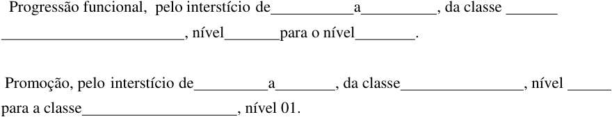
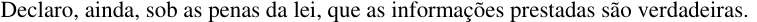
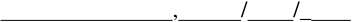
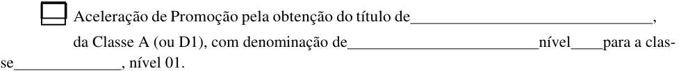
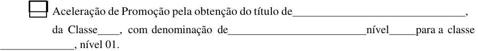
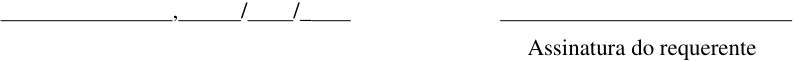
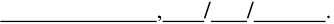
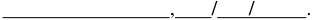
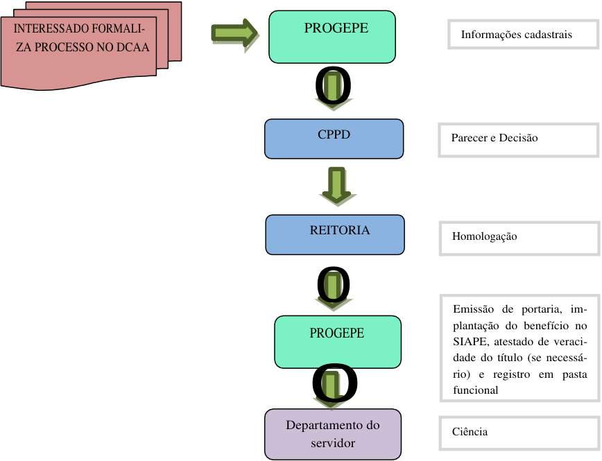
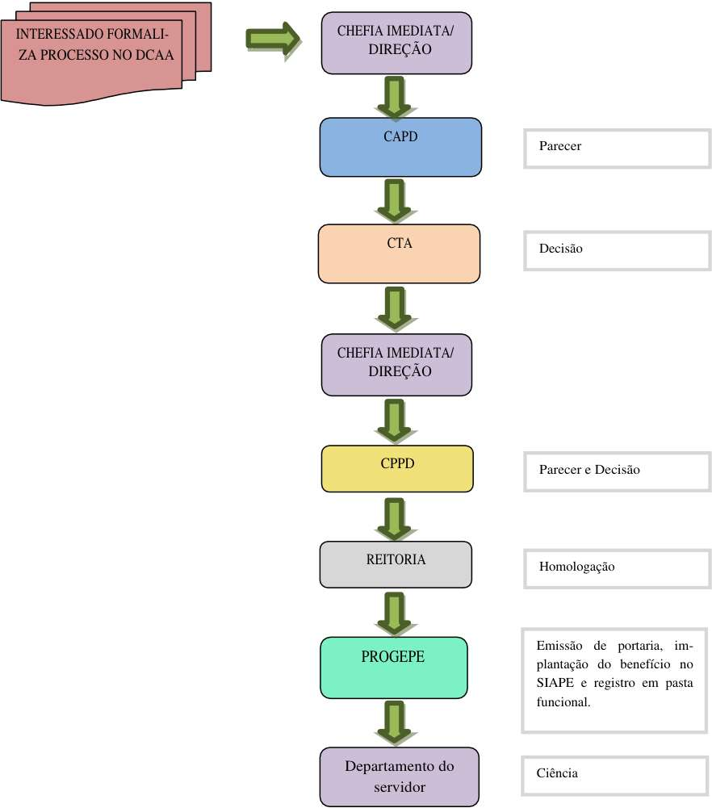

<!-- page 1 -->

<!-- figure p01-fig1 | described_by: agy | ocr_overlap: None | needs_review: false | decorative: true -->
### (1) Tipo de figura / Type of figure
- **PT:** Trata-se de um ícone ou logotipo institucional em baixa resolução (arte em preto e branco / bitmap monocromático) representando o **Brasão de Armas da República Federativa do Brasil** (Armas Nacionais do Brasil), comumente utilizado no cabeçalho de documentos oficiais brasileiros.
- **EN:** A low-resolution monochrome (black-and-white bitmap) institutional emblem/coat of arms representing the **Coat of Arms of the Federative Republic of Brazil** (*Brasão de Armas da República Federativa do Brasil*), commonly found in the header of official Brazilian government documents.

---

### (2) Todo o texto visível / All visible text
- **PT:** `[illegible]` — Devido à baixíssima resolução e binarização da imagem, as inscrições nas faixas inferiores (onde normalmente constam *"REPÚBLICA FEDERATIVA DO BRASIL"* e *"15 de Novembro de 1889"*) consistem apenas em agrupamentos de pixels pretos indistinguíveis, sendo totalmente ilegíveis (`[illegible]`). Não há títulos, rótulos, legendas, eixos ou células.
- **EN:** `[illegible]` — Due to the very low resolution and monochrome pixelation of the image, the inscriptions on the lower scroll/ribbons consists only of indistinguishable clusters of black pixels and are completely `[illegible]`. There are no readable titles, labels, legends, captions, axis ticks, or cell values.

---

### (3) Estrutura e elementos visuais / Structure and visual elements
- **PT:** A figura é um único emblema centralizado, sem painéis, caixas, setas, linhas/colunas ou eixos, composto pelos seguintes elementos gráficos dispostos simetricamente:
  - **Centro:** Um escudo circular escuro cercado por uma borda circular pontilhada (representando um anel de estrelas em pixels brancos) e contendo no interior manchas brancas pixeladas (representando a constelação do Cruzeiro do Sul).
  - **Estrela de cinco pontas:** O círculo central está sobreposto a uma estrela de cinco pontas com bordas duplas (contorno preto e branco), com uma ponta voltada para cima, duas laterais e duas inferiores.
  - **Espada vertical:** Na base central, posicionada verticalmente no eixo de simetria entre as duas pontas inferiores da estrela, encontra-se o punho/empunhadura de uma espada apontada para cima.
  - **Guirlanda / Ramos laterais:** Ao redor da estrela de cinco pontas, há uma coroa/guirlanda densa de folhagens em pixels pretos e brancos (representando ramos de café e fumo) que envolve as laterais esquerda, direita e superior do brasão.
  - **Faixa / Listel inferior:** Na base do emblema, abaixo da estrela e atravessando o punho da espada, há uma fita curva com extremidades bifurcadas (listel) contendo traços pixelados `[illegible]`.
- **EN:** The figure is a single centered emblem with no panels, boxes, arrows, rows/columns, or axes, composed of the following symmetrically arranged graphical elements:
  - **Center:** A dark circular shield bordered by a dotted ring of white pixels (representing the ring of stars) with white pixel clusters inside (representing the Southern Cross constellation).
  - **Five-pointed star:** The central circle rests at the center of a five-pointed star outlined in black and white, with one point facing straight up, two extending horizontally to the left and right, and two pointing downward.
  - **Vertical sword:** Positioned vertically along the central axis at the bottom, between the two lower points of the star, is the hilt/handle of an upright sword.
  - **Wreath / Lateral branches:** Surrounding the star on the left, right, and top sides is a dense foliate wreath rendered in black and white pixels (representing coffee and tobacco branches).
  - **Lower scroll / ribbon:** Across the bottom of the emblem, beneath the star and intersecting the sword hilt, is a curved banner/scroll with forked ends containing `[illegible]` pixelated markings.

---

### (4) Números e valores de dados / Numbers and data values
- **PT:** Nenhum número ou valor de dado é legível na imagem (`[illegible]` na faixa inferior).
- **EN:** No numbers or data values are readable in the image (`[illegible]` on the lower scroll).

---

### (5) Cores / Colours
- **PT:** A imagem é estritamente monocromática (preto sobre fundo branco / transparente), sem uso de cores para codificação de significado além do contraste de contorno do próprio brasão.
- **EN:** The image is strictly monochrome (black pixels on a white/transparent background); colour carries no additional meaning beyond forming the black-and-white silhouette and outlines of the coat of arms.

MINISTÉRIO DA EDUCAÇÃO UNIVERSIDADE FEDERAL RURAL DE PERNAMBUCO SECRETARIA GERAL DOS CONSELHOS DA ADMINISTRAÇÃO SUPERIOR CONSELHO UNIVERSITÁRIO 

RESOLUÇÃO Nº 009/2019. 

EMENTA:      Regulamenta procedimentos para as progressões funcionais e promoções das carreiras de Magistério Superior e do Ensino Básico, Técnico e Tecnológico na Universidade Federal Rural de Pernambuco. 

A Presidente do Conselho Universitário da Universidade Federal Rural de Pernambuco, no uso de suas atribuições e tendo em vista a Decisão  nº 009/2019 deste Conselho, exarada no Processo UFRPE nº 23082.007353/2018-19, em sua III Reunião Extraordinária, realizada no dia 07 de fevereiro de 2019, 

CONSIDERANDO a estruturação do Plano de Carreiras e Cargos de Magistério Federal, amparadas pela Lei nº 12.772/2012, alterada pela Lei nº 12.863/2013 e pela Lei nº 13.325/2016, pela Portaria Ministerial nº 554/2013-MEC, as quais estabelecem diretrizes gerais para o processo de avaliação de desempenho para fins de progressão e promoção e uniformizadas pela Nota Técnica nº 2556/2018-MP; 

CONSIDERANDO a Lei nº 9.394/1996, que estabelece as dire- 

trizes e bases da educação nacional; 

CONSIDERANDO a Resolução n° 086/2014CONSU/UFRPE e suas alterações, que estabelecem normas para a promoção para a Classe E, com denominação de Professor Titular, da Carreira do Magistério Superior e Classe de Titular da Carreira do Magistério do Ensino Básico, Técnico  e Tecnológico da Universidade Federal Rural de Pernambuco; 

CONSIDERANDO, ainda, a imprescritibilidade e a necessidade de se manterem os registros da documentação comprobatória do exercício das atividades de ensino, pesquisa, extensão e gestão, mantidas no âmbito da Universidade Federal Rural de Pernambuco, 

## RESOLVE: 

Art. 1º - Regulamentar os procedimentos para as progressões funcionais e promoções das carreiras do Magistério Superior, e para as do Ensino Básico, Técnico e Tecnológico(EBTT) na Universidade Federal Rural de Pernambuco (UFRPE). 

Confere com o original assinado pela Reitora e arquivado nesta Secretaria Geral. 

<!-- page 2 -->

<!-- figure p02-fig1 | same image as p01-fig1 -->

MINISTÉRIO DA EDUCAÇÃO UNIVERSIDADE FEDERAL RURAL DE PERNAMBUCO SECRETARIA GERAL DOS CONSELHOS DA ADMINISTRAÇÃO SUPERIOR CONSELHO UNIVERSITÁRIO 

(CONTINUAÇÃO DA RESOLUÇÃO Nº 009/2019-CONSU/UFRPE) 

# TÍTULO I 

DAS CARREIRAS DE MAGISTÉRIO SUPERIOR E DO EBTT DA UFRPE 

Art. 2º - A Carreira de Magistério Superior compõe-se 

das seguintes Classes: 

I. Classe A, com denominações de: 

a) Professor Adjunto A, se portador do título de doutor; 

b) Professor Assistente A, se portador do título de mestre; ou 

c) Professor Auxiliar, se graduado ou portador do título de especialista. 

II. Classe B, com denominação de Professor Assistente; 

III. Classe C, com denominação de Professor Adjunto; 

IV. Classe D, com denominação de Professor Associado; e 

V. Classe E, com denominação de Professor Titular. 

Parágrafo Único - As Classes A e B possuem dois níveis, designados pelos números 1 e 2. As Classes C e D possuem quatro níveis, designados pelos números de 1 a 4, e a Classe E possui nível único. 

Art. 3º - A Carreira do Magistério do EBTT compõe-se 

das seguintes Classes: 

I - D I; II - D II; III - D III; 

IV - D IV; e 

V - Titular. 

Parágrafo Único - As Classes D I e D II possuem dois níveis, designados pelos números 1 e 2. As Classes D III e D IV possuem quatro níveis, designados pelos números de 1 a 4 e a Classe Titular possui um só nível. 

Confere com o original assinado pela Reitora e arquivado nesta Secretaria Geral. 

<!-- page 3 -->

<!-- figure p03-fig1 | same image as p01-fig1 -->

MINISTÉRIO DA EDUCAÇÃO UNIVERSIDADE FEDERAL RURAL DE PERNAMBUCO SECRETARIA GERAL DOS CONSELHOS DA ADMINISTRAÇÃO SUPERIOR CONSELHO UNIVERSITÁRIO 

(CONTINUAÇÃO DA RESOLUÇÃO Nº 009/2019-CONSU/UFRPE) 

TÍTULO II 

DAS FORMAS DE PROGRESSÃO E PROMOÇÃO 

NAS CARREIRAS DE MAGISTÉRIO SUPERIOR E DO EBTT 

Art. 4º - O desenvolvimento nas Carreiras de Magistério Superior e do Magistério do EBTT ocorrerá mediante progressão funcional e promoção. 

Parágrafo Único - A progressão funcional é a passagem do docente para o nível de vencimento imediatamente superior dentro de uma mesma classe, e promoção é a passagem do docente de uma Classe para outra subsequente, na forma da lei. 

Art. 5º - A progressão funcional do docente observará 

cumulativamente: 

I. cumprimento do interstício mínimo de 24 (vinte e quatro) 

meses de efetivo exercício no nível em que se encontra; e 

II. aprovação em avaliação de desempenho. 

Art. 6º - A promoção do docente ocorrerá quando observado o cumprimento do interstício mínimo de 24 (vinte e quatro) meses de efetivo exercício no último nível de cada Classe. 

Art. 7º - Para fins de promoção na Carreira do Magistério Superior, além do cumprimento do interstício de que trata o Art. 6º, cumulativamente, será exigido: 

I. Para a Classe B, com denominação de Professor Assistente,lograr aprovação em processo de avaliação de desempenho. 

II. Para a Classe C, com denominação de Professor Adjunto,lograr aprovação em processo de avaliação de desempenho. 

III. Para a Classe D, com denominação de Professor Associado: 

a) possuir o título de doutor; e 

b) lograr aprovação em processo de avaliação de desempenho. 

IV. Para a Classe E, com denominação de Professor Titular: 

a) possuir o título de doutor; e 

b) lograr aprovação em processo de avaliação de desempenho; e 

Confere com o original assinado pela Reitora e arquivado nesta Secretaria Geral. 

<!-- page 4 -->

<!-- figure p04-fig1 | same image as p01-fig1 -->

MINISTÉRIO DA EDUCAÇÃO UNIVERSIDADE FEDERAL RURAL DE PERNAMBUCO SECRETARIA GERAL DOS CONSELHOS DA ADMINISTRAÇÃO SUPERIOR CONSELHO UNIVERSITÁRIO 

(CONTINUAÇÃO DA RESOLUÇÃO Nº 009/2019-CONSU/UFRPE) 

c) lograr aprovação no Memorial Descritivo, que deverá considerar as atividades de ensino, pesquisa, extensão, gestão acadêmica e produção profissional relevan- te, ou defesa de tese acadêmica inédita. 

Art. 8º - Para fins de promoção na Carreira do Magistério do EBTT, além do cumprimento do interstício de que trata o Art. 6º, cumulativamente será exigido: 

- I. para a Classe D II,lograr aprovação em processo  de avaliação  de desempenho; II. para a  Classe D  III,lograr aprovação em  processo de avaliação de desempenho; III. para a Classe D IV,lograr aprovação em processo de avaliação de desempenho; IV. para a Classe de Professor Titular: 

   - a) possuir título de doutor; 

   - b) lograr aprovação em processo de avaliação de desempenho; e 

   - c) lograr aprovação no Memorial Descritivo, que deverá considerar as atividades de ensino, pesquisa, extensão, gestão acadêmica e produção profissional relevante, ou defesa de tese acadêmica inédita. 

Art. 9º - Os docentes do Magistério Superior aprovados no estágio probatório do respectivo cargo e que atenderem aos seguintes requisitos de titulação farão jus a processo de aceleração da promoção, mediante requerimento do interessado: 

- I - para o nível inicial da Classe B, com denominação de Professor Assistente, se apresentar o título de Mestre; 

- II - para o nível inicial da Classe C, com denominação de Professor Adjunto, se apresentar o título de Doutor. 

Art. 10 - Os docentes da Carreira do EBTT aprovados no estágio probatório do respectivo cargo e que atenderem aos seguintes requisitos de titulação farão jus a processo de Aceleração da Promoção, mediante requerimento do interessado: 

- I – de qualquer nível da classe D I para o nível 1 da classe D II, se apresentar título de especialista; e 

- II - de qualquer nível das classes D I e D II para o nível 1 da classe D III, se apresentar título de mestre ou doutor. 

Confere com o original assinado pela Reitora e arquivado nesta Secretaria Geral. 

<!-- page 5 -->

<!-- figure p05-fig1 | same image as p01-fig1 -->

MINISTÉRIO DA EDUCAÇÃO UNIVERSIDADE FEDERAL RURAL DE PERNAMBUCO SECRETARIA GERAL DOS CONSELHOS DA ADMINISTRAÇÃO SUPERIOR CONSELHO UNIVERSITÁRIO 

(CONTINUAÇÃO DA RESOLUÇÃO Nº 009/2019-CONSU/UFRPE) 

TÍTULO III 

DA DOCUMENTAÇÃO PARA PROGRESSÃO/PROMOÇÃO 

Art. 11 - Para todos os procedimentos em que se exige diploma, caso seja esse emitido por instituição estrangeira, deverá primeiramente ser reconhecido por instituição nacional competente, conforme o Art. 48º, §3º, da Lei nº 9.394/1996 e a Resolução nº 49/2017-CEPE/UFRPE. 

Art. 12 - Para a solicitação de Aceleração da Promoção de servidores que recebem Retribuição por Titulação (RT) referente ao mesmo título que fundamenta o pleito, deverá ser encaminhado, juntamente com o último Relatório de Avaliação Final do Estágio Probatório (Resolução n° 116/2016-CONSU/UFRPE), um requerimento solicitando a Aceleração da Promoção à Direção do seu Departamento (Anexo II), juntamente com uma cópia do diploma e da portaria PROGEPE, de pagamento de Retribuição por Titulação pelo título obtido (na hipótese de já perceber a RT). 

Parágrafo Único – na hipótese de o requerente não receber RT, com base no mesmo título que fundamenta a Aceleração da Promoção, o docente deverá apresentar requerimento, por meio de processo administrativo, contendo a documentação a seguir: I- requerimento solicitando a Aceleração da Promoção à Pró-Reitoria de Gestão de Pessoas – PROGEPE (Anexo III); 

- II- cópia da Portaria de aprovação em Estágio Probatório (divulgada no Boletim de Serviços acessado por meio do sítio da PROGEPE); 

- III- cópia do diploma. 

Art. 13 - Para a solicitação de progressão funcional ou promoção por cumprimento do interstício e desempenho acadêmico, o servidor deverá abrir processo administrativo contendo: 

1. requerimento do(a) docente à Direção, solicitando a progressão/promoção, informando o período do interstício (Anexo I); 

2. cópia da portaria da última progressão/promoção, se houver ocorrido; 

Confere com o original assinado pela Reitora e arquivado nesta Secretaria Geral. 

<!-- page 6 -->

<!-- figure p06-fig1 | same image as p01-fig1 -->

MINISTÉRIO DA EDUCAÇÃO UNIVERSIDADE FEDERAL RURAL DE PERNAMBUCO SECRETARIA GERAL DOS CONSELHOS DA ADMINISTRAÇÃO SUPERIOR CONSELHO UNIVERSITÁRIO 

(CONTINUAÇÃO DA RESOLUÇÃO Nº 009/2019-CONSU/UFRPE) 

3. relatório documentado de atividades, referente ao interstício da requisição (Anexo IV). 

4. A promoção para a Classe D, com denominação Professor Associado, está condicionada à apresentação de cópia do diploma de doutorado. 

Art. 14 -O docente poderá ser instado, a qualquer tempo, a agregar informações ou documentos suplementares. Nesses casos, os prazos fixados nesta Resolução serão contados a partir do pleno atendimento das solicitações. 

# TÍTULO IV 

DA TRAMITAÇÃO DA CONCESSÃO DE PROGRESSÃO/PROMOÇÃO 

Art. 15 - Nos casos de <u>aceleração da promoção, ao receber o</u> processo do docente, a PROGEPE, em até 15 (quinze) dias, deverá instruir o processo com as informações cadastrais e encaminhar à Comissão Permanente de Pessoal Docente (CPPD) para análise e decisão. 

§ 1º - A CPPD deverá analisar e decidir sobre a promoção em 30 (trinta) dias, encaminhando nesse prazo o processo à Reitoria, para homologação em até dois dias úteis, com retorno à PROGEPE, para emissão de portaria e demais trâmites administrativos. 

§ 2º - Implantado o benefício, a PROGEPE procederá à verificação da veracidade do diploma apresentado (Fluxograma 1). 

Art. 16 - Nos casos de <u>progressão funcional ou promoção por interstício e desempenho acadêmico</u> a Direção deverá, ao receber o processo, anexar portaria de nomeação da Comissão de Avaliação de Pessoal Docente (CAPD) e encaminhar a essa comissão,no prazo de cinco dias, para análise e Decisão. 

§ 1º - A CAPD deverá analisar e emitir Parecer sobre a progressão/promoção no prazo máximo de 15 (quinze) dias, restituindo o processo para análise do CTA, que deverá apresentar Decisão em 15 (quinze) dias. Em seguida, a Direção providenciará o envio à CPPD, em dois dias úteis. 

§ 2º - A CPPD deverá analisar e emitir Decisão sobre a pro- 

Confere com o original assinado pela Reitora e arquivado nesta Secretaria Geral. 

<!-- page 7 -->

<!-- figure p07-fig1 | same image as p01-fig1 -->

## MINISTÉRIO DA EDUCAÇÃO UNIVERSIDADE FEDERAL RURAL DE PERNAMBUCO SECRETARIA GERAL DOS CONSELHOS DA ADMINISTRAÇÃO SUPERIOR CONSELHO UNIVERSITÁRIO 

## (CONTINUAÇÃO DA RESOLUÇÃO Nº 009/2019-CONSU/UFRPE) 

gressão/promoção em até 15 (quinze) dias, encaminhando nesse prazo o processo à Reitoria, para homologação em até dois dias úteis e, em seguida, à PROGEPE, no caso de deferimento, para emissão de portaria, e posteriormente seguir os demais trâmites administrativos (Fluxograma 2). 

Art. 17 - O docente poderá protocolar o seu requerimento de progressão/promoção com antecedência de 60 (sessenta) dias do término do interstício. 

Parágrafo Único – Nos casos de processos protocolados com antecedência superior a 60 (sessenta) dias, a CAPD deverá encaminhar o processo ao requerente, solicitando a reapresentação dentro do prazo estabelecido. 

## TÍTULO V 

## DA AVALIAÇÃO DO DESEMPENHO ACADÊMICO 

# Seção I 

## DA COMPETÊNCIA 

Art. 18 - A avaliação do desempenho acadêmico para fins de progressão funcional e promoção será procedida pela Comissão de Avaliação de Pessoal Docente (CAPD), sendo de sua competência analisar e emitir Parecer detalhado e conclusivo. 

§ 1º - Cada Departamento/Unidade Acadêmica/CODAI constituirá uma CAPD, composta por quatro docentes designados pelo respectivo Conselho Técnico Administrativo (CTA) e nomeados por Portaria da Direção do Departamento/Unidade Acadêmica/CODAI, sendo três titulares e um suplente, devendo a escolha priorizar professores com a titulação de Doutor, ocupantes das Classes C (Adjunto), D (Associado) ou E (Titular) para o Magistério Superior, e professores com a titulação de Mestre ou Doutor, ocupantes das Classes D III, D IV ou Classe E (Titular), para o Magistério do EBTT. 

§ 2º -A CAPD será instalada após a publicação da portaria de designação dos seus membros, pela Direção do Departamento/Unidade Acadêmica/CODAI, cujos componentes terão um mandato de dois anos, permitindo-se uma recondução, por igual período. Caberá aos membros da CAPD a escolha de quem presidirá a comissão, dentre os três titulares. 

Confere com o original assinado pela Reitora e arquivado nesta Secretaria Geral. 

<!-- page 8 -->

<!-- figure p08-fig1 | same image as p01-fig1 -->

MINISTÉRIO DA EDUCAÇÃO UNIVERSIDADE FEDERAL RURAL DE PERNAMBUCO SECRETARIA GERAL DOS CONSELHOS DA ADMINISTRAÇÃO SUPERIOR CONSELHO UNIVERSITÁRIO 

(CONTINUAÇÃO DA RESOLUÇÃO Nº 009/2019-CONSU/UFRPE) § 3º -   Aplica-se aos membros da CAPD a obrigatoriedade da frequência, de acordo com Resolução nº 005/2015-CONSU/UFRPE. 

Art. 19 - À presidência da CAPD caberá carga horária de no mínimo oito horas semanais de atividades relativas aos trabalhos da referida comissão, e, aos demais membros, de no mínimo quatro horas semanais, em dias e horários a serem estabelecidos em comum acordo entre os pares. 

# Seção II 

DOS CRITÉRIOS DE AVALIAÇÃO 

Art. 20 -Os critérios de avaliação para a progressão funcional e promoção levarão em consideração os Artigos 5º, 6º e 7º, da Portaria Ministerial nº 554/2013-MEC,que estabelecem as diretrizes gerais para o processo de avaliação de desempenho. 

Art. 21 - A avaliação de desempenho acadêmico adotará critérios objetivos fixados nas normas de caráter geral contidas no Anexo III, para os docentes da Carreira do Magistério Superior e para os docentes da Carreira do EBTT e que integram esta resolução, para todos os efeitos jurídicos e legais. 

Art. 22 - Os critérios de pontuação constantes no Anexo III abrangem qualificação acadêmica,atividades de ensino, produção intelectual, pesquisa, extensão, administração, representação e outras atividades relevantes não incluídas no plano de integralização curricular e em cursos e programas oferecidos pela UFRPE. Para as atividades de ensino e gestão deverão ser consideradas as seguintes condições: 

I - o docente do Magistério Superior deverá apresentar atividades de ensino nos termos do Art. 57, da Lei nº 9.394/1996 ou da Portaria n° 17, de 11 de maio de 2016SETEC, para o Magistério do EBTT; 

II - as atividades de gestão serão consideradas quando exercidas no âmbito da UFRPE ou de outro órgão público, a cuja disposição se encontre o docente, conforme o Art. 93 da Lei nº 8.112/1990. 

§ 1º - Para efeito de pontuação, serão computadas as atividades realizadas, bem como os títulos obtidos durante o interstício avaliado. 

§ 2º - O regime de trabalho do professor do Ensino Básico, Técnico e Tecnológico seguirá o que preconiza a Resolução n° 002/2018-CONSU/UFRPE. 

Confere com o original assinado pela Reitora e arquivado nesta Secretaria Geral. 

<!-- page 9 -->

<!-- figure p09-fig1 | same image as p01-fig1 -->

MINISTÉRIO DA EDUCAÇÃO UNIVERSIDADE FEDERAL RURAL DE PERNAMBUCO SECRETARIA GERAL DOS CONSELHOS DA ADMINISTRAÇÃO SUPERIOR CONSELHO UNIVERSITÁRIO 

(CONTINUAÇÃO DA RESOLUÇÃO Nº 009/2019-CONSU/UFRPE) 

§ 3º - Em nenhuma hipótese uma mesma atividade ou um mesmo trabalho poderá ser valorado em mais de um grupo ou subgrupo. 

Art. 23º - Para a Avaliação do Desempenho Didático, a CAPD deverá utilizar a avaliação realizada pelos discentes matriculados nos componentes curriculares ministrados por cada docente no interstício. 

§ 1º -A pontuação do docente no interstício será calculada considerando-se a média de todas as avaliações efetuadas pelos discentes, em todas as disciplinas ministradas e finalizadas no interstício de avaliação. 

§ 2º - A Avaliação Discente será disponibilizada em período es- 

pecífico, antes da matrícula semestral. 

§ 3º - O docente será pontuado em 2,5 (dois e meio) pontos por semestre letivo, para o qual não se verificou a avaliação, até que se implante, na UFRPE, uma Avaliação de Desempenho Didático. 

Art. 24 - A Avaliação do Desempenho Acadêmico consistirá na atribuição de pontos pelas atividades desenvolvidas no interstício, de acordo com o quadro de indicadores constante no Anexo III, estando o docente apto à progressão ou promoção quando obtiver no mínimo 120 pontos, em se tratando de professor em Regime de Dedicação Exclusiva ou de 40 horas, e no mínimo 84 pontos, quando em regime de 20 horas. 

Art. 25 -Serão considerados apenas os títulos acadêmicos nacionais obtidos em cursos credenciados e os títulos estrangeiros, quando reconhecidos, conforme o § 3º do Art. 48, da Lei no 9.394/1996. 

Parágrafo Único - Os certificados de cursos de aperfeiçoamento ou especialização devem atender às condições estabelecidas na legislação vigente. 

Art. 26 - O desempenho de docentes afastados para programas de Pós-Graduação Stricto Sensu será avaliado através dos relatórios apresentados, comprovando as atividades desenvolvidas no referido programa,com parecer do Orientador. Em se tratando de Estágio Pós-Doutoral, a anuência será do Supervisor ou equivalente. 

Parágrafo Único - Para efeito de avaliação prevista no caput, será atribuída a cada semestre letivo em que o docente esteve afastado para participação em programa de pós-graduação 1/4 da pontuação total mínima exigida para o interstício, de acordo com o Art. 24 desta Resolução. 

Confere com o original assinado pela Reitora e arquivado nesta Secretaria Geral. 

<!-- page 10 -->

<!-- figure p10-fig1 | same image as p01-fig1 -->

MINISTÉRIO DA EDUCAÇÃO UNIVERSIDADE FEDERAL RURAL DE PERNAMBUCO SECRETARIA GERAL DOS CONSELHOS DA ADMINISTRAÇÃO SUPERIOR CONSELHO UNIVERSITÁRIO 

(CONTINUAÇÃO DA RESOLUÇÃO Nº 009/2019-CONSU/UFRPE) 

Art. 27 - O desempenho acadêmico de docentes cedidos para 

servir a outro órgão público será avaliado através de relatórios apresentados,  com  o parecer da chefia imediata, no referido local de trabalho. 

Parágrafo Único - Para efeitos de avaliação prevista no caput atribuir-se-á,  a cada semestre em que o docente esteve cedido a outro órgão público, 1/8 da pontuação total mínima exigida para o interstício, de acordo com o Art. 29 desta resolução e com base nos relatórios apresentados e com o parecer da chefia imediata (Anexo V). 

# Seção III 

## DA CONTAGEM DO INTERSTÍCIO 

Art. 28 - Os períodos de interstícios serão computados a partir da data indicada na última portaria de progressão ou promoção. 

Art. 29 - Nos casos em que o docente estiver afastado por cessão para servir a outro órgão público e não amparado pelo Art. 47, inciso II e pelo Art. 49, do Decreto no 94.664/1987, bem como pelo Art. 30, da Lei 12.772/2012, o interstício mínimo exigido passará a ser o dobro do tempo de permanência no nível da classe em que se encontrar, considerando cada período de afastamento analisado. 

# TÍTULO VI 

## DOS RECURSOS, PRAZOS E ENCAMINHAMENTOS 

Art. 30 - Após a decisão da CAPD, se o docente não for considerado apto, a Direção do Departamento/Unidade Acadêmica/CODAI deverá lhe dar ciência sobre o resultado da avaliação de desempenho. 

§ 1º -O docente que for considerado inapto para a progressão /promoção poderá recorrer do Parecer da CAPD no prazo de 30 (trinta) dias. A CAPD terá cinco dias úteis para se posicionar e remeter os autos ao CTA para proferir a Decisão em 30 (trinta) dias. 

Art. 31 - Quando a decisão do CTA for pelo deferimento do recurso, o processo seguirá para a CPPD. 

Confere com o original assinado pela Reitora e arquivado nesta Secretaria Geral. 

<!-- page 11 -->

<!-- figure p11-fig1 | same image as p01-fig1 -->

MINISTÉRIO DA EDUCAÇÃO UNIVERSIDADE FEDERAL RURAL DE PERNAMBUCO SECRETARIA GERAL DOS CONSELHOS DA ADMINISTRAÇÃO SUPERIOR CONSELHO UNIVERSITÁRIO 

(CONTINUAÇÃO DA RESOLUÇÃO Nº 009/2019-CONSU/UFRPE) 

Art. 32 -Quando a decisão do CTA for pelo indeferimento do 

recurso, o requerente será notificado para ciência. 

Parágrafo Único - Mantida a decisão de “não apto”, emitida pelo CTA, o requerente poderá apresentar novo requerimento, no mesmo processo, com interstício estendido e os documentos comprobatórios cabíveis. 

# TITULO VII 

## DOS CRITÉRIOS DE AVALIAÇÃO 

Art. 33 - A avaliação do Relatório de Atividades (Anexos III e IV) do docente deverá ser processada mediante análise criteriosa dos indicadores de atividades e qualificações distribuídos em cinco grupos, a saber: 

Grupo I – Qualificação Acadêmica; 

Grupo II – Produção Intelectual; Grupo III – Atividades de Ensino, Pesquisa e Extensão; Grupo IV – Atividade de Administração; 

Grupo V – Atividade de Representação de Classe Docente e Entidades Científicas e/ou Eventos de relevância profissional. 

Art. 34 - Os indicadores correspondentes à Qualificação Acadêmica aplicam-se aos certificados, títulos e graus obtidos pelo docente, que deverão estar em conformidade com as resoluções vigentes na UFRPE. 

Art. 35 - Para efeito de pontuação por participação em Comissões, Órgãos Colegiados, Câmaras e Conselhos, o membro deve apresentar a portaria de nomeação e a declaração constando uma frequência mínima de 80% (oitenta) de presença semestral. 

Parágrafo Único -Nos casos de Comissões para executar uma demanda específica, a declaração comprovando a frequência mínima de 80% (oitenta) será expedida pelo responsável do Órgão/Setor demandante. 

Confere com o original assinado pela Reitora e arquivado nesta Secretaria Geral. 

<!-- page 12 -->

<!-- figure p12-fig1 | same image as p01-fig1 -->

MINISTÉRIO DA EDUCAÇÃO UNIVERSIDADE FEDERAL RURAL DE PERNAMBUCO SECRETARIA GERAL DOS CONSELHOS DA ADMINISTRAÇÃO SUPERIOR CONSELHO UNIVERSITÁRIO 

(CONTINUAÇÃO DA RESOLUÇÃO Nº 009/2019-CONSU/UFRPE) 

# TÍTULOVIII 

## DAS DISPOSIÇÕES FINAIS 

Art. 36 - A progressão funcional ou promoção será efetivada através de Portaria da Reitoria, cuja competência é delegável à PROGEPE, a qual surtirá efeitos financeiros e funcionais a partir da data em que forem cumpridos cumulativamente os dois requisitos: interstício e parecer favorável da CAPD. 

§ 1º - Nos casos de aceleração da promoção, os efeitos financeiros e funcionais são contados a partir da data de publicação da portaria constitutiva do direito. 

§ 2º - Nos casos de promoção por obtenção de título, os efeitos financeiros e funcionais são contados a partir da data do protocolo do requerimento de concessão de RT, desde que acompanhado do respectivo diploma. 

Art. 37 - Não será permitida a progressão/promoção cumulati- 

va. 

Art. 38 - As normas previstas nesta resolução não se aplicam à Promoção para a classe de Titular, as  quais  já  estão  previstas  na  Resolução nº 086/2014CONSU/UFRPE e suas alterações. 

Art. 39 - Esta resolução entra em vigor 30 (trinta) dias após a sua publicação, ficando revogadas as Resoluções nº 057/1988, nº 225/2006, nº 208/2012 e nº 062/2015, do CONSU/UFRPE e demais disposições em contrário. 

SALA DOS CONSELHOS DA UFRPE, em 08 de fevereiro de 2019. 

## **PROF****a** **MARIA JOSÉ DE SENA** = PRESIDENTE = 

Confere com o original assinado pela Reitora e arquivado nesta Secretaria Geral. 

<!-- page 13 -->

<!-- figure p13-fig1 | same image as p01-fig1 -->

## MINISTÉRIO DA EDUCAÇÃO UNIVERSIDADE FEDERAL RURAL DE PERNAMBUCO SECRETARIA GERAL DOS CONSELHOS DA ADMINISTRAÇÃO SUPERIOR CONSELHO UNIVERSITÁRIO 

(CONTINUAÇÃO DA RESOLUÇÃO Nº 009/2019-CONSU/UFRPE) 

## <u>ANEXO I</u> 

### <u>REQUERIMENTO PARA PROGRESSÃO E PROMOÇÃO DA CARREIRA DOCENTE</u> 

À Direção do(a) Departamento/Unidade Acadêmica/CODAI 

|REQUERENTE SIAPE N°: EM CASO DE REDISTRIBUIÇÃO, INFORMAR A DATA DE EXERCÍCIO NO ÓRGÃO DE ORI|Data de Efetivo Exercício / / GEM / /|
|---|---|
|CARGO CELULAR E-MAIL||
|LOTAÇÃO/EXERCÍCIO REGIME DE TRABALHO||

Solicito, de acordo com os artigos 12, 13-A, 14 e 15-A da Lei nº 12.772/2012 e a Resolução nº 009/2019-CONSU/UFRPE, a concessão de: 

<!-- figure p13-fig2 | described_by: agy | ocr_overlap: 0.89 | needs_review: false -->
**(1) Tipo de figura**
Recorte de formulário textual (trecho de documento administrativo) com campos em branco (linhas sublinhadas) para preenchimento sobre progressão funcional e promoção.

**(2) Todo o texto visível (na íntegra)**
* Primeiro bloco (duas linhas):
  * Linha 1: `Progressão funcional, pelo interstício de___________a__________, da classe _______`
  * Linha 2: `________________________, nível_______para o nível________.`
* Segundo bloco (duas linhas):
  * Linha 3: `Promoção, pelo interstício de__________a________, da classe________________, nível ______`
  * Linha 4: `para a classe____________________, nível 01.`

**(3) Estrutura**
A imagem é composta por dois parágrafos/enunciados curtos dispostos verticalmente, separados por um espaço em branco, sem caixas, setas, eixos ou tabelas:
* **Primeiro enunciado (Progressão funcional):** ocupa as duas primeiras linhas e contém 5 lacunas representadas por linhas horizontais contínuas para preenchimento manual ou digitado:
  1. Primeira lacuna após `pelo interstício de` (início do período).
  2. Segunda lacuna após `a` e antes de `, da classe` (fim do período).
  3. Terceira lacuna que começa no final da primeira linha após `da classe ` e continua no início da segunda linha antes de `, nível` (nome/identificação da classe).
  4. Quarta lacuna após `, nível` e antes de `para o nível` (nível de origem).
  5. Quinta lacuna após `para o nível` e seguida de ponto final `.` (nível de destino).
* **Segundo enunciado (Promoção):** ocupa as duas últimas linhas e contém 5 lacunas representadas por linhas horizontais contínuas:
  1. Primeira lacuna após `pelo interstício de` (início do período).
  2. Segunda lacuna após `a` e antes de `, da classe` (fim do período).
  3. Terceira lacuna após `, da classe` e antes de `, nível` (classe de origem).
  4. Quarta lacuna no final da terceira linha após `, nível ` (nível de origem).
  5. Quinta lacuna na quarta linha após `para a classe` e antes de `, nível 01.` (classe de destino).

**(4) Números e valores de dados**
* `01` (presente ao final do segundo bloco, em `nível 01.`). Não há outros números na imagem.

**(5) Cores**
Texto e linhas pretos sobre fundo branco; as cores não carregam significado adicional.

~~~text ocr
Progressão funcional, pelo interstício de a , da classe
, nivel para o nível
Promoção, pelo interstício de a , da classe , nivel
para a classe , nível Ol.
~~~

<!-- Start of picture text -->
Progressão funcional,  pelo interstício de a   , da classe , nível para o nível . Promoção, pelo interstício de a   , da classe , nível para a classe , nível 01. <!-- End of picture text -->

<!-- figure p13-fig3 | described_by: agy | ocr_overlap: 1.0 | needs_review: false -->
**(1) Tipo de figura:**
Trata-se de um recorte de texto simples (uma única linha de texto de declaração extraída de um documento).

**(2) Todo o texto visível (literalmente):**
`Declaro, ainda, sob as penas da lei, que as informações prestadas são verdadeiras.`

**(3) Estrutura:**
A imagem consiste em uma única linha horizontal contínua de texto tipográfico com serifa. Não há caixas, bordas, setas, conexões, eixos, linhas/colunas de tabela ou painéis.

**(4) Números ou valores de dados:**
Não há números ou valores de dados presentes na imagem.

**(5) Cores com significado:**
Texto em preto sobre fundo branco/transparente, sem uso de cores com significado adicional.

~~~text ocr
Declaro, ainda, sob as penas da lei, que as informações prestadas são verdadeiras.
~~~

<!-- Start of picture text -->
Declaro, ainda, sob as penas da lei, que as informações prestadas são verdadeiras. <!-- End of picture text -->

<!-- figure p13-fig4 | described_by: agy | ocr_overlap: None | needs_review: false -->
1. **Kind of figure / Tipo de figura**:
   A form fill-in line for location and date (uma linha de preenchimento de formulário para local e data), consisting of horizontal blank lines separated by a comma and forward slashes.

2. **Visible text (verbatim) / Texto visível (literal)**:
   - `,` (comma / vírgula)
   - `/` (forward slash / barra)
   - `/` (forward slash / barra)
   *(Exact pattern of underscores and punctuation: `_______________________, ________/________/________`)*
   There are no words, letters, titles, labels, legends, captions, axis ticks, or cell values present.

3. **Structure / Estrutura**:
   A single horizontal row arranged from left to right containing:
   - One long horizontal baseline (blank line for location/place) on the left.
   - A comma (`,`) immediately following the first horizontal line.
   - A medium-length horizontal baseline (blank line for day/month), followed by a forward slash (`/`).
   - A second medium-length horizontal baseline (blank line for month/day), followed by a forward slash (`/`).
   - A third medium-length horizontal baseline (blank line for year) on the right, with a slight step/dash at its left edge immediately after the second slash.
   There are no boxes, arrows, axes, multiple rows/columns, or panels.

4. **Numbers and data values / Números e valores de dados**:
   None (nenhum número ou valor de dado presente).

5. **Colours / Cores**:
   Black lines and punctuation marks on a white background; colour carries no additional semantic meaning (linhas e sinais de pontuação pretos sobre fundo branco, sem significado semântico adicional de cor).

<!-- Start of picture text -->
,   /   /_ <!-- End of picture text -->

### Assinatura do requerente 

### DOCUMENTAÇÃO NECESSÁRIA: 

Para a solicitação de progressão ou promoção funcional por interstício e desempenho acadêmico, o servidor deverá abrir processo administrativo contendo: 

1. este requerimento devidamente preenchido; 

2. cópia da portaria da última progressão/promoção, ou de nomeação se primeira progressão; 

3. relatório documentado de atividades, referente ao interstício requerido (com base no Anexo II). 

4. A promoção para a Classe D, com denominação Professor Associado, está condicionada à apresentação de cópia do diploma. 

##### Base legal 

   - Lei nº12.772/12, alterada pelas Leis nº12.863/13 e 13.325/16; 

- Lei nº 8.112/90; 

- □ □ □ 

   - Lei nº 9.394/96; 

<!-- figure p13-fig5 | described_by: agy | ocr_overlap: None | needs_review: false | decorative: true -->
1. **Kind of figure**: A tiny, low-resolution (17 × 19 pixels) grayscale icon or glyph graphic extracted from a PDF, showing a single vertical rounded-rectangle outline (resembling a smartphone/device icon, an empty box/missing-character glyph, or a stylized digit `0`) on the left side of a blank white canvas.

2. **Visible text**: None (unless the outline itself is interpreted as the character `0`; there are no titles, labels, legends, captions, axis ticks, or cell values).

3. **Structure**:
   - A single, vertically oriented, hollow rectangular outline with slightly rounded corners is positioned on the left half of the image (spanning roughly the left 40% of the width and the middle-to-lower vertical region, with wider white padding at the top and right).
   - The interior of the rectangle is completely blank (white).
   - There are no connecting lines, arrows, axes, rows, columns, or multiple panels.

4. **Numbers and data values**: None (unless the shape represents the single digit `0`).

5. **Colours**: The image is purely grayscale (light grey outline with RGB values down to 182 on a pure white RGB 255 background); colour carries no additional meaning.

- Portaria Ministerial nº 554/2013-MEC; 

<!-- figure p13-fig6 | same image as p13-fig5 -->

- Resolução nº 009/2019 do CONSU/UFRPE. 

Confere com o original assinado pela Reitora e arquivado nesta Secretaria Geral. 

<!-- page 14 -->

<!-- figure p14-fig1 | same image as p01-fig1 -->

MINISTÉRIO DA EDUCAÇÃO UNIVERSIDADE FEDERAL RURAL DE PERNAMBUCO SECRETARIA GERAL DOS CONSELHOS DA ADMINISTRAÇÃO SUPERIOR CONSELHO UNIVERSITÁRIO 

(CONTINUAÇÃO DA RESOLUÇÃO Nº 009/2019-CONSU/UFRPE) 

## <u>ANEXO II</u> 

### <u>REQUERIMENTO PARA ACELERAÇÃO DA PROMOÇÃO DA CARREIRA DOCENTE/ESTÁGIO PROBATÓRIO</u> 

À Direção do(a) Departamento/Unidade Acadêmica/CODAI 

|REQUERENTE|SIA N0:|PE|Data de Efetivo Exercício / /|
|---|---|---|---|
|EM CASO DE REDISTRIBUIÇÃO IN|FORMAR A DATA DE EXERCÍCIO NO ÓR|GÃO DE ORIG|EM / /|
|CARGO|CELULAR|E-MAIL||
|LOTAÇÃO/EXERCÍCIO|REGIME DE TRA|BALHO||

Solicito, de acordo com o artigo 13 e 15 da Lei nº 12.772/2012 e a Resolução nº 009/2019CONSU/UFRPE, a concessão de: 

<!-- figure p14-fig2 | described_by: agy | ocr_overlap: 0.91 | needs_review: false -->
**(1) Tipo de figura**
Recorte de um item de formulário ou requerimento administrativo com uma caixa de seleção (checkbox) em branco e campos de texto sublinhados para preenchimento manual.

**(2) Todo o texto visível (na íntegra)**
* Linha 1: `Aceleração de Promoção pela obtenção do título de______________________________________,`
* Linha 2: `da Classe A (ou D1), com denominação de______________________________nível_____para a clas-`
* Linha 3: `se________________, nível 01.`

Texto contínuo recomposto:
`Aceleração de Promoção pela obtenção do título de [campo em branco], da Classe A (ou D1), com denominação de [campo em branco] nível [campo em branco] para a classe [campo em branco], nível 01.`

**(3) Estrutura**
A imagem é composta por um único bloco de texto disposto em três linhas horizontais, sem eixos, setas, tabelas ou múltiplos painéis:
* **Caixa de seleção (checkbox):** Localizada no canto superior esquerdo, imediatamente à esquerda do início da primeira linha (`Aceleração de Promoção...`). Apresenta um contorno retangular preto duplo/sobreposto (dois quadrados vazios ligeiramente deslocados verticalmente) e não está assinalada.
* **Linhas e campos de preenchimento:**
  * **1ª linha:** Inicia após a caixa de seleção e contém o texto `Aceleração de Promoção pela obtenção do título de`, seguido por uma linha horizontal longa para preenchimento do título e encerrada por uma vírgula (`,`).
  * **2ª linha:** Alinhada verticalmente com o início do texto da primeira linha; começa com `da Classe A (ou D1), com denominação de`, seguido por uma linha horizontal média para preenchimento da denominação, a palavra `nível`, uma linha horizontal curta para preenchimento do nível e o trecho `para a clas-` (com hífen de translineação).
  * **3ª linha:** Recuada mais à esquerda do que as linhas anteriores (alinhada à margem esquerda da imagem, antes da posição da caixa de seleção); começa com a continuação da palavra dividida (`se`), seguida por uma linha horizontal média para preenchimento da classe, uma vírgula e o texto final `, nível 01.`.

**(4) Números e valores de dados**
* `1` (integrante do código alfanumérico `D1`, referente à classe).
* `01` (referente ao nível de destino: `nível 01`).

**(5) Cores**
A imagem é inteiramente monocromática (texto e contornos em preto sobre fundo branco), não havendo cores com significado semântico.

~~~text ocr
se
= Aceleração de Promoção pela obtenção do título de
da Classe A (ou D1), com denominação de
, nível Ol.
nivel para a clas-
~~~

<!-- Start of picture text -->
□ Aceleração de Promoção pela obtenção do título de , da Classe A (ou D1), com denominação de nível para a clas- se , nível 01. <!-- End of picture text -->

Declaro, ainda, sob as penas da lei, que as informações prestadas são verdadeiras. 

<!-- figure p14-fig3 | described_by: agy | ocr_overlap: None | needs_review: false -->
**(1) Tipo de figura:**
Trata-se de um recorte de formulário contendo campos em branco (linhas sublinhadas) destinados ao preenchimento de local, data e assinatura do requerente.

**(2) Todo o texto visível (literalmente):**
- À esquerda: `________________, _____/_____/_____`
- À direita, na parte superior: `_________________________________`
- À direita, centralizado abaixo da linha: `Assinatura do requerente`

**(3) Estrutura:**
A imagem é dividida horizontalmente em duas seções lado a lado:
- **Seção esquerda:** Composta por uma linha horizontal longa (para o preenchimento do local/cidade), seguida imediatamente por uma vírgula (`,`) e três linhas horizontais curtas separadas por duas barras oblíquas (`/`) para o preenchimento da data no formato dia/mês/ano (`_____/_____/_____`). Não há rótulo de texto abaixo desta linha.
- **Seção direita:**Separada por um espaço em branco central, apresenta uma linha horizontal longa contínua na mesma altura da linha da esquerda. Logo abaixo e centralizado em relação a essa linha, encontra-se o rótulo textual `Assinatura do requerente`.
Não há caixas, setas, eixos, tabelas ou painéis adicionais.

**(4) Números ou valores de dados:**
Nenhum número ou valor de dado está presente na imagem (os campos estão em branco).

**(5) Cores:**
A imagem é inteiramente monocromática (linhas e texto em preto sobre fundo branco), sem cores que transmitam significado adicional.

~~~text ocr
Assinatura do requerente
~~~

<!-- Start of picture text -->
,   /   /_ Assinatura do requerente <!-- End of picture text -->

Confere com o original assinado pela Reitora e arquivado nesta Secretaria Geral. 

<!-- page 15 -->

<!-- figure p15-fig1 | same image as p01-fig1 -->

## MINISTÉRIO DA EDUCAÇÃO UNIVERSIDADE FEDERAL RURAL DE PERNAMBUCO SECRETARIA GERAL DOS CONSELHOS DA ADMINISTRAÇÃO SUPERIOR CONSELHO UNIVERSITÁRIO 

(CONTINUAÇÃO DA RESOLUÇÃO Nº 009/2019-CONSU/UFRPE) 

### DOCUMENTAÇÃO NECESSÁRIA: 

Para a solicitação de aceleração de promoção o servidor deverá encaminhar, juntamente com o último Relatório de Avaliação Final do Estágio Probatório (Resolução 116/2016-CONSU/UFRPE), um requerimento solicitando a aceleração da promoção à Diretoria do seu Departamento, juntamente com uma cópia do diploma e cópia da portaria PROGEPE de pagamento de retribuição por titulação pelo título obtido (na hipótese de já perceber a RT). 

##### Base legal 

- Lei nº12.772/12, alterada pelas Leis nº12.863/13 e 13.325/16; 

<!-- figure p15-fig2 | described_by: agy | ocr_overlap: None | needs_review: false -->
1. **Kind of figure:** This is a small, low-resolution (26 × 19 pixels) graphical icon or symbol showing a single hollow rectangular outline (resembling an empty checkbox, bullet symbol, or page icon) on a plain background.
2. **Visible text:** None (there is no text in the image).
3. **Structure:** A single vertically oriented, hollow rectangle with a light grey border and a white interior is positioned on the left half of the canvas, surrounded by empty white space (with a wider white margin on the right). There are no arrows, connectors, axes, rows, columns, or multiple panels.
4. **Numbers and data values:** None.
5. **Colours:** The image is entirely grayscale (a light grey rectangular outline on a solid white background); colour does not carry additional meaning.

<!-- figure p15-fig3 | same image as p15-fig2 -->

<!-- figure p15-fig4 | same image as p13-fig5 -->

<!-- figure p15-fig5 | same image as p13-fig5 -->

- Lei nº 8.112/90; 

- Lei nº 9.394/96; 

- Portaria Ministerial nº 554/2013-MEC; 

- Resolução nº 009/2019 do CONSU/UFRPE. 

Confere com o original assinado pela Reitora e arquivado nesta Secretaria Geral. 

<!-- page 16 -->

<!-- figure p16-fig1 | same image as p01-fig1 -->

## MINISTÉRIO DA EDUCAÇÃO UNIVERSIDADE FEDERAL RURAL DE PERNAMBUCO SECRETARIA GERAL DOS CONSELHOS DA ADMINISTRAÇÃO SUPERIOR CONSELHO UNIVERSITÁRIO 

(CONTINUAÇÃO DA RESOLUÇÃO Nº 009/2019-CONSU/UFRPE) 

## <u>ANEXO III</u> 

### <u>REQUERIMENTO PARA ACELERAÇÃO DA PROMOÇÃO DA CARREIRA DOCENTE</u> 

## À PROGEPE* 

|REQUERENTE|SIA N0:|PE Data de Efetivo Exercício / /|
|---|---|---|
|EM CASO DE REDISTRIBUIÇÃO IN|FORMAR A DATA DE EXERCÍCIO NO ÓR|GÃO DE ORIGEM / /|
|CARGO|CELULAR|E-MAIL|
|LOTAÇÃO/EXERCÍCIO|REGIME DE TRA|BALHO|

Solicito, de acordo com o artigo 13 e 15 da Lei nº 12.772/2012 e a Resolução nº 009/2019CONSU/UFRPE, a concessão de: 

<!-- figure p16-fig2 | described_by: None | ocr_overlap: None | needs_review: true -->
[no description]

~~~text ocr
LJ Aceleração de Promoção pela obtenção do título de
da Classe , com denominação de nível para a classe
, nível 01.
~~~

<!-- Start of picture text -->
□ Aceleração de Promoção pela obtenção do título de , da Classe ,  com denominação de   nível para a classe , nível 01. <!-- End of picture text -->

Declaro, ainda, sob as penas da lei, que as informações prestadas são verdadeiras. 

<!-- figure p16-fig3 | described_by: claude:sonnet | ocr_overlap: None | needs_review: false -->
1) Figura: trecho de formulário/documento — linha pra data e assinatura, sem gráfico ou diagrama.

2) Texto visível: "Assinatura do requerente" (abaixo de linha em branco à direita).

3) Estrutura: duas linhas horizontais em branco lado a lado no topo.
- Esquerda: linha em branco, seguida de vírgula, depois espaço pra dia/mês/ano formato "___/___/___" (três campos separados por barras).
- Direita: linha em branco maior, sem texto acima.
Abaixo da linha direita, centralizado: texto "Assinatura do requerente".

4) Nenhum valor numérico preenchido — campos tudo em branco (local, data, assinatura).

5) Sem cor com significado — só preto e branco.

~~~text ocr
Assinatura do requerente
~~~

<!-- Start of picture text -->
,   /   /_ Assinatura do requerente <!-- End of picture text -->

Confere com o original assinado pela Reitora e arquivado nesta Secretaria Geral. 

<!-- page 17 -->

<!-- figure p17-fig1 | same image as p01-fig1 -->

MINISTÉRIO DA EDUCAÇÃO UNIVERSIDADE FEDERAL RURAL DE PERNAMBUCO SECRETARIA GERAL DOS CONSELHOS DA ADMINISTRAÇÃO SUPERIOR CONSELHO UNIVERSITÁRIO 

(CONTINUAÇÃO DA RESOLUÇÃO Nº 009/2019-CONSU/UFRPE) 

DOCUMENTAÇÃO NECESSÁRIA: 

Para a solicitação de aceleração de promoção o servidor deverá abrir processo administrativo contendo: 

1. este requerimento devidamente preenchido; 

2. cópia da portaria de aprovação em estágio probatório; 

3. cópia da portaria PROGEPE de pagamento de retribuição por titulação pelo título obtido (na hipótese de já perceber a RT); 4. cópia do Diploma. 

* Solicitação à PROGEPE para anexar informações cadastrais. 

##### Base legal 

<!-- figure p17-fig2 | same image as p15-fig2 -->

<!-- figure p17-fig3 | same image as p15-fig2 -->

<!-- figure p17-fig4 | same image as p15-fig2 -->

<!-- figure p17-fig5 | same image as p13-fig5 -->

<!-- figure p17-fig6 | same image as p13-fig5 -->

Lei nº12.772/12, alterada pelas Leis nº12.863/13 e 13.325/16; Lei nº 8.112/90; Lei nº 9.394/96; Portaria Ministerial nº 554/2013-MEC; 

Resolução nº 009/2019 do CONSU/UFRPE. 

Confere com o original assinado pela Reitora e arquivado nesta Secretaria Geral. 

<!-- page 18 -->

<!-- figure p18-fig1 | same image as p01-fig1 -->

MINISTÉRIO DA EDUCAÇÃO UNIVERSIDADE FEDERAL RURAL DE PERNAMBUCO SECRETARIA GERAL DOS CONSELHOS DA ADMINISTRAÇÃO SUPERIOR CONSELHO UNIVERSITÁRIO 

(CONTINUAÇÃO DA RESOLUÇÃO Nº 009/2019-CONSU/UFRPE) 

<u>ANEXO IV - PLANILHA DE AVALIAÇÃO DOCENTE UFRPE</u> 

AVALIAÇÃO DE DESEMPENHO DOCENTE PARA EFEITO DA PROGRESSÃO / PROMOÇÃO FUNCIONAL DE PROFESSOR DO MAGISTÉRIO SUPE- 

<u>RIOR</u> 

Nome: 

SIAPE: Admissão <u>/ /</u> Classe: Nível: Denominação: Órgão de Lotação - <u>Processo nº.</u> 

INTERSTÍCIO de _____/_____/ <u>___ a _____/_____/_____</u> 

DISCRIMINAÇÃO DOS GRUPOS DE ACORDO COM A RESOLUÇÃO nº 009/2019 CONSU/UFRPE 

GRUPO I QUALIFICAÇÃO ACADÊMICA 

|INDICADORES|Doc. número|Folhas|Pontuação|Pontuação máxima|Pontos CAPD|
|---|---|---|---|---|---|
|a) Disciplina isolada de Pós-Graduação (*)|||2 por disciplina|-||
|b) Curso concluído de Aperfeiçoamento (Carga horária mínima de 180 horas)|||10 por curso|10||
|c) Curso concluído de Especialização|||15 por curso|15||
|d) Créditos de Mestrado Integralizados (*)|||15 por integrali- zação|15||
|e) Título de Mestre|||30 por título|30||
|f) Créditos de Doutorado Integralizados (*)|||20 por integrali- zação|20||
|g) Título de Doutor ou Livre Docente|||40 por título|40||
|h) Estágio de Pós-Doutorado concluído|||20 por estágio|20||
|i) Título de Licenciatura|||15 por título|15||
|j) Participação em eventos de natureza Técnico-Científico-Cultural (ouvinte - duração de até 30 horas)|||2 por evento|20||
|k) Participação em intercâmbios, está- gios e missões (duração mínima de um mês)|||2 por mês de participação|20||

Confere com o original assinado pela Reitora e arquivado nesta Secretaria Geral. 

<!-- page 19 -->

<!-- figure p19-fig1 | same image as p01-fig1 -->

## MINISTÉRIO DA EDUCAÇÃO UNIVERSIDADE FEDERAL RURAL DE PERNAMBUCO SECRETARIA GERAL DOS CONSELHOS DA ADMINISTRAÇÃO SUPERIOR CONSELHO UNIVERSITÁRIO 

(CONTINUAÇÃO DA RESOLUÇÃO Nº 009/2019-CONSU/UFRPE) 

|l) Participação em Curso de Extensão (ouvinte)|2 por curso|10|
|---|---|---|
|m) Participação em Curso na Área Peda- gógica ou de formação complementar (ouvinte)|2 para cada 4 horas|20|
|n) Premiações / distinções Técnico- Científico-Culturais**|7 por prêmio|14|
|o) Outras qualificações acadêmicas jul- gadas relevantes pela CAPD SUBTOTAL|-|10|

* Os itens A, D e F só serão pontuados na hipótese de não conclusão do Curso e se o professor não estiver com afastamento integral, evitando, assim, o cômputo em ~~d~~ uplicidade. ** Estendida para autores, co-autores e orientadores do trabalho premiado. 

|GRUPO II - PRODUÇÃO INTELECTUAL|
|---|

|INDICADORES|Doc. núme- ro|Folhas|Pontuação|Pontua- ção má- xima|Pontos CAPD|
|---|---|---|---|---|---|
|a) Publicações de artigos em periódicos técnico- científicos e educacionais na área de atuação, com corpo editorial|||20 por artigo|80||
|b) Publicação de tradução de artigos em periódicos técnico-científicos e educacionais na área de atua- ção,com corpo editorial|||10 por artigo|40||
|c) Editor Chefe e coeditor de periódicos científicos|||10 por periódi- co|20||
|d) Membro do corpo editorial de periódicos especia- lizados do País ou do exterior|||5 por periódico|20||
|e)Consultor e/ou revisor deperiódicos|||2por artigo|20||
|f) Autoria, organização ou editoração de livros, na área de atuação,com ISBN|||40 por livro|80||
|g) Tradução de livros na área de atuação, com ISBN|||20 por livro|40||
|h) Autoria de capítulos de livros na área de atuação, com ISBN|||10 por capítulo|20||
|i) Tradução de capítulos de livros na área de atua- ção,com ISBN|||5 por capítulo|10||
|j) Participação em eventos de natureza científica, cultural, artística e de extensão (congressos, simpó- sios,encontros,feiras e similares):|-|-|-|-|-|
|j-1) Como palestrante e em mesa redonda|||5 por partici- pação|20||
|j-2) Como apresentador de trabalho oral e/ou pôster.|||2 por trabalho|8||
|j-3)Ministrante de curso, minicurso e oficina|||5por atividade|20||

Confere com o original assinado pela Reitora e arquivado nesta Secretaria Geral. 

<!-- page 20 -->

<!-- figure p20-fig1 | same image as p01-fig1 -->

## MINISTÉRIO DA EDUCAÇÃO UNIVERSIDADE FEDERAL RURAL DE PERNAMBUCO SECRETARIA GERAL DOS CONSELHOS DA ADMINISTRAÇÃO SUPERIOR CONSELHO UNIVERSITÁRIO 

## (CONTINUAÇÃO DA RESOLUÇÃO Nº 009/2019-CONSU/UFRPE) 

|j-4) Presidente da Comissão Organizadora de evento|4 por evento|16|
|---|---|---|
|j-5) Membro de Comissão Organizado- ra/Cientifica de evento|2 por evento|8|
|j-6)Avaliador de trabalho em evento científico.|2por evento|8|
|k) Artigos completos publicados em anais de con- gresso|10 por artigo|40|
|l) Resumos expandidos publicados em anais de congresso, resenha e tradução de resenha.|2 por resumo /resenha/traduç ão|20|
|m) Resumos simples publicados em anais congres- so|1 por resumo|10|
|n) Participação em equipe executora de espetáculos teatrais, shows, recitais, olimpíadas, maratonas e demais atividades artísticas|2 por atividade|4|
|o) Elaboração de material didático na área de atua- ção,com aprovação do CTA|4 por trabalho|20|
|p)Patente depositada ou Registro de Software|20porpatente|80|
|q) Difusão de conhecimento de natureza técnico- científico-cultural através de veículos de comuni- cação|2 por trabalho|20|
|r) Outras atividades de Produção Intelectual julga- das relevantespela CAPD|1 a 5 por ativi- dade|20|
|s) Participação em Comissão Avaliadora de Órgãos ou Instituições Públicas|10 por partici- pação|20|
|t) Coordenação de processo seletivo para estudan- tes do EBTT|8 por evento|32|
|u) Elaboração de provas de processo seletivo para alunos do EBTT|5 por evento|20|
|v) Aplicação e/ou fiscalização de processo seletivo para alunos do EBTT|2 por evento|20|
|w) Participação em Comissão Especial RSC|5 por portaria|10|
|x) Administrador no SIMEC do RSC para a UFR- PE|10 por semes- tre|40|
|y) Interlocutor no SIMEC do RSCpara a UFRPE|5por semestre|20|
|z) Suplente do Interlocutor no SIMEC do RSC para a UFRPE|2,5 por semes- tre|10|

Confere com o original assinado pela Reitora e arquivado nesta Secretaria Geral. 

<!-- page 21 -->

<!-- figure p21-fig1 | same image as p01-fig1 -->

## MINISTÉRIO DA EDUCAÇÃO UNIVERSIDADE FEDERAL RURAL DE PERNAMBUCO SECRETARIA GERAL DOS CONSELHOS DA ADMINISTRAÇÃO SUPERIOR CONSELHO UNIVERSITÁRIO 

## (CONTINUAÇÃO DA RESOLUÇÃO Nº 009/2019-CONSU/UFRPE) 

|GRUPO III – ATIVIDADES D|E ENSINO Doc|, PESQUIS|A E EXTENSÃO|Pontua-|Pontos|
|---|---|---|---|---|---|
|INDICADORES|. número|Folhas|Pontuação|ção má- xima| CAPD|
|a) Carga Horária Didática:|||1,5 pontos por|||
|a-1) Leciona uma ou mais turmas da mesma disciplina|||carga horária semanal/semestre|||
|a-2) Leciona duas ou mais turmas de duas ou mais dis- ciplinas diferentes|||2 pontos por carga horária sema- nal/semestre|||
|a-3) Leciona uma ou mais turmas de uma ou mais disci- plinas diferentes de cursos específicos de programas|||0,5 pontos por carga horária semanal/semestre|||
|b) Desempenho didático|||0-10 conforme Art. 23|-||
|c) Bolsista de produtividade em pesquisa, em extensão e em inovação tecnológica,comprovadopelo CNPq|||5 por semestre|||
|d) Orientação em andamento: de iniciação científica (PI- BIC, PIBIC-EM, PIC), PIBITI, de extensão, de PAVI, de PIBID, de PRP, de BIA, de PET, de Residência Veteriná- ria (tutor/preceptor), de PBTAC, de monitoria, de mono- grafia, de TCC, de estágio supervisionado obrigatório ou deestágio não obrigatório.|||2 por orientação por semestre|20||
|e) Orientação concluída: de iniciação científica (PIBIC, PIBIC-EM, PIC), PIBITI, de extensão, de PAVI, de PI- BID, de PRP, de BIA, de PET, de Residência Veterinária (tutor/preceptor), de PBTAC, de monitoria, de monogra- fia, de TCC, de estágio supervisionado obrigatório ou de estágio não obrigatório|||4 por orientação|40||
|f) Coordenação deprojeto de ensino/pesquisa/extensão|||10porprojeto|30||
|g) Coordenação de projeto aprovado por agência de fo- mento|||20 por projeto|||
|h) Participação, como colaborador, em projeto de ensino, pesquisa e/ou extensão|||5 por projeto|20||
|i) Participação em grupo de pesquisa, extensão e ensino do CNPq e grupos certificados pela UFRPE|||2 por participa- ção|8||
|j) Assessoria e/ou consultoria prestadas a outras entidades a serviço da UFRPE|||2 por evento|10||
|k) Participação em bancas examinadoras de monografia de graduação, TCC, estágio supervisionado obrigatório ou|||2 por participa- ção|10||

Confere com o original assinado pela Reitora e arquivado nesta Secretaria Geral. 

<!-- page 22 -->

<!-- figure p22-fig1 | same image as p01-fig1 -->

## MINISTÉRIO DA EDUCAÇÃO UNIVERSIDADE FEDERAL RURAL DE PERNAMBUCO SECRETARIA GERAL DOS CONSELHOS DA ADMINISTRAÇÃO SUPERIOR CONSELHO UNIVERSITÁRIO 

## (CONTINUAÇÃO DA RESOLUÇÃO Nº 009/2019-CONSU/UFRPE) 

|estágio não obrigatório|||
|---|---|---|
|l) Participação em bancas examinadoras de apresentação de projetos, qualificação, dissertação ou tese (exceto o orientador), de especialização ou aperfeiçoamento|5 por participa- ção|25|
|m)Participação em bancas examinadoras de concurso para magistério superior, EBTT ou residência veterinária.|5 por participa- ção|25|
|n) Avaliação de relatórios ou projetos de ensino, pesquisa ou extensão – ad hoc|2 por participa- ção|10|
|o) Supervisor de Estágio Supervisionado Obrigatório ou Estágio não obrigatório, EBTT ou superior|2 por estágio concluído|10|
|p) Orientação (concluída) de tese|20por tese|80|
|q) Orientação (concluída) de dissertação|15 por disserta- ção|60|
|r) Orientação (concluída) de monografia de especializa- ção/aperfeiçoamento|10 por monogra- fia|40|
|s) Coorientação (concluída) de especializa- ção/aperfeiçoamento, dissertação ou tese|7,5 por coorien- tação|30|
|t) Orientação doutorado/mestrado em andamento|5 por orientação/ semestre|20|
|u) Coorientação doutorado/mestrado em andamento|2 por orientação/ semestre|8|
|v) Supervisor de estágiopós-doutoramento|7,5por estagiário|15|
|x) Outras atividades de Ensino, Pesquisa e Extensão consi- deradas como relevantes pela CAPD. SUBTOTAL|1 a 5 por ativida- de|10|

|GRUPO IV - ATIVIDAD|ES DE AD |MINIST|RAÇÃO|||
|---|---|---|---|---|---|
|INDICADORES|Doc. número|Folhas|Pontuação|Pontuação máxima|Pontos CAPD|
|a) Reitoria, Vice-Reitoria, Pró-Reitorias, chefia de gabinete, Direção de Unidades Acadêmicas e CODAI|||30 por semestre|||
|b) Direção de Departamentos Acadêmicos|||25 por semestre|||
|c) Coordenação Geral de Cursos, de Cursos de graduação e de pós-graduação|||20 por semestre|||
|d) Eventual Substituto de Departamentos Acadêmicos e Uni- dades Acadêmicas|||18 por semestre|||
|e) Direção ou Coordenação de Órgão Suplementares|||15por semestre|||
|f) Assessoria de Administração Superior|||10 por semestre|||
|g) Eventual Substituto de Coordenação Geral de Cursos, de Cursos de graduação e de pós-graduação|||15 por semestre|||

Confere com o original assinado pela Reitora e arquivado nesta Secretaria Geral. 

<!-- page 23 -->

<!-- figure p23-fig1 | same image as p01-fig1 -->

## MINISTÉRIO DA EDUCAÇÃO UNIVERSIDADE FEDERAL RURAL DE PERNAMBUCO SECRETARIA GERAL DOS CONSELHOS DA ADMINISTRAÇÃO SUPERIOR CONSELHO UNIVERSITÁRIO 

## (CONTINUAÇÃO DA RESOLUÇÃO Nº 009/2019-CONSU/UFRPE) 

|h) Supervisão de Área, Coordenação das Pró-Reitorias, Co- ordenação de Bases Físicas e Estações Experimentais e tuto- rias de PET / PIBID e demais coordenações pertinentes.|10 por semestre||
|---|---|---|
|i) Participação em Comissões e Colegiados formados por consultas (com 80% de frequência).|5 por partici- pação por se- mestre|40|
|j) Participação em comissões e Colegiados indicadas pela Direção/Coordenação de Curso (com 80% de frequência).|5 por participa- ção por semes- tre|40|
|k) Coordenação e/ou execução de convênios|10 por convê- nio ativo|20|
|l) Participação em Comissões designadas pela Administração Superior (com 80% de frequência)|5 por participa- ção por semes- tre|20|
|m) Outras atividades administrativas julgadas relevantes pela CAPD|1 a 5|10|
|SUBTOTAL|||

#### GRUPO IV – ATIVIDADES DE ADMINISTRAÇÃO(EXCLUSIVO DO EBTT) 

|INDICADORES|Doc. Número|Folhas|Pontuação|Limites de pontos até|Pontos CAPD|
|---|---|---|---|---|---|
|a) Vice-Direção|||20por semestre|||
|b) Diretor de Ensino ou Administra- tivo|||15 por semestre|||

#### GRUPO V - ATIVIDADE DE REPRESENTAÇÃO DE CLASSE OU 

#### ENTIDADE CIENTÍFICA/CULTURAL 

|INDICADORES|Doc. Número|Folhas|Pontuação|Limites de pontos até|Pontos CAPD|
|---|---|---|---|---|---|
|a) Participação na Diretoria Executi- va|||10 por semestre|40||
|b) Participação em Conselho Fiscal, Técnico-Científico e de Representa- ção.|||5 por semestre|20||
|c) Participação em Congresso na qualidade de delegado|||2 por evento|10||
|d) Participação em outros eventos como representante (aprovado em Assembleia ou pela Sociedade)|||5 por evento|20||
|SUBTOTAL||||||

Confere com o original assinado pela Reitora e arquivado nesta Secretaria Geral. 

<!-- page 24 -->

<!-- figure p24-fig1 | same image as p01-fig1 -->

## MINISTÉRIO DA EDUCAÇÃO UNIVERSIDADE FEDERAL RURAL DE PERNAMBUCO SECRETARIA GERAL DOS CONSELHOS DA ADMINISTRAÇÃO SUPERIOR CONSELHO UNIVERSITÁRIO 

(CONTINUAÇÃO DA RESOLUÇÃO Nº 009/2019-CONSU/UFRPE) 

|PONTOS POR GRUPO|Pontos CAPD|
|---|---|
|GRUPO I||
|GRUPO II||
|GRUPO III||
|GRUPO IV||
|GRUPO V||
|SOMA TOTAL DOS PONTOS OBTIDOS||

Confere com o original assinado pela Reitora e arquivado nesta Secretaria Geral. 

<!-- page 25 -->

<!-- figure p25-fig1 | same image as p01-fig1 -->

MINISTÉRIO DA EDUCAÇÃO UNIVERSIDADE FEDERAL RURAL DE PERNAMBUCO SECRETARIA GERAL DOS CONSELHOS DA ADMINISTRAÇÃO SUPERIOR CONSELHO UNIVERSITÁRIO 

(CONTINUAÇÃO DA RESOLUÇÃO Nº 009/2019-CONSU/UFRPE) 

## <u>ANEXO V</u> 

## <u>PARECER AVALIATIVO PARA PROGRESSÃO E PROMOÇÃO DA CARREIRA DOCENTE</u> 

À Direção do(a) Departamento/Unidade Acadêmica/CODAI da UFRPE 

Com relação ao trabalho desempenhado nesta Instituição, <u>,</u> pelo Prof.(a) <u>,  SIAPE  n</u>o , como 

chefe imediato do servidor atesto, para os devidos fins de comprovação para progressão / promoção da carreira docente, que o mesmo atendeu plenamente todas as atribuições que lhe foram conferidas   durante   o   semestre   compreendido   entre   os meses  de <u>a</u> 

de 20 <u>.</u> 

Resumo das atividades desenvolvidas no semestre: 

Confere com o original assinado pela Reitora e arquivado nesta Secretaria Geral. 

<!-- page 26 -->

<!-- figure p26-fig1 | same image as p01-fig1 -->

## MINISTÉRIO DA EDUCAÇÃO UNIVERSIDADE FEDERAL RURAL DE PERNAMBUCO SECRETARIA GERAL DOS CONSELHOS DA ADMINISTRAÇÃO SUPERIOR CONSELHO UNIVERSITÁRIO 

(CONTINUAÇÃO DA RESOLUÇÃO Nº 009/2019-CONSU/UFRPE) 

<!-- figure p26-fig2 | described_by: agy | ocr_overlap: None | needs_review: false -->
**(1) Kind of figure**
A fill-in-the-blank form field line (specifically formatted as a location/name blank followed by a three-part date field separated by slashes, ending with a period).

**(2) Visible text (verbatim)**
`______________, ____/____/_______.`
Specifically, the only visible typographical characters are:
- `,` (comma)
- `/` (forward slash, first occurrence)
- `/` (forward slash, second occurrence)
- `.` (period / full stop)
There are no words, letters, titles, labels, legends, captions, axis ticks, or cell values.

**(3) Structure**
The figure consists of a single horizontal row of black baseline rules (underscores/blank lines) and punctuation marks on a white background, arranged from left to right as follows:
1. A long horizontal blank line (`______________`) occupying roughly the left 47% of the image width (for a location or text entry).
2. A comma (`,`) immediately following the first line.
3. A short horizontal blank line (`____`) for the first date component (day or month).
4. A forward slash (`/`) separating the first and second date components.
5. A second short horizontal blank line (`____`) for the second date component (month or day).
6. A second forward slash (`/`) separating the second and third date components.
7. A medium-length horizontal blank line (`_______`) for the third date component (year).
8. A period (`.`) at the far right end of the line.

There are no boxes, arrows, axes, multiple rows/columns, or panels.

**(4) Numbers and data values**
None. No numbers or data values are present in the image.

**(5) Colours**
The image is purely monochrome (black lines and punctuation on a white background); colour does not carry any additional meaning.

<!-- Start of picture text -->
, /   /   . <!-- End of picture text -->

(Chefia imediata) (Fone de contato: <u>)</u> 

Papel timbrado do órgão ao qual o docente esteja cedido. Devidamente assinado e carimbado. 

Confere com o original assinado pela Reitora e arquivado nesta Secretaria Geral. 

<!-- page 27 -->

<!-- figure p27-fig1 | same image as p01-fig1 -->

MINISTÉRIO DA EDUCAÇÃO UNIVERSIDADE FEDERAL RURAL DE PERNAMBUCO SECRETARIA GERAL DOS CONSELHOS DA ADMINISTRAÇÃO SUPERIOR CONSELHO UNIVERSITÁRIO 

(CONTINUAÇÃO DA RESOLUÇÃO Nº 009/2019-CONSU/UFRPE) 

Apêndice Modelo de Parecer CAPD - Magistério Superior e EBTT 

PARECER DA COMISSÃO DE AVALIAÇÃO DE PESSOAL DOCENTE DO DEPTO / UNIDADE / CODAI REFERENTE À PROGRESSÃO/PROMOÇÃO POR INTERSTÍCIO E DESEMPENHO A- CADÊMICO 

A  COMISSÃO  DE  AVALIAÇÃO  DE  PESSOAL  DOCENTE  (CAPD),  designada  pela  Portaria n° <u>,   encaminha   à   Direção   do   Departamento/Unidade/CODAI   o   processo  nº</u> ,  do(a)  professor(a) <u>,</u> analisado conforme o Parecer nº <u>/2018. De acordo com os critérios objetivos</u> fixados    na     Resolução     mencionada,     foi     atribuída     a   pontuação    de <u>(</u> ), segundo planilha abaixo, sendo considerado(a) <u>APROVADO(A)</u> para seguir as demais etapas do processo de Promoção/Progressão. 

DISCRIMINAÇÃO DOS GRUPOS DE ACORDO COM A RESOLUÇÃO Nº 009/2019-CONSU/UFRPE 

|PONTOS POR GRUPO|PONTOS|
|---|---|
|GRUPO I – QUALIFICAÇÃO ACADÊMICA||
|GRUPO II – PRODUÇÃO INTELECTUAL||
|GRUPO III – ATIVIDADES DE ENSINO, PESQUISA E EXTENSÃO||
|GRUPO IV –ATIVIDADES DE ADMINISTRAÇÃO||
|GRUPO V –ATIVIDADES DE REPRESENTAÇÃO DE CLASSE E ENTIDADE CIENTIFICA E/OU CULTURAL||
|SOMA TOTAL DOS PONTOS OBTIDOS||

, <u>/ / .</u> 

Comissão: 

(Presidente da CAPD) 

(Membro da CAPD) 

#### (Membro da CAPD) 

Confere com o original assinado pela Reitora e arquivado nesta Secretaria Geral. 

<!-- page 28 -->

<!-- figure p28-fig1 | same image as p01-fig1 -->

MINISTÉRIO DA EDUCAÇÃO UNIVERSIDADE FEDERAL RURAL DE PERNAMBUCO SECRETARIA GERAL DOS CONSELHOS DA ADMINISTRAÇÃO SUPERIOR CONSELHO UNIVERSITÁRIO 

(CONTINUAÇÃO DA RESOLUÇÃO Nº 009/2019-CONSU/UFRPE) 

Apêndice Modelo de Decisão CAPD - Magistério Superior 

COMISSÃO DE AVALIAÇÃO DE PESSOAL DOCENTE DO DEPARTAMENTO/UNIDADE 

PARECER Nº <u>/20</u> 

A   Comissão   de   Avaliação   de   Pessoal   Docente   (CAPD),   designada  pela  Portaria nº <u>/20 ,   em   sua</u> ª   reunião   ordinária,   realizada   no   dia <u>de</u> de <u>,  examinou  o  processo  administrativo   de   nº</u> 23082. /20 - <u>,  encaminhado  à  Direção  do  Departamento/Unidade  pe-</u> lo(a) professor(a) <u>, com pedido de pro-</u> gressão, por desempenho  e cumprimento do interstício, da  Classe <u>nível pa-</u> ra a Classe nível <u>, no interstício de</u> de _ de <u>a</u> de <u>de _ . O relator desse processo foi o(a)</u> Prof(a) , que, tendo comprovado 

que o pedido em apreço encontrava-se de acordo com os dispositivos legais vigentes, recomendou sua aprovação. A CAPD, à luz do parecer do relator, resolveu APROVAR a progressão por desempenho e interstício do período analisado, recomendando para início de cômputo  de  interstício  e  efeitos  financeiros  a  data de de <u>de</u> 

<u>, conforme a Lei nº 13.325/2016, interpretação apresentada nas Notas nº 81/2016 e</u> nº 93/2016 da PJ-UFRPE/PGF/AGU e Decisão da Magnífica Reitora dessa Universidade (Processo nº 19940/2016-81). Recomenda ainda remeter o processo à apreciação da Comissão Permanente de Pessoal Docente (CPPD). 

<!-- figure p28-fig2 | described_by: agy | ocr_overlap: None | needs_review: false -->
(1) **Type of figure**: A blank fill-in-the-blank line field for a location (city/place) and a date (in `DD/MM/YYYY` or `MM/DD/YYYY` format).

(2) **Visible text (verbatim)**:
`___________________, ____/____/________.`
(Contains only punctuation and underscores/horizontal lines: a long horizontal line, a comma `,`, a short horizontal line, a forward slash `/`, a short horizontal line, a forward slash `/`, a medium horizontal line, and a period `.`; no letters or words are present.)

(3) **Structure**:
A single horizontal row arranged from left to right on a white background:
- A long horizontal blank line on the left (for writing a location/place name).
- A comma (`,`) immediately following the long line.
- A short horizontal blank line (first date component, e.g., day or month).
- A forward slash (`/`) separator above the baseline.
- A second short horizontal blank line (second date component, e.g., month or day).
- A second forward slash (`/`) separator above the baseline, continuous with the baseline underline extending into the third date field.
- A slightly longer horizontal blank line (third date component, e.g., year).
- A period (`.`) at the far right end.

(4) **Numbers and data values**:
None (all fields are blank).

(5) **Colours**:
Black lines and punctuation marks on a plain white background; colour carries no additional meaning.

Comissão: 

(Presidente da CAPD) 

(Membro da CAPD) 

(Membro da CAPD) 

AQUI SERÃO COLOCADAS AS PLANILHAS EM EXCEL, com a pontuação obtida em cada um dos indicadores. 

Confere com o original assinado pela Reitora e arquivado nesta Secretaria Geral. 

<!-- page 29 -->

<!-- figure p29-fig1 | same image as p01-fig1 -->

MINISTÉRIO DA EDUCAÇÃO UNIVERSIDADE FEDERAL RURAL DE PERNAMBUCO SECRETARIA GERAL DOS CONSELHOS DA ADMINISTRAÇÃO SUPERIOR CONSELHO UNIVERSITÁRIO 

(CONTINUAÇÃO DA RESOLUÇÃO Nº 009/2019-CONSU/UFRPE) 

Apêndice Modelo de Decisão CAPD - EBTT 

COMISSÃO DE AVALIAÇÃO DE PESSOAL DOCENTE DO CODAI 

DECISÃO Nº <u>/20</u> 

A   Comissão   de   Avaliação   de   Pessoal   Docente   (CAPD),   designada   pela   Portaria   nº  - <u>/20 , em sua</u> ª reunião ordinária, realizada no dia <u>de</u> de <u>, examinou o processo administrativo de nº 23082. /20</u> - ,encaminhado à Direção do CODAI pelo(a) professor(a) <u>, com pedido de progressão por desempenho</u> e interstício da Classe D- nível para a Classe D- <u>nível , no in-</u> terstício  de de _ <u>de a</u> de <u>de .</u> O relator desse processo foi o(a) prof.(a) 

que, tendo comprovado que o pedido 

em apreço encontrava-se de acordo com os dispositivos legais vigentes, opinou por sua a- provação. A CAPD, à luz do parecer do relator, resolveu APROVAR a progressão por desempenho e interstício do período analisado, recomendando para início de cômputo de interstício e efeitos financeiros a data de <u>de</u> de <u>, confor-</u> me a Lei nº 13.325/2016, interpretação apresentada nas Notas nº 81/2016 e nº 93/2016 da PJ-UFRPE/PGF/AGU e Decisão da Magnífica Reitora dessa Universidade (Processo nº 19940/2016-81). Recomenda ainda remeter o processo à apreciação da Comissão Permanente de Pessoal Docente (CPPD). 

<!-- figure p29-fig2 | described_by: agy | ocr_overlap: None | needs_review: false -->
1. **Kind of figure**: A blank fill-in-the-blank form field / signature date and location line (`_________________, ___/___/_____.`).

2. **Visible text (verbatim)**:
   - Punctuation and separator characters only (no words or letters): `,` `/` `/` `.`
   - Combined with the horizontal blank lines, the full line reads: `_________________, ____/____/_______.`

3. **Structure**:
   - A single horizontal row arranged from left to right containing four underlined fill-in fields separated by punctuation:
     1. A long horizontal baseline on the left (for a location/place name), followed immediately by a comma (`,`).
     2. A short horizontal baseline (for the day or month), followed by a forward slash (`/`).
     3. A second short horizontal baseline (for the month or day), followed by a forward slash (`/`).
     4. A medium-length horizontal baseline (for the year), followed at the right end by a period/full stop (`.`).
   - There are no boxes, arrows, axes, panels, or multiple rows/columns.

4. **Numbers and data values**: None (all fields are blank).

5. **Colours**: Monochrome black lines and punctuation marks on a white background; colour carries no additional meaning.

Comissão: 

(Presidente da CAPD) 

(Membro da CAPD) 

(Membro da CAPD) 

Confere com o original assinado pela Reitora e arquivado nesta Secretaria Geral. 

<!-- page 30 -->

<!-- figure p30-fig1 | same image as p01-fig1 -->

MINISTÉRIO DA EDUCAÇÃO UNIVERSIDADE FEDERAL RURAL DE PERNAMBUCO SECRETARIA GERAL DOS CONSELHOS DA ADMINISTRAÇÃO SUPERIOR CONSELHO UNIVERSITÁRIO 

(CONTINUAÇÃO DA RESOLUÇÃO Nº 009/2019-CONSU/UFRPE) 

Fluxograma 1 – da Aceleração da Promoção 

<!-- figure p30-fig2 | described_by: agy | ocr_overlap: 1.0 | needs_review: false -->
**(1) Tipo de figura**
A imagem é um fluxograma de processo administrativo (diagrama de blocos e setas) que ilustra a tramitação sequencial de um processo entre diferentes setores institucionais e as respectivas atividades realizadas em cada etapa.

**(2) Todo o texto visível (transcrição exata)**
- No bloco inicial (canto superior esquerdo, em formato de múltiplos documentos sobrepostos):
  `INTERESSADO FORMALI-`
  `ZA PROCESSO NO DCAA`
- Na coluna central de blocos (de cima para baixo):
  - 1º bloco: `PROGEPE`
  - Sobreposto à seta entre o 1º e o 2º bloco: `O` (ou `0`)
  - 2º bloco: `CPPD`
  - 3º bloco: `REITORIA`
  - Sobreposto à seta entre o 3º e o 4º bloco: `O` (ou `0`)
  - 4º bloco: `PROGEPE`
  - Sobreposto à seta entre o 4º e o 5º bloco: `O` (ou `0`)
  - 5º bloco:
    `Departamento do`
    `servidor`
- Na coluna direita de caixas retangulares (de cima para baixo, alinhadas com os blocos da coluna central):
  - 1ª caixa: `Informações cadastrais`
  - 2ª caixa: `Parecer e Decisão`
  - 3ª caixa: `Homologação`
  - 4ª caixa:
    `Emissão de portaria, im-`
    `plantação do benefício no`
    `SIAPE, atestado de veraci-`
    `dade do título (se necessá-`
    `rio) e registro em pasta`
    `funcional`
  - 5ª caixa: `Ciência`

**(3) Estrutura e conexões**
O diagrama está organizado em três colunas lógicas (esquerda, centro e direita) e cinco níveis horizontais (linhas):
- **Coluna da esquerda (Nível 1):** Contém uma forma gráfica de três folhas de documento empilhadas (com base ondulada e contorno preto) com o texto `"INTERESSADO FORMALI- / ZA PROCESSO NO DCAA"`. À direita dessa forma, há uma seta grossa apontando para a direita em direção ao primeiro bloco da coluna central (`PROGEPE`).
- **Coluna central (Fluxo principal de unidades/órgãos):** Composta por cinco caixas de cantos arredondados e contorno preto, dispostas verticalmente e conectadas por setas grossas apontando para baixo:
  1. Do bloco inicial (`INTERESSADO FORMALI- ZA PROCESSO NO DCAA`) parte uma seta horizontal para a direita até o primeiro bloco arredondado: `PROGEPE`.
  2. Do primeiro bloco `PROGEPE` parte uma seta vertical apontando para baixo (com um caractere `O` preto sobreposto a ela) até o segundo bloco arredondado: `CPPD`.
  3. Do bloco `CPPD` parte uma seta vertical apontando para baixo até o terceiro bloco arredondado: `REITORIA`.
  4. Do bloco `REITORIA` parte uma seta vertical apontando para baixo (com um caractere `O` preto sobreposto a ela) até o quarto bloco arredondado: `PROGEPE`.
  5. Do segundo bloco `PROGEPE` parte uma seta vertical apontando para baixo (com um caractere `O` preto sobreposto a ela) até o quinto e último bloco arredondado: `Departamento do servidor`.
- **Coluna da direita (Descrição das ações/etapas):** Composta por cinco caixas retangulares de fundo branco e borda cinza clara, posicionadas imediatamente à direita de cada um dos cinco blocos da coluna central (sem setas entre a coluna central e a coluna da direita, associadas por alinhamento horizontal):
  - Ao lado do primeiro bloco `PROGEPE`: caixa `"Informações cadastrais"`.
  - Ao lado do bloco `CPPD`: caixa `"Parecer e Decisão"`.
  - Ao lado do bloco `REITORIA`: caixa `"Homologação"`.
  - Ao lado do segundo bloco `PROGEPE`: caixa `"Emissão de portaria, im- plantação do benefício no SIAPE, atestado de veraci- dade do título (se necessá- rio) e registro em pasta funcional"`.
  - Ao lado do bloco `Departamento do servidor`: caixa `"Ciência"`.

**(4) Números e valores de dados**
Não há números, escalas ou valores quantitativos no diagrama (apenas os três glifos gráficos `O` / `0` em preto sobrepostos às setas verticais, decorrentes de formatação/fonte sobre as setas).

**(5) Cores com significado**
As cores diferenciam visualmente os tipos de elementos e as instâncias/unidades que participam do processo:
- **Rosa-avermelhado (salmão escuro):** usado na forma de documentos empilhados que representa a ação inicial do interessado no DCAA (`INTERESSADO FORMALI- ZA PROCESSO NO DCAA`).
- **Verde-água (ciano/menta claro):** usado nos dois blocos referentes à `PROGEPE` (1º e 4º blocos da coluna central), identificando visualmente que se trata da mesma unidade em duas etapas distintas do fluxo.
- **Azul claro:** usado nos blocos `CPPD` (2º bloco) e `REITORIA` (3º bloco), agrupando as instâncias de análise, parecer, decisão e homologação.
- **Lilás / roxo claro:** usado no último bloco da coluna central (`Departamento do servidor`), destacando a etapa final de destino do processo.
- **Verde-oliva:** usado em todas as cinco setas direcionais que indicam o sentido do fluxo do processo.
- **Fundo branco com borda cinza:** usado em todas as cinco caixas retangulares da coluna da direita, distinguindo as descrições de atividades das unidades organizacionais.

~~~text ocr
=
Q
Informações cadastrais
Parecer e Decisão
Homologação
Emissão de portaria, im-
plantação do benefício no
SIAPE, atestado de veraci-
dade do título (se necessá-
rio) e registro em pasta
funcional
Ciência
~~~

<!-- Start of picture text -->
INTERESSADO FORMALI-  PROGEPE Informações cadastrais ZA PROCESSO NO DCAA 0 CPPD  Parecer e Decisão REITORIA Homologação 0 Emissão de portaria, im- plantação do benefício no PROGEPE SIAPE, atestado de veraci- dade do título (se necessá- rio) e registro em pasta funcional 0 Departamento do Ciência servidor <!-- End of picture text -->

Confere com o original assinado pela Reitora e arquivado nesta Secretaria Geral. 

<!-- page 31 -->

<!-- figure p31-fig1 | same image as p01-fig1 -->

MINISTÉRIO DA EDUCAÇÃO UNIVERSIDADE FEDERAL RURAL DE PERNAMBUCO SECRETARIA GERAL DOS CONSELHOS DA ADMINISTRAÇÃO SUPERIOR CONSELHO UNIVERSITÁRIO 

(CONTINUAÇÃO DA RESOLUÇÃO Nº 009/2019-CONSU/UFRPE) 

Fluxograma 2 - da Progressão e Promoção Funcional 

<!-- figure p31-fig2 | described_by: agy | ocr_overlap: 1.0 | needs_review: false -->
**1. Tipo de figura**
Fluxograma (diagrama de fluxo de processo administrativo) disposto predominantemente na vertical, com uma etapa inicial à esquerda, uma coluna central de instâncias/setores conectados por setas e uma coluna à direita com caixas de descrição das ações correspondentes a determinadas etapas.

**2. Todo o texto visível (literal)**
- Na caixa inicial (canto superior esquerdo, formato de múltiplos documentos):
  `INTERESSADO FORMALI-`
  `ZA PROCESSO NO DCAA`
- Na primeira caixa da coluna central:
  `CHEFIA IMEDIATA/`
  `DIREÇÃO`
- Na segunda caixa da coluna central:
  `CAPD`
- Na caixa lateral à direita de `CAPD`:
  `Parecer`
- Na terceira caixa da coluna central:
  `CTA`
- Na caixa lateral à direita de `CTA`:
  `Decisão`
- Na quarta caixa da coluna central:
  `CHEFIA IMEDIATA/`
  `DIREÇÃO`
- Na quinta caixa da coluna central:
  `CPPD`
- Na caixa lateral à direita de `CPPD`:
  `Parecer e Decisão`
- Na sexta caixa da coluna central:
  `REITORIA`
- Na caixa lateral à direita de `REITORIA`:
  `Homologação`
- Na sétima caixa da coluna central:
  `PROGEPE`
- Na caixa lateral à direita de `PROGEPE`:
  `Emissão de portaria, im-`
  `plantação do benefício no`
  `SIAPE e registro em pasta`
  `funcional.`
- Na oitava (última) caixa da coluna central:
  `Departamento do`
  `servidor`
- Na caixa lateral à direita de `Departamento do servidor`:
  `Ciência`

**3. Estrutura, caixas, setas e conexões**
O diagrama é estruturado em três colunas implícitas (esquerda, central e direita) e oito níveis verticais (linhas):

- **Nível 1 (Topo):**
  - **Esquerda:** Uma figura de documentos empilhados (três folhas sobrepostas com base ondulada e contorno preto) contendo o texto `"INTERESSADO FORMALI- ZA PROCESSO NO DCAA"`.
  - **Conexão horizontal:** Uma seta larga apontando para a direita conecta o bloco `"INTERESSADO FORMALI- ZA PROCESSO NO DCAA"` à primeira caixa da coluna central.
  - **Centro:** Caixa retangular de cantos arredondados e contorno preto com o texto `"CHEFIA IMEDIATA/ DIREÇÃO"`. Não há caixa lateral à direita neste nível.
  - **Conexão vertical:** Uma seta larga apontando para baixo sai de `"CHEFIA IMEDIATA/ DIREÇÃO"` em direção a `"CAPD"`.

- **Nível 2:**
  - **Centro:** Caixa retangular de cantos arredondados e contorno preto com o texto `"CAPD"`.
  - **Direita:** Alinhada horizontalmente à direita de `"CAPD"` (sem seta conectora), uma caixa retangular de cantos retos com borda cinza-clara e fundo branco contendo `"Parecer"`.
  - **Conexão vertical:** Uma seta larga apontando para baixo sai de `"CAPD"` em direção a `"CTA"`.

- **Nível 3:**
  - **Centro:** Caixa retangular de cantos arredondados e contorno preto com o texto `"CTA"`.
  - **Direita:** Alinhada horizontalmente à direita de `"CTA"` (sem seta conectora), uma caixa retangular de cantos retos com borda cinza-clara e fundo branco contendo `"Decisão"`.
  - **Conexão vertical:** Uma seta larga apontando para baixo sai de `"CTA"` em direção à segunda caixa `"CHEFIA IMEDIATA/ DIREÇÃO"`.

- **Nível 4:**
  - **Centro:** Caixa retangular de cantos arredondados e contorno preto com o texto `"CHEFIA IMEDIATA/ DIREÇÃO"`. Não há caixa lateral à direita neste nível.
  - **Conexão vertical:** Uma seta larga apontando para baixo sai de `"CHEFIA IMEDIATA/ DIREÇÃO"` em direção a `"CPPD"`.

- **Nível 5:**
  - **Centro:** Caixa retangular de cantos arredondados e contorno preto com o texto `"CPPD"`.
  - **Direita:** Alinhada horizontalmente à direita de `"CPPD"` (sem seta conectora), uma caixa retangular de cantos retos com borda cinza-clara e fundo branco contendo `"Parecer e Decisão"`.
  - **Conexão vertical:** Uma seta larga apontando para baixo sai de `"CPPD"` em direção a `"REITORIA"`.

- **Nível 6:**
  - **Centro:** Caixa retangular de cantos arredondados e contorno preto com o texto `"REITORIA"`.
  - **Direita:** Alinhada horizontalmente à direita de `"REITORIA"` (sem seta conectora), uma caixa retangular de cantos retos com borda cinza-clara e fundo branco contendo `"Homologação"`.
  - **Conexão vertical:** Uma seta larga apontando para baixo sai de `"REITORIA"` em direção a `"PROGEPE"`.

- **Nível 7:**
  - **Centro:** Caixa retangular de cantos arredondados e contorno preto com o texto `"PROGEPE"`.
  - **Direita:** Alinhada horizontalmente à direita de `"PROGEPE"` (sem seta conectora), uma caixa retangular maior de cantos retos com borda cinza-clara e fundo branco contendo `"Emissão de portaria, im- plantação do benefício no SIAPE e registro em pasta funcional."`.
  - **Conexão vertical:** Uma seta larga apontando para baixo sai de `"PROGEPE"` em direção a `"Departamento do servidor"`.

- **Nível 8 (Base):**
  - **Centro:** Caixa retangular de cantos arredondados e contorno preto com o texto `"Departamento do servidor"`.
  - **Direita:** Alinhada horizontalmente à direita de `"Departamento do servidor"` (sem seta conectora), uma caixa retangular de cantos retos com borda cinza-clara e fundo branco contendo `"Ciência"`.

**4. Números ou valores de dados**
Não há números ou valores quantitativos na figura.

**5. Cores com significado visual**
As cores diferenciam visualmente os tipos de elementos e as instâncias/unidades administrativas ao longo do fluxo:
- **Rosa-avermelhado / salmão (`INTERESSADO FORMALI- ZA PROCESSO NO DCAA`):** Destaca o documento/ação inicial de abertura do processo pelo interessado.
- **Lilás / roxo-claro (`CHEFIA IMEDIATA/ DIREÇÃO` nos níveis 1 e 4, e `Departamento do servidor` no nível 8):** Agrupa visualmente as instâncias vinculadas à unidade/departamento de origem do servidor (chefia/direção e departamento).
- **Azul-claro (`CAPD`):** Identifica a instância `CAPD`.
- **Pêssego / laranja-claro (`CTA`):** Identifica a instância `CTA`.
- **Amarelo (`CPPD`):** Identifica a instância `CPPD`.
- **Cinza-claro (`REITORIA`):** Identifica a instância `REITORIA`.
- **Verde-água / turquesa-claro (`PROGEPE`):** Identifica a instância `PROGEPE`.
- **Verde-oliva com contorno verde-escuro e sombra:** Usado em todas as 8 setas indicadoras de direção do fluxo.
- **Fundo branco com borda cinza-clara:** Usado de forma padronizada em todas as 6 caixas laterais à direita que descrevem o ato administrativo produzido em cada etapa (`Parecer`, `Decisão`, `Parecer e Decisão`, `Homologação`, `Emissão de portaria...`, `Ciência`).

~~~text ocr
Parecer
Decisão
Parecer e Decisão
Homologação
Emissão de portaria, im-
plantação do benefício no
SIAPE e registro em pasta
funcional.
Ciência
+
E
+
=
~~~

<!-- Start of picture text -->
INTERESSADO FORMALI-  CHEFIA IMEDIATA/ ZA PROCESSO NO DCAA DIREÇÃO CAPD Parecer CTA Decisão CHEFIA IMEDIATA/ DIREÇÃO CPPD Parecer e Decisão REITORIA Homologação Emissão de portaria, im- PROGEPE plantação do benefício no SIAPE e registro em pasta funcional. Departamento do Ciência servidor <!-- End of picture text -->

Confere com o original assinado pela Reitora e arquivado nesta Secretaria Geral.
