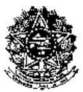

<!-- page 1 -->

# 4 

**MINISTÉRIO DA EDUCAÇÃO** 

## **UNIVERSIDADE FEDERAL RURAL DE PERNAMBUCO SECRETARIA GERAL DOS CONSELHOS DA ADMINISTRAÇÃO SUPERIOR CONSELHO UNIVERSITÁRIO** 

RESOLUÇÃO Nº 042/2020 

EMENTA: Regulamenta carga horária das atividades dos docentes da Universidade Federal Rural de Pernambuco. 

O Presidente do Conselho Universitário da Universidade Federal Rural de Pernambuco, no uso de suas atribuições e tendo em vista a Decisão Nº 036/2020 deste Conselho, exarada no Processo UFRPE Nº 23082.010097/2020-09, em sua VI Reunião Extraordinária, realizada no dia 11 de setembro de 2020, 

**CONSIDERANDO** a necessidade de definir os critérios internos para a distribuição da carga horária semanal de atividades desenvolvidas pelo corpo docente do magistério superior da Universidade Federal Rural de Pernambuco; 

**CONSIDERANDO** o disposto na Lei 6.182, de 11/12/1974; Lei 9.394, de 20/12/1996 (LDB); Lei nº 12.772, de 28/12/2012; Portaria MEC nº 475/1987, de 26/08/1987; Decreto 94.664/87, de 23/07/1987; Lei 11.784/2008, de 22/09/2008; Lei 12.863/2013, de 24/09/2013; Decreto nº 9.235, de 15/12/2017; <u>Lei nº 12.527, de 18/11/2011</u> **<u>;</u>** Acórdão 2729/2017/TCU (itens 9.9; 9.9.1 e 9.9.2); Resolução CONSU 03/2018; Resolução CEPE 053/2017; e no Estatuto e Regimento da UFRPE. 

**CONSIDERANDO** que as atividades de pesquisa e extensão devem ser incentivadas, na medida em que contribuem para a interrelação Universidade-Comunidade, assim como para a atualização e fortalecimento do ensino de graduação e pós-graduação; 

**CONSIDERANDO** que cada Departamento ou Unidade Acadêmica deve ter suas peculiaridades acadêmicas respeitadas, observadas, no entanto, as normas gerais que regem a Universidade; 

**CONSIDERANDO** que cabe ao Departamento ou Unidade Acadêmica a definição e organização das atividades do pessoal docente nele lotado, e levando em conta a necessidade de dotá-lo de um instrumento normativo atualizado para a administração acadêmica da distribuição dos encargos docentes. 

## RESOLVE: 

Art. 1º - Regulamentar os critérios de distribuição da carga horária semanal de atividades do corpo docente do magistério superior da Universidade Federal Rural de Pernambuco (UFRPE), conforme estabelecido no anexo desta Resolução e de acordo com o que consta do Processo acima mencionado. 

Confere com o original assinado pelo Reitor e arquivado nesta Secretaria Geral. 

<!-- page 2 -->

<!-- figure p02-fig1 | described_by: agy | ocr_overlap: None | needs_review: false | decorative: true -->
**(1) Tipo de figura / Kind of figure**
Brasão oficial / emblema heráldico em preto e branco de baixa resolução (Brasão de Armas da República Federativa do Brasil / Coat of Arms of the Federative Republic of Brazil).

**(2) Todo o texto visível / All visible text**
- Faixa/listel inferior (linha superior e linha inferior): `[illegible]` (o texto na faixa inferior está completamente pixelizado e ilegível devido à baixa resolução da imagem / all text on the bottom scroll is completely pixelated and `[illegible]`).

**(3) Estrutura / Structure**
- **Elemento central:** Um escudo redondo (círculo central) contendo cinco estrelas de cinco pontas dispostas em forma de cruz (a constelação do Cruzeiro do Sul) sobre fundo escuro, circundado por um anel circular pontilhado (anel de estrelas).
- **Estrela de cinco pontas:** O círculo central está sobreposto a uma grande estrela de cinco pontas facetada/bipartida, cujas pontas se projetam para cima, para os lados e diagonalmente para baixo.
- **Espada vertical:** Uma espada disposta verticalmente atrás da estrela central, com o punho e os copos visíveis na parte inferior central, logo acima do listel, e a ponta alinhada ao vértice superior da estrela.
- **Ramos laterais (guirlanda):** Dois ramos vegetais arqueados (café à esquerda e fumo/tabaco à direita) que envolvem as laterais da estrela de cinco pontas a partir da base até o topo, sobre um fundo radiante escuro.
- **Faixa / listel na base:** Na parte inferior do brasão, cruzando sobre a base dos ramos e o punho da espada, há uma faixa (listel) ondulada dividida em dobras (uma faixa central/superior e duas pontas laterais/inferiores), contendo caracteres totalmente ilegíveis (`[illegible]`).
- Não há caixas de fluxograma, setas, eixos cartesianos, linhas/colunas de tabela ou múltiplos painéis.

**(4) Números ou valores de dados / Numbers or data values**
- Nenhum número legível (`[illegible]` na faixa inferior onde normalmente constaria a data).
- Elementos contáveis na figura: 1 estrela grande de 5 pontas, 5 estrelas menores no círculo central formando o Cruzeiro do Sul, 1 círculo/anel pontilhado ao redor do centro, 1 espada vertical, 2 ramos laterais e 1 faixa (listel) na base.

**(5) Cores / Colours**
- A imagem é inteiramente monocromática (preto e branco, 1 bit / alto contraste), sem cores que transmitam codificação adicional de dados.

## **MINISTÉRIO DA EDUCAÇÃO UNIVERSIDADE FEDERAL RURAL DE PERNAMBUCO SECRETARIA GERAL DOS CONSELHOS DA ADMINISTRAÇÃO SUPERIOR CONSELHO UNIVERSITÁRIO** 

**(CONTINUAÇÃO DA RESOLUÇÃO Nº 042/2020 DO CONSU).** 

Art. 2° -  Esta Resolução entra em vigor nesta data re- 

vogando-se as disposições em contrário. 

SALA DOS CONSELHOS DA UFRPE, em 14 de setembro de 2020. 

## **PROF. MARCELO BRITO CARNEIRO LEÃO** 

## = PRESIDENTE = 

Reproduzida em 20/01/2021 por haver saído com incorreção 

Confere com o original assinado pelo Reitor e arquivado nesta Secretaria Geral. 

<!-- page 3 -->

<!-- figure p03-fig1 | same image as p02-fig1 -->

## **MINISTÉRIO DA EDUCAÇÃO UNIVERSIDADE FEDERAL RURAL DE PERNAMBUCO SECRETARIA GERAL DOS CONSELHOS DA ADMINISTRAÇÃO SUPERIOR CONSELHO UNIVERSITÁRIO** 

**(CONTINUAÇÃO DA RESOLUÇÃO Nº 042/2020 DO CONSU).** 

## **REGULAMENTO DE DISTRIBUIÇÃO DE CARGA HORÁRIA DOCENTE DO MAGISTÉRIO SUPERIOR NA UFRPE** 

Art. 1º - Regulamenta os critérios de distribuição da carga horaria semanal de atividades do corpo docente do magistério superior da Universidade Federal Rural de Pernambuco (UFRPE), conforme estabelecido nesta resolução. 

Art. 2º - A distribuição da carga horária semanal de atividades do corpo docente deve obedecer às exigências legais em vigor, primando pela qualidade e indissociabilidade entre ensino, pesquisa e extensão. 

Art. 3º - O(A) docente ministrará aulas em todos os níveis e modalidades de ensino, indistintamente, conforme a necessidade da instituição, de acordo com sua especificidade e área de atuação, podendo, conforme o caso, colaborar em áreas com as quais tenha afinidade e adequada formação ou capacitação. 

Parágrafo Único - A ministração de aulas, como atividade precípua do(a) docente, não será objeto de superposição, mas de articulação com as atividades de pesquisa e extensão, representação e administração, prevalecendo sempre as demandas advindas da implantação e implementação dos cursos em todos os níveis e modalidades ofertadas no âmbito da UFRPE. 

Art. 4º - Para fins de distribuição da carga horária semanal, serão considerados os regimes de trabalho descritos no Art. 20 da Lei nº 12.772, de 28/12/2012, para os(as) docentes do Magistério Superior: 

I- 40 (quarenta) horas semanais de trabalho, em tempo integral, com dedicação exclusiva. 

II- 40 (quarenta) horas semanais de trabalho, em tempo integral, sem dedicação exclusiva. 

III - tempo parcial de 20 (vinte) horas semanais de trabalho. 

Art. 5º - A distribuição da carga horária semanal em cada semestre letivo será realizada pelo Departamento Acadêmico ou Unidade Acadêmica a que pertence o(a) docente, em consonância com o Art. 3º, § 3º da Lei 6.182, de 11 de dezembro de 1974, e os Art. 23 e Art. 78 do Estatuto da UFRPE 

§1º - As atividades de ensino, pesquisa, extensão, administração e representação apresentadas pelo(a) docente deverão integralizar o número de horas relativas ao regime de trabalho em que o(a) docente é contratado(contratada), em consonância com o Art. 3º da Lei 6.182, de 11/12/1974, e Art. 78 do Estatuto da UFRPE. 

§2º - O(A) docente cujas atividades descritas no parágrafo anterior superem a carga horária do seu regime de trabalho, não poderá usar este excedente de horas para ministrar carga horária em sala de aula inferior a oito horas semanais, conforme o Art. 57 da Lei 9.394, de 20/12/1996. 

Confere com o original assinado pelo Reitor e arquivado nesta Secretaria Geral. 

<!-- page 4 -->

<!-- figure p04-fig1 | same image as p02-fig1 -->

## **MINISTÉRIO DA EDUCAÇÃO UNIVERSIDADE FEDERAL RURAL DE PERNAMBUCO SECRETARIA GERAL DOS CONSELHOS DA ADMINISTRAÇÃO SUPERIOR CONSELHO UNIVERSITÁRIO** 

**(CONTINUAÇÃO DA RESOLUÇÃO Nº 042/2020 DO CONSU).** 

Parágrafo Único **-** As atividades de representação envolvem: representação de classe e, indicação para representação de coordenação em órgãos de fomento, institutos e/ou centros nacionais e internacionais de ensino, pesquisa e extensão. 

Art. 6º. Respeitado o atendimento às necessidades de oferta de disciplinas, cabe ao Departamento Acadêmico ou Unidade Acadêmica, organizar as atividades docentes no melhor interesse de seu funcionamento, buscando integrar as diversas funções acadêmicas em seu âmbito, respeitando-se a legislação em vigor. 

Art. 7º - Os PIT/RIT dos(das) docentes do Departamento Acadêmico ou Unidade Acadêmica deverão ser submetidos para aprovação do Conselho Técnico Administrativo (CTA), em consonância com o Art. 8º, item b, do Regimento Geral da UFRPE, pelo menos 30 (trinta) dias antes do início de cada ano letivo. 

§1º - Até 30 (trinta) dias após o início de cada período letivo, o Departamento Acadêmico ou Unidade Acadêmica poderá efetuar os remanejamentos e ajustes que se façam necessários no plano de que trata o _caput_ deste artigo, no interesse prioritário do ensino. 

§2 **º** - Até 60 (sessenta) dias após a entrada em exercício no cargo (posse, redistribuição, remoção e afastamento de longa duração), o Departamento Acadêmico ou Unidade Acadêmica poderá efetuar os remanejamentos e ajustes que se façam necessários no plano de que trata o _caput_ deste artigo, no interesse prioritário do ensino. 

Art. 8º - O Departamento Acadêmico ou Unidade Acadêmica deverá determinar prazo para que os(as) docentes apresentem o Plano Individual de Trabalho (PIT) de modo a atender o disposto no § 1º do Art. 5º desta Resolução. 

Parágrafo Único - O(A) docente que não apresentar o seu PIT ficará sujeito à distribuição de carga horária em disciplinas de graduação pela Supervisão de Área, ou equivalente, do seu local de lotação, respeitando-se os limites máximos estabelecidos nesta resolução, a sua formação acadêmica em nível de graduação e pós-graduação e as necessidades de oferta de disciplinas pelo Departamento Acadêmico ou Unidade Acadêmica, independentemente das outras atividades desenvolvidas pelo(a) docente. 

Art. 9º - O(A) docente poderá ser dispensado, temporariamente, da obrigação de ministrar aulas, na graduação e/ou na pós-graduação, nos seguintes casos especiais: a) durante o exercício do cargo de Reitor, Vice-Reitor, Chefia de Gabinete da Reitoria, Pró-Reitor e, Diretor Geral e Acadêmico das Unidades Acadêmicas. 

b) outros casos estabelecidos na legislação em vigor Resolução nº 053/2017. Nestes casos o(a) docente deverá fazer a solicitação por escrito ao CTA, ficando a dispensa da obrigação de ministrar aulas condicionada à aprovação prévia do CTA, com ga- 

Confere com o original assinado pelo Reitor e arquivado nesta Secretaria Geral. 

<!-- page 5 -->

<!-- figure p05-fig1 | same image as p02-fig1 -->

## **MINISTÉRIO DA EDUCAÇÃO UNIVERSIDADE FEDERAL RURAL DE PERNAMBUCO SECRETARIA GERAL DOS CONSELHOS DA ADMINISTRAÇÃO SUPERIOR CONSELHO UNIVERSITÁRIO** 

**(CONTINUAÇÃO DA RESOLUÇÃO Nº 042/2020 DO CONSU).** 

rantias prévias que não haverá prejuízo na oferta de disciplinas da graduação e pósgraduação durante o período de afastamento do(da) docente. 

Art. 10 - O(A) docente poderá, temporariamente, ter a sua carga horária semanal reduzida, ministrando, no mínimo 4 (quatro) horas na graduação e, no máximo, 8 (oito) horas semanais de aula, no exercício dos cargos listados abaixo: 

a) Diretor(a) de Departamento Acadêmico. 

b) Coordenador(a) Geral dos Cursos de Graduação. 

c) Coordenador(a) Geral dos Cursos de Pós-graduação. 

- d) Coordenador(a) de Curso de Graduação. 

e) Coordenador(a) de Curso de Pós-graduação _Stricto sensu_ ou _Lato sensu_ . 

f) Outros cargos de direção e coordenação vinculados diretamente à administração universitária. 

§1º - Em todas os casos previstos nas alíneas deste artigo, a redução da carga horária deverá ser solicitada formalmente à direção do Departamento Acadêmico ou Unidade Acadêmica em o que o(a) docente está lotado, ficando a redução de carga horária condicionada à aprovação prévia do CTA e à garantia de que não haverá prejuízo no oferecimento de disciplinas da graduação e pós-graduação durante o período de exercício dos cargos. 

§2º- A carga horária mínima estabelecida no _caput_ deste artigo deverá obedecer ao estabelecido no §4º do Art. 13 desta Resolução. 

§3º- O CTA poderá aprovar a redução da carga horária do(a) substituto eventual da direção ou da coordenação, de forma temporária, quando solicitado pelo(a) titular da função. 

## **CAPÍTULO II** 

## **DAS ATIVIDADES DE ENSINO** 

Art. 11 - Para efeito da elaboração do Plano Individual 

de Trabalho entende-se por atividades de ensino: 

I - A ministração de aulas em cursos de ensino de graduação, e de pós-graduação _stricto sensu_ e _lato sensu_ , mantidos pela UFRPE. 

II – A ministração de aulas não remuneradas em cursos de graduação, de pósgraduação _stricto sensu_ e _lato sensu_ em outras instituições de ensino público, desde que aprovadas previamente pelo CTA do Departamento Acadêmico ou Unidade Acadêmica em que o(a) docente está lotado e garantida a oferta na UFRPE da carga horária mínima estabelecida no Art. 13 desta Resolução. 

III - A preparação das atividades mencionadas no Inciso 1, bem como a criação de recursos educacionais, o atendimento, o acompanhamento e a avaliação das atividades discentes. 

Confere com o original assinado pelo Reitor e arquivado nesta Secretaria Geral. 

<!-- page 6 -->

<!-- figure p06-fig1 | same image as p02-fig1 -->

## **MINISTÉRIO DA EDUCAÇÃO UNIVERSIDADE FEDERAL RURAL DE PERNAMBUCO SECRETARIA GERAL DOS CONSELHOS DA ADMINISTRAÇÃO SUPERIOR CONSELHO UNIVERSITÁRIO** 

**(CONTINUAÇÃO DA RESOLUÇÃO Nº 042/2020 DO CONSU).** 

IV - A participação no planejamento, na organização, na execução e na avaliação referentes ao ensino oferecido pela UFRPE. 

V- A orientação e a supervisão de estágios curriculares obrigatórios ou não obrigatórios em curso de graduação e programas institucionais da UFRPE. 

VI- A orientação de alunos de graduação, mestrado e doutorado da UFRPE. 

VII - Tutoria de grupos do Programa de Educação Tutorial (PET). 

VIII – Tutoria ou preceptoria de Programas de Residência (PR). 

IX – Coordenação de núcleos e grupos de estudos institucionalizados em CTA. X – Tutoria de Atividades Curriculares Complementares (ACC) dos cursos de graduação. 

Art. 12 - As atividades de ensino serão desenvolvidas, regularmente, durante o ano acadêmico e distribuídas em 2 (dois) períodos letivos ordinários e em até 2 (dois) períodos extraordinários de férias. 

Parágrafo Único – Em casos de possíveis excepcionalidades, a quantidade de períodos no ano acadêmico pode ser maior que 2 (dois) períodos letivos ordinários e maior que 2 (dois) períodos extraordinários de férias. 

Art. 13 - Em consonância com o Art. 57 da Lei nº 9.394, de 20/12/1996, e para fins de enquadramento e manutenção do regime de trabalho, a carga horária a ser integralizada corresponde ao mínimo de oito horas de aula semanais, priorizando o ensino de graduação. 

§1º - Entende-se por carga horária as horas despendidas efetivamente com aulas no ensino de graduação e/ou pós-graduação em disciplinas devidamente registradas no componente curricular do curso onde será ofertada. 

§2º - Para os componentes curriculares com duração menor que um semestre, a carga horária semanal será computada proporcionalmente à razão entre a duração do componente curricular e a duração do semestre medida em semanas. 

§3 **º** - As aulas poderão ser ministradas de forma presencial, a distância (EAD) ou de forma híbrida, desde que previstas no Projeto Pedagógico do Curso, aprovado nas instâncias superiores da UFRPE, inclusive em casos excepcionais. 

§4º - Da carga horária referida no _caput_ deste artigo deverão ser destinadas, obrigatoriamente, um mínimo de quatro horas de aula semanais ao ensino de graduação, mesmo quando o(a) docente se enquadrar nos casos descritos no Art. 10 desta resolução. 

Art. 14 - A carga horária semanal mínima de aulas poderá ser atingida através da oferta de disciplinas optativas e ACC, desde que atendido o que estabelece a Resolução nº 220/2016 do Conselho de Ensino, Pesquisa e Extensão (CEPE) e que não existam disciplinas obrigatórias que possam ser lecionadas pelo(a) docente, considerando o disposto no Art. 3º desta Resolução. 

Confere com o original assinado pelo Reitor e arquivado nesta Secretaria Geral. 

<!-- page 7 -->

<!-- figure p07-fig1 | same image as p02-fig1 -->

## **MINISTÉRIO DA EDUCAÇÃO UNIVERSIDADE FEDERAL RURAL DE PERNAMBUCO SECRETARIA GERAL DOS CONSELHOS DA ADMINISTRAÇÃO SUPERIOR CONSELHO UNIVERSITÁRIO** 

**(CONTINUAÇÃO DA RESOLUÇÃO Nº 042/2020 DO CONSU).** 

Art. 15 - A convite das Direções e com anuência do(a) docente, em condições excepcionais, o(a) mesmo poderá ministrar aulas em outros Departamentos ou Unidades Acadêmicas da UFRPE, diferente da sua lotação, quando demandado pelas coordenações de curso, mediante autorização da Direção do órgão de origem do(a) docente. 

Art. 16 - A carga horária semanal será diferenciada, de acordo com o regime de trabalho e o desenvolvimento de outras atividades pelo(a) docente, observando-se o disposto no Art. 5º desta resolução. 

Art. 17 - A carga horária semanal máxima de ministração de aulas teóricas, práticas, de laboratório ou de campo, é de 50% da jornada de trabalho para docentes no regime de 40 (quarenta) horas, com ou sem Dedicação Exclusiva, e de 60% da jornada de trabalho para docentes no regime de 20 (vinte) horas. 

§1º - Não se contabilizará em duplicidade a carga horária de aula resultante da união de duas ou mais turmas de disciplinas de mesmo conteúdo, ministradas no mesmo horário. 

§2º - Para as disciplinas ministradas por mais de um(a) docente, a carga horária deverá ser contabilizada proporcionalmente à participação de cada docente na disciplina, conforme o PIT e o descrito no plano de ensino da disciplina apresentado para o semestre e obrigatoriamente registrada no Sistema de Gestão Acadêmica. 

§3º - Para disciplinas de graduação ministradas na 

UAEADTec o quantitativo de 30 alunos equivale a uma turma. 

Art. 18 - Não se contabilizará como carga horária de aula quaisquer atividades realizadas em cursos de graduação e pós-graduação nos quais o(a) docente seja remunerado adicionalmente. 

Parágrafo Único - Não será considerada remuneração adicional o ressarcimento de despesas para deslocamento e hospedagem (e.g. diárias) do(a) docente, aquela advinda de cargos de direção, de funções gratificadas ou de bolsas de fomento ao ensino, pesquisa e extensão de instituições reconhecidas e/ou conveniadas pela UFRPE. 

Art. 19 - Para o cômputo da carga horária de ensino 

do(a) docente serão utilizados os seguintes critérios: 

I- A ministração de aulas será expressa em horas-aula, entendendo-se por hora-aula a unidade de tempo dedicada ao exercício efetivo de aulas teóricas, práticas, de laboratório e de campo, conforme disposto na Portaria MEC nº 475/1987. 

II - A carga horária do(a) docente compreenderá o somatório das horas-aula das atividades de graduação e pós-graduação. 

Confere com o original assinado pelo Reitor e arquivado nesta Secretaria Geral. 

<!-- page 8 -->

<!-- figure p08-fig1 | same image as p02-fig1 -->

## **MINISTÉRIO DA EDUCAÇÃO UNIVERSIDADE FEDERAL RURAL DE PERNAMBUCO SECRETARIA GERAL DOS CONSELHOS DA ADMINISTRAÇÃO SUPERIOR CONSELHO UNIVERSITÁRIO** 

**(CONTINUAÇÃO DA RESOLUÇÃO Nº 042/2020 DO CONSU).** 

Parágrafo Único - Quando a duração da aula, em minutos, for inferior a 1 hora-relógio, haverá compensação aumentando-se o número de aulas da disciplina (número total de encontros). 

Art. 20 - A cada 1 (uma) hora de carga horária semanal em disciplinas será computada 1 (uma) hora adicional para as atividades de manutenção de ensino. 

Parágrafo Único - Entende-se por atividades de manu- 

tenção de ensino: 

I.     Planejamento de ensino. 

II. Atendimento ao aluno. 

III. Preparação de aulas. 

IV. Confecção de material didático. 

- V. Preparação e correção de avaliações. 

- VI. Manutenção do registro escolar. 

VII. Reuniões pedagógicas. 

VIII. Reuniões de coordenação. 

- IX. Reuniões de gestão. 

## **CAPÍTULO III DAS ATIVIDADES DE PESQUISA** 

Art. 21 - Para efeito da elaboração do Plano Individual 

de Trabalho entende-se por atividades de pesquisa: 

I. Planejamento e execução de projetos de pesquisa, com ou sem financiamento, na qualidade de coordenador ou colaborador. 

II. Coordenação e/ou participação em grupo de pesquisa. 

III. Supervisão de estágio pós-doutoral. 

IV.  Orientação principal ou coorientação de alunos de pós-graduação. 

- V.  Orientação principal ou coorientação de alunos em programas oficiais da UFRPE ou outros órgãos de fomento de iniciação científica. 

VI.  Planejamento e organização de eventos acadêmico-científicos. 

VII. Participação em Comitês e Comissões Científicas. 

VIII. Participação em Conselho Editorial de revistas científicas, técnicas e culturais ou de instituições de capital público ou privadas. 

IX.  Publicação de livro e/ou capítulo de livro científico, didático, cultural ou técnico. 

X.  Edição, organização e/ou tradução de livro científico, didático, cultural ou técnico. 

XI.  Produção cientifica em congressos, simpósios, _workshops_ ou seminários. 

XII. Desenvolvimento de aplicativos computacionais, registrados ou publicados em livros ou revistas indexadas. 

XIII. Registro de patente. 

Confere com o original assinado pelo Reitor e arquivado nesta Secretaria Geral. 

<!-- page 9 -->

<!-- figure p09-fig1 | same image as p02-fig1 -->

## **MINISTÉRIO DA EDUCAÇÃO UNIVERSIDADE FEDERAL RURAL DE PERNAMBUCO SECRETARIA GERAL DOS CONSELHOS DA ADMINISTRAÇÃO SUPERIOR CONSELHO UNIVERSITÁRIO** 

**(CONTINUAÇÃO DA RESOLUÇÃO Nº 042/2020 DO CONSU).** 

XIV.  Produção científica em periódicos nacionais e/ou internacionais. XV. Revisão e elaboração de parecer _Ad-hoc_ em artigos e projetos. XVI. Elaboração de parecer em agências de fomento. XVII.- Elaboração e publicação de relatórios técnicos. XVIII.- Tradução de artigos científicos e livros científicos, didáticos, culturais ou técnicos. 

Art. 22 - Para alocação da carga horária do(a) docente destinada a atividades de pesquisa, deverão ser satisfeitas as seguintes condições: 

I.  Estar com o currículo atualizado na plataforma Lattes do CNPq. 

II.  A atividade deve ser reconhecida oficialmente pela UFRPE. III. A atividade deve estar aprovada junto ao CTA do órgão de lotação do(a) docente. 

Art. 23 - Somente poderão ser computados para integralizar a carga horária semanal os projetos de pesquisa que atenderem o disposto na Resolução nº 436/2005 do CEPE ou outra Resolução _a posteriori_ . 

Parágrafo Único - A carga horária de participação em projetos de pesquisa ficará limitada a no máximo 20 (vinte) horas semanais, incluídos aqueles em que o(a) docente seja coordenador. 

Art. 24 - A orientação principal de alunos de pósgraduação _stricto sensu_ será computada até o número máximo de oito alunos por docente, em concordância com o Art. 2º da Portaria CAPES nº 1, de 04/01/2012, e do artigo 5º da Portaria CAPES nº 174, de 30/12/2014, considerados todos os cursos em que o(a) docente participa. 

§ 1º - A coorientação de alunos de pós-graduação _Stricto sensu_ será computada até o número máximo de oito alunos por docente, independentemente do número de cursos em que o(a) docente esteja vinculado. 

§ 2º - Cada orientação de mestrado poderá ser considerada, para efeito de composição de carga horária, por, no máximo, quatro semestres letivos consecutivos. 

§ 3º - Cada orientação de doutorado poderá ser considerada, para efeito de composição de carga horária, por, no máximo, oito semestres letivos consecutivos. 

Art. 25 - Não serão consideradas para efeito de composição de carga horária as orientações ou coorientações em cursos em que o(a) docente receba qualquer remuneração adicional para tal. 

Confere com o original assinado pelo Reitor e arquivado nesta Secretaria Geral. 

<!-- page 10 -->

<!-- figure p10-fig1 | same image as p02-fig1 -->

## **MINISTÉRIO DA EDUCAÇÃO UNIVERSIDADE FEDERAL RURAL DE PERNAMBUCO SECRETARIA GERAL DOS CONSELHOS DA ADMINISTRAÇÃO SUPERIOR CONSELHO UNIVERSITÁRIO** 

**(CONTINUAÇÃO DA RESOLUÇÃO Nº 042/2020 DO CONSU).** 

Parágrafo Único - Não será considerada remuneração adicional o ressarcimento de despesas para deslocamento e hospedagem (e.g. diárias) do(a) docente, aquela advinda de cargos de direção, de funções gratificadas ou de bolsas de fomento ao ensino, pesquisa e extensão de instituições reconhecidas. 

Art. 26 – O(A) docente que alocar carga horária para o desenvolvimento de atividades de pesquisa e que, nos últimos cinco anos não tiver produção científica publicada em periódico com conceito mínimo C pelo QUALIS da Capes/MEC ou Fator de Impacto maior ou igual a 0,5 (meio) ou JCR maior ou igual a 0,5 (meio) ou Google Acadêmico Índice H5 maior ou igual a 4 (quatro) ou revistas com corpo editorial e ISSN não poderá alocar nova carga horária para pesquisa pelo período subsequente. 

§ 1º - Somente serão consideradas as publicações em que a UFRPE seja mencionada como Instituição de vínculo do(a) docente. 

§ 2º - O CTA poderá dispensar da publicação dos resultados em periódico científico as atividades de pesquisa que tenham como produto final a geração de processos ou produtos tecnológicos, visando o registro de patentes, mediante relatório circunstanciado do(a) docente e parecer conclusivo de consultor _ad hoc_ . 

Art. 27 - O(A) docente que no PIT tiver alocado carga horária para desenvolvimento de atividades de pesquisa, e não realizar a carga horária planejada, deverá justificar o ocorrido no seu RIT. 

## **CAPÍTULO IV DAS ATIVIDADES DE EXTENSÃO** 

Art. 28 - Para efeito da elaboração do Plano Individual 

de Trabalho entende-se por atividades de extensão: 

I - Execução de projeto de extensão, com ou sem bolsa (BEXT/SONUS), na qualidade de coordenador ou colaborador. 

II - Orientação de bolsistas ou voluntários em projetos de extensão. 

III - A coordenação, ministração ou participação em cursos de aperfeiçoamento ou de outros cursos de curta duração, não incluídos nos Art. 11 e 21. 

IV - Planejamento e organização de projetos, cursos, palestras, colóquios, simpósios, oficinas, minicursos, artísticos, culturais e esportivos, entre outros de interesse da instituição e da comunidade. 

V - Planejamento e organização de programas de qualificação profissional, programas comunitários de mobilização interna e externa, entre outros de interesse da instituição e da comunidade. 

Confere com o original assinado pelo Reitor e arquivado nesta Secretaria Geral. 

<!-- page 11 -->

<!-- figure p11-fig1 | same image as p02-fig1 -->

## **MINISTÉRIO DA EDUCAÇÃO UNIVERSIDADE FEDERAL RURAL DE PERNAMBUCO SECRETARIA GERAL DOS CONSELHOS DA ADMINISTRAÇÃO SUPERIOR CONSELHO UNIVERSITÁRIO** 

**(CONTINUAÇÃO DA RESOLUÇÃO Nº 042/2020 DO CONSU).** 

VI - A prestação de serviços à sociedade mediante atendimento direto ou indireto, tais como assessorias, consultorias e perícias, observando-se a legislação vigente e devidamente autorizadas pela instituição. 

VII - Tutoria de empresas juniores. 

VIII - Participação em bancas de concurso ou de formação acadêmica. 

IX - Elaboração de relatórios de extensão. 

X - Elaboração de escrita de artigos e capítulo de livros e a atuação como revisor. XI - Avaliador de projetos de extensão. 

Art. 29 - Somente poderão ser computadas para integralizar a carga horária semanal as atividades de extensão que estiverem, no mínimo, previamente aprovadas pelo CTA do órgão de lotação do(a) docente. 

§1º - As atividades de extensão desenvolvidas pelos(pelas) docentes devem ser obrigatoriamente cadastradas no Sistema de Informação e Gestão de Projetos (SIGProj) (sigprojl.mec.gov.br/), ou outro sistema que venha a ser adotado pela UFRPE futuramente. 

§2º - Caso o projeto cadastrado no SIGProj não seja realizado, o(a) docente poderá lançar as etapas de planejamento e elaboração do projeto desde que apresentado um documento comprobatório justificando a não execução do projeto. 

§3º - Serão computadas no máximo 20 (vinte) horas de atividades de extensão concomitantes para cada docente na condição de coordenador ou colaborador. 

Art. 30 - Não serão consideradas para efeito de composição de carga horária as atividades de extensão em que o(a) docente receba qualquer remuneração adicional. 

Parágrafo Único - Não será considerada remuneração adicional o ressarcimento de despesas para deslocamento e hospedagem (e.g. diárias) do(da) docente, aquela advinda de cargos de direção, de funções gratificadas ou de bolsas de fomento de instituições reconhecidas. 

Art. 31 - O(A) docente que alocar a carga horária para o desenvolvimento de atividades de extensão, deve apresentar os resultados das atividades de extensão declaradas na página da PROExC, ou no Congresso Internacional de Ensino, Pesquisa e Extensão da UFRPE - CIEPEX, ou evento similar de interesse da área. 

§1º - Somente serão consideradas as publicações em que a UFRPE seja mencionada como Instituição de vínculo do(a) docente. 

§2º - O(A) docente que após dois anos não atender o estabelecido no _caput_ deste artigo não poderá alocar nova carga horária para atividades de extensão pelo período subsequente. 

Confere com o original assinado pelo Reitor e arquivado nesta Secretaria Geral. 

<!-- page 12 -->

<!-- figure p12-fig1 | same image as p02-fig1 -->

## **MINISTÉRIO DA EDUCAÇÃO UNIVERSIDADE FEDERAL RURAL DE PERNAMBUCO SECRETARIA GERAL DOS CONSELHOS DA ADMINISTRAÇÃO SUPERIOR CONSELHO UNIVERSITÁRIO** 

**(CONTINUAÇÃO DA RESOLUÇÃO Nº 042/2020 DO CONSU).** 

§3º - O CEPE poderá, mediante relatório circunstanciado do(da) docente e parecer conclusivo de consultor _ad hoc,_ dispensar ou substituir a publicação dos resultados como indicativo de produção associada às atividades de extensão. 

Art. 32 – O (A) docente que, tendo alocado carga horária para desenvolvimento de atividades de extensão, desrespeitar as normas para o cumprimento dessas atividades, estabelecidas nesta Resolução ou em outras instâncias da UFRPE, perderá o direito de voltar a alocar carga horária para essas atividades enquanto perdurar a irregularidade. 

## **CAPÍTULO V DAS ATIVIDADES ADMINISTRATIVAS** 

Art. 33 - Entende-se por atividades de administração as 

relacionadas com: 

I- A direção, a coordenação, a chefia e o assessoramento, integrantes do quadro oficial da estrutura administrativa ou acadêmica da UFRPE. 

II - O desempenho de outras funções previstas na legislação. 

III - Participação em conselhos, comissões e comitês de diferentes naturezas, internos ou externos à UFRPE. 

IV - Outras atividades administrativas estabelecidas nas normativas da UFRPE. 

Parágrafo Único - Outras funções administrativas não abrangidas neste artigo, quando assumidas por docentes, serão definidas através de portaria da Reitoria, ou por sua delegação conforme Instrução Normativa 001/2013-GR, explicitando-se, no ato de designação, a carga horária semanal necessária para exercício da função. 

Art. 34 - Para serem válidas, as Atividades Administrativas e de Representação deverão ser comprovadas através de instrumento legal. 

Art. 35 - Para computar a participação em conselhos, comissões e comitês de diferentes naturezas, devidamente aprovada pelas instâncias cabíveis, deverá ser comprovada a realização de reuniões com, no mínimo, periodicidade mensal. 

§1º - Não poderá alocar nova carga horária para as atividades descritas no _caput_ deste artigo, os(a) docentes titulares e suplentes, que não respeitarem o disposto na Resolução Conselho Superior (CONSU) nº 005/2015, de 03/02/2015. 

§2º - A participação nas reuniões deverá ser comprovada através de declaração de comparecimento a pelo menos 80% das reuniões. 

Confere com o original assinado pelo Reitor e arquivado nesta Secretaria Geral. 

<!-- page 13 -->

<!-- figure p13-fig1 | same image as p02-fig1 -->

## **MINISTÉRIO DA EDUCAÇÃO UNIVERSIDADE FEDERAL RURAL DE PERNAMBUCO SECRETARIA GERAL DOS CONSELHOS DA ADMINISTRAÇÃO SUPERIOR CONSELHO UNIVERSITÁRIO** 

**(CONTINUAÇÃO DA RESOLUÇÃO Nº 042/2020 DO CONSU).** 

§3º - Somente será computada a carga horária pela participação em conselhos, comissões e comitês de diferentes naturezas em que o(a) docente participe como membro não nato. 

## **CAPÍTULO VI** 

## **DO PLANO INDIVIDUAL DE TRABALHO E RELATÓRIO INDIVIDUAL DE TRABALHO** 

Art. 36 - Anualmente, em data fixada, cada docente apresentará o PIT/RIT ao seu órgão de lotação e exercício para aprovação. Nestes documentos deverão estar discriminadas todas as suas atividades docentes, por período letivo. 

§ 1º - O(A) docente deverá elaborar o PIT com base nas atividades que desenvolverá, ao longo de 12 (doze) meses, no âmbito do ensino, da pesquisa, da extensão, da formação e da administração, conforme disposto nesta Resolução no Apêndice I. 

§ 2º - O PIT deverá estar compatibilizado ao plano de trabalho da área acadêmica à qual o(a) docente está associado(associada), priorizando-se as atividades de ensino de graduação. 

§ 3º - Na elaboração de seu PIT, o(a) docente deverá demonstrar o preenchimento da carga horária do respectivo regime de trabalho, atendidos os critérios estabelecidos nesta Resolução. 

Art. 37 - Na hipótese de eventualmente uma atividade planejada ultrapassar o limite estabelecido nesta resolução, a mesma deverá constar no RIT, devidamente justificada. 

Art. 38 – Cabe ao Departamento Acadêmico ou Uni- 

dade Acadêmica, criar uma Comissão de Avaliação dos PIT e RIT. 

Parágrafo Único - A Comissão deverá ser composta por 5 (cinco) docentes do respectivo Departamento Acadêmico ou Unidade Acadêmica. 

Art. 39 - O PIT deverá ser aprovado pelo CTA de seu órgão de lotação, após a análise e aprovação da Supervisão de Área ou, no caso das Unidades Acadêmicas, da Coordenação Geral dos Cursos de Graduação – COGER. 

§1º - Após a aprovação do PIT pelo CTA, a direção do Departamento Acadêmico ou Unidade Acadêmica deverá dar publicidade, ampla e irrestrita, de todas as atividades desenvolvidas pelos (pelas) docentes junto à comunidade acadêmica, de acordo com o Acórdão 2729/2017/TCU-item 9-subitens 9.1 e 9.2. 

Confere com o original assinado pelo Reitor e arquivado nesta Secretaria Geral. 

<!-- page 14 -->

<!-- figure p14-fig1 | same image as p02-fig1 -->

## **MINISTÉRIO DA EDUCAÇÃO UNIVERSIDADE FEDERAL RURAL DE PERNAMBUCO SECRETARIA GERAL DOS CONSELHOS DA ADMINISTRAÇÃO SUPERIOR CONSELHO UNIVERSITÁRIO** 

**(CONTINUAÇÃO DA RESOLUÇÃO Nº 042/2020 DO CONSU).** 

§2º - Caso o CTA não aprove o PIT do(da) docente, após ciência do mesmo, este terá até 15 (quinze) dias corridos para refazê-lo e encaminhálo, cabendo recurso a instâncias superiores. 

Art. 40 - Anualmente, em data fixada pelo órgão de lotação, o(a) docente apresentará o seu RIT referente às atividades docentes descritas no PIT para o ano em exercício. 

§ 1º- O RIT deverá explicitar o número de horas-aula dadas em cada período letivo, em nível de graduação e de pós-graduação, e conter o relato de todas as outras atividades de magistério realçando os pontos do PIT que foram atingidos plenamente e indicando os objetivos não atingidos ou atingidos parcialmente. 

§ 2º - O relatório de que trata este artigo deverá ser feito em formulário próprio, devidamente acompanhado dos documentos comprobatórios das atividades realizadas. 

Art. 41 **-** O RIT de cada docente, instruído com o respectivo PIT, será objeto de análise da Comissão de Avaliação do PIT/RIT, e a subsequente apreciação do CTA do órgão de lotação do(da) docente. 

§1º - Caso o CTA não aprove o PIT/RIT, após ciência do(da) docente, este terá até 15 (quinze) dias corridos para refazê-lo e reencaminhá-lo a este Conselho. 

§2º - Das apreciações mencionadas neste artigo cabe recurso em primeira instância ao CEPE e em segunda instância ao CONSU. 

§3º - O(A) docente que tiver a reprovação de seus PIT/RIT homologada, ficará impedido de participar de editais da UFRPE e a concorrer a cargos de gestão até que venha a ter seu PIT/RIT aprovado. 

## **CAPÍTULO VII DAS DISPOSIÇÕES TRANSITÓRIAS** 

Art. 42 - Revoga-se a Resolução nº 018/2010 do Conselho Universitário, datada de 02 de março de 2010 e demais disposições em contrário. SALA DOS CONSELHOS DA UFRPE, em 14 de setembro de 2020. 

## **PROF. MARCELO BRITO CARNEIRO LEÃO** 

## = PRESIDENTE = 

Confere com o original assinado pelo Reitor e arquivado nesta Secretaria Geral. 

<!-- page 15 -->

<!-- figure p15-fig1 | same image as p02-fig1 -->

## **MINISTÉRIO DA EDUCAÇÃO UNIVERSIDADE FEDERAL RURAL DE PERNAMBUCO SECRETARIA GERAL DOS CONSELHOS DA ADMINISTRAÇÃO SUPERIOR CONSELHO UNIVERSITÁRIO** 

**(CONTINUAÇÃO DA RESOLUÇÃO Nº 042/2020 DO CONSU).** 

## **APÊNDICE 1 RELAÇÃO DE ATIVIDADES PARA DISTRIBUIÇÃO DE CARGA HORÁRIA DOCENTE (*)** 

**<u>ENSINO</u>** Orientação principal de alunos de graduação (programas de estímulo à docência, monografia, bolsa permanência, PET, monitoria, tutorial de 1º ano, cooperação internacional, PAVI, tutor de empresa junior, TCC, ESO, ACC) <u>Orientação principal de alunos de pós-graducação (</u> _<u>Stricto sensu</u>_ <u>e</u> _<u>Lato sensu</u>_ <u>) Co-orientação de alunos de pós-graduação (</u> _<u>Stricto sensu</u>_ e _Lato_ _<u>sensu</u>_ <u>) Coordenação de grupos de estudo reconhecidos pela instituição Coordenação de projeto de ensino com financiamento externo Coordenação de projeto de ensino sem financiamento externo Colaboração em projeto de ensino com ou sem financiamento externo Supervisão/orientação de residência multiprofissional Participação como membro titular de banca de trabalhos de conclusão de curso</u> Formação continuada em docência na área de atuação ou afim 

|**PESQUISA**|
|---|
|Supervisão de pós-doutorado|
|Coordenação degrupos depesquisa reconhecidos oficialmentepelaUFRPE|
|Coordenação de projeto de pesquisa com financiamento (exceto bolsa)|
|Coordenação deprojeto depesquisa sem financiamento|
|Colaboração em projeto de pesquisa com ou sem financiamento externo|
|Participação emconselhos editoriais|
|Editor deperiódicos científicos|
|Orientação principal de iniciação científica ou tecnológica|
|Coorientação de iniciação científica ou tecnológica|
|Revisor de periódico científico|
|Participação como titular em bancas depós-graduação(sem ser orientador)|
|Avaliador de programas (PIBIC, CIEPEX, etc.) e eventos técnico-científicos|
|Elaboração e submissão para publicação de livro, produção de manual técnico e/ou didáti- co|
|Elaboração e submissão para publicação de capítulo de livro, artigo científico em revista indexada|
|Editoração, organização e/ou tradução de livro técnico-científico|
|Produção cientifica em congressos, simpósios, workshops, seminários regionais, nacionais ou internacionais, como primeiro autor ou autor correspondente|
|Planejamento ou organização de eventos acadêmicos-científicos na condição de**Coorde-** **nador**|
|Planejamento ou organização de eventos acadêmicos-científicos na condição de**Colabo-** **rador**|
|Formação continuada científica na área de atuação ou afim|
|**EXTENSÃO**|

Confere com o original assinado pelo Reitor e arquivado nesta Secretaria Geral. 

<!-- page 16 -->

<!-- figure p16-fig1 | same image as p02-fig1 -->

## **MINISTÉRIO DA EDUCAÇÃO UNIVERSIDADE FEDERAL RURAL DE PERNAMBUCO SECRETARIA GERAL DOS CONSELHOS DA ADMINISTRAÇÃO SUPERIOR CONSELHO UNIVERSITÁRIO** 

**(CONTINUAÇÃO DA RESOLUÇÃO Nº 042/2020 DO CONSU).** 

<u>Coordenação de projetos de extensão aprovados oficialmente pela UFRPE Colaboração em projeto de extensão de outra instituição</u> Planejamento e organização de cursos, palestras, colóquios, simpósios, oficinas, minicursos, ester outros de interesse da instituição e da comunidade, na condição de **Coordena-** **<u>dor</u>** Planejamento e organização de cursos, palestras, colóquios, simpósios, oficinas, minicursos, ester outros de interesse da instituição e da comunidade, na condição de **<u>Colaborador</u>** Desenvolvimento de atividades contínuas de cunho esportivo, artístico e cultural no âmbito interno da instituição Planejamento e/ou organização de programas de qualificação professional, programas comunitários de mobilização interna e externa, entre outros de interesse da instituição e da comunidade, na condição de **<u>Coordenador</u>** <u>.</u> 

Planejamento e/ou organização de programas de qualificação profissional, programas Comunitários de mobilização interna e externa, entre outros de interesse da instituição e da comunidade, na condição de **Colaborador** 

Atividades de consultoria, curadoria, assessoria, prestação de serviços, laudos técnicos, desde que não remuneradas, observando-se a legislação vigente, e devidamente autorizadas pela instituição <u>Formação continuada em extensão na área de atuação ou afim</u> **ADMINISTRATIVA** Participação em comissões permanentes ou temporárias e colegiados institucionais como titular Participação em comissões permanentes ou temporárias e colegiados institucionais como suplente <u>Supervisão de área do conhecimento Cargos de coordenação de curso ou coordenação geral de cursos</u> Cargos de coordenação administrativa (ex: execução de convênios, bases experimentais <u>etc.)</u> Reitoria, Vice-reitoria, Chefia de Gabinete, Pró-reitorias, Direção Geral e Acadêmica de <u>Unidades Acadêmicas</u> Diretor de Departamento Acadêmico <u>Assessorias e demais cargos de confiança nomeados pela Reitoria (ver Art. 33) Representação em conselhos, comitês, sindicatos e outras organizações profissionais (**)</u> Formação continuada administrativa na área de atuação ou afim 

* Limitado à carga horária do contrato de trabalho (20h ou 40h ou 40h DE semanais). 

** Considerar ainda os limites estabelecidos em Lei e/ou Resolução de Conselhos de Classe. 

Confere com o original assinado pelo Reitor e arquivado nesta Secretaria Geral.
