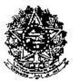
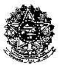

<!-- page 1 -->

<!-- figure p01-fig1 | described_by: agy | ocr_overlap: None | needs_review: false -->
**1. Tipo de figura / Kind of figure**
- **PT:** Brasão / emblema oficial em preto e branco de baixa resolução (Brasão de Armas da República Federativa do Brasil).
- **EN:** Low-resolution black-and-white official coat of arms / emblem (Coat of Arms of the Federative Republic of Brazil).

**2. Texto visível / Visible text**
- **PT:** Há inscrições nas faixas (listéis) na parte inferior do brasão, porém devido à baixa resolução e pixelização da imagem todo o texto encontra-se `[illegible]`.
- **EN:** There is text along the scroll/ribbon banners at the bottom of the emblem, but due to low resolution and pixelation all text is `[illegible]`.

**3. Estrutura / Structure**
- **PT:** Emblema simétrico composto por:
  - Um escudo circular central contendo constelações estilizadas (Cruzeiro do Sul) no interior e uma bordadura circular pontilhada (representando estrelas ao redor do círculo central).
  - O escudo circular está sobreposto a uma estrela de cinco pontas.
  - Uma espada vertical posicionada no eixo central inferior, cuja empunhadura aparece na base da estrela, entre as duas pontas inferiores.
  - Dois ramos vegetais arqueados (folhagens/guirlanda) que envolvem as laterais esquerda e direita da estrela de cinco pontas, partindo da base até o topo.
  - Na base, sob a estrela e os ramos, há uma faixa/listel dobrada em três segmentos (esquerdo, central sobre o punho da espada e direito) com extremidades bifurcadas, onde se localiza o texto `[illegible]`.
- **EN:** Symmetrical emblem composed of:
  - A central circular shield containing stylized constellations (Southern Cross) inside and a dotted circular border (representing a ring of stars around the inner circle).
  - The circular shield is superimposed on a five-pointed star.
  - A vertical sword positioned along the lower central axis, with its hilt visible at the base between the two bottom points of the star.
  - Two arched wreaths of foliage framing the left and right sides of the five-pointed star from base to top.
  - At the bottom base, beneath the star and wreaths, a scroll/ribbon banner folded into sections with forked ends bearing the `[illegible]` text.

**4. Números e valores de dados / Numbers and data values**
- **PT:** Nenhum número ou valor de dados legível (`[illegible]` na faixa inferior).
- **EN:** No legible numbers or data values (`[illegible]` on the lower scroll).

**5. Cores / Colours**
- **PT:** Imagem monocromática (apenas pixels pretos sobre fundo branco); as cores não carregam significado adicional além do contraste do desenho em preto e branco.
- **EN:** Monochrome image (black pixels on a white background only); colours carry no additional meaning beyond the black-and-white line/halftone contrast.

## **MINISTÉRIO DA EDUCAÇÃO UNIVERSIDADE FEDERAL RURAL DE PERNAMBUCO SECRETARIA GERAL DOS CONSELHOS DA ADMINISTRAÇÃO SUPERIOR CONSELHO UNIVERSITÁRIO** 

RESOLUÇÃO CONSU/UFRPE Nº 434, DE 20 DE FEVEREIRO DE 2024. 

Regulamente atividades docentes do Magistério Superior da Universidade Federal Rural de Pernambuco. 

O Presidente do Conselho Universitário da Universidade Federal Rural de Pernambuco, no uso de suas atribuições e tendo em vista a Decisão Nº 013/2024 deste Conselho, em sua I Reunião Extraordinária, realizada no dia 19 de fevereiro de 2024, exarada no Processo UFRPE Nº 23082.036930/2023-39, 

CONSIDERANDO a necessidade de regulamentar as atividades desenvolvidas pelo corpo docente do Magistério Superior da Universidade Federal Rural de Pernambuco e estabelecer os critérios internos para a distribuição da carga horária semanal dos docentes. 

CONSIDERANDO o disposto na Constituição Federal, de 1988; na Lei n. 8.112, de 11 de dezembro de 1990; na Lei 9.394, de 20 de dezembro de 1996 (LDB); na Lei nº 12.772, de 28 de dezembro de 2012; na Lei nº 12.527, de 18 de novembro de 2011; e no Estatuto e Regimento da UFRPE. 

CONSIDERANDO que as atividades de pesquisa e extensão devem ser incentivadas, na medida em que contribuem para a inter-relação Universidade-Comunidade, assim como para a atualização e fortalecimento do ensino de graduação e pós-graduação; 

CONSIDERANDO que cada Departamento ou Unidade Acadêmica deve ter suas peculiaridades acadêmicas respeitadas, observadas, no entanto, as normas gerais que regem a Universidade; 

CONSIDERANDO que cabe ao Departamento ou Unidade Acadêmica a definição e organização das atividades do pessoal docente nele lotado, e levando em conta a necessidade de dotá-lo de um instrumento normativo atualizado para a administração acadêmica da distribuição dos encargos docentes. 

# **RESOLVE:** 

**Art. 1º** Regulamentar as atividades docentes do Magistério Superior e os critérios de distribuição da carga horária semanal de atividades desse corpo docente na Universidade Federal Rural de Pernambuco UFRPE, conforme consta no Processo acima mencionado. 

Art. 2º  Ficam revogadas as Resoluções CONSU 042, de 14 de setembro de 2020, a qual regulamenta a carga horária das atividades docentes.; e CONSU nº 292, de 13 de abril de 2023, que altera a Resolução 042/2020, em seu parágrafo 2º do art. 40. 

Confere com o original assinado pelo Reitor e arquivado nesta Secretaria Geral. 

<!-- page 2 -->

<!-- figure p02-fig1 | described_by: agy | ocr_overlap: None | needs_review: false | decorative: true -->
**(1) Tipo de figura / Kind of figure**
- **PT:** Trata-se de um emblema ou brasão oficial em baixa resolução (preto e branco): o Brasão de Armas da República Federativa do Brasil ( Armas Nacionais do Brasil), comumente utilizado no cabeçalho de documentos oficiais brasileiros.
- **EN:** This is a low-resolution, black-and-white official emblem or coat of arms: the Coat of Arms of the Federative Republic of Brazil (*Brasão de Armas da República Federativa do Brasil*), commonly used at the top of official Brazilian documents.

**(2) Todo o texto visível / All visible text**
- **PT:** O texto inscrito nas faixas/fitas inferiores do brasão está completamente pixelado devido à baixa resolução da imagem: `[illegible]` (ilegível). Não há títulos, rótulos, legendas, eixos ou células legíveis na imagem.
- **EN:** The text inscribed on the lower ribbons/scrolls of the coat of arms is completely pixelated due to the low resolution of the image: `[illegible]`. There are no readable titles, labels, legends, captions, axis ticks, or cell values in the image.

**(3) Estrutura / Structure**
- **PT:** A figura consiste em um único painel centralizado contendo um emblema simétrico composto por:
  - Um escudo circular central contendo cinco pequenas manchas brancas (representando a constelação do Cruzeiro do Sul), circundado por um anel de pequenos pontos brancos (estrelas).
  - O escudo central está sobreposto a uma estrela de cinco pontas facetada.
  - Uma espada vertical posicionada no eixo central inferior, cuja empunhadura aparece na base da estrela de cinco pontas.
  - Dois ramos vegetais curvos (ramos de café e tabaco) que ladeiam a estrela a partir da base até o topo, formando uma guirlanda ao redor de um fundo radiante (resplendor).
  - Na base, uma fita/listel dobrada em duas linhas curvas horizontais (onde constam inscrições `[illegible]`) sobre o cruzamento dos ramos e o punho da espada.
  - Não há caixas, setas, eixos, linhas ou colunas de tabela.
- **EN:** The figure consists of a single centered panel containing a symmetrical emblem composed of:
  - A central circular shield containing five small white marks (representing the Southern Cross constellation), bordered by a ring of small white dots (stars).
  - The central shield is superimposed on a five-pointed faceted star.
  - A vertical sword positioned along the lower central axis, with its hilt visible at the base of the five-pointed star.
  - Two curved botanical branches (coffee and tobacco branches) flanking the star from base to top, forming a wreath around a radiating background (sunburst/glory).
  - At the bottom, a ribbon/scroll folded into two curved horizontal lines (containing `[illegible]` inscriptions) across the crossing of the branches and the sword hilt.
  - There are no boxes, arrows, axes, table rows, or columns.

**(4) Números ou valores de dados / Numbers or data values**
- **PT:** Nenhum número ou valor de dados é legível na imagem (`[illegible]` nas faixas inferiores).
- **EN:** No numbers or data values are readable in the image (`[illegible]` on the lower ribbons).

**(5) Cores / Colours**
- **PT:** A imagem é inteiramente monocromática (preto e branco / binária), sem uso de cores com significado adicional.
- **EN:** The image is entirely monochrome (black and white / binary), with no colours carrying additional meaning.

## **MINISTÉRIO DA EDUCAÇÃO UNIVERSIDADE FEDERAL RURAL DE PERNAMBUCO SECRETARIA GERAL DOS CONSELHOS DA ADMINISTRAÇÃO SUPERIOR CONSELHO UNIVERSITÁRIO** 

(CONTINUAÇÃO DA RESOLUÇÃO CONSU/UFRPE Nº 434, DE 20 DE FEVEREIRO DE 2024). 

Art. 3º  Esta Resolução entra em vigor em 20 de fevereiro de 2024. 

SALA DOS CONSELHOS SUPERIORES DA UFRPE. 

Prof. Marcelo Brito Carneiro Leão 

PRESIDENTE 

Confere com o original assinado pelo Reitor  e arquivado nesta Secretaria Geral. 

<!-- page 3 -->

<!-- figure p03-fig1 | same image as p02-fig1 -->

## **MINISTÉRIO DA EDUCAÇÃO UNIVERSIDADE FEDERAL RURAL DE PERNAMBUCO SECRETARIA GERAL DOS CONSELHOS DA ADMINISTRAÇÃO SUPERIOR CONSELHO UNIVERSITÁRIO** 

(CONTINUAÇÃO DA RESOLUÇÃO CONSU/UFRPE Nº 434, DE 20 DE FEVEREIRO DE 2024). 

# **REGULAMENTO DE DISTRIBUIÇÃO DE CARGA HORÁRIA DOCENTE DO MAGISTÉRIO SUPERIOR NA UFRPE** 

# **CAPÍTULO  I** 

# **DAS DISPOSIÇÕES GERAIS** 

Art. 1º  Regulamentar as atividades docentes do Magistério Superior e os critérios de distribuição da carga horária semanal de atividades desse corpo docente na Universidade Federal Rural de Pernambuco UFRPE. 

Art. 2º  Por atividades docentes entende-se aquelas relacionadas às Carreiras e Cargos Isolados do Plano de Carreiras e Cargos de Magistério Federal atinentes ao ensino, à pesquisa e à extensão e as inerentes ao exercício de direção, assessoramento, chefia, coordenação e assistência na própria Instituição, além daquelas previstas em legislação específica. 

Art. 3º  A distribuição da carga horária semanal de atividades do corpo docente deve obedecer às exigências legais em vigor, primando pela qualidade e indissociabilidade entre ensino, pesquisa e extensão. 

Art. 4º O(A) docente ministrará aulas em todos os níveis e modalidades de ensino, indistintamente, conforme a necessidade da instituição, de acordo com sua especificidade e área de atuação, podendo, conforme o caso, colaborar em áreas com as quais tenha afinidade e adequada formação ou capacitação. 

§ 1º  A ministração de aulas é atividade precípua do(a) docente, e não será objeto de superposição, mas de articulação com as atividades de pesquisa e extensão, representação e administração. § 2º  As demandas advindas da implementação de cursos em todos os níveis e modalidades são prevalecentes em relação às demais. 

Art. 5º  Para fins de distribuição da carga horária semanal, serão observados os seguintes regimes de trabalho: 

I - quarenta horas semanais de trabalho, em tempo integral, com ou sem dedicação exclusiva; ou II - tempo parcial de vinte horas semanais de trabalho. 

Art. 6º  A distribuição da carga horária semanal em cada semestre letivo será realizada por cada Departamento Acadêmico ou Unidade Acadêmica no melhor interesse do seu funcionamento, respeitado o atendimento às necessidades de oferta de disciplinas e o seguinte: 

Confere com o original assinado pelo Reitor  e arquivado nesta Secretaria Geral. 

<!-- page 4 -->

<!-- figure p04-fig1 | same image as p02-fig1 -->

## **MINISTÉRIO DA EDUCAÇÃO UNIVERSIDADE FEDERAL RURAL DE PERNAMBUCO SECRETARIA GERAL DOS CONSELHOS DA ADMINISTRAÇÃO SUPERIOR CONSELHO UNIVERSITÁRIO** 

(CONTINUAÇÃO DA RESOLUÇÃO CONSU/UFRPE Nº 434, DE 20 DE FEVEREIRO DE 2024). 

§ 1º  As atividades de ensino, pesquisa, extensão, administração e representação apresentadas pelo(a) docente deverão integralizar o número de horas relativas ao regime de trabalho em que o(a) docente é contratado(a). 

§ 2º  O(A) docente cujas atividades descritas no parágrafo anterior superem a carga horária do seu regime de trabalho, não poderá usar este excedente de horas para ministrar carga horária em sala de aula inferior a oito horas semanais, conforme o Art. 57 da Lei 9.394, de 1996. 

I o docente é obrigado ao mínimo de 8 (oito) horas semanais de aulas, que podem ser cumpridas na graduação e  na pós-graduação; 

II - o mínimo de 4 (quatro) horas semanais de aulas devem ser destinadas ao ensino de graduação; III - as atividades de ensino, pesquisa, extensão, administração e representação apresentadas pelo docente deverão integralizar o número de horas relativas ao seu regime de trabalho. 

Parágrafo único.  As atividades de representação envolvem: representação de classe e, indicação para representação de coordenação em órgãos de fomento, institutos e/ou centros nacionais e internacionais de ensino, pesquisa e extensão. 

Art. 7º  O docente poderá ser temporariamente dispensado da obrigação de ministrar aulas: 

I - durante o exercício dos cargos de Reitor, Vice-Reitor, Chefe de Gabinete da Reitoria, Pró-Reitor e Diretor Geral e Acadêmico das Unidades Acadêmicas; 

II - durante afastamento integral de longa duração, como prevê a Resolução CONSU n° 53/2017 e Resolução 151/2019; 

III - outros casos estabelecidos na legislação em vigor. 

Parágrafo único.  Nas hipóteses de que trata este artigo, a redução da carga horária é condicionada à ausência de prejuízo no oferecimento de disciplinas da graduação e da pós-graduação durante o período de exercício dos cargos e deve ser formalmente solicitada ao Conselho TécnicoAdministrativo (CTA), órgão responsável pela aprovação dos pedidos. 

Art. 8º  O docente poderá ministrar, no mínimo, 4 (quatro) horas semanais nos cursos de graduação e, no máximo, 8 (oito) horas semanais durante o período em que exercer, ainda que temporariamente, um dos seguintes cargos: 

I - diretor(a) de Departamento Acadêmico; 

II - coordenador(a) Geral dos Cursos de Graduação; 

III - coordenador(a) Geral dos Cursos de Pós-graduação; 

IV - coordenador(a) de Curso de Graduação; 

V - coordenador(a) de Curso de Pós-graduação **Stricto sensu** ou **Lato sensu** ; 

VI - outros cargos de direção e coordenação vinculados diretamente à administração universitária. 

§ 1º  Nas hipóteses de que trata este artigo, a redução da carga horária deverá ser formalmente solicitada à direção do Departamento Acadêmico ou Unidade Acadêmica em o que o/a docente está lotado, ficando a redução de carga horária condicionada à aprovação prévia do CTA e à garantia de que 

Confere com o original assinado pelo Reitor  e arquivado nesta Secretaria Geral. 

<!-- page 5 -->

<!-- figure p05-fig1 | same image as p02-fig1 -->

## **MINISTÉRIO DA EDUCAÇÃO UNIVERSIDADE FEDERAL RURAL DE PERNAMBUCO SECRETARIA GERAL DOS CONSELHOS DA ADMINISTRAÇÃO SUPERIOR CONSELHO UNIVERSITÁRIO** 

(CONTINUAÇÃO DA RESOLUÇÃO CONSU/UFRPE Nº 434, DE 20 DE FEVEREIRO DE 2024). 

não haverá prejuízo no oferecimento de disciplinas da graduação e pós-graduação durante o período de exercício dos cargos. 

§ 2º  O CTA poderá aprovar a redução da carga horária do(a) substituto eventual da direção ou da coordenação, de forma temporária, quando solicitado pelo(a) titular da função. 

# **CAPÍTULO II** 

# **DAS ATIVIDADES DE ENSINO** 

Art. 9º  Para efeito de cômputo da carga horária do docente, entende-se por atividades de ensino: 

I - a ministração de aulas em cursos de graduação e de pós-graduação mantidos pela UFRPE; 

II - a ministração de aulas não remuneradas em cursos de graduação e de pós-graduação em outras instituições de ensino público desde que aprovadas previamente pelo CTA do Departamento ou Unidade Acadêmica em que lotado o docente e garantida a oferta da carga horária mínima obrigatória na UFRPE; 

III - a preparação das atividades descritas no inciso I, bem como a criação de recursos educacionais, o atendimento, o acompanhamento e a avaliação das atividades discentes; 

IV - a participação no planejamento, na organização, na execução e na avaliação referentes ao ensino oferecido pela UFRPE; 

V - a orientação e a supervisão de estágios curriculares obrigatórios ou não obrigatórios em cursos de graduação e programas institucionais da UFRPE; 

VI - a orientação de alunos de graduação, mestrado e doutorado da UFRPE; 

VII - a tutoria de grupos do Programa de Educação Tutorial (PET); 

VIII - a tutoria ou preceptoria de Programas de Residência (PR); 

IX - a coordenação de núcleos, grupos de estudos e outras atividades afins institucionalizadas em 

# CTA; 

X - tutoria de Atividades Curriculares Complementares (ACC) dos cursos de graduação; XI - outras atividades homologadas pelo CTA. 

Art. 10.  As atividades de ensino serão desenvolvidas durante o ano acadêmico e distribuídos em 2 (dois) períodos letivos e em até 2 (dois) períodos de férias. 

Parágrafo único.  Excepcionalmente, a quantidade de períodos poderá ser maior que 2 (dois) períodos letivos e/ou 2 (dois) períodos de férias no ano letivo. 

Art. 11.  Em consonância com o Art. 57 da Lei nº 9.394, de 1996, e para fins de enquadramento e manutenção do regime de trabalho, a carga horária a ser integralizada corresponde ao mínimo de oito horas de aula semanais, priorizando o ensino de graduação. 

Confere com o original assinado pelo Reitor  e arquivado nesta Secretaria Geral. 

<!-- page 6 -->

<!-- figure p06-fig1 | same image as p02-fig1 -->

## **MINISTÉRIO DA EDUCAÇÃO UNIVERSIDADE FEDERAL RURAL DE PERNAMBUCO SECRETARIA GERAL DOS CONSELHOS DA ADMINISTRAÇÃO SUPERIOR CONSELHO UNIVERSITÁRIO** 

(CONTINUAÇÃO DA RESOLUÇÃO CONSU/UFRPE Nº 434, DE 20 DE FEVEREIRO DE 2024). 

§ 1º  Entende-se por carga horária as horas despendidas efetivamente com aulas no ensino de graduação e/ou pós-graduação em disciplinas devidamente registradas no componente curricular do curso onde será ofertada. 

§ 2º  Para os componentes curriculares com duração menor que um semestre letivo, a carga horária semanal será computada proporcionalmente à razão entre a duração do componente curricular e a duração do semestre letivo medida em semanas. 

§ 3º  Da carga horária referida no **caput** deste artigo deverão ser destinadas, obrigatoriamente, um mínimo de quatro horas de aula semanais ao ensino de graduação, mesmo quando o(a) docente se enquadrar nos casos descritos no Art. 8 desta resolução. 

Art. 12.  O docente poderá ministrar aulas em outros Departamentos ou Unidades Acadêmicas da UFRPE quando convidado pelas coordenações de curso. 

Parágrafo único.  A participação de que trata o **caput** exige a autorização da Direção do órgão de origem e a anuência do docente convidado. 

Art. 13.  A carga horária semanal máxima de ministração de aulas teóricas, práticas, de laboratório ou de campo, é de 50% (cinqüenta por cento) da jornada de trabalho para docentes no regime de 40 (quarenta) horas, com ou sem Dedicação Exclusiva, e de 60% (sessenta por cento) da jornada de trabalho para docentes no regime de 20 (vinte) horas. 

§ 1º  Não se contabilizará em duplicidade a carga horária de aula resultante da união de duas ou mais turmas de disciplinas de mesmo conteúdo, ministradas no mesmo horário. 

§ 2º  Para as disciplinas ministradas por mais de um(a) docente, a carga horária deverá ser contabilizada proporcionalmente à participação de cada docente na disciplina, conforme descrito no plano de ensino da disciplina apresentado para o semestre letivo e obrigatoriamente registrada no Sistema de Gestão Acadêmica. 

§ 3º  Em caso de disciplinas compartilhadas de forma interdisciplinar em que os docentes atuam conjuntamente em todas as aulas, todos integralizarão a carga horária total; 

§ 4º  Em caso de disciplinas em que os docentes se alternam ao longo das aulas, a carga horária será integralizada de forma proporcional à participação de cada docente, conforme registrado no sistema de função acadêmica. § 5º  Para disciplinas de graduação ministradas na Unidade Acadêmica de Ensino à Distância e Tecnologia (UAEADTec) o quantitativo de 30 (trinta) alunos equivale a uma turma. 

§ 6º  Para as disciplinas de Trabalho de Conclusão de Curso e Estágio Supervisionado Obrigatório (ESO) caracterizadas como orientação individual no Projeto Pedagógico de Curso, a carga horária do docente será a equivalente à sua participação no componente curricular, conforme registrado no sistema de função acadêmica. 

§ 7º  Para as disciplinas Trabalho de Conclusão de Curso e Estágio Supervisionado Obrigatório (ESO) caracterizadas como atividades coletivas no Projeto Pedagógico de Curso, a carga horária do docente corresponderá à de uma disciplina regular. 

Confere com o original assinado pelo Reitor  e arquivado nesta Secretaria Geral. 

<!-- page 7 -->

<!-- figure p07-fig1 | same image as p02-fig1 -->

## **MINISTÉRIO DA EDUCAÇÃO UNIVERSIDADE FEDERAL RURAL DE PERNAMBUCO SECRETARIA GERAL DOS CONSELHOS DA ADMINISTRAÇÃO SUPERIOR CONSELHO UNIVERSITÁRIO** 

(CONTINUAÇÃO DA RESOLUÇÃO CONSU/UFRPE Nº 434, DE 20 DE FEVEREIRO DE 2024). 

Art. 14.  Não se contabilizará como carga horária de aula atividades realizadas em cursos de graduação e pós-graduação nos quais o(a) docente seja remunerado adicionalmente. 

Parágrafo único.  Não será considerado como remuneração adicional o ressarcimento de despesas para deslocamento e hospedagem advindo do exercício de cargos de direção, de funções gratificadas ou de bolsas pagas pela própria UFRPE, por agência oficial de fomento, por fundação de apoio devidamente credenciada pela UFRPE, por organismo internacional amparado por ato, tratado ou convenção internacional. 

Art. 15.  A cada 1 (uma) hora de carga horária semanal em disciplinas, será computada 1 (uma) hora adicional para as atividades de manutenção de ensino. 

Parágrafo único.   Entende-se por atividades de manutenção de ensino: 

I - o planejamento de ensino; 

II - o atendimento ao aluno; 

III - a preparação de aulas; 

IV - a confecção de material didático; V - a preparação e correção de avaliações; 

VI - a manutenção do registro escolar; 

VII - a participação em reuniões pedagógicas, de coordenação e de gestão. 

# **CAPÍTULO III** 

# **DAS ATIVIDADES DE PESQUISA** 

Art. 16.  Para efeito da elaboração de cômputo da carga horária do docente, entende-se por atividades de pesquisa: 

I - o planejamento e execução de projetos de pesquisa, com ou sem financiamento, na qualidade de coordenador ou colaborador; 

II - a coordenação e/ou participação em grupo de pesquisa; 

III - a supervisão de estágio pós-doutora; 

IV - a orientação principal ou coorientação de alunos de pós-graduação; 

V - a orientação principal ou coorientação de alunos em programas oficiais da UFRPE ou outros órgãos de fomento de iniciação científica; 

VI - o planejamento e organização de eventos acadêmico-científicos; 

VII - a participação em Comitês e Comissões Científicas ou de Programas de Pesquisa; 

VIII - a participação em Conselho Editorial de revistas científicas, técnicas e culturais ou de instituições de capital público ou privadas; 

IX - a publicação de capítulo e de livro científico, didático, cultural ou técnico; 

X - a edição, organização e/ou tradução de livro científico, didático, cultural ou técnico; 

Confere com o original assinado pelo Reitor  e arquivado nesta Secretaria Geral. 

<!-- page 8 -->

<!-- figure p08-fig1 | same image as p02-fig1 -->

## **MINISTÉRIO DA EDUCAÇÃO UNIVERSIDADE FEDERAL RURAL DE PERNAMBUCO SECRETARIA GERAL DOS CONSELHOS DA ADMINISTRAÇÃO SUPERIOR CONSELHO UNIVERSITÁRIO** 

(CONTINUAÇÃO DA RESOLUÇÃO CONSU/UFRPE Nº 434, DE 20 DE FEVEREIRO DE 2024). 

XI - a produção científica em congressos, simpósios, workshops ou seminários; 

XII - o desenvolvimento de aplicativos computacionais, registrados ou publicados em livros ou 

revistas indexadas; 

XIII - o registro de patente; 

XIV - a produção científica em periódicos nacionais e/ou internacionais; 

XV - a revisão e elaboração de parecer **Ad-hoc** em artigos e projetos; 

XVI - a elaboração de parecer em agências de fomento; 

XVII - a elaboração e publicação de relatórios técnicos; 

XVIII - a tradução de artigos científicos e livros científicos, didáticos, culturais ou técnicos; 

XIX - outras atividades aprovadas por órgão competente da UFRPE, como CTA, CCD, Reitoria, CEPE. 

Art. 17.  Para alocação da carga horária do(a) docente destinada às atividades de pesquisa, deverá ser satisfeita pelo menos uma das seguintes condições: 

I - participar de projeto de pesquisa aprovado conforme normativa institucional específica em vigor (Resolução CEPE/UFRPE Nº 361, de 17 de novembro de 2021  ou que a substitua); 

II - participar de projeto de pesquisa aprovado junto aos órgãos de fomento, ou outras instituições de financiamento à pesquisa. 

Art. 18.  A carga horária destinada à participação em atividades de pesquisa ficará limitada a no máximo 20 (vinte) horas semanais, incluídos aquelas em que o(a) docente seja coordenador. 

Art. 19.  A orientação principal de alunos de pós-graduação **Stricto sensu** será computada até o número máximo de 8 (oito) alunos por docente, considerados todos os cursos em que o(a) docente participa. 

Parágrafo único.  A coorientação de alunos de pós-graduação **Stricto sensu** será computada até o número máximo de 8 (oito) alunos, independentemente do número de cursos em que o docente esteja vinculado. 

Art. 20.  Não serão consideradas para efeito de composição de carga horária as orientações ou coorientações em cursos nos quais o(a) docente receba qualquer remuneração adicional para tal. 

§ 1º  Não será considerado como remuneração adicional o ressarcimento de despesas para deslocamento e hospedagem advindo do exercício de cargos de direção, de funções gratificadas ou de bolsas de fomento de instituições reconhecidas ou conveniadas à UFRPE. 

§ 2º  Serão consideradas para efeito de composição de carga horária as atividades de pesquisa remuneradas conforme normativa institucional específica em vigor (Resolução CONSU/UFRPE Nº 373, de  4 de setembro de 2023 ou a que a substitua). 

# **CAPÍTULO IV** 

# **DAS ATIVIDADES DE EXTENSÃO** 

Confere com o original assinado pelo Reitor  e arquivado nesta Secretaria Geral. 

<!-- page 9 -->

<!-- figure p09-fig1 | same image as p02-fig1 -->

## **MINISTÉRIO DA EDUCAÇÃO UNIVERSIDADE FEDERAL RURAL DE PERNAMBUCO SECRETARIA GERAL DOS CONSELHOS DA ADMINISTRAÇÃO SUPERIOR CONSELHO UNIVERSITÁRIO** 

(CONTINUAÇÃO DA RESOLUÇÃO CONSU/UFRPE Nº 434, DE 20 DE FEVEREIRO DE 2024). 

Art. 21.  Para efeito de cômputo da carga horária docente, entende-se por atividades de extensão: 

I - a execução de projeto de extensão, com ou sem bolsa (BEXT/SONUS), na qualidade de coordenador ou colaborador; 

II - a orientação de bolsistas ou voluntários em projetos de extensão; 

III - a coordenação, ministração ou participação em cursos de aperfeiçoamento ou de outros cursos de curta duração, não incluídos nos Art. 9º e 16; 

IV - o planejamento e organização de projetos, cursos, palestras, colóquios, simpósios, oficinas, minicursos, artísticos, culturais e esportivos, entre outros de interesse da instituição e da comunidade; 

V - o planejamento e a organização de programas de qualificação profissional, programas comunitários de mobilização interna e externa, entre outros de interesse da instituição e da comunidade; 

VI - a prestação de serviços técnicos especializados à sociedade e às organizações públicas ou privadas mediante atendimento direto ou indireto, tais como análises e ensaios laboratoriais, apresentações artístico-cultural, auditorias, capacitações, laudos técnicos, treinamentos, vistorias, assessorias, consultorias e perícias, observando-se a legislação vigente e devidamente autorizadas pela instituição, em conformidade com a normativa institucional em vigor para atividades remuneradas; 

VII - a tutoria de empresas juniores; 

VIII - a participação em bancas de concurso ou de formação acadêmica; 

IX - a elaboração de relatórios de extensão; 

X - a elaboração de escrita de artigos e capítulo de livro e a atuação como revisor; 

XI - a avaliação de projetos de extensão; 

XII - outras atividades aprovadas por órgão competente como CTA, CCD, Reitoria, CEPE. 

Art. 22.  Para integralizar a carga horária semanal, somente poderão ser computadas as atividades de extensão previamente aprovadas pelo CTA do órgão de lotação do docente. 

§1º  As atividades de extensão desenvolvidas pelos(pelas) docentes devem ser obrigatoriamente cadastradas no Sistema de Informação e Gestão de Projetos (SIGProj) (sigproj.ufrj.br), ou outro sistema que venha a ser adotado pela UFRPE futuramente. 

§2º  Serão computadas no máximo 20 (vinte) horas de atividades de extensão concomitantes para cada docente na condição de coordenador ou colaborador. 

Art. 23.  Não serão consideradas para efeito de composição de carga horária as atividades de extensão em que o(a) docente receba remuneração adicional. 

Parágrafo único.  Não será considerado como remuneração adicional o ressarcimento de despesas para deslocamento e hospedagem advindo do exercício de cargos de direção, de funções gratificadas ou de bolsas de fomento de instituições reconhecidas ou conveniadas à UFRPE. 

Confere com o original assinado pelo Reitor  e arquivado nesta Secretaria Geral. 

<!-- page 10 -->

<!-- figure p10-fig1 | same image as p02-fig1 -->

## **MINISTÉRIO DA EDUCAÇÃO UNIVERSIDADE FEDERAL RURAL DE PERNAMBUCO SECRETARIA GERAL DOS CONSELHOS DA ADMINISTRAÇÃO SUPERIOR CONSELHO UNIVERSITÁRIO** 

(CONTINUAÇÃO DA RESOLUÇÃO CONSU/UFRPE Nº 434, DE 20 DE FEVEREIRO DE 2024). 

# **CAPÍTULO V** 

# **DAS ATIVIDADES ADMINISTRATIVAS** 

Art. 24.  Para efeito de cômputo da carga horária docente, entende-se como atividades administrativas aquelas relacionadas com: 

I - a direção, a coordenação, a chefia, coordenação e assistência no âmbito da UFRPE; 

II - a participação em conselhos, comissões e comitês de qualquer natureza externos a UFRPE; III - outras atividades previstas pela legislação. 

Parágrafo único.  Funções administrativas não abrangidas neste artigo, quando assumidas por docentes, serão definidas através de portaria da Reitoria, ou por sua delegação conforme Instrução Normativa em vigor, explicitando-se, no ato de designação, a carga horária semanal necessária para exercício da função. 

Art. 25.  Somente serão consideradas atividades de participação em conselhos, comissões e comitês de diferentes naturezas em que o(a) docente participe como membro não nato. 

# **CAPÍTULO  VI** 

# **DAS DISPOSIÇÕES TRANSITÓRIAS** 

Art. 26.  Esta Resolução entra em vigor em 20 de fevereiro de 2024 e deverá ser observada por todas as unidades desta UFRPE. 

SALA DOS CONSELHOS SUPERIORES DA UFRPE. 

# **Prof. Marcelo Brito Carneiro Leão** 

PRESIDENTE 

Confere com o original assinado pelo Reitor  e arquivado nesta Secretaria Geral. 

<!-- page 11 -->

<!-- figure p11-fig1 | same image as p02-fig1 -->

## **MINISTÉRIO DA EDUCAÇÃO UNIVERSIDADE FEDERAL RURAL DE PERNAMBUCO SECRETARIA GERAL DOS CONSELHOS DA ADMINISTRAÇÃO SUPERIOR CONSELHO UNIVERSITÁRIO** 

(CONTINUAÇÃO DA RESOLUÇÃO CONSU/UFRPE Nº 434, DE 20 DE FEVEREIRO DE 2024). 

Confere com o original assinado pelo Reitor  e arquivado nesta Secretaria Geral. 

<!-- page 12 -->

FOLHA DE ASSINATURAS 

MINISTÉRIO DA EDUCAÇÃO UNIVERSIDADE FEDERAL RURAL DE PERNAMBUCO SISTEMA INTEGRADO DE PATRIMÔNIO, ADMINISTRAÇÃO E CONTRATOS UFRPE 

# RESOLUÇÃO Nº 45/2024 - SEG-UFRPE (11.01.23) 

(Nº do Protocolo: NÃO PROTOCOLADO) 

(Assinado digitalmente em 25/03/2024 15:46) GELSOMINA MARIA BIGNETTI VELOSO SECRETARIO SCS-SEG (11.01.23.02) Matricula: ###036#0 

Visualize o documento original em https://sigs.ufrpe.br/documentos/informando seu número: 45, ano: 2024, tipo: RESOLUÇÃO, data de emissão: 25/03/2024 e o código de verificação: 933beebfc4
