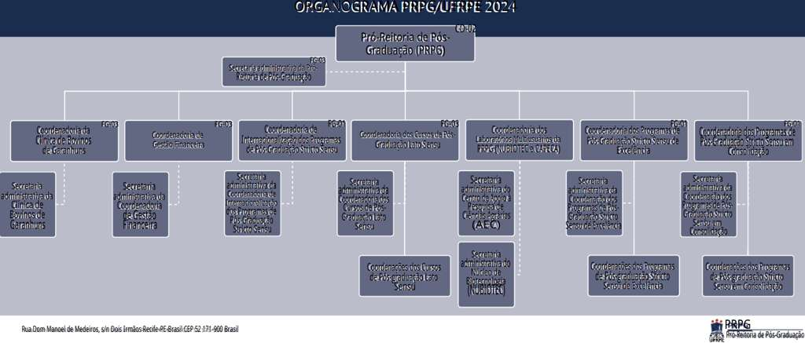

<!-- page 1 -->

## **MINISTÉRIO DA EDUCAÇÃO UNIVERSIDADE FEDERAL RURAL DE PERNAMBUCO SECRETARIA GERAL DOS CONSELHOS DA ADMINISTRAÇÃO SUPERIOR CONSELHO UNIVERSITÁRIO** 

RESOLUÇÃO CONSU Nº 604/2025 DE 28 DE ABRIL DE 2025. 

Aprova alteração da Estrutura Organizacional e do Regimento Interno da Pró-Reitoria de PósGraduação da Universidade Federal Rural de Pernambuco. 

A Presidente do Conselho Universitário da Universidade Federal Rural de Pernambuco, no uso de suas atribuições estatutárias e tendo em vista a Decisão Nº 33/2025 deste Conselho, exarada no Processo UFRPE Nº 23082.024509/2024-66, em sua III Reunião Extraordinária, realizada no dia 25 de abril de 2025, 

## **RESOLVE** 

Art. 1º  Aprovar a alteração da Estrutura Organizacional e do Regimento Interno da Pró-Reitoria de Pós-graduação (PRPG) da Universidade Federal Rural de Pernambuco, de acordo com o anexo e conforme consta do Processo acima mencionado. 

Art. 2º  Em consequência do Art. 1o , fica revogada a Resolução **Ad referendum** nº 461, datada de 10 de abril de 2024 do Conselho Universitário, a qual trata do mesmo assunto. 

Art. 3º  Esta Resolução entra em vigor em 28 de abril de 2025. 

SALA DOS CONSELHOS SUPERIORES DA UFRPE. 

## **Profa. Maria José de Sena** 

## **PRESIDENTE** 

Confere com a original assinada pela Reitora e arquivada nesta Secretaria Geral. 

<!-- page 2 -->

## **MINISTÉRIO DA EDUCAÇÃO UNIVERSIDADE FEDERAL RURAL DE PERNAMBUCO SECRETARIA GERAL DOS CONSELHOS DA ADMINISTRAÇÃO SUPERIOR CONSELHO UNIVERSITÁRIO** 

(CONTINUAÇÃO DA RESOLUÇÃO CONSU/UFRPE Nº 604, DE 28  DE ABRIL DE 2025.) 

## **REGIMENTO INTERNO DA PRÓ-REITORIA DE PÓS-GRADUAÇÃO – PRPG** 

## **CAPÍTULO I DA CATEGORIA E FINALIDADE** 

Art. 1º  A Pró-Reitoria de Pós-Graduação é órgão Executivo, diretamente vinculado à Reitoria, criado pela Resolução nº 030-A/2020, tendo sido reestruturado pela Resolução nº 604/2025, ambas do Conselho Universitário. 

Art. 2º  A Pró-Reitoria tem por finalidade: 

I - assessorar a Reitoria nas atividades de Pós-Graduação; 

II - propor e acompanhar o desenvolvimento de políticas, programas, projetos e ações de articulação e cooperação, internas e externas, com vistas ao aprimoramento da Pós-Graduação; 

III - promover, coordenar, supervisionar e apoiar o ensino de Pós-Graduação, visando o crescimento, a disseminação e a internacionalização da Pós-Graduação; 

IV - coordenar o atendimento às demandas da Coordenação de Aperfeiçoamento de Pessoal de Nível Superior (CAPES) e de outros órgãos externos, no limite de suas competências; 

V - subsidiar o aprimoramento dos resultados institucionais a partir de indicadores de desempenho; 

VI-impulsionar parcerias intra e interinstitucionais. 

## **CAPÍTULO II DA ORGANIZAÇÃO** 

## **Seção I** 

## **Da Estrutura Organizacional** 

Art. 3º  A Pró-Reitoria possui a seguinte estrutura organizacional: 

I - Secretaria administrativa da Pró-Reitoria de Pós-Graduação; 

II -Coordenadoria dos Programas de Pós-Graduação **Stricto Sensu** de Excelência; 

a) Secretaria administrativa da Coordenadoria dos Programas de Pós-Graduação **Stricto Sensu** de Excelência; 

b) Coordenações dos Programas de Pós-graduação **Stricto Sensu** de Excelência. 

III - Coordenadoria dos Programas de Pós-Graduação **Stricto Sensu** em Consolidação: 

a) Secretaria administrativa da Coordenadoria dos Programas de Pós-Graduação **Stricto Sensu** em Consolidação; 

Confere com a original assinada pela Reitora e arquivada nesta Secretaria Geral. 

<!-- page 3 -->

## **MINISTÉRIO DA EDUCAÇÃO UNIVERSIDADE FEDERAL RURAL DE PERNAMBUCO SECRETARIA GERAL DOS CONSELHOS DA ADMINISTRAÇÃO SUPERIOR CONSELHO UNIVERSITÁRIO** 

(CONTINUAÇÃO DA RESOLUÇÃO CONSU/UFRPE Nº 604, DE 28  DE ABRIL DE 2025.) 

b) Coordenações dos Programas de Pós-graduação **Stricto Sensu** em Consolidação. 

IV - Coordenadoria de Internacionalização dos Programas de Pós-Graduação **Stricto Sensu** : 

a) Secretaria administrativa da Coordenadoria de Internacionalização dos Programas de PósGraduação **Stricto Sensu** . 

V - Coordenadoria dos Cursos de Pós-Graduação **Lato Sensu** : 

a) Secretaria administrativa da Coordenadoria dos Cursos de Pós-Graduação **Lato Sensu** _;_ 

b) Coordenações dos Cursos de Pós-graduação **Lato Sensu** _._ 

VI - Coordenadoria de Gestão Financeira: 

a) Secretaria administrativa da Coordenadoria de Gestão Financeira. 

VII - Coordenadoria da Clínica de Bovinos de Garanhuns: 

a) Secretaria administrativa da Clínica de Bovinos de Garanhuns. 

VIII - Coordenadoria dos Laboratórios Multiusuários da PRPG (NUBIOTEC e CAPECA): 

a) Secretaria administrativa do Núcleo de Biotecnologia (NUBIOTEC); 

b) Secretaria administrativa do Centro de Apoio à Pesquisa de Ciências Agrárias (CAPECA). 

§1º As Coordenadorias e Secretaria Administrativa vinculam-se diretamente à Pró-Reitoria; às Coordenações e as Secretarias dos Programas de Pós-graduação **Stricto Sensu** de Excelência vinculam-se diretamente à Coordenadoria dos Programas de Pós-Graduação **Stricto Sensu** de Excelência; as Coordenações e Secretarias dos Programas de Pós-graduação **Stricto Sensu** em Consolidação vinculamse diretamente à Coordenadoria dos Programas de Pós-graduação **Stricto Sensu** em Consolidação; a Secretaria administrativa da Coordenadoria de Internacionalização dos Programas de Pós-Graduação **Stricto Sensu** vincula-se diretamente à Coordenadoria de Internacionalização dos Programas de PósGraduação **Stricto Sensu** ; as Coordenações dos Cursos de Pós-Graduação **Lato Sensu** vinculam-se diretamente à Coordenadoria dos Cursos de Pós-Graduação **Lato Sensu** ; a Secretaria da Coordenadoria de Gestão Financeira vincula-se diretamente à Coordenadoria de Gestão Financeira. 

§ 2º As Coordenações dos Programas de Pós-graduação **Stricto Sensu** e Curso **Lato Sensu** estão dispostas na tabela de estrutura anexa ao regimento. 

## **Seção II** 

## **Da Designação e Denominação dos Titulares** 

Art. 4º  A Pró-Reitoria é dirigida pelo Pró-Reitor(a) de Pós-Graduação, nomeado (a) pelo (a) Reitor (a), com o referendo do Conselho Universitário. 

Confere com a original assinada pela Reitora e arquivada nesta Secretaria Geral. 

<!-- page 4 -->

## **MINISTÉRIO DA EDUCAÇÃO UNIVERSIDADE FEDERAL RURAL DE PERNAMBUCO SECRETARIA GERAL DOS CONSELHOS DA ADMINISTRAÇÃO SUPERIOR CONSELHO UNIVERSITÁRIO** 

(CONTINUAÇÃO DA RESOLUÇÃO CONSU/UFRPE Nº 604, DE 28  DE ABRIL DE 2025.) 

Parágrafo único.  Nas ausências e impedimentos do(a) Pró-Reitor(a), assumirá a Pró-Reitoria, sucessivamente: 

I - Coordenador(a) de Programas de Pós-Graduação **Stricto Sensu** de Excelência; 

II - Coordenador(a) de Programas de Pós-Graduação **Stricto Sensu** em Consolidação; 

III - Coordenador(a) de Internacionalização dos Programas de Pós-Graduação **Stricto Sensu** _;_ 

IV - Coordenador(a) dos Cursos de Pós-Graduação **Lato Sensu** . 

Art. 5º  As Coordenadorias serão dirigidas por Coordenadores(a), designados pelo(a) Pró-Reitor(a). 

Parágrafo único.  Nas ausências e impedimentos do(a) Coordenador(a), um(a) servidor(a) de sua respectiva Coordenação, poderá ser indicado pelo(a) Coordenador(a) como substituto(a) eventual. 

## **CAPÍTULO III** 

## **DAS COMPETÊNCIAS DAS UNIDADES** 

Art. 6º  São competências comuns a todas as Coordenadorias: 

I - elaborar planejamento interno e relatórios periódicos acerca das atividades desenvolvidas para conhecimento e aprovação do(a) Pró-Reitor(a); 

II - transmitir informações referentes à sua área de competência; 

III - executar atividades correlatas com suas competências. 

Art. 7º  À Coordenadoria de Programas de Pós-Graduação **Stricto Sensu** de Excelência compete: 

I -implementar e acompanhar as ações de Apoio aos Programas de Pós-Graduação **Stricto Sensu** de Excelência (notas igual ou superior a 5) e de apoio à criação de cursos novos; 

II - elaborar e gerenciar projetos institucionais (projetos de cooperação entre instituições para qualificação de profissionais de nível superior PCI, tais como MINTER, DINTER, entre outros); 

III - manter atualizadas as informações das normas e resoluções relativas às atividades aos Programas de Pós-Graduação **Stricto Sensu** de Excelência; 

IV - acompanhar a implementação das bolsas de Pós-Graduação concedidas pela CAPES aos Programas de Pós-Graduação **Stricto Sensu** de Excelência nota 5; 

V - acompanhar o processo seletivo para os Programas de Pós-Graduação **Stricto Sensu** de Excelência; 

VI - acompanhar e orientar os processos de credenciamento e descredenciamento de Docentes 

Confere com a original assinada pela Reitora e arquivada nesta Secretaria Geral. 

<!-- page 5 -->

## **MINISTÉRIO DA EDUCAÇÃO UNIVERSIDADE FEDERAL RURAL DE PERNAMBUCO SECRETARIA GERAL DOS CONSELHOS DA ADMINISTRAÇÃO SUPERIOR CONSELHO UNIVERSITÁRIO** 

(CONTINUAÇÃO DA RESOLUÇÃO CONSU/UFRPE Nº 604, DE 28  DE ABRIL DE 2025.) 

dos Programas de Pós-Graduação **Stricto Sensu** de Excelência; 

VII - promover ações estratégicas nos Programas de Pós-Graduação **Stricto Sensu** de Excelência, com o objetivo de aumentar a nota dos Programas junto à CAPES; 

VIII - acompanhar e homologar bolsas do Programa PNPD dos Programas de Pós-Graduação **Stricto Sensu** de Excelência; 

IX - analisar e expedir Certificados dos Programas de Pós-Graduação **Stricto Sensu** de Excelência; 

X- analisar, expedir e registrar Certificados de Estágio Pós-Doutoral dos Pós-Graduação **Stricto Sensu** de Excelência. 

Art. 8º  À Coordenadoria de Programas de Pós-Graduação **Stricto Sensu** em Consolidação compete: 

I -implementar e acompanhar as ações de Apoio aos Programas de Pós-Graduação **Stricto Sensu** em consolidação (notas 3 e 4); 

II - manter atualizadas as informações das normas e resoluções relativas às atividades de PósGraduação **Stricto Sensu** em Consolidação; 

III - acompanhar a implementação das bolsas de Pós-Graduação concedidas pela CAPES aos Programas de Pós-Graduação **Stricto Sensu** em Consolidação; 

IV - acompanhar o processo seletivo para os Programas de Pós-Graduação **Stricto Sensu** em Consolidação; 

V - acompanhar e orientar os processos de credenciamento e descredenciamento de Docentes dos Programas de Pós-Graduação **Stricto Sensu** em Consolidação; 

VI - promover ações estratégicas nos Programas de Pós-Graduação **Stricto Sensu** em Consolidação, com o objetivo de aumentar a nota dos Programas junto à CAPES; 

VII- analisar e expedir Certificados dos Programas de Pós-Graduação **Stricto Sensu** em Consolidação; 

VIII - analisar, expedir e registrar Certificados de Estágio Pós-Doutoral dos Programas de PósGraduação **Stricto Sensu** em Consolidação. 

Art. 9º  À Coordenadoria de Internacionalização dos Programas de Pós-Graduação **Stricto Sensu** compete: 

I - definir, gerenciar e fortalecer políticas de internacionalização para os Programas de PósGraduação **Stricto Sensu** _;_ 

II - gerenciar os Programas de Internacionalização de agências de fomento à pesquisa Nacionais 

Confere com a original assinada pela Reitora e arquivada nesta Secretaria Geral. 

<!-- page 6 -->

## **MINISTÉRIO DA EDUCAÇÃO UNIVERSIDADE FEDERAL RURAL DE PERNAMBUCO SECRETARIA GERAL DOS CONSELHOS DA ADMINISTRAÇÃO SUPERIOR CONSELHO UNIVERSITÁRIO** 

(CONTINUAÇÃO DA RESOLUÇÃO CONSU/UFRPE Nº 604, DE 28  DE ABRIL DE 2025.) 

(CNPq e CAPES), da Fundação de Amparo à Ciência e Tecnologia do Estado de Pernambuco (FACEPE) e demais agências que possam fomentar ações de internacionalização de interesse da UFRPE; 

III- captar e divulgar oportunidades de intercâmbios; 

IV - estimular o intercâmbio de professores e discentes para consolidar e fortalecer a internacionalização da Pós-Graduação e, consequentemente, da UFRPE; 

V - dar suporte aos Programas de Pós-Graduação **Stricto Sensu** em ações relativas à internacionalização; 

VI _-_ analisar Termos de Cooperação Acadêmica, inclusive de Cotutela de Doutorado e Dupla titulação com vistas a consolidar redes de parcerias internacionais; 

VII - acompanhar e orientar o procedimento de reconhecimento de títulos obtidos no exterior pelos Programas de Pós-Graduação **Stricto Sensu** ; 

VIII - gerenciar o processo de aplicação de testes de proficiência em língua estrangeira e português para estrangeiros dos Programas de Pós-Graduação **Stricto Sensu** em parceria com Núcleo de Internacionalização (NINTER) do Instituto de Inovação, Parcerias e Empreendedorismo (Instituto IPÊ) da UFRPE; 

IX - estimular e promover junto ao NINTER a institucionalização dos projetos de pesquisa, ensino e/ou extensão que envolvam parceiros internacionais; 

X - encaminhar, para conhecimento, ao NINTER, as ações que envolvam a internacionalização da pós-graduação, tais como mobilidade acadêmica de discentes e docentes, testes de proficiência, eventos científicos, tecnológicos, extensionistas ou afins, projetos de pesquisa, ensino e/ou extensão dos programas de pós-graduação da UFRPE, entre outros. 

Art. 10.  À Coordenadoria dos Cursos de Pós-graduação **Lato Sensu** compete: 

I - incentivar a criação de Cursos de Especialização, Aperfeiçoamento e de Residência; 

II - acompanhar e gerenciar as propostas de criação de novos Cursos de Especialização, Aperfeiçoamento e de Residências; 

III - acompanhar junto às agências de fomento (CNPq, CAPES, MAPA, MEC, Ministério da Saúde, entre outros) que possam financiar Cursos de Especialização, Aperfeiçoamento e de Residência; 

IV - acompanhar e gerenciar os Cursos de Especialização, Aperfeiçoamento e de Residência em funcionamento; 

V - acompanhar o processo seletivo e dar publicidade aos editais de seleção; 

VI - analisar relatórios finais dos Cursos de Especialização, Aperfeiçoamento e de Residências; 

Confere com a original assinada pela Reitora e arquivada nesta Secretaria Geral. 

<!-- page 7 -->

## **MINISTÉRIO DA EDUCAÇÃO UNIVERSIDADE FEDERAL RURAL DE PERNAMBUCO SECRETARIA GERAL DOS CONSELHOS DA ADMINISTRAÇÃO SUPERIOR CONSELHO UNIVERSITÁRIO** 

(CONTINUAÇÃO DA RESOLUÇÃO CONSU/UFRPE Nº 604, DE 28  DE ABRIL DE 2025.) 

VII - gerir a emissão de certificados, históricos e declarações de conclusão dos Cursos de Especialização, Aperfeiçoamento e de Residência; 

VIII - elaborar relatório anual da Gestão dos Cursos de Especialização, Aperfeiçoamento e de Residências; 

IX - orientar o Sistema de Avaliação implementado pelo MEC dos Cursos de Especialização, Aperfeiçoamento e de Residência. 

Art. 11.  À Coordenadoria de Gestão Financeira compete: 

<mark>I - receber, orientar, atender, esclarecer e assistir aos Programas de Pós-Graduação</mark> **<mark>Stricto Sensu</mark>** <mark>,</mark> bem como a comunidade em geral sobre serviços financeiros da PRPG; 

II - gerenciar o recurso programa de apoio à Pós-Graduação - PROAP/CAPES quanto a: 

a) concessão de diárias e passagens para a PRPG e Programas de Pós-Graduação **Stricto Sensu** ; 

<mark>b) concessão de aquisição de serviços e materiais para a PRPG e Programas de Pós-Graduação</mark> **Stricto Sensu** ; 

c) concessão de manutenção de equipamentos; 

d) análise de prestação de contas; 

e) outras atividades que tenham como finalidade a utilização do recurso. 

III - gerenciar o recurso da Administração Superior direcionado à PRPG quanto a: 

a) concessão de diárias e passagens para a PRPG e Programas de Pós-Graduação **Stricto Sensu** ; 

<mark>b) concessão de aquisição de serviços e materiais para a PRPG e Programas de Pós-Graduação</mark> **Stricto Sensu** ; 

c) concessão de manutenção de equipamentos; 

d) análise de Prestação de contas; 

<mark>e) controle e elaboração das folhas de pagamentos relativas às bolsas de auxílio dos alunos de Pós-Graduação em situação de vulnerabilidade socioeconômica que participam do Programa de Apoio</mark> ao Discente de Pós-Graduação (PADPG); 

<mark>f) acompanhamento e encaminhamento dos dados relativos ao seguro de viagens de campos dos</mark> discentes da Pós-Graduação; 

<mark>g) desenvolvimento de outras atividades que tenham como finalidade a utilização do recurso.</mark> 

IV - gerenciar, implementar, suspender, reativar, cancelar e prorrogar as bolsas de Pós-Graduação 

Confere com a original assinada pela Reitora e arquivada nesta Secretaria Geral. 

<!-- page 8 -->

## **MINISTÉRIO DA EDUCAÇÃO UNIVERSIDADE FEDERAL RURAL DE PERNAMBUCO SECRETARIA GERAL DOS CONSELHOS DA ADMINISTRAÇÃO SUPERIOR CONSELHO UNIVERSITÁRIO** 

(CONTINUAÇÃO DA RESOLUÇÃO CONSU/UFRPE Nº 604, DE 28  DE ABRIL DE 2025.) 

concedidas pela Demanda Social/CAPES à PRPG e aos Programas de Pós-Graduação **Stricto Sensu** ; 

V - gerenciar informações das bolsas relacionadas aos cursos Lato Sensu. 

Art. 12.  À Coordenadoria da Clínica de Bovinos de Garanhuns compete: 

I - desenvolver atividades de ensino (graduação e pós-graduação), pesquisa e extensão, desde ações nas áreas de clínicas médica e cirúrgica, laboratório em ruminantes e equídeos; 

II - promover cursos e palestras para criadores da região; 

III - promover educação continuada para médicos veterinários; 

IV - gerenciar programa de Residência em Medicina Veterinária e estágio curricular e extracurricular para alunos da UFRPE e de outras universidades brasileiras. 

<mark>Art. 13.  À Coordenadoria dos Laboratórios Multiusuários compete:</mark> 

I - dirigir as atividades realizadas no NUBIOTEC conforme sua instrução normativa. 

II - dirigir as atividades do Centro de Apoio à Pesquisa de Ciências Agrárias (CAPECA) conforme sua instrução normativa. 

III - desenvolver atividades científicas e tecnológicas, com vistas, primordialmente, ao desenvolvimento de produtos e serviços biotecnológicos ou ligados às ciências agrárias; 

IV - facultar instalações, equipamentos e recursos humanos ao melhoramento da qualidade do ensino e das pesquisas desenvolvidas pelas Pós-Graduações da Universidade Federal Rural de Pernambuco; 

V - prestar os serviços que lhe são inerentes, de maneira complementar, às pessoas físicas e jurídicas de direito público ou de direito privado, mediante contratos ou convênios, na forma deste Regimento e de Resolução específica. 

Art. 14.  À Secretaria Administrativa da Pró-Reitoria de Pós-Graduação compete: 

I - auxiliar o(a) Pró-Reitor(a) na execução das atividades administrativas; 

II- receber, registrar, enviar e arquivar correspondência oficial e processos administrativos; 

III - solicitar e controlar a distribuição de material de expediente da Pró-Reitoria; 

IV - solicitar os serviços de manutenção das instalações e patrimônio; 

V - acompanhar a frequência dos servidores lotados na Pró-Reitoria/Coordenadoria; 

VI - coordenar as ações administrativas da secretaria; 

VII - executar outras atividades correlatas com suas competências. 

Confere com a original assinada pela Reitora e arquivada nesta Secretaria Geral. 

<!-- page 9 -->

## **MINISTÉRIO DA EDUCAÇÃO UNIVERSIDADE FEDERAL RURAL DE PERNAMBUCO SECRETARIA GERAL DOS CONSELHOS DA ADMINISTRAÇÃO SUPERIOR CONSELHO UNIVERSITÁRIO** 

(CONTINUAÇÃO DA RESOLUÇÃO CONSU/UFRPE Nº 604, DE 28  DE ABRIL DE 2025.) 

Art. 15.  Às Secretarias Administrativas das Coordenadorias da PRPG competem: 

I - auxiliar o(a) Coordenador(a) na execução das atividades administrativas; 

II- receber, registrar, enviar e arquivar correspondência oficial e processos administrativos; 

III - solicitar e controlar a distribuição de material de expediente da Coordenadoria; 

IV - solicitar os serviços de manutenção das instalações e patrimônio; 

V - coordenar as ações administrativas da secretaria; 

VI - executar outras atividades correlatas com suas competências. 

**CAPÍTULO IV** 

**DAS ATRIBUIÇÕES DOS DIRIGENTES** 

Art. 16.  Ao Pró-Reitor(a) incumbe superintender as atividades universitárias na respectiva área, de acordo com o Art. 26, § 1º do Regimento Geral da UFRPE. 

Art. 17.  Além de atividades listadas no Art. 26, cabe ao Pró-Reitor(a): 

I - gerir e coordenar as atividades desenvolvidas na Pró-Reitoria; 

II - definir responsabilidades na execução dos programas da Pró-Reitoria; 

III - transmitir as informações relacionadas à Pró-Reitoria; 

IV - indicar membros para participação em comissões e grupos de trabalho; 

V - convocar e dirigir as reuniões da Pró-Reitoria; 

VI- deliberar sobre as providências necessárias ao pleno funcionamento e manutenção das atividades da Pró-Reitoria; 

VII - praticar todos os demais atos inerentes à sua função, ainda que não especificados neste 

artigo. 

Art. 18.  Aos (Às) Coordenadores (as) das Coordenadorias cabe: 

I - assessorar administrativamente o (a) Pró-Reitor(a), no âmbito de suas atribuições institucionais; 

II - coordenar as atividades administrativas na sua respectiva área, dentro da competência que lhe for delegada pelo (a) Pró-Reitor (a); 

III - planejar, semestralmente, as atividades das Coordenadorias; 

IV- transmitir as informações referentes à sua área de competência. 

Confere com a original assinada pela Reitora e arquivada nesta Secretaria Geral. 

<!-- page 10 -->

## **MINISTÉRIO DA EDUCAÇÃO UNIVERSIDADE FEDERAL RURAL DE PERNAMBUCO SECRETARIA GERAL DOS CONSELHOS DA ADMINISTRAÇÃO SUPERIOR CONSELHO UNIVERSITÁRIO** 

(CONTINUAÇÃO DA RESOLUÇÃO CONSU/UFRPE Nº 604, DE 28  DE ABRIL DE 2025.) 

**CAPÍTULO V** 

**DAS DISPOSIÇÕES GERAIS** 

Art. 19.  As alterações no Regimento Interno serão propostas pela Pró-Reitoria e encaminhadas para apreciação dos órgãos de deliberação superiores. 

Art. 20.  O Regimento Interno deverá ser atualizado conforme revisão e atualização do planejamento estratégico da Pró-Reitoria. 

Art. 21.  Os casos omissos serão resolvidos pelo (a) Pró-reitor (a), em consonância com as normas vigentes. 

Art. 22.  O presente regimento entra em vigor em 28 de abril de 2025. 

SALA DOS CONSELHOS SUPERIORES DA UFRPE. 

Profa. Maria José de Sena 

PRESIDENTE 

Confere com a original assinada pela Reitora e arquivada nesta Secretaria Geral. 

<!-- page 11 -->

<!-- figure p11-fig2 | described_by: agy | ocr_overlap: 0.89 | needs_review: false -->
**1. Tipo de figura**

Trata-se de um organograma institucional hierárquico da Pró-Reitoria de Pós-Graduação (PRPG) da Universidade Federal Rural de Pernambuco (UFRPE), referente ao ano de 2024. A figura apresenta um artefato de sobreposição de texto (camada de texto em preto ligeiramente deslocada sobre o texto original em branco ou azul), sem comprometer a leitura da maioria dos rótulos, exceto por uma divergência em uma sigla específica registrada abaixo.

**2. Todo o texto visível (transcrição literal)**

* **Título (faixa superior):**
  * `ORGANOGRAMA PRPG/UFRPE 2024`

* **Nível superior (topo central):**
  * Caixa principal: `Pró-Reitoria de Pós-Graduação (PRPG)` — rótulo no canto superior direito da caixa: `CD-02`
  * Caixa auxiliar à esquerda: `Secretaria administrativa da Pró-Reitoria de Pós-Graduação` — rótulo no canto superior direito da caixa: `FG-03`

* **Linha intermediária de coordenadorias (da esquerda para a direita) e suas unidades vinculadas abaixo:**
  * **Coluna 1:**
    * Caixa superior: `Coordenadoria da Clínica de Bovinos de Garanhuns` — rótulo no canto superior direito: `FG-03`
    * Caixa vinculada abaixo à esquerda: `Secretaria administrativa da Clínica de Bovinos de Garanhuns`
  * **Coluna 2:**
    * Caixa superior: `Coordenadoria de Gestão Financeira` — rótulo no canto superior direito: `FG-03`
    * Caixa vinculada abaixo à esquerda: `Secretaria administrativa da Coordenadoria de Gestão Financeira`
  * **Coluna 3:**
    * Caixa superior: `Coordenadoria de Internacionalização dos Programas de Pós-Graduação Stricto Sensu` — rótulo no canto superior direito: `FG-01`
    * Caixa vinculada abaixo à esquerda: `Secretaria administrativa da Coordenadoria de Internacionalização dos Programas de Pós-Graduação Stricto Sensu`
  * **Coluna 4:**
    * Caixa superior: `Coordenadoria dos Cursos de Pós-Graduação Lato Sensu` — rótulo no canto superior direito: `FG-03`
    * Caixa intermediária à esquerda: `Secretaria administrativa da Coordenadoria dos Cursos de Pós-Graduação Lato Sensu`
    * Caixa inferior: `Coordenações dos Cursos de Pós-graduação Lato Sensu`
  * **Coluna 5:**
    * Caixa superior: `Coordenadoria dos Laboratórios Multiusuários da PRPG (NUBIOTEC e CAPECA)` (sem código no canto superior direito)
    * Caixa vinculada superior à esquerda: `Secretaria administrativa do Centro de Apoio à Pesquisa de Ciências Agrárias (AEC)` (nota: no texto branco original subjacente à camada preta lê-se `(CAPECA)` em vez de `(AEC)`)
    * Caixa vinculada inferior à esquerda: `Secretaria administrativa do Núcleo de Biotecnologia (NUBIOTEC)`
  * **Coluna 6:**
    * Caixa superior: `Coordenadoria dos Programas de Pós-Graduação Stricto Sensu de Excelência` — rótulo no canto superior direito: `FG-01`
    * Caixa intermediária à esquerda: `Secretaria administrativa da Coordenação dos Programas de Pós-Graduação Stricto Sensu de Excelência`
    * Caixa inferior: `Coordenações dos Programas de Pós-graduação Stricto Sensu de Excelência`
  * **Coluna 7:**
    * Caixa superior: `Coordenadoria dos Programas de Pós-Graduação Stricto Sensu em Consolidação` — rótulo no canto superior direito: `FG-01`
    * Caixa intermediária à esquerda: `Secretaria administrativa da Coordenação dos Programas de Pós-Graduação Stricto Sensu em Consolidação`
    * Caixa inferior: `Coordenações dos Programas de Pós-graduação Stricto Sensu em Consolidação`

* **Rodapé (faixa inferior):**
  * À esquerda: `Rua Dom Manoel de Medeiros, s/n Dois Irmãos Recife-PE-Brasil CEP 52 171-900 Brasil`
  * À direita (junto ao logotipo institucional): abaixo do brasão lê-se `UFRPE` (há uma faixa interna no brasão com texto `[illegible]`); ao lado direito do brasão lê-se `PRPG` acima de uma linha horizontal e `Pró-Reitoria de Pós-Graduação` abaixo dela.

**3. Estrutura**

A imagem é dividida horizontalmente em três faixas: uma faixa superior com o título, uma área central contendo o organograma e uma faixa inferior de rodapé com endereço e identidade visual. Não há eixos, painéis múltiplos, legenda explícita nem pontas de seta nas conexões; todas as ligações são feitas por linhas ortogonais brancas, diferenciadas entre **linhas contínuas** (subordinação direta) e **linhas tracejadas** (vinculação das secretarias administrativas).

O organograma contém 20 caixas retangulares de cantos arredondados organizadas em árvore hierárquica de cima para baixo:

* **Topo:** A caixa `Pró-Reitoria de Pós-Graduação (PRPG)` (`CD-02`) fica centralizada no alto, sobrepondo parcialmente a borda inferior da faixa do título.
  * Da parte inferior dessa caixa desce uma linha vertical contínua.
  * Desse tronco vertical parte, para a esquerda, uma **linha horizontal tracejada** que se conecta à borda direita da caixa `Secretaria administrativa da Pró-Reitoria de Pós-Graduação` (`FG-03`).
  * Continuando para baixo, o tronco vertical contínuo encontra uma longa **barra horizontal contínua** que se estende por toda a largura do diagrama e se ramifica para baixo em **7 linhas verticais contínuas**, cada uma conectada ao topo de uma das 7 coordenadorias alinhadas em uma mesma fileira horizontal.

* **Ramos das 7 coordenadorias (da esquerda para a direita):**
  1. `Coordenadoria da Clínica de Bovinos de Garanhuns` (`FG-03`): de sua base desce uma **linha tracejada** em formato de "L" (vertical para baixo e depois horizontal para a esquerda) conectando-se à lateral direita da caixa `Secretaria administrativa da Clínica de Bovinos de Garanhuns`.
  2. `Coordenadoria de Gestão Financeira` (`FG-03`): de sua base desce uma **linha tracejada** em "L" (vertical para baixo e horizontal para a esquerda) conectando-se à lateral direita da caixa `Secretaria administrativa da Coordenadoria de Gestão Financeira`.
  3. `Coordenadoria de Internacionalização dos Programas de Pós-Graduação Stricto Sensu` (`FG-01`): de sua base desce uma **linha tracejada** em "L" (vertical para baixo e horizontal para a esquerda) conectando-se à lateral direita da caixa `Secretaria administrativa da Coordenadoria de Internacionalização dos Programas de Pós-Graduação Stricto Sensu`.
  4. `Coordenadoria dos Cursos de Pós-Graduação Lato Sensu` (`FG-03`): de sua base desce uma **linha vertical contínua** até o topo da caixa inferior `Coordenações dos Cursos de Pós-graduação Lato Sensu`. Do meio desse segmento vertical contínuo parte, para a esquerda, um curto trecho de **linha horizontal tracejada** conectado à lateral direita da caixa `Secretaria administrativa da Coordenadoria dos Cursos de Pós-Graduação Lato Sensu`.
  5. `Coordenadoria dos Laboratórios Multiusuários da PRPG (NUBIOTEC e CAPECA)`: de sua base desce uma longa **linha vertical tracejada** que emite dois ramais horizontais tracejados para a esquerda: o primeiro conecta-se à lateral direita da caixa `Secretaria administrativa do Centro de Apoio à Pesquisa de Ciências Agrárias (AEC)` [subjacente: `(CAPECA)`] e o segundo, na extremidade inferior da linha, conecta-se à lateral direita da caixa `Secretaria administrativa do Núcleo de Biotecnologia (NUBIOTEC)`. Não há caixa de coordenação vinculada por linha contínua abaixo dela.
  6. `Coordenadoria dos Programas de Pós-Graduação Stricto Sensu de Excelência` (`FG-01`): de sua base desce uma **linha vertical contínua** até o topo da caixa inferior `Coordenações dos Programas de Pós-graduação Stricto Sensu de Excelência`. Do meio dessa linha contínua parte, para a esquerda, um curto trecho de **linha horizontal tracejada** conectado à lateral direita da caixa `Secretaria administrativa da Coordenação dos Programas de Pós-Graduação Stricto Sensu de Excelência`.
  7. `Coordenadoria dos Programas de Pós-Graduação Stricto Sensu em Consolidação` (`FG-01`): de sua base desce uma **linha vertical contínua** até o topo da caixa inferior `Coordenações dos Programas de Pós-graduação Stricto Sensu em Consolidação`. Do meio dessa linha contínua parte, para a esquerda, um curto trecho de **linha horizontal tracejada** conectado à lateral direita da caixa `Secretaria administrativa da Coordenação dos Programas de Pós-Graduação Stricto Sensu em Consolidação`.

**4. Todos os números, códigos e valores de dados**

* Ano de referência no título: `2024`
* Códigos de cargos de direção (CD) e funções gratificadas (FG) exibidos no canto superior direito de caixas específicas:
  * `CD-02` (1 ocorrência): `Pró-Reitoria de Pós-Graduação (PRPG)`
  * `FG-03` (4 ocorrências): `Secretaria administrativa da Pró-Reitoria de Pós-Graduação`; `Coordenadoria da Clínica de Bovinos de Garanhuns`; `Coordenadoria de Gestão Financeira`; `Coordenadoria dos Cursos de Pós-Graduação Lato Sensu`
  * `FG-01` (3 ocorrências): `Coordenadoria de Internacionalização dos Programas de Pós-Graduação Stricto Sensu`; `Coordenadoria dos Programas de Pós-Graduação Stricto Sensu de Excelência`; `Coordenadoria dos Programas de Pós-Graduação Stricto Sensu em Consolidação`
  * Sem código exibido (12 caixas): `Coordenadoria dos Laboratórios Multiusuários da PRPG (NUBIOTEC e CAPECA)`, as 8 secretarias administrativas ligadas às coordenadorias e as 3 caixas de `Coordenações...` na base.
* Código postal no rodapé: `CEP 52 171-900`

**5. Cores com significado**

As cores não codificam níveis hierárquicos nem categorias distintas entre as unidades do organograma: todas as 20 caixas compartilham o mesmo preenchimento cinza-azulado escuro com borda branca, e todas as linhas conectoras são brancas. As diferenças cromáticas cumprem apenas função de separação visual de layout (faixa superior azul-marinho escuro para o título, fundo cinza-azulado claro para a área do diagrama e faixa branca para o rodapé) e identidade visual institucional no brasão da UFRPE (azul-marinho, branco, vermelho e amarelo).

~~~text ocr
Ge
Oc
Fe
te
PRPG/UFRPE 2024
US
o
(i
Manoel de Medeiros, s/n Dois 171-900 Brasil
OC
US
FAT)
UR
Ge
ELL
‘on
EU
cir
09
ETT
RRPG
de Pós-Graduação
~~~

## **MINISTÉRIO DA EDUCAÇÃO UNIVERSIDADE FEDERAL RURAL DE PERNAMBUCO SECRETARIA GERAL DOS CONSELHOS DA ADMINISTRAÇÃO SUPERIOR CONSELHO UNIVERSITÁRIO** 

(CONTINUAÇÃO DA RESOLUÇÃO CONSU/UFRPE Nº 604, DE 28  DE ABRIL DE 2025.) 

<!-- Start of picture text -->
ORGANOGRAMA PRPG/UFRPE 2024 CD-02 Pró-Reitoria de Pós- Graduação (PRPG) FG-03 Secretaria administrativa da Pró- Reitoria de Pós-Graduação FG-03 FG-03 FG-01 FG-03 FG-01 FG-01 Coordenadoria da Coordenadoria de Coordenadoria de Coordenadoria dos Cursos de Pós- Coordenadoria dos Coordenadoria dos Programas de Coordenadoria dos Programas de Clínica de Bovinos Gestão Financeira Internacionalização dos Programas Graduação Lato Sensu Laboratórios Multiusuários da Pós-Graduação Stricto Sensu de Pós-Graduação Stricto Šensu em de Garanhuns de Pós-Graduação Stricto Šensu PRPG (NUBIOTEC e CAPECA) Excelência Consolidação administrativa daClínica deSecretaria administrativa daCoordenadoriaSecretaria Internacionalizaçãoadministrativa daCoordenadoria deSecretaria administrativa daCoordenadoria dosCursos de Pós-Secretaria administrativa doCentro de Apoio àPesquisa deSecretaria Programas de Pós-administrativa daCoordenação dosSecretaria Programas de Pós-administrativa daCoordenação dosSecretaria Bovinos deGaranhuns Financeirade Gestão dos Programas dePós-GraduaçãoStricto Sensu Graduação LatoSensu Ciências Agrárias(AEC) Sensu de ExcelênciaGraduação Stricto Graduação StrictoConsolidaçãoSensu em Secretaria administrativa do Coordenações dos Cursos Núcleo de Coordenações dos Programas Coordenações dos Programas de Pós-graduação LatoSensu Biotecnologia(NUBIOTÉC) de Pós-graduação StrictoSensu de Excelência de Pós-graduação StrictoSensu em Consolidação PRPG Rua Dom Manoel de Medeiros, s/n Dois Irmãos Recife-PE-Brasil CEP 52 171-900 Brasil UFRPE Pró-Reitoria de Pós-Graduação <!-- End of picture text -->

Confere com a original assinada pela Reitora e arquivada nesta Secretaria Geral. 

<!-- page 12 -->

## **MINISTÉRIO DA EDUCAÇÃO UNIVERSIDADE FEDERAL RURAL DE PERNAMBUCO SECRETARIA GERAL DOS CONSELHOS DA ADMINISTRAÇÃO SUPERIOR CONSELHO UNIVERSITÁRIO** 

(CONTINUAÇÃO DA RESOLUÇÃO CONSU/UFRPE Nº 604, DE 28  DE ABRIL DE 2025.) 

- **1 Coordenações dos Cursos de Pós-graduação Lato Sensu** 

   1. Programa de Residência em Medicina Veterinária 

   2. Programa de Residência em Clínica Médica de Ruminantes 

   3. Programa de Residência Profissional Agrária: Qualificação técnica e inserção de engenheiros florestais em empresas de base florestal 

   4. Programa de Residência Profissional Agrária: Vivência e estágios na realidade de sistemas produtivos bovinos no semiárido paraibano 

   5. Programa de Residência Profissional Agrícola em Pesca e Aquicultura (AQUIRESIDÊNCIA) 

   6. Especialização em Ensino de Astronomia e Ciências Afins 

   7. Especialização em Ensino de Ciências e Matemática 

   8. Especialização em Estudos da Linguagem e Formação Docente 

   9. Especialização em Robótica Educacional 

   10. Especialização em Gestão de Política Social 

   11. Especialização em Gestão Pública Escolar Municipal 

   12. Especialização em Gestão Pública Municipal 

   13. Especialização em Políticas Sociais 

   14. Especialização em Tomada de Decisão Baseada em Evidências no Setor Público (TDBE-SP) 

   15. Especialização em Assistência Técnica e Extensão Rural (ATER) Agroecológica, Feminista e Antirracista no Semiárido Brasileiro 

Confere com a original assinada pela Reitora e arquivada nesta Secretaria Geral. 

<!-- page 13 -->

## **MINISTÉRIO DA EDUCAÇÃO UNIVERSIDADE FEDERAL RURAL DE PERNAMBUCO SECRETARIA GERAL DOS CONSELHOS DA ADMINISTRAÇÃO SUPERIOR CONSELHO UNIVERSITÁRIO** 

(CONTINUAÇÃO DA RESOLUÇÃO CONSU/UFRPE Nº 604, DE 28  DE ABRIL DE 2025.) 

16. Especialização em Educação para o Consumo Sustentável: SBPC vai à Escola 

17. Especialização em Gestão Pública da Saúde 

18. Especialização em Diversidades Étnicas no Nordeste Brasileiro: História, Culturas esuas Tecnologias 

### **2 Coordenações dos Programas de Pós-graduação Stricto Sensu de Excelência:** 

19. Coordenação Pós-Graduação em Biociência Animal; 

20. Coordenação Pós-Graduação em Biodiversidade; 

21. Coordenação Pós-Graduação em Biometria e Estatística Aplicada; 

22. Coordenação Pós-Graduação em Biotecnologia – rede RENORBIO; 

23. Coordenação Pós-Graduação em Ciência do Solo; 

24. Coordenação Pós-Graduação em Engenharia Agrícola; 

25. Coordenação Pós-Graduação em Engenharia Ambiental; 

26. Coordenação Pós-Graduação em Ensino das Ciências; 

27. Coordenação Pós-Graduação em Ensino de Física; 

28. Coordenação Pós-Graduação em Entomologia; 

29. Coordenação Pós-Graduação em Etnobiologia e Conservação da Natureza; 

Confere com a original assinada pela Reitora e arquivada nesta Secretaria Geral. 

<!-- page 14 -->

## **MINISTÉRIO DA EDUCAÇÃO UNIVERSIDADE FEDERAL RURAL DE PERNAMBUCO SECRETARIA GERAL DOS CONSELHOS DA ADMINISTRAÇÃO SUPERIOR CONSELHO UNIVERSITÁRIO** 

(CONTINUAÇÃO DA RESOLUÇÃO CONSU/UFRPE Nº 604, DE 28  DE ABRIL DE 2025.) 

30. Coordenação Pós-Graduação em Fitopatologia; 

31. Coordenação Pós-Graduação em Matemática em Rede Nacional; 

32. Coordenação Pós-Graduação em Recursos Pesqueiros e Aquicultura; 

### **3 Coordenações dos Programas de Pós-graduação Stricto Sensu em Consolidação:** 

1. Coordenação Pós-Graduação em Administração e Desenvolvimento; 

2. Coordenação Pós-Graduação em Agronomia - Melhoramento Genético de Plantas; 

3. Coordenação Pós-Graduação em Agroecologia e Desenvolvimento Territorial; 

4. Coordenação Pós-Graduação em Biodiversidade e Conservação; 

5. Coordenação Pós-Graduação em Ciência e Tecnologia de Alimentos; 

6. Coordenação Pós-Graduação em Ciências Florestais; 

7. Coordenação Pós-Graduação em Ciências do Movimento; 

8. Coordenação Pós-Graduação em Ciências Sociais; 

9. Coordenação Pós-Graduação em Desenvolvimento e Inovação Tecnológica em Medicamentos; 

10. Coordenação Pós-Graduação em Controladoria; 

11. Coordenação Pós-Graduação em Educação, Culturas e Identidades; 

12. Coordenação Pós-Graduação em Educação Física; 

Confere com a original assinada pela Reitora e arquivada nesta Secretaria Geral. 

<!-- page 15 -->

## **MINISTÉRIO DA EDUCAÇÃO UNIVERSIDADE FEDERAL RURAL DE PERNAMBUCO SECRETARIA GERAL DOS CONSELHOS DA ADMINISTRAÇÃO SUPERIOR CONSELHO UNIVERSITÁRIO** 

(CONTINUAÇÃO DA RESOLUÇÃO CONSU/UFRPE Nº 604, DE 28  DE ABRIL DE 2025.) 

13. Coordenação Pós-graduação em Engenharia de Sistemas de Energia; 

14. Coordenação Pós-graduação em Engenharia Física; 

15. Coordenação Pós-Graduação em Estudos da Linguagem; 

16. Coordenação Pós-Graduação em Física Aplicada; 

17. Coordenação Pós-Graduação em História; 

18. Coordenação Pós-Graduação em Informática Aplicada; 

19. Coordenação Pós-Graduação em Produção Vegetal; 

20. Coordenação Pós-Graduação em Química; 

21. Coordenação Pós-Graduação em Saúde Única; 

22. Coordenação Pós-Graduação em Tecnologia e Gestão em Educação a Distância; 

23. Coordenação Pós-Graduação em Medicina Veterinária; 

24. Coordenação Pós-Graduação em Políticas Públicas e Desenvolvimento; 

25. Coordenação Pós-Graduação em Química em Rede Nacional; 

26. Coordenação Pós-Graduação em Administração Pública em Rede Nacional; 

27. Coordenação Pós-Graduação em Rede Nordeste de Ensino. 

28. Coordenação Pós-Graduação em Zootecnia. 

Confere com a original assinada pela Reitora e arquivada nesta Secretaria Geral.
