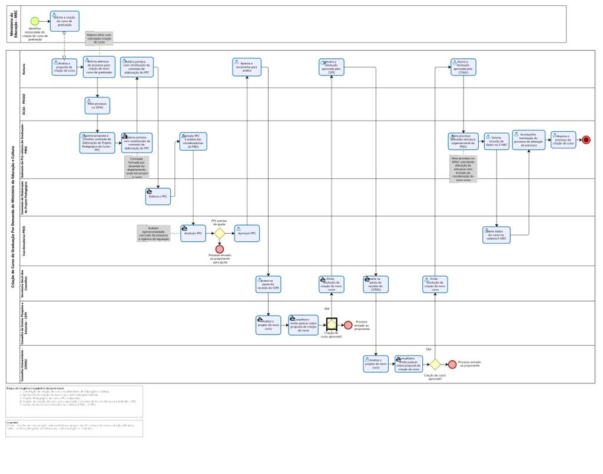

<!-- page 1 -->

<!-- figure p01-fig1 | described_by: agy | ocr_overlap: 0.9 | needs_review: false -->
### 1. Tipo de figura
Diagrama de fluxo de processo em notação BPMN (Business Process Model and Notation) com piscinas (*pools*) e raias (*swimlanes*) horizontais, representando o fluxo de criação de curso de graduação por demanda do Ministério da Educação, acompanhado de dois quadros de texto na parte inferior esquerda (regras de negócio e legenda).

---

### 2. Todo o texto visível (transcrição literal)

**Piscina superior:**
- Título vertical da piscina: `Ministério da Educação - MEC`
- Rótulo do evento de início: `Identifica necessidade de criação de curso de graduação`
- Tarefa: `Solicita a criação de curso de graduação`

**Piscina inferior:**
- Título vertical da piscina: `Criação de Curso de Graduação Por Demanda do Ministério da Educação e Cultura`

**Rótulos verticais das 8 raias (de cima para baixo) e textos internos (da esquerda para a direita):**

1. Raia: `Reitoria`
   - Tarefa: `Analisa a proposta da criação de curso`
   - Anotação (acima da tarefa seguinte): `Elabora ofício com solicitação criação de curso`
   - Tarefa: `Solicita abertura de processo para criação de novo curso de graduação`
   - Tarefa: `Publica portaria com constituição da comissão de elaboração do PPC`
   - Tarefa: `Aprecia e encaminha para análise`
   - Tarefa: `Assina a resolução aprovada pelo CEPE`
   - Tarefa: `Assina a resolução aprovada pelo CONSU`

2. Raia: `DCAA - PROAD`
   - Tarefa: `Abre processo no SIPAC`

3. Raia: `Gabinete da Pró-reitoria de Graduação - PREG`
   - Tarefa: `Aprecia proposta e constitui comissão de Elaboração do Projeto Pedagógico do Curso - PPC`
   - Tarefa: `Elabora portaria com constituição da comissão de elaboração do PPC` *(observação visual: o glifo `à` aparece sobreposto à letra inicial `E` por falha de renderização do ícone da tarefa)*
   - Anotação (abaixo da tarefa anterior): `Comissão formada por docentes do departamento onde funcionará o curso`
   - Tarefa: `Submete PPC à análise das coordenadorias da PREG`
   - Tarefa: `Abre processo alterando estrutura organizacional da PREG`
   - Anotação (abaixo da tarefa anterior): `Abre processo no SIPAC solicitando alteração da estrutura com inclusão da coordenação do novo curso`
   - Tarefa: `Solicita inclusão de dados no E-MEC`
   - Tarefa: `Acompanha tramitação do processo de alteração de estrutura`
   - Tarefa: `Arquiva o processo de criação de curso`

4. Raia: `Comissão de Elaboração do Projeto Pedagógico`
   - Tarefa: `Elabora o PPC` *(com o glifo `è` no canto superior esquerdo, por falha de renderização de ícone)*

5. Raia: `Coordenadorias PREG`
   - Anotação (à esquerda da primeira tarefa): `Avaliam operacionalidade curricular da proposta e vigência da regulação`
   - Tarefa: `Analisam PPC` *(com o glifo `è` no canto superior esquerdo)*
   - Rótulo acima do losango de decisão: `PPC precisa de ajuste`
   - Rótulo abaixo do evento de fim: `Processo enviado ao proponente para ajuste`
   - Tarefa: `Aprovam PPC`
   - Tarefa: `Insere dados do curso no sistema E-MEC`

6. Raia: `Secretaria Geral dos Conselhos`
   - Tarefa: `Insere na pauta da reunião do CEPE`
   - Tarefa: `Emite resolução da criação do novo curso` *(com o glifo `è` no canto superior esquerdo)*
   - Tarefa: `Insere na pauta da reunião do CONSU` *(com o glifo `è` no canto superior esquerdo sobreposto ao início de `Insere`)*
   - Tarefa: `Emite resolução da criação do novo curso`

7. Raia: `Conselho de Ensino Pesquisa e Extensão - CEPE`
   - Tarefa: `Analisa o projeto do novo curso` *(com o glifo `è` no canto superior esquerdo)*
   - Tarefa: `Conselheiro emite parecer sobre proposta de criação de curso` *(com o glifo `è` no canto superior esquerdo sobreposto ao início de `Conselheiro`)*
   - Rótulo acima/ao lado da seta ascendente do losango: `SIM`
   - Rótulo abaixo do losango de decisão: `Criação de curso aprovada?`
   - Rótulo à direita do evento de fim: `Processo enviado ao proponente`

8. Raia: `Conselho Universitário - CONSU`
   - Tarefa: `Analisa o projeto do novo curso`
   - Tarefa: `Conselheiro emite parecer sobre proposta de criação de curso` *(com o glifo `è` no canto superior esquerdo sobreposto ao início de `Conselheiro`)*
   - Rótulo acima/ao lado da seta ascendente do losango: `SIM`
   - Rótulo abaixo do losango de decisão: `Criação de curso aprovada?`
   - Rótulo à direita do evento de fim: `Processo enviado ao proponente`

**Quadro inferior esquerdo 1 (com borda retangular cinza):**
- `Regra de negócio (requisitos do processo):`
- `1. Solicitação de criação de curso do Ministério de Educação e Cultura;`
- `2. Rproposta de criação de novo curso aprovada pela reitoria;`
- `3. Projeto Pedagógico do Curso-PPC elaborado;`
- `4. Projeto do criação de novo curso aprovado Conselho de Ensino Pesquisa e Extenão-CEPE;`
- `5. Dados do novo curso inseridos no sistema E-MEC, SIORG.`

**Quadro inferior esquerdo 2 (com borda retangular cinza):**
- `Legenda`
- `DCAA - Divisão de Cominicação Administrativa e Arquivo da Pró-reitoria de Administração (PROAD).`
- `SIPAC- Sistema Integrado de Patrimônio, Administração e Contratos`

---

### 3. Estrutura do diagrama e conexões

O diagrama divide-se verticalmente em três áreas principais:
- **Topo:** piscina horizontal `Ministério da Educação - MEC` (sem subdivisão em raias).
- **Centro:** piscina horizontal principal `Criação de Curso de Graduação Por Demanda do Ministério da Educação e Cultura`, subdividida em 8 raias horizontais empilhadas de cima para baixo (`Reitoria`, `DCAA - PROAD`, `Gabinete da Pró-reitoria de Graduação - PREG`, `Comissão de Elaboração do Projeto Pedagógico`, `Coordenadorias PREG`, `Secretaria Geral dos Conselhos`, `Conselho de Ensino Pesquisa e Extensão - CEPE` e `Conselho Universitário - CONSU`).
- **Base (à esquerda):** dois quadros retangulares empilhados contendo as regras de negócio e a legenda.

As atividades são representadas por retângulos de cantos arredondados; a maioria traz um ícone de usuário no canto superior esquerdo, `Assina a resolução aprovada pelo CEPE` traz um ícone de mão (tarefa manual) e algumas exibem caracteres pretos (`à`, `è`) no lugar de ícones por erro de fonte na exportação do PDF. Da mesma forma, o losango de decisão da raia `CEPE` apresenta uma moldura retangular preta sobreposta por artefato de renderização. Anotações explicativas aparecem em retângulos cinza ligados às respectivas tarefas por linhas pontilhadas.

**Sequência completa de conexões (setas):**

1. **Início (MEC) → Solicitação:**
   - Evento de início (`Identifica necessidade de criação de curso de graduação`, em `Ministério da Educação - MEC`) → seta contínua para a direita → `Solicita a criação de curso de graduação` (`MEC`).
2. **Fluxo de mensagem (MEC → Reitoria):**
   - `Solicita a criação de curso de graduação` (`MEC`) → linha tracejada vertical para baixo com círculo aberto na origem e seta triangular vazada no destino → `Analisa a proposta da criação de curso` (`Reitoria`).
3. **Abertura de processo e constituição da comissão:**
   - `Analisa a proposta da criação de curso` (`Reitoria`) → seta contínua para a direita → `Solicita abertura de processo para criação de novo curso de graduação` (`Reitoria`).
     - Anotação `Elabora ofício com solicitação criação de curso` ligada por linha pontilhada à borda superior dessa tarefa.
   - `Solicita abertura de processo para criação de novo curso de graduação` (`Reitoria`) → seta contínua para baixo → `Abre processo no SIPAC` (`DCAA - PROAD`).
   - `Abre processo no SIPAC` (`DCAA - PROAD`) → seta contínua para baixo → `Aprecia proposta e constitui comissão de Elaboração do Projeto Pedagógico do Curso - PPC` (`PREG`).
   - `Aprecia proposta e constitui comissão de Elaboração do Projeto Pedagógico do Curso - PPC` (`PREG`) → seta contínua para a direita → `Elabora portaria com constituição da comissão de elaboração do PPC` (`PREG`).
     - Anotação `Comissão formada por docentes do departamento onde funcionará o curso` ligada por linha pontilhada à borda inferior dessa tarefa.
   - `Elabora portaria com constituição da comissão de elaboração do PPC` (`PREG`) → seta contínua para cima (cruzando `DCAA - PROAD`) → `Publica portaria com constituição da comissão de elaboração do PPC` (`Reitoria`).
4. **Elaboração e análise do PPC:**
   - `Publica portaria com constituição da comissão de elaboração do PPC` (`Reitoria`) → seta contínua saindo pela direita e descendo verticalmente (cruzando `DCAA - PROAD` e `PREG`) → `Elabora o PPC` (`Comissão de Elaboração do Projeto Pedagógico`).
   - `Elabora o PPC` (`Comissão de Elaboração do Projeto Pedagógico`) → seta contínua saindo pela direita, subindo e entrando pela esquerda → `Submete PPC à análise das coordenadorias da PREG` (`PREG`).
   - `Submete PPC à análise das coordenadorias da PREG` (`PREG`) → seta contínua para baixo (cruzando `Comissão de Elaboração do Projeto Pedagógico`) → `Analisam PPC` (`Coordenadorias PREG`).
     - Anotação `Avaliam operacionalidade curricular da proposta e vigência da regulação` ligada por linha pontilhada à borda esquerda de `Analisam PPC`.
   - `Analisam PPC` (`Coordenadorias PREG`) → seta contínua para a direita → losango de decisão `PPC precisa de ajuste` (`Coordenadorias PREG`).
     - Ramo inferior (sem rótulo na seta) → seta contínua para baixo → evento de fim `Processo enviado ao proponente para ajuste` (`Coordenadorias PREG`).
     - Ramo direito (sem rótulo na seta) → seta contínua para a direita → `Aprovam PPC` (`Coordenadorias PREG`).
5. **Tramitação no CEPE:**
   - `Aprovam PPC` (`Coordenadorias PREG`) → seta contínua para cima (cruzando `Comissão de Elaboração do Projeto Pedagógico`, `PREG` e `DCAA - PROAD`) → `Aprecia e encaminha para análise` (`Reitoria`).
   - `Aprecia e encaminha para análise` (`Reitoria`) → seta contínua saindo pela direita e descendo verticalmente (cruzando `DCAA - PROAD`, `PREG`, `Comissão de Elaboração do Projeto Pedagógico` e `Coordenadorias PREG`) → `Insere na pauta da reunião do CEPE` (`Secretaria Geral dos Conselhos`).
   - `Insere na pauta da reunião do CEPE` (`Secretaria Geral dos Conselhos`) → seta contínua para baixo → `Analisa o projeto do novo curso` (`CEPE`).
   - `Analisa o projeto do novo curso` (`CEPE`) → seta contínua para a direita → `Conselheiro emite parecer sobre proposta de criação de curso` (`CEPE`).
   - `Conselheiro emite parecer sobre proposta de criação de curso` (`CEPE`) → seta contínua para a direita → losango de decisão `Criação de curso aprovada?` (`CEPE`).
     - Ramo direito (sem rótulo) → seta contínua para a direita → evento de fim `Processo enviado ao proponente` (`CEPE`).
     - Ramo superior (rotulado `SIM`) → seta contínua para cima → `Emite resolução da criação do novo curso` (`Secretaria Geral dos Conselhos`, primeira ocorrência).
   - `Emite resolução da criação do novo curso` (`Secretaria Geral dos Conselhos`, primeira ocorrência) → seta contínua para cima (cruzando `Coordenadorias PREG`, `Comissão de Elaboração do Projeto Pedagógico`, `PREG` e `DCAA - PROAD`) → `Assina a resolução aprovada pelo CEPE` (`Reitoria`).
6. **Tramitação no CONSU:**
   - `Assina a resolução aprovada pelo CEPE` (`Reitoria`) → seta contínua saindo pela direita e descendo verticalmente (cruzando `DCAA - PROAD`, `PREG`, `Comissão de Elaboração do Projeto Pedagógico` e `Coordenadorias PREG`) → `Insere na pauta da reunião do CONSU` (`Secretaria Geral dos Conselhos`).
   - `Insere na pauta da reunião do CONSU` (`Secretaria Geral dos Conselhos`) → seta contínua para baixo (cruzando `CEPE`) → `Analisa o projeto do novo curso` (`CONSU`).
   - `Analisa o projeto do novo curso` (`CONSU`) → seta contínua para a direita → `Conselheiro emite parecer sobre proposta de criação de curso` (`CONSU`).
   - `Conselheiro emite parecer sobre proposta de criação de curso` (`CONSU`) → seta contínua para a direita → losango de decisão `Criação de curso aprovada?` (`CONSU`).
     - Ramo direito (sem rótulo) → seta contínua para a direita → evento de fim `Processo enviado ao proponente` (`CONSU`).
     - Ramo superior (rotulado `SIM`) → seta contínua para cima (cruzando `CEPE`) → `Emite resolução da criação do novo curso` (`Secretaria Geral dos Conselhos`, segunda ocorrência).
   - `Emite resolução da criação do novo curso` (`Secretaria Geral dos Conselhos`, segunda ocorrência) → seta contínua para cima (cruzando `Coordenadorias PREG`, `Comissão de Elaboração do Projeto Pedagógico`, `PREG` e `DCAA - PROAD`), dobrando à direita na altura da raia `Reitoria` → `Assina a resolução aprovada pelo CONSU` (`Reitoria`).
7. **Alteração estrutural, cadastro no E-MEC e encerramento:**
   - `Assina a resolução aprovada pelo CONSU` (`Reitoria`) → seta contínua para baixo (cruzando `DCAA - PROAD`) → `Abre processo alterando estrutura organizacional da PREG` (`PREG`).
     - Anotação `Abre processo no SIPAC solicitando alteração da estrutura com inclusão da coordenação do novo curso` ligada por linha pontilhada à borda inferior dessa tarefa.
   - `Abre processo alterando estrutura organizacional da PREG` (`PREG`) → seta contínua para a direita → `Solicita inclusão de dados no E-MEC` (`PREG`).
   - `Solicita inclusão de dados no E-MEC` (`PREG`) → seta contínua para baixo (cruzando `Comissão de Elaboração do Projeto Pedagógico`) → `Insere dados do curso no sistema E-MEC` (`Coordenadorias PREG`).
   - `Insere dados do curso no sistema E-MEC` (`Coordenadorias PREG`) → seta contínua saindo pela direita e subindo verticalmente (cruzando `Comissão de Elaboração do Projeto Pedagógico`), entrando pela borda inferior → `Acompanha tramitação do processo de alteração de estrutura` (`PREG`).
   - `Acompanha tramitação do processo de alteração de estrutura` (`PREG`) → seta contínua para a direita → `Arquiva o processo de criação de curso` (`PREG`).
   - `Arquiva o processo de criação de curso` (`PREG`) → seta contínua para a direita → evento de término final (círculo sem rótulo de texto, na extremidade direita da raia `PREG`).

---

### 4. Números e valores de dados
Não há valores numéricos de dados, medições, escalas ou eixos na figura. Os únicos números presentes são os numerais de enumeração dos itens da lista em `Regra de negócio (requisitos do processo):`: `1.`, `2.`, `3.`, `4.` e `5.`.

---

### 5. Cores com significado
- **Verde-claro com contorno verde:** identifica o evento de início do processo (`Identifica necessidade de criação de curso de graduação`).
- **Azul-claro com contorno azul:** identifica todas as caixas de tarefas/atividades executadas ao longo do fluxo.
- **Amarelo-claro com contorno amarelo-oliva:** identifica os três losangos de decisão (*gateways* condicionais).
- **Vermelho-claro/rosado com contorno vermelho espesso (círculo simples):** identifica os três eventos de encerramento por devolução ao proponente (`Processo enviado ao proponente para ajuste` e os dois `Processo enviado ao proponente`).
- **Vermelho com borda dupla e centro vermelho-escuro preenchido:** identifica o evento de término definitivo do processo (após `Arquiva o processo de criação de curso`).
- **Cinza-claro (sem contorno completo, com traço lateral esquerdo):** identifica os quatro blocos de anotações explicativas associados às tarefas por linhas pontilhadas.

~~~text ocr
Criação de Curso de Graduação Por Demanda do Ministério da Educação e Cultura
necessidade de
de curso ce
de do processar
cu
tação
de é
de
By de
~~~

<!-- Start of picture text -->
Solicita a criaçãode curso de graduação Identifica criação de curso denecessidade degraduação Elabora ofício comsolicitação criaçãode curso criação de cursoproposta daAnalisa a curso de graduaçãoSolicita aberturade processo paracriação de novo com constituição daelaboração do PPCPublica portariacomissão de encaminha paraAprecia eanálise aprovada peloresoluçãoAssina aCEPE aprovada peloresoluçãoAssina aCONSU Abre processono SIPAC Pedagógico do Curso -Elaboração do Projetoconstitui comissão deAprecia proposta ePPC àcom constituição daelaboração do PPCElabora portariacomissão de Submete PPCcoordenadoriasa análise dasda PREG alterando estruturaorganizacional daAbre processoPREG dados no E-MECinclusão deSolicita processo de alteraçãotramitação doAcompanhade estrutura criação de cursoprocesso deArquiva o onde funcionarádepartamentoformada pordocentes doComissão Abre processo noSIPAC solicitandoestrutura comalteração dainclusão da o curso coordenação donovo curso è Elabora o PPC PPC precisa de ajuste e vigência da regulaçãocurricular da propostaoperacionalidadeAvaliam èAnalisam PPC Aprovam PPC Insere dadossistema E-MECdo curso no Processo enviado ao proponente para ajuste reunião do CEPEInsere napauta da ècriação do novoresolução daEmitecurso èInsere nareunião dopauta daCONSU criação do novoresolução daEmitecurso SIM èprojeto do novoAnalisa ocurso èemite parecer sobreproposta de criaçãoConselheirode curso ☐Criação de proponenteenviado aoProcesso curso aprovada? SIM projeto do novoAnalisa ocurso èsobre proposta decriação de cursoConselheiroemite parecer Processo enviadoao proponente Criação de curso aprovada? Ministério da Educação - MEC Reitoria DCAA - PROAD PREG Gabinete da Pró-reitoria de Graduação - Comissão de Elaboração do Projeto Pedagógico Coordenadorias PREG Criação de Curso de Graduação Por Demanda do Ministério da Educação e Cultura Conselhos Secretaria Geral dos Extensão - CEPE Conselho de Ensino Pesquisa e CONSU Conselho Universitário - <!-- End of picture text -->
