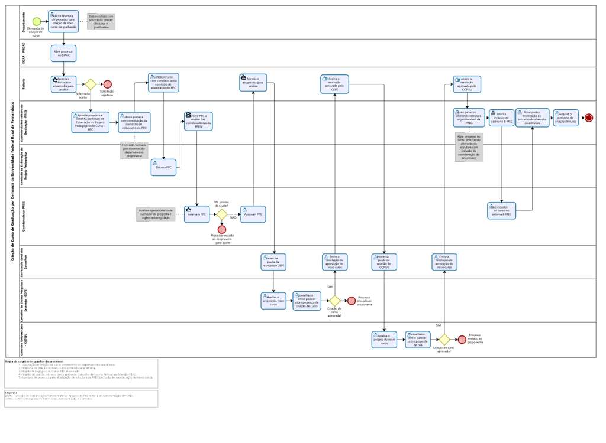

<!-- page 1 -->

<!-- figure p01-fig1 | described_by: agy | ocr_overlap: 1.0 | needs_review: false -->
### (1) Tipo de figura
Trata-se de um fluxograma de processo de negócio em notação BPMN (*Business Process Model and Notation*), estruturado como uma piscina (*pool*) horizontal dividida em 9 raias (*lanes*) representando os setores/órgãos envolvidos, acompanhado na parte inferior esquerda por duas caixas retangulares de texto contendo regras de negócio e legenda.

---

### (2) Todo o texto visível (transcrição literal)

**Título da piscina (texto vertical na margem esquerda):**
- `Criação de Curso de Graduação por Demanda da Universidade Federal Rural de Pernambuco`

**Rótulos das 9 raias (texto vertical à esquerda, de cima para baixo):**
1. `Departamento`
2. `DCAA - PROAD`
3. `Reitoria`
4. `Gabinete da Pró-reitoria de Graduação - PREG`
5. `Comissão de Elaboração do Projeto Pedagógico`
6. `Coordenadorias PREG`
7. `Secreatraia Geral dos Conselhos`
8. `Conselho de Ensino Pesquisa e Extensão - CEPE`
9. `Conselho Universitário - CONSU`

**Textos dentro das raias (agrupados por raia, da esquerda para a direita):**

- **Raia `Departamento`:**
  - Rótulo abaixo do evento de início: `Demanda de criação de curso`
  - Tarefa: `Solicita abertura de processo para criação de novo curso de graduação`
  - Anotação de texto: `Elabora ofício com solicitação criação de curso e justificativa`

- **Raia `DCAA - PROAD`:**
  - Tarefa: `Abre processo no SIPAC`

- **Raia `Reitoria`:**
  - Tarefa: `Aprecia a solicitação e encaminha para analise`
  - Rótulo no fluxo descendente do losango: `Solicitação aceita`
  - Rótulo abaixo do evento de fim à direita do losango: `Solicitação rejeitada`
  - Tarefa: `Publica portaria com constituição da comissão de elaboração do PPC`
  - Tarefa: `Aprecia e encaminha para análise`
  - Tarefa: `Assina a resolução aprovada pelo CEPE`
  - Tarefa: `Assina a resolução aprovada pelo CONSU`

- **Raia `Gabinete da Pró-reitoria de Graduação - PREG`:**
  - Tarefa: `Aprecia proposta e constitui comissão de Elaboração do Projeto Pedagógico do Curso - PPC`
  - Tarefa: `Elabora portaria com constituição da comissão de elaboração do PPC`
  - Anotação de texto (posicionada abaixo da tarefa anterior, sobrepondo a divisa com a raia 5): `Comissão formada por docentes do departamento proponente.`
  - Tarefa (com ícone preto sobrepondo as primeiras letras da primeira palavra): `[illegible]mete PPC a análise das coordenadorias da PREG`
  - Tarefa: `Abre processo alterando estrutura organizacional da PREG`
  - Anotação de texto (posicionada abaixo da tarefa anterior, atravessando a divisa para a raia 5): `Abre processo no SIPAC solicitando alteração da estrutura com inclusão da coordenação do novo curso`
  - Tarefa: `Solicita inclusão de dados no E-MEC`
  - Tarefa: `Acompanha tramitação do processo de alteração de estrutura`
  - Tarefa: `Arquiva o processo de criação de curso`

- **Raia `Comissão de Elaboração do Projeto Pedagógico`:**
  - Tarefa: `Elabora PPC`

- **Raia `Coordenadorias PREG`:**
  - Anotação de texto: `Avaliam operacionalidade curricular da proposta e vigência da regulação`
  - Tarefa: `Analisam PPC`
  - Rótulo acima do losango de decisão: `PPC precisa de ajuste?`
  - Rótulo abaixo do evento de fim (ramo inferior): `Processo enviado ao proponente para ajuste`
  - Rótulo no fluxo à direita do losango: `NÃO`
  - Tarefa: `Aprovam PPC`
  - Tarefa (à direita): `Insere dados do curso no sistema E-MEC`

- **Raia `Secreatraia Geral dos Conselhos`:**
  - Tarefa (1ª): `Insere na pauta da reunião do CEPE`
  - Tarefa (2ª): `Emite a resolução de aprovação do novo curso`
  - Tarefa (3ª): `Insere na pauta da reunião do CONSU`
  - Tarefa (4ª): `Emite a resolução de aprovação do novo curso`

- **Raia `Conselho de Ensino Pesquisa e Extensão - CEPE`:**
  - Tarefa: `Analisa o projeto do novo curso`
  - Tarefa: `Conselheiro emite parecer sobre proposta de criação de curso`
  - Rótulo abaixo do losango de decisão: `Criação de curso aprovada?`
  - Rótulo no fluxo ascendente do losango: `SIM`
  - Rótulo à direita do evento de fim: `Processo enviado ao proponente`

- **Raia `Conselho Universitário - CONSU`:**
  - Tarefa: `Analisa o projeto do novo curso`
  - Tarefa: `Conselheiro emite parecer sobre proposta de cria`
  - Rótulo abaixo do losango de decisão: `Criação de curso aprovada?`
  - Rótulo no fluxo ascendente do losango: `SIM`
  - Rótulo à direita do evento de fim: `Processo enviado ao proponente`

**Caixa inferior esquerda 1 (fora da piscina):**
- `Regra de negócio (requisitos do processo):`
- `1. Solicitação de criação de curso proveniente de departamento acadêmico;`
- `2. Proposta de criação de novo curso aprovada pela reitoria;`
- `3. Projeto Pedagógico do Curso-PPC elaborado;`
- `4. Projeto do criação de novo curso aprovado Conselho de Ensino Pesquisa e Extenão-CEPE;`
- `5. Abertura de processo para atualização de estrutura da PREG (inclusão de coordenação do novo curso).`

**Caixa inferior esquerda 2 (abaixo da anterior, fora da piscina):**
- `Legenda`
- `DCAA - Divisão de Cominicação Administrativa e Arquivo da Pró-reitoria de Administração (PROAD).`
- `SIPAC- Sistema Integrado de Patrimônio, Administração e Contratos`

---

### (3) Estrutura: painéis, raias, caixas, ícones e conexões

A imagem organiza-se em três blocos visuais:
1. **Piscina principal** ocupando quase toda a largura e cerca de 80% superiores da figura, dividida em **9 raias horizontais empilhadas** (enumeradas na seção anterior), com cabeçalho vertical geral à extrema esquerda e cabeçalhos verticais individuais para cada raia. Não há eixos numéricos, colunas formais ou subtabelas; o fluxo temporal progride majoritariamente da esquerda para a direita.
2. **Caixa `Regra de negócio (requisitos do processo):`**, posicionada abaixo do canto inferior esquerdo da piscina.
3. **Caixa `Legenda`**, posicionada diretamente abaixo da caixa de regras de negócio.

**Elementos gráficos internos às raias:**
- **Retângulos de cantos arredondados (25 tarefas):** quase todos trazem pequenos ícones no canto superior esquerdo — ícone de silhueta de usuário na maioria das tarefas; ícone de mão em `Assina a resolução aprovada pelo CEPE` e `Assina a resolução aprovada pelo CONSU`; ícone escuro semelhante a um caractere `è` em `Aprecia a solicitação e encaminha para analise`, `Aprecia e encaminha para análise` e `Analisam PPC`; ícone escuro em forma de `8` em `[illegible]mete PPC a análise das coordenadorias da PREG`; pequeno ícone escuro estilizado em `Solicita inclusão de dados no E-MEC`; e nenhum ícone em `Abre processo no SIPAC`.
- **Losangos (4 pontos de decisão/gateways):** um na `Reitoria`, um em `Coordenadorias PREG`, um no `CEPE` e um no `CONSU`.
- **Círculos (6 eventos):** 1 evento de início (em `Departamento`), 4 eventos de fim simples (em `Reitoria`, `Coordenadorias PREG`, `CEPE` e `CONSU`) e 1 evento de fim de término com núcleo preenchido (ao final da raia `Gabinete da Pró-reitoria de Graduação - PREG`).
- **Blocos de anotação (4 caixas cinzas com borda aberta à direita):** ligados por linhas pontilhadas sem seta às respectivas tarefas.

**Sequência completa de setas (fluxo de sequência) e associações (linhas pontilhadas):**
1. Evento de início `Demanda de criação de curso` (`Departamento`) → tarefa `Solicita abertura de processo para criação de novo curso de graduação` (`Departamento`).
   - Associação pontilhada à direita liga esta tarefa à anotação `Elabora ofício com solicitação criação de curso e justificativa`.
2. `Solicita abertura de processo para criação de novo curso de graduação` (`Departamento`) → desce para `Abre processo no SIPAC` (`DCAA - PROAD`).
3. `Abre processo no SIPAC` (`DCAA - PROAD`) → desce para `Aprecia a solicitação e encaminha para analise` (`Reitoria`).
4. `Aprecia a solicitação e encaminha para analise` (`Reitoria`) → segue à direita para o losango de decisão sem rótulo (`Reitoria`):
   - Saída à direita (sem rótulo na seta) → evento de fim `Solicitação rejeitada` (`Reitoria`).
   - Saída para baixo (rotulada `Solicitação aceita`) → desce para `Aprecia proposta e constitui comissão de Elaboração do Projeto Pedagógico do Curso - PPC` (`Gabinete da Pró-reitoria de Graduação - PREG`).
5. `Aprecia proposta e constitui comissão de Elaboração do Projeto Pedagógico do Curso - PPC` (`PREG`) → segue à direita para `Elabora portaria com constituição da comissão de elaboração do PPC` (`PREG`).
   - Associação pontilhada para baixo liga esta tarefa à anotação `Comissão formada por docentes do departamento proponente.`.
6. `Elabora portaria com constituição da comissão de elaboração do PPC` (`PREG`) → sobe e dobra à direita para `Publica portaria com constituição da comissão de elaboração do PPC` (`Reitoria`).
7. `Publica portaria com constituição da comissão de elaboração do PPC` (`Reitoria`) → desce verticalmente (cruzando a raia `PREG`) até `Elabora PPC` (`Comissão de Elaboração do Projeto Pedagógico`).
8. `Elabora PPC` (`Comissão de Elaboração do Projeto Pedagógico`) → sai pela direita, sobe e entra pela esquerda em `[illegible]mete PPC a análise das coordenadorias da PREG` (`PREG`).
9. `[illegible]mete PPC a análise das coordenadorias da PREG` (`PREG`) → desce verticalmente (cruzando a raia da Comissão) até `Analisam PPC` (`Coordenadorias PREG`).
   - Associação pontilhada à esquerda liga `Analisam PPC` à anotação `Avaliam operacionalidade curricular da proposta e vigência da regulação`.
10. `Analisam PPC` (`Coordenadorias PREG`) → segue à direita para o losango `PPC precisa de ajuste?` (`Coordenadorias PREG`):
    - Saída para baixo (sem rótulo na seta) → evento de fim `Processo enviado ao proponente para ajuste` (`Coordenadorias PREG`).
    - Saída à direita (rotulada `NÃO`) → segue para `Aprovam PPC` (`Coordenadorias PREG`).
11. `Aprovam PPC` (`Coordenadorias PREG`) → sobe verticalmente (cruzando as raias da Comissão e da `PREG`) até `Aprecia e encaminha para análise` (`Reitoria`).
12. `Aprecia e encaminha para análise` (`Reitoria`) → sai pela direita e desce verticalmente (cruzando as raias `PREG`, Comissão e `Coordenadorias PREG`) até `Insere na pauta da reunião do CEPE` (`Secreatraia Geral dos Conselhos`).
13. `Insere na pauta da reunião do CEPE` (`Secreatraia Geral dos Conselhos`) → desce para `Analisa o projeto do novo curso` (`Conselho de Ensino Pesquisa e Extensão - CEPE`).
14. `Analisa o projeto do novo curso` (`CEPE`) → segue à direita para `Conselheiro emite parecer sobre proposta de criação de curso` (`CEPE`).
15. `Conselheiro emite parecer sobre proposta de criação de curso` (`CEPE`) → segue à direita para o losango `Criação de curso aprovada?` (`CEPE`):
    - Saída à direita (sem rótulo na seta) → evento de fim `Processo enviado ao proponente` (`CEPE`).
    - Saída para cima (rotulada `SIM`) → sobe para a 1ª tarefa `Emite a resolução de aprovação do novo curso` (`Secreatraia Geral dos Conselhos`).
16. 1ª tarefa `Emite a resolução de aprovação do novo curso` (`Secreatraia Geral dos Conselhos`) → sobe verticalmente (cruzando `Coordenadorias PREG`, Comissão e `PREG`) até `Assina a resolução aprovada pelo CEPE` (`Reitoria`).
17. `Assina a resolução aprovada pelo CEPE` (`Reitoria`) → sai pela direita e desce verticalmente (cruzando `PREG`, Comissão e `Coordenadorias PREG`) até `Insere na pauta da reunião do CONSU` (`Secreatraia Geral dos Conselhos`).
18. `Insere na pauta da reunião do CONSU` (`Secreatraia Geral dos Conselhos`) → desce verticalmente (cruzando a raia do `CEPE`) até `Analisa o projeto do novo curso` (`Conselho Universitário - CONSU`).
19. `Analisa o projeto do novo curso` (`CONSU`) → segue à direita para `Conselheiro emite parecer sobre proposta de cria` (`CONSU`).
20. `Conselheiro emite parecer sobre proposta de cria` (`CONSU`) → segue à direita para o losango `Criação de curso aprovada?` (`CONSU`):
    - Saída à direita (sem rótulo na seta) → evento de fim `Processo enviado ao proponente` (`CONSU`).
    - Saída para cima (rotulada `SIM`) → sobe verticalmente (cruzando a raia do `CEPE`) até a 2ª tarefa `Emite a resolução de aprovação do novo curso` (`Secreatraia Geral dos Conselhos`).
21. 2ª tarefa `Emite a resolução de aprovação do novo curso` (`Secreatraia Geral dos Conselhos`) → sobe verticalmente (cruzando `Coordenadorias PREG`, Comissão e `PREG`) e dobra à direita para entrar pela esquerda em `Assina a resolução aprovada pelo CONSU` (`Reitoria`).
22. `Assina a resolução aprovada pelo CONSU` (`Reitoria`) → desce para `Abre processo alterando estrutura organizacional da PREG` (`PREG`).
    - Associação pontilhada para baixo liga esta tarefa à anotação `Abre processo no SIPAC solicitando alteração da estrutura com inclusão da coordenação do novo curso`.
23. `Abre processo alterando estrutura organizacional da PREG` (`PREG`) → segue à direita para `Solicita inclusão de dados no E-MEC` (`PREG`).
24. `Solicita inclusão de dados no E-MEC` (`PREG`) → desce verticalmente (cruzando a raia da Comissão) até `Insere dados do curso no sistema E-MEC` (`Coordenadorias PREG`).
25. `Insere dados do curso no sistema E-MEC` (`Coordenadorias PREG`) → sai pela direita, sobe verticalmente (cruzando a raia da Comissão) e entra por baixo em `Acompanha tramitação do processo de alteração de estrutura` (`PREG`).
26. `Acompanha tramitação do processo de alteração de estrutura` (`PREG`) → segue à direita para `Arquiva o processo de criação de curso` (`PREG`).
27. `Arquiva o processo de criação de curso` (`PREG`) → segue à direita para o evento de fim de término sem rótulo (`PREG`).

---

### (4) Números e valores de dados
Não há valores numéricos de dados, medições, escalas ou quantidades no diagrama. Os únicos numerais visíveis são os números ordinais `1.`, `2.`, `3.`, `4.` e `5.` que enumeram os cinco itens da lista na caixa `Regra de negócio (requisitos do processo):`.

---

### (5) Cores com significado
As cores diferenciam as categorias semânticas de elementos da notação BPMN:
- **Verde-claro com contorno verde-oliva** (círculo): indica o **evento de início** do processo (`Demanda de criação de curso`).
- **Azul-claro com contorno azul** (retângulos arredondados): identifica as **tarefas/atividades** do fluxo.
- **Amarelo-claro com contorno oliva** (losangos): identifica os **pontos de decisão (gateways)** com ramificação condicional.
- **Vermelho-claro/salmão com contorno vermelho espesso** (4 círculos simples): identifica **eventos de fim** correspondentes a encerramento/interrupção por rejeição ou devolução ao proponente (`Solicitação rejeitada`, `Processo enviado ao proponente para ajuste` e ambos os `Processo enviado ao proponente`).
- **Vermelho-escuro preenchido no centro, com anel branco e contorno vermelho espesso** (círculo final na raia `PREG`): identifica o **evento de fim de término**, marcando a conclusão bem-sucedida e o encerramento definitivo do processo.
- **Cinza-claro com linha vertical esquerda cinza-escuro** (4 blocos retangulares): diferencia visualmente as **anotações explicativas** das tarefas executáveis.

~~~text ocr
de processo para
de
| de graduação
criação de
curso
e, a
PPC PPC
do proponente
ajuste
Criação de Curso de Graduação por Demanda da Universidade Federal Rural de Pernambuco
te
do
e »
e
~~~

<!-- Start of picture text -->
Solicita abertura Elabora ofício com de processo para solicitação criação criação de novo de curso e Demanda de curso de graduação justificativa criação de curso Abre processo no SIPAC èencaminha parasolicitação eAprecia aanalise Solicitaçãoaceita Solicitaçãorejeitada com constituição daelaboração do PPCPublica portariacomissão de èencaminha paraAprecia eanálise aprovada peloresoluçãoAssina aCEPE aprovada peloresoluçãoAssina aCONSU Pedagógico do Curso -Elaboração do Projetoconstitui comissão deAprecia proposta ePPC com constituição daelaboração do PPCElabora portariacomissão de 8coordenadorias daSubmete PPC aanálise dasPREG alterando estruturaorganizacional daAbre processoPREG dados no E-MECinclusão deSolicita processo de alteraçãotramitação doAcompanhade estrutura criação de cursoprocesso deArquiva o Abre processo no SIPAC solicitando Comissão formadapor docentes dodepartamentoproponente. coordenação doestrutura comalteração dainclusão danovo curso Elabora PPC PPC precisa de ajuste? Insere dados Avaliam operacionalidade è do curso no curricular da proposta evigência da regulação Analisam PPC NÃO Aprovam PPC sistema E-MEC Processo enviado ao proponente para ajuste reunião do CEPEInsere napauta da aprovação doresolução denovo cursoEmite a Insere nareunião dopauta daCONSU aprovação doresolução denovo cursoEmite a SIM projeto do novoAnalisa ocurso sobre proposta decriação de cursoemite parecerConselheiro Criação de proponenteenviado aoProcesso curso aprovada? SIM projeto do novoAnalisa ocurso sobre propostaemite parecerConselheirode cria Criação de curso proponenteenviado aoProcesso aprovada? Departamento DCAA - PROAD Reitoria Graduação - PREG Gabinete da Pró-reitoria de Projeto Pedagógico Comissão de Elaboração do Coordenadorias PREG Criação de Curso de Graduação por Demanda da Universidade Federal Rural de Pernambuco Conselhos Secreatraia Geral dos Extensão - CEPE Conselho de Ensino Pesquisa e - CONSU Conselho Universitário <!-- End of picture text -->
