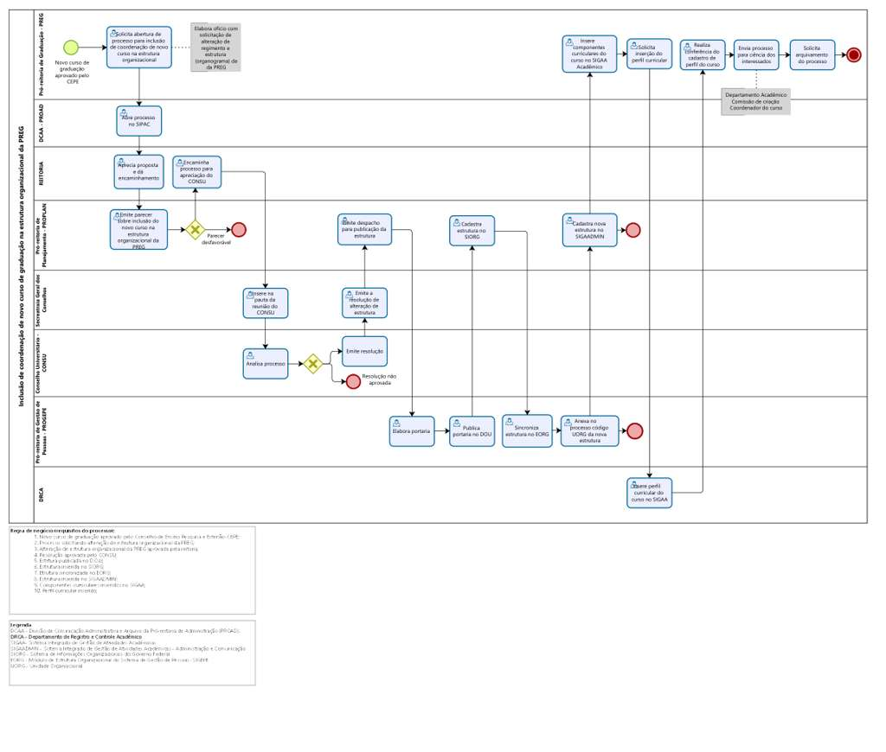

<!-- page 1 -->

<!-- figure p01-fig1 | described_by: agy | ocr_overlap: 0.76 | needs_review: false -->
### 1. Tipo de figura
Diagrama de fluxo de processos em notação BPMN (*Business Process Model and Notation*), estruturado em uma piscina (*pool*) horizontal dividida em 8 raias (*swimlanes*) correspondentes a unidades e órgãos universitários, acompanhado de dois quadros retangulares de texto na parte inferior esquerda (fora da piscina): um com regras de negócio/requisitos do processo e outro com a legenda das siglas.

---

### 2. Todo o texto visível (literalmente)

**Título vertical da piscina (extrema esquerda, orientado de baixo para cima):**
- `Inclusão de coordenação de novo curso de graduação na estrutura organizacional da PREG`

**Rótulos verticais das 8 raias (de cima para baixo, orientados de baixo para cima):**
1. `Pró-reitoria de Graduação - PREG`
2. `DCAA - PROAD`
3. `REITORIA`
4. `Pró-reitoria de Planejamento - PROPLAN`
5. `Secreatraia Geral dos Conselhos`
6. `Conselho Universitário - CONSU`
7. `Pró-reitoria de Gestão de Pessoas - PROGEPE`
8. `DRCA`

**Textos dos elementos em cada raia (da esquerda para a direita):**
- **Raia `Pró-reitoria de Graduação - PREG`:**
  - Evento de início: `Novo curso de graduação aprovado pelo CEPE`
  - Tarefa: `Solicita abertura de processo para inclusão de coordenação de novo curso na estrutura organizacional`
  - Anotação: `Elabora ofício com solicitação de alteração de regimento e estrutura (organograma) da da PREG`
  - Tarefa: `Insere componentes curriculares do curso no SIGAA Acadêmico`
  - Tarefa: `Solicita inserção do perfil curricular`
  - Tarefa: `Realiza conferência do cadastro de perfil do curso`
  - Tarefa: `Envia processo para ciência dos interessados`
  - Anotação (posicionada abaixo da tarefa anterior, sobrepondo a divisa entre as raias `Pró-reitoria de Graduação - PREG` e `DCAA - PROAD`):
    `Departamento Acadêmico`
    `Comissão de criação`
    `Coordenador do curso`
  - Tarefa: `Solicita arquivamento do processo`
- **Raia `DCAA - PROAD`:**
  - Tarefa: `Abre processo no SIPAC`
- **Raia `REITORIA`:**
  - Tarefa: `Aprecia proposta e dá encaminhamento`
  - Tarefa: `Encaminha processo para apreciação do CONSU`
- **Raia `Pró-reitoria de Planejamento - PROPLAN`:**
  - Tarefa: `Emite parecer sobre inclusão do novo curso na estrutura organizacional da PREG`
  - Rótulo da seta de saída do gateway para evento de fim: `Parecer desfavorável`
  - Tarefa: `Emite despacho para publicação da estrutura`
  - Tarefa: `Cadastra estrutura no SIORG`
  - Tarefa: `Cadastra nova estrutura no SIGAADMIN`
- **Raia `Secreatraia Geral dos Conselhos`:**
  - Tarefa: `Insere na pauta da reunião do CONSU`
  - Tarefa: `Emite a resolução de alteração de estrutura`
- **Raia `Conselho Universitário - CONSU`:**
  - Tarefa: `Analisa processo`
  - Tarefa: `Emite resolução`
  - Rótulo ao lado do evento de fim: `Resolução não aprovada`
- **Raia `Pró-reitoria de Gestão de Pessoas - PROGEPE`:**
  - Tarefa: `Elabora portaria`
  - Tarefa: `Publica portaria no DOU`
  - Tarefa: `Sincroniza estrutura no EORG`
  - Tarefa: `Anexa no processo código UORG da nova estrutura`
- **Raia `DRCA`:**
  - Tarefa: `Insere perfil curricular do curso no SIGAA`

**Quadro de texto inferior esquerdo (superior):**
- Título (em negrito): `Regra de negócio (requisitos do processo):`
- Lista numerada:
  - `1. Novo curso de graduação aprovado pelo Conselho de Ensino Pesquisa e Extenão- CEPE;`
  - `2. Processo solicitando alteração de estrutura organizacional da PREG;`
  - `3. Alteração de estrutura organizacional da PREG aprovada pela reitoria;`
  - `4. Resolução aprovada pelo CONSU;`
  - `5. Estrtura publicada no D.O.U;`
  - `6. Estrutura inserida no SIORG;`
  - `7. Etrutura sincronizada no EORG;`
  - `8. Estrutura inserida no SIGAADMIN;`
  - `9. Componentes curriculares inseridos no SIGAA;`
  - `10. Perfil curricular inserido;`

**Quadro de texto inferior esquerdo (inferior):**
- Título (em negrito): `Legenda`
- Itens:
  - `DCAA - Divisão de Cominicação Administrativa e Arquivo da Pró-reitoria de Administração (PROAD).`
  - `DRCA - Departamento de Registro e Controle Acadêmico` *(linha inteira em negrito)*
  - `SIGAA- Sistema Integrado de Gestão de Atividades Acadêmicas`
  - `SIGAADMIN - Sistema Integrado de Gestão de Atividades Acadêmicas - Administração e Comunicação`
  - `SIORG - Sistema de Informações Organizacionais do Governo Federal`
  - `EORG - Módulo de Estrutura Organizacional do Sistema de Gestão de Pessoas -SIGEPE`
  - `UORG - Unidade Organiacional`

---

### 3. Estrutura (caixas, setas, conexões, painéis e raias)

**Organização dos painéis:**
- **Painel superior (piscina BPMN):** ocupa toda a largura da figura e cerca de dois terços superiores da altura. Possui uma coluna vertical à esquerda com o título geral do processo e, à direita dela, 8 raias horizontais separadas por linhas pretas horizontais.
- **Painéis inferiores:** abaixo do canto esquerdo da piscina há dois retângulos com borda fina cinza empilhados verticalmente — o superior contém `Regra de negócio (requisitos do processo):` e o inferior contém `Legenda`.

**Tipos de elementos gráficos na piscina:**
- 1 evento de início (círculo com borda fina).
- 21 caixas de tarefa (retângulos de cantos arredondados): 18 possuem um pequeno ícone de usuário (silhueta humana) no canto superior esquerdo (tarefas de usuário) e 3 não possuem ícone (`Emite resolução`, `Envia processo para ciência dos interessados` e `Solicita arquivamento do processo`).
- 2 gateways exclusivos (losangos contendo um "X").
- 2 anotações de texto (caixas retangulares com borda aberta à direita em formato de colchete `[`), conectadas por linhas pontilhadas sem ponta de seta.
- 4 eventos de fim simples (círculos de borda espessa) e 1 evento de fim de término (círculo de borda espessa com círculo interno preenchido).

**Conexões e sequência completa do fluxo (setas sólidas de fluxo de sequência e linhas pontilhadas de associação):**
1. Em `Pró-reitoria de Graduação - PREG`, o evento de início `Novo curso de graduação aprovado pelo CEPE` liga-se por seta à direita à tarefa `Solicita abertura de processo para inclusão de coordenação de novo curso na estrutura organizacional`.
2. Dessa tarefa, uma linha pontilhada horizontal à direita associa-se à anotação `Elabora ofício com solicitação de alteração de regimento e estrutura (organograma) da da PREG`.
3. Da base de `Solicita abertura de processo para inclusão de coordenação de novo curso na estrutura organizacional`, uma seta desce para a raia `DCAA - PROAD`, entrando no topo de `Abre processo no SIPAC`.
4. Da base de `Abre processo no SIPAC`, uma seta desce para a raia `REITORIA`, entrando no topo de `Aprecia proposta e dá encaminhamento`.
5. Da base de `Aprecia proposta e dá encaminhamento`, uma seta desce para a raia `Pró-reitoria de Planejamento - PROPLAN`, entrando no topo de `Emite parecer sobre inclusão do novo curso na estrutura organizacional da PREG`.
6. Do lado direito de `Emite parecer sobre inclusão do novo curso na estrutura organizacional da PREG`, uma seta segue à direita até um gateway exclusivo ("X") na mesma raia (`PROPLAN`), que se divide em duas saídas:
   - **Para a direita:** seta rotulada `Parecer desfavorável` ligando-se a um evento de fim simples sem texto adicional.
   - **Para cima:** seta sem rótulo que sobe para a raia `REITORIA`, entrando na base de `Encaminha processo para apreciação do CONSU`.
7. Do lado direito de `Encaminha processo para apreciação do CONSU`, uma seta segue para a direita, dobra 90° para baixo e atravessa a raia `PROPLAN` até entrar no topo de `Insere na pauta da reunião do CONSU`, na raia `Secreatraia Geral dos Conselhos`.
8. Da base de `Insere na pauta da reunião do CONSU`, uma seta desce para a raia `Conselho Universitário - CONSU`, entrando no topo de `Analisa processo`.
9. Do lado direito de `Analisa processo`, uma seta vai até um segundo gateway exclusivo ("X") na mesma raia (`CONSU`), cuja saída pela direita se bifurca em dois ramos:
   - **Ramo inferior:** dobra para baixo e para a direita, ligando-se a um evento de fim simples com o rótulo `Resolução não aprovada` ao lado direito.
   - **Ramo superior:** dobra para cima e para a direita (sem rótulo), entrando na lateral esquerda de `Emite resolução` (na mesma raia `CONSU`).
10. Do topo de `Emite resolução`, uma seta sobe para a raia `Secreatraia Geral dos Conselhos`, entrando na base de `Emite a resolução de alteração de estrutura`.
11. Do topo de `Emite a resolução de alteração de estrutura`, uma seta sobe para a raia `Pró-reitoria de Planejamento - PROPLAN`, entrando na base de `Emite despacho para publicação da estrutura`.
12. Do lado direito de `Emite despacho para publicação da estrutura`, uma seta segue para a direita, dobra 90° para baixo e atravessa as raias `Secreatraia Geral dos Conselhos` e `CONSU` até a raia `Pró-reitoria de Gestão de Pessoas - PROGEPE`, entrando no topo de `Elabora portaria`.
13. Do lado direito de `Elabora portaria`, uma seta segue à direita para `Publica portaria no DOU` (na mesma raia `PROGEPE`).
14. Do topo de `Publica portaria no DOU`, uma seta sobe verticalmente atravessando as raias `CONSU` e `Secreatraia Geral dos Conselhos` até a raia `PROPLAN`, entrando na base de `Cadastra estrutura no SIORG`.
15. Do lado direito de `Cadastra estrutura no SIORG`, uma seta segue para a direita, dobra 90° para baixo e atravessa as raias `Secreatraia Geral dos Conselhos` e `CONSU` até a raia `PROGEPE`, entrando no topo de `Sincroniza estrutura no EORG`.
16. Do lado direito de `Sincroniza estrutura no EORG`, uma seta segue à direita para `Anexa no processo código UORG da nova estrutura` (na mesma raia `PROGEPE`).
17. De `Anexa no processo código UORG da nova estrutura` saem duas setas:
    - **Para a direita:** liga-se a um evento de fim simples sem rótulo (na mesma raia `PROGEPE`).
    - **Para cima:** sobe verticalmente atravessando as raias `CONSU` e `Secreatraia Geral dos Conselhos` até a raia `PROPLAN`, entrando na base de `Cadastra nova estrutura no SIGAADMIN`.
18. De `Cadastra nova estrutura no SIGAADMIN` também saem duas setas:
    - **Para a direita:** liga-se a um evento de fim simples sem rótulo (na mesma raia `PROPLAN`).
    - **Para cima:** sobe verticalmente atravessando as raias `REITORIA` e `DCAA - PROAD` até a raia `Pró-reitoria de Graduação - PREG`, entrando na base de `Insere componentes curriculares do curso no SIGAA Acadêmico`.
19. Do lado direito de `Insere componentes curriculares do curso no SIGAA Acadêmico`, uma seta segue à direita para `Solicita inserção do perfil curricular` (na mesma raia `PREG`).
20. Da base de `Solicita inserção do perfil curricular`, uma longa seta vertical desce atravessando todas as raias intermediárias (`DCAA - PROAD`, `REITORIA`, `PROPLAN`, `Secreatraia Geral dos Conselhos`, `CONSU` e `PROGEPE`) até a raia `DRCA`, entrando no topo de `Insere perfil curricular do curso no SIGAA`.
21. Do lado direito de `Insere perfil curricular do curso no SIGAA`, uma seta segue para a direita, dobra 90° para cima e sobe verticalmente atravessando todas as raias intermediárias (`PROGEPE`, `CONSU`, `Secreatraia Geral dos Conselhos`, `PROPLAN`, `REITORIA` e `DCAA - PROAD`) de volta à raia `PREG`, entrando na base de `Realiza conferência do cadastro de perfil do curso`.
22. Do lado direito de `Realiza conferência do cadastro de perfil do curso`, uma seta segue à direita para `Envia processo para ciência dos interessados` (na mesma raia `PREG`).
23. Da base de `Envia processo para ciência dos interessados`, uma linha pontilhada vertical desce até a anotação `Departamento Acadêmico / Comissão de criação / Coordenador do curso`.
24. Do lado direito de `Envia processo para ciência dos interessados`, uma seta segue à direita para `Solicita arquivamento do processo` (na mesma raia `PREG`).
25. Do lado direito de `Solicita arquivamento do processo`, uma seta segue à direita até o evento de fim de término (sem rótulo), encerrando o diagrama.

---

### 4. Números e valores de dados
A figura não apresenta dados quantitativos, medidas, datas ou valores numéricos em gráficos ou tabelas. Os únicos números presentes são os itens sequenciais de `1.` a `10.` da lista numerada no quadro `Regra de negócio (requisitos do processo):`.

---

### 5. Cores com significado
As cores seguem a codificação semântica padrão da notação BPMN:
- **Verde-claro com contorno verde:** indica o evento de início do processo (`Novo curso de graduação aprovado pelo CEPE`).
- **Azul-claro com contorno azul (e ícones de usuário em azul):** identifica as caixas de tarefas/atividades executadas em cada setor.
- **Amarelo/verde-oliva com "X" no centro:** identifica os gateways exclusivos (pontos de decisão com caminhos alternativos).
- **Vermelho-claro com contorno espesso vermelho-escuro:** identifica os 4 eventos de fim simples (encerramentos parciais ou por reprovação: `Parecer desfavorável`, `Resolução não aprovada`, fim após `Anexa no processo código UORG da nova estrutura` e fim após `Cadastra nova estrutura no SIGAADMIN`).
- **Vermelho com contorno espesso vermelho-escuro e disco interno vermelho-escuro:** identifica o evento de fim de término (encerramento final do processo após `Solicita arquivamento do processo`).
- **Cinza-claro (caixas de preenchimento sólido):** diferencia as duas anotações informativas/artefatos das tarefas do fluxo principal.

~~~text ocr
processo para inclusão
de coordenação de novo
curso na estrutura
Novo curso de
grodusção
pelo
CEPE
DCAA - PROAD | Pró-reixoria de Graduação - PREG
ite parecer
bre inclusão do
novo curso na
estrutura
da
Secrestrala Geral dos
i
|
Pró-reitoris de Gestão de | Conselho Universitário -
Regra de do processor
de
Resolução pelo
put
no
ro
ae
PRE
PREG
- o racação e de
Reg Aro Controle Acadêmico
5
ce
de do Sistemas
-
~~~

<!-- Start of picture text -->
Elabora ofício com Novo curso degraduação de coordenação de novoprocesso para inclusãoSolicita abertura decurso na estruturaorganizacional (organograma) dasolicitação dealteração deregimento eestruturada PREG curso no SIGAAcurriculares docomponentesAcadêmicoInsere perfil curricularinserção doSolicita conferência doperfil do cursocadastro deRealiza para ciência dosEnvia processointeressados arquivamentodo processoSolicita aprovado pelo CEPE Departamento Acadêmico Comissão de criação Coordenador do curso Abre processo no SIPAC Aprecia propostaencaminhamentoe dá apreciação doprocesso paraEncaminhaCONSU Emite parecer sobre inclusão doorganizacional danovo curso naestruturaPREG desfavorávelParecer para publicação daEmite despachoestrutura estrutura noCadastraSIORG Cadastra novaestrutura noSIGAADMIN Insere na Emite a pauta da resolução de reunião do alteração de CONSU estrutura Emite resolução Analisa processo Resolução não aprovada Anexa no Elabora portaria portaria no DOUPublica estrutura no EORGSincroniza processo códigoUORG da nova estrutura Insere perfil curricular do curso no SIGAA Pró-reitoria de Graduação - PREG DCAA - PROAD REITORIA Pró-reitoria de Planejamento - PROPLAN Conselhos Secreatraia Geral dos CONSU Conselho Universitário - Inclusão de coordenação de novo curso de graduação na estrutura organizacional da PREG Pessoas - PROGEPE Pró-reitoria de Gestão de DRCA <!-- End of picture text -->
