<!-- page 1 -->

PRPG Pró-Reitoria de Pós-Graduação 

UNIVERSIDADE FEDERAL RURAL DE PERNAMBUCO 

# **Manual de Orientação para cadastramento de Processos Seletivos do** 

# **SIGAA** 

###### **RECIFE/PE** 

**2023** 

1 

Rua Dom Manoel de Medeiros, s/n, Dois Irmãos. Recife - PE | CEP 52171-900 | <u>www.ufrpe.br</u> 

<!-- page 2 -->

PRPG 

UNIVERSIDADE FEDERAL RURAL DE PERNAMBUCO 

#### Pró-Reitoria de Pós-Graduação 

**REITOR** 

Marcelo Brito Carneiro Leão 

**VICE-REITOR** 

Gabriel Rivas de Melo 

###### **Pró-Reitoria de Pós-Graduação** 

Maria Madalena Pessoa Guerra 

**Pró-Reitoria de Ensino de Graduação** Maria do Socorro de Lima Oliveira 

**Pró-Reitoria de Extensão, Cultura e Cidadania** 

Moisés de Melo Santana 

**Pró-Reitoria de Gestão Estudantil e Inclusão** 

Severino Mendes de Azevedo Júnior 

**Pró-Reitoria de Planejamento e Desenvolvimento Institucional** Carolina Guimarães Raposo 

**Pró-Reitoria de Administração** 

Mozart Alexandre Melo de Oliveira 

**Pró-Reitoria de Gestão de Pessoas** 

Renata Andrade de Lima e Souza 

2 

Rua Dom Manoel de Medeiros, s/n, Dois Irmãos. Recife - PE | CEP 52171-900 | <u>www.ufrpe.br</u> 

<!-- page 3 -->

PRPG 

UNIVERSIDADE FEDERAL RURAL DE PERNAMBUCO 

#### Pró-Reitoria de Pós-Graduação 

###### **Elaboração:** 

Coordenação Geral dos Programas de Pós-Graduação _Stricto sensu_ 

- Diego de Queiroz Jordão E-mail: sec.cppg@ufrpe.br (ramal: 6052) - Analice Gonçalves Régis E-mail: sec.cppg@ufrpe.br (ramal: 6052) 

###### **Revisão e colaboração:** 

Coordenadora dos Programas de Pós-Graduação _Stricto Sensu_ de excelência - Profª  Anete Soares Cavalcanti E-mail: cppg.prpg@ufrpe.br (ramal: 6052) 

Coordenadora dos Programas de Pós-Graduação _Stricto Sensu_ em consolidação - Prof.  Natanael Duarte de Azevedo E-mail: cppg.prpg@ufrpe.br (ramal: 6052) 

###### **Contribuição:** 

Coordenadores e Secretários dos Programas de Pós-Graduação da UFRPE. 

3 

Rua Dom Manoel de Medeiros, s/n, Dois Irmãos. Recife - PE | CEP 52171-900 | <u>www.ufrpe.br</u> 

<!-- page 4 -->

#### Índice 

#### <u>Configurações iniciais Cadastro de Questionários Cadastro de Processo Seletivo Cadastro de Comissão Avaliação de Candidatos Recursos Notícias</u> 

#### <u>Documentos Cadastro de Discentes</u> 

1 

<!-- page 5 -->

> SIGAA - Sistema Integrado de GX + 

× 

☆  

> ← C Não segurovalidacao.sigs.ufrpe.br/sigaa/stricto/coordenacao.jsf 

Para começar, através do Menu Cadastros -> Parâmetros do Programa, a Coordenação pode definir alguns parâmetros do processo seletivo, como a necessidade de um Projeto, ou a indicação de um possível orientador já na inscrição. 

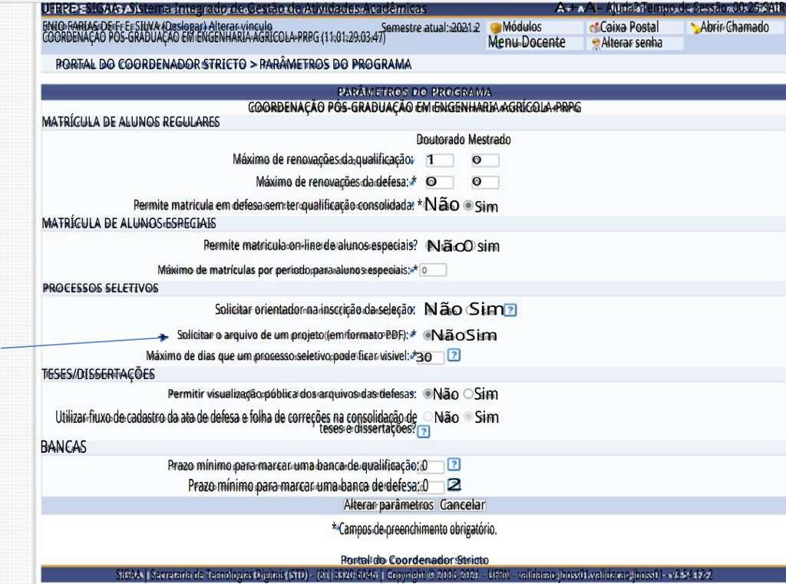

<!-- figure p05-fig1 | described_by: claude:sonnet | ocr_overlap: 0.76 | needs_review: false -->
(1) Tipo de figura: captura de tela (screenshot) de sistema web SIGAA, mostrando formulário de parâmetros acadêmicos. Várias linhas de texto aparecem sobrepostas/duplicadas (efeito de dupla exposição), dificultando leitura de alguns trechos.

(2) Texto visível (verbatim, onde legível):

Topo (texto sobreposto, parcialmente ilegível):
"UFRPE SIGAA Sistema Integrado de Gestão de Atividades Acadêmicas" — "A+ A- Ajuda Tempo de Sessão: 00:25 SATR[...]"

Linha seguinte (sobreposta):
"ENIO FARIAS DE SILVA (Deslogar) Alterar vínculo" / "Semestre atual: 2021.2" / "Módulos" / "Caixa Postal" / "Abrir Chamado"
"COORDENAÇÃO POS-GRADUAÇÃO EM ENGENHARIA AGRÍCOLA-PRPG (11:01:29:03:47)" / "Menu Docente" / "Alterar senha"

Breadcrumb:
"PORTAL DO COORDENADOR STRICTO > PARÂMETROS DO PROGRAMA"

Barra de título azul escura:
"PARÂMETROS DO PROGRAMA"

Subtítulo (sobreposto):
"COORDENAÇÃO POS-GRADUAÇÃO EM ENGENHARIA AGRÍCOLA-PRPG"

Seção "MATRÍCULA DE ALUNOS REGULARES":
- Cabeçalho de colunas: "Doutorado   Mestrado"
- "Máximo de renovações da qualificação:" → valor "1" (Doutorado), "0" (Mestrado)
- "Máximo de renovações da defesa:*" → valor "0" (Doutorado), "0" (Mestrado)
- "Permite matrícula em defesa sem ter qualificação consolidada: *" → opções "Não" / "Sim" (texto sobreposto; "Sim" aparece selecionado, marcado com bolinha preenchida)

Seção "MATRÍCULA DE ALUNOS ESPECIAIS":
- "Permite matrícula on-line de alunos especiais?" → "Não" / "Sim" (sobrepostos, difícil distinguir marcado)
- "Máximo de matrículas por período para alunos especiais:*" → valor "0"

Seção "PROCESSOS SELETIVOS":
- "Solicitar orientador na inscrição da seleção:" → "Não" / "Sim" com ícone de interrogação "?"
- "Solicitar o arquivo de um projeto (em formato PDF):*" → "Não" / "Sim" (opção "Não" aparece marcada, com seta azul apontando da margem esquerda para esta linha)
- "Máximo de dias que um processo seletivo pode ficar visível:*" → valor "30", com ícone "?"

Seção "TESES/DISSERTAÇÕES":
- "Permitir visualização pública dos arquivos das defesas:" → "Não" (marcado) / "Sim"
- "Utilizar fluxo de cadastro da ata de defesa e folha de correções na consolidação de teses e dissertações?" → "Não" / "Sim" (marcado), com ícone "?"

Seção "BANCAS":
- "Prazo mínimo para marcar uma banca de qualificação:" → valor "0", ícone "?"
- "Prazo mínimo para marcar uma banca de defesa:" → valor "0", ícone "2" (provavelmente também "?" distorcido)

Botões: "Alterar parâmetros" | "Cancelar"

Rodapé:
"*Campos de preenchimento obrigatório."
"Portal do Coordenador Stricto"
"SIGAA | Secretaria de Tecnologias Digitais (STD) - (81) 3320-6046 | Copyright © 2006-2021 - UFRN - validacao-jboss01.validacao-jboss01 - v3.54.12-2"

(3) Estrutura: página de formulário web de cima para baixo, com barra superior de navegação/usuário, breadcrumb, faixa de título azul, depois várias seções delimitadas por cabeçalhos em negrito ("MATRÍCULA DE ALUNOS REGULARES", "MATRÍCULA DE ALUNOS ESPECIAIS", "PROCESSOS SELETIVOS", "TESES/DISSERTAÇÕES", "BANCAS"), cada uma contendo linhas de campo rótulo+valor (caixas de texto, botões de opção "Não"/"Sim", ícones de ajuda "?"). Única seta: linha azul horizontal fina à esquerda da imagem, apontando da margem para a linha "Solicitar o arquivo de um projeto (em formato PDF)", indicando destaque dessa linha. Não há eixos, gráficos ou painéis — é formulário único de coluna.

(4) Valores numéricos: 1, 0, 0, 0, 0, 30, 0, 0; "2021.2" (semestre); "00:25" (tempo de sessão); "11:01:29:03:47" (código numérico ao lado do nome da coordenação); "3320-6046" (telefone); "2006-2021" (intervalo copyright); "v3.54.12-2" (versão sistema); "3.54.12-2".

(5) Cor com significado: faixa de título "PARÂMETROS DO PROGRAMA" em azul escuro com texto branco; seta de destaque em azul claro; radio buttons marcados aparecem preenchidos (escuro) indicando seleção, mas texto sobreposto/borrão torna incerta a identificação exata de qual opção ("Não" ou "Sim") está selecionada em várias linhas — nestes casos: [illegible, sobreposição de texto impede confirmar seleção exata].

~~~text ocr
| pola
ENIO» Modulos Postal
RORTAL DO COORDENADOR STRICTO > RARAMETROS DO PROGRAMA
BO
a
MATRÍGULA DE ALUNOS REGULARES
Doutorado Mestrado
Máximo de 1 o
Máximo de renovaçõesdadefesa:* O o
Permite matricula em consolidada: * N&O Sim
DE ALUNOS-ESREGIAIS
Permite alunos-especiais? sim
Máximo de matrículas por 0
PROCESSOS SELETIVOS
Solicitar Não
Solicitar o arquivo de um projeto((emiformato-PDF):* um
Máximo de dias que um (7)
TESES/DISSERTAÇÕES
Permitir
da ata de defesa e folha de correções fa Não Sim
BANCAS
Prazo mínimo (2)
Prazo-mínimo dedefesa:.0
parâmetros Cancelar
=
~~~

<!-- Start of picture text -->
UFRPE - SIGAA - Sistema Integrado de Gestão de Atividades Acadêmicas A+ A- Ajuda? Tempo de Sessão: 00:25 SAIR ENIO FARIAS DE F. E. SILVA (Deslogar) Alterar vinculo Semestre atual: 2021.2 Módulos Caixa Postal Abrir Chamado COORDENAÇÃO PÓS-GRADUAÇÃO EM ENGENHARIA AGRÍCOLA-PRPG (11.01.29.03.47) Menu Docente Alterar senha PORTAL DO COORDENADOR STRICTO > PARÂMETROS DO PROGRAMA PARÂMETROS DO PROGRAMA COORDENAÇÃO PÓS-GRADUAÇÃO EM ENGENHARIA AGRÍCOLA-PRPG MATRÍCULA DE ALUNOS REGULARES Doutorado Mestrado Máximo de renovações da qualificação:  1 0 Máximo de renovações da defesa: * 0 0 Permite matricula em defesa sem ter qualificação consolidada: * Não Sim MATRÍCULA DE ALUNOS ESPECIAIS Permite matricula on-line de alunos especiais? NãoO sim Máximo de matrículas por periodo para alunos especiais: * PROCESSOS SELETIVOS Solicitar orientador na inscrição da seleção:  Não Sim + Solicitar o arquivo de um projeto (em formato PDF): * NãoSim Máximo de dias que um processo seletivo pode ficar visivel: *30 TESES/DISSERTAÇÕES Permitir visualização pública dos arquivos das defesas: Não Sim Utilizar fiuxo de cadastro da ata de defesa e folha de correções na consolidação de Não Sim teses e dissertações? BANCAS Prazo mínimo para marcar uma banca de qualificação: 0 Prazo mínimo para marcar uma banca de defesa: 0 2 Alterar parâmetros Cancelar * Campos de preenchimento obrigatório. Portal do Coordenador Stricto SIGAA | Secretaria de Tecnologias Digitais (STD) - (81) 3320-6046 | Copyright © 2006-2021 - UFRN - validacao-jboss01.validacao-jboss01 - v3.54.12-2 <!-- End of picture text -->

A opção de solicitar um projeto pode ser inserida de outra forma conforme veremos adiante. 

2 

POR INTL 29/10/202115:57  

29°℃ Chuva fraca 

Digite aqui para pesquisar 

<!-- page 6 -->

A+ A- Ajuda? Tempo de Sessão: 00:25SAIR 

UFRPE - SIGAA- Sistema Integrado de Gestão de Atividades Acadêmicas A+ A- ENIO FARIAS DE F. E. SILVA (Deslogar) Alterar vinculo Semestre atual: 2022.1 Módulos Caixa Postal COORDENAÇÃO PÓS-GRADUAÇÃO EM ENGENHARIA AGRÍCOLA-PRPG (11.01.29.03.47) Menu Docente Alterar senha 

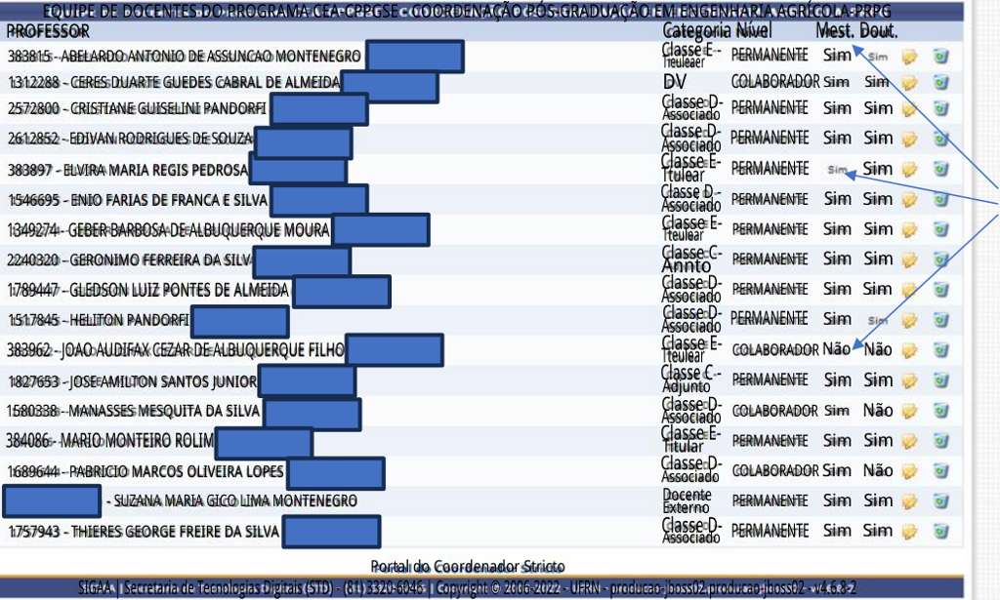

<!-- figure p06-fig2 | described_by: claude:sonnet | ocr_overlap: 0.88 | needs_review: false -->
1) Tipo de figura: captura de tela (print) de uma tabela de sistema web (SIGAA), listando equipe docente de um programa de pós-graduação.

2) Texto visível, na íntegra:

Título da tabela (no topo, sobre fundo escuro): "EQUIPE DE DOCENTES DO PROGRAMA CEA-CPPGSE COORDENAÇÃO PÓS-GRADUAÇÃO EM ENGENHARIA AGRÍCOLA-PRPG"

Cabeçalhos das colunas: "PROFESSOR" | "Categoria" | "Nível" | "Mest." | "Dout."

Linhas da tabela (coluna "PROFESSOR" parcialmente coberta por retângulos azuis opacos que ocultam parte do nome; mostro o texto visível de cada linha, seguido de Categoria / Nível / Mest. / Dout.):

- "3838515 - ABELARDO ANTONIO DE ASSUNCAO MONTENEGRO" [nome truncado pelo bloco azul] — Classe E - Titular — PERMANENTE — Sim — Sim
- "1312288 - CERES DUARTE GUEDES CABRAL DE ALMEIDA" — DV — COLABORADOR — Sim — Sim
- "2572800 - CRISTIANE GUISELINI PANDORFI" [bloco azul] — Classe D - Associado — PERMANENTE — Sim — Sim
- "2612852 - EDIVAN RODRIGUES DE SOUZA" [bloco azul] — Classe D - Associado — PERMANENTE — Sim — Sim
- "383897 - ELVIRA MARIA REGIS PEDROSA" [bloco azul] — Classe E - Titular — PERMANENTE — Sim — Sim
- "1546695 - ENIO FARIAS DE FRANCA E SILVA" [bloco azul] — Classe D - Associado — PERMANENTE — Sim — Sim
- "1349274 - GEBER BARBOSA DE ALBUQUERQUE MOURA" [bloco azul] — Classe E - Titular — PERMANENTE — Sim — Sim
- "2240320 - GERONIMO FERREIRA DA SILVA" [bloco azul] — Classe C - Annto [ilegível/truncado, provavelmente "Adjunto"] — PERMANENTE — Sim — Sim
- "1789447 - GLEDSON LUIZ PONTES DE ALMEIDA" [bloco azul] — Classe D - Associado — PERMANENTE — Sim — Sim
- "1517845 - HELITON PANDORFI" [bloco azul] — Classe D - Associado — PERMANENTE — Sim — Sim (o "Sim" de Dout. aparece em fonte menor/itálico "sim")
- "383962 - JOAO AUDIFAX CEZAR DE ALBUQUERQUE FILHO" [bloco azul] — Classe E - Titular — COLABORADOR — Não — Não
- "1827653 - JOSE AMILTON SANTOS JUNIOR" [bloco azul] — Classe C - Adjunto — PERMANENTE — Sim — Sim
- "1580338 - MANASSES MESQUITA DA SILVA" [bloco azul] — Classe D - Associado — COLABORADOR — Sim — Não
- "384086 - MARIO MONTEIRO ROLIM" [bloco azul] — Classe E - Titular — PERMANENTE — Sim — Sim
- "1689644 - PABRICIO MARCOS OLIVEIRA LOPES" [bloco azul] — Classe D - Associado — COLABORADOR — Sim — Não
- [bloco azul cobrindo todo nome] "- SUZANA MARIA GICO LIMA MONTENEGRO" — Docente Externo — PERMANENTE — Sim — Sim
- "1757943 - THIERES GEORGE FREIRE DA SILVA" [bloco azul] — Classe D - Associado — PERMANENTE — Sim — Sim

Rodapé: "Portal do Coordenador Stricto"
Linha final em letras minúsculas: "SIGAA | Secretaria de Tecnologia Digitais (STD) - (81) 3320-6246 | Copyright © 2006-2022 - UFRN - producao-jboss02.producao-jboss02 - v4.6.8.2"

3) Estrutura: tabela com 5 colunas (Professor, Categoria, Nível, Mest., Dout.) e 17 linhas de docentes. Cada nome na coluna "Professor" tem parte do texto ocultada por um retângulo azul sólido (provavelmente anonimização de dados pessoais). À direita da tabela, duas setas azuis diagonais apontam da margem direita da imagem para dentro da tabela: uma aponta para a célula "Sim" (Mest.) da primeira linha (Abelardo Antonio), outra aponta para a célula "Sim" (Mest.) da linha de Elvira Maria Regis Pedrosa — destacando esses dois valores específicos. Ao lado de cada linha, à direita das colunas Mest./Dout., há dois pequenos ícones (não identificáveis em detalhe, aparentam ser ícones de ação tipo "editar"/"info", em amarelo/laranja e azul).

4) Valores de dados (Mest. / Dout.) por linha, na ordem da tabela: Sim/Sim; Sim/Sim; Sim/Sim; Sim/Sim; Sim/Sim; Sim/Sim; Sim/Sim; Sim/Sim; Sim/Sim; Sim/Sim; Não/Não; Sim/Sim; Sim/Não; Sim/Sim; Sim/Não; Sim/Sim; Sim/Sim.
Valores de "Nível": PERMANENTE (13 ocorrências), COLABORADOR (4 ocorrências).
Códigos numéricos de matrícula visíveis: 3838515, 1312288, 2572800, 2612852, 383897, 1546695, 1349274, 2240320, 1789447, 1517845, 383962, 1827653, 1580338, 384086, 1689644, 1757943.

5) Cores com significado: retângulos azuis sólidos ocultam nomes (anonimização/redação de dados pessoais, sem relação com conteúdo). Setas azuis indicam/realçam duas células específicas com valor "Sim" na coluna Mest. Ícones em amarelo/laranja e azul-esverdeado ao final de cada linha, de função não identificável (prováveis botões de ação do sistema).

~~~text ocr
Be
PROFESSOR est,
DE MONTENEGRO
2»
1312288 - CERESDUARTE GUEDES CABRAL DE A DV COLABORADOR Sim
2572800 - GUISELINE PANDORAL PERMANENTE Sim Sim D 27
2612852 -- RODRIGUES DE PERMANENTE Sim
383897 - ELVIRA: MARIA REGIS PEDROS, E PERMANENTE sima
1546695 - FARIAS DE FRANCA E SILVA Sim Sim
MOURA Sim Sim
2240320 - GERONIMO FERREIRA DA SILV. Sim Sim
1789447 - GLEDSON LUIZ PONTES DE ALMEIDA Sim Sim
1517645 Sim
CEZAR FILH coLABORADOR Não
1827653 SANTOS JUNIO PERMANENTE Sim Sim
MESQUITA DA SILVA COLABORADOR Sim Não
384086- MARIO: MONTEIRO ROLI PERMANENTE Sim Sim
as
1689644: -PABRICIO MARCOS OLIVEIRA LOPES Associado COLABORADOR Sim
ico Docente PERMANENTE Sim Sim
1757943 - THIERES GEORGE FREIRE DA Glasse-D- PERMANENTE Sim Sim
Rartal do Coordenador Stricto
(511))
~~~

<!-- Start of picture text -->
Abrir Chamado <!-- End of picture text -->

CadastrosAlunoTurmasMatriculasConsultasRelatóriosBiblioteca Página WEB Outros PORTAL DO COORDENADOR STRICTO > ASSOCIAR DOCENTES AO PROGRAMA DE PÓS-GRADUAÇÃO 

: Cadastrar Membro : Visualizar Detalhes : Alterar Dados da Associação : Retirar Docente do Programa 

<!-- Start of picture text -->
EQUIPE DE DOCENTES DO PROGRAMA CEA-CPPGSE - COORDENAÇÃO PÓS-GRADUAÇÃO EM ENGENHARIA AGRÍCOLA-PRPG PROFESSOR Categoria Nível Mest. Dout. 383815 - ABELARDO ANTONIO DE ASSUNCAO MONTENEGRO Classe E -Tieuleaer PERMANENTE Sim 1312288 - CERES DUARTE GUEDES CABRAL DE ALMEIDA DV COLABORADOR Sim Sim 2572800 - CRISTIANE GUISELINI PANDORFI Classe D-Associado PERMANENTE Sim Sim Classe D- 2612852 - EDIVAN RODRIGUES DE SOUZA Associado PERMANENTE Sim Sim Classe E- 383897 - ELVIRA MARIA REGIS PEDROSA Ttulear PERMANENTE Sim Classe D - 1546695 - ENIO FARIAS DE FRANCA E SILVA Associado PERMANENTE Sim Sim 1349274 - GEBER BARBOSA DE ALBUQUERQUE MOURA Classe E-Tteulear PERMANENTE Sim Sim 2240320 - GERONIMO FERREIRA DA SILV AnntoClasse C- PERMANENTE Sim Sim Classe D- 1789447 - GLEDSON LUIZ PONTES DE ALMEIDA Associado PERMANENTE Sim Sim 1517845 - HELITON PANDORFI AssociadoClasse D- PERMANENTE Sim Classe E- 383962 - JOAO AUDIFAX CEZAR DE ALBUQUERQUE FILHO Tteulear COLABORADOR Não Não Classe C - 1827653 - JOSE AMILTON SANTOS JUNIOR Adjunto PERMANENTE Sim Sim Classe D- 1580338 - MANASSES MESQUITA DA SILVA Associado COLABORADOR Sim Não Classe E- 384086 - MARIO MONTEIRO ROLIM Titular PERMANENTE Sim Sim Classe D- 1689644 - PABRICIO MARCOS OLIVEIRA LOPES Associado COLABORADOR Sim Não - SUZANA MARIA GICO LIMA MONTENEGRO ExternoDocente PERMANENTE Sim Sim 1757943 - THIERES GEORGE FREIRE DA SILVA Classe D-Associado PERMANENTE Sim Sim Portal do Coordenador Stricto SIGAA | Secretaria de Tecnologias Digitais (STD) - (81) 3320-6046 | Copyright © 2006-2022 - UFRN - producao-jboss02.producao-jboss02 - v4.6.8-2 <!-- End of picture text -->

No caso de o parâmetro solicitando o orientador na inscrição tenha sido marcado como “Sim”, somente aparecerão no momento da inscrição, os docentes da equipe (Em Cadastros > Corpo Docente do Programa > Equipe de Docentes do Programa) que estiverem marcados como “Sim” para o respectivo nível do Edital. 

Ou seja, quem estiver marcado “Sim” em Mestrado, aparecerá em editais de Mestrado, e quem estiver marcado “Sim” em Doutorado, aparecerá em editais de Doutorado. 

3 

<!-- page 7 -->

https:/ SIGAA Sigaa SIG@U Seleçò SIG × SIPAC Inscric Opçõe 

Platafo Base_lE UFRPE M Docum MCaixa M Caixa M Caixa d M Caixad 

Facebo Planilh Whats 

<!-- figure p07-fig1 | described_by: claude:sonnet | ocr_overlap: None | needs_review: false -->
Captura de interface de aplicativo, mostrando apenas uma barra de título/janela.

**Texto visível (verbatim):** "Renorb"

**Estrutura:** Barra horizontal fina (estilo barra de título de janela). À esquerda, texto "Renorb" seguido de um separador vertical ("|"). À direita do separador, cinco ícones em sequência: um sinal de "+" (adicionar/nova aba), um círculo preenchido (ponto/indicador, cor não discernível com significado claro), um traço "–" (minimizar), um quadrado/retângulo vazado (restaurar/maximizar) e um "✕" (fechar).

**Valores/números:** nenhum.

**Cores:** sem uso de cor aparentemente significativo além de tons neutros (preto/cinza sobre fundo claro) — não carregam informação adicional.

~~~text ocr
Renorh +
~~~

<!-- Start of picture text -->
Renorb + × <!-- End of picture text -->

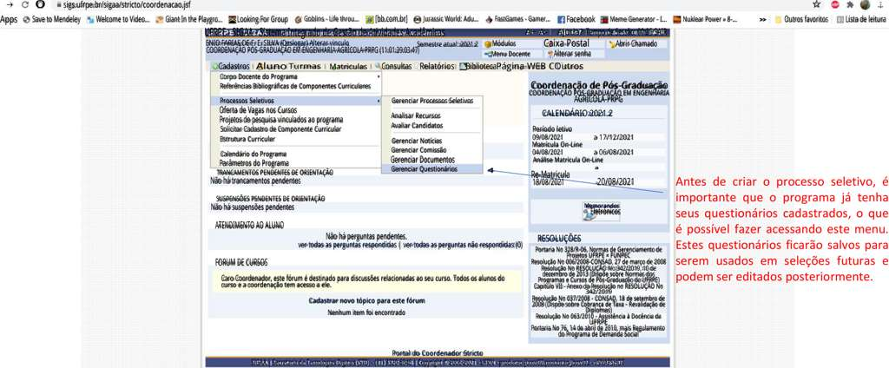

<!-- figure p07-fig3 | described_by: claude:sonnet | ocr_overlap: 0.89 | needs_review: false -->
1. Tipo de figura: captura de tela (screenshot) de interface web — sistema acadêmico SIGAA, com um menu de navegação aberto em cascata (três níveis) e uma anotação sobreposta em texto vermelho e uma seta azul apontando para um item do menu.

2. Todo texto visível, verbatim:

Barra de endereço do navegador: "sigs.ufrpe.br/sigaa/stricto/coordenacao.jsf"

Abas do navegador (ícones com texto): "Apps", "Save to Mendeley", "Welcome to Video...", "Giant In the Playgro...", "Looking For Group", "Goblins - Life throu...", "[bb.com.br]", "Jurassic World: Adu...", "FastGames - Gamer...", "Facebook", "Meme Generator - I...", "Nuklear Power » 8-...", ">>", "Outros favoritos", "Lista de leitura"

Cabeçalho do sistema: "UFRPE SIGAA Sistema Integrado de Gestão de Atividades Acadêmicas" — "A+ A-" — "Ajuda?" — "Tempo de Sessão: 00:51:49"

Linha de usuário: "ENIO FARIAS DE FREIRE SILVA (Deslogar) Alterar vinculo" — "Semestre atual: 2021.2" — "Módulos" — "Caixa Postal" — "Abrir Chamado"
"COORDENAÇÃO PÓS-GRADUAÇÃO EM ENGENHARIA AGRICOLA-PRPG (11:01:29:03:47)" — "Menu Docente" — "Alterar senha"

Barra de menus principal: "Cadastros | Aluno Turmas | Matrículas | Consultas | Relatórios | Biblioteca Página WEB | Outros"

Submenu nível 1 (sob "Aluno Turmas", aparentemente):
- "Corpo Docente do Programa"
- "Referências Bibliográficas de Componentes Curriculares"
- "Processos Seletivos" (com seta ► indicando submenu)
- "Oferta de Vagas nos Cursos"
- "Projetos de pesquisa vinculados ao programa"
- "Solicitar Cadastro de Componente Curricular"
- "Estrutura Curricular"
- "Calendário do Programa"
- "Parâmetros do Programa"

Submenu nível 2 (aberto a partir de "Processos Seletivos"):
- "Gerenciar Processos Seletivos"
- "Analisar Recursos"
- "Avaliar Candidatos"
- "Gerenciar Notícias"
- "Gerenciar Comissão"
- "Gerenciar Documentos"
- "Gerenciar Questionários" (item destacado em azul/realçado, alvo da seta)

Abaixo do menu, sobre o conteúdo da página (parcialmente sobreposto pelo menu):
"TRANCAMENTOS PENDENTES DE ORIENTAÇÃO"
"Não há trancamentos pendentes"

"SUSPENSÕES PENDENTES DE ORIENTAÇÃO"
"Não há suspensões pendentes"

"ATENDIMENTO AO ALUNO"
"Não há perguntas pendentes."
"ver todas as perguntas respondidas || ver todas as perguntas não respondidas (0)"

"FÓRUM DE CURSOS"
"Caro Coordenador, este fórum é destinado para discussões relacionadas ao seu curso. Todos os alunos do curso e a coordenação tem acesso a ele."
"Cadastrar novo tópico para este fórum"
"Nenhum item foi encontrado"

Rodapé: "Portal do Coordenador Stricto"
"SIGAA | Secretaria de Tecnologias Digitais (STD) - (81) 3320-6046 | Copyright © 2006-2021 - UFRN - producao_jboss02.producao_jboss02 - vSNAPSHOT"

Painel direito (caixa de informações):
Título: "Coordenação de Pós-Graduação"
Subtítulo: "COORDENAÇÃO PÓS-GRADUAÇÃO EM ENGENHARIA AGRICOLA-PRPG"

"CALENDÁRIO 2021.2"
"Período letivo" — "09/08/2021   a 17/12/2021"
"Matrícula On-Line" — "04/08/2021   a 06/08/2021"
"Análise Matrícula On-Line" — "a" (sem datas visíveis, campo aparentemente vazio/truncado)
"Re-Matrícula" — "18/08/2021   a 20/08/2021"

Ícone/link: "Memorandos Eletrônicos"

"RESOLUÇÕES" (lista de links):
- "Portaria No 328/R-06, Normas de Gerenciamento de Projetos UFRPE x FUNPEC"
- "Resolução No 006/2008-CONSAD, 27 de março de 2008"
- "Resolução No RESOLUÇÃO No 342/2019, 10 de dezembro de 2013 (Dispõe sobre Normas dos Programas e Cursos de Pós-Graduação da UFRPE) Capítulo VII - Anexo da Resolução no RESOLUÇÃO No 342/2019"
- "Resolução No 037/2008 - CONSAD, 18 de setembro de 2008 (Dispõe sobre Cobrança de Taxa - Revalidação de Diplomas)"
- "Resolução No 063/2010 - Assistência à Docência da UFRPE"
- "Portaria No 76, 14 de abril de 2010, mais Regulamento do Programa de Demanda Social"

Anotação em texto vermelho (à direita da captura, fora da interface original):
"Antes de criar o processo seletivo, é importante que o programa já tenha seus questionários cadastrados, o que é possível fazer acessando este menu. Estes questionários ficarão salvos para serem usados em seleções futuras e podem ser editados posteriormente."

3. Estrutura:
- Topo: barra de endereço do navegador com ícones de favoritos.
- Abaixo: janela do sistema SIGAA, com cabeçalho institucional, barra de usuário/sessão, e barra de menus horizontal.
- Um menu em cascata de três níveis se abre para baixo/direita a partir da barra de menus: nível 1 (lista vertical de opções do módulo "Aluno Turmas"), nível 2 (surge à direita de "Processos Seletivos", lista vertical de ações), e dentro dele o item "Gerenciar Questionários" está destacado (realce azul).
- Uma seta azul desenhada à mão parte da área de texto vermelho (anotação externa) e aponta para o item "Gerenciar Questionários" no submenu, conectando a explicação ao elemento da interface.
- Por trás/abaixo do menu aberto, parcialmente coberto, está o conteúdo da página principal do coordenador: seções empilhadas verticalmente (trancamentos, suspensões, atendimento ao aluno, fórum de cursos) à esquerda/centro, e um painel lateral à direita com calendário acadêmico e lista de resoluções.
- À direita de toda a captura de tela, um bloco de texto vermelho em fonte maior serve de anotação explicativa, fora da moldura do navegador.
- Rodapé da página com informações de copyright do sistema.

4. Valores numéricos/datas:
- Tempo de Sessão: 00:51:49
- Semestre atual: 2021.2
- Código entre parênteses: (11:01:29:03:47)
- Calendário 2021.2:
  - Período letivo: 09/08/2021 a 17/12/2021
  - Matrícula On-Line: 04/08/2021 a 06/08/2021
  - Análise Matrícula On-Line: a [sem valores legíveis — illegible]
  - Re-Matrícula: 18/08/2021 a 20/08/2021
- Perguntas não respondidas: (0)
- Portaria No 328/R-06
- Resolução No 006/2008-CONSAD, 27 de março de 2008
- Resolução No 342/2019, 10 de dezembro de 2013, Capítulo VII
- Resolução No 037/2008 - CONSAD, 18 de setembro de 2008
- Resolução No 063/2010
- Portaria No 76, 14 de abril de 2010
- Copyright © 2006-2021

5. Cores com significado:
- Texto vermelho: anotação/explicação adicionada por fora da interface original, destacando instrução sobre o fluxo de uso.
- Seta azul: indica conexão direta entre a anotação vermelha e o item de menu "Gerenciar Questionários".
- Destaque azul claro de fundo no item "Gerenciar Questionários" dentro do submenu: indica que este é o item selecionado/apontado, foco da explicação.
- Fundo amarelo claro na caixa "FÓRUM DE CURSOS": destaque visual padrão da interface para essa seção informativa, sem significado adicional além de diferenciação de bloco.

~~~text ocr
> C O
Apps & Saveto Mendeley Welcome to Video... Giantln the Group Goblins €3 Jurassic World: Adu... FastGames - Gamer... Nuklear Power » 8-... >»>
mas
atual:20212 Caixa-Postal ir-Chamado
COORDENAÇÃO POS-GRADU senha
| Turmas | | Gonsultas Relatórios: COutros
Corpo Docente do Programa , Coord de P
Referências Bibliográficas de Componentes Curriculares
as Bibliográficas ponentes Curricu |
Processos Seletivos » Processos Seletivos
Oferta de Vagas nos Cursos ENDÁRIO 20211
pesquisa vinculados ao programa 2
Solicitar: Cadastro de Componente Curricular Candidates Reriodo letivo
Estrutura Curricular Gerenciar Notícias 08/
Calendário do Programa Gerenciar Comissão 04/08/2021 a 06/08/2021
Parâmetros do Programa Gerenciar Documentos Análise Matricula On-Line
TRANCAMENTOS PENDENTES DE ORIENTAÇÃO icula =
Nao he trancamentes pendentes 18/08/ 8/2021
SUSPENSÕES PENDENTES DE
Não há suspensões pendentes
MENDIMENTO AQ ALUNO
Não há perguntas pendentes. . RESOLUÇÕES
ver-todas as perguntas respondidas | ver-todas as perguntas não respondidas (0) Portaria No de Gerenciamento de
Resolução N 008-C , 27 de 2008
Caro este fórum é destinado para discussões relacionadas ao seu curso. Todos os alunos do Programas e Cursos de P
curso e a coordenação tem acesso a ele. Capitulo Resolução no 0 No
Cadastrar novo tópico para este fórum
Nenhum item foi encontrado
Di
Resolução No 063/2016 - à Docência da
Portaria No 76, 14 de abril de 2010, mai lamento
E do Programa
x
Quiros favoritos [=] Lista de leitura
Antes de criar o processo seletivo, é
importante que o programa já tenha
seus questionários cadastrados, o que
é possível fazer acessando este menu.
Estes questionários ficarão salvos para
serem usados em seleções futuras e
podem ser editados posteriormente.
~~~

<!-- Start of picture text -->
☆ <!-- End of picture text -->

<!-- Start of picture text -->
→ 0 sigs.ufrpe.br/sigaa/stricto/coordenacao.jsf ☆ … Apps Save to Mendeley Welcome to Video... Giant In the Playgro... Looking For Group Goblins - Life throu... [bb.com.br] Jurassic World: Adu... FastGames - Gamer... Facebook Meme Generator - I... Nuklear Power » 8-... » Outros favoritos Lista de leitura UFRPE - SIGAA - Sistema Integrado de Gestão de Atividades Acadêmicas A+ A- Ajuda? Tempo de Sessão: 00:25 SAIR ENIO FARIAS DE F. E. SILVA (Deslogar) Alterar vinculo Semestre atual: 2021.2 Módulos Caixa Postal Abrir Chamado COORDENAÇÃO PÓS-GRADUAÇÃO EM ENGENHARIA AGRÍCOLA-PRPG (11.01.29.03.47) Menu Docente Alterar senha Cadastros Aluno Turmas Matriculas Consultas Relatórios BibliotecaPágina WEB COutros Corpo Docente do Programa Referências Bibliográficas de Componentes Curriculares Coordenação de Pós-Graduação COORDENAÇÃO PÓS-GRADUAÇÃO EM ENGENHARIA Processos Seletivos Gerenciar Processos Seletivos AGRÍCOLA-PRPG Oferta de Vagas nos Cursos Analisar Recursos CALENDÁRIO 2021.2 Projetos de pesquisa vinculados ao programa Avaliar Candidatos Solicitar Cadastro de Componente Curricular Período letivo Estrutura Curricular Gerenciar Notícias 09/08/2021 a 17/12/2021 Matrícula On-Line Calendário do Programa Gerenciar Comissão 04/08/2021 a 06/08/2021 Gerenciar Documentos Análise Matricula On-Line TRANCAMENTOS PENDENTES DE ORIENTAÇÃOParâmetros do Programa Gerenciar Questionários 4 Re-Matricula a Não há trancamentos pendentes 18/08/2021 20/08/2021 Antes de criar o processo seletivo, é SUSPENSÕES PENDENTES DE ORIENTAÇÃO importante que o programa já tenha Não há suspensões pendentes MemorandosEletrónicos seus questionários cadastrados, o que ATENDIMENTO AO ALUNO é possível fazer acessando este menu. Não há perguntas pendentes. RESOLUÇÕES ver todas as perguntas respondidas | ver todas as perguntas não respondidas (0) Portaria No 328/R-06, Normas de Gerenciamento de Estes questionários ficarão salvos para Projetos UFRPE × FUNPEC FORUM DE CURSOS Resolução No 006/2008-CONSAD, 27 de março de 2008 serem usados em seleções futuras e Resolução No RESOLUÇÃO No 342/2019, 10 de Caro Coordenador, este fórum é destinado para discussões relacionadas ao seu curso. Todos os alunos do Programas e Cursos de Pós-Graduação da UFRPE)dezembro de 2013 (Dispõe sobre Normas dos podem ser editados posteriormente. curso e a coordenação tem acesso a ele. Capitulo VII - Anexo da Resolução no RESOLUÇÃO No 342/2019 Cadastrar novo tópico para este fórum Resolução No 037/2008 - CONSAD, 18 de setembro de 2008 (Dispõe sobre Cobrança de Taxa - Revalidação de Nenhum item foi encontrado Diplomas) Resolução No 063/2010 - Assistência à Docência da UFRPE Portaria No 76, 14 de abril de 2010, mais Regulamento do Programa de Demanda Social Portal do Coordenador Stricto SIGAA | Secretaria de Tecnologias Digitais (STD) - (81) 3320-6046 | Copyright © 2006-2021 - UFRN - producao-jboss02.producao-jboss02 - vSNAPSHOT <!-- End of picture text -->

4 POR 09:12 INTL06/09/2021 

25°C Parc ensolarado 

Q Digite aqui para pesquisar 

<!-- page 8 -->

 

 SIGAA - Sistema Integrado de GX + 

☆  

> ← C Não segurotreinamento.sigs.ufrpe.br/sigaa/stricto/coordenacao.jsf 

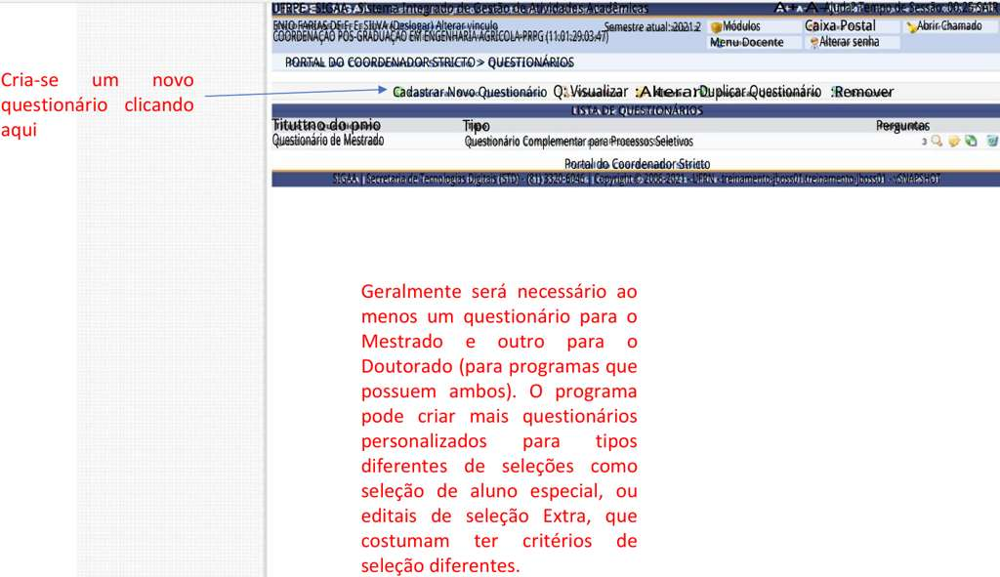

<!-- figure p08-fig1 | described_by: claude:sonnet | ocr_overlap: 0.88 | needs_review: false -->
Captura de tela de sistema web (software acadêmico SIGAA), mostrando uma página de listagem de questionários, com uma anotação manual (seta e texto em vermelho) sobreposta à imagem, e abaixo um parágrafo explicativo também em texto vermelho.

**1. Tipo de figura:** Print/captura de tela de interface de sistema acadêmico (SIGAA), com anotações gráficas (seta azul e textos em vermelho) adicionadas sobre a captura, explicando o uso da tela.

**2. Todo o texto visível:**

Cabeçalho do sistema (linha superior, texto sobreposto/com efeito de "fantasma"/duplicado, dificultando leitura perfeita, mas reconstituível pelo contexto):
- "UFRPE - SIGAA - Sistema Integrado de Gestão de Atividades Acadêmicas"
- Canto superior direito: "A+ A- Ajuda? Tempo de Sessão: 00:25 SAIR"

Segunda linha (nome do usuário e vínculo, texto também sobreposto):
- "ENIO FARIAS DE F E SILVA (Deslogar) Alterar vínculo"
- "COORDENAÇÃO POS-GRADUAÇÃO EM ENGENHARIA AGRICOLA-PRPG (11.01.29.03.47)"
- Ao centro: "Semestre atual: 2021.2"
- Caixas de menu à direita: "Módulos" (com ícone), "Caixa Postal", "Abrir Chamado" (com ícone); abaixo: "Menu Docente", "Alterar senha" (com ícone)

Linha de localização/breadcrumb:
- "PORTAL DO COORDENADOR STRICTO > QUESTIONÁRIOS"

Linha de ações (com ícones coloridos), também com sobreposição de texto:
- "Cadastrar Novo Questionário" (em verde) | "Visualizar" | "Alterar" | "Duplicar Questionário" | "Remover"

Anotação manual à esquerda, em texto vermelho, com seta azul apontando da anotação até a opção "Cadastrar Novo Questionário":
- "Cria-se um novo questionário clicando aqui"

Barra de título da tabela (fundo azul-escuro):
- "LISTA DE QUESTIONÁRIOS"

Cabeçalho das colunas da tabela (texto também sobreposto/borrado — leitura literal dos caracteres aparentes: "Tituttno do pnio" para a primeira coluna, provavelmente correspondendo a "Título do Questionário"; mas como está sobreposto/distorcido, considero o texto exato [illegible]):
- Coluna 1: [illegible, aparentando "Título do Questionário"]
- Coluna 2: "Tipo"
- Coluna 3 (à direita): "Perguntas"

Linha de dados da tabela (única linha de dado):
- Coluna 1: "Questionário de Mestrado"
- Coluna 2: "Questionário Complementar para Processos Seletivos"
- Coluna 3: número "3", seguido de quatro ícones (lupa, lápis/editar, duplicar, lixeira)

Rodapé da tabela (faixa azul-escura):
- "Portal do Coordenador Stricto"

Rodapé do sistema (faixa escura, texto pequeno):
- "SIGAA | Secretaria de Tecnologias Digitais (STD) - (81) 3320-6046 | Copyright © 2006-2021 - UFRN - treinamento-jboss01.treinamento.jboss01 - vSNAPSHOT"

Parágrafo explicativo abaixo da captura, em texto vermelho (fora da tela do sistema, anotação adicional):
- "Geralmente será necessário ao menos um questionário para o Mestrado e outro para o Doutorado (para programas que possuem ambos). O programa pode criar mais questionários personalizados para tipos diferentes de seleções como seleção de aluno especial, ou editais de seleção Extra, que costumam ter critérios de seleção diferentes."

**3. Estrutura:**
- Captura de tela ocupa a parte superior direita da imagem (um bloco retangular), com faixa cinza clara vazia à esquerda e abaixo.
- Dentro da captura, de cima para baixo: barra de cabeçalho azul-claro (nome do sistema + ajuda/sessão/sair), linha de identificação do usuário/vínculo/semestre/menus, barra de breadcrumb, barra de ações (ícones + links), tabela com cabeçalho de colunas e uma linha de dados, barra de rodapé "Portal do Coordenador Stricto", faixa final de copyright.
- Seta azul: parte da margem esquerda (fora da captura), aponta horizontalmente para a direita, da anotação em texto vermelho "Cria-se um novo questionário clicando aqui" até a opção "Cadastrar Novo Questionário" na barra de ações da tela.
- Parágrafo explicativo em vermelho posicionado abaixo da seta/anotação, dentro da área cinza (fora da captura de tela), alinhado mais à direita, como um bloco de texto corrido.
- Não há gráficos, eixos ou múltiplos painéis — é uma única captura de tela com uma tabela de uma coluna de dados.

**4. Valores numéricos:**
- "2021.2" (semestre atual)
- "00:25" (tempo de sessão)
- "11.01.29.03.47" (código da coordenação)
- "3" (número de perguntas do questionário "Questionário de Mestrado")
- "(81) 3320-6046" (telefone no rodapé)
- "2006-2021" (intervalo de copyright)

**5. Cores com significado:**
- Texto vermelho: anotações manuais explicativas (não faz parte da interface original do sistema).
- Seta azul: indica direção/relação entre a anotação e o elemento da interface ("Cadastrar Novo Questionário").
- Ícone/link "Cadastrar Novo Questionário" em verde: destaca a ação de criar novo questionário (cor de ação positiva/criação).
- Faixas de fundo azul-escuro: barras de título/seção da interface ("LISTA DE QUESTIONÁRIOS", rodapé "Portal do Coordenador Stricto", rodapé de copyright).
- Ícones coloridos na linha de dados (lupa, lápis, duplicar, lixeira): representam ações distintas (visualizar, alterar, duplicar, remover), cada um com cor própria do ícone padrão do sistema.

~~~text ocr
-
atual:20212 Caixa-Postal
Menu-Docente « Alterar senha
RORTAL DO COORDENADORSTRIGIO> QUESTIONÁRIOS
CadastrarNovoQuestionário ‘Remover
Questionário de Mestrado Complementar para ProcessosSeletivos 3428
Cria-se um novo
questionário clicando
aqui
|
Geralmente será necessário ao
menos um questionário para o
Mestrado e outro para o
Doutorado (para programas que
possuem ambos). O programa
pode criar mais questionários
personalizados para tipos
diferentes de seleções como
seleção de aluno especial, ou
editais de seleção Extra, que
costumam ter critérios de
seleção diferentes.
~~~

<!-- Start of picture text -->
UFRPE - SIGAA - Sistema Integrado de Gestão de Atividades Acadêmicas A+ A-Ajuda? Tempo de Sessão: 00:25 SAIR ENIO FARIAS DE F. E. SILVA (Deslogar) Alterar vinculo Semestre atual: 2021.2 Módulos Caixa Postal Abrir Chamado COORDENAÇÃO PÓS-GRADUAÇÃO EM ENGENHARIA AGRÍCOLA-PRPG (11.01.29.03.47) Menu Docente Alterar senha PORTAL DO COORDENADOR STRICTO > QUESTIONÁRIOS Cria-se um novo Cadastrar Novo Questionário Q: Visualizar :Alterar: Duplicar Questionário :Remover questionário clicando LISTA DE QUESTIONÁRIOS Tituttno do pnio Tipo Perguntas aqui Questionário de Mestrado Questionário Complementar para Processos Seletivos Portal do Coordenador Stricto SIGAA | Secretaria de Tecnologias Digitais (STD) - (81) 3320-6046 | Copyright © 2006-2021 - UFRN - treinamento-jboss01.treinamento-jboss01 - vSNAPSHOT Geralmente será necessário ao menos um questionário para o Mestrado e outro para o Doutorado (para programas que possuem ambos). O programa pode criar mais questionários personalizados para tipos diferentes de seleções como seleção de aluno especial, ou editais de seleção Extra, que costumam ter critérios de seleção diferentes. <!-- End of picture text -->

5 

POR 09:18 INTL 06/09/2021 

QDigite aqui para pesquisar 

27C Parc ensolarado 

<!-- page 9 -->

 

 SIGAA - Sistema Integrado de GX + 

☆  

> ← C 

###### Não seguro |treinamento.sigs.ufrpe.br/sigaa/geral/questionario/dados_gerais.jsf 

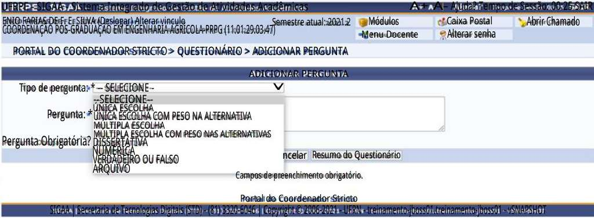

<!-- figure p09-fig1 | described_by: claude:sonnet | ocr_overlap: 0.66 | needs_review: false -->
1. Tipo figura: screenshot sistema web (SIGAA), form com dropdown aberto.

2. Texto visível, verbatim:

Topo/cabeçalho (sobreposto, texto duplicado/borrado em partes):
- "UFRPE SIGAA Sistema Integrado de Gestão de Atividades Acadêmicas"
- "A+ A A- Ajuda Tempo de Sessão: 00:25 SATR" [parte ilegível devido sobreposição]
- "ENIO FARIAS DE FREIRE SILVA (Deslogar) Alterar vínculo" [sobreposto]
- "COORDENAÇÃO POS-GRADUAÇÃO EM ENGENHARIA AGRICOLA-PRPG (11.01.29.03:47)"
- "Semestre atual: 2021.2"
- Ícones/menus: "Módulos", "Caixa Postal", "Abrir Chamado", "Menu Docente", "Alterar senha"

Breadcrumb/título seção:
- "PORTAL DO COORDENADOR STRICTO > QUESTIONÁRIO > ADICIONAR PERGUNTA"

Barra título form:
- "ADICIONAR PERGUNTA"

Campos form:
- "Tipo de pergunta: *" com dropdown "--SELECIONE--" (seta ∨)
- "Pergunta: *" — campo texto grande vazio
- "Pergunta Obrigatória?" — campo (parcialmente coberto pelo dropdown)

Dropdown aberto (lista opções, cobre parte dos campos abaixo):
- "--SELECIONE--"
- "UNICA ESCOLHA"
- "UNICA ESCOLHA COM PESO NA ALTERNATIVA"
- "MULTIPLA ESCOLHA"
- "MULTIPLA ESCOLHA COM PESO NAS ALTERNATIVAS"
- "DISSERTATIVA"
- "NUMERICA"
- "VERDADEIRO OU FALSO"
- "ARQUIVO"

Botões (parcialmente cobertos pelo dropdown):
- "...ncelar" [provável "Cancelar", parte coberta] "Resumo do Questionário"

Texto abaixo botões:
- "Campos de preenchimento obrigatório."

Rodapé:
- "Portal do Coordenador Stricto"
- "SIGAA | Secretaria de Tecnologias Digitais (STD) - (81) 3320-6046 | Copyright © 2006-2021 - UFRN - treinamento-jboss01.treinamento-jboss01 - vSNAPSHOT"

3. Estrutura:
- Barra azul escura topo: info usuário/sessão/sistema.
- Barra abaixo: breadcrumb navegação.
- Caixa form branca com borda: título "ADICIONAR PERGUNTA" em barra azul, abaixo campos empilhados verticalmente (Tipo de pergunta → Pergunta → Pergunta Obrigatória).
- Dropdown lista suspensa aberta sobrepõe-se por cima dos campos "Pergunta Obrigatória" e botões, obscurecendo parte deles.
- Rodapé com linha divisória, texto centralizado.

4. Valores numéricos: "2021.2" (semestre), "00:25" (tempo sessão), "11.01.29.03:47" (código coordenação), "(81) 3320-6046" (telefone), "2006-2021" (copyright anos).

5. Cores: barra topo e barra título form em azul escuro (navegação/hierarquia); fundo geral branco/cinza claro; sem outras cores com significado funcional.

~~~text ocr
ENIO» terar vinculo atual:20212 of, Gaixa Postal
COORDENAÇÃO POS-GRADU RICOLA-PREG senha
DO COORDENADORSTRIGIO> QUESTIONÁRIO > ADIGIONAR PERGUNTA
Tipo de perguntar* — SELEGIONE - Vv
--SELECIONE--
Pergunta: * PESO NA ALTERNATIVA
MULTI PLA ESC OLHA
LHA COM PESO INAS ALTERNATIVAS
obrigatório.
Rartal do Coordenador
|
~~~

<!-- Start of picture text -->
UFRPE - SIGAA - Sistema Integrado de Gestão de Atividades Acadêmicas A+ A- Ajuda? Tempo de Sessão: 00:25 SAIR ENIO FARIAS DE F. E. SILVA (Deslogar) Alterar vinculo Semestre atual: 2021.2 Módulos Caixa Postal Abrir Chamado COORDENAÇÃO PÓS-GRADUAÇÃO EM ENGENHARIA AGRÍCOLA-PRPG (11.01.29.03.47) Menu Docente Alterar senha PORTAL DO COORDENADOR STRICTO > QUESTIONÁRIO > ADICIONAR PERGUNTA ADICIONAR PERGUNTA Tipo de pergunta: * -- SELECIONE - V --SELECIONE-- Pergunta: * ÚNICA ESCOLHA ÚNICA ESCOLHA COM PESO NA ALTERNATIVA MÚLTIPLA ESCOLHA MÚLTIPLA ESCOLHA COM PESO NAS ALTERNATIVAS Pergunta Obrigatória? DISSERTATIVA NUMÉRICA VERDADEIRO OU FALSO ncelar Resumo do Questionário ARQUIVO Campos de preenchimento obrigatório. Portal do Coordenador Stricto SIGAA | Secretaria de Tecnologias Digitais (STD) - (81) 3320-6046 | Copyright © 2006-2021 - UFRN - treinamento-jboss01.treinamento-jboss01 - vSNAPSHOT <!-- End of picture text -->

Após dar um nome para o Os principais dados pessoais dos questionário, começa-se a criar as candidatos já estão incluídos no perguntas para o questionário. Estas formulário de inscrição no sistema, perguntas podem ser também conforme veremos mais pra frente. solicitações de arquivos obrigatórios e opcionais para a inscrição. Veremos um exemplo na tela a seguir. 

6 

POR 09:22 INTL 06/09/2021 

Q Digite aqui para pesquisar 

27℃ Parc ensolarado 

<!-- page 10 -->

 

> SIGAA - Sistema Integrado de GX + 

☆  

> ← C 

###### Não seguro treinamento.sigs.ufrpe.br/sigaa/geral/questionario/pergunta.jsf 

Escolhe-se o tipo de pergunta “arquivo”, então descreve o tipo de arquivo solicitando no campo “Pergunta”, marca-se a caixa texto “Apenas PDF?” caso deseje que o arquivo seja enviado em PDF, e marca a caixa texto “Perguntar Obrigatória” caso o arquivo seja obrigatório. Depois clica-se em “Adicionar Pergunta” e a pergunta será adicionada ao questionário. 

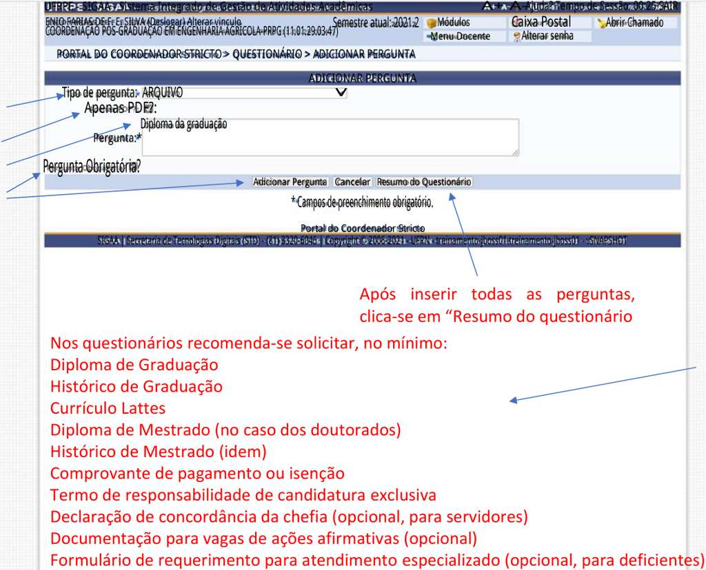

<!-- figure p10-fig1 | described_by: claude:sonnet | ocr_overlap: 0.94 | needs_review: false -->
Captura de tela de sistema SIGAA, com anotações manuais (setas e texto) sobrepostas.

**1. Tipo de figura:** Screenshot de interface de sistema web (SIGAA — Sistema Integrado de Gestão de Atividades Acadêmicas), com setas azuis e texto em vermelho/preto adicionados como anotação explicativa.

**2. Texto visível (verbatim):**

Barra superior do sistema:
- "UFRPE SIGAA Sistema Integrado de Gestão de Atividades Acadêmicas"
- "A+ A- Ajuda Tempo de Sessão: 00:25 SAIR"
- "ENIO FARIAS DE F. E SILVA (Deslogar) Alterar vínculo"
- "Semestre atual: 2021.2"
- "Módulos" / "Caixa Postal"
- "COORDENAÇÃO PÓS-GRADUAÇÃO EM ENGENHARIA AGRÍCOLA-PRPG (11.01.29.03.47)"
- "Menu Docente" / "Alterar senha" / "Abrir Chamado"

Trilha de navegação:
- "PORTAL DO COORDENADOR STRICTO > QUESTIONÁRIO > ADICIONAR PERGUNTA"

Caixa principal (título): "ADICIONAR PERGUNTA"

Campos do formulário:
- "Tipo de pergunta: ARQUIVO" (campo dropdown)
- "Apenas PDF?:"
- "Pergunta:*" — campo de texto preenchido com "Diploma da graduação"
- "Pergunta Obrigatória?"

Botões: "Adicionar Pergunta" | "Cancelar" | "Resumo do Questionário"

Nota de rodapé do formulário: "* Campos de preenchimento obrigatório."

Rodapé do sistema:
- "Portal do Coordenador Stricto"
- "SIGAA | Secretaria de Tecnologias Digitais (STD) - (81) 3320-6046 | Copyright © 2006-2021 - UFRN - treinamento-jboss01.treinamento.jboss01 - vSNAPSHOT"

Texto anotado em vermelho (abaixo do print):
- "Após inserir todas as perguntas, clica-se em 'Resumo do questionário"
- "Nos questionários recomenda-se solicitar, no mínimo:"
- "Diploma de Graduação"
- "Histórico de Graduação"
- "Currículo Lattes"
- "Diploma de Mestrado (no caso dos doutorados)"
- "Histórico de Mestrado (idem)"
- "Comprovante de pagamento ou isenção"
- "Termo de responsabilidade de candidatura exclusiva"
- "Declaração de concordância da chefia (opcional, para servidores)"
- "Documentação para vagas de ações afirmativas (opcional)"
- "Formulário de requerimento para atendimento especializado (opcional, para deficientes)"

**3. Estrutura (setas e conexões):**
- 4 setas azuis, partindo da margem esquerda, apontam cada uma para um elemento do formulário: a primeira para "Tipo de pergunta: ARQUIVO"; a segunda para "Apenas PDF?:"; a terceira para o campo "Pergunta:*" (texto "Diploma da graduação"); a quarta para "Pergunta Obrigatória?".
- Uma seta azul liga o texto vermelho "Após inserir todas as perguntas, clica-se em 'Resumo do questionário'" ao botão "Resumo do Questionário" na tela.
- Uma seta azul liga a lista vermelha de documentos recomendados (à esquerda) a um ponto à direita, próximo ao rodapé do print (sem elemento específico rotulado nessa região — aponta para a área em branco/rodapé).
- Abaixo do print está uma lista enumerativa (em vermelho) de documentos recomendados para compor o questionário.

**4. Valores numéricos:**
- "00:25" (tempo de sessão)
- "2021.2" (semestre)
- "11.01.29.03.47" (código da coordenação)
- "(81) 3320-6046" (telefone)
- "2006-2021" (intervalo de copyright)

**5. Cores com significado:**
- Texto em vermelho: anotações/instruções adicionadas pelo autor da figura (recomendações e explicação do fluxo), diferenciando-se do conteúdo original do sistema (preto/cinza).
- Setas em azul: indicam relação entre anotação e elemento da tela (não ligadas a dado numérico, apenas indicativas).
- Barra de título do sistema em azul-escuro/roxo, padrão visual do SIGAA, sem significado semântico adicional.

~~~text ocr
“Aco
Ut SAL
senha
RORTAL DO COORDENADORSTRIGIO> QUESTIONÁRIO > ADIGIONAR PERGUNTA
de pergunta: ARQUIVO Vv
Adicionar Pergunta Cancelar Resumo do Questionário
*
Portal do Coordenador
Após inserir todas as perguntas,
clica-se em “Resumo do questionário
Nos questionários recomenda-se solicitar, no mínimo:
Diploma de Graduação
Histórico de Graduação
Currículo Lattes
Diploma de Mestrado (no caso dos doutorados)
Histórico de Mestrado (idem)
Comprovante de pagamento ou isenção
Termo de responsabilidade de candidatura exclusiva
Declaração de concordância da chefia (opcional, para servidores)
Documentação para vagas de ações afirmativas (opcional)
Formulário de requerimento para atendimento especializado (opcional, para deficientes)
~~~

<!-- Start of picture text -->
UFRPE - SIGAA - Sistema Integrado de Gestão de Atividades Acadêmicas A+ A-Ajuda? Tempo de Sessão: 00:25 SAIR ENIO FARIAS DE F. E. SILVA (Deslogar) Alterar vinculo Semestre atual: 2021.2 Módulos  Caixa Postal Abrir Chamado COORDENAÇÃO PÓS-GRADUAÇÃO EM ENGENHARIA AGRÍCOLA-PRPG (11.01.29.03.47) Menu Docente Alterar senha PORTAL DO COORDENADOR STRICTO > QUESTIONÁRIO > ADICIONAR PERGUNTA ADICIONAR PERGUNTA Tipo de pergunta:  ARQUIVO V Apenas PDF?: Diploma da graduação Pergunta:* Pergunta Obrigatória? Adicionar Pergunta Cancelar Resumo do Questionário * Campos de preenchimento obrigatório. Portal do Coordenador Stricto SIGAA | Secretaria de Tecnologias Digitais (STD) - (81) 3320-6046 | Copyright © 2006-2021 - UFRN - treinamento-jboss01.treinamento-jboss01 - vSNAPSHOT Após inserir todas as perguntas, clica-se em “Resumo do questionário Nos questionários recomenda-se solicitar, no mínimo: Diploma de Graduação Histórico de Graduação Currículo Lattes Diploma de Mestrado (no caso dos doutorados) Histórico de Mestrado (idem) Comprovante de pagamento ou isenção Termo de responsabilidade de candidatura exclusiva Declaração de concordância da chefia (opcional, para servidores) Documentação para vagas de ações afirmativas (opcional) Formulário de requerimento para atendimento especializado (opcional, para deficientes) <!-- End of picture text -->

Caberá ao programa decidir se irá solicitar documentação adicional a esta. O Programa também pode decidir outra forma de receber a documentação através de seus editais. É possível solicitar também o projeto de pesquisa dessa outra maneira. 

7 

POR 09:25 INTL 06/09/2021 

QDigite aqui para pesquisar 

27C Parc ensolarado 

<!-- page 11 -->

 × 

SIGAA - Sistema Integrado de GX + 

##### ← C Não seguro treinamento.sigs.ufrpe.br/sigaa/geral/questionario/pergunta.jsf 

## ☆ 

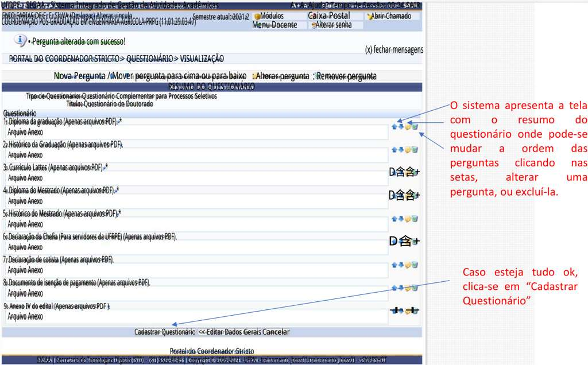

<!-- figure p11-fig1 | described_by: claude:sonnet | ocr_overlap: 0.96 | needs_review: false -->
Screenshot anotado sistema SIGAA, tela "Resumo do Questionário", com setas vermelhas e caixas texto explicativo sobrepostas.

**Texto topo (cabeçalho sistema, sobreposto/difícil):**
UFRPE SIGAA Sistema Integrado de Gestão de Atividades Acadêmicas | A+ A- Ajuda? Tempo de Sessão: 00:2 [illegible]
ENIO FARIAS DE F E. SILVA (Deslogar) Alterar vínculo | Semestre atual: 2021.2 | Módulos | Caixa Postal | Abrir Chamado
COORDENAÇÃO POS-GRADUAÇÃO EM ENGENHARIA AGRICOLA-PRPG (11.01.29.03:47) | Menu Docente | Alterar senha

**Mensagem sistema:**
(i) • Pergunta alterada com sucesso!
(x) fechar mensagens

**Breadcrumb:**
PORTAL DO COORDENADOR STRICTO > QUESTIONÁRIO > VISUALIZAÇÃO

**Linha ações:**
Nova Pergunta / Mover pergunta para cima ou para baixo : Alterar pergunta : Remover pergunta

**Barra título azul escura:**
RESUMO DO QUESTIONÁRIO

**Dados gerais:**
Tipo de Questionário: Questionário Complementar para Processos Seletivos
Título: Questionário de Doutorado

**Lista "Questionário" (perguntas numeradas, cada uma com texto + "Arquivo Anexo" abaixo, e ícones ação à direita):**
1. Diploma da graduação (Apenas arquivos PDF). *
   Arquivo Anexo
2. Histórico da Graduação (Apenas arquivos PDF).
   Arquivo Anexo
3. Curriculo Lattes (Apenas arquivos PDF). *
   Arquivo Anexo
4. Diploma do Mestrado (Apenas arquivos PDF). *
   Arquivo Anexo
5. Histórico do Mestrado (Apenas arquivos PDF). *
   Arquivo Anexo
6. Declaração da Chefia (Para servidores da UFRPE) (Apenas arquivos PDF).
   Arquivo Anexo
7. Declaração de cotista (Apenas arquivos PDF).
   Arquivo Anexo
8. Documento de isenção de pagamento (Apenas arquivos PDF).
   Arquivo Anexo
9. Anexo IV do edital (Apenas arquivos PDF.)
   Arquivo Anexo

Ícones direita cada linha: setas cima/baixo (reordenar), ícone editar (lápis/página amarela), ícone excluir (seta verde circular). Linhas 3,4,5,6 ícones sobrepostos texto ilegível parcial ("D+" — provável sobreposição gráfica, [illegible] exato).

**Rodapé lista:**
Cadastrar Questionário  << Editar Dados Gerais  Cancelar

**Rodapé página:**
Portal do Coordenador Stricto
SIGAA | Secretaria de Tecnologias Digitais (STD) - (81) 3320-6046 - Copyright © 2006-2021 - UFRN - treinamento.jboss01.treinamento.jboss01 - vSNAPSHOT

**Anotações vermelhas sobrepostas (2 caixas texto + setas azuis apontando):**

Caixa 1 (seta aponta pra ícones linha 1, dois pontos de origem):
"O sistema apresenta a tela com o resumo do questionário onde pode-se mudar a ordem das perguntas clicando nas setas, alterar uma pergunta, ou excluí-la."

Caixa 2 (seta aponta botão "Cadastrar Questionário" rodapé):
"Caso esteja tudo ok, clica-se em "Cadastrar Questionário"."

**Estrutura geral:** página web capturada, sem cores com significado além do padrão SIGAA (azul escuro barras título, fundo cinza claro página, anotações vermelhas tutorial sobrepostas com setas azuis indicando elementos clicáveis). Nenhum gráfico/eixo numérico — é tela de software, não gráfico de dados.

~~~text ocr
osta
) sucesso!
PORTAL DO QUESTIONÁRIO > VISUALIZAÇÃO
Nova-Pergunta /Mover: pergunta :
para Processos Seletivos
(x)
estionário de
Arquivo Anexo
da Graduação PDF). |
Arquivo Anexo
paar
Diploma do PDF).
Arquivo
do Mestrado
Arquivo Anexo
Declaração-da Chefia (Para servidores da UFRPE) (Apenas
Arquivo Anexo
arquivos PDF),
8: Documento de isenção de pagamento (Apenas arquivos-BDF).
Arquivo Anexo
IV do edital
Arquivo
Cadastrar: Questionário Gerais Cancelar
Portalido Coordenador
O sistema apresenta a tela
com o resumo do
questionário onde pode-se
mudar a ordem das
perguntas clicando nas
setas, alterar uma
pergunta, ou excluí-la.
Caso esteja tudo ok,
clica-se em “Cadastrar
Questionário”
~~~

<!-- Start of picture text -->
UFRPE - SIGAA - Sistema Integrado de Gestão de Atividades Acadêmicas A+ A- Ajuda? Tempo de Sessão: 00:24 SAIR ENIO FARIAS DE F. E. SILVA (Deslogar) Alterar vinculo Semestre atual: 2021.2 Módulos Caixa Postal Abrir Chamado COORDENAÇÃO PÓS-GRADUAÇÃO EM ENGENHARIA AGRÍCOLA-PRPG (11.01.29.03.47) Menu Docente Alterar senha • Pergunta alterada com sucesso! (x) fechar mensagens PORTAL DO COORDENADOR STRICTO > QUESTIONÁRIO > VISUALIZAÇÃO Nova Pergunta /:Mover pergunta para cima ou para baixo : Alterar pergunta : Remover pergunta RESUMO DO QUESTIONÁRIO Tipo de Questionário: Questionário Complementar para Processos Seletivos Titulo: Questionário de Doutorado O sistema apresenta a tela Questionário 1. Diploma da graduação (Apenas arquivos PDF). * com o resumo do Arquivo Anexo questionário onde pode-se 2. Histórico da Graduação (Apenas arquivos PDF).  mudar a ordem das Arquivo Anexo perguntas clicando nas 3. Curriculo Lattes (Apenas arquivos PDF). * D+ Arquivo Anexo setas, alterar uma 4. Diploma do Mestrado (Apenas arquivos PDF). * D+ pergunta, ou excluí-la. Arquivo Anexo 5. Histórico do Mestrado (Apenas arquivos PDF).* Arquivo Anexo 6. Declaração da Chefia (Para servidores da UFRPE) (Apenas arquivos PDF). D+ Arquivo Anexo 7. Declaração de cotista (Apenas arquivos PDF). Arquivo Anexo Caso esteja tudo ok, 8. Documento de isenção de pagamento (Apenas arquivos PDF). clica-se em “Cadastrar Arquivo Anexo Questionário” 9. Anexo IV do edital (Apenas arquivos PDF ).  ++ Arquivo Anexo Cadastrar Questionário << Editar Dados Gerais Cancelar Portal do Coordenador Stricto SIGAA | Secretaria de Tecnologias Digitais (STD) - (81) 3320-6046 | Copyright © 2006-2021 - UFRN - treinamento-jboss01.treinamento-jboss01 - vSNAPSHOT <!-- End of picture text -->

8 

POR 09:34 27℃ Parc ensolaradoINTL 06/09/2021 

Digite aqui para pesquisar 

O 

<!-- page 12 -->

 SIGAA - Sistema Integrado de GX + 

0 

☆  

← C 

###### Não seguro |treinamento.sigs.ufrpe.br/sigaa/public/processo_seletivo/view.jsf 

Esta é a tela apresentada ao candidato no momento de sua inscrição. O sistema irá solicitar apenas os seus dados pessoais (e o projeto e o possível orientador, caso o programa tenha marcado a opção nos parâmetros do programa), quaisquer outros dados além desses, o programa deverá solicitar em seu questionário que também será apresentado nesta tela. 

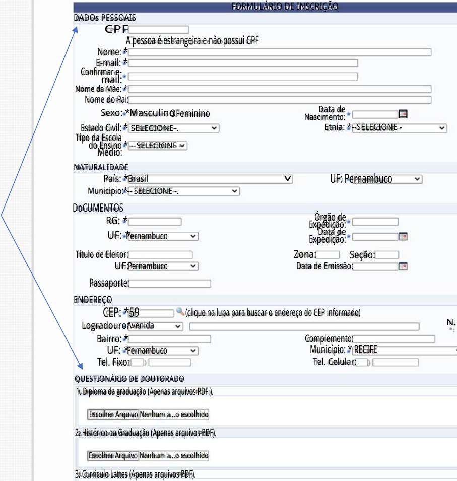

<!-- figure p12-fig1 | described_by: claude:sonnet | ocr_overlap: 0.87 | needs_review: false -->
(1) Figura: screenshot web form (formulário online), campos preenchíveis — não gráfico/tabela de dados.

(2) Texto visível, verbatim:
- Título topo: "FORMULÁRIO DE INSCRIÇÃO"
- Seção "DADOs PESSOAIS"
- "CPF" (campo texto)
- "A pessoa é estrangeira e não possui CPF" (checkbox/label)
- "Nome: *" (campo)
- "E-mail: *" (campo)
- "Confirmar e-mail:" (campo, "*" junto)
- "Nome da Mãe: *" (campo)
- "Nome do Pai:" (campo)
- "Sexo: *" com opções "Masculino" / "Feminino"
- "Data de Nascimento: *" (campo + ícone calendário)
- "Estado Civil: *" dropdown "-SELECIONE-"
- "Etnia: *" dropdown "--SELECIONE--"
- "Tipo da Escola do Ensino Médio:" dropdown "-- SELECIONE --"
- Seção "NATURALIDADE"
- "País: *" dropdown "Brasil"
- "UF:" dropdown "Pernambuco"
- "Município: *" dropdown "--SELECIONE--"
- Seção "DoCUMENTOS"
- "RG: *" (campo)
- "Órgão de Expedição: *" (campo)
- "UF: *" dropdown "Pernambuco"
- "Data de Expedição: *" (campo + ícone calendário)
- "Título de Eleitor:" (campo)
- "Zona:" (campo) "Seção:" (campo)
- "UF:" dropdown "Pernambuco"
- "Data de Emissão:" (campo + ícone calendário)
- "Passaporte:" (campo)
- Seção "ENDEREÇO"
- "CEP: *" campo "59" + ícone lupa + texto "(clique na lupa para buscar o endereço do CEP informado)"
- "Logradouro" dropdown "Avenida" + campo texto ao lado
- "Bairro: *" (campo)
- "Complemento:" (campo)
- "UF: *" dropdown "Pernambuco"
- "Município: * RECIFE" (campo preenchido)
- "Tel. Fixo:" campo (DDD) + campo número
- "Tel. Celular:" campo (DDD) + campo número
- Seção "QUESTIONÁRIO DE DOUTORADO"
- "1. Diploma da graduação (Apenas arquivos PDF)." + botão "Escolher Arquivo" + "Nenhum a...o escolhido" (= "Nenhum arquivo escolhido")
- "2. Histórico da Graduação (Apenas arquivos PDF)." + botão "Escolher Arquivo" + "Nenhum a...o escolhido"
- "3. Currículo Lattes (Apenas arquivos PDF)." (corte, resto fora imagem)
- Letra solta à direita, altura CEP: "N." [illegible, cortado]

(3) Estrutura: formulário vertical único, campos label-à-esquerda/input-à-direita, organizado em blocos com cabeçalho de seção sublinhado ("DADOs PESSOAIS", "NATURALIDADE", "DoCUMENTOS", "ENDEREÇO", "QUESTIONÁRIO DE DOUTORADO"). Seta azul dupla sobrepõe imagem, ligando ponto próximo campo "CPF" (topo) até ponto próximo campo "Tel. Fixo" (seção Endereço) — indica trecho/região destacada do formulário, sem rotular conteúdo da seta. Asteriscos (*) ao lado de labels marcam campos obrigatórios.

(4) Valores de dado preenchidos: CEP "59" (parcial); Município "RECIFE"; UF repetido 4x "Pernambuco"; País "Brasil"; Logradouro tipo "Avenida".

(5) Cor: seta diagonal azul (duas pontas) é único elemento colorido com função indicativa — aponta/destaca faixa de campos do formulário; restante da imagem em preto/branco/cinza padrão de formulário web.

~~~text ocr
DADOs PESSOAIS
GPF. — |
A pessoa possui GPF
E-mail:
-
mail:
Nome da Mãe: *
Nome
Sexo:*Masculin OFeminino
Estado Gl. v
Tipo da Escola
edio:
NATURALIDADE
País: *Brasil
Municipio:*-- SEEECIONE.-. v
DoGUMENTOS
RG:
Titulo de Eleitor:
Passaporte:
ENDEREÇO
Data de
Nascimento: E
Etnia: -
UF: v
|
Data de Emissão!
*59 lupa para buscar o endereço do CEP informado)
Bairro; *
Tel.
QUESTIONÁRIO DE DOUTORADO
da graduação (Apenas ).
[Escolher Arquivo Nenhum escolhido
22 Histórico-da Graduação (Apenas arquivos-PDF).
[Escolher Arquivo Nenhum a:..o escolhido,
Lattes (Apenas
|
Complemento!
Municipio: *
Tel. Celular:
~~~

<!-- Start of picture text -->
FORMULÁRIO DE INSCRIÇÃO DADOs PESSOAIS CPF A pessoa é estrangeira e não possui CPF Nome: * E-mail: * Confirmar e- mail: Nome da Mãe: * Nome do Pai: Sexo: *MasculinoOFeminino Nascimento:Data de  Estado Civil: * SELECIONE-. Etnia: *--SELECIONE - Tipo da Escola do Ensino * -- SELECIONE -- Médio: NATURALIDADE País: *Brasil V UF: Pernambuco Municipio:*-- SELECIONE -. DoCUMENTOS RG: * Órgão de Expedição: UF: *Pernambuco Data de Expedição: Titulo de Eleitor: Zona: Seção: UF:Pernambuco Data de Emissão: Passaporte: ENDEREÇO CEP: *59 (clique na lupa para buscar o endereço do CEP informado) Logradouro:Avenida N. Bairro: * Complemento: UF: *Pernambuco Município: * RECIFE Tel. Fixo: Tel. Celular: QUESTIONÁRIO DE DOUTORADO 1. Diploma da graduação (Apenas arquivos PDF ). Escolher Arquivo Nenhum a...o escolhido 2. Histórico da Graduação (Apenas arquivos PDF). Escolher Arquivo Nenhum a...o escolhido 3. Curriculo Lattes (Apenas arquivos PDF). <!-- End of picture text -->

Escolher Arquivo Nenhum a...o escolhido 

9 

POR 09:33 INTL08/09/2021 

26℃ Chuva fraca 

Digite aqui para pesquisar 

<!-- page 13 -->

 

 

 SIGAA - Sistema Integrado de GX + 

☆  

> ← C 

###### Não seguro |treinamento.sigs.ufrpe.br/sigaa/stricto/coordenacao.jsf 

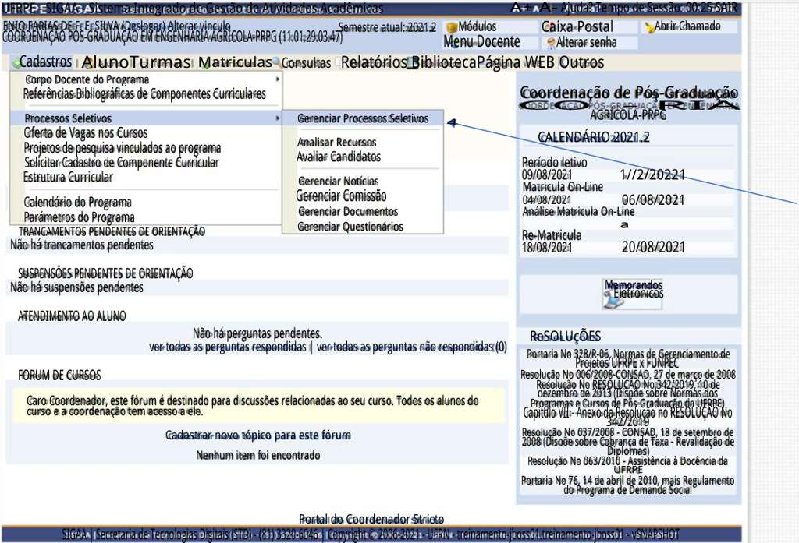

<!-- figure p13-fig1 | described_by: claude:sonnet | ocr_overlap: 0.92 | needs_review: false -->
Captura de tela de interface web (sistema acadêmico SIGAA/SIG, UFRPE), com menu suspenso aberto sobre a página.

**1. Tipo de figura:** Screenshot de uma interface de sistema de gestão acadêmica (não é gráfico nem diagrama técnico), mostrando um menu de navegação expandido em cascata (submenu dentro de submenu) sobreposto ao conteúdo da página principal.

**2. Todo o texto visível (verbatim, onde legível):**

Barra superior (texto sobreposto/ilegível em partes por sobreposição de elementos):
- "UFRPE SIGAA Sistema Integrado de Gestão de Atividades Acadêmicas" [parcialmente sobreposto, trechos ilegíveis]
- "A+ A- Ajuda Tempo de Sessão: 00:25 Sair" [sobreposto, parcialmente ilegível]
- "ENIO FARIAS DE FREIRE SILVA (Deslogar) Alterar vínculo" [sobreposto, parcialmente ilegível]
- "Semestre atual: 2021.2"
- "Módulos"
- "Caixa Postal"
- "Abrir Chamado"
- "COORDENAÇÃO POS-GRADUAÇÃO EM ENGENHARIA AGRICOLA-PRPG (11:01:29:03:47)" [sobreposto, parcialmente ilegível]
- "Menu Docente"
- "Alterar senha"

Barra de abas de menu:
- "Cadastros"
- "Aluno" / "Turmas" [sobrepostos]
- "Matriculas"
- "Consultas"
- "Relatórios"
- "Biblioteca"
- "Página WEB"
- "Outros"

Primeira coluna do submenu (sob "Cadastros"):
- "Corpo Docente do Programa" (com seta ">" indicando submenu)
- "Referências Bibliográficas de Componentes Curriculares"
- "Processos Seletivos" (destacado/selecionado, com seta indicando submenu aberto)
- "Oferta de Vagas nos Cursos"
- "Projetos de pesquisa vinculados ao programa"
- "Solicitar Cadastro de Componente Curricular"
- "Estrutura Curricular"
- "Calendário do Programa"
- "Parâmetros do Programa"

Segunda coluna do submenu (aberta a partir de "Processos Seletivos"):
- "Gerenciar Processos Seletivos" (com seta "◄" apontando, indicando item destacado — ponto de referência de uma seta azul vinda da direita)
- "Analisar Recursos"
- "Avaliar Candidatos"
- "Gerenciar Notícias"
- "Gerenciar Comissão"
- "Gerenciar Documentos"
- "Gerenciar Questionários"

Área de conteúdo abaixo do menu (parcialmente coberta pelo menu):
- "TRANCAMENTOS PENDENTES DE ORIENTAÇÃO"
- "Não há trancamentos pendentes"
- "SUSPENSÕES PENDENTES DE ORIENTAÇÃO"
- "Não há suspensões pendentes"
- "ATENDIMENTO AO ALUNO"
- "Não há perguntas pendentes."
- "ver todas as perguntas respondidas | ver todas as perguntas não respondidas (0)"
- "FORUM DE CURSOS"
- "Caro Coordenador, este fórum é destinado para discussões relacionadas ao seu curso. Todos os alunos do curso e a coordenação tem acesso a ele."
- "Cadastrar novo tópico para este fórum"
- "Nenhum item foi encontrado"

Painel lateral direito (caixa com cabeçalho azul):
- "Coordenação de Pós-Graduação"
- "COORDENAÇÃO ACADÊMICA DE PÓS-GRADUAÇÃO EM ENGENHARIA AGRICOLA-PRPG" [sobreposto, parcialmente ilegível]
- "CALENDÁRIO 2021.2"
- "Período letivo" — "09/08/2021" — "1//2/20221" [valor parcialmente ilegível/distorcido, provavelmente "1/12/2021" ou similar — texto conforme aparece: "1//2/20221"]
- "Matricula On-Line" — "04/08/2021" — "06/08/2021"
- "Análise Matricula On-Line" — "a" [texto solto, aparentemente parte de um intervalo de datas cortado]
- "Re-Matricula" — "18/08/2021" — "20/08/2021"
- Ícone/botão: "Memorandos Eletrônicos"
- "RESOLUÇÕES"
- "Portaria No 328/R-06, Normas de Gerenciamento de Projetos UFRPE x FUNPEC"
- "Resolução No 006/2008-CONSAD, 27 de março de 2008"
- "Resolução No RESOLUÇÃO No 342/2019, 10 de dezembro de 2013 (Dispõe sobre Normas dos Programas e Cursos de Pós-Graduação de UFRPE)" [texto com sobreposição, conteúdo aproximado]
- "Capítulo VII- Anexo da Resolução No 342/2019"
- "Resolução No 037/2008 - CONSAD, 18 de setembro de 2008 (Dispõe sobre Cobrança de Taxa - Revalidação de Diplomas)"
- "Resolução No 063/2010 - Assistência à Docência da UFRPE"
- "Portaria No 76, 14 de abril de 2010, mais Regulamento do Programa de Demanda Social"

Rodapé:
- "Portal do Coordenador Stricto"
- "SIGAA | Secretaria de Tecnologias Digitais (STD) - (81) 3320-6046 | Copyright © 2006-2021 - UFRN - treinamento.jboss01.treinamento.jboss01 - vSNAPSHOT"

**3. Estrutura:**
- Barra horizontal superior com informações de sessão/usuário.
- Abaixo, barra de abas horizontais de menu principal ("Cadastros", "Aluno Turmas", "Matriculas" etc.).
- A partir da aba "Cadastros", um menu suspenso vertical (primeira coluna) se abre para baixo.
- A partir do item "Processos Seletivos" dessa primeira coluna, abre-se uma segunda coluna de submenu à direita, listando 7 itens.
- Uma seta azul longa, horizontal, parte da borda direita da imagem e aponta para a esquerda, terminando na altura do item "Gerenciar Processos Seletivos" — indicando/destacando esse item específico.
- Uma pequena seta preta "◄" aparece também ao lado de "Gerenciar Processos Seletivos".
- À direita da tela, um painel/caixa de informações independente ("Coordenação de Pós-Graduação") com cabeçalho azul, contendo um calendário de datas em formato de duas colunas (evento / data) e, abaixo, uma lista de resoluções normativas.
- Abaixo do menu, à esquerda, segue o conteúdo da página principal em seções de texto empilhadas verticalmente (trancamentos, suspensões, atendimento ao aluno, fórum de cursos).
- Rodapé de página centralizado na parte inferior.
- O menu suspenso se sobrepõe parcialmente ao texto da página, cobrindo alguns conteúdos atrás dele.

**4. Valores numéricos/datas:**
- Semestre atual: 2021.2
- Tempo de sessão: 00:25 [parcialmente sobreposto/ilegível]
- Período letivo: 09/08/2021 até "1//2/20221" [ilegível/distorcido]
- Matrícula On-Line: 04/08/2021 a 06/08/2021
- Re-Matrícula: 18/08/2021 a 20/08/2021
- "ver todas as perguntas não respondidas (0)" — valor numérico: 0
- Portaria No 328/R-06
- Resolução No 006/2008-CONSAD, 27 de março de 2008
- Resolução No 342/2019, 10 de dezembro de 2013
- Resolução No 037/2008 - CONSAD, 18 de setembro de 2008
- Resolução No 063/2010
- Portaria No 76, 14 de abril de 2010
- Telefone: (81) 3320-6046
- Copyright © 2006-2021

**5. Cores com significado:**
- Fundo azul/roxo na barra superior e nas abas do menu, com a aba "Aluno" em destaque (fundo mais escuro/contrastante), indicando seção ativa.
- Item "Processos Seletivos" no submenu em azul-escuro/destacado, indicando que é o item expandido/selecionado que originou a segunda coluna.
- Seta e traço horizontal em azul, usados para apontar/destacar visualmente o item "Gerenciar Processos Seletivos".
- Cabeçalho do painel lateral direito ("Coordenação de Pós-Graduação") em azul, diferenciando-o como caixa de destaque.
- Caixa de texto do "Fórum de Cursos" com fundo amarelo-claro, diferenciando-a como aviso/bloco de destaque do restante do conteúdo em fundo branco.
- Ícone de "Memorandos Eletrônicos" com símbolo gráfico pequeno ao lado do texto (ícone decorativo, sem valor textual adicional legível).

~~~text ocr
of
atual:20212 Caixa-Postal
senha
| RelatóriosBibliotecaPágina WEB Outros
Corpo Docente do Programa ,
de Componentes Curriculares
- A
Seletivos » Processos Seletivos
erta de Vagas nos Cursos DÁRIO 2021
vinculados ao 2
Solicitar: Cadastro de Componente Curricular Período letivo
Estrutura Curricular Notícias,
enciar Comissão 04/08/2021 06/08/2021
Parámetros do Gerenciar Documentos Análise Matrícula On-Line
TRANGAMENTOS PENDENTES DE ORIENTAÇÃO Re-Matricula
Não he trancamentos pendentes 18/08/2021 20/08/2021
SUSPENSÕES RENDENTES DE ORIENTAÇÃO
Não há suspensões pendentes
ATENDIMENTO AQ ALUNO
Não-há perguntas pendentes. ReSOLUÇÕES
ver-todas as perguntas respondidas | ver-todas as perguntas não respondidas (0) Portaria No
etos UFRPE X
FORUM DE CURSOS Resolução No 27 de 2008
é destinado para discussões relacionadas ao seu curso. Todos os alunos do Gu da
para este fórum Cobrança de de
Nenhum item foi encontrado Resolução No 063/2016; à Docência d
Portaria No 76, 14 de abril de 2010, mai |
a
id
~~~

<!-- Start of picture text -->
UFRPE - SIGAA - Sistema Integrado de Gestão de Atividades Acadêmicas A+ A- Ajuda? Tempo de Sessão: 00:25 SAIR ENIO FARIAS DE F. E. SILVA (Deslogar) Alterar vinculo Semestre atual: 2021.2 Módulos Caixa Postal Abrir Chamado COORDENAÇÃO PÓS-GRADUAÇÃO EM ENGENHARIA AGRÍCOLA-PRPG (11.01.29.03.47) Menu Docente Alterar senha Cadastros AlunoTurmas Matriculas Consultas Relatórios BibliotecaPágina WEB Outros Corpo Docente do Programa Referências Bibliográficas de Componentes Curriculares Coordenação de Póş-Graduação CO  - RIA Processos Seletivos Gerenciar Processos Seletivos 4 AGRÍCOLA-PRPG Oferta de Vagas nos CursosProjetos de pesquisa vinculados ao programa Analisar Recursos CALENDÁRIO 2021.2 Avaliar Candidatos Solicitar Cadastro de Componente Curricular Período letivo Estrutura Curricular Gerenciar Notícias 09/08/2021 1//2/20221 Matricula On-Line Calendário do Programa Gerenciar Comissão 04/08/2021  06/08/2021 Gerenciar Documentos Análise Matricula On-Line TRANCAMENTOS PENDENTES DE ORIENTAÇÃOParámetros do Programa Gerenciar Questionários Re-Matricula a Não há trancamentos pendentes 18/08/2021  20/08/2021 SUSPENSÖES PENDENTES DE ORIENTAÇÃO Não há suspensões pendentes MemorandosEletrónicos ATENDIMENTO AO ALUNO Não há perguntas pendentes. ReSOLUçÕES ver todas as perguntas respondidas | ver todas as perguntas não respondidas (0) Portaria No 328/R-06, Normas de Gerenciamento de Projetos UFRPE x FUNPEC FORUM DE CURSOS Resolução No 006/2008-CONSAD, 27 de março de 2008 Resolução No RESOLUÇÃO No 342/2019, 10 de dezembro de 2013 (Dispõe sobre Normas dos Caro Coordenador, este fórum é destinado para discussões relacionadas ao seu curso. Todos os alunos do Programas e Cursos de Pós-Graduação da UFRPE) curso e a coordenação tem acesso a ele. Capitulo VII - Anexo da Resolução no RESOLUÇÃO No 342/2019 Cadastrar novo tópico para este fórum Resolução No 037/2008 - CONSAD, 18 de setembro de 2008 (Dispõe sobre Cobrança de Taxa - Revalidação de Nenhum item foi encontrado Diplomas) Resolução No 063/2010 - Assistência à Docência da UFRPE Portaria No 76, 14 de abril de 2010, mais Regulamento do Programa de Demanda Social Portal do Coordenador Stricto SIGAA | Secretaria de Tecnologias Digitais (STD) - (81) 3320-6046 | Copyright © 2006-2021 - UFRN - treinamento-jboss01.treinamento-jboss01 - vSNAPSHOT <!-- End of picture text -->

Após cadastrados os questionários, acessa-se este menu para cadastrar o processo seletivo 

10 POR 09:38 INTL 06/09/2021 

27°C Parc ensolarado● 

Q Digite aqui para pesquisar 

<!-- page 14 -->

 

> SIGAA - Sistema Integrado de GX + 

☆  

##### ← C ▲Não segurotreinamento.sigs.ufrpe.br/sigaa/stricto/coordenacao.jsf 

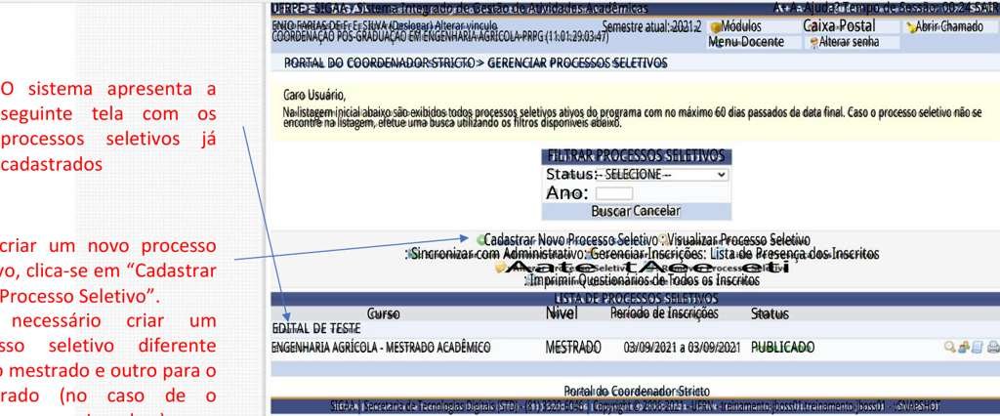

<!-- figure p14-fig1 | described_by: claude:sonnet | ocr_overlap: 0.91 | needs_review: false -->
Imagem é uma captura de tela (screenshot) de sistema web (SIGAA), com anotações sobrepostas em texto vermelho à esquerda e duas setas azuis apontando da anotação para elementos da tela.

**Texto visível, verbatim:**

Topo da tela (sobreposto/ilegível em parte por elementos empilhados, [illegible] onde texto se sobrepõe):
"UFRPE SIGAA - Sistema Integrado de Gestão de Atividades Acadêmicas" / "A+ A- Ajuda Tempo de Sessão: 00:24:55" (parcialmente sobreposto)
"ENIO FARIAS DE FREIRE SILVA (Deslogar) Alterar vínculo" / "Semestre atual: 2021.2" / "Módulos" / "Caixa Postal" / "Abrir Chamado"
"COORDENAÇÃO POS-GRADUAÇÃO EM ENGENHARIA AGRICOLA-PRPG (11.01.29.03.47)" / "Menu Docente" / "Alterar senha"

Abaixo:
"PORTAL DO COORDENADOR STRICTO > GERENCIAR PROCESSOS SELETIVOS"

Caixa com fundo amarelo claro:
"Caro Usuário,
Na listagem inicial abaixo são exibidos todos processos seletivos ativos do programa com no máximo 60 dias passados da data final. Caso o processo seletivo não se encontre na listagem, efetue uma busca utilizando os filtros disponíveis abaixo."

Caixa de filtro (título em barra azul):
"FILTRAR PROCESSOS SELETIVOS"
"Status: -- SELECIONE --" (campo dropdown/combobox)
"Ano:" (campo de texto vazio)
Botões: "Buscar" "Cancelar"

Linha de links/ícones (parcialmente sobreposta por marca d'água diagonal "Arte Aeuti" ou similar, [illegible]):
"Cadastrar Novo Processo Seletivo : Visualizar Processo Seletivo"
": Sincronizar com Administrativo : Gerenciar Inscrições : Lista de Presença dos Inscritos"
": Imprimir Questionário de Todos os Inscritos"
(ícones circulares verdes antes de cada item de link)

Marca d'água diagonal sobre a tabela, em letras grandes cinza: "Arte Aeuti" [illegible — texto estilizado/distorcido, pode ser outra palavra]

Tabela "LISTA DE PROCESSOS SELETIVOS" (cabeçalho em barra azul escura), colunas:
"Curso" | "Nível" | "Período de Inscrições" | "Status"

Acima da tabela, à esquerda: "EDITAL DE TESTE"

Linha de dados única:
"ENGENHARIA AGRÍCOLA - MESTRADO ACADÊMICO" | "MESTRADO" | "03/09/2021 a 03/09/2021" | "PUBLICADO"
(à direita da linha, 4 ícones pequenos: lupa, ícone amarelo, ícone azul, impressora)

Rodapé:
"Portal do Coordenador Stricto"
"SIGAA | Secretaria de Tecnologias Digitais (STI) - (81) 3820-0404 | Copyright © 2006-2021 - UFRN - treinamento.jboss01.treinamento.jboss01 - vSNAPSHOT"

**Texto da anotação (vermelho, lado esquerdo), de cima para baixo:**
"O sistema apresenta a seguinte tela com os processos seletivos já cadastrados"

Segundo bloco (texto cortado na borda esquerda da imagem, início de cada linha ausente — [illegible] no início de cada linha cortada):
"...criar um novo processo [illegible]...vo, clica-se em "Cadastrar [illegible] Processo Seletivo".
[illegible] necessário criar um [illegible]sso seletivo diferente [illegible] mestrado e outro para o [illegible]rado (no caso de o [illegible]..." — restante da frase cortado pela borda inferior/esquerda da imagem.

**Estrutura:**
- Painel esquerdo: fundo quadriculado (grade de design), contém dois blocos de texto vermelho (anotações explicativas), empilhados verticalmente.
- Painel direito: screenshot do sistema SIGAA, organizado em seções empilhadas verticalmente: cabeçalho de sistema (3 linhas), breadcrumb de navegação, caixa de aviso amarela, caixa de filtro azul/branca, linha de links de ação, tabela de resultados, rodapé.
- Duas setas azuis diagonais partem da área do primeiro bloco de texto vermelho (região central-esquerda) apontando para dentro do screenshot: uma aponta para a linha de links de ação ("Cadastrar Novo Processo Seletivo..."), outra aponta para a célula "EDITAL DE TESTE" na tabela.
- Marca d'água diagonal repetida sobre a área da tabela/links, texto estilizado de difícil leitura.

**Valores/dados:**
- Semestre atual: 2021.2
- Tempo de sessão: 00:24:55
- Código do vínculo: 11.01.29.03.47
- Data de período de inscrições: 03/09/2021 a 03/09/2021
- Status do processo: PUBLICADO
- Nível: MESTRADO
- Telefone no rodapé: (81) 3820-0404
- Ano de copyright: 2006-2021

**Cor com significado:** fundo amarelo claro = caixa de aviso/instrução; ícones verdes = indicadores de ação disponível (links ativos); texto vermelho = anotação/comentário sobreposto (não parte da interface original); setas azuis = indicação de referência entre anotação e elemento da tela.

~~~text ocr
O sistema apresenta a
seguinte tela com os
processos seletivos já
cadastrados
criar um novo processo
o, clica-se em “Cadastrar
Processo Seletivo”.
necessário criar um
sso seletivo diferente
mestrado e outro para o
rado (no caso de o
RORTAL DO > GERENCIAR PROGESSOS SELETIVOS
MenuDocente senha
Caro Usuário,
do pro com no máximo 60 dias passados da data final. Caso o processo seletivo não se
Status :- v
Ano:
Buscar Cancelar
Cadastrar Novo Processo-Seletivo : Processo Seletivo
Listaide
05 Inscritos
de Status
MESTRADO 03/09/2021 a 03/09/2021 PUBLICADO &
Curso
EDITAL DE TESTE
ENGENHARIA AGRÍCOLA - MESTRADO ACADÊMICO
|
~~~

<!-- Start of picture text -->
UFRPE - SIGAA - Sistema Integrado de Gestão de Atividades Acadêmicas A+ A- Ajuda? Tempo de Sessão: 00:24 SAIR ENIO FARIAS DE F. E. SILVA (Deslogar) Alterar vinculo Semestre atual: 2021.2 Módulos Caixa Postal Abrir Chamado COORDENAÇÃO PÓS-GRADUAÇÃO EM ENGENHARIA AGRÍCOLA-PRPG (11.01.29.03.47) Menu Docente Alterar senha PORTAL DO COORDENADOR STRICTO > GERENCIAR PROCESSOS SELETIVOS O sistema apresenta a Caro Usuário, seguinte tela com os Na listagem inicial abaixo são exibidos todos processos seletivos ativos do programa com no máximo 60 dias passados da data final. Caso o processo seletivo não se encontre na listagem, efetue uma busca utilizando os filtros disponíveis abaixo. processos seletivos já FILTRAR PROCESSOS SELETIVOS cadastrados Status:-- SELECIONE -- Ano: Buscar Cancelar Cadastrar Novo Processo Seletivo : Visualizar Processo Seletivo criar um novo processo : Sincronizar com Administrativo: Gerenciar Inscrições: Lista de Presença dos Inscritos seletivo, clica-se em “Cadastrar  Aate  tAee  eti : Imprimir Questionários de Todos os Inscritos Novo Processo Seletivo”. LISTA DE PROCESSOS SELETIVOS Curso Nivel Período de Inscrições Status necessário criar um EDITAL DE TESTE seletivo diferente ENGENHARIA AGRÍCOLA - MESTRADO ACADÊMICO MESTRADO 03/09/2021 a 03/09/2021 PUBLICADO para o mestrado e outro para o Portal do Coordenador Stricto (no caso de o SIGAA | Secretaria de Tecnologias Digitais (STD) - (81) 3320-6046 | Copyright © 2006-2021 - UFRN - treinamento-jboss01.treinamento-jboss01 - vSNAPSHOT <!-- End of picture text -->

Para criar um novo processo seletivo, clica-se em “Cadastrar Novo Processo Seletivo”. Será necessário criar um processo seletivo diferente para o mestrado e outro para o doutorado (no caso de o programa possuir ambos) 

11 

POR 09:39 27℃ Parc ensolaradoINTL 06/09/2021  

Digite aqui para pesquisar 

<!-- page 15 -->

 

 SIGAA - Sistema Integrado de GX + 

☆  

C 

← 

<!-- figure p15-fig1 | described_by: claude:sonnet | ocr_overlap: None | needs_review: false -->
Pequena screenshot, barra endereço navegador (browser URL bar fragment).

Texto visível (verbatim): "•Não seguro|trabalho.sigs.urfpe.br/sigaa/administracao/cadastro/ProcessoSeletivo/form.jsf"

Estrutura: linha única texto, sem caixas/setas/eixos/tabelas. Bullet "•" à esquerda indica ícone "não seguro" (conexão HTTP não segura), seguido da URL completa.

Valores numéricos: nenhum.

Cores: nenhuma com significado (texto preto simples, imagem monocromática/cinza claro de fundo).

~~~text ocr
«Não sf
~~~

<!-- Start of picture text -->
▲Não segurotreinamento.sigs.ufrpe.br/sigaa/administracao/cadastro/ProcessoSeletivo/form.jsf <!-- End of picture text -->

Nesta tela insere-se as informações do edital tal como título, período, edital, informações úteis aos candidatos Esta opção serve para limitar o número de inscrições ao número de vagas, então geralmente será marcada como “não” 

É recomendável avisar aos candidatos que é preferível não se cadastrarem com e-mails oriundos da Microsoft, pois estes às vezes não recebem os e- mails automáticos do sistema 

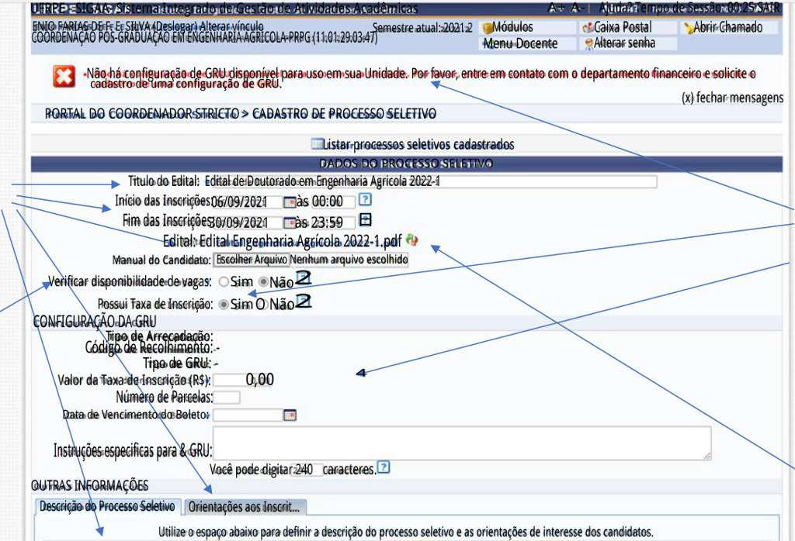

<!-- figure p15-fig2 | described_by: claude:sonnet | ocr_overlap: 0.84 | needs_review: false -->
(1) Captura de tela de sistema web (interface de software acadêmico), com setas azuis sobrepostas apontando pra campos do formulário — não é gráfico/tabela de dados, é print de tela anotado.

(2) Texto visível, verbatim:

Topo (barra sistema):
- "UFRPE SIGAA - Sistema Integrado de Gestão de Atividades Acadêmicas"
- "A+ A- | Ajuda? | Tempo de Sessão:00:25 SAIR" (parte sobreposta por seta, [illegible] parcial)
- "ENIO FARIAS DE... E... SILVA (Deslogar) Alterar vínculo" (nome parcialmente ilegível por sobreposição de seta — "ENIO FARIAS DE FE... E... SILVA")
- "COORDENAÇÃO POS-GRADUAÇÃO EM ENGENHARIA AGRICOLA-PRPG (11.01.29.03:47)"
- "Semestre atual: 2021.2"
- Ícones/menus: "Módulos", "Caixa Postal", "Abrir Chamado"
- "Menu Docente", "Alterar senha"

Mensagem de alerta (ícone X vermelho):
- "Não há configuração de GRU disponível para uso em sua Unidade. Por favor, entre em contato com o departamento financeiro e solicite o cadastro de uma configuração de GRU."
- "(x) fechar mensagens"

Caminho/breadcrumb:
- "PORTAL DO COORDENADOR STRICTO > CADASTRO DE PROCESSO SELETIVO"
- "Listar processos seletivos cadastrados" (com ícone azul)

Título seção (barra azul escura):
- "DADOS DO PROCESSO SELETIVO"

Campos do formulário:
- "Título do Edital: Edital de Doutorado em Engenharia Agrícola 2022-1"
- "Início das Inscrições: 06/09/2021 às 00:00" (ícone calendário, ícone ajuda "?")
- "Fim das Inscrições: 30/09/2021 às 23:59" (ícone calendário)
- "Edital: Edital Engenharia Agrícola 2022-1.pdf" (ícone/link)
- "Manual do Candidato: [Escolher Arquivo] Nenhum arquivo escolhido"
- "Verificar disponibilidade de vagas: ○ Sim ● Não" (com ícone ajuda "?")
- "Possui Taxa de Inscrição: ● Sim ○ Não" (com ícone ajuda "?")

Seção "CONFIGURAÇÃO DA GRU":
- "Tipo de Arrecadação:" (valor vazio)
- "Código de Recolhimento: -"
- "Tipo de GRU: -"
- "Valor da Taxa de Inscrição (R$): 0,00"
- "Número de Parcelas:" (campo vazio)
- "Data de Vencimento do Boleto:" (campo vazio, ícone calendário)
- "Instruções específicas para a GRU:" (caixa de texto vazia)
- "Você pode digitar 240 caracteres." (com ícone ajuda "?")

Seção "OUTRAS INFORMAÇÕES":
- Abas: "Descrição do Processo Seletivo" | "Orientações aos Inscrit..." (texto cortado, provável "Orientações aos Inscritos")
- "Utilize o espaço abaixo para definir a descrição do processo seletivo e as orientações de interesse dos candidatos."

(3) Estrutura: página única formulário vertical, dividida em blocos por título de seção (barras azul-escuro): "DADOS DO PROCESSO SELETIVO", "CONFIGURAÇÃO DA GRU", "OUTRAS INFORMAÇÕES". Dentro de cada bloco, campos label:valor empilhados. Numerosas setas azuis finas sobrepostas, cada uma saindo de ponto na margem esquerda/direita e apontando pra campo específico do formulário — função de anotação/destaque (não setas de fluxo entre caixas, sem diagrama de caixas conectadas). Setas apontam pra: título do edital, datas de início/fim inscrições, campo edital PDF, checkbox "Verificar disponibilidade de vagas", radio "Possui Taxa de Inscrição", valor taxa inscrição R$ 0,00, abas de descrição/orientações (duas setas apontam pra essa área).

(4) Valores numéricos/datas:
- Tempo de Sessão: 00:25
- Código unidade: 11.01.29.03:47
- Semestre: 2021.2
- Edital título ano: 2022-1
- Início inscrições: 06/09/2021, 00:00
- Fim inscrições: 30/09/2021, 23:59
- Valor taxa inscrição: R$ 0,00
- Limite caracteres: 240

(5) Cores com significado:
- Ícone X vermelho = alerta/erro na mensagem de GRU não configurada.
- Barras de título azul-escuro = cabeçalho de seção.
- Setas azul-claro = anotações apontando campos (adicionadas sobre o print, não parte original da interface).
- Texto em azul claro/ciano nos títulos de página ("PORTAL DO COORDENADOR...", "DADOS DO PROCESSO SELETIVO" em branco sobre azul) = destaque de navegação/seção.

~~~text ocr
ATE
ch. Gaixa Postal
MenuDocente senha
E3 Por favor, entre-em contato com o departamento financeiro e solicite o
(x) fechar- mensagens
RORTAL DO COORDENADORSTRICTO > CADASTRO DE PROCESSO SELETIVO
seletivos cadastrados
— Edital; de:Doutorado-em Engenharia Agricola 2022-4
Inicio das 00:00 (2)
Manual do Candidato: | Arquivo Nenhum arquivo escolhido
ificar © Sinn ®NaoZ
Taxa de inscrição: ® Sim O
Utilize o espaço abaixo para definir a descrição do processo seletivo e as orientações de interesse dos candidatos.
~~~

<!-- Start of picture text -->
UFRPE - SIGAA- Sistema Integrado de Gestão de Atividades Acadêmicas A+ A- Ajuda? Tempo de Sessão: 00:25 SAIR ENIO FARIAS DE F. E. SILVA (Deslogar) Alterar vínculo Semestre atual: 2021.2 Módulos Caixa Postal Abrir Chamado COORDENAÇÃO PÓS-GRADUAÇÃO EM ENGENHARIA AGRÍCOLA-PRPG (11.01.29.03.47) Menu Docente Alterar senha Não há configuração de GRU disponível para uso em sua Unidade. Por favor, entre em contato com o departamento financeiro e solicite o cadastro de uma configuração de GRU. (x) fechar mensagens PORTAL DO COORDENADOR STRICTO > CADASTRO DE PROCESSO SELETIVO Listar processos seletivos cadastrados DADOS DO PROCESSO SELETIVO Titulo do Edital:  Edital de Doutorado em Engenharia Agricola 2022-1 Início das Inscrições:06/09/2021 às 00:00 Fim das Inscrições:30/09/2021 às 23:59  Edital: Edital Engenharia Agrícola 2022-1.pdf Manual do Candidato: Escolher Arquivo Nenhum arquivo escolhido Verificar disponibilidade de vagas:  Sim Não 2 Possui Taxa de Inscrição: SimO Não2 CONFIGURAÇÃO DA GRU Tipo de Arrecadação: Código de Recolhimento: - Tipo de GRU: - Valor da Taxa de Inscrição (R$):  0,00 4 Número de Parcelas: Data de Vencimento do Boleto: Instruções especificas para & GRU: Você pode digitar 240 caracteres. OUTRAS INFORMAÇÕES Descrição do Processo Seletivo Orientações aos Inscrit... Utilize o espaço abaixo para definir a descrição do processo seletivo e as orientações de interesse dos candidatos. <!-- End of picture text -->

No momento estamos colocando o sistema de pagamento para funcionar então passaremos estas informações posteriormente. Para permitir a criação do Processo, iremos marcar a opção como “Não” e daremos instruções ao candidato de como gerar a taxa de inscrição. 

Cada programa deverá criar seu próprio edital, podendo ser o mesmo arquivo para Mestrado e Doutorado, pois não haverá mais o Edital Geral da PRPG (Talvez possa existir um Manual do Candidato universal). 

12 

09:47 

27℃ Parc ensolarado 0POR 09:47 INTL 06/09/2021 

QDigite aqui para pesquisar 

<!-- page 16 -->

Ajuda?Tempo de Sessão: 00:25 SAIRTempo de Sessão: 00:25 SAIR 

UFRPE - SIGAA - Sistema Integrado de Gestão de Atividades Acadêmicas A+ A- Ajuda?Tempo de Sessão: 00:25 SAIRTempo de Sessão: 00:25 SAIR ABELARDO ANTONIO DE A. MONTENEGRO (Deslogar) Alterar vínculo Semestre atual: 2025.1 Módulos Caixa Postal Abrir Chamado COORDENAÇÃO PÓS-GRADUAÇÃO EM ENGENHARIA AGRÍCOLA-PRPG (11.01.29.03.47) Menu Docente Alterar senha PORTAL DO COORDENADOR STRICTO > CADASTRO DE PROCESSO SELETIVO Listar processos seletivos cadastrados DADOS DO PROCESSO SELETIVO Titulo do Edital: * Inicio das Inscrições:11/04/2025 às00:00 Com a atualização do Fim das Inscrições:11/04/2025 às23:59 Sistema agora é possível escolher entre “Edital Edital:Escolher arquivo Nenhum arquivo escolhido Ordinário” ou “Edital Manual do Candidato: Escolher arquivo Nenhum arquivo escolhido Não incluímos a categoria “Servidor Com a atualização do Extraordinário” modalidade de vagas pois se trata de um sistema, será possível Possui Taxa de Inscrição:sim Não2 extra que não deveria contar para o t escolher entre “Edital Tipo de Edital: * Edital OrdinárioEdital Extraordinário vagas, porém o sistema estava levan Ordinário” ou “Edital PCD - Pessoas com Deficiência conta para o cálculo do percentual, p Extraordinário” Modalidades de Vagas: AF - Negros, indígenas ou pessoas trans eles devem ser inscritos como Ampla - Ampla Concorrência concorrência a tratados à parte. Curso Do ProceSso SeleTIVo O Edital Ordinário irá Curso: *-- SELECIONE -- V obrigar o uso das Questionário:NÃO APLICAR QUESTIONÁRIOS ESPECÍFICOS V K modalidades de vagas OUTRAS INFORMAÇÕES padrão, enquanto no Edital Extraordinário você poderá Descrição do Processo Seletivo Orientações aos Inscrit... escolher quais as Utilize o espaço abaixo para definir a descrição do processo seletivo e as orientações de interesse dos candidatos. modalidades das vagas você irá usar. Isto poderá ser usado em situações em que o programa irá oferecer poucas vagas para ampla concorrência, então 13 não haveria o suficiente 

<!-- page 17 -->

 

SIGAA - Sistema Integrado de GX + 

☆  

← C ▲Não segurotreinamento.sigs.ufrpe.br/sigaa/administracao/cadastro/ProcessoSeletivo/form_etapas.jsf 

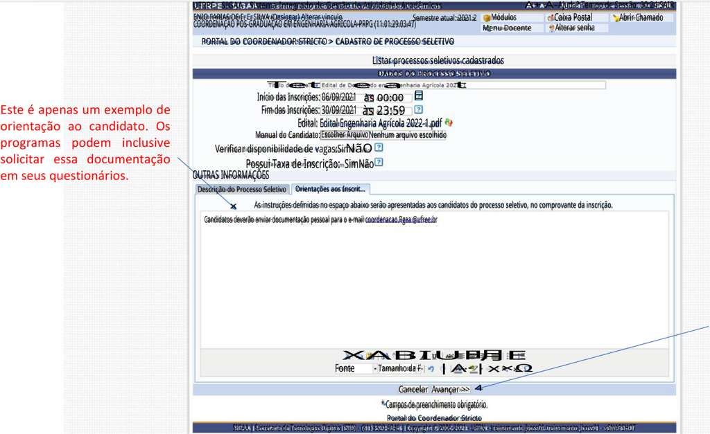

<!-- figure p17-fig1 | described_by: claude:sonnet | ocr_overlap: 0.9 | needs_review: false -->
Captura de tela de interface web (sistema de gestão acadêmica), com uma anotação explicativa sobreposta em vermelho.

**1. Tipo de figura:** Screenshot de uma tela de sistema (SIGAA/SIGAA-like, "SIG@A — Sistema Integrado de Gestão de Atividades Acadêmicas"), com um texto explicativo e duas setas de anotação adicionadas sobre a imagem.

**2. Todo o texto visível (verbatim):**

Barra superior/cabeçalho (texto sobreposto, parcialmente ilegível por sobreposição de elementos):
"UFRPE SIG@A Sistema Integrado de Gestão de Atividades Acadêmicas" — "A++·A−− Ajuda | Tempo de Sessão: 00:24:5A..."
"ENIO FARIAS DE FE... SILVA (Deslogar) Alterar vínculo" / "COORDENAÇÃO PÓS-GRADUAÇÃO EM ENGENHARIA AGRÍCOLA-PRPG (11.01.29.03.47)" — "Semestre atual: 2021.2"
"Módulos" / "Menu Docente"
"Caixa Postal"
"Alterar senha"
"Abrir Chamado"

Linha de navegação/breadcrumb:
"PORTAL DO COORDENADOR STRICTO > CADASTRO DE PROCESSO SELETIVO"

"Listar processos seletivos cadastrados"

Barra de título da seção (fundo azul escuro):
"DADOS DO PROCESSO SELETIVO"

Campos do formulário:
- "Título do Cadastro: Edital de Doutorado em Engenharia Agrícola 202[1]" (campo de texto, parcialmente sobreposto/ilegível no trecho central)
- "Início das Inscrições: 06/09/2021 às 00:00" (com ícone de calendário)
- "Fim das Inscrições: 30/09/2021 às 23:59" (com ícone de ajuda "?")
- "Edital: Edital Engenharia Agrícola 2022-1.pdf" (com ícone de anexo)
- "Manual do Candidato: [Escolher Arquivo] Nenhum arquivo escolhido"
- "Verificar disponibilidade de vagas: Sim Não" (com ícone de ajuda "?") — opção "Não" selecionada
- "Possui Taxa de Inscrição: Sim Não" (com ícone de ajuda "?") — opção "Não" selecionada

Seção "OUTRAS INFORMAÇÕES" com duas abas:
- "Descrição do Processo Seletivo" (aba não ativa)
- "Orientações aos Inscrit..." (aba ativa, texto truncado — provavelmente "Orientações aos Inscritos")

Texto de instrução dentro da aba ativa:
"As instruções definidas no espaço abaixo serão apresentadas aos candidatos do processo seletivo, no comprovante da inscrição."

Caixa de texto (editor de rich text) contendo:
"Candidatos deverão enviar documentação pessoal para o e-mail coordenacao.rgea@ufree.br" (link em azul/sublinhado)

Barra de ferramentas do editor (ícones de formatação, texto ilegível/decorativo — exibe algo como "X A B I U ⊟ ⊟ ≡" representando botões de fonte, negrito, itálico, sublinhado etc.)
"Fonte [menu suspenso]" / "Tamanho da F- [menu suspenso]" / ícone de desfazer / ícone "A" com seta / ícone "X² X²"

Botões abaixo do formulário:
"Cancelar" | "Avançar >>"

Rodapé:
"* Campos de preenchimento obrigatório."
"Portal do Coordenador Stricto"
"SIGAA | Secretaria de Tecnologias Digitais (STI) · (81) 3320-6046 · Copyright © 2006-2021 - UFRN - treinamento.jboss01.treinamento.jboss01 - vSNAPSHOT"

Texto da anotação vermelha (fora da captura de tela, à esquerda):
"Este é apenas um exemplo de orientação ao candidato. Os programas podem inclusive solicitar essa documentação em seus questionários."

**3. Estrutura — elementos, conexões e layout:**
A imagem é composta por um grande retângulo (a captura de tela do sistema) ocupando a maior parte do lado direito, e um bloco de texto em vermelho posicionado à esquerda, fora da captura de tela, sobre fundo quadriculado (indicando transparência/fundo de edição).

Duas setas azuis finas partem do bloco de texto vermelho (ou de pontos próximos a ele) e apontam para dentro da captura de tela:
- Uma seta diagonal sobe e aponta para a aba "Orientações aos Inscrit..." / área de instrução logo abaixo dela (próximo ao texto "As instruções definidas no espaço abaixo...").
- Uma segunda seta, mais abaixo e à direita, aponta horizontalmente para a região do botão "Avançar >>" (marcada com um pequeno "4" ao lado da seta).

Dentro da captura de tela, de cima para baixo, os blocos estão organizados verticalmente em seções empilhadas: cabeçalho do sistema → breadcrumb de navegação → título "DADOS DO PROCESSO SELETIVO" → lista de campos do formulário (rótulo à esquerda, valor/controle à direita) → seção "OUTRAS INFORMAÇÕES" com abas → caixa de texto grande (editor) com barra de ferramentas na parte inferior da caixa → botões de ação → rodapé com nota obrigatória e informações de copyright.

**4. Valores numéricos/dados:**
- Semestre atual: 2021.2
- Tempo de Sessão: 00:24:5[A] [illegible — possivelmente dígito/caractere ilegível no cronômetro]
- Código do setor: 11.01.29.03.47
- Início das Inscrições: 06/09/2021, às 00:00
- Fim das Inscrições: 30/09/2021, às 23:59
- Nome do arquivo de edital: "Edital Engenharia Agrícola 2022-1.pdf"
- Ano no título do cadastro: 202[1] (último dígito obscurecido/ilegível — "2021" ou similar)
- Telefone no rodapé: (81) 3320-6046
- Copyright: © 2006-2021
- Marcação numérica da seta: "4"

**5. Cores com significado:**
- Texto e seta em vermelho/azul: anotações adicionadas sobre a captura original (não fazem parte do sistema), destacando partes específicas da tela (aba de orientações e botão "Avançar").
- Fundo azul escuro: barras de título das seções ("DADOS DO PROCESSO SELETIVO").
- Fundo quadriculado atrás do bloco de texto vermelho: indica área transparente/externa à imagem original do sistema.
- Link de e-mail em azul sublinhado dentro do editor de texto: convenção visual padrão de hyperlink.
- Abas: aba ativa ("Orientações aos Inscrit...") visualmente destacada (fundo diferente) em relação à aba inativa ("Descrição do Processo Seletivo").

~~~text ocr
4 SAL!
ar atual:20212 Módulos Postal
senha
DO COORDENADORSTRIGTO > CADASTRO DE PROGESSO SELETIVO
Listar processos-seletivos.cadastrados
DIS
To de Agricola
Inicio das Inscrições: 06/09/2021 00:00 E
Este é apenas um exemplo de 30/09/2021 às 23:59
Edital: Edital: Fia Agricola 2022- pdf
orientação ao candidato. Os
programas podem inclusive Verificar
solicitar essa documentação de
em seus questionários. TRAS INFORMAÇÕES
espaço abaixo serão apresentadas aos candidatos do processo seletivo, no comprovante da inscrição.
Candidatos deverão: enviar: documentação pessoal para o e-mail
E
Fonte |
Cancelar
obrigatório.
do Coordenador
+ |
A
~~~

<!-- Start of picture text -->
UFRPE - SIGAA - Sistema Integrado de Gestão de Atividades Acadêmicas A+ A-Ajuda? Tempo de Sessão: 00:24 SAIR ENIO FARIAS DE F. E. SILVA (Deslogar) Alterar vinculo Semestre atual: 2021.2 Módulos Caixa Postal Abrir Chamado COORDENAÇÃO PÓS-GRADUAÇÃO EM ENGENHARIA AGRÍCOLA-PRPG (11.01.29.03.47) Menu Docente Alterar senha PORTAL DO COORDENADOR STRICTO > CADASTRO DE PROCESSO SELETIVO Listar processos seletivos cadastrados DADOS DO PROCESSO SELETIVO Tet   e a     t Início das Inscrições: 06/09/2021 às 00:00  Este é apenas um exemplo de Fim das Inscrições: 30/09/2021 às 23:59 Edital: Edital Engenharia Agrícola 2022-1.pdf orientação ao candidato. Os Manual do Candidato: Escolher ArquivoNenhum arquivo escolhido programas podem inclusive Verificar disponibilidade de vagas:SimNãO solicitar essa documentação Possui Taxa de Inscrição:  SimNão em seus questionários. OUTRAS INFORMAÇÕES Descrição do Processo Seletivo Orientações aos Inscrit... X As instruções definidas no espaço abaixo serão apresentadas aos candidatos do processo seletivo, no comprovante da inscrição. Candidatos deverão enviar documentação pessoal para o e-mail coordenacao.Rgea @ufree.br XABIUE Fonte Tamanho da F- |A·|x×Ω Cancelar Avançar >> 4 * Campos de preenchimento obrigatório. Portal do Coordenador Stricto SIGAA | Secretaria de Tecnologias Digitais (STD) - (81) 3320-6046 | Copyright © 2006-2021 - UFRN - treinamento-jboss01.treinamento-jboss01 - vSNAPSHOT <!-- End of picture text -->

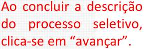

<!-- figure p17-fig2 | described_by: claude:sonnet | ocr_overlap: 1.0 | needs_review: false -->
(1) Figure type: text box, no chart/diagram. Red bold text on faint white/grid-dot background, thin gray border box.

(2) Text verbatim: "Ao concluir a descrição do processo seletivo, clica-se em "avançar"."

(3) Structure: single rectangular bordered box, centered text, no arrows, no axes, no rows/columns, no panels.

(4) No numeric data values present.

(5) Colour: text in red, rest white/light gray — no other meaning-bearing colors.

~~~text ocr
Ao concluir a descrição
do processo seletivo,
clica-se em “avançar”.
~~~

<!-- Start of picture text -->
Ao concluir a descrição do processo seletivo, clica-se em “avançar”. <!-- End of picture text -->

14 

10:02 

POR 10:02 INTL 06/09/2021 

QDigite aqui para pesquisar 

27℃ Chuva fraca 

<!-- page 18 -->

A+ A- Ajuda? Tempo de Sessão: 00:25 SAIR 

Nesta tela deve-se inserir a quantidade de vagas para cada modalidade. O Sistema faz o cálculo do percentual para verificar se está de acordo com a resolução 

UFRPE - SIGAA - Sistema Integrado de Gestão de Atividades Acadêmicas A+ A- Ajuda? Tempo de Sessão: 00:25 SAIR ABELARDO ANTONIO DE A. MONTENEGRO (Deslogar) Alterar vínculo Semestre atual: 2025.1 Módulos Caixa Postal Abrir Chamado COORDENAÇÃO PÓS-GRADUAÇÃO EM ENGENHARIA AGRÍCOLA-PRPG (11.01.29.03.47) Menu Docente Alterar senha Para cumprir a exigência da Resolução 008/2022, que requer a oferta de 20% do total de vagas para a modalidade de vaga AF - Negros, X indígenas ou pessoas trans, por gentileza arredonde este valor para o número inteiro acima do informado. Para cumprir a exigência da Resolução 008/2022, que requer a oferta de 8% do total de vagas para a modalidade de vaga PCD - Pessoas com Deficiência, por gentileza arredonde este valor para o número inteiro acima do informado. (x) fechar mensager PORTAL DO COORDENADOR STRICTO > CADASTRO DE OFERTA E RESERVA DE VAGAS DE PROCESSO SELETIVO OFERTAS E RESERVAS DE VAGAS QUADRO DE VAGAS PCD AF Ampla Total de Vagas Nível: MESTRADO 1 1 15 17 << Voltar Cancelar Avançar >> *Campos de preenchimento obrigatório. Portal do Coordenador Stricto SIGAA | Secretaria de Tecnologias Digitais (STD) - https://servicosdigitais.ufrpe.br/help | Copyright © 2006-2025 - UFRN - producao-jboss01.producao-jboss01 - v4.16.1-12 

(x) fechar mensager 

15 

<!-- page 19 -->

Início || x 

M Caixa d × MCaixa d × M Caixa d × 

Polare × 

V 

← → C 

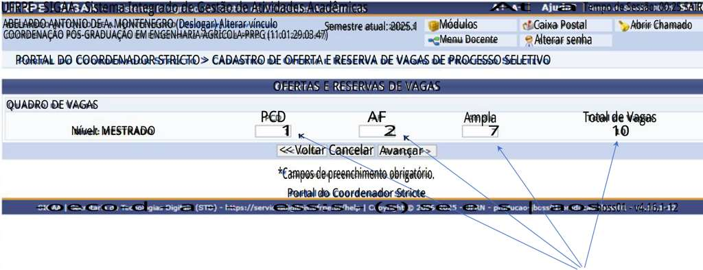

<!-- figure p19-fig3 | described_by: claude:sonnet | ocr_overlap: 0.78 | needs_review: false -->
Captura tela sistema web (SIGAA), com anotações (setas) sobreposto na imagem, não gráfico de dados.

**Texto cabeçalho (topo):**
"UFRPE SIGAA Sistema Integrado de Gestão de Atividades Acadêmicas" — texto sobreposto, duplicado/ilegível parcial onde se mistura com "ESSOS" repetido em baixo (watermark tipo "ESSOS" repetido várias vezes na barra inferior, ilegível resto).
Direita topo: ícones "Ajuda", "Tempo de Sessão: 00:25", "SAIR".

Linha abaixo: "ABELARDO ANTONIO DE A. MONTENEGRO (Deslogar) Alterar vínculo" / "COORDENAÇÃO PÓS-GRADUAÇÃO EM ENGENHARIA AGRÍCOLA-PRPG (11.01.29.03.47)"
Centro: "Semestre atual: 2025.1"
Direita, dois blocos ícone+texto: "Módulos" / "Menu Docente" | "Caixa Postal" / "Alterar senha" | "Abrir Chamado"

Linha navegação: "PORTAL DO COORDENADOR STRICTO > CADASTRO DE OFERTA E RESERVA DE VAGAS DE PROCESSO SELETIVO"

**Faixa título azul escura:** "OFERTAS E RESERVAS DE VAGAS"

**Seção "QUADRO DE VAGAS":**
Tabela com colunas: "PCD" | "AF" | "Ampla" | "Total de Vagas"
Linha: "Nível: MESTRADO" | caixa valor **1** (PCD) | caixa valor **2** (AF) | caixa valor **7** (Ampla) | valor **10** (Total de Vagas)

Botões abaixo: "<< Voltar" "Cancelar" "Avançar >"

Texto nota: "*Campos de preenchimento obrigatório."
Linha: "Portal do Coordenador Stricto"

Rodapé (sobreposto/ilegível parcial, repetição "ESSOS"): algo tipo "SIGAA | Superior Tecnologia Digitais (STI) - https://servicos...sigaa/help | Copyright © 2006-2025 - UFRN - [ilegível]ssiboss01 - v4.16.1-12" — partes [illegible] por sobreposição texto duplicado.

**Setas (anotação manual, cor azul):** 3 setas convergem de ponto único abaixo (perto botões) apontando para cima, para três caixas: valor "1" (PCD), valor "2" (AF), valor "7" (Ampla) — destacando esses três campos de vagas por nível.

Sem cores com significado além azul das setas de anotação (destaque manual) e faixa título azul escuro padrão interface.

~~~text ocr
tor
tre atual:20254 @Mddulos Postal Abrit Chamado
 Mterar senha =
RORTAL DO CADASTRO DE E RESERVA DE VAGAS DE PROGESSO SELETIVO
COORDENAÇÃO POS-GRADUAÇÃO EM ENGE
QUADRO DE VAGAS
PED AF Ampla Total de Vagas
MESTRADO 1 2 7 10
<<Voltar Cancelar
*Campos-de preenchimento obrigatório.
do Coordenador
GP | CD - | Ci D = = 1-2?
~~~

<!-- Start of picture text -->
 Ofícios x <!-- End of picture text -->

Facebo × 

Centralx 

Email- × 

###### (1) Wh × 

<!-- Start of picture text -->
Comun × <!-- End of picture text -->

###### sigs.ufrpe.br/sigaa/administracao/cadastro/ProcessoSeletivo/form_etapas.jsf 

###  

Welcome to Video... Giant In the Playgro... Looking For Group Goblins - Life throu... Jurassic World: Adul... FastGames - Gamer... xkcd - A Webcomic... Um Sábado Qualqu... 

<!-- Start of picture text -->
UFRPE - SIGAA - Sistema Integrado de Gestão de Atividades Acadêmicas At  a Tempo de Sessão: 00:25 SAIR ABELARDO ANTONIO DE A. MONTENEGRO (Deslogar) Alterar vínculo Semestre atual: 2025.1 Módulos Caixa Postal Abrir Chamado COORDENAÇÃO PÓS-GRADUAÇÃO EM ENGENHARIA AGRÍCOLA-PRPG (11.01.29.03.47) Menu Docente Alterar senha PORTAL DO COORDENADOR STRICTO > CADASTRO DE OFERTA E RESERVA DE VAGAS DE PROCESSO SELETIVO OFERTAS E RESERVAS DE VAGAS QUADRO DE VAGAS PCD AF Ampla Total de Vagas Nível: MESTRADO 1 K 2 K 7 10 << Voltar Cancelar Avançar *Campos de preenchimento obrigatório. Portal do Coordenador Stricte -oeco-d - a - -    ess:s - (s) se e  s | aosboss01 - v4.16.1-12 <!-- End of picture text -->

Se o quantitativo estiver correto, o sistema avança sem problemas. 

16 

<!-- page 20 -->

 

> SIGAA - Sistema Integrado de GX + 

☆  

← C 

###### Não seguro treinamento.sigs.ufrpe.br/sigaa/administracao/cadastro/ProcessoSeletivo/form_etapas.jsf 

Esta opção indica também quem deve inserir o resultado no sistema 

É recomendável (mas não obrigatório) incluir uma etapa conjunta para a análise da isenção e comprovação de pagamento anterior à homologação 

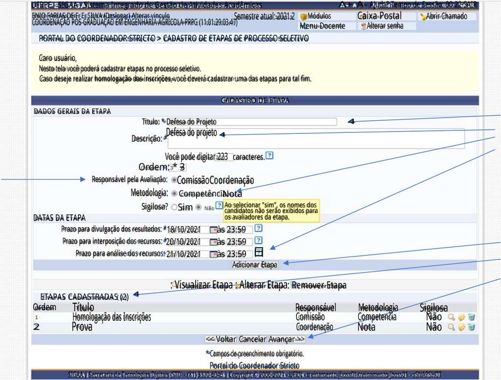

<!-- figure p20-fig1 | described_by: claude:sonnet | ocr_overlap: 0.85 | needs_review: false -->
Figura: screenshot de interface de sistema web (SIGAA), tela de cadastro, com setas azuis sobrepostas apontando para campos específicos.

**1. Tipo de figura:** captura de tela de sistema de gestão acadêmica (SIGAA), com anotações (setas) indicando campos relevantes.

**2. Texto visível (verbatim):**

Cabeçalho:
- "UFRPE-SIGAA-A: Sistema Integrado de Gestão de Atividades Acadêmicas"
- "A+ A- Ajuda Tempo de Sessão: 00:24 SAIR"
- "ENIO FARIAS DE Fr Er SILVA (Deslogar) Alterar vínculo"
- "Semestre atual: 2021.2"
- "Módulos" / "Caixa Postal"
- "COORDENAÇÃO POS-GRADUAÇÃO EM ENGENHARIA AGRICOLA-PRPG (11:01:29:03:47)"
- "Menu Docente" / "Alterar senha" / "Abrir Chamado"

Caminho/título da tela:
- "PORTAL DO COORDENADOR STRICTO > CADASTRO DE ETAPAS DE PROCESSO SELETIVO"

Caixa de aviso (fundo amarelo):
- "Caro usuário,"
- "Nesta tela você poderá cadastrar etapas no processo seletivo."
- "Caso deseje realizar homologação das inscrições, você deverá cadastrar uma das etapas para tal fim."

Barra de seção:
- "CADASTRO DE ETAPA"
- "DADOS GERAIS DA ETAPA"

Campos do formulário:
- "Título: *" → valor: "Defesa do Projeto"
- "Descrição: *" → valor: "Defesa do projeto"
- "Você pode digitar 223 caracteres." (com ícone de ajuda "?")
- "Ordem: *" → valor: "3"
- "Responsável pela Avaliação:" opções (radio) → "Comissão" / "Coordenação" (marcado: Comissão)
- "Metodologia:" opções (radio) → "Competência" / "Nota" (marcado: Competência)
- "Sigilosa?" opções (radio) → "Sim" / "Não" (marcado: Não)
- Tooltip (caixa amarela) ao lado de "Sigilosa": "Ao selecionar 'sim', os nomes dos candidatos não serão exibidos para os avaliadores da etapa."

Seção "DATAS DA ETAPA":
- "Prazo para divulgação dos resultados: *" → "18/10/2021" "às 23:59" (ícone calendário + "?")
- "Prazo para interposição dos recursos: *" → "20/10/2021" "às 23:59" (ícone "?")
- "Prazo para análise dos recursos: *" → "21/10/2021" "às 23:59" (ícone calendário)

Botão: "Adicionar Etapa"

Legenda de ícones: ": Visualizar Etapa : Alterar Etapa : Remover Etapa"

Tabela "ETAPAS CADASTRADAS (2)" — colunas: "Ordem | Título | Responsável | Metodologia | Sigilosa"
- Linha 1: "1 | Homologação das Inscrições | Comissão | Competência | Não" (com ícones lupa/editar/lixeira)
- Linha 2: "2 | Prova | Coordenação | Nota | Não" (com ícones lupa/editar/lixeira)

Rodapé do formulário:
- "<< Voltar   Cancelar   Avançar >>"
- "* Campos de preenchimento obrigatório."
- "Portal do Coordenador Stricto"
- "SIGAA | Secretaria de Tecnologias Digitais (STD) - (81) 3320-6046 | Copyright © 2006-2021 - UFRN - treinamento.jboss01.treinamento.jboss01 - vSNAPSHOT"

**3. Estrutura:**
Topo: barra institucional com dados do usuário e sessão. Abaixo: caixa de instruções (amarela). Abaixo: formulário em dois blocos — "Dados Gerais da Etapa" (campos texto/rádio) e "Datas da Etapa" (três campos data+hora). Botão "Adicionar Etapa" entre formulário e tabela. Abaixo: tabela com etapas já cadastradas (2 linhas). Rodapé: navegação (Voltar/Cancelar/Avançar) e informações de copyright.

Setas azuis sobrepostas (anotações, sem texto próprio) apontam, pelo lado direito e esquerdo da imagem, para: campo "Título", campo "Descrição", campo "Responsável pela Avaliação", botão "Adicionar Etapa", texto "ETAPAS CADASTRADAS (2)" e botões de navegação "Voltar/Cancelar/Avançar" — indicando elementos de destaque, sem rótulo textual associado.

**4. Valores numéricos:**
- Tempo de sessão: 00:24
- Semestre: 2021.2
- Código numérico ao lado do nome da coordenação: 11:01:29:03:47
- Caracteres digitados/disponíveis: 223
- Ordem do formulário: 3
- Datas: 18/10/2021, 20/10/2021, 21/10/2021 — todas "às 23:59"
- Quantidade de etapas cadastradas: 2
- Ordem na tabela: 1 e 2
- Telefone rodapé: (81) 3320-6046
- Copyright: 2006-2021

**5. Cores com significado:**
- Fundo amarelo claro: caixas de aviso/instrução e tooltip de ajuda.
- Barra azul escura: cabeçalhos de seção ("CADASTRO DE ETAPA").
- Setas azuis: anotações/destaques adicionados sobre a captura original, não parte da interface.
- Ícones de ação na tabela (lupa, lápis, lixeira) em cores padrão de sistema, sem rótulo de texto.

~~~text ocr
57 Cds A
tre Caixa-Posta
« Alterar senha
PORTAL DO COORDENADORSTRICTO > CADASTRO DE ETAPAS DE PROGESSO SELETIVO
Caro usuário,
Nestatela- você poderá cadastrar etapas no processo seletivo.
Caso deseje realizar homologação das etapas para tal fim.
DADOS GERAIS DA ETAPA
Titulo: * Defesa do Projeto
a —
Você pode digitar-223
3
Responsável pela Avaliação:
@
Sigilosa? OSim le
DATAS DA ETAPA os avaliadores da et
Prazo para divulgação dos resultados: *18/10/2021 [as 23:59
Prazo para interposição *20/10/2021 23:59 [2]
Prazo para 23:59 H
Adicionar Etapa
ETARAS CADASTRADAS, (2)
1 0 das Inscrições
2
<<Voltar Avangar->>
~~~

<!-- Start of picture text -->
UFRPE - SIGAA - Sistema Integrado de Gestão de Atividades Acadêmicas A+ A- Ajuda? Tempo de Sessão: 00:22 SAIR ENIO FARIAS DE F. E. SILVA (Deslogar) Alterar vinculo Semestre atual: 2021.2 Módulos Caixa Postal Abrir Chamado COORDENAÇÃO PÓS-GRADUAÇÃO EM ENGENHARIA AGRÍCOLA-PRPG (11.01.29.03.47) Menu Docente Alterar senha PORTAL DO COORDENADOR STRICTO > CADASTRO DE ETAPAS DE PROCESSO SELETIVO Caro usuário, Nesta tela você poderá cadastrar etapas no processo seletivo. Caso deseje realizar homologação das inscrições, você deverá cadastrar uma das etapas para tal fim. CADASTRO DE ETAPA DADOS GERAIS DA ETAPA Titulo: * Defesa do Projeto 4 Defesa do projeto 4 Descrição: * Você pode digitar 223 caracteres. Ordem: * 3 Responsável pela Avaliação: ComissãoCoordenação Metodologia: CompetênciaNota Sigilosa? Sim Ao selecionar "sim", os nomes dos candidatos não serão exibidos para DATAS DA ETAPA os avaliadores da etapa. Prazo para divulgação dos resultados: *18/10/2021 às 23:59 Prazo para interposição dos recursos: *20/10/2021 às 23:59 Prazo para análise dos recursos: 21/10/2021 às 23:59  Adicionar Etapa : Visualizar Etapa : Alterar Etapa: Remover Etapa ETAPAS CADASTRADAS (2) 4 Ordem Título Responsável Metodologia Sigilosa Homologação das Inscrições Comissão Competencia Não 2 Prova Coordenação Nota Não << Voltar Cancelar Avançar >> * Campos de preenchimento obrigatório. Portal do Coordenador Stricto SIGAA | Secretaria de Tecnologias Digitais (STD) - (81) 3320-6046 | Copyright © 2006-2021 - UFRN - treinamento-jboss01.treinamento-jboss01 - vSNAPSHOT <!-- End of picture text -->

Na tela seguinte deverão ser adicionadas as etapas do processo com suas descrições, exceto o resultado final (que é sempre uma nota) 

Ao terminar de descrever uma etapa, clica-se em “adicionar etapa”. Quando todas etapas (exceto o resultado final) estiverem cadastradas, clica-se em “avançar” 

17 

POR 10:12 27°C Chuva fraca● INTL 06/09/2021 

Digite aqui para pesquisar 

<!-- page 21 -->

Outra novidade da atualização é esta tela de “Etapa de Consolidação Parcial de Processo Seletivo”. Conforme a Descrição da tela, nesta etapa você deve definir quem são os aprovados no processo seletivo apenas dentro da Ampla Concorrência. 

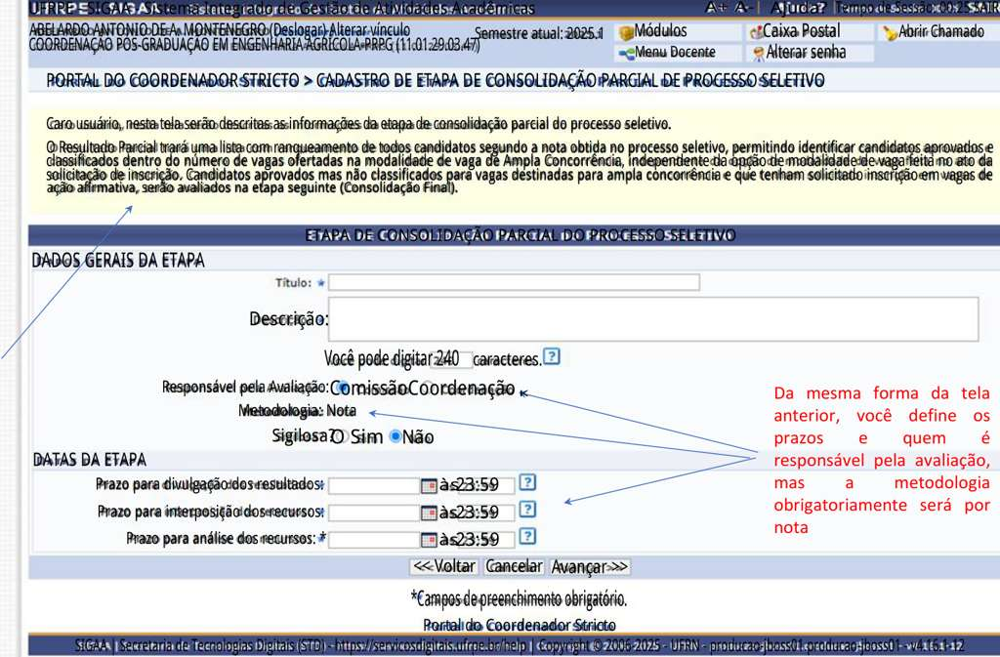

<!-- figure p21-fig1 | described_by: claude:sonnet | ocr_overlap: 0.83 | needs_review: false -->
(1) Tipo de figura: captura de tela (screenshot) de interface de sistema web — tela do sistema SIGAA, módulo "Portal do Coordenador Stricto", com duas setas azuis de anotação e um bloco de texto explicativo em vermelho sobrepostos à imagem original.

(2) Todo o texto visível, verbatim:

Barra superior:
- "UFRPE SIGAA Sistema Integrado de Gestão de Atividades Acadêmicas"
- "A+ A- | Ajuda? | Tempo de Sessão: 00:25 SAIR"

Linha de identificação do usuário:
- "ABELARDO ANTONIO DE A. MONTENEGRO (Deslogar) Alterar vínculo"
- "COORDENAÇÃO POS-GRADUAÇÃO EM ENGENHARIA AGRICOLA-PRPG (11.01.29.03.47)"
- "Semestre atual: 2025.1"
- Ícones de menu: "Módulos", "Caixa Postal", "Abrir Chamado", "Menu Docente", "Alterar senha"

Linha de navegação/título da tela:
- "PORTAL DO COORDENADOR STRICTO > CADASTRO DE ETAPA DE CONSOLIDAÇÃO PARCIAL DE PROCESSO SELETIVO"

Caixa de aviso amarela:
- "Caro usuário, nesta tela serão descritas as informações da etapa de consolidação parcial do processo seletivo."
- "O Resultado Parcial trará uma lista com ranqueamento de todos candidatos segundo a nota obtida no processo seletivo, permitindo identificar candidatos aprovados e classificados dentro do número de vagas ofertadas na modalidade de vaga de Ampla Concorrência, independente da opção de modalidade de vaga feita no ato da solicitação de inscrição. Candidatos aprovados mas não classificados para vagas destinadas para ampla concorrência e que tenham solicitado inscrição em vagas de ação afirmativa, serão avaliados na etapa seguinte (Consolidação Final)."

Barra de seção azul-escura:
- "ETAPA DE CONSOLIDAÇÃO PARCIAL DO PROCESSO SELETIVO"

Bloco "DADOS GERAIS DA ETAPA":
- "DADOS GERAIS DA ETAPA"
- "Título: *" (campo de texto vazio)
- "Descrição:" (campo de texto vazio)
- "Você pode digitar 240 caracteres. [?]"
- "Responsável pela Avaliação: ◉ Comissão ○ Coordenação" (duas opções tipo rádio)
- "Metodologia: Nota" (texto fixo, não editável, indicado por seta)
- "Sigilosa? ○ Sim ◉ Não" (opção "Não" selecionada)

Bloco "DATAS DA ETAPA":
- "DATAS DA ETAPA"
- "Prazo para divulgação dos resultados:" + campo de data vazio + "às 23:59" + ícone "[?]"
- "Prazo para interposição dos recursos:" + campo de data vazio + "às 23:59" + ícone "[?]"
- "Prazo para análise dos recursos: *" + campo de data vazio + "às 23:59" + ícone "[?]"

Botões:
- "<< Voltar" | "Cancelar" | "Avançar >>"

Rodapé:
- "*Campos de preenchimento obrigatório."
- "Portal do Coordenador Stricto"
- "SIGAA | Secretaria de Tecnologias Digitais (STD) - https://servicosdigitais.ufrpe.br/help | Copyright © 2006-2025 - UFRN - producao-jboss01.producao-jboss01 - v4.16.1-12"

Texto da anotação vermelha (caixa de observação sobreposta, à direita):
- "Da mesma forma da tela anterior, você define os prazos e quem é responsável pela avaliação, mas a metodologia obrigatoriamente será por nota"

(3) Estrutura, caixas, setas e conexões:
- Topo: cabeçalho institucional com barra de ferramentas e dados do usuário logado.
- Abaixo, caminho de navegação em forma de breadcrumb indicando a tela atual.
- Caixa de texto explicativo com fundo amarelo claro, logo abaixo do breadcrumb.
- Uma seta azul diagonal parte do canto inferior esquerdo da imagem (fora de qualquer caixa, ponto de origem ~ canto esquerdo) e aponta para cima, em direção ao texto dentro da caixa amarela (parece indicar/destacar o bloco de aviso amarelo como um todo).
- Corpo principal dividido em uma barra de título de seção (fundo azul-escuro) e, abaixo, um formulário com dois subgrupos: "DADOS GERAIS DA ETAPA" (campos: Título, Descrição, Responsável pela Avaliação, Metodologia, Sigilosa) e "DATAS DA ETAPA" (três campos de prazo, cada um com seletor de data, horário fixo "23:59" e ícone de ajuda).
- Duas setas azuis adicionais partem da caixa de texto vermelha (lado direito da imagem) e apontam para a esquerda, em direção aos campos do formulário: uma aponta para a linha "Responsável pela Avaliação / Metodologia" (próximo a "Comissão/Coordenação" e "Nota"), outra aponta para a área das "DATAS DA ETAPA" (prazos).
- Barra de botões de ação horizontal, centralizada, abaixo do formulário.
- Rodapé final com texto de direitos autorais e versão do sistema.

(4) Valores numéricos/dados:
- "Tempo de Sessão: 00:25"
- "Semestre atual: 2025.1"
- Código do vínculo: "(11.01.29.03.47)"
- "240" caracteres (limite do campo Descrição)
- Três campos de horário, todos fixos em "23:59"
- Copyright: "© 2006-2025"
- Versão do sistema: "v4.16.1-12"

(5) Cores com significado:
- Barra superior e barra de seção em azul-escuro (identidade visual do sistema).
- Caixa de aviso/instruções em amarelo claro, destacando texto informativo.
- Botão "Avançar >>" sem cor diferenciada visível além do padrão dos botões.
- Opções de rádio selecionadas marcadas em azul (●), indicando a escolha atual: "Comissão" e "Não" (para Sigilosa).
- Anotações sobrepostas (setas e caixa de texto) em vermelho e azul, não fazendo parte do sistema original, usadas para indicar/explicar elementos da tela a quem vê a imagem.

~~~text ocr
A
tre Postal Chamado
Docente senha
RORTAL DO > CADASTRO DE ETAPA DE CONSOLIDAÇÃO PARGIAL DE PROGESSO SELETIVO
Caro usuário, nesta telasserdo descritas: da etapa de consolidação parcial do processo seletivo.
O Resultado Rarcial trará uma lista de tados candidatos segundo a nota no po seletivo, permitindo identificar
classificados dentro do de vagas ofertadas na modalidade de vaga de Ampla Concorrência, no ato da
salici de ii Candidatos aprovados mas não classificados ara vagas destinadas para ampla concorrência e que tenham solicitado em vagas de
ação avaliados na e pa seguinte (Consolidação
GERAIS DA ETAPA
Titulo: +
Desckição:
Você pode
Responsável pela Avaliação: Da mesma forma da tela
Metodologia: Nota anterior, você define os
sim prazos e quem é
DAFAS DA EFAPA responsável pela avaliação,
Prazo para mas a metodologia
Prazo para interposição! [2] obrigatoriamente será por
Prazo para análise dos mecursos: * [2] nota
<<Voltar Cancelar Avangar->>
obrigatório.
Rental! do Coordenador
— VA
~~~

<!-- Start of picture text -->
UFRPE - SIGAA - Sistema Integrado de Gestão de Atividades Acadêmicas A+ A- Ajuda? Tempo de Sessão: 00:25 SAIR ABELARDO ANTONIO DE A. MONTENEGRO (Deslogar) Alterar vínculo Semestre atual: 2025.1 Módulos Caixa Postal Abrir Chamado COORDENAÇÃO PÓS-GRADUAÇÃO EM ENGENHARIA AGRÍCOLA-PRPG (11.01.29.03.47) Menu Docente Alterar senha PORTAL DO COORDENADOR STRICTO > CADASTRO DE ETAPA DE CONSOLIDAÇÃO PARCIAL DE PROCESSO SELETIVO Caro usuário, nesta tela serão descritas as informações da etapa de consolidação parcial do processo seletivo. O Resultado Parcial trará uma lista com ranqueamento de todos candidatos segundo a nota obtida no processo seletivo, permitindo identificar candidatos aprovados e classificados dentro do número de vagas ofertadas na modalidade de vaga de Ampla Concorrência, independente da opção de modalidade de vaga feita no ato da solicitação de inscrição. Candidatos aprovados mas não classificados para vagas destinadas para ampla concorrência e que tenham solicitado inscrição em vagas de ação afirmativa, serão avaliados na etapa seguinte (Consolidação Final). ETAPA DE CONSOLIDAÇÃO PARCIAL DO PROCESSO SELETIVO DADOS GERAIS DA ETAPA Descrição: caracteres. Você pode digitar 240 Responsável pela Avaliação:ComissãoCoordenação K Da mesma forma da tela Metodologia: Nota anterior, você define os Sigilosa?O Sim Não prazos e quem é DATAS DA ETAPA responsável pela avaliação, Prazo para divulgação dos resultados:  às23:59 mas a metodologia obrigatoriamente será por Prazo para interposição dos recursos:  às23:59 nota Prazo para análise dos recursos: * às23:59 << Voltar Cancelar Avançar >> *Campos de preenchimento obrigatório. Portal do Coordenador Stricto SIGAA | Secretaria de Tecnologias Digitais (STD) - https://servicosdigitais.ufrpe.br/help | Copyright © 2006-2025 - UFRN - producao-jboss01.producao-jboss01 - v4.16.1-12 <!-- End of picture text -->

18 

<!-- page 22 -->

Após clicar em “avançar”, o 

sistemaE estaapresentaé a novaa telatelaparade a descriçãoconsolidaçãoda etapafinalfinaldo da seleção.processoNo seletivo,resultadoondefinal, obrigatoriamentedeverão ser tratadosserá atribuídaos umacandidatosnota ao candidato,em vagasque determinará sua classificação.além da Ampla Concorrência 

A+ A- Ajuda? Tempo de Sessão: 00:25 SAIR 

UFRPE - SIGAA - Sistema Integrado de Gestão de Atividades Acadêmicas A+ A- Ajuda? Tempo de Sessão: 00:25 SAIR ABELARDO ANTONIO DE A. MONTENEGRO (Deslogar) Alterar vínculo Semestre atual: 2025.1 Módulos Caixa Postal Abrir Chamado COORDENAÇÃO PÓS-GRADUAÇÃO EM ENGENHARIA AGRÍCOLA-PRPG (11.01.29.03.47) Menu Docente Alterar senha PORTAL DO COORDENADOR STRICTO > CADASTRO DE ETAPA DE CONSOLIDAÇÃO FINAL DE PROCESSO SELETIVO Caro usuário, nesta tela serão descritas as informações da etapa de consolidação final do processo seletivo. 

EEsta etapa consiste na divulgação da lista final de aprovados com a classificação dos candidatos na modalidades de vagas de ação afirmativa, e estará condicionado ao Parecer das bancas específicas. O candidato estará classificado na modalidade de vaga de ação afirmativa ofertada apenas se o Parecer emitido lhe for favorável. Caso o parecer seja desfavorável, o candidato que esteja aprovado segundo os critérios do edital, constará como suplente para as vagas de ampla concorrência e será convocado segundo a sua classificação, caso haja vacância. ETAPA DE AVALIAÇÃO E CONSOLIDAÇÃO FINAL DO PROCESSO SELETIVO DADOS GERAIS DA ETAPA Descrição: Você pode digitar 240 caracteres. Responsável pela Avaliação: CoordenaçãoK Metodologia: CompetênciaK Aqui o sistema obriga que esta etapa Sigilosa? Sim Não seja realizada pela Coordenação, e MODALIDADES DE VAGA A SEREM AVALIADAS que a metodologia seja por PCD - Pessoas com Deficiência Competência. AF - Negros, indígenas ou pessoas trans DATAS DA ETAPA Prazo para divulgação dos resultados: às23:59 3 Prazo para interposição dos recursos: * às23:59 Prazo para análise dos recursos: às23:59 2 << Voltar Cancelar Avançar >> * Campos de preenchimento obrigatório. Portal do Coordenador Stricto SIGAA | Secretaria de Tecnologias Digitais (STD) - https://servicosdigitais.ufrpe.br/help | Copyright © 2006-2025 - UFRN - producao-jboss01.producao-jboss01 - v4.16.1-1219 

<!-- page 23 -->

Avançando para a tela final de cadastro do processo 

seletivo, deverá ser E esta é a nova tela para informado para qual curso Salvar ou Submeter o será ofertado o edital processo seletivo para a cadastrado (Mestrado ou PRPG. Como a tela antiga doutorado), e deverá ser pedia o número de vagas selecionado qual dos e o questionário, e ambas questionários cadastrados as questões já foram deverá ser aplicado ao resolvidas em telas processo seletivo anteriores, não há necessidade de nenhum Tambémpreenchimento nesta tela.deverá ser informado o número de vagas. É possível informar o número de vagas separadamente por linha de pesquisa, porém essa opção não é recomendada por dificultar a inserção de vagas para cotistas e servidores 

A+ A- Ajuda?  SAIR 

UFRPE - SIGAA - Sistema Integrado de Gestão de Atividades Acadêmicas 

ABELARDO ANTONIO DE A. MONTENEGRO (Deslogar) Alterar vínculo Semestre atual: 2025.1 Módulos Caixa Postal COORDENAÇÃO PÓS-GRADUAÇÃO EM ENGENHARIA AGRÍCOLA-PRPG (11.01.29.03.47) Menu Docente Alterar senha PORTAL DO COORDENADOR STRICTO > PROCESSO SELETIVO 

Abrir Chamado 

DADOS DO PROCESSO SELETIVO CurSo: ENGENHARIA AGRÍCOLA - MESTRADO ACADÊMICO Edital: TESTE DE PROCESSO SELETIVO Tipo de Edital: Edital Ordinário Nível: MESTRADO Período de Inscrições: 11/04/2025 às 00:00 - 18/04/2025 às 23:59 Número de Vagas: 10 Questionário Específico: Questionário de Mestrado Q: Visualizar Etapa ETAPAS DO PROCESSO SELETIVO Etapa Divulgação dos resultados até Interposição de recursos até Análise dos recursos até Teste 21/04/2025 às 23:59 22/04/2025 às 23:59 23/04/2025 às 23:59 Q Teste 21/04/2025 às 23:59 22/04/2025 às 23:59 23/04/2025 às 23:59 Q VAGAS RESERVADAS POR MODALIDADE DE VAGA Após concluído, a Modalidade de Vaga Vagas coordenação poderá Pessoas com Deficiência 1 Negros, indígenas ou pessoas trans Salvar para2 realizar Ampla Concorrência alterações posteriores,7 ou Submeter, para submeter Salvar Submeter << Voltar Cancelar à análise da PRPG (que poderá recomendar mudanças e enviar de Relembramos que o botão “Salvar” volta para ser alterado) apenas Salva o processo para o próprio programa poder realizar alterações posteriores caso deseje, e “Submeter” é que encaminha para avaliação da 20 PRPG. 

<!-- page 24 -->

 

 SIGAA - Sistema Integrado de GX + 

☆  

> ← C 

###### Não seguro treinamento.sigs.ufrpe.br/sigaa/administracao/cadastro/ProcessoSeletivo/form_curso_linhas.jsf 

O processo seletivo ficará pendente de aprovação pela PRPG. Enquanto isso, será necessário cadastrar a comissão que irá avaliar o processo seletivo, conforme a mensagem do sistema indica. 

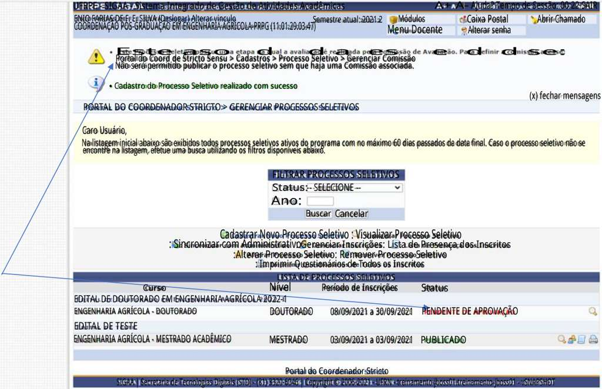

<!-- figure p24-fig1 | described_by: claude:sonnet | ocr_overlap: 0.84 | needs_review: false -->
Imagem lida. Descrição completa abaixo.

---

**1. Tipo de figura**

Captura de tela (print) de uma interface de sistema web acadêmico (SIGAA — Sistema Integrado de Gestão de Atividades Acadêmicas), com duas setas azuis desenhadas manualmente (anotação adicionada sobre o print) apontando para elementos específicos da tela.

**2. Todo o texto visível (verbatim)**

Barra de título superior (fundo azul escuro):
- "UFRPE - SIGAA - Sistema Integrado de Gestão de Atividades Acadêmicas"
- "A+ A– Ajuda? Tempo de Sessão: 00:22 SAIR" (também legível como 00:24 em outra leitura — dígitos pouco nítidos, poderia ser "00:22" ou "00:24")

Barra de usuário (fundo azul claro):
- "ENIO FARIAS DE F. E SILVA (Deslogar) Alterar vínculo"
- "COORDENAÇÃO POS-GRADUAÇÃO EM ENGENHARIA AGRICOLA-PRPG (11.01.29.03.47)"
- "Semestre atual: 2021.2"
- Ícones à direita: "Módulos", "Caixa Postal", "Abrir Chamado"
- "Menu Docente", "Alterar senha"

Bloco de mensagens do sistema (área com ícones de alerta/info), com texto grande em negrito sobreposto a um texto pequeno (duas camadas de texto ocupando o mesmo espaço, resultando em sobreposição ilegível em parte):
- Texto pequeno (parcialmente legível sob a sobreposição): "Esta solicitação de processo seletivo passou por uma etapa na qual a avaliação é realizada por comissão de Avaliação. Pa[ra] definir Comissão..." — restante **[ilegível]** por sobreposição com o texto grande.
- Texto grande em negrito, sobreposto ao anterior, formando letras isoladas e distorcidas (parece ser o mesmo aviso renderizado em fonte muito maior por cima): fragmentos legíveis "E s t e j a ... o ... d ... a ... es e d us se" — conteúdo **[ilegível]**, pois as duas camadas de texto se sobrepõem.
- Abaixo, com ícone de alerta (triângulo amarelo com "!"):
  "• Portal do Coord de Stricto Sensu > Cadastros > Processo Seletivo > Gerenciar Comissão"
  "Não será permitido publicar o processo seletivo sem que haja uma Comissão associada."
- Com ícone de informação (círculo azul com "i"), em texto verde:
  "• Cadastro do Processo Seletivo realizado com sucesso"
- Canto direito: "(x) fechar mensagens"

Título de seção:
- "PORTAL DO COORDENADOR STRICTO > GERENCIAR PROCESSOS SELETIVOS"

Bloco de instruções (fundo amarelo claro):
- "Caro Usuário,"
- "Na listagem inicial abaixo são exibidos todos processos seletivos ativos do programa com no máximo 60 dias passados da data final. Caso o processo seletivo não se encontre na listagem, efetue uma busca utilizando os filtros disponíveis abaixo."

Caixa de filtro (título em barra azul):
- "FILTRAR PROCESSOS SELETIVOS"
- "Status: -- SELECIONE --" (caixa de seleção/dropdown)
- "Ano:" (campo de texto vazio)
- Botões: "Buscar" "Cancelar"

Linha de links de ação (em azul, sublinhados, separados por ":"):
- "Cadastrar Novo Processo Seletivo"
- "Visualizar Processo Seletivo"
- "Sincronizar com Administrativo"
- "Gerenciar Inscrições"
- "Lista de Presença dos Inscritos"
- "Alterar Processo Seletivo"
- "Remover Processo Seletivo"
- "Imprimir Questionários de Todos os Inscritos"

Tabela "LISTA DE PROCESSOS SELETIVOS" (cabeçalho em barra azul), colunas:
- "Curso" | "Nível" | "Período de Inscrições" | "Status"

Linhas da tabela:
- Grupo "EDITAL DE DOUTORADO EM ENGENHARIA AGRÍCOLA 2022-1"
  - "ENGENHARIA AGRÍCOLA - DOUTORADO" | "DOUTORADO" | "08/09/2021 a 30/09/2021" | "PENDENTE DE APROVAÇÃO" (em vermelho) — ícone de lupa à direita
- Grupo "EDITAL DE TESTE"
  - "ENGENHARIA AGRÍCOLA - MESTRADO ACADÊMICO" | "MESTRADO" | "03/09/2021 a 03/09/2021" | "PUBLICADO" (em verde) — ícones à direita: lupa, pessoas/sincronizar, documento, impressora

Rodapé:
- "Portal do Coordenador Stricto"
- "SIGAA | Secretaria de Tecnologias Digitais (STD) - (81) 3320-6046 | Copyright © 2006-2021 - UFRN - treinamento-jboss01 - treinamento-jboss01 - vSNAPSHOT"

**3. Estrutura (layout, setas, conexões)**

Layout em blocos empilhados verticalmente, típico de página web institucional:
1. Barra de título do sistema (topo).
2. Barra de dados do usuário logado.
3. Painel de mensagens/avisos do sistema (com ícones de alerta amarelo e informação azul), contendo texto sobreposto ilegível.
4. Título de navegação ("breadcrumb" da seção).
5. Bloco de instruções em fundo amarelo.
6. Caixa de filtro de busca (centralizada).
7. Linha de menu de ações (links).
8. Tabela de resultados com cabeçalho e duas linhas de dados agrupadas por edital.
9. Rodapé do sistema.

Duas setas azuis diagonais (anotação sobreposta à imagem original, não fazem parte da interface original):
- Uma seta parte da margem esquerda inferior da imagem e aponta para cima, em direção ao ícone de alerta (triângulo amarelo) no painel de mensagens do sistema.
- Uma segunda seta, mais longa, parte de um ponto próximo à mesma origem (canto inferior esquerdo) e segue diagonalmente para cima/direita até apontar para a célula "PENDENTE DE APROVAÇÃO" na tabela de processos seletivos.

Não há gráficos, eixos ou painéis numéricos nesta figura — é uma interface de formulário/tabela de sistema.

**4. Valores numéricos**

- Tempo de sessão: "00:22" (ou possivelmente "00:24") SAIR
- Código do coordenador: "(11.01.29.03.47)"
- Semestre: "2021.2"
- Edital 1: período "08/09/2021 a 30/09/2021"
- Edital 2: período "03/09/2021 a 03/09/2021"
- "60 dias" (mencionado no texto de instrução, referente ao prazo de exibição dos processos)
- Telefone no rodapé: "(81) 3320-6046"
- Copyright: "2006-2021"

**5. Cores com significado**

- Vermelho: status "PENDENTE DE APROVAÇÃO" (indica pendência/alerta).
- Verde: status "PUBLICADO" (indica processo já publicado/ativo) e também a mensagem "Cadastro do Processo Seletivo realizado com sucesso" (confirmação de sucesso).
- Amarelo: ícone de alerta/aviso (triângulo com "!") e fundo do bloco de instruções.
- Azul: ícone de informação (círculo com "i"), barras de título/cabeçalho de seção e tabela, links de ação, e as duas setas de anotação adicionadas sobre a imagem.
- Preto: texto padrão da interface.

~~~text ocr
ctCaixa Postal *Abrir-Chamado
« Alterar senha
Módulos
Menu-Docente
de
to > > >
publicar O processo etivo sem que haja uma Comis
i « Cadastro-do Processo Seletivo realizado com sucesso
(x)
PORTAL DO GERENGIAR PROGESSOS SELETIVOS
Garo Usuário,
com no máximo 60 dias passados da data final. Caso o processo seletivo não se
Status SELECIONE — v
Ano:
Buscar Cancelar
Cadastr: : Seletivo
Lista de
Seletivo:
os Inscritos
DE
Curse Nive Reriodo de Inscrições Status
EDITAL DE DOUTORADO EM 2022
ENGENHARIA AGRÍCOLA - DOUTORADO DOUTORADO 08/09/2021 a 30/09/2024 PENDENTE DE APROVAÇÃO Q
EDITAL DE TESTE
ENGENHARIA AGRÍCOLA - MESTRADO ACADÊMICO MESTRADO 03/09/2021 a 03/09/2021 PUBLICADO 285 8
Portal do Coordenador Striato
~~~

<!-- Start of picture text -->
UFRPE - SIGAA - Sistema Integrado de Gestão de Atividades Acadêmicas A+ A- Ajuda? Tempo de Sessão: 00:22 SAIR ENIO FARIAS DE F. E. SILVA (Deslogar) Alterar vinculo Semestre atual: 2021.2 Módulos Caixa Postal Abrir Chamado COORDENAÇÃO PÓS-GRADUAÇÃO EM ENGENHARIA AGRÍCOLA-PRPG (11.01.29.03.47) Menu Docente Alterar senha Este aso   d    d a  es    e  d  d se: Portal do Coord de Stricto Sensu > Cadastros > Processo Seletivo > Gerenciar Comissão Não será permitido publicar o processo seletivo sem que haja uma Comissão associada. • Cadastro do Processo Seletivo realizado com sucesso (x) fechar mensagens PORTAL DO COORDENADOR STRICTO > GERENCIAR PROCESSOS SELETIVOS Caro Usuário, Na listagem inicial abaixo são exibidos todos proçessos seletivos ativos do programa com no máximo 60 dias passados da data final. Caso o processo seletivo não se encontre na listagem, efetue uma busca utilizando os filtros disponíveis abaixo. FILTRAR PROCESSOS SELETIVOS Status:-- SELECIONE -- Ano: Buscar Cancelar Cadastrar Novo Processo Seletivo : Visualizar Processo Seletivo : Sincronizar com Administrativo: Gerenciar Inscrições: Lista de Presença dos Inscritos :Alterar Processo Seletivo: Remover Processo Seletivo : Imprimir Questionários de Todos os Inscritos LISTA DE PROCESSOS SELETIVOS Curso Nível Período de Inscrições Status EDITAL DE DOUTORADO EM ENGENHARIA AGRÍCOLA 2022-1 ENGENHARIA AGRÍCOLA - DOUTORADO DOUTORADO 08/09/2021 a 30/09/2021 PENDENTE DE APROVAÇÃO EDITAL DE TESTE ENGENHARIA AGRÍCOLA - MESTRADO ACADÊMICO MESTRADO 03/09/2021 a 03/09/2021 PUBLICADO Portal do Coordenador Stricto SIGAA | Secretaria de Tecnologias Digitais (STD) - (81) 3320-6046 | Copyright © 2006-2021 - UFRN - treinamento-jboss01.treinamento-jboss01 - vSNAPSHOT <!-- End of picture text -->

21 

POR 08:59 27°C Chuva fraca● INTL 08/09/2021  

Digite aqui para pesquisar 

<!-- page 25 -->

 

 

 SIGAA - Sistema Integrado de GX + 

☆  

> ← C 

###### Não seguro |treinamento.sigs.ufrpe.br/sigaa/stricto/coordenacao.jsf 

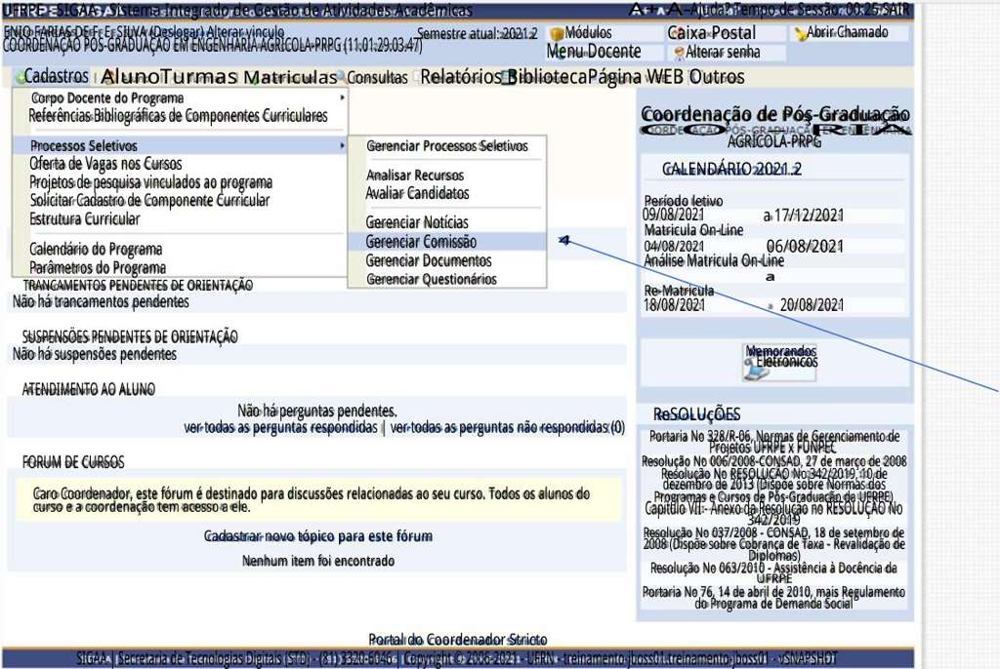

<!-- figure p25-fig1 | described_by: claude:sonnet | ocr_overlap: 0.9 | needs_review: false -->
(1) Figura: captura de tela (screenshot) de sistema web — SIGAA (Sistema Integrado de Gestão de Atividades Acadêmicas), mostrando menu de navegação expandido com submenus, com uma seta desenhada à mão apontando para item de menu.

(2) Texto visível (algumas áreas com texto sobreposto/borrado, marcadas [illegible] onde necessário):

Cabeçalho:
- "UFRPE-SIGAA-Sistema Integrado de Gestão de Atividades Acadêmicas" (texto sobreposto/duplicado, parcialmente ilegível devido a dupla exposição)
- "A+ A -A -Ajuda-Tempo de Sessão: 00:25:SAIR"
- "ENIO FARIAS DE FREITAS E SILVA (Deslogar) Alterar vínculo" (sobreposto)
- "Semestre atual: 2021.2"
- Ícones: "Módulos", "Caixa Postal", "Abrir Chamado"
- "COORDENAÇÃO POS-GRADUAÇÃO EM ENGENHARIA AGRICOLA-PRPG (11:01:29:03:47)" [parte sobreposta/ilegível]
- "Menu-Docente"
- "Alterar senha"

Barra de menu principal:
- "Cadastros | AlunoTurmas Matrículas Consultas | Relatórios BibliotecaPágina WEB Outros" (itens de menu colados/sobrepostos: "Cadastros", "Aluno", "Turmas", "Matrículas", "Consultas", "Relatórios", "Biblioteca", "Página WEB", "Outros")

Coluna de submenu esquerda (sob "Cadastros"):
- "Corpo Docente do Programa" (com seta ► indicando submenu)
- "Referências Bibliográficas de Componentes Curriculares"
- "Processos Seletivos" (com seta ► indicando submenu, este item está destacado/expande o submenu da direita)
- "Oferta de Vagas nos Cursos"
- "Projetos de pesquisa vinculados ao programa"
- "Solicitar Cadastro de Componente Curricular"
- "Estrutura Curricular"
- "Calendário do Programa"
- "Parâmetros do Programa"

Submenu direito (aberto a partir de "Processos Seletivos"):
- "Gerenciar Processos Seletivos"
- "Analisar Recursos"
- "Avaliar Candidatos"
- "Gerenciar Notícias"
- "Gerenciar Comissão" (item destacado em azul/realçado, com seta desenhada à mão apontando para ele a partir da direita)
- "Gerenciar Documentos"
- "Gerenciar Questionários"

Abaixo do menu, área de conteúdo principal (coluna esquerda):
- "TRANCAMENTOS PENDENTES DE ORIENTAÇÃO"
- "Não há trancamentos pendentes"
- "SUSPENSÕES PENDENTES DE ORIENTAÇÃO"
- "Não há suspensões pendentes"
- "ATENDIMENTO AO ALUNO"
- "Não há perguntas pendentes."
- "ver todas as perguntas respondidas | ver todas as perguntas não respondidas (0)"
- "FORUM DE CURSOS"
- "Caro Coordenador, este fórum é destinado para discussões relacionadas ao seu curso. Todos os alunos do curso e a coordenação tem acesso a ele."
- "Cadastrar novo tópico para este fórum"
- "Nenhum item foi encontrado"

Coluna direita (caixa de informações):
- "Coordenação de Pós-Graduação" (título, sobreposto com outro texto ilegível abaixo: algo como "COORDENAÇÃO POS-GRADUAÇÃO EM ENGENHARIA AGRICOLA-PRPG" repetido/duplicado)
- "AGRICOLA-PRPG"
- "CALENDÁRIO 2021.2"
- "Período letivo"
- "09/08/2021   a 17/12/2021"
- "Matrícula On-Line"
- "04/08/2021   06/08/2021"
- "Análise Matrícula On-Line"
- "a" (sozinho, numa linha)
- "Re-Matrícula"
- "18/08/2021   20/08/2021"
- Ícone/link: "Memorandos Eletrônicos"
- "RESOLUÇÕES" (título de seção)
- "Portaria No 328/R-06, Normas de Gerenciamento de Projetos UFRPE x FUNPEC"
- "Resolução No 006/2008-CONSAD, 27 de março de 2008"
- "Resolução No RESOLUÇÃO No 342/2019, 10 de dezembro de 2013 (Dispõe sobre Normas dos Programas e Cursos de Pós-Graduação de UFRPE)" [texto sobreposto, parcialmente confuso devido a duas resoluções coladas]
- "Capítulo VII- Anexo da Resolução no RESOLUÇÃO No 342/2019"
- "Resolução No 037/2008 - CONSAD, 18 de setembro de 2008 (Dispõe sobre Cobrança de Taxa - Revalidação de Diplomas)"
- "Resolução No 063/2010 - Assistência à Docência da UFRPE"
- "Portaria No 76, 14 de abril de 2010, mais Regulamento do Programa de Demanda Social"

Rodapé:
- "Portal do Coordenador Stricto"
- "SIGAA | Secretaria de Tecnologias Digitais (STD) - (81) 3320-6046 | Copyright © 2006-2021 - UFRN - treinamento.jboss01.treinamento.jboss01 - vSNAPSHOT"

(3) Estrutura: captura de tela de interface web, sem eixos/gráfico. Elementos:
- Barra superior de cabeçalho com dados de sessão/usuário.
- Barra de menu horizontal principal com abas.
- Ao clicar "Cadastros", abre painel suspenso com lista vertical de opções (coluna 1).
- Passar o mouse sobre "Processos Seletivos" (item com seta ►) abre um segundo submenu em cascata à direita (coluna 2), posicionado ao lado da coluna 1.
- Uma seta azul desenhada manualmente (anotação, não parte original do sistema) parte de baixo à direita da tela e aponta para o item "Gerenciar Comissão", que está destacado em azul-claro — indicando o item a ser clicado.
- Abaixo do menu, a página principal divide-se em duas colunas: coluna esquerda larga com seções de avisos/fórum; coluna direita estreita com caixa de calendário/resoluções.
- Rodapé horizontal com texto de copyright.

(4) Valores/números/datas:
- Tempo de Sessão: 00:25
- Semestre atual: 2021.2
- Horário/código: 11:01:29:03:47 [parcialmente ilegível devido sobreposição]
- CALENDÁRIO 2021.2
- Período letivo: 09/08/2021 a 17/12/2021
- Matrícula On-Line: 04/08/2021 a 06/08/2021
- Re-Matrícula: 18/08/2021 a 20/08/2021
- "ver todas as perguntas não respondidas (0)" — valor 0
- Portaria No 328/R-06
- Resolução No 006/2008-CONSAD, 27 de março de 2008
- Resolução No 342/2019, 10 de dezembro de 2013
- Resolução No 037/2008, 18 de setembro de 2008
- Resolução No 063/2010
- Portaria No 76, 14 de abril de 2010
- Telefone: (81) 3320-6046
- Copyright © 2006-2021

(5) Cores com significado:
- Item de menu "Gerenciar Comissão" destacado em fundo azul-claro, indicando seleção/hover.
- Seta de anotação em azul, desenhada manualmente, não pertence ao sistema original — indica ação a seguir (clicar em "Gerenciar Comissão").
- Caixa "FORUM DE CURSOS" com fundo amarelo-claro, destacando aviso/texto informativo.
- Restante da interface em tons padrão (cinza, branco, preto) sem outras cores semânticas.

~~~text ocr
VE
A Caixa-Postal
MenuDocente senha
«Cadastros | AlunoTurmas Matriculas-Consultas RelatóriosBibliotecaPágina WEB Outros
Coordenação de Pá
de Componentes Curriculares enação
| de Pós
» Processos Seletivos
erta de Vagas nos Cursos
vinculados ao
4 al é
do Pr Gerenciar Comissão 04/08/2021 06/08/2021
5 Gerenciar Documentos ise Matricula On-Line
Parâmetros do Programa . a
TRANGAMENTOS PENDENTES DE ORIENTAÇÃO
Não ha trancamentos pendentes 18/08/2021 » 20/08/2021
SUSPENSÕES RENDENTES DE ORIENTAÇÃO
Não há suspensões pendentes
ATENDIMENTO AQ ALUNO
perguntas pendentes. | ReSOLUÇÕES
ver-todas as perguntas respondidas | ver-todas as perguntas não respondidas (0) Portaria No
X
FORUM DE CURSOS Resolução No 006/2008-CONSAD, 27 de março de 2008
Caro Coordenador, este fórum é destinado para discussões relacionadas ao seu curso. Todos os alunos do 213
curso e a coordenação tem acesso a ele. No
Cadastrar- tópico para este fórum
Nenhum item foi encontrado
Resolução No 063/2040 - Assis ncia à Docência da
Portaria No 76, 14 de abril de 2010, mai lamento
Programa te
id
~~~

<!-- Start of picture text -->
UFRPE - SIGAA - Sistema Integrado de Gestão de Atividades Acadêmicas A+ A-Ajuda? Tempo de Sessão: 00:25 SAIR ENIO FARIAS DE F. E. SILVA (Deslogar) Alterar vinculo Semestre atual: 2021.2 Módulos Caixa Postal Abrir Chamado COORDENAÇÃO PÓS-GRADUAÇÃO EM ENGENHARIA AGRÍCOLA-PRPG (11.01.29.03.47) Menu Docente Alterar senha Cadastros AlunoTurmas Matriculas Consultas Relatórios BibliotecaPágina WEB Outros Corpo Docente do Programa Referências Bibliográficas de Componentes Curriculares Coordenação de Póş-Graduação CO  - RIA Processos Seletivos Gerenciar Processos Seletivos AGRÍCOLA-PRPG Oferta de Vagas nos CursosProjetos de pesquisa vinculados ao programa Analisar Recursos CALENDÁRIO 2021.2 Avaliar Candidatos Solicitar Cadastro de Componente Curricular Período letivo Estrutura Curricular Gerenciar Notícias 09/08/2021 a 17/12/2021 Matricula On-Line Calendário do Programa Gerenciar Comissão 4 04/08/2021  06/08/2021 Gerenciar Documentos Análise Matricula On-Line TRANCAMENTOS PENDENTES DE ORIENTAÇÃOParâmetros do Programa Gerenciar Questionários Re-Matricula a Não há trancamentos pendentes 18/08/2021 20/08/2021 SUSPENSÖES PENDENTES DE ORIENTAÇÃO Não há suspensões pendentes MemorandosEletrónicos ATENDIMENTO AO ALUNO Não há perguntas pendentes. ReSOLUçÕES ver todas as perguntas respondidas | ver todas as perguntas não respondidas (0) Portaria No 328/R-06, Normas de Gerenciamento de Projetos UFRPE x FUNPEC FORUM DE CURSOS Resolução No 006/2008-CONSAD, 27 de março de 2008 Resolução No RESOLUÇÃO No 342/2019, 10 de dezembro de 2013 (Dispõe sobre Normas dos Caro Coordenador, este fórum é destinado para discussões relacionadas ao seu curso. Todos os alunos do Programas e Cursos de Pós-Graduação da UFRPE) curso e a coordenação tem acesso a ele. Capitulo VII - Anexo da Resolução no RESOLUÇÃO No 342/2019 Cadastrar novo tópico para este fórum Resolução No 037/2008 - CONSAD, 18 de setembro de 2008 (Dispõe sobre Cobrança de Taxa - Revalidação de Nenhum item foi encontrado Diplomas) Resolução No 063/2010 - Assistência à Docência da UFRPE Portaria No 76, 14 de abril de 2010, mais Regulamento do Programa de Demanda Social Portal do Coordenador Stricto SIGAA | Secretaria de Tecnologias Digitais (STD) - (81) 3320-6046 | Copyright © 2006-2021 - UFRN - treinamento-jboss01.treinamento-jboss01 - vSNAPSHOT <!-- End of picture text -->

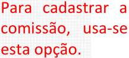

<!-- figure p25-fig2 | described_by: claude:sonnet | ocr_overlap: 1.0 | needs_review: false -->
(1) Tipo de figura: caixa de texto simples (callout), sem bordas, moldura ou setas visíveis — apenas texto destacado em vermelho sobre fundo branco.

(2) Texto visível, na íntegra: "Para cadastrar a comissão, usa-se esta opção."

(3) Estrutura: bloco único de texto corrido em três linhas, alinhado à esquerda, fonte sem serifa em negrito. Não há eixos, painéis, linhas, colunas ou setas conectando elementos.

(4) Valores numéricos: nenhum.

(5) Cor: todo texto em vermelho sobre fundo branco — cor usada só para destacar/chamar atenção, não codifica categorias distintas.

~~~text ocr
Para cadastrar a
comissão, usa-se
esta opção.
~~~

<!-- Start of picture text -->
Para cadastrar a comissão, usa-se esta opção. <!-- End of picture text -->

22 

POR 09:02 27°C Chuva fraca● INTL08/09/2021  

Q Digite aqui para pesquisar 

<!-- page 26 -->

 

 SIGAA - Sistema Integrado de GX + 

☆  

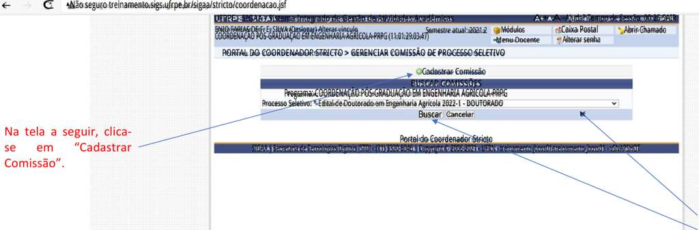

<!-- figure p26-fig1 | described_by: claude:sonnet | ocr_overlap: 0.79 | needs_review: false -->
(1) Tipo: captura de tela (screenshot) de sistema web, anotada com setas e texto explicativo em vermelho — típica de manual/tutorial de uso de sistema.

(2) Texto visível, verbatim:

Barra navegador: "Não seguro treinamento.sigs.ufrpe.br/sigaa/stricto/coordenacao.jsf"

Topo sistema: "UFRPE SIGAA Sistema integrado de Gestão de Atividades Acadêmicas" — canto direito: "A+ A A- Ajuda? Tempo de Sessão: 00:25 SAIR"

Linha usuário: "ENIO FARIAS DE F. E SILVA (Deslogar) Alterar vínculo" — "Semestre atual: 2021.2" — ícones: "Módulos", "Caixa Postal", "Abrir Chamado"
Linha abaixo: "COORDENAÇÃO POS-GRADUAÇÃO EM ENGENHARIA AGRICOLA-PRPG (11.01.29.03.47)" — "Menu Docente", "Alterar senha"

Breadcrumb: "PORTAL DO COORDENADOR STRICTO > GERENCIAR COMISSÃO DE PROCESSO SELETIVO"

Botão verde topo direito do painel: "Cadastrar Comissão" (com ícone "+" verde)

Faixa azul escura: "BUSCAR COMISSÕES"

Campos:
"Programa: COORDENAÇÃO POS-GRADUAÇÃO EM ENGENHARIA AGRICOLA-PRPG"
"Processo Seletivo: * Edital de Doutorado em Engenharia Agrícola 2022-1 - DOUTORADO" (campo dropdown/select)

Botões: "Buscar" "Cancelar"

Rodapé breadcrumb: "Portal do Coordenador Stricto"

Rodapé final: "SIGAA | Secretaria de Tecnologias Digitais (STD) - (81) 3320-6046 | Copyright © 2006-2021 - UFRN - treinamento.jboss01.treinamento.jboss01 - vSNAPSHOT"

Texto anotação vermelha (fora da tela do sistema, lado esquerdo): "Na tela a seguir, clica-se em "Cadastrar Comissão"."

(3) Estrutura: screenshot navegador ocupa maior parte direita/centro imagem. Texto vermelho anotação fica canto esquerdo inferior, fora screenshot, sobre fundo quadriculado (grade cinza clara).

Quatro setas azuis finas saem todas do texto vermelho/região esquerda, convergindo e apontando para 4 pontos diferentes dentro screenshot:
- 1 seta aponta para botão "Cadastrar Comissão" (topo direito painel)
- 1 seta aponta para linha "Buscar" (botão)
- 1 seta aponta para pequeno ícone seta preta (▼/cursor) próximo ao canto direito da faixa "BUSCAR COMISSÕES", próximo ao select Processo Seletivo
- 1 seta aponta para canto inferior direito da imagem (fora do painel, saindo de tela, ponta solta sem alvo visível claro — aponta pra baixo-direita, possivelmente indicando continuação/próxima ação fora do recorte)

Não há painéis múltiplos, não há eixos, não há tabela de dados numéricos — é interface de formulário web única.

(4) Valores/dados numéricos presentes:
- Semestre atual: 2021.2
- Tempo de Sessão: 00:25
- Código unidade: 11.01.29.03.47
- Edital: Doutorado em Engenharia Agrícola 2022-1
- Telefone rodapé: (81) 3320-6046
- Copyright: 2006-2021

(5) Cores com significado:
- Verde: ícone "+" do botão "Cadastrar Comissão" (indica ação de adicionar/criar)
- Vermelho: texto de instrução/anotação do tutorial (destaque didático, não parte do sistema original)
- Azul: setas de anotação (indicam direção/alvo da instrução) e barras de cabeçalho do sistema (azul escuro institucional)
- Amarelo/laranja: faixa fina decorativa abaixo header institucional
- Fundo quadriculado cinza claro: provavelmente fundo de ferramenta de edição/anotação (indica área fora do print real, tipo canvas de edição de imagem)

~~~text ocr
e
Na tela a seguir, clica-
se
Comissão”.
C
Postal
eMenuDocente senha
PORTAL DO COORDENADORSSTRICTO > GERENCIAR COMISSÃO DE PROGESSO SELETIVO
Comissão
EM ENGENHARIA AGRICOLAPRR
seletivo: Engenharia Agricola 2022-1 - DOUTORADO
Buscar
em Ca dastrar id
~~~

<!-- Start of picture text -->
← C ▲Não seguro treinamento.sigs.ufrpe.br/sigaa/stricto/coordenacao.jsf UFRPE - SIGAA - Sistema Integrado de Gestão de Atividades Acadêmicas A+ A-Ajuda? Tempo de Sessão: 00:25 SAIR ENIO FARIAS DE F. E. SILVA (Deslogar) Alterar vinculo Semestre atual: 2021.2 Módulos Caixa Postal Abrir Chamado COORDENAÇÃO PÓS-GRADUAÇÃO EM ENGENHARIA AGRÍCOLA-PRPG (11.01.29.03.47) Menu Docente Alterar senha PORTAL DO COORDENADOR STRICTO > GERENCIAR COMISSÃO DE PROCESSO SELETIVO Cadastrar Comissão BUSCAR COMISSÕES Programa: COORDENAÇÃO PÓS-GRADUAÇÃO EM ENGENHARIA AGRÍCOLA-PRPG Processo Seletivo: * Edital de Doutorado em Engenharia Agrícola 2022-1 - DOUTORADO Buscar Cancelar K Na tela a seguir, clica- Portal do Coordenador Stricto se em “Cadastrar SIGAA | Secretaria de Tecnologias Digitais (STD) - (81) 3320-6046 | Copyright © 2006-2021 - UFRN - treinamento-jboss01.treinamento-jboss01 - vSNAPSHOT Comissão”. <!-- End of picture text -->

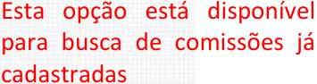

<!-- figure p26-fig2 | described_by: claude:sonnet | ocr_overlap: 1.0 | needs_review: false -->
(1) Figura tipo texto de aviso/nota, sem gráfico, tabela ou diagrama — apenas texto em destaque sobre fundo claro quadriculado (watermark/padrão de grade leve).

(2) Texto visível, verbatim, em vermelho:
"Esta opção está disponível para busca de comissões já cadastradas"

(3) Estrutura: bloco único de texto em três linhas, alinhado/justificado, sem caixas, setas, eixos ou painéis.

(4) Nenhum valor numérico presente.

(5) Cor: texto em vermelho — indica aviso/nota de atenção. Fundo branco/cinza claro com leve padrão de grade, sem significado funcional.

~~~text ocr
Esta opção está disponível
para busca de comissões já
cadastradas
~~~

<!-- Start of picture text -->
Esta opção está disponível para busca de comissões já cadastradas <!-- End of picture text -->

23 

POR £0:60 27°C Chuva fraca● INTL08/09/2021 

Digite aqui para pesquisar 

<!-- page 27 -->

 

> SIGAA - Sistema Integrado de GX + 

☆  

> ← C 

###### ▲Não segurotreinamento.sigs.ufrpe.br/sigaa/ensino/ComissaoProcessoSeletivo/form_comissao_processo_seletivo.jsf 

Na tela seguinte, deve-se nomear a comissão, indicar se o membro pertence ao programa (em caso negativo irá aparecer um campo para digitar o nome), escolher o membro, sua função, e clica-se me “adicionar membro”. 

A tela mostra também os membros que já foram inseridos. Quando terminar a inserção, clica-se em “Cadastrar comissão 

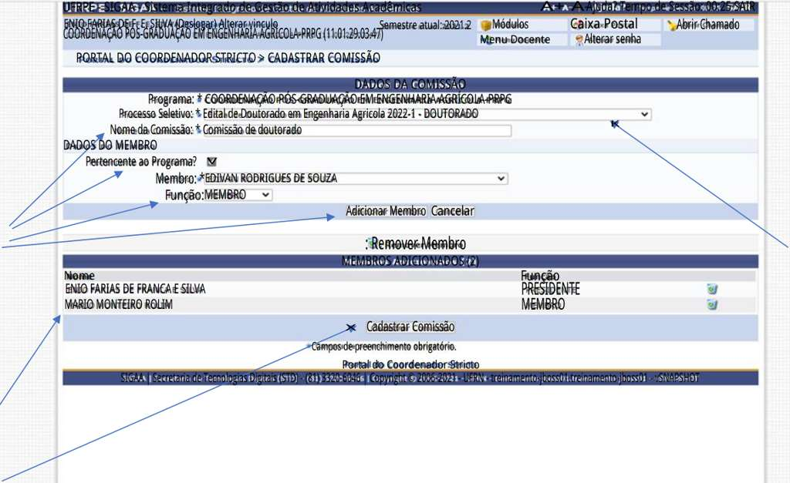

<!-- figure p27-fig1 | described_by: claude:sonnet | ocr_overlap: 0.9 | needs_review: false -->
1. Tipo de figura: captura de tela (screenshot) de sistema web, anotada com setas azuis apontando pra campos específicos (tipo tutorial/instrução de uso).

2. Texto visível (verbatim):

Topo (cabeçalho sistema):
- "UFRPE" "SIGAA" "Sistema Integrado de Gestão de Atividades Acadêmicas"
- "A+ A A" "Ajuda" "Tempo de Sessão: 00:25" "SAIR"
- "ENIO FARIAS DE F. E SILVA (Deslogar) Alterar vínculo"
- "COORDENAÇÃO PÓS-GRADUAÇÃO EM ENGENHARIA AGRICOLA-PRPG (11.01.29.03.47)"
- "Semestre atual: 2021.2"
- Ícones: "Módulos", "Caixa Postal", "Abrir Chamado"
- "Menu Docente", "Alterar senha"

Breadcrumb/caminho: "PORTAL DO COORDENADOR STRICTO > CADASTRAR COMISSÃO"

Seção "DADOS DA COMISSÃO" (barra azul escura):
- "Programa: * COORDENAÇÃO PÓS-GRADUAÇÃO EM ENGENHARIA AGRICOLA-PRPG"
- "Processo Seletivo: * Edital de Doutorado em Engenharia Agrícola 2022-1 - DOUTORADO" (dropdown)
- "Nome da Comissão: * Comissão de doutorado" (campo texto)

Seção "DADOS DO MEMBRO":
- "Pertencente ao Programa?" com checkbox marcado
- "Membro: * EDIVAN RODRIGUES DE SOUZA" (dropdown)
- "Função: MEMBRO" (dropdown)
- Botões: "Adicionar Membro" "Cancelar"

Texto solto: ": Remover Membro"

Tabela "MEMBROS ADICIONADOS (2)":
- Cabeçalho colunas: "Nome" | "Função"
- Linha 1: "ENIO FARIAS DE FRANCA E SILVA" | "PRESIDENTE" (ícone verde ao lado)
- Linha 2: "MARIO MONTEIRO ROLIM" | "MEMBRO" (ícone verde ao lado)

Botão: "Cadastrar Comissão" (com ícone X ao lado)

Texto: "Campos de preenchimento obrigatório."

Rodapé: "Portal do Coordenador Stricto"
- "SIGAA | Secretaria de Tecnologias Digitais (STI) - (81) 3320-6046 | Copyright © 2006-2021 - UFRN - treinamento-jboss01.treinamento-jboss01 - vSNAPSHOT"

3. Estrutura: formulário web de cadastro, organizado em caixas/seções empilhadas verticalmente:
- Cabeçalho do sistema (barra superior)
- Breadcrumb de navegação
- Caixa "DADOS DA COMISSÃO" (título em barra azul) com 3 campos
- Seção "DADOS DO MEMBRO" (sem caixa destacada) com checkbox, 2 dropdowns, botões
- Linha "Remover Membro"
- Tabela "MEMBROS ADICIONADOS" com 2 colunas (Nome, Função) e 2 linhas de dados
- Botão final "Cadastrar Comissão"
- Nota de campos obrigatórios
- Rodapé institucional

Setas azuis (anotações, não parte do sistema original): váli flechas saindo de pontos à esquerda (margem) apontando pra: campo "Nome da Comissão", checkbox "Pertencente ao Programa?", área "DADOS DO MEMBRO", dropdown "Membro", linha "ENIO FARIAS DE FRANCA E SILVA" na tabela. Outra seta aponta da direita pro dropdown "Processo Seletivo" e outra da direita pro ícone ao lado de linha da tabela (ícone verde).

4. Números/valores:
- "00:25" (tempo de sessão)
- "11.01.29.03.47" (código do programa)
- "2021.2" (semestre)
- "2022-1" (ano/semestre do edital)
- "(2)" (quantidade de membros adicionados)
- "(81) 3320-6046" (telefone)
- "2006-2021" (período copyright)

5. Cores com significado: barra de título "DADOS DA COMISSÃO" e cabeçalho tabela "MEMBROS ADICIONADOS" em azul escuro (destaque de seção); setas de anotação em azul (indicam pontos de atenção/instrução); ícones ao lado das linhas da tabela em verde (ação, provavelmente "aprovar/excluir membro"); asteriscos "*" em vermelho/laranja indicando campo obrigatório.

~~~text ocr
DAI
Caixa-Postal
PG senha
RORTAL DO COORDENADORSTRIGTO > CADASTRAR COMISSÃO
Programa: * COORDENAÇÃO
Processo Seletivo: + Edital
Nome-da * Comissão de doutorado
MEMBRO
Pertencente ao Programa?
RODRIGUES DE SOUZA v
Adicionar Membro Cancelar
E Membro
F
FARIAS DE FRANCA £ SILVA ENTE
MARIO MONTEIRO ROLIM MEMBRO
ee
Cadastrar Comissão
rigatório.
SUAA | |
~~~

<!-- Start of picture text -->
UFRPE - SIGAA - Sistema Integrado de Gestão de Atividades Acadêmicas A+ A-Ajuda? Tempo de Sessão: 00:25 SAIR ENIO FARIAS DE F. E. SILVA (Deslogar) Alterar vinculo Semestre atual: 2021.2 Módulos Caixa Postal Abrir Chamado COORDENAÇÃO PÓS-GRADUAÇÃO EM ENGENHARIA AGRÍCOLA-PRPG (11.01.29.03.47) Menu Docente Alterar senha PORTAL DO COORDENADOR STRICTO > CADASTRAR COMISSÃO DADOS DA COMISSÃO Programa: * COORDENAÇÃO PÓS-GRADUAÇÃO EM ENGENHARIA AGRÍCOLA-PRPG Processo Seletivo: * Edital de Doutorado em Engenharia Agricola 2022-1 - DOUTORADO Nome da Comissão: * Comissão de doutorado K DADOS DO MEMBRO Pertencente ao Programa? V Membro: *EDIVAN RODRIGUES DE SOUZA Função:MEMBRO Adicionar Membro Cancelar : Remover Membro MEMBROS ADICIONADOS (2) Nome Função ENIO FARIAS DE FRANCA E SILVA PRESIDENTE MARIO MONTEIRO ROLIM MEMBRO X Cadastrar Comissão Campos de preenchimento obrigatório. Portal do Coordenador Stricto SIGAA | Secretaria de Tecnologias Digitais (STD) - (81) 3320-6046 | Copyright © 2006-2021 - UFRN - treinamento-jboss01.treinamento-jboss01 - vSNAPSHOT <!-- End of picture text -->

A comissão poderá ser a mesma para os processos seletivos de Mestrado e Doutorado, porém ela deverá ser cadastrada em ambos. 

Docentes externos à UFRPE podem ser membros da banca mas não presidentes. 

24 

POR L0:60 INTL 08/09/2021 

27℃ Chuva fraca 

Digite aqui para pesquisar 

<!-- page 28 -->

 

> SIGAA - Sistema Integrado de GX + 

☆  

← → C Não seguro treinamento.sigs.ufrpe.br/sigaa/stricto/coordenacao.jsf 

Caso a PRPG aprove o processo seletivo, o mesmo será publicado (ou ficará pendente de publicação, caso ainda não esteja na data prevista da publicação). Caso solicite alteração, o programa será informado e poderá editá-lo clicando no ícone ao lado da lixeira. 

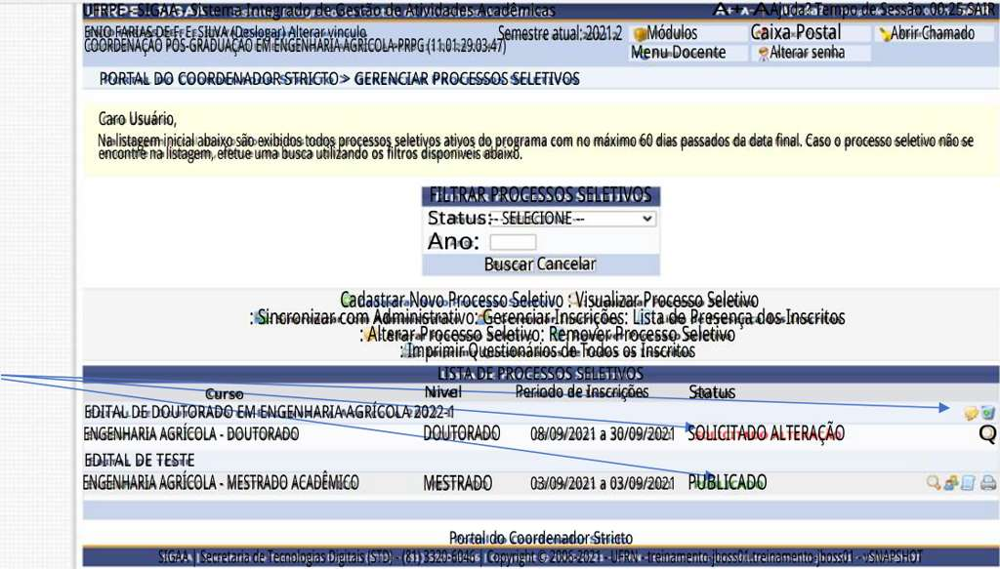

<!-- figure p28-fig1 | described_by: claude:sonnet | ocr_overlap: 0.76 | needs_review: false -->
Captura de tela de interface de sistema web (SIGAA - Sistema Integrado de Gestão de Atividades Acadêmicas), tela do "Portal do Coordenador Stricto". A imagem apresenta sobreposição/fantasma de texto em várias linhas (duplicação visual), com algumas palavras pouco legíveis devido a essa sobreposição.

**1. Tipo de figura:** captura de tela (screenshot) de sistema de gestão acadêmica web, não é gráfico de dados.

**2. Texto visível (verbatim):**

Barra superior (com sobreposição de texto, parcialmente ilegível em trechos):
- "UFRPE SIGAA Sistema Integrado de Gestão de Atividades Acadêmicas"
- "A+ A- A Ajuda Tempo de Sessão: 00:25:5[illegible]"
- "ENIO FARIAS DE F. E SILVA (Deslogar) Alterar vínculo" — "Semestre atual: 2021.2" — "Módulos" — "Caixa Postal" — "Abrir Chamado"
- "COORDENAÇÃO POS-GRADUAÇÃO EM ENGENHARIA AGRICOLA-PRPG (11.01.29.03.47)" — "Menu Docente" — "Alterar senha"

Linha de navegação (breadcrumb):
- "PORTAL DO COORDENADOR STRICTO > GERENCIAR PROCESSOS SELETIVOS"

Caixa de aviso (fundo amarelo claro):
- "Caro Usuário,"
- "Na listagem inicial abaixo são exibidos todos processos seletivos ativos do programa com no máximo 60 dias passados da data final. Caso o processo seletivo não se encontre na listagem, efetue uma busca utilizando os filtros disponíveis abaixo."

Caixa de filtro (título em barra azul):
- "FILTRAR PROCESSOS SELETIVOS"
- "Status: -- SELECIONE --" (campo com menu suspenso)
- "Ano:" (campo de texto em branco)
- Botões: "Buscar" "Cancelar"

Linha de ações/links (em verde, sobrepostos):
- "Cadastrar Novo Processo Seletivo : Visualizar Processo Seletivo"
- "Sincronizar com Administrativo : Gerenciar Inscrições : Lista de Presença dos Inscritos"
- "Alterar Processo Seletivo : Remover Processo Seletivo"
- "Imprimir Questionários de Todos os Inscritos"

Título da tabela (barra azul escura):
- "LISTA DE PROCESSOS SELETIVOS"

Cabeçalho da tabela:
- "Curso" | "Nivel" | "Periodo de Inscrições" | "Status"

Linhas da tabela:
- Linha de grupo: "EDITAL DE DOUTORADO EM ENGENHARIA AGRÍCOLA 2022-1"
  - "ENGENHARIA AGRÍCOLA - DOUTORADO" | "DOUTORADO" | "08/09/2021 a 30/09/2021" | "SOLICITADO ALTERAÇÃO" (texto em vermelho) — ícone na direita (letra "Q")
- Linha de grupo: "EDITAL DE TESTE"
  - "ENGENHARIA AGRÍCOLA - MESTRADO ACADÊMICO" | "MESTRADO" | "03/09/2021 a 03/09/2021" | "PUBLICADO" (texto em verde) — ícones na direita (vários pequenos ícones, ilegíveis individualmente)

Rodapé:
- "Portal do Coordenador Stricto"
- "SIGAA | Secretaria de Tecnologias Digitais (STD) - (81) 3320-6[illegible] | Copyright © 2006-2021 - UFRN - [treinamento.jboss01.treinamento.jboss01] - vSNAPSHOT"

**3. Estrutura:**
- Layout vertical em seções empilhadas: barra de cabeçalho superior → breadcrumb de navegação → caixa de aviso amarela → caixa de filtro azul com campos "Status" e "Ano" e botões → bloco de links de ação em verde → tabela de "Lista de Processos Seletivos" com 4 colunas e 2 editais (grupos), cada um com uma linha de dados → rodapé do sistema.
- Duas setas azuis diagonais desenhadas sobre a imagem (anotações manuais), apontando da esquerda/centro para a direita: uma parte da margem esquerda (altura da tabela) apontando para o ícone/ação na linha "SOLICITADO ALTERAÇÃO" (extremidade direita), e outra saindo da região central (linha "PUBLICADO") apontando também para a direita, na mesma linha de status "PUBLICADO". As setas parecem indicar/destacar as colunas de "Status" e os ícones de ação à direita de cada registro.
- Não há eixos nem gráfico; é uma tabela de dados dentro de uma interface web.

**4. Valores de dados (tabela "Lista de Processos Seletivos"):**
- Registro 1: Curso = "ENGENHARIA AGRÍCOLA - DOUTORADO"; Nível = "DOUTORADO"; Período de Inscrições = "08/09/2021 a 30/09/2021"; Status = "SOLICITADO ALTERAÇÃO"
- Registro 2: Curso = "ENGENHARIA AGRÍCOLA - MESTRADO ACADÊMICO"; Nível = "MESTRADO"; Período de Inscrições = "03/09/2021 a 03/09/2021"; Status = "PUBLICADO"
- Outros valores numéricos: "Semestre atual: 2021.2"; código "(11.01.29.03.47)"; tempo de sessão "00:25:5[illegible]"; telefone "(81) 3320-6[illegible]"; copyright "2006-2021".

**5. Cores com significado:**
- Barra de cabeçalho e barra de título da tabela: fundo azul escuro com texto branco (elementos de navegação/estrutura do sistema).
- Caixa de aviso: fundo amarelo claro (destaque de instrução ao usuário).
- Links de ação ("Cadastrar Novo Processo Seletivo", etc.): texto em verde (indicando links clicáveis).
- Status "SOLICITADO ALTERAÇÃO": texto em vermelho (indicando status pendente/alerta).
- Status "PUBLICADO": texto em verde (indicando status concluído/ativo).
- Duas setas azuis sobrepostas: anotação manual adicionada à imagem, não fazem parte do sistema original, usadas para apontar/destacar os status e ícones de ação na tabela.

~~~text ocr
tre Postal
RORTAL DO COORDENADORSSTRIGTO > PROGESSOS SELETIVOS
Garo Usuário,
todos ativos do programa com no máximo 60 dias passados da data final. Caso 0 processo seletivo não se
Status:-
Ane:
Buscar Cancelar
: VisualizaraP rocasso Seletivo
:
Se
EDITAL E
ENGENHARIA AGRÍCOLA - DOUTORADO Q
EDITAL DE TESTE
28528
ENGENHARIA AGRÍCOLA - MESTRADO ACADÊMICO MESTRADO 03/09/2021 a 03/09/2024
~~~

<!-- Start of picture text -->
UFRPE - SIGAA - Sistema Integrado de Gestão de Atividades Acadêmicas A+ A-Ajuda? Tempo de Sessão: 00:25 SAIR ENIO FARIAS DE F. E. SILVA (Deslogar) Alterar vinculo Semestre atual: 2021.2 Módulos Caixa Postal Abrir Chamado COORDENAÇÃO PÓS-GRADUAÇÃO EM ENGENHARIA AGRÍCOLA-PRPG (11.01.29.03.47) Menu Docente Alterar senha PORTAL DO COORDENADOR STRICTO > GERENCIAR PROCESSOS SELETIVOS Caro Usuário, Na listagem inicial abaixo são exibidos todos processos seletivos ativos do programa com no máximo 60 dias passados da data final. Caso o processo seletivo não se encontre na listagem, efetue uma busca utilizando os filtros disponiveis abaixo. FILTRAR PROCESSOS SELETIVOS Status:-- SELECIONE -- Ano: Buscar Cancelar  Cadastrar Novo Processo Seletivo : Visualizar Processo Seletivo : Sincronizar com Administrativo: Gerenciar Inscrições: Lista de Presença dos Inscritos : Alterar Processo Seletivo: Remover Processo Seletivo : Imprimir Questionários de Todos os Inscritos LISTA DE PROCESSOS SELETIVOS Curso Nivel Periodo de Inscrições Status EDITAL DE DOUTORADO EM ENGENHARIA AGRÍCOLA 2022-1 ENGENHARIA AGRÍCOLA - DOUTORADO DOUTORADO 08/09/2021 a 30/09/2021 SOLICITADO ALTERAÇÃO Q EDITAL DE TESTE ENGENHARIA AGRÍCOLA - MESTRADO ACADÊMICO MESTRADO 03/09/2021 a 03/09/2021 PUBLICADO Portal do Coordenador Stricto SIGAA | Secretaria de Tecnologias Digitais (STD) - (81) 3320-6046 | Copyright © 2006-2021 - UFRN - treinamento-jboss01.treinamento-jboss01 - vSNAPSHOT <!-- End of picture text -->

25 

26°C Chuva fraca PORINTL 08/09/202109:14  

Digite aqui para pesquisar 

<!-- page 29 -->

 

> SIGAA - Sistema Integrado de GX + 

☆  

> ← C Não segurotreinamento.sigs.ufrpe.br/sigaa/administracao/cadastro/ProcessoSeletivo/lista.jsf 

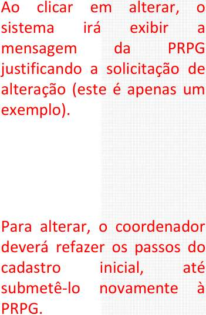

<!-- figure p29-fig1 | described_by: claude:sonnet | ocr_overlap: 0.95 | needs_review: false -->
1) Tipo: figura texto-anotação, sem gráfico/diagrama — bloco texto vermelho sobre fundo pontilhado claro (textura papel quadriculado).

2) Texto visível, verbatim, dois parágrafos:

"Ao clicar em alterar, o sistema irá exibir a mensagem da PRPG justificando a solicitação de alteração (este é apenas um exemplo)."

"Para alterar, o coordenador deverá refazer os passos do cadastro inicial, até submetê-lo novamente à PRPG."

3) Estrutura: sem caixas, sem setas, sem eixos, sem colunas/painéis. Só dois blocos parágrafo texto, separado espaço vazio (área pontilhada sem conteúdo) entre eles.

4) Valor numérico: nenhum.

5) Cor: todo texto vermelho — sem variação cor, sem significado diferencial entre as duas partes.

~~~text ocr
Ao clicar em alterar, o
sistema irá exibir a
mensagem da PRPG
justificando a solicitação de
alteração (este é apenas um
exemplo).
Para alterar, o coordenador
deverá refazer os passos do
cadastro inicial, até
submeté-lo novamente a
PRPG.
~~~

<!-- Start of picture text -->
Ao clicar em alterar, o sistema irá exibir a mensagem da PRPG justificando a solicitação de alteração (este é apenas um exemplo). Para alterar, o coordenador deverá refazer os passos do cadastro inicial, até submetê-lo novamente à PRPG. <!-- End of picture text -->

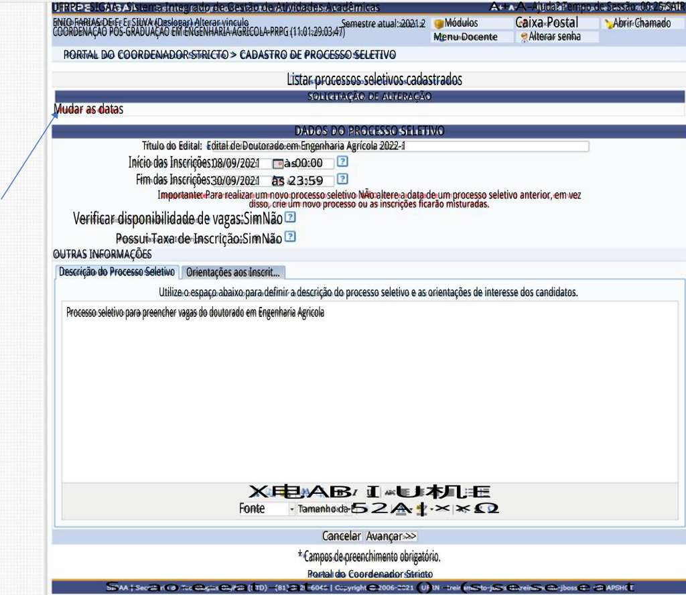

<!-- figure p29-fig2 | described_by: claude:sonnet | ocr_overlap: 0.83 | needs_review: false -->
(1) Tipo de figura: captura de tela (screenshot) de sistema web administrativo, com anotação manual sobrepostа — seta azul desenhada à mão apontando para texto manuscrito "Mudar as datas". Imagem com ruído/efeito de "fantasma" (texto duplicado/desfocado em várias linhas), tornando parte do texto difícil de ler.

(2) Texto visível, verbatim (onde legível):
- Topo, barra do sistema: "UFRPE SIGAA Sistema Integrado de Gestão de Atividades Acadêmicas"
- Canto superior direito: "A+ A A- Ajuda? Tempo de Sessão: 00:25:5A[trunc, illegible]"
- "ENIO FARIAS DE FREIRE SILVA (Deslogar) Alterar vínculo" / "COORDENAÇÃO PÓS-GRADUAÇÃO EM ENGENHARIA AGRÍCOLA-PRPG (11:01:29:03:47)"
- "Semestre atual: 2021.2"
- Ícones/menus: "Módulos", "Caixa Postal", "Abrir Chamado"
- "Menu Docente", "Alterar senha"
- Trilha de navegação: "PORTAL DO COORDENADOR STRICTO > CADASTRO DE PROCESSO SELETIVO"
- Link: "Listar processos seletivos cadastrados"
- Faixa azul-escura: "SOLICITAÇÃO DE ALTERAÇÃO"
- Anotação manuscrita (com seta azul apontando para ela): "Mudar as datas"
- Faixa de título: "DADOS DO PROCESSO SELETIVO"
- Campo: "Título do Edital: Edital de Doutorado em Engenharia Agrícola 2022-1"
- Campo: "Início das Inscrições: 08/09/2021" com ícone de calendário, "às 00:00" e ícone de ajuda "?"
- Campo: "Fim das Inscrições: 30/09/2021 às 23:59" com ícone "?"
- Texto em vermelho: "Importante: Para realizar um novo processo seletivo NÃO altere a data de um processo seletivo anterior, em vez disso, crie um novo processo ou as inscrições ficarão misturadas."
- Campo: "Verificar disponibilidade de vagas: Sim Não" com ícone "?"
- Campo: "Possui Taxa de Inscrição: Sim Não" com ícone "?"
- Seção: "OUTRAS INFORMAÇÕES"
- Abas: "Descrição do Processo Seletivo" | "Orientações aos Inscrit..." (texto cortado, provavelmente "Inscritos")
- Instrução: "Utilize o espaço abaixo para definir a descrição do processo seletivo e as orientações de interesse dos candidatos."
- Caixa de texto com conteúdo: "Processo seletivo para preencher vagas do doutorado em Engenharia Agrícola"
- Barra de ferramentas do editor de texto (ícones sobrepostos/fantasma, parcialmente ilegíveis): letras tipo "X B I U" (negrito/itálico/sublinhado), símbolos "52 A" e caracteres especiais (Ω e outros), rótulos "Fonte" e "Tamanho da..." (cortado)
- Botões: "Cancelar" e "Avançar >>"
- Nota: "* Campos de preenchimento obrigatório."
- Rodapé: "Portal do Coordenador Stricto"
- Linha final (texto sobreposto/fantasma, parcialmente ilegível): "SAGE SIGAA (TD) - [1,21 r1: 504s?] | Copyright 2006-2021 - UFRN - [restante ilegível/sobreposto] - JBoss - [ilegível]"

Partes marcadas como [illegible]: alguns trechos no topo direito (tempo de sessão completo), parte do rodapé final, detalhes da barra de ferramentas do editor de texto — todos aparecem sobrepostos/duplicados por efeito de "ghosting" na imagem.

(3) Estrutura: página única de formulário web, organizada em blocos horizontais empilhados verticalmente:
- Barra superior de sistema (logo/título + menu de usuário + sessão)
- Barra de navegação (breadcrumb)
- Link de listagem
- Faixa de seção "SOLICITAÇÃO DE ALTERAÇÃO" com anotação manual abaixo
- Seta azul desenhada à mão, partindo da margem esquerda da imagem (fora do conteúdo do sistema) apontando diagonalmente para cima-direita, até o texto manuscrito "Mudar as datas" (anotação de terceiro, não parte original da tela)
- Bloco "DADOS DO PROCESSO SELETIVO": campos empilhados (título, datas de início/fim, duas perguntas sim/não)
- Aviso em vermelho dentro do mesmo bloco
- Seção "OUTRAS INFORMAÇÕES" com duas abas (painel de abas) e abaixo uma caixa de texto grande (editor de rich text) com barra de ferramentas no topo
- Linha de botões de ação (Cancelar / Avançar)
- Rodapé com nota de campo obrigatório e informações de copyright do sistema

Não há eixos, gráficos, tabelas numéricas ou painéis múltiplos — é uma única tela de formulário.

(4) Valores de dados presentes:
- Semestre atual: 2021.2
- Início das Inscrições: 08/09/2021, às 00:00
- Fim das Inscrições: 30/09/2021, às 23:59
- Tempo de Sessão: 00:25:5[resto ilegível]
- Código/identificador: (11:01:29:03:47)
- Ano/edital: Edital de Doutorado em Engenharia Agrícola 2022-1
- Ano de copyright: 2006-2021

(5) Cores com significado:
- Faixas de cabeçalho/seção em azul escuro (destaque estrutural de títulos de seção, ex.: "SOLICITAÇÃO DE ALTERAÇÃO", "DADOS DO PROCESSO SELETIVO")
- Texto em vermelho no aviso "Importante: ..." — destaca alerta/restrição importante para o usuário
- Seta e texto manuscrito em azul — anotação adicionada sobre a captura de tela, indicando/destacando o elemento "Mudar as datas" como ponto de interesse, não fazendo parte do sistema original

~~~text ocr
MenuDocente
RORTAL DO COORDENADORSTRICTO > CADASTRO DE PROGESSO SELETIVO
Listar
Título do Edital: Edital Agrícola 2022-4
Início-das (2)
Fimdas [2]
seletivo processo seletivo anterior, em vez
disso, novo processo ou as inscrições ficarão misturadas.
Verificar vagas:SimNão 2)
OUTRAS INFORMAÇÕES
Descrição do Processo aos inscrit...
descrição do processo seletivo e as de interesse dos candidatos.
Processo seletivo para preencher vagas do doutorado em Engenharia Agricola
Fonte 2 AX
Cancelar Avançar->>
*Campos de preenchimento obrigatório.
Coordenador
~~~

<!-- Start of picture text -->
UFRPE - SIGAA - Sistema Integrado de Gestão de Atividades Acadêmicas A+ A-Ajuda? Tempo de Sessão: 00:25 SAIR ENIO FARIAS DE F. E. SILVA (Deslogar) Alterar vinculo Semestre atual: 2021.2 Módulos Caixa Postal Abrir Chamado COORDENAÇÃO PÓS-GRADUAÇÃO EM ENGENHARIA AGRÍCOLA-PRPG (11.01.29.03.47) Menu Docente Alterar senha PORTAL DO COORDENADOR STRICTO > CADASTRO DE PROCESSO SELETIVO Listar processos seletivos cadastrados SOLICITAÇÃO DE ALTERAÇÃO Mudar as datas DADOS DO PROCESSO SELETIVO Título do Edital:  Edital de Doutorado em Engenharia Agrícola 2022-1 Início das Inscrições:08/09/2021 às00:00 Fim das Inscrições:30/09/2021 às 23:59 Importante: Para realizar um novo processo seletivo NÃo altere a data de um processo seletivo anterior, em vez disso, crie um novo processo ou as inscrições ficarão misturadas. Verificar disponibilidade de vagas:SimNão Possui Taxa de Inscrição:SimNão OUTRAS INFORMAÇÕES Descrição do Processo Seletivo Orientações aos Inscrit... Utilize o espaço abaixo para definir a descrição do processo seletivo e as orientações de interesse dos candidatos. Processo seletivo para preencher vagas do doutorado em Engenharia Agricola XAB I UE Fonte Tamanho da F52A|××Ω Cancelar Avançar >> * Campos de preenchimento obrigatório. Portal do Coordenador Stricto S - ao-e-eat - at - -  e  - () - (s se se  ea  t <!-- End of picture text -->

26 

0POR 09:17 INTL 08/09/2021  

QDigite aqui para pesquisar 

26°C Chuva fraca 

<!-- page 30 -->

UFRPE - SIGAA- Sisterma Integrado de Gestão de Atividades Acadêrmicas A+ A- Ajuda? Tempo de Sessão: 00:25 SAIR PAULO ROBERTO C. DE O. FILHO (Deslogar) Alterar vinculo Semestre atual: 2022.1 Módulos Caixa Postal Abrir Chamado COORDENAÇÃO PÓS-GRADUAÇÃO EM RECURSOS PESQUEIROS E AQUICULTUR... (11.01.29.03.12) Menu Docente Alterar senha 

PORTAL DO COORDENADOR STRICTO > GERENCIAR DOCUMENTOS DE PROCESSO SELETIVO 

Cadastrar Novo Documento BUSCAR DOCUMENTOS Programa: COORDENAÇÃO PÓS-GRADUAÇÃO EM RECURSOS PESQUEIROS E AQUICULTURA-PRPG Processo Seletivo:*EDITAL 2022.2 - RECURSOS PESQUEIROS E AQUICULTURA - MESTRADO ACADÊMICO - MESTR Buscar Cancelar : Baixar Arquivo : Publicar:Despublicar :Alterar : Remover DOCUMENTOS CADASTRADOS (2) Descrição Data de Cadastro Tipo Documento Publicado Manual do Candidato 27/04/2022 16:41:27 Manual do Candidato Não Edital do Processo Seletivo 27/04/202216:41:27 Edital do Processo Seletivo Não Portal do Coordenador Stricto SIGAA | Secretaria de Tecnologias Digitais (STD) - (81) 3320-6046 | Copyright © 2006-2022 - UFRN - producao-jboss02.producao-jboss02 - v4.6.8-2 

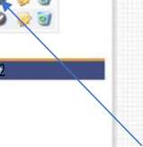

<!-- figure p30-fig1 | described_by: claude:sonnet | ocr_overlap: None | needs_review: false -->
Figure type: screenshot fragment of software UI, no chart/graph axes visible.

Text visible: "2" (partial, left edge, white on dark blue bar). Rest [illegible] — too cropped/small.

Structure:
- Top-left: small toolbar row, 2 square icon buttons (rounded corners), left one shows yellow star shape on blue background, right one blue/teal icon, [illegible] detail.
- Below toolbar: horizontal dark navy/blue bar spanning width, containing white "2" at left edge, rest of bar empty/[illegible].
- Right side: light gray dot-grid pattern (grid of small dots), typical of design-canvas background (e.g. Figma/drawing tool).
- Diagonal blue line cuts across whole image corner-to-corner (top-left to bottom-right), overlaying both toolbar and grid area — likely a selection/alignment guide line, not data.

No axes, no legend, no numeric data values present beyond single digit "2".

Colors: yellow (star icon), dark navy (bar), light blue/teal (line, icon), gray (dot grid) — no colors encode quantitative meaning here, UI chrome only.

Note: image heavily cropped/small resolution — most content [illegible]. If this isn't full intended figure, re-check source file/crop.

Caso a PRPG solicite alteração, será necessário o programa republicar os documentos já enviados anteriormente, através do menu Cadastros > Processos Seletivos > Gerenciar Documentos, e clicando neste botão 

27 

<!-- page 31 -->

 

> SIGAA - Sistema Integrado de GX + 

☆  

##### ← C ▲Não segurotreinamento.sigs.ufrpe.br/sigaa/stricto/coordenacao.jsf 

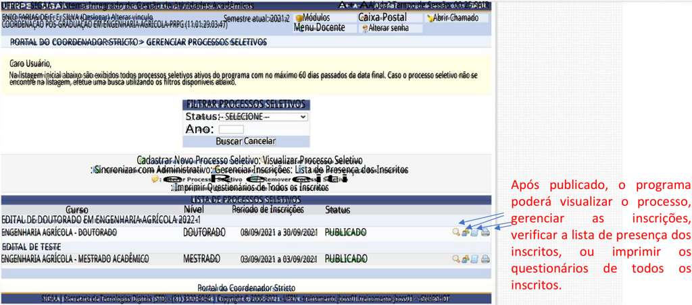

<!-- figure p31-fig1 | described_by: claude:sonnet | ocr_overlap: 0.92 | needs_review: false -->
Captura tela sistema web (SIGAA), com anotação sobreposta em vermelho à direita. Nota: parte do texto no topo da imagem aparece com sobreposição/fantasma (duas camadas de texto desalinhadas), dificultando leitura exata de alguns trechos — marco como [ilegível] onde aplicável.

**1. Tipo de figura:** Captura de tela (screenshot) de interface de sistema acadêmico web, com uma caixa de texto explicativa em vermelho adicionada sobre a imagem.

**2. Texto visível (verbatim):**

Barra superior (com sobreposição/ghosting, parcialmente [ilegível]):
- "UFRPE | SIGAA — Sistema Integrado de Gestão de Atividades Acadêmicas" (reconstrução aproximada; camadas sobrepostas tornam leitura exata incerta)
- "A+ A- AA" / "Ajuda" / "Tempo de sessão: 00:25:5x" [ilegível no final]

Linha abaixo (também com ghosting):
- "ENIO FARIAS DE FREITAS SILVA (Desligar) Alterar vínculo"
- "COORDENAÇÃO PÓS-GRADUAÇÃO EM ENGENHARIA AGRÍCOLA-PRPG (11:01:29:03:47)" [números finais possivelmente ilegíveis/incertos]
- "Semestre atual: 2021.2"
- "Módulos"
- "Caixa Postal"
- "Abrir Chamado"
- "Menu Docente"
- "Alterar senha"

Linha de navegação (breadcrumb), com sobreposição:
- "PORTAL DO COORDENADOR STRICTO > GERENCIAR PROCESSOS SELETIVOS"

Bloco de aviso (fundo amarelo claro):
- "Caro Usuário,"
- "Na listagem inicial abaixo são exibidos todos os processos seletivos ativos do programa com no máximo 60 dias passados da data final. Caso o processo seletivo não se encontre na listagem, efetue uma busca utilizando os filtros disponíveis abaixo."

Caixa de filtro (título em barra azul escura):
- "FILTRAR PROCESSOS SELETIVOS"
- "Status: -- SELECIONE --" (campo dropdown)
- "Ano:" (campo texto vazio)
- Botões: "Buscar" "Cancelar"

Linha de ações/links (com sobreposição de texto):
- "Cadastrar Novo Processo Seletivo" | "Visualizar Processo Seletivo"
- "Sincronizar com Administrativo" | "Gerenciar Inscrições" | "Lista de Presença dos Inscritos"
- ícones com legendas sobrepostas, aproximadamente: "Editar Processo Seletivo", "Remover Processo Seletivo", "..." [ilegível]
- "Imprimir Questionários de Todos os Inscritos"

Tabela principal, título da barra azul:
- "LISTA DE PROCESSOS SELETIVOS"

Cabeçalhos de coluna da tabela:
- "Curso" | "Nível" | "Período de Inscrições" | "Status"

Linhas da tabela (grupo 1):
- Subtítulo de grupo: "EDITAL DE DOUTORADO EM ENGENHARIA AGRÍCOLA 2022.1"
- Linha de dados: "ENGENHARIA AGRÍCOLA - DOUTORADO" | "DOUTORADO" | "08/09/2021 a 30/09/2021" | "PUBLICADO" — seguida de 4 ícones (lupa, outro ícone, folha/documento, impressora)

Linhas da tabela (grupo 2):
- Subtítulo de grupo: "EDITAL DE TESTE"
- Linha de dados: "ENGENHARIA AGRÍCOLA - MESTRADO ACADÊMICO" | "MESTRADO" | "03/09/2021 a 03/09/2021" | "PUBLICADO" — seguida dos mesmos 4 ícones

Rodapé:
- "Portal do Coordenador Stricto"
- "SIGAA | Secretaria de Tecnologia da Informação (STI) - (81) 5241-6484 [possivelmente ilegível parte do telefone] - UFRN - treinamento.jboss01.treinamento.jboss01 - vSNAPSHOT"

Caixa de texto vermelha (anotação, canto direito, texto limpo e legível):
"Após publicado, o programa poderá visualizar o processo, gerenciar as inscrições, verificar a lista de presença dos inscritos, ou imprimir os questionários de todos os inscritos."

**3. Estrutura:**
- Topo: barra de cabeçalho do sistema (logo/nome sistema, dados sessão, menus de usuário), com duas linhas de texto sobrepostas (efeito fantasma/duplo render).
- Abaixo: breadcrumb de navegação indicando localização atual no portal.
- Bloco amarelo de aviso/instrução ao usuário.
- Caixa de filtro de busca (dropdown Status + campo Ano + botões Buscar/Cancelar).
- Linha de links de ação (cadastrar, visualizar, sincronizar, gerenciar inscrições, lista de presença, imprimir questionários) com pequenos ícones de ação sobrepostos ao texto.
- Tabela "LISTA DE PROCESSOS SELETIVOS" com 4 colunas (Curso, Nível, Período de Inscrições, Status), organizada em 2 grupos (um por edital), cada grupo com cabeçalho de edital e uma linha de dados com 4 ícones de ação (lupa=visualizar, ícone de pasta/engrenagem=gerenciar, documento=lista de presença, impressora=imprimir) nas duas setas azuis apontando da linha da tabela para a caixa de texto vermelha, ligando a linha de dados aos ícones explicados no texto.
- Rodapé do sistema.
- Caixa de anotação vermelha à direita, conectada à tabela por duas setas azuis diagonais apontando dos ícones da linha "ENGENHARIA AGRÍCOLA - DOUTORADO" para o texto explicativo.

**4. Valores/dados:**
- Semestre atual: 2021.2
- Tempo de sessão: 00:25:5x [ilegível final]
- Edital 1: "EDITAL DE DOUTORADO EM ENGENHARIA AGRÍCOLA 2022.1" — Curso: Engenharia Agrícola - Doutorado; Nível: Doutorado; Período: 08/09/2021 a 30/09/2021; Status: Publicado
- Edital 2: "EDITAL DE TESTE" — Curso: Engenharia Agrícola - Mestrado Acadêmico; Nível: Mestrado; Período: 03/09/2021 a 03/09/2021; Status: Publicado
- Telefone rodapé: (81) 5241-6484 [dígitos finais incertos/ilegível]

**5. Cores com significado:**
- Fundo amarelo claro: bloco de aviso/instrução.
- Barras azul-escuro: títulos de seções (filtro e tabela).
- Texto vermelho: anotação explicativa adicionada sobre a captura (destaque de ensino/instrução, não parte original da interface).
- Setas azuis: indicam conexão visual entre ícones da tabela e a explicação em vermelho.
- Fundo cinza claro alternado nas linhas da tabela: separação visual entre entradas.

~~~text ocr
~ Alterar senha
DO GERENCIAR PROGESSOS SELETIVOS
Caro Usuário,
ixo são exibidos todos seleti ativos de fograma com no máximo 60 dias passados da data final. Caso o processo seletivo não se
Status :- SELECIONE— v
Ano:
Buscar Cancelar
Cadastrar-Novo-Processo Seletivo: Seletivo
Administrativo:Gerenciar Inscrições: Listade
Sr e
Todos os Após publicado, o programa
AA VE poderá visualizar O processo,
EDITAL DE-DOUTORADO EM 202241 erenciar as
ENGENHARIA AGRÍCOLA - DOUTORADO DOUTORADO 08/09/2021 a 30/09/2021 PUBLICADO
verificar a lista de presença dos
EDITAL DE TESTE
ENGENHARIA AGRÍCOLA - MESTRADO MESTRADO 03/09/2021 à 03/09/2021 PUBLICADO OS
questionários de todos os
inscritos.
|
~~~

<!-- Start of picture text -->
UFRPE - SIGAA - Sistema Integrado de Gestão de Atividades Acadêmicas A+ A-Ajuda? Tempo de Sessão: 00:25 SAIR ENIO FARIAS DE F. E. SILVA (Deslogar) Alterar vinculo Semestre atual: 2021.2 Módulos Caixa Postal Abrir Chamado COORDENAÇÃO PÓS-GRADUAÇÃO EM ENGENHARIA AGRÍCOLA-PRPG (11.01.29.03.47) Menu Docente Alterar senha PORTAL DO COORDENADOR STRICTO > GERENCIAR PROCESSOS SELETIVOS Caro Usuário, Na listagem inicial abaixo são exibidos todos processos seletivos ativos do programa com no máximo 60 dias passados da data final. Caso o processo seletivo não se encontre na listagem, efetue uma busca utilizando os filtros disponíveis abaixo. FILTRAR PROCESSOS SELETIVOS Status:-- SELECIONE -- Ano: Buscar Cancelar Cadastrar Novo Processo Seletivo: Visualizar Processo Seletivo : Sincronizar com Administrativo: Gerenciar Inscrições: Lista de Presença dos Inscritos  e  R e  eiti : Imprimir Questionários de Todos os Inscritos Após publicado, o programa LISTA DE PROCESSOS SELETIVOS poderá visualizar o processo, Curso Nível Periodo de Inscrições Status EDITAL DE DOUTORADO EM ENGENHARIA AGRÍCOLA 2022-1 gerenciar as inscrições, ENGENHARIA AGRÍCOLA - DOUTORADO DOUTORADO 08/09/2021 a 30/09/2021 PUBLICADO verificar a lista de presença dos EDITAL DE TESTE inscritos, ou imprimir os ENGENHARIA AGRÍCOLA - MESTRADO ACADÊMICO MESTRADO 03/09/2021 a 03/09/2021 PUBLICADO questionários de todos os Portal do Coordenador Stricto inscritos. SIGAA | Secretaria de Tecnologias Digitais (STD) - (81) 3320-6046 | Copyright © 2006-2021 - UFRN - treinamento-jboss01.treinamento-jboss01 - vSNAPSHOT <!-- End of picture text -->

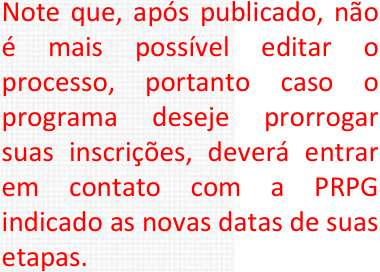

<!-- figure p31-fig2 | described_by: claude:sonnet | ocr_overlap: 1.0 | needs_review: false -->
Figura: bloco texto, fundo branco/leve grade quadriculada clara, texto cor vermelha, justificado, sem bordas/caixas/setas/eixos.

Texto completo (verbatim):

"Note que, após publicado, não é mais possível editar o processo, portanto caso o programa deseje prorrogar suas inscrições, deverá entrar em contato com a PRPG indicado as novas datas de suas etapas."

Sem números, sem legendas, sem múltiplos painéis. Cor vermelha só carrega ênfase/aviso — resto sem significado cromático.

~~~text ocr
Note que, após publicado, não
é mais possível editar o
processo, portanto caso o
programa deseje prorrogar
suas inscrições, deverá entrar
em contato com a PRPG
indicado as novas datas de suas
etapas.
~~~

<!-- Start of picture text -->
Note que, após publicado, não é mais possível editar o processo, portanto caso o programa deseje prorrogar suas inscrições, deverá entrar em contato com a PRPG indicado as novas datas de suas etapas. <!-- End of picture text -->

28 

26°C Chuva fraca INTL 08/09/2021POR 09:22  

Digite aqui para pesquisar 

<!-- page 32 -->

 

> SIGAA - Sistema Integrado de GX + 

☆  

> ← C 

###### ▲Não segurotreinamento.sigs.ufrpe.br/sigaa/administracao/cadastro/ProcessoSeletivo/lista.jsf 

Clicando em “visualizar processo”, é apresentada a seguinte tela com o resumo do processo seletivo. É a mesma tela apresentada ao candidato que deseja inscrever-se. 

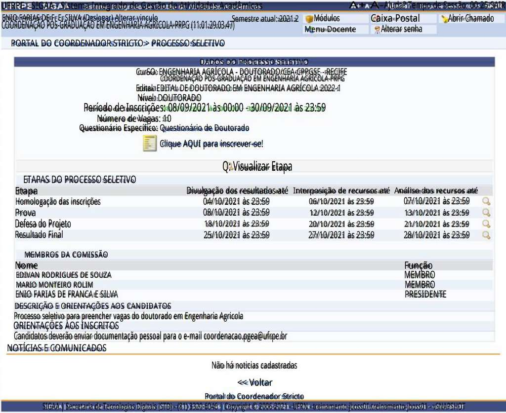

<!-- figure p32-fig1 | described_by: claude:sonnet | ocr_overlap: 0.83 | needs_review: false -->
Esta é uma captura de tela (print) de página web de sistema de gestão acadêmica (SIGAA/SIGAA-UFRPE), não gráfico ou diagrama de dados.

**Topo da página (cabeçalho do sistema):**
- Texto sobreposto/duplicado (ghosting), parcialmente ilegível: "UFRPE SIGAA Sistema Integrado de Gestão de Atividades Acadêmicas"
- Usuário logado: "ENIO FARIAS DE FRANÇA E SILVA (Deslogar) Alterar vínculo"
- "COORDENAÇÃO POS-GRADUAÇÃO EM ENGENHARIA AGRICOLA-PRPG (11.01.29.03.47)"
- Centro: "Semestre atual: 2021.2"
- Direita: "A+ A- Ajuda Tempo de Sessão: 00:25 Sair"
- Ícones de menu: "Módulos", "Menu Docente", "Caixa Postal", "Alterar senha", "Abrir Chamado"
- Breadcrumb: "PORTAL DO COORDENADOR STRICTO > PROCESSO SELETIVO"

**Bloco título central (barra azul):**
"DADOS DO PROCESSO SELETIVO"

**Seção de dados do processo (lista campo: valor):**
- Curso: ENGENHARIA AGRÍCOLA - DOUTORADO/CEA-CPPGSE - RECIFE
- COORDENAÇÃO POS-GRADUAÇÃO EM ENGENHARIA AGRÍCOLA-PRPG
- Edital: EDITAL DE DOUTORADO EM ENGENHARIA AGRÍCOLA 2022-1
- Nível: DOUTORADO
- Período de Inscrições: 08/09/2021 às 00:00 - 30/09/2021 às 23:59
- Número de Vagas: 10
- Questionário Específico: Questionário de Doutorado (link)
- Botão/link com ícone: "Clique AQUI para inscrever-se!"

**Subtítulo:** "Q: Visualizar Etapa" (com ícone de lupa)

**Tabela "ETAPAS DO PROCESSO SELETIVO":**

Colunas: Etapa | Divulgação dos resultados até | Interposição de recursos até | Análise dos recursos até | (ícone lupa)

Linhas:
- Homologação das inscrições | 04/10/2021 às 23:59 | 06/10/2021 às 23:59 | 07/10/2021 às 23:59 | 🔍
- Prova | 08/10/2021 às 23:59 | 12/10/2021 às 23:59 | 13/10/2021 às 23:59 | 🔍
- Defesa do Projeto | 18/10/2021 às 23:59 | 20/10/2021 às 23:59 | 21/10/2021 às 23:59 | 🔍
- Resultado Final | 25/10/2021 às 23:59 | 27/10/2021 às 23:59 | 28/10/2021 às 23:59 | 🔍

**Seção "MEMBROS DA COMISSÃO":**

Colunas: Nome | Função

Linhas:
- EDIVAN RODRIGUES DE SOUZA | MEMBRO
- MARIO MONTEIRO ROLIM | MEMBRO
- ENIO FARIAS DE FRANÇA E SILVA | PRESIDENTE

**Seção "DESCRIÇÃO E ORIENTAÇÕES AOS CANDIDATOS":**
"Processo seletivo para preencher vagas do doutorado em Engenharia Agricola"

**Subseção "ORIENTAÇÕES AOS INSCRITOS":**
"Candidatos deverão enviar documentação pessoal para o e-mail coordenacao.pgea@ufrpe.br"

**Seção "NOTÍCIAS E COMUNICADOS":**
"Não há notícias cadastradas"

**Rodapé:**
- Link: "<< Voltar"
- Link: "Portal do Coordenador Stricto"
- Texto de copyright/versão (pequeno, parcialmente ilegível): "SIGAA | Secretaria de Tecnologias Digitais (STD) - (81) 3320-6046 | Copyright © 2006-2021 - UFRN - treinamento-jboss01.treinamento-jboss01 - vSNAPSHOT"

**Estrutura visual:** página em formato de formulário/tabela, sem gráficos, sem eixos. Cores: barra de título em azul escuro com texto branco (apenas estética de cabeçalho de seção, sem codificação de dados); linhas de tabela com listras zebradas cinza/branco. Cabeçalho superior sobreposto com texto fantasma duplicado (efeito de digitação/renderização), tornando algumas letras sobrepostas difíceis de separar, mas conteúdo reconstruído acima a partir do texto repetido.

~~~text ocr
5 ostal
: Alterar senha
RORTAL DO PROGESSO SELETIVO
OLA -
JAÇÃO EM ENGENHARIA AGRICOLA-PRPG
EDITAL DE DOUTORADO EM ENGENHARIA AGRÍCOLA 2022-1
Nivel) DOUTORADO
às 23:59
Número de Wagas:
Específico: Questionário de Doutorado
E AQUI para inscrever-se!
Etapa
ETARAS DO PROCESSO SELETIVO
Etapa ão dos Interposição de recursos até Amálise-dos recursos até
Homologação das inscrições 04/10/2021 às 23:59 06/10/2021 às 23:59 07/10/2021 23:59
Prova 08/10/2021 às 23:59 12/10/2021 às 23:59 18/10/2021 as
Defesa do Projeto 18/10/2021 às 23:59 20/10/2021 às 23:59
Resultado Final às 23:59 às 23:59 28/10/2021 23:59
MEMBROS DA COMISSÃO
Nome
EDIVAN RODRIGUES DE SOUZA
MARIO MONTEIRO ROLIM MEMBRO
ENIO FARIAS DE FRANCA SILVA PRESIDENTE
E ORIENTAÇÕES AOS CANDIDATOS
Processo seletivo er do doutorado em Ei ria Agricola
ORIENTAÇÕES
pessoal para o e-mail coordenacao
& GOMUNICADOS
Não há noticias cadastradas
<<Voltar
Rontalido Coordenador Stricto
~~~

<!-- Start of picture text -->
UFRPE - SIGAA - Sistema Integrado de Gestão de Atividades Acadêmicas A+ A-Ajuda? Tempo de Sessão: 00:25 SAIR ENIO FARIAS DE F. E. SILVA (Deslogar) Alterar vinculo Semestre atual: 2021.2 Módulos Caixa Postal Abrir Chamado COORDENAÇÃO PÓS-GRADUAÇÃO EM ENGENHARIA AGRÍCOLA-PRPG (11.01.29.03.47) Menu Docente Alterar senha PORTAL DO COORDENADOR STRICTO > PROCESSO SELETIVO DADOS DO PROCESSO SELETIVO CurSO: ENGENHARIA AGRÍCOLA - DOUTORADO/CEA-CPPGSE - RECIFE COORDENAÇÃO PÓS-GRADUAÇÃO EM ENGENHARIA AGRÍCOLA-PRPG Edital: EDITAL DE DOUTORADO EM ENGENHARIA AGRÍCOLA 2022-1 Nível: DOUTORADO Período de Inscrições: 08/09/2021 às 00:00 - 30/09/2021 às 23:59 Número de Vagas: 10 Questionário Específico: Questionário de Doutorado Clique AQUI para inscrever-se! Q: Visualizar Etapa ETAPAS DO PROCESSO SELETIVO Etapa Divulgação dos resultados até Interposição de recursos até Análise dos recursos até Homologação das inscrições 04/10/2021 às 23:59 06/10/2021 às 23:59 07/10/2021 às 23:59 Prova 08/10/2021 às 23:59 12/10/2021 às 23:59 13/10/2021 às 23:59 Defesa do Projeto 18/10/2021 às 23:59 20/10/2021 às 23:59 21/10/2021 às 23:59 Resultado Final 25/10/2021 às 23:59 27/10/2021 às 23:59 28/10/2021 às 23:59 MEMBROS DA COMISSÃO Nome Função EDIVAN RODRIGUES DE SOUZA MEMBRO MARIO MONTEIRO ROLIM MEMBRO ENIO FARIAS DE FRANCA E SILVA PRESIDENTE DESCRIÇÃO E ORIENTAÇÕES AOS CANDIDATOS Processo seletivo para preencher vagas do doutorado em Engenharia Agricola ORIENTAÇÖES AOS INSCRITOS Candidatos deverão enviar documentação pessoal para o e-mail coordenacao.pgea@ufrpe.br NOTÍCIAS E COMUNICADOS Não há noticias cadastradas << Voltar Portal do Coordenador Stricto SIGAA | Secretaria de Tecnologias Digitais (STD) - (81) 3320-6046 | Copyright © 2006-2021 - UFRN - treinamento-jboss01.treinamento-jboss01 - vSNAPSHOT <!-- End of picture text -->

29 

> PORINTL 08/09/202109:26  

26°C Chuva fraca● 

Digite aqui para pesquisar 

<!-- page 33 -->

 

 SIGAA - Sistema Integrado de GX + 

☆  

> ← C 

###### Não seguro|treinamento.sigs.ufrpe.br/sigaa/administracao/cadastro/ProcessoSeletivo/lista.jsf 

Na tela “Gerenciar inscrições, é possível ver a lista de candidatos inscritos, e detalhá-los usando os botões de “visualizar dados do candidatos”, “alterar dados da inscrição”, “fazer downloads de anexos” e “cancelar inscrição”. As opções “aprovado em demanda interna” e “cadastrar discente” só estão disponíveis caso o candidato seja aprovado 

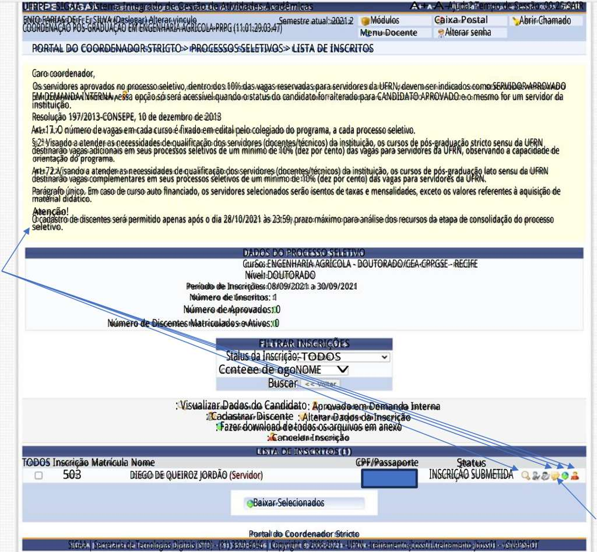

<!-- figure p33-fig1 | described_by: claude:sonnet | ocr_overlap: 0.88 | needs_review: false -->
**1. Tipo de figura:** Captura de tela (screenshot) de uma interface web — o sistema SIGAA (Sistema Integrado de Gestão de Atividades Acadêmicas), na tela "Lista de Inscritos" de um processo seletivo de pós-graduação. A imagem tem setas azuis desenhadas manualmente sobre a captura, apontando para elementos específicos da tela.

**2. Todo o texto visível (verbatim):**

Cabeçalho superior:
- "UFRPE SIGAA Sistema Integrado de Gestão de Atividades Acadêmicas"
- "A+ A A -Ajuda Tempo de Sessão: 00:25 SAIR"
- "ENIO FARIAS DE F. E. SILVA (Deslogar) Alterar vínculo" / "COORDENAÇÃO POS-GRADUAÇÃO EM ENGENHARIA AGRICOLA-PRPG (11.01.29.03.47)"
- "Semestre atual: 2021.2"
- "Módulos" / "Caixa Postal" / "Abrir Chamado"
- "Menu Docente" / "Alterar senha"

Trilha de navegação:
- "PORTAL DO COORDENADOR STRICTO > PROCESSOS SELETIVOS > LISTA DE INSCRITOS"

Bloco de aviso (caixa amarela):
- "Caro coordenador,"
- "Os servidores aprovados no processo seletivo, dentro dos 10% das vagas reservadas para servidores da UFRN, devem ser indicados como SERVIDOR APROVADO EM DEMANDA INTERNA, essa opção só será acessível quando o status do candidato for alterado para CANDIDATO APROVADO e o mesmo for um servidor da instituição."
- "Resolução 197/2013-CONSEPE, 10 de dezembro de 2013"
- "Art. 17. O número de vagas em cada curso é fixado em edital pelo colegiado do programa, a cada processo seletivo."
- "§ 2º Visando a atender as necessidades de qualificação dos servidores (docentes/técnicos) da instituição, os cursos de pós-graduação stricto sensu da UFRN destinarão vagas adicionais em seus processos seletivos de um mínimo de 10% (dez por cento) das vagas para servidores da UFRN, observando a capacidade de orientação do programa."
- "Art. 72. Visando a atender as necessidades de qualificação dos servidores da instituição, os cursos de pós-graduação lato sensu da UFRN destinarão vagas complementares em seus processos seletivos de um mínimo de 10% (dez por cento) das vagas para servidores da UFRN."
- "Parágrafo único. Em caso de curso auto financiado, os servidores selecionados serão isentos de taxas e mensalidades, exceto os valores referentes à aquisição de material didático."
- "Atenção!"
- "O cadastro de discentes será permitido apenas após o dia 28/10/2021 às 23:59, prazo máximo para análise dos recursos da etapa de consolidação do processo seletivo."

Caixa "DADOS DO PROCESSO SELETIVO" (título em barra azul-escura):
- "Curso: ENGENHARIA AGRICOLA - DOUTORADO/CEA-CPPGSE - RECIFE"
- "Nível: DOUTORADO"
- "Período de Inscrições: 08/09/2021 a 30/09/2021"
- "Número de Inscritos: 1"
- "Número de Aprovados: 0"
- "Número de Discentes Matriculados e Ativos: 0"

Caixa "FILTRAR INSCRIÇÕES" (título em barra azul-escura):
- "Status da Inscrição: TODOS" (caixa de seleção suspensa)
- "Conteee de ogoNOME" [trecho ilegível/sobreposto — provavelmente "Conteúdo de..." com campo suspenso] com seta suspensa (V)
- Botão "Buscar" / link "<< Voltar"

Lista de ícones/legendas (linhas centrais, texto sobreposto em itálico/legenda):
- ": Visualizar Dados do Candidato: Aprovado em Demanda Interna"
- ": Cadastrar Discente : Alterar Dados da Inscrição"
- ": Fazer download de todos os arquivos em anexo"
- ": Cancelar Inscrição"

Tabela "LISTA DE INSCRITOS (1)" (título em barra azul-escura), cabeçalhos de coluna:
- "TODOS" | "Inscrição" | "Matrícula" | "Nome" | "CPF/Passaporte" | "Status"

Linha de dados da tabela:
- Checkbox (desmarcado) | "503" | (coluna Matrícula vazia) | "DIEGO DE QUEIROZ JORDÃO (Servidor)" | [campo CPF/Passaporte coberto por um retângulo azul desenhado à mão, ocultando/destacando o conteúdo] | "INSCRIÇÃO SUBMETIDA" seguido de 5 ícones (lupa, e outros ícones coloridos: um amarelo, um laranja, um verde, um azul — tipos exatos dos ícones ilegíveis em detalhe)

Abaixo da tabela:
- Botão "Baixar Selecionados"

Rodapé:
- "Portal do Coordenador Stricto"
- "SIGAA | Secretaria de Tecnologias Digitais (STD) - (81) 3320-6046 | Copyright © 2006-2021 - UFRN - treinamento.jboss01.treinamento.jboss01 - vSNAPSHOT"

**3. Estrutura, caixas e setas:**
A página está organizada verticalmente em blocos empilhados:
- Topo: faixa cinza/azul-clara com dados de login e menus.
- Trilha de navegação em texto simples.
- Bloco de aviso com fundo amarelo-claro contendo o texto normativo (parágrafos e artigos de lei).
- Caixa "DADOS DO PROCESSO SELETIVO" com cabeçalho azul-escuro e corpo branco listando 6 linhas de dados.
- Caixa "FILTRAR INSCRIÇÕES" com cabeçalho azul-escuro e corpo contendo dois campos de filtro e um botão.
- Bloco de legendas de ícones (texto centralizado, sem borda própria).
- Tabela "LISTA DE INSCRITOS (1)" com 6 colunas e 1 linha de dados, cabeçalho azul-escuro.
- Botão de ação abaixo da tabela.
- Rodapé institucional.

Há 4 setas azuis desenhadas manualmente sobre a captura de tela, todas apontando para cima, na diagonal, vindas da parte inferior direita da imagem em direção ao bloco de aviso amarelo no topo esquerdo:
- Uma seta parte da área próxima à linha de dados da tabela (perto do nome "DIEGO DE QUEIROZ JORDÃO") e aponta para o bloco de aviso amarelo.
- Três setas adicionais partem da extremidade direita da linha da tabela (região dos ícones de status "INSCRIÇÃO SUBMETIDA") e também apontam na mesma direção diagonal para o bloco de aviso amarelo, indicando relação entre o aviso normativo e a necessidade de alterar o status do candidato/ícones de ação.
Há também um retângulo azul desenhado à mão sobre o campo "CPF/Passaporte" da linha de dados, ocultando ou destacando essa informação (conteúdo não visível/ilegível).

**4. Valores numéricos:**
- Tempo de Sessão: 00:25
- Semestre atual: 2021.2
- Resolução 197/2013
- Data da resolução: 10 de dezembro de 2013
- Art. 17, § 2º, Art. 72
- 10% (dez por cento) — citado duas vezes
- Período de Inscrições: 08/09/2021 a 30/09/2021
- Número de Inscritos: 1
- Número de Aprovados: 0
- Número de Discentes Matriculados e Ativos: 0
- Data limite: 28/10/2021 às 23:59
- Inscrição nº: 503
- Telefone rodapé: (81) 3320-6046
- Copyright: © 2006-2021

**5. Cores com significado:**
- Fundo amarelo-claro: destaca o bloco de aviso/atenção normativo.
- Barras de título azul-escuro: cabeçalhos de seção (DADOS DO PROCESSO SELETIVO, FILTRAR INSCRIÇÕES, LISTA DE INSCRITOS).
- Setas azuis e retângulo azul: marcações manuais de ênfase adicionadas sobre a captura original, não fazem parte da interface do sistema.
- Ícones de status na linha da tabela em cores distintas (amarelo, laranja, verde, azul) representando provavelmente ações diferentes (visualizar, editar, cadastrar, cancelar), conforme legendas listadas acima, mas o ícone específico associado a cada cor não é identificável com clareza na imagem.

~~~text ocr
A ESSA.
Caixa-Postal
= Alterar senha
PORTAL DO LISTA DE INSCRITOS
Gare coordenador,
aprovados no «Seletivo, vagas-reservadas-para-servidores
MERNA pessa será acessivel.quando-o:status do for um servidor da
Resolução 197/2013-CONSEPE, 10 de dezembro de 2013
7.0 número de vagas emcada curso é pelo-colegiado do programa, a cada processo seletivo.
dum m a capac
complementares em seus de um por de par
Em auto financiado, os servidores selecionados isentos de taxas e mensalidades, exceto os valores referentes à aquisição de
sr permitido apenas após o dia 28/10/2021 as 23:59; dos recursos da etapa de consolidação do processo
tivo
AGRICOLA - DOUTORADO
DOUTORADO
de a 30/09/2024
Numero
Número de-Discentes Matriculades:
: Alt
rar
Dic
TODOS Inscrição Matricula Nome
CPF Status
DIEGO DE QUEIROZ JORDÃO (Servidor)
e
~~~

<!-- Start of picture text -->
UFRPE - SIGAA - Sistema Integrado de Gestão de Atividades Acadêmicas A+ A-Ajuda? Tempo de Sessão: 00:25 SAIR ENIO FARIAS DE F. E. SILVA (Deslogar) Alterar vinculo Semestre atual: 2021.2 Módulos Caixa Postal Abrir Chamado COORDENAÇÃO PÓS-GRADUAÇÃO EM ENGENHARIA AGRÍCOLA-PRPG (11.01.29.03.47) Menu Docente Alterar senha PORTAL DO COORDENADOR STRICTO > PROCESSOS SELETIVOS > LISTA DE INSCRITOS Caro coordenador, Os servidores aprovados no processo seletivo, dentro dos 10% das vagas reservadas para servidores da UFRN, devem ser indicados como SERVIDOR APROVADO EM DEMANDA INTERNA , essa opção só será acessível quando o status do candidato for alterado para CANDIDATO APROVADO e o mesmo for um servidor da instituição. Resolução 197/2013-CONSEPE, 10 de dezembro de 2013 Art. 17. O número de vagas em cada curso é fixado em edital pelo colegiado do programa, a cada processo seletivo. § 2º Visando a atender as necessidades de qualificação dos servidores (docentes/técnicos) da instituição, os cursos de pós-graduação stricto sensu da UFRN destinarão vagas adicionais em seus processos seletivos de um mínimo de 10% (dez por cento) das vagas para servidores da UFRN, observando a capacidade de orientação do programa. Art. 72. Visando a atender as necessidades de qualificação dos servidores (docentes/técnicos) da instituição, os cursos de pós-graduação lato sensu da UFRN destinarão vagas complementares em seus processos seletivos de um minimo de 10% (dez por cento) das vagas para servidores da UFRN. Parágrafo único. Em caso de curso auto financiado, os servidores selecionados serão isentos de taxas e mensalidades, exceto os valores referentes à aquisição de material didático. Atenção! O cadastro de discentes será permitido apenas após o dia 28/10/2021 às 23:59, prazo máximo para análise dos recursos da etapa de consolidação do processo seletivo. DADOS DO PROCESSO SELETIVO CurSo: ENGENHARIA AGRÍCOLA - DOUTORADO/CEA-CPPGSE - RECIFE Nível: DOUTORADO Período de Inscrições: 08/09/2021 a 30/09/2021 Número de Inscritos: 1 Número de Aprovados: 0 Número de Discentes Matriculados e Ativos: 0 FILTRAR INSCRIÇÕES Stalus da Inscrição:--TODOS Ccnteee de ogoNOME V Buscar : Visualizar Dados do Candidato: Aprovado em Demanda Interna : Cadastrar Discente : Alterar Dados da Inscrição : Fazer download de todos os arquivos em anexo : Cancelar Inscrição LISTA DE INSCRITOS (1) TODOS Inscrição Matrícula Nome CPF/Passaporte Status 503 DIEGO DE QUEIROZ JORDÃO (Servidor) INSCRIÇÃO SUBMETIDA Baixar Selecionados Portal do Coordenador Stricto SIGAA | Secretaria de Tecnologias Digitais (STD) - (81) 3320-6046 | Copyright © 2006-2021 - UFRN - treinamento-jboss01.treinamento-jboss01 - vSNAPSHOT <!-- End of picture text -->

A opção de “Fazer downloads dos anexos” inclui todos os anexos solicitados no formulário, menos o projeto de pesquisa caso este tenha sido solicitado conforme o Slide 2. Neste caso, o projeto pode ser visualizado através da opção “visualizar dados do candidato”. 

Caso o candidato informe um e- mail inválido no cadastro, caberá à coordenação corrigi-lo através da opção “alterar dados da inscrição” para que o mesmo possa ter acesso ao seu Portal do Candidato. 30 

27°C Chuva fraca●POR INTL 08/09/202109:41  

Digite aqui para pesquisar 

<!-- page 34 -->

 

 

 SIGAA - Sistema Integrado de GX + 

> ← C 

###### Não seguro |treinamento.sigs.ufrpe.br/sigaa/stricto/coordenacao.jsf 

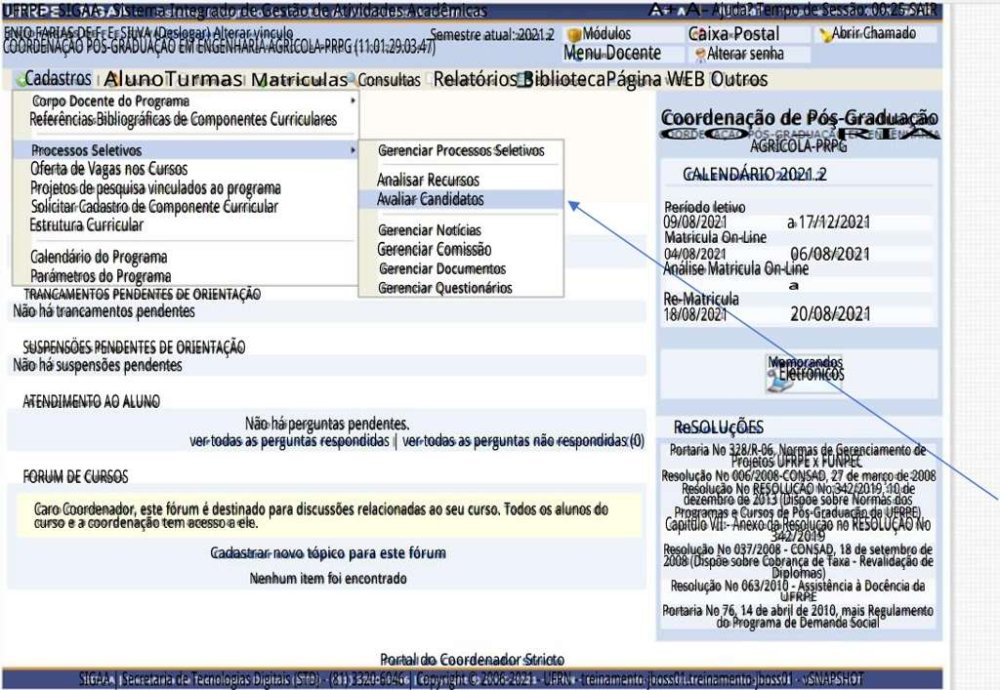

<!-- figure p34-fig1 | described_by: claude:sonnet | ocr_overlap: 0.94 | needs_review: false -->
É uma captura de tela (screenshot) de um sistema web de gestão acadêmica, mostrando um menu suspenso (dropdown) aberto sobre a página principal do sistema.

**Texto visível (cabeçalho e navegação):**

- Canto superior esquerdo: "UFRPE-SIGAA" e "Sistema Integrado de Gestão de Atividades Acadêmicas"
- Abaixo: "ENIO FARIAS DE FREIRE SILVA (Deslogar) Alterar vínculo" e "COORDENAÇÃO POS-GRADUAÇÃO EM ENGENHARIA AGRICOLA-PRPG (11:01:29:03:47)"
- Centro: "Semestre atual: 2021.2"
- Canto superior direito: "A+ A- Ajuda Tempo de Sessão: 00:25:54TR" (parcialmente sobreposto/ilegível), "Módulos", "Caixa Postal", "Abrir Chamado", "Menu Docente", "Alterar senha"

**Barra de menus (abas):**
"Cadastros | Aluno | Turmas | Matrículas | Consultas | Relatórios | Biblioteca | Página WEB | Outros"

**Menu suspenso nível 1 (aberto sob "Cadastros"):**
- Corpo Docente do Programa
- Referências Bibliográficas de Componentes Curriculares
- Processos Seletivos (item destacado, com seta indicando submenu)
- Oferta de Vagas nos Cursos
- Projetos de pesquisa vinculados ao programa
- Solicitar Cadastro de Componente Curricular
- Estrutura Curricular
- Calendário do Programa
- Parâmetros do Programa

**Menu suspenso nível 2 (aberto ao lado, a partir de "Processos Seletivos"):**
- Gerenciar Processos Seletivos
- Analisar Recursos
- Avaliar Candidatos (item destacado/realçado em azul claro)
- Gerenciar Notícias
- Gerenciar Comissão
- Gerenciar Documentos
- Gerenciar Questionários

**Estrutura/setas:** Uma seta azul diagonal liga o submenu nível 2 (região de "Avaliar Candidatos") até o canto superior direito da imagem, apontando para fora da área de menus, em direção ao painel lateral direito (indicando talvez destino de navegação ou destaque de fluxo).

**Corpo da página, abaixo da barra de menus:**
- "TRANCAMENTOS PENDENTES DE ORIENTAÇÃO" — "Não há trancamentos pendentes"
- "SUSPENSÕES PENDENTES DE ORIENTAÇÃO" — "Não há suspensões pendentes"
- "ATENDIMENTO AO ALUNO" — "Não há perguntas pendentes." — links: "ver todas as perguntas respondidas | ver todas as perguntas não respondidas (0)"
- "FORUM DE CURSOS" — texto: "Caro Coordenador, este fórum é destinado para discussões relacionadas ao seu curso. Todos os alunos do curso e a coordenação tem acesso a ele." — links: "Cadastrar novo tópico para este fórum" e "Nenhum item foi encontrado"

**Painel lateral direito:**
- Título: "Coordenação de Pós-Graduação"
- Subtítulo (sobreposto/ilegível parcialmente): algo como "COORD... ACAD... PÓS-GRADUAÇ... ENGENHARIA..." seguido de "AGRICOLA-PRPG"
- "CALENDÁRIO 2021.2"
  - "Período letivo": "09/08/2021 a 17/12/2021"
  - "Matricula On-Line": "04/08/2021"
  - "Análise Matrícula On-Line": "06/08/2021 a" (data final não visível/cortada)
  - "Re-Matricula": "18/08/2021 20/08/2021"
- Ícone/link: "Memorandos Eletrônicos"
- "RESOLUÇÕES" (lista de links, cada um iniciando por "Portaria No" ou "Resolução No"):
  - "Portaria No 328/R-06, Normas de Gerenciamento de Projetos UFRPE x FUNPEC"
  - "Resolução No 006/2008-CONSAD, 27 de março de 2008"
  - "Resolução No RESOLUÇÃO No 342/2019, 10 de dezembro de 2013 (Dispõe sobre Normas dos Programas e Cursos de Pós-Graduação da UFRPE)"
  - "Capítulo VII - Anexo da Resolução No RESOLUÇÃO No 342/2019"
  - "Resolução No 037/2008 - CONSAD, 18 de setembro de 2008 (Dispõe sobre Cobrança de Taxa - Revalidação de Diplomas)"
  - "Resolução No 063/2010 - Assistência à Docência da UFRPE"
  - "Portaria No 76, 14 de abril de 2010, mais Regulamento do Programa de Demanda Social"

**Rodapé:**
- "Portal do Coordenador Stricto"
- "SIGAA | Secretaria de Tecnologias Digitais (STD) - (81) 3320-6046 | Copyright © 2006-2021 - UFRN - treinamento.jboss01.treinamento.jboss01 - vSNAPSHOT"

**Cores com significado:**
- Fundo azul-claro nos cabeçalhos de seção da coluna central (ex.: "TRANCAMENTOS...", "ATENDIMENTO AO ALUNO", "FORUM DE CURSOS").
- Item "Avaliar Candidatos" realçado em fundo azul-claro, indicando o item selecionado/apontado pela seta.
- Seta azul usada para indicar/destacar fluxo de navegação até a área lateral direita.
- Painel lateral direito com fundo amarelo-claro (bege) para a seção de calendário/resoluções, diferenciando-o visualmente do conteúdo central (fundo branco).

Diversos trechos de texto sobrepostos nos cabeçalhos (área superior e subtítulo do painel direito) aparecem duplicados/desalinhados, tornando algumas palavras parcialmente ilegíveis — nesses casos específicos, o conteúdo exato não pôde ser confirmado [illegible] além do que foi transcrito acima.

~~~text ocr
Módulos
WEB Outros
Corpo Docente do Pr
Referâncias:Bibliográficas de Componentes Curriculares
Processos Seletivos » Gerenciar Processos Seletivos
Oferta de Vagas nos Cursos
sa vinculados ao programa + -
de Componente | Avaliar Candidatos
Estrutura Curricular Gerenciar Notícias
ograma Gerenciar Comissão
Gerenciar Documentos
TRANGAMENTOS PENDENTES DE ORIENTAÇÃO Gerenciar Questionários
Não há trancamentos pendentes
SUSPENSÕES PENDENTES DE
Não há suspensões pendentes
ATENDIMENTO AO ALUNO
Não-há perguntas pendentes.
ver-todas as perguntas respondidas | ver-todas as perguntas não (0)
FORUM DE CURSOS
Caro este fórum é de é destinado para discussões relacionadas ao seu curso. Todos os alunos do
curso e a coordenação tem
tópico para este fórum
Nenhum item foi encontrado
Alterar senha
de Pós
CALENDÁRIO 2021.2
05/08/2001 a 17/12/2021
Matricula On-Line
04/08/2024 6/08/2021
ise Matricula
20/08/2021
RESOLUÇÕES
Portaria No
No 27 de
Resolução No à à Docência da
Portaria No 76 14 de abr de 2010, lamento
de Demanda
|
~~~

<!-- Start of picture text -->
UFRPE - SIGAA - Sistema Integrado de Gestão de Atividades Acadêmicas A+ A- Ajuda? Tempo de Sessão: 00:25 SAIR ENIO FARIAS DE F. E. SILVA (Deslogar) Alterar vinculo Semestre atual: 2021.2 Módulos Caixa Postal Abrir Chamado COORDENAÇÃO PÓS-GRADUAÇÃO EM ENGENHARIA AGRÍCOLA-PRPG (11.01.29.03.47) Menu Docente Alterar senha Cadastros AlunoTurmas Matriculas Consultas Relatórios BibliotecaPágina WEB Outros Corpo Docente do Programa Referências Bibliográficas de Componentes Curriculares Coordenação de Póş-Graduação CO  - RIA Processos Seletivos Gerenciar Processos Seletivos AGRÍCOLA-PRPG Oferta de Vagas nos Cursos Analisar Recursos CALENDÁRIO 2021.2 Projetos de pesquisa vinculados ao programa Avaliar Candidatos Solicitar Cadastro de Componente Curricular Período letivo Estrutura Curricular Gerenciar Notícias 09/08/2021 a 17/12/2021 Matricula On-Line Calendário do Programa Gerenciar Comissão 04/08/2021  06/08/2021 Gerenciar Documentos Análise Matricula On-Line TRANCAMENTOS PENDENTES DE ORIENTAÇÃOParámetros do Programa Gerenciar Questionários Re-Matricula a Não há trancamentos pendentes 18/08/2021  20/08/2021 SUSPENSÖES PENDENTES DE ORIENTAÇÃO Não há suspensões pendentes MemorandosEletronicos ATENDIMENTO AO ALUNO Não há perguntas pendentes. ReSOLUçÕES ver todas as perguntas respondidas | ver todas as perguntas não respondidas (0) Portaria No 328/R-06, Normas de Gerenciamento de Projetos UFRPE x FUNPEC FORUM DE CURSOS Resolução No 006/2008-CONSAD, 27 de março de 2008 Resolução No RESOLUÇÃO No 342/2019, 10 de dezembro de 2013 (Dispõe sobre Normas dos Caro Coordenador, este fórum é destinado para discussões relacionadas ao seu curso. Todos os alunos do Programas e Cursos de Pós-Graduação da UFRPE) curso e a coordenação tem acesso a ele. Capitulo VII - Anexo da Resolução no RESOLUÇÃO No 342/2019 Cadastrar novo tópico para este fórum Resolução No 037/2008 - CONSAD, 18 de setembro de 2008 (Dispõe sobre Cobrança de Taxa - Revalidação de Nenhum item foi encontrado Diplomas) Resolução No 063/2010 - Assistência à Docência da UFRPE Portaria No 76, 14 de abril de 2010, mais Regulamento do Programa de Demanda Social Portal do Coordenador Stricto SIGAA | Secretaria de Tecnologias Digitais (STD) - (81) 3320-6046 | Copyright © 2006-2021 - UFRN - treinamento-jboss01.treinamento-jboss01 - vSNAPSHOT <!-- End of picture text -->

Para avaliar os candidatos, utiliza-se esta opção do menu. Apesar de a avaliação estar disponível antes do encerramento das inscrições, não recomendamos começar a avaliar até que as inscrições se encerrem, pois uma vez avaliado, o candidato não poderá mais cancelar sua inscrição e realizar outra, caso deseje corrigir algum dado ou documento. 

31 27°C Chuva fraca●DOPOR INTL08/09/202109:48  

Q Digite aqui para pesquisar 

<!-- page 35 -->

 

 SIGAA - Sistema Integrado de GX + 

> ← C 

###### ▲Não segurotreinamento.sigs.ufrpe.br/sigaa/ensino/AvaliacaoProcessoSeletivo/lista_processos_seletivos.jsf 

É **IMPRESCINDÍVEL** que os resultados das etapas sejam inseridos no sistema antes da data programa, pois o sistema não permitirá que os resultado sejam inseridos posterior a esta data, e candidatos que não tiverem sido avaliados na etapa anterior não poderão seguir para a próxima etapa, e consequentemente não poderão ser aprovados e nem cadastrados como alunos. 

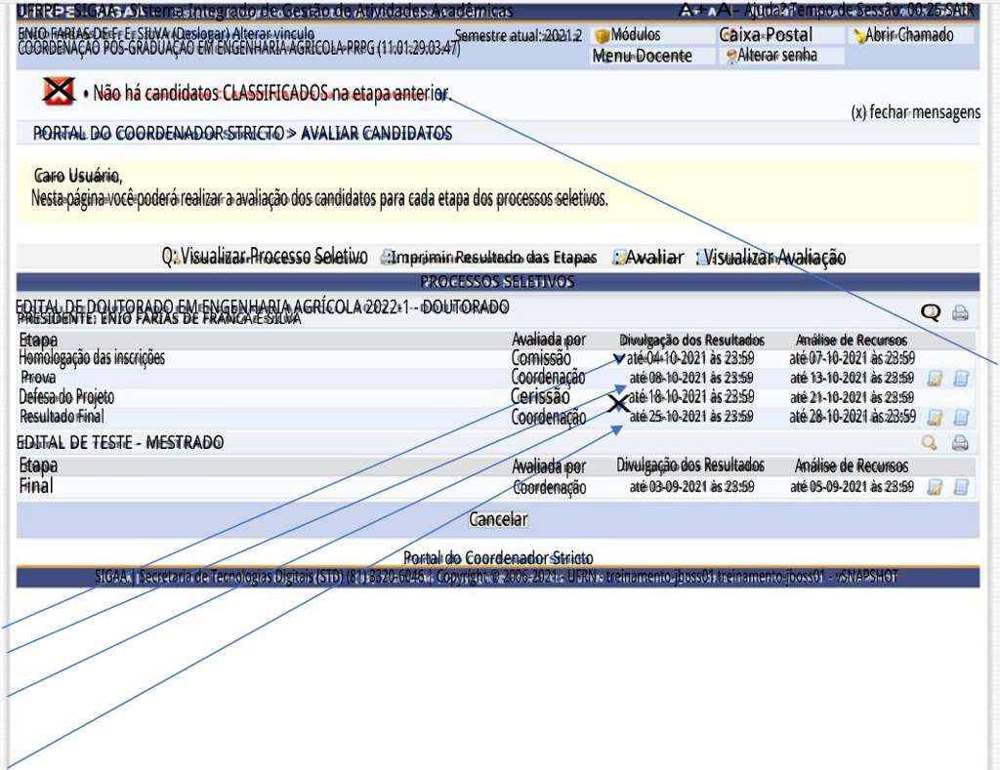

<!-- figure p35-fig1 | described_by: claude:sonnet | ocr_overlap: 0.8 | needs_review: false -->
Captura de tela de sistema web (SIGAA – Sistema Integrado de Gestão de Atividades Acadêmicas), com setas diagonais azuis e pretas sobrepostas (anotações apontando de pontos da tela para outros elementos, sem texto próprio).

**Texto visível, verbatim:**

Cabeçalho: "UFRPE SIGAA Sistema Integrado de Gestão de Atividades Acadêmicas" — canto superior direito "A+ A- Ajuda Tempo de Sessão: 00:25:54h".

Linha abaixo: "ENIO FARIAS DE FRANÇA E SILVA (Deslogar) Alterar vínculo" / "COORDENAÇÃO POS-GRADUAÇÃO EM ENGENHARIA AGRICOLA-PRPG (11:01:29:03:47)" — "Semestre atual: 2021.2" — ícones "Módulos", "Caixa Postal", "Abrir Chamado", "Menu Docente", "Alterar senha".

Mensagem de alerta (ícone X vermelho): "Não há candidatos CLASSIFICADOS na etapa anterior." — à direita "(x) fechar mensagens".

Trilha: "PORTAL DO COORDENADOR STRICTO > AVALIAR CANDIDATOS".

Caixa amarela: "Caro Usuário, Nesta página você poderá realizar a avaliação dos candidatos para cada etapa dos processos seletivos."

Menu de ações: "Q: Visualizar Processo Seletivo | Imprimir Resultado das Etapas | Avaliar | Visualizar Avaliação".

Título seção: "PROCESSOS SELETIVOS".

**Tabela 1:**
"EDITAL DE DOUTORADO EM ENGENHARIA AGRÍCOLA 2022-1 - DOUTORADO" / "PRESIDENTE: ENIO FARIAS DE FRANÇA E SILVA" — ícones lupa e impressora à direita.

Colunas: "Etapa | Avaliada por | Divulgação dos Resultados | Análise de Recursos".

Linhas:
- Homologação das inscrições | Comissão | até 04-10-2021 às 23:59 | até 07-10-2021 às 23:59
- Prova | Coordenação | até 08-10-2021 às 23:59 | até 13-10-2021 às 23:59
- Defesa do Projeto | Comissão | até 18-10-2021 às 23:59 | até 21-10-2021 às 23:59
- Resultado Final | Coordenação | até 25-10-2021 às 23:59 | até 28-10-2021 às 23:59 (linhas "Prova" e "Resultado Final" têm ícones de edição/documento à direita)

**Tabela 2:**
"EDITAL DE TESTE - MESTRADO" — ícones lupa e impressora à direita.
Colunas iguais: "Etapa | Avaliada por | Divulgação dos Resultados | Análise de Recursos".
Linha: Final | Coordenação | até 03-09-2021 às 23:59 | até 05-09-2021 às 23:59 (com ícones de edição/documento).

Botão: "Cancelar".

Rodapé: "Portal do Coordenador Stricto".

Rodapé final: "SIGAA | Secretaria de Tecnologias Digitais (STD) (81) 3320-6046 | Copyright © 2006-2021 - UFRN - treinamento-jboss01.treinamento-jboss01 - vSNAPSHOT".

**Estrutura/setas:** várias setas diagonais (azuis, uma preta) partem de pontos próximos ao canto inferior esquerdo da imagem e sobem/cruzam a tela, apontando para: ícone de mensagem (X vermelho), área "Avaliar" no menu de ações, célula "Comissão" da etapa "Defesa do Projeto", e datas de "Divulgação dos Resultados"/ícones de edição nas linhas da tabela 1. Não há texto nas próprias setas. Não há gráficos, eixos ou cores com significado além do vermelho do ícone de alerta (X) e cinza/azul padrão da interface do sistema.

~~~text ocr
COORDENAÇÃO POS-GRADUA
MenuDocente senha
DX + Nao há candidatos etapa anterie
PORTAL DO COORDENADORSTRIGIO > AVALIAR CANDIDATOS
(x) fechar-mensagens
avaliação: dos candidatos para cada etapa dos processos seletivos.
Seletivo das Etapas ; Avaliar Visuali
Sich
EM ENGENHARIA AGRÍCOLA DOUTORADO
Etapa Avaliadapor Divulgação dos de Recursos
Homologação das inscrições Comissão a 2359
Prova Coordenação até08-10-2021
Defesardo Projeto 3623559 &s 23:59
Resultado Final até 25-40-2021 às 23:59 até 28-10-2021
EDITAL DE TESTE - MESTRADO 4
na
até 03-09-2021 às 23:59 até 05-09-2021
Cancelar
Portal de ordenador Stricto
|
~~~

<!-- Start of picture text -->
UFRPE - SIGAA - Sistema Integrado de Gestão de Atividades Acadêmicas A+ A- Ajuda? Tempo de Sessão: 00:25 SAIR ENIO FARIAS DE F. E. SILVA (Deslogar) Alterar vinculo Semestre atual: 2021.2 Módulos Caixa Postal Abrir Chamado COORDENAÇÃO PÓS-GRADUAÇÃO EM ENGENHARIA AGRÍCOLA-PRPG (11.01.29.03.47) Menu Docente Alterar senha X • Não há candidatos CLASSIFICADOS na etapa anterior. (x) fechar mensagens PORTAL DO COORDENADOR STRICTO > AVALIAR CANDIDATOS Caro Usuário, Nesta página você poderá realizar a avaliação dos candidatos para cada etapa dos processos seletivos. Q: Visualizar Processo Seletivo :Imprimir Resultado das Etapas : Avaliar : Visualizar Avaliação PROCESSOS SELETIVOS EDITAL DE DOUTORADO EM ENGENHARIA AGRÍCOLA 2022-1 - DOUTORADO PRESIDENTE: ENIO FARIAS DE FRANCA E SILVA Q Etapa Avaliada por Divulgação dos Resultados Análise de Recursos Homologação das inscrições Comissão Vaté 04-10-2021 às 23:59 até 07-10-2021 às 23:59 Prova Coordenação até 08-10-2021 às 23:59 até 13-10-2021 às 23:59 Defesa do Projeto Cerissão até 18-10-2021 às 23:59 até 21-10-2021 às 23:59 Resultado Final até 28-10-2021 às 23:59 Coordenação Xaté 25-10-2021 às 23:59 EDITAL DE TESTE - MESTRADO Etapa Avaliada por Divulgação dos Resultados Análise de Recursos Final Coordenação até 03-09-2021 às 23:59 até 05-09-2021 às 23:59 Cancelar Portal do Coordenador Stricto SIGAA | Secretaria de Tecnologias Digitais (STD) (81) 3320-6046 | Copyríght © 2006-2021 - UFRN - treinamento-jboss01.treinamento-jboss01 - vSNAPSHOT <!-- End of picture text -->

O sistema apresenta esta tela. A avaliação dos candidatos deve seguir a etapa em ordem, caso contrário o sistema irá identificar que o candidato não foi aprovado na etapa anterior. 

32 

POR 09:52 27°C Chuva fraca● INTL08/09/2021 

QDigite aqui para pesquisar 

<!-- page 36 -->

 

 SIGAA - Sistema Integrado de GX + 

> ← C 

###### Não seguro |treinamento.sigs.ufrpe.br/sigaa/portais/docente/docente.jsf 

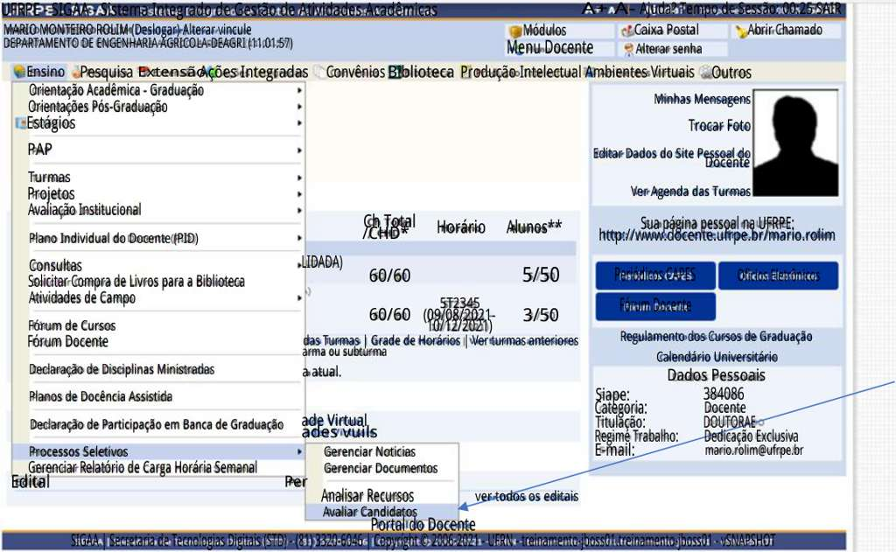

<!-- figure p36-fig1 | described_by: claude:sonnet | ocr_overlap: 0.93 | needs_review: false -->
(1) Captura tela sistema SIGAA (interface web), com menu dropdown aberto e seta/destaque apontando item.

(2) Texto visível:

Topo:
- "UFRPE SIGAA Sistema Integrado de Gestão de Atividades Acadêmicas"
- "A+ A- Ajuda Tempo de Sessão: 00:25:54r" [parcial ilegível no canto]
- "MARIO MONTEIRO ROLIM (Deslogar) Alterar vínculo"
- "DEPARTAMENTO DE ENGENHARIA AGRICOLA-DEAGRI (11:01:57)"
- "Módulos" / "Caixa Postal" / "Abrir Chamado"
- "Menu Docente" / "Alterar senha"

Barra de abas: "Ensino | Pesquisa | Extensão | Ações Integradas | Convênios | Biblioteca | Produção Intelectual | Ambientes Virtuais | Outros"

Menu lateral esquerdo (sob "Ensino"), em ordem:
- Orientação Acadêmica - Graduação ▸
- Orientações Pós-Graduação ▸
- Estágios ▸
- PAP
- Turmas
- Projetos
- Avaliação Institucional
- Plano Individual do Docente (PID)
- Consultas
- Solicitar Compra de Livros para Biblioteca
- Atividades de Campo
- Fórum de Cursos
- Fórum Docente
- Declaração de Disciplinas Ministradas
- Planos de Docência Assistida
- Declaração de Participação em Banca de Graduação
- Processos Seletivos ▸ (com submenu aberto)
- Gerenciar Relatório de Carga Horária Semanal
- Edital

Submenu aberto ao lado de "Processos Seletivos":
- Gerenciar Notícias
- Gerenciar Documentos
- Analisar Recursos
- Avaliar Candidatos (destacado/selecionado, seta azul aponta pra ele)

Área central (parcialmente coberta pelo menu), tabela com colunas:
- "Ch Total /CHD*" | "Horário" | "Alunos**"
Linhas visíveis:
- "...LIDADA)" | 60/60 | (vazio horário) | 5/50
- "5T2345 (09/08/2021-10/12/2021)" | 60/60 | | 3/50

Textos cortados/parciais: "das Turmas | Grade de Horários | Ver turmas anteriores", "...arma ou subturma", "...a atual.", "ade Virtual" / "ades Vuuis" [provável "Atividades Virtuais", parcialmente sobreposto, trecho ilegível], "ver todos os editais", "Portal do Docente", "Per" (coluna cortada).

Painel direito:
- "Minhas Mensagens"
- "Trocar Foto"
- "Editar Dados do Site Pessoal do Docente"
- ícone silhueta de pessoa (placeholder foto)
- "Sua página pessoal na UFRPE: http://www.docente.ufrpe.br/mario.rolim"
- Dois botões azuis: "Periódicos CAPES" e "Ofícios Eletrônicos" (textos com leve sobreposição/distorção)
- Botão azul: "Fórum Docente"
- "Regulamento dos Cursos de Graduação"
- "Calendário Universitário"
- "Dados Pessoais":
  - Siape: 384086
  - Categoria: Docente
  - Titulação: DOUTORAE [provável "DOUTORADO", trecho ilegível/cortado]
  - Regime Trabalho: Dedicação Exclusiva
  - E-mail: mario.rolim@ufrpe.br

Rodapé:
- "SIGAA | Secretaria de Tecnologias Digitais (STD) - (81) 3320-6046 | Copyright © 2006-2021 - UFRN - treinamento.jboss01.treinamento.jboss01 - vSNAPSHOT"

(3) Estrutura: página web dividida em 3 regiões — cabeçalho superior (identificação usuário/sessão), coluna central larga com menu de navegação em árvore (itens com submenu indicado por ▸) sobreposto a tabela de turmas, coluna direita estreita com cartão de perfil/atalhos, rodapé institucional. Seta azul diagonal (desenhada manualmente, anotação) liga região do menu até item "Avaliar Candidatos", indicando destaque/instrução de clique. Submenu "Processos Seletivos" expande-se à direita do item do menu principal, sobrepondo conteúdo da tabela central.

(4) Valores numéricos: Ch Total/CHD 60/60 (duas linhas); Alunos 5/50 e 3/50; código turma "5T2345"; datas "09/08/2021" a "10/12/2021"; Siape 384086; telefone (81) 3320-6046; horário sessão "00:25:54" [parcial]; departamento "11:01:57" (código/hora entre parênteses); copyright "2006-2021".

(5) Cores com significado: links e títulos em azul (padrão hyperlink); item "Avaliar Candidatos" destacado em fundo diferenciado (seleção/hover) indicando item ativo apontado pela seta; seta desenhada em azul como anotação de destaque; ícone de foto em preto/cinza (placeholder, sem foto cadastrada); restante do layout em tons neutros (cinza claro/branco) típico de sistema administrativo.

~~~text ocr
Ue
og Postal
Menu Docente © Alterar senha
Pesquisa Gonvênios Biblioteca Produção-Intelectual Ambientes-Virtuais
Orientação Acadêmica - Graduação
Orientações Pós-Graduação > Minhas Mensagens
» Trocar Foto
PAP >
Editar Dados do Site Pessoal do
Turmas >
> Agenda das Turmas
lação Institucional ,
| Sua pagina pessoal
Plano Individual do Docente(fPID) > Horário
Consultas
Solicitar-Compra de Livros para a Biblioteca 60/60 5/50
— |
Fórum de Cursos 60/60 3/50
Fórum Docente das Turmas | Grade de Horários | anteriores Regulamento-dos Cursos de Graduação
Calendário Universitário
Declaração de Disciplinas Ministradas aatual. Dados Pessoais
Planos de Docência Assistida 384086
Docente
Declaração de Participação em Banca de Graduação ade Virtual Titu DOU;
Processos Seletivos » Gerenciar Notícias mario,
Gerenciar Documentos
Edita
Relatório de Carga Horária Semanal
~~~

<!-- Start of picture text -->
UFRPE - SIGAA - Sistema Integrado de Gestão de Atividades Acadêmicas A+ A- Ajuda? Tempo de Sessão: 00:25 SAIR MARIO MONTEIRO ROLIM (Deslogar) Alterar vincule Módulos Caixa Postal Abrir Chamado DEPARTAMENTO DE ENGENHARIA AGRICOLA-DEAGRI (11.01.57) Menu Docente Alterar senha Ensino Pesquisa ExtensãoAções Integradas Convênios Biblioteca Produção Intelectual Ambientes Virtuais Outros Orientação Acadêmica - Graduação Minhas Mensagens Orientações Pós-Graduação Estágios Trocar Foto PAP Editar Dados do Site Pessoal do Docente Turmas Projetos Ver Agenda das Turmas Avaliação Institucional Ch Total Horário Alunos** Sua página pessoal na UFRPE: Plano Individual do Docente (PID) /CHD* http://www.docente.ufrpe.br/mario.rolim Consultas LIDADA) 60/60 5/50 Periódicos CAPES Oficios Eletrônicos Solicitar Compra de Livros para a Biblioteca Atividades de Campo 5T2345 Fórum Docente 60/60 (09/08/2021- 3/50 Fórum de Cursos 10/12/2021) Fórum Docente das Turmas | Grade de Horários | Ver turmas anteriores Regulamento dos Cursos de Graduação arma ou subturma Calendário Universitário Declaração de Disciplinas Ministradas a atual. Dados Pessoais Planos de Docência Assistida Siape: 384086 Categoria: Docente Declaração de Participação em Banca de Graduação ade Virtual Titulação: DOUTORAE ades vuils Regime Trabalho: Dedicação Exclusiva Processos Seletivos Gerenciar Noticias E-mail: mario.rolim@ufrpe.br Gerenciar Relatório de Carga Horária Semanal Gerenciar Documentos Edital Per Analisar Recursos ver todos os editais Avaliar Candidatos Portal do Docente SIGAA | Secretaria de Tecnologias Digitais (STD) - (81) 3320-6046 | Copyríght © 2006-2021 - UFRN - treinamento-jboss01.treinamento-jboss01 - vSNAPSHOT <!-- End of picture text -->

Os membros da comissão deverão avaliar os candidatos através do Portal do Docente, no menu a seguir. A mesma tela do slide anterior será apresentada para eles. A documentação enviada pelo candidato somente estará disponível pela tela da coordenação, então será necessário que seja encaminhada aos membros da comissão. 

treinamento.sigs.ufrpe.br/sigaa/portais/docente/docente.jsf# 

33 POR 09:56 INTL08/09/2021  

Digite aqui para pesquisar 

27°C Parc ensolarado 

<!-- page 37 -->

 

 SIGAA - Sistema Integrado de GX + 

> ← C 

###### ▲Não segurotreinamento.sigs.ufrpe.br/sigaa/ensino/AvaliacaoProcessoSeletivo/lista_processos_seletivos.jsf 

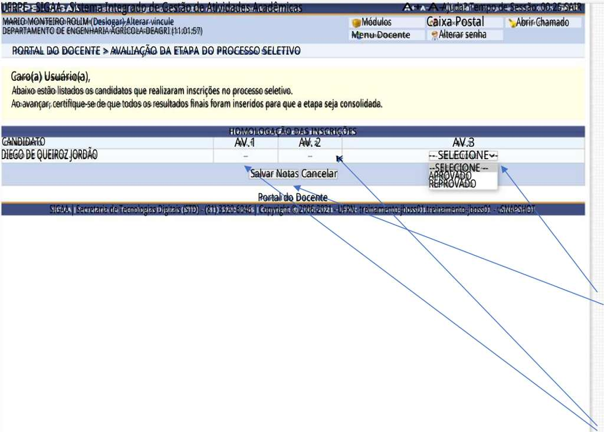

<!-- figure p37-fig1 | described_by: claude:sonnet | ocr_overlap: 0.94 | needs_review: false -->
Captura de tela de interface de sistema (portal web SIGAA), não gráfico de dados.

**Texto completo visível:**

Cabeçalho: "UFRPE SIGAA Sistema Integrado de Gestão de Atividades Acadêmicas"
Linha ajuda: "A+ A- A Ajuda? Tempo de Sessão: 00:25:5ATR" [parcialmente ilegível]

Barra usuário: "MARIO MONTEIRO ROLIM (Deslogar) Alterar vínculo" / "DEPARTAMENTO DE ENGENHARIA AGRÍCOLA-DEAGRI (11:01:57)"

Menu direito: "Módulos" | "Caixa Postal" | "Abrir Chamado" (linha 1); "Menu Docente" | "Alterar senha" (linha 2)

Trilha de navegação: "PORTAL DO DOCENTE > AVALIAÇÃO DA ETAPA DO PROCESSO SELETIVO"

Bloco amarelo (texto):
"Caro(a) Usuário(a),
Abaixo estão listados os candidatos que realizaram inscrições no processo seletivo.
Ao avançar, certifique-se de que todos os resultados finais foram inseridos para que a etapa seja consolidada."

Tabela, título da seção: "HOMOLOGAÇÃO DAS INSCRIÇÕES"
Colunas (cabeçalho): "CANDIDATO" | "AV.1" | "AV.2" | "AV.3"
Linha de dados: "DIEGO DE QUEIROZ JORDÃO" | "-" | "-" | dropdown aberto

Dropdown aberto (opções, de cima p/ baixo): "--SELECIONE--" (duplicado, topo da lista e também valor atual selecionado) / "APROVADO" / "REPROVADO"

Linha de botões abaixo da tabela: "Salvar Notas" | "Cancelar"

Rodapé: "Portal do Docente"
Última linha: "SIGAA | Secretaria de Tecnologias Digitais (STD) - (81) 3320-6046 | Copyright © 2006-2021 - UFRN - treinamento-jboss01.treinamento-jboss01 - v5NAPSHOT"

**Estrutura/marcações gráficas:**
Sobre a captura de tela há várias setas azuis desenhadas manualmente (anotações), todas apontando para cima a partir de um ponto comum abaixo da imagem (fora do print, canto inferior direito), convergindo para diferentes elementos da interface:
- uma seta aponta para o campo de nota "AV.3" / célula "-" (coluna AV.2, linha Diego)
- uma seta aponta para o cursor/símbolo "◄" ao lado do dropdown "--SELECIONE--"
- uma seta aponta para o próprio dropdown aberto com as opções
- uma seta aponta para o botão "Salvar Notas Cancelar"
- uma seta aponta para o canto superior direito da área da tabela (linha de cabeçalho "AV.3")
- mais setas apontam para áreas vazias abaixo da tabela (sem conteúdo associado)

Não há cores com significado de dados (é apenas o esquema visual padrão do sistema: faixa cinza/azulada no cabeçalho da tabela, fundo amarelo claro no aviso, linhas internas tracejadas verticais e horizontais do papel/imagem de fundo). As setas azuis são anotações sobrepostas, não parte original da tela.

Nenhum valor numérico de dados está presente (células de nota aparecem vazias, marcadas com "-").

~~~text ocr
:
Caixa-Posta *
Menu Docente
« Alterar senha
RORTAL DO DOCENTE > DA ETAPA DO SELETIVO
Garo(a) Usuário(a),
Abaixo estão listados os candidatos que realizaram inscrições no processo seletivo.
certifique-se de que todos os resultados finais foram inseridos para que a etapa seja consolidada.
DAS
CANDIDATO
DIEGO DE QUEIROZ JORDÃO
alvar Notas Cancelar
~~~

<!-- Start of picture text -->
UFRPE - SIGAA - Sistema Integrado de Gestão de Atividades Acadêmicas A+ A-Ajuda? Tempo de Sessão: 00:25 SAIR MARIO MONTEIRO ROLIM (Deslogar) Alterar vincule Módulos Caixa Postal Abrir Chamado DEPARTAMENTO DE ENGENHARIA AGRÍCOLA-DEAGRI (11.01.57) Menu Docente Alterar senha PORTAL DO DOCENTE > AVALIAÇÃO DA ETAPA DO PROCESSO SELETIVO Caro(a) Usuário(a), Abaixo estão listados os candidatos que realizaram inscrições no processo seletivo. Ao avançar, certifique-se de que todos os resultados finais foram inseridos para que a etapa seja consolidada. HOMOLOGAÇÃO DAS INSCRIÇÕES CANDIDATO AV.1 AV. 2 AV.3 DIEGO DE QUEIROZ JORDÃO K -- SELECIONE -- --SELECIONE -- Salvar Notas Cancelar APROVADO REPROVADO Portal do Docente SIGAA | Secretaria de Tecnologias Digitais (STD) - (81) 3320-6046 | Copyright © 2006-2021 - UFRN- treinamento-jboss01.treinamento-jboss01 - vSNAPSHOT <!-- End of picture text -->

Clicando no botão “avaliar”, aparece a seguinte tela para o avaliador. No exemplo temos apenas um candidato, mas todos os candidatos são listados nesta tela. Após escolher o resultado, o membro da comissão clica em “salvar notas”. Também é possível visualizar a avaliação dos outros membros da comissão. 

34 

POR 09:58 27℃ Parc ensolarado INTL 08/09/2021 

Digite aqui para pesquisar 

<!-- page 38 -->

 

> SIGAA - Sistema Integrado de GX + 

☆ 

> ← C 

###### ▲Não segurotreinamento.sigs.ufrpe.br/sigaa/ensino/AvaliacaoProcessoSeletivo/lista_processos_seletivos.jsf 

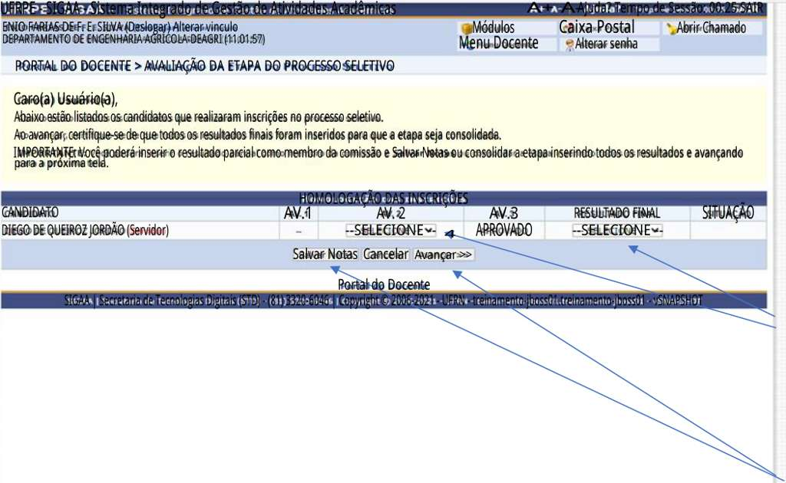

<!-- figure p38-fig1 | described_by: claude:sonnet | ocr_overlap: 0.84 | needs_review: false -->
Captura de tela de sistema web (interface SIGAA — Sistema Integrado de Gestão de Atividades Acadêmicas), página "Avaliação da Etapa do Processo Seletivo", com várias setas azuis indicando elementos da interface.

**1. Tipo de figura**: screenshot de interface de sistema administrativo acadêmico (não é gráfico/tabela de dados), com anotações em setas azuis apontando campos específicos.

**2. Texto visível (verbatim)**:

Cabeçalho superior:
- "UFRPE - SIGAA - Sistema Integrado de Gestão de Atividades Acadêmicas"
- "A+ A- Ajuda Tempo de Sessão: 00:25:5A1R" [parte final ilegível/sobreposta]
- "ENIO FARIAS DE Fr Er SILVA (Deslogar) Alterar vínculo"
- "DEPARTAMENTO DE ENGENHARIA AGRICOLA-DEAGRI (11:01:57)"
- "Módulos"
- "Caixa Postal"
- "Abrir Chamado"
- "Menu Docente"
- "Alterar senha"

Linha de navegação (breadcrumb):
- "PORTAL DO DOCENTE > AVALIAÇÃO DA ETAPA DO PROCESSO SELETIVO"

Bloco de instruções (caixa amarela):
- "Caro(a) Usuário(a),"
- "Abaixo estão listados os candidatos que realizaram inscrições no processo seletivo."
- "Ao avançar, certifique-se de que todos os resultados finais foram inseridos para que a etapa seja consolidada."
- "IMPORTANTE: Você poderá inserir o resultado parcial como membro da comissão e Salvar Notas ou consolidar a etapa inserindo todos os resultados e avançando para a próxima tela."

Título da tabela:
- "HOMOLOGAÇÃO DAS INSCRIÇÕES"

Cabeçalhos das colunas:
- "CANDIDATO"
- "AV.1"
- "AV.2"
- "AV.3"
- "RESULTADO FINAL"
- "SITUAÇÃO"

Linha de dados:
- "DIEGO DE QUEIROZ JORDÃO (Servidor)" | "-" | "--SELECIONE--" | "APROVADO" | "--SELECIONE--" | (vazio)

Botões:
- "Salvar Notas"
- "Cancelar"
- "Avançar >>"

Rodapé:
- "Portal do Docente"
- "SIGAA | Secretaria de Tecnologias Digitais (STD) - (81) 3320-6046 | Copyright © 2006-2021 - UFRN - treinamento-jboss01.treinamento-jboss01 - vSNAPSHOT"

**3. Estrutura**: layout vertical de página web. Topo: barra de sistema com nome usuário à esquerda, menus à direita. Abaixo: breadcrumb de navegação. Caixa de aviso amarela com texto instrucional. Tabela única com 1 linha de candidato e 6 colunas. Abaixo da tabela, 3 botões de ação lado a lado. Rodapé institucional.

Setas azuis (anotações, sem texto associado) apontam para: dropdown "--SELECIONE--" da coluna AV.2, dropdown "--SELECIONE--" da coluna RESULTADO FINAL (duas setas, uma de cada lado), botão "Avançar >>", e extremidade direita da tabela (perto coluna SITUAÇÃO) — total 5 setas indicando pontos de atenção/ação na interface.

**4. Valores de dados**: AV.1 = "-" (traço, sem valor); AV.2 = não preenchido (dropdown "--SELECIONE--"); AV.3 = "APROVADO"; RESULTADO FINAL = não preenchido (dropdown "--SELECIONE--"); SITUAÇÃO = vazio.

**5. Cores**: fundo geral branco/cinza claro típico de sistema administrativo; caixa de aviso em amarelo claro; cabeçalho superior em cinza; setas de anotação em azul (indicam pontos que usuário deve observar/preencher, não fazem parte do sistema original); célula "AV.3" com valor "APROVADO" sem destaque de cor especial.

~~~text ocr
RORTAL DO DOCENTE > AVALIAÇÃO DA EFAPA DO PROGESSO SELETIVO
Garo(a) Usuário(a),
Abaixo os: candidatos que realizaram inscrições no processo seletivo.
certifique-se os resultados finais foram inseridos para que a etapa seja consolidada.
resultado da comissão e ou consolidar os resultados e avançando
RESULTADO FIAIAL
DIEGO DE QUEIROZ JORDÃO (Servidor) - APROVADO
~~~

<!-- Start of picture text -->
UFRPE - SIGAA - Sistema Integrado de Gestão de Atividades Acadêmicas A+ A-Ajuda? Tempo de Sessão: 00:25 SAIR ENIO FARIAS DE F. E. SILVA (Deslogar) Alterar vinculo Módulos Caixa Postal Abrir Chamado DEPARTAMENTO DE ENGENHARIA AGRÍCOLA-DEAGRI (11.01.57) Menu Docente Alterar senha PORTAL DO DOCENTE > AVALIAÇÃO DA ETAPA DO PROCESSO SELETIVO Caro(a) Usuário(a), Abaixo estão listados os candidatos que realizaram inscrições no processo seletivo. Ao avançar, certifique-se de que todos os resultados finais foram inseridos para que a etapa seja consolidada. IMPORTANTE: Você poderá inserir o resultado parcial como membro da comissão e Salvar Notas ou consolidar a etapa inserindo todos os resultados e avançando para a próxima tela. HOMOLOGAÇÃO DAS INSCRIÇÕES CANDIDATO AV.1 AV. 2 AV.3 RESULTADO FINAL SITUAÇÃO DIEGO DE QUEIROZ JORDÃO (Servidor) --SELECIONE -- 4 APROVADO --SELECIONE -- Salvar Notas Cancelar Avançar >> Portal do Docente SIGAA | Secretaria de Tecnologias Digitais (STD) - (81) 3320-6046 | Copyright © 2006-2021 - UFRN - treinamento-jboss01.treinamento-jboss01 - vSNAPSHOT <!-- End of picture text -->

Ao presidente da comissão, é permitido além de inserir sua avaliação, inserir o resultado final da etapa, independentemente dos outros membros terem inserido suas avaliações. O resultado final da etapa pode inclusive diferir da avaliação individual do presidente. É essencial que o presidente da comissão insira o resultado final para que os candidatos passem para a próxima fase Caso deseje apenas inserir seu resultado, clica-se em “salvar notas”, caso deseje encerrar a etapa, insere-se o resultado final, e clica-se em “Avançar”. Caso o candidato seja reprovado, aparecerá um campo para inserir a justificativa da desclassificaçao. 

35 

POR 10:00 27℃ Parc ensolarado INTL 08/09/2021 

Digite aqui para pesquisar 

<!-- page 39 -->

 

 SIGAA - Sistema Integrado de GX + 

> ← C ▲Não segurotreinamento.sigs.ufrpe.br/sigaa/ensino/AvaliacaoProcessoSeletivo/avaliacao_etapa.jsf 

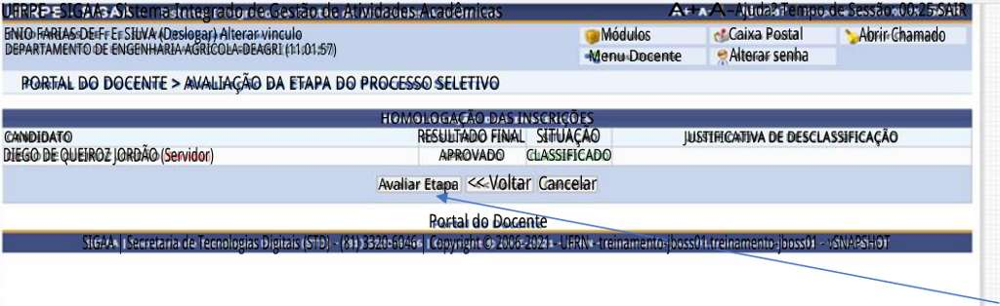

<!-- figure p39-fig1 | described_by: claude:sonnet | ocr_overlap: 0.87 | needs_review: false -->
(1) Tipo de figura: captura de tela (screenshot) de sistema web administrativo (SIGAA), com uma seta azul de anotação sobreposta apontando para cima, em direção a um botão.

(2) Texto visível, verbatim:
- Topo esquerdo: "UFRPE - SIGAA - Sistema Integrado de Gestão de Atividades Acadêmicas"
- Topo direito: "A+ A- A" / "Ajuda" / "Tempo de Sessão: 00:25" / "SATR"
- Linha 2: "ENIO FARIAS DE FREITAS SILVA (Deslogar) Alterar vínculo" — "Módulos" — "Caixa Postal" — "Abrir Chamado"
- Linha 3: "DEPARTAMENTO DE ENGENHARIA AGRÍCOLA-DEAGRI (11:01:57)" — "Menu Docente" — "Alterar senha"
- Título da seção: "PORTAL DO DOCENTE > AVALIAÇÃO DA ETAPA DO PROCESSO SELETIVO"
- Cabeçalho da tabela central: "HOMOLOGAÇÃO DAS INSCRIÇÕES"
- Colunas da tabela: "CANDIDATO" | "RESULTADO FINAL" | "SITUAÇÃO" | "JUSTIFICATIVA DE DESCLASSIFICAÇÃO"
- Linha de dados: "DIEGO DE QUEIROZ JORDÃO (Servidor)" [em vermelho: "(Servidor)"] | "APROVADO" | "CLASSIFICADO" | (vazio)
- Botões abaixo da tabela: "Avaliar Etapa" | "<< Voltar" | "Cancelar"
- Rodapé: "Portal do Docente"
- Linha final: "SIGAA | Secretaria de Tecnologias Digitais (STD) - (81) 3320-6046 - Copyright © 2006-2021 - UFRN - treinamento-jboss01.treinamento-jboss01 - vSNAPSHOT"

(3) Estrutura: página web com três áreas no topo (barra de identificação do sistema à esquerda, barra de ajuda/sessão à direita, barra de usuário/departamento com links de módulos), seguida de um título de navegação em breadcrumb ("PORTAL DO DOCENTE > AVALIAÇÃO DA ETAPA DO PROCESSO SELETIVO"). Abaixo, uma tabela com cabeçalho azul escuro ("HOMOLOGAÇÃO DAS INSCRIÇÕES") e quatro colunas, contendo uma única linha de dados do candidato. Logo abaixo da tabela, três botões/links em linha: "Avaliar Etapa", "<< Voltar", "Cancelar". Uma seta azul grossa de anotação cruza a imagem diagonalmente, partindo de baixo (fora da tabela, canto inferior direito da área de botões) e apontando para cima em direção ao botão "Avaliar Etapa" — indica/destaca esse botão. Rodapé com texto institucional centralizado.

(4) Valores de dados: nenhum número estatístico, exceto "Tempo de Sessão: 00:25", horário "(11:01:57)", telefone "(81) 3320-6046" e ano de copyright "2006-2021".

(5) Cores com significado: "(Servidor)" aparece em vermelho, destacando status especial do candidato; a seta de anotação é azul, usada para indicar/apontar o botão "Avaliar Etapa"; cabeçalhos de tabela em fundo azul escuro com texto branco; linhas de dados em fundo azul claro alternado (padrão visual do sistema, sem significado adicional).

~~~text ocr
GE
Postal * Ghamado
Docente
© Alterar senha
RESULTADO FINAL SITUAÇÃO JUSTIFICATIVA DE DESCLASSIFICAÇÃO
DIEGO DE QUEIROZ JORDÃO (Servidor)
SUCKIN SU |
~~~

<!-- Start of picture text -->
UFRPE - SIGAA - Sistema Integrado de Gestão de Atividades Acadêmicas A+ A-Ajuda? Tempo de Sessão: 00:25 SAIR ENIO FARIAS DE F. E. SILVA (Deslogar) Alterar vinculo Módulos Caixa Postal Abrir Chamado DEPARTAMENTO DE ENGENHARIA AGRÍCOLA-DEAGRI (11.01.57) Menu Docente Alterar senha PORTAL DO DOCENTE > AVALIAÇÃO DA ETAPA DO PROCESSO SELETIVO HOMOLOGAÇÃO DAS INSCRIÇÕES CANDIDATO RESULTADO FINAL SITUAÇÃO JUSTIFICATIVA DE DESCLASSIFICAÇÃO DIEGO DE QUEIROZ JORDÃO (Servidor) APROVADO CLASSIFICADO Avaliar Etapa << Voltar Cancelar Portal do Docente SIGAA | Secretaria de Tecnologias Digitais (STD) - (81) 3320-6046 | Copyright © 2006-2021 - UFRN - treinamento-jboss01.treinamento-jboss01 - vSNAPSHOT <!-- End of picture text -->

O sistema irá apresentar a seguinte tela com o resumo da avaliação de todos os candidatos para o encerramento da etapa. Para concluir, clica-se em “avaliar etapa”. 

36 

POR 10:05 27C Parc ensolarado INTL 08/09/2021 

QDigite aqui para pesquisar 

<!-- page 40 -->

 

 SIGAA - Sistema Integrado de GX + 

> ← C 

###### ▲Não segurotreinamento.sigs.ufrpe.br/sigaa/ensino/AvaliacaoProcessoSeletivo/lista_processos_seletivos.jsf 

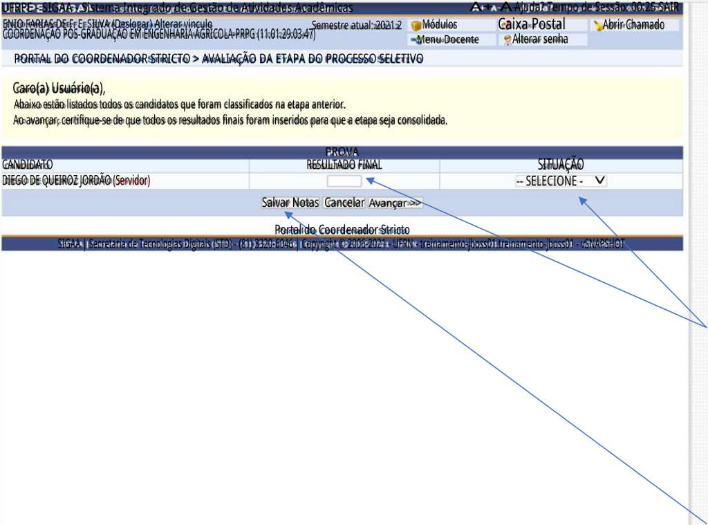

<!-- figure p40-fig1 | described_by: claude:sonnet | ocr_overlap: 0.88 | needs_review: false -->
(1) Captura de tela de interface de sistema web (SIGAA – Sistema Integrado de Gestão de Atividades Acadêmicas), com duas setas azuis desenhadas manualmente apontando para elementos da tela.

(2) Texto visível, na íntegra:

Cabeçalho superior:
- "UFRPE - SIGAA - Sistema Integrado de Gestão de Atividades Acadêmicas"
- "A+ A- A Ajuda Tempo de Sessão: 00:25 Sair"
- "ENIO FARIAS DE Fr Er SILVA (Deslogar) Alterar vínculo" — "Semestre atual: 2021.2" — "Módulos" — "Caixa Postal" — "Abrir Chamado"
- "COORDENAÇÃO POS-GRADUAÇÃO EM ENGENHARIA AGRICOLA-PRPG (11.01.29.03.47)" — "Menu Docente" — "Alterar senha"

Linha de navegação/breadcrumb:
- "PORTAL DO COORDENADOR STRICTO > AVALIAÇÃO DA ETAPA DO PROCESSO SELETIVO"

Bloco de aviso (fundo amarelo claro):
- "Caro(a) Usuário(a),"
- "Abaixo estão listados todos os candidatos que foram classificados na etapa anterior."
- "Ao avançar, certifique-se de que todos os resultados finais foram inseridos para que a etapa seja consolidada."

Tabela central:
- Título de seção mesclado no topo: "PROVA"
- Cabeçalho de colunas: "CANDIDATO" | "RESULTADO FINAL" | "SITUAÇÃO"
- Linha de dados: "DIEGO DE QUEIROZ JORDÃO (Servidor)" | [campo de texto vazio] | "-- SELECIONE -" (caixa de seleção suspensa, com seta para baixo "∨")
- Linha de botões: "Salvar Notas" | "Cancelar" | "Avançar >>"

Rodapé:
- "Portal do Coordenador Stricto"
- "SIGAA | Secretaria de Tecnologias Digitais (STD) - (81) 3320-6046 | Copyright © 2006-2021 - UFRN - treinamento-jboss01.treinamento-jboss01 - vSNAPSHOT"

(3) Estrutura: página web organizada em blocos horizontais empilhados verticalmente — barra de cabeçalho (identificação do sistema e usuário), linha de breadcrumb/título da página, caixa de aviso amarela, tabela de candidatos com 3 colunas (Candidato, Resultado Final, Situação) e cabeçalho mesclado "PROVA", seguida de linha de botões de ação, e rodapé institucional. Sobre a imagem, duas setas azuis diagonais desenhadas à mão: uma parte da região abaixo/esquerda da tabela e aponta para cima em direção ao campo "RESULTADO FINAL" (campo de texto vazio na linha do candidato); outra parte de baixo à direita e aponta para cima em direção ao combo "SITUAÇÃO" (caixa "-- SELECIONE --"). As setas indicam/destacam esses dois campos de preenchimento como pontos de atenção.

(4) Não há valores numéricos de dados preenchidos — o campo "RESULTADO FINAL" está vazio e "SITUAÇÃO" está no valor padrão "-- SELECIONE --". Único número presente: tempo de sessão "00:25" e código "(11.01.29.03.47)" e telefone "(81) 3320-6046" e ano "2021.2" / copyright "2006-2021".

(5) Cores com significado: fundo amarelo claro no bloco de instruções (destaque de aviso/atenção); faixa azul escura no cabeçalho da tabela ("PROVA"); linhas azul-claro alternadas na tabela (estilo zebra padrão de tabela, sem significado semântico adicional); setas em azul vivo, desenhadas manualmente, usadas para apontar/destacar os campos "RESULTADO FINAL" e "SITUAÇÃO" que precisam ser preenchidos.

~~~text ocr
Modulos Caixa-Posta
senha
RORTAL DO > AVALIAÇÃO DA DO PROGESSO SELETIVO
Garo(a) Usuário(a),
Abaixo estão listados todos os candidatos que foram classificados na etapa anterior.
certifique-se de que todos os resultados finais foram inseridos para que a etapa seja consolidada.
CANDIDATO
DIEGO DE QUEIROZ JORDÃO (Servidor)
Salvar Notas Cancelar
ide
> us 14
~~~

<!-- Start of picture text -->
UFRPE - SIGAA - Sistema Integrado de Gestão de Atividades Acadêmicas A+ A-Ajuda? Tempo de Sessão: 00:25 SAIR ENIO FARIAS DE F. E. SILVA (Deslogar) Alterar vinculo Semestre atual: 2021.2 Módulos Caixa Postal Abrir Chamado COORDENAÇÃO PÓS-GRADUAÇÃO EM ENGENHARIA AGRÍCOLA-PRPG (11.01.29.03.47) Menu Docente Alterar senha PORTAL DO COORDENADOR STRICTO > AVALIAÇÃO DA ETAPA DO PROCESSO SELETIVO Caro(a) Usuário(a), Abaixo estão listados todos os candidatos que foram classificados na etapa anterior. Ao avançar, certifique-se de que todos os resultados finais foram inseridos para que a etapa seja consolidada. PROVA CANDIDATO RESULTADO FINAL SITUAÇÃO DIEGO DE QUEIROZ JORDÃO (Servidor) -- SELECIONE - V Salvar Notas Cancelar Avançar >> Portal do Coordenador Stricto SIGAA | Secretaria de Tecnologias Digitais (STD) - (81) 3320-6046 | Copynght © 2006-2021 - UFRN - treinamento-jboss01.treinamento-jboss01 - vSNAPSHOT <!-- End of picture text -->

Caso a etapa da seleção tenha sido selecionada para ser avaliada pela Coordenação (ou a mesma ser responsável em inserir os resultados), bastará ao coordenador inserir seu resultado através do Portal do Coordenador Stricto sensu conforme o slide 24. 

Neste exemplo, temos uma etapa cujo responsável é o coordenador, e o tipo de avaliação é através da nota. Após inserir a nota, a coordenação deverá inserir também a situação do candidato (classificado ou desclassificado). 

Novamente, para inserir apenas o resultado parcial, clica-se em “Salvar Notas”, para encerrar a etapa, clica-se em “avançar”. Na tela seguinte novamente confirma-se o resultado clicando em “Avaliar Etapa”. 

37 

POR 10:08 INTL 08/09/2021 

Digite aqui para pesquisar 

27C Parc ensolarado 

<!-- page 41 -->

 

 SIGAA - Sistema Integrado de GX + 

> ← C 

###### ▲Não segurotreinamento.sigs.ufrpe.br/sigaa/ensino/AvaliacaoProcessoSeletivo/lista_processos_seletivos.jsf 

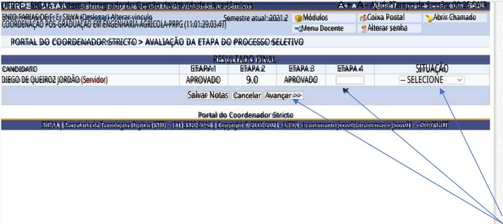

<!-- figure p41-fig1 | described_by: claude:sonnet | ocr_overlap: 0.72 | needs_review: false -->
Tipo de figura: captura de tela de sistema web (SIGAA – Sistema Integrado de Gestão de Atividades Acadêmicas), com setas anotadas sobrepostas (marcação manual) apontando elementos da interface.

Texto visível (verbatim):

Cabeçalho superior:
- "UFRPE SIGAA Sistema Integrado de Gestão de Atividades Acadêmicas"
- "A+ A- Ajuda Tempo de Sessão: 00:25:5AIR" [illegible parte final]
- "ENIO FARIAS DE FEE SILVA (Deslogar) Alterar vínculo" [nome parcialmente ilegível/sobreposto]
- "COORDENAÇÃO POS-GRADUAÇÃO EM ENGENHARIA AGRICOLA-PRPG (11:01:29:03:47)"
- "Semestre atual: 2021.2"
- Botões: "Módulos", "Caixa Postal", "Abrir Chamado", "Menu Docente", "Alterar senha"

Linha de navegação (breadcrumb):
- "PORTAL DO COORDENADOR STRICTO > AVALIAÇÃO DA ETAPA DO PROCESSO SELETIVO"

Tabela principal:
- Título da tabela: "RESULTADO FINAL"
- Cabeçalhos de coluna: "CANDIDATO" | "ETAPA 1" | "ETAPA 2" | "ETAPA 3" | "ETAPA 4" | "SITUAÇÃO"
- Linha de dados: "DIEGO DE QUEIROZ JORDÃO (Servidor)" | "APROVADO" | "9.0" | "APROVADO" | [campo vazio, caixa de texto] | "-- SELECIONE --" (caixa suspensa/dropdown)

Linha de botões: "Salvar Notas" | "Cancelar" | "Avançar >>"

Rodapé:
- "Portal do Coordenador Stricto"
- "SIGAA | Secretaria de Tecnologias Digitais (STD) - (81) 3320-6046 | Copyright © 2006-2021 - UFRN - treinamento.jboss01.treinamento-jboss01 - vSNAPSHOT"

Estrutura:
- Layout tipo tela de sistema acadêmico, organizado em blocos horizontais empilhados: cabeçalho institucional → barra de navegação (breadcrumb) → tabela de resultado → linha de botões de ação → rodapé.
- Tabela tem 1 linha de cabeçalho (azul escuro) + 1 linha de dados, 6 colunas no total.
- Três setas azuis desenhadas à mão (anotação), todas partindo de área abaixo/direita da tela, apontando para cima, em direção a:
  1. o campo de texto vazio da coluna "ETAPA 4" (seta do meio/esquerda);
  2. a caixa de seleção "-- SELECIONE --" da coluna "SITUAÇÃO" (seta mais à direita);
  3. uma terceira seta aponta também para a região da linha de botões ("Avançar >>") / área superior da tabela.

Valores numéricos/dados:
- Tempo de sessão: 00:25:5[illegible]
- Código entre parênteses junto ao nome do coordenador: "(11:01:29:03:47)"
- Semestre: "2021.2"
- Nota ETAPA 2: "9.0"
- Telefone no rodapé: "(81) 3320-6046"
- Copyright: "2006-2021"

Cores com significado:
- Barra de cabeçalho da tabela ("RESULTADO FINAL" e linha de títulos de coluna): fundo azul escuro, texto branco — indica cabeçalho/destaque.
- Linha de dados do candidato: fundo azul claro, alternando com fundo branco nas áreas vizinhas — padrão comum de tabela SIGAA.
- Setas de anotação: azul vivo, usadas para destacar/indicar campos que exigem ação do usuário (preencher nota da Etapa 4 e selecionar situação).
- Rodapé: faixa laranja fina decorativa acima da linha de texto do rodapé.

~~~text ocr
atual:20212 et. Caixa Postal »_Abrir
Docente © Alterar senha
RORTAL DO COORDENADORSTRIGTO > AVALIAÇÃO DA ETAPA DO PROGESSO SELETIVO
CANDIDATO - ETAPA 2 ETAPAS ETAPA 4
DIEGO DE QUEIROZ JORDAO (Servidor) APROVADO 9.0 APROVADO
Salvar Notas Cancelar Avangar>>
SU
~~~

<!-- Start of picture text -->
UFRPE - SIGAA - Sistema Integrado de Gestão de Atividades Acadêmicas A+ A- Ajuda?Tempo de Sessão: 00:25 SAIR ENIO FARIAS DE F. E. SILVA (Deslogar) Alterar vinculo Semestre atual: 2021.2 Módulos Caixa Postal Abrir Chamado COORDENAÇÃO PÓS-GRADUAÇÃO EM ENGENHARIA AGRÍCOLA-PRPG (11.01.29.03.47) Menu Docente Alterar senha PORTAL DO COORDENADOR STRICTO > AVALIAÇÃO DA ETAPA DO PROCESSO SELETIVO RESULTADO FINAL CANDIDATO ETAPA1 ETAPA 2 ETAPA 3 ETAPA 4 SITUAÇÃO DIEGO DE QUEIROZ JORDÃO (Servidor) APROVADO 9.0 APROVADO -- SELECIONE Salvar Notas Cancelar Avançar >> K Portal do Coordenador Stricto SIGAA | Secretaria de Tecnologias Digitais (STD) - (81) 3320-6046 | Copyright © 2006-2021 - UFRN - treinamento jboss01.treinamenio-jboss01 - vSNAPSHOT <!-- End of picture text -->

Após cada etapa ser concluída uma a uma, chega na etapa onde é colocado o resultado final, que é feito de forma similar às etapas anteriores, porém será mostrado os resultado de todas as etapas anteriores. 

Novamente insere-se a nota e o resultado, avança para a tela seguinte, e confirma-se na opção “Avaliar Etapa” O candidato que tiver sido aprovado fora das vagas deverá constar como “Classificado” no sistema, para o caso de haver a necessidade de remanejamento. 

38 

POR 11:38 28°C Chuva fraca● INTL08/09/2021 

QDigite aqui para pesquisar 

<!-- page 42 -->

 

 

 SIGAA - Sistema Integrado de GX + 

C 

← 

Não segurotreinamento.sigs.ufrpe.br/sigaa/public/processo_seletivo/area_do_candidato/lista_inscricoes_candidato.jsf 

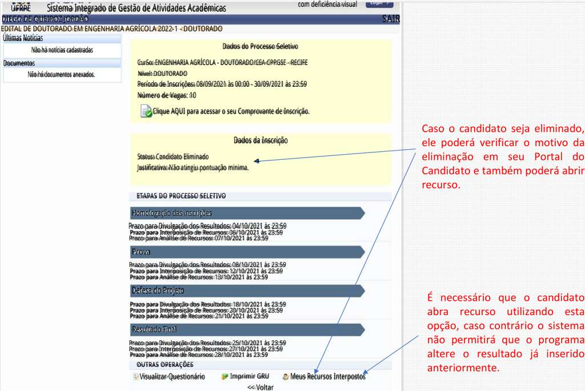

<!-- figure p42-fig1 | described_by: claude:sonnet | ocr_overlap: 0.92 | needs_review: false -->
Imagem é captura de tela de sistema web universitário (portal acadêmico), não gráfico/figura de dados.

**1. Tipo de figura:** Screenshot de interface de sistema web, com anotações sobrepostas em vermelho (setas e texto explicativo) apontando para elementos da tela.

**2. Todo texto visível, verbatim:**

Cabeçalho:
- "UFRPE" (logo, parcialmente sobreposto por marca d'água diagonal)
- "Sistema Integrado de Gestão de Atividades Acadêmicas"
- "com deficiência visual" (canto superior direito, parcial)
- Botão: "Login" (parcialmente visível)
- "SAIR"

Linha de identificação:
- "DIEGO DE QUEIROZ JORDÃO"
- "EDITAL DE DOUTORADO EM ENGENHARIA AGRÍCOLA 2022-1 - DOUTORADO"

Painel lateral esquerdo:
- "Últimas Notícias"
- "Não há notícias cadastradas"
- "Documentos"
- "Não há documentos anexados."

Caixa "Dados do Processo Seletivo":
- "Curso: ENGENHARIA AGRÍCOLA - DOUTORADO/CEA-CPPGSE - RECIFE"
- "Nível: DOUTORADO"
- "Período de Inscrições: 08/09/2021 às 00:00 - 30/09/2021 às 23:59"
- "Número de Vagas: 10"
- ícone + "Clique AQUI para acessar o seu Comprovante de Inscrição."

Caixa "Dados da Inscrição":
- "Status: Candidato Eliminado"
- "Justificativa: Não atingiu pontuação mínima."

Seção "ETAPAS DO PROCESSO SELETIVO" (barras em formato de seta, cada uma com prazos abaixo):

- "Homologação das inscrições"
  - Prazo para Divulgação dos Resultados: 04/10/2021 às 23:59
  - Prazo para Interposição de Recursos: 06/10/2021 às 23:59
  - Prazo para Análise de Recursos: 07/10/2021 às 23:59

- "Prova"
  - Prazo para Divulgação dos Resultados: 08/10/2021 às 23:59
  - Prazo para Interposição de Recursos: 12/10/2021 às 23:59
  - Prazo para Análise de Recursos: 13/10/2021 às 23:59

- "Defesa do Projeto"
  - Prazo para Divulgação dos Resultados: 18/10/2021 às 23:59
  - Prazo para Interposição de Recursos: 20/10/2021 às 23:59
  - Prazo para Análise de Recursos: 21/10/2021 às 23:59

- "Resultado Final"
  - Prazo para Divulgação dos Resultados: 25/10/2021 às 23:59
  - Prazo para Interposição de Recursos: 27/10/2021 às 23:59
  - Prazo para Análise de Recursos: 28/10/2021 às 23:59

"OUTRAS OPERAÇÕES":
- ícone + "Visualizar Questionário"
- ícone + "Imprimir GRU"
- ícone + "Meus Recursos Interpostos"
- "<< Voltar"

Anotações vermelhas (texto adicionado à imagem, fora da interface original):
- Bloco 1 (seta aponta pra "Status: Candidato Eliminado"): "Caso o candidato seja eliminado, ele poderá verificar o motivo da eliminação em seu Portal do Candidato e também poderá abrir recurso."
- Bloco 2 (seta aponta pra "Meus Recursos Interpostos"): "É necessário que o candidato abra recurso utilizando esta opção, caso contrário o sistema não permitirá que o programa altere o resultado já inserido anteriormente."

**3. Estrutura:**
Layout tela dividida em: coluna estreita esquerda (notícias/documentos), coluna central larga (dados processo seletivo, empilhados em caixas), coluna direita com dois blocos de texto vermelho conectados por setas azuis diagonais à interface central. Seta 1 vai do bloco de texto superior direito até linha "Status: Candidato Eliminado" na caixa "Dados da Inscrição". Seta 2 vai do bloco de texto inferior direito até item "Meus Recursos Interpostos" na seção "OUTRAS OPERAÇÕES". Etapas do processo seletivo mostradas como 4 barras horizontais empilhadas verticalmente (forma de seta/chevron cinza-azulado), cada uma seguida de 3 linhas de prazo.

**4. Valores numéricos/datas:**
- Vagas: 10
- Período inscrições: 08/09/2021 00:00 até 30/09/2021 23:59
- Datas por etapa (todas às 23:59): Homologação 04/10, 06/10, 07/10/2021; Prova 08/10, 12/10, 13/10/2021; Defesa Projeto 18/10, 20/10, 21/10/2021; Resultado Final 25/10, 27/10, 28/10/2021.

**5. Cores com significado:**
Texto anotado em vermelho + setas azuis = sobreposição explicativa adicionada por quem fez a captura, destacando dois pontos da interface (não faz parte do sistema original). Barras das etapas em cinza-azulado sólido. Caixas de dados em fundo amarelo-claro. Restante da interface em tons neutros (branco/cinza), padrão de portal web institucional.

~~~text ocr
Sistema Integrado de Gestão de Atividades Acadêmicas com
Die
EDITAL DE DOUTORADO-EM ENGENHARIA 2022-1 «DOUTORADO
notícias cadastradas Dados do Processo Seletivo
Documentos AGRÍCOLA -
anexados.
de Inscrições: às 00:00 - 30/09/2021 às 23:59
Número de Vagas: 10
AQUI para acessar o seu Comprovante de Inscrição.
Caso o candidato seja eliminado,
Dados da Inscrição ele poderá verificar o motivo da
Candidato Eliminado E
minima.
recurso.
ETARAS DO PROCESSO SELETIVO
às 23:59
Prazo para de Recursos::06/10/2021 às 23:59
Análi Recursos::07/10/2021 as 23:59
Rrazo paras Divulgaçãodos: às 23:59
Prazo para de Recursos:: 12/10/2021 às 23:59
Prazo para Análise: de: às 23:59
Prazo para Divulgação dos as 23:59
às 23:59
Prazo para Análise de às 23:59
Divulgação-dos: às 23:59
ao de: as 23:59
Prazo para se: dê: Recursos::28/10/2021 às 23:59
OUTRAS OPERAÇÕES
- Meus Recursos Interpostos
abra
eliminação em seu Portal
Candidato e também poderá abrir
É necessário que o candidato
recurso utilizando esta
opção, caso contrário o sistema
não permitirá que o programa
altere o resultado já inserido
anteriormente.
~~~

<!-- Start of picture text -->
com deficiência visual UFRPE Sistema Integrado de Gestão de Atividades Acadêmicas DIEGO DE QUEIROZ JORDÃO SAIR EDITAL DE DOUTORADO EM ENGENHARIA AGRÍCOLA 2022-1 - DOUTORADO Últimas Notícias Dados do Processo Seletivo Não há notícias cadastradas Documentos CurSo: ENGENHARIA AGRÍCOLA - DOUTORADO/CEA-CPPGSE - RECIFE Não há documentos anexados. Nível: DOUTORADO Período de Inscrições: 08/09/2021 às 00:00 - 30/09/2021 às 23:59 Número de Vagas: 10 Clique AQUI para acessar o seu Comprovante de Inscrição. Caso o candidato seja eliminado, Dados da Inscrição ele poderá verificar o motivo da Status: Candidato Eliminado 4 eliminação em seu Portal do Justificativa: Não atingiu pontuação minima. Candidato e também poderá abrir recurso. ETAPAS DO PROCESSO SELETIVO Homologação das inscrições Prazo para Divulgação dos Resultados: 04/10/2021 às 23:59 Prazo para Interposição de Recursos: 06/10/2021 às 23:59 Prazo para Análise de Recursos: 07/10/2021 às 23:59 Prova Prazo para Divulgação dos Resultados: 08/10/2021 às 23:59 Prazo para Interposição de Recursos: 12/10/2021 às 23:59 Prazo para Análise de Recursos: 13/10/2021 às 23:59 Defesa do Projeto É necessário que o candidato Prazo para Divulgação dos Resultados: 18/10/2021 às 23:59 Prazo para Interposição de Recursos: 20/10/2021 às 23:59 abra recurso utilizando esta Prazo para Análise de Recursos: 21/10/2021 às 23:59 Resultado Final opção, caso contrário o sistema Prazo para Divulgação dos Resultados: 25/10/2021 às 23:59 não permitirá que o programa Prazo para Interposição de Recursos: 27/10/2021 às 23:59 Prazo para Análise de Recursos: 28/10/2021 às 23:59 altere o resultado já inserido OUTRAS OPERAÇÕES anteriormente. Visualizar Questionário Imprimir GRU Meus Recursos Interpostos << Voltar <!-- End of picture text -->

SIGAA | Secretaria de Tecnologias Digitais (STD) - (81) 3320-6046 | Copyright © 2006-2021 - UFRN - treinamento-jboss01.treinamento-jboss01 vSNAPSHOT 

39 

0POR 11:51 INTL 08/09/2021  

QDigite aqui para pesquisar 

28°C Chuva fraca 

<!-- page 43 -->

 

 

 SIGAA - Sistema Integrado de GX + 

> ← C 

###### Não seguro|treinamento.sigs.ufrpe.br/sigaa/stricto/coordenacao.jsf 

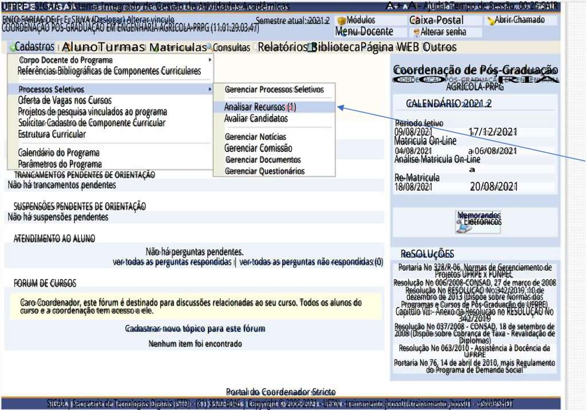

<!-- figure p43-fig1 | described_by: claude:sonnet | ocr_overlap: 0.87 | needs_review: false -->
**1. Tipo de figura:** Captura de tela (screenshot) de interface web — sistema SIGAA (Sistema Integrado de Gestão de Atividades Acadêmicas), tela do menu docente/coordenador, com um menu suspenso aberto e uma seta desenhada apontando para item do menu.

**2. Todo texto visível (verbatim):**

Cabeçalho superior:
- "UFRPE SIGAA Sistema Integrado de Gestão de Atividades Acadêmicas" [parcialmente sobreposto/ilegível em trecho]
- "A+ A- Ajuda Tempo de Sessão: 00:25:5Alt" [parte final ilegível]
- "ENIO FARIAS DE FREIRE SILVA (Deslogar) Alterar vínculo" [sobreposto, parcialmente ilegível]
- "COORDENAÇÃO POS-GRADUAÇÃO EM ENGENHARIA AGRICOLA-PRPG (11.01.29.03.47)"
- "Semestre atual: 2021.2"
- "Módulos"
- "Caixa Postal"
- "Abrir Chamado"
- "Menu Docente"
- "Alterar senha"

Barra de menu:
- "Cadastros"
- "Aluno"
- "Turmas"
- "Matrículas"
- "Consultas"
- "Relatórios"
- "Biblioteca"
- "Página WEB"
- "Outros"

Menu suspenso de "Cadastros" (coluna 1):
- "Corpo Docente do Programa" (com seta ">" indicando submenu)
- "Referências Bibliográficas de Componentes Curriculares" (com seta ">")
- "Processos Seletivos" (com seta ">", destacado/selecionado)
- "Oferta de Vagas nos Cursos"
- "Projetos de pesquisa vinculados ao programa"
- "Solicitar Cadastro de Componente Curricular"
- "Estrutura Curricular"
- "Calendário do Programa"
- "Parâmetros do Programa"

Submenu de "Processos Seletivos" (coluna 2, aberto à direita):
- "Gerenciar Processos Seletivos"
- "Analisar Recursos (1)" — destacado, com a seta desenhada apontando para este item
- "Avaliar Candidatos"
- "Gerenciar Notícias"
- "Gerenciar Comissão"
- "Gerenciar Documentos"
- "Gerenciar Questionários"

Bloco abaixo do menu (lado esquerdo):
- "TRANCAMENTOS PENDENTES DE ORIENTAÇÃO"
- "Não há trancamentos pendentes"
- "SUSPENSÕES PENDENTES DE ORIENTAÇÃO"
- "Não há suspensões pendentes"
- "ATENDIMENTO AO ALUNO"
- "Não há perguntas pendentes."
- "ver todas as perguntas respondidas | ver todas as perguntas não respondidas (0)"
- "FORUM DE CURSOS"
- "Caro Coordenador, este fórum é destinado para discussões relacionadas ao seu curso. Todos os alunos do curso e a coordenação tem acesso a ele."
- "Cadastrar novo tópico para este fórum"
- "Nenhum item foi encontrado"

Painel direito:
- "Coordenação de Pós-Graduação" (título, parcialmente sobreposto por outro texto)
- "COORD. ACAD. PÓS-GRADUAÇÃO EM ENGENHARIA AGRICOLA-PRPG" [sobreposto, trecho ilegível]
- "CALENDÁRIO 2021.2"
- "Período letivo" — "09/08/2021" a "17/12/2021"
- "Matrícula On-Line" — "04/08/2021" a "06/08/2021"
- "Análise Matrícula On-Line" — a [data final não visível/ilegível]
- "Re-Matrícula" — "18/08/2021" a "20/08/2021"
- Ícone/link: "Memorandos Eletrônicos"
- "RESOLUÇÕES"
- "Portaria No 328/R-06, Normas de Gerenciamento de Projetos UFRPE x FUNPEC"
- "Resolução No 006/2008-CONSAD, 27 de março de 2008"
- "Resolução No RESOLUÇÃO No 342/2019, 10 de dezembro de 2013 (Dispõe sobre Normas dos Programas e Cursos de Pós-Graduação da UFRPE)"
- "Capítulo VII- Anexo da Resolução no RESOLUÇÃO No 342/2019"
- "Resolução No 037/2008 - CONSAD, 18 de setembro de 2008 (Dispõe sobre Cobrança de Taxa - Revalidação de Diplomas)"
- "Resolução No 063/2010 - Assistência à Docência da UFRPE"
- "Portaria No 76, 14 de abril de 2010, mais Regulamento do Programa de Demanda Social"

Rodapé:
- "Portal do Coordenador Stricto"
- "SIGAA | Secretaria de Tecnologias Digitais (STI) - (81) 3320-6046 | Copyright © 2006-2021 - UFRN - treinamento.jboss01.treinamento.jboss01 - vSNAPSHOT"

**3. Estrutura:** Página dividida em: faixa de cabeçalho (topo), barra de menus horizontal, menu suspenso em cascata (2 colunas, coluna 1 lista opções de "Cadastros", coluna 2 é submenu de "Processos Seletivos" aberto à direita da coluna 1). Uma seta desenhada à mão (azul) parte da borda direita da imagem, cruza a tela diagonalmente, e aponta para o item "Analisar Recursos (1)" no submenu. Abaixo do menu, bloco de texto em coluna única (lado esquerdo) com várias seções tituladas em caixa alta. À direita, painel lateral tipo sidebar com título, calendário em formato de tabela informal (rótulo + datas), ícone de memorandos, e lista de resoluções/normativas. Rodapé em faixa horizontal no fim da página.

**4. Valores numéricos/datas:**
- Semestre: 2021.2
- Tempo de sessão: 00:25:5[trecho ilegível]
- Código do programa: 11.01.29.03.47
- Analisar Recursos: (1)
- Perguntas não respondidas: (0)
- Calendário 2021.2:
 - Período letivo: 09/08/2021 a 17/12/2021
 - Matrícula On-Line: 04/08/2021 a 06/08/2021
 - Análise Matrícula On-Line: a [data inicial ilegível/ausente]
 - Re-Matrícula: 18/08/2021 a 20/08/2021
- Normativas: Portaria No 328/R-06; Resolução No 006/2008; Resolução No 342/2019 (10 dez 2013); Resolução No 037/2008 (18 set 2008); Resolução No 063/2010; Portaria No 76 (14 abr 2010)
- Rodapé: telefone (81) 3320-6046; Copyright © 2006-2021

**5. Cores com significado:** Item "Processos Seletivos" (coluna 1) e "Analisar Recursos (1)" (coluna 2) aparecem destacados/realçados (fundo diferenciado) indicando seleção/hover no menu. Seta sobreposta em azul, usada para indicar/apontar o item "Analisar Recursos (1)" como foco da instrução. Bloco "FORUM DE CURSOS" tem fundo amarelo claro, diferenciando-o como aviso/destaque textual. Restante da interface segue paleta padrão azul/branco/cinza do sistema SIGAA.

~~~text ocr
of
| atual:20212 Módulos
MenuDocente senha
«Cadastros | Matriculas-Consultas RelatóriosBibliotecaPágina WEB Outros
» ão de Pó ~
n
ências Bibliográficas de Componentes enação
Seletivos » Processos Seletivos AGRICOLA:
erta de Vagas nos Cursos CALENDÁRIO
vinculados ao
Solicitar: Cadastro de Componente Curricular iodo leti
Estrutura Curricular Gerenciar Notícias
Gerenciar Comissão 04/08/2024 06/08/2021
Gerenciar Documentos Matricula On-line
TRANGAMENTOS PENDENTES DE ORIENTAÇÃO Gerenciar Questionários Re-Matricula E
Não há trancamentos pendentes 18/08/2021 20/08/2021
SUSPENSÕES PENDENTES DE ORIENTAÇÃO
Não há suspensões pendentes
AO ALUNO
perguntas pendentes. |
ver-todas as perguntas respondidas | ver-todas as perguntas não respondidas (0) Portaria No te
FORUM DE CURSOS Resolução No 27 de março de 2008
de sob
é destinado para discussões relacionadas ao seu curso. Todos os alunos do Gur No
novo tópico para este fórum
Nenhum item foi encontrado
Resolução No 063/2016; à Docência da
Portaria No 14 de 2010,
De
~~~

<!-- Start of picture text -->
UFRPE - SIGAA - Sistema Integrado de Gestão de Atividades Acadêmicas A+ A- Ajuda? Tempo de Sessão: 00:25 SAIR ENIO FARIAS DE F. E. SILVA (Deslogar) Alterar vinculo Semestre atual: 2021.2 Módulos Caixa Postal Abrir Chamado COORDENAÇÃO PÓS-GRADUAÇÃO EM ENGENHARIA AGRÍCOLA-PRPG (11.01.29.03.47) Menu Docente Alterar senha Cadastros AlunoTurmas Matriculas Consultas Relatórios BibliotecaPágina WEB Outros Corpo Docente do Programa Referências Bibliográficas de Componentes Curriculares Coordenação de Póş-Graduação CO  - RIA Processos Seletivos Gerenciar Processos Seletivos AGRÍCOLA-PRPG Oferta de Vagas nos Cursos CALENDÁRIO 2021.2 Analisar Recursos (1) Projetos de pesquisa vinculados ao programa Avaliar Candidatos Solicitar Cadastro de Componente Curricular Periodo letivo Estrutura Curricular Gerenciar Notícias Matricula On-Line09/08/2021 17/12/2021 Calendário do Programa Gerenciar Comissão 04/08/2021 a 06/08/2021 Gerenciar Documentos Análise Matricula On-Line TRANCAMENTOS PENDENTES DE ORIENTAÇÃOParâmetros do Programa Gerenciar Questionários Re-Matricula a Não há trancamentos pendentes 18/08/2021  20/08/2021 SUSPENSÖES PENDENTES DE ORIENTAÇÃO Não há suspensões pendentes MemorandosEletrónicos ATENDIMENTO AO ALUNO Não há perguntas pendentes. ReSOLUçÕES ver todas as perguntas respondidas | ver todas as perguntas não respondidas (0) Portaria No 328/R-06, Normas de Gerenciamento de Projetos UFRPE x FUNPEC FORUM DE CURSOS Resolução No 006/2008-CONSAD, 27 de março de 2008 Resolução No RESOLUÇÃO No 342/2019, 10 de dezembro de 2013 (Dispõe sobre Normas dos Caro Coordenador, este fórum é destinado para discussões relacionadas ao seu curso. Todos os alunos do Programas e Cursos de Pós-Graduação da UFRPE) curso e a coordenação tem acesso a ele. Capitulo VII - Anexo da Resolução no RESOLUÇÃO No 342/2019 Cadastrar novo tópico para este fórum Resolução No 037/2008 - CONSAD, 18 de setembro de 2008 (Dispõe sobre Cobrança de Taxa - Revalidação de Nenhum item foi encontrado Diplomas) Resolução No 063/2010 - Assistência à Docência da UFRPE Portaria No 76, 14 de abril de 2010, mais Regulamento do Programa de Demanda Social Portal do Coordenador Stricto SIGAA | Secretaria de Tecnologias Digitais (STD) - (81) 3320-6046 | Copyright © 2006-2021 - UFRN - treinamento-jboss01.treinamento-jboss01 - vSNAPSHOT <!-- End of picture text -->

Caso o candidato abra recurso, o sistema irá apresentar notificação de recurso neste menu. 

40 28°C Chuva fraca POR INTL 08/09/202111:54  

Q Digite aqui para pesquisar 

<!-- page 44 -->

 

 SIGAA - Sistema Integrado de GX + 

> ← C 

###### Não segurotreinamento.sigs.ufrpe.br/sigaa/portais/docente/docente.jsf 

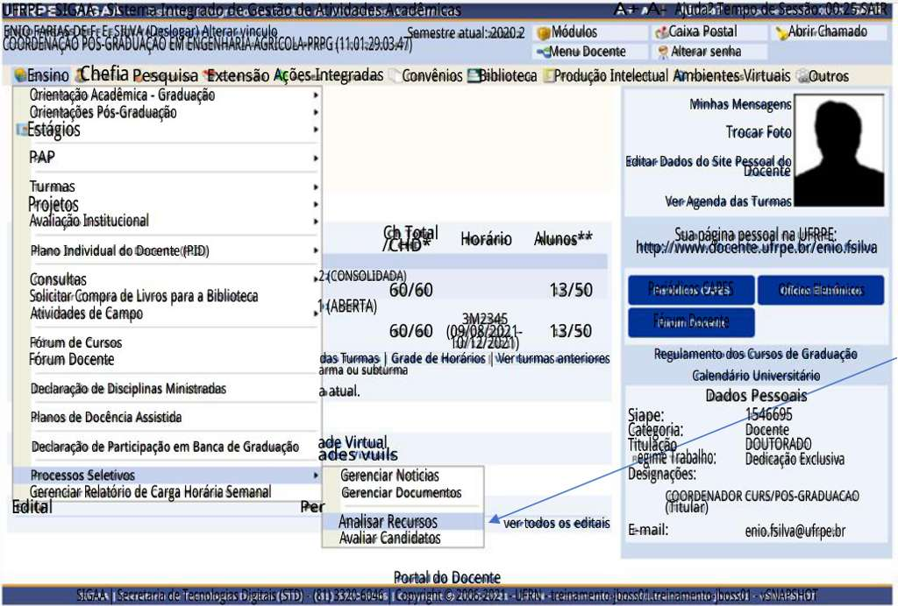

<!-- figure p44-fig1 | described_by: claude:sonnet | ocr_overlap: 0.91 | needs_review: false -->
(1) Captura de tela de sistema web (SIGAA), com menu suspenso aberto sobreposto na página.

(2) Todo texto visível, verbatim:

Topo da página (sobreposto, parcialmente ilegível por sobreposição de elementos):
- "UFRPE SIGAA Sistema Integrado de Gestão de Atividades Acadêmicas"
- "A+ A- Ajuda Tempo de Sessão: 00:25 AtR" [trecho final ilegível/cortado]
- "ENIO FARIAS DE FERREIRA SILVA (Deslogar) Alterar vínculo"
- "Semestre atual: 2020.2"
- "Módulos"
- "Caixa Postal"
- "Abrir Chamado"
- "COORDENAÇÃO POS-GRADUAÇÃO EM ENGENHARIA AGRICOLA-PRPG (11:01:29:03:47)" [sequência numérica final possivelmente ilegível]
- "Menu Docente"
- "Alterar senha"

Barra de menus principal (ícones + abas):
- "Ensino"
- "Chefia"
- "Pesquisa"
- "Extensão"
- "Ações Integradas"
- "Convênios"
- "Biblioteca"
- "Produção Intelectual"
- "Ambientes Virtuais"
- "Outros"

Menu lateral esquerdo (lista de opções, aba "Ensino" aberta):
- "Orientação Acadêmica - Graduação" (com seta de submenu)
- "Orientações Pós-Graduação" (com seta de submenu)
- "Estágios" (com seta de submenu)
- "PAP"
- "Turmas"
- "Projetos"
- "Avaliação Institucional"
- "Plano Individual do Docente (PID)"
- "Consultas"
- "Solicitar Compra de Livros para a Biblioteca"
- "Atividades de Campo"
- "Fórum de Cursos"
- "Fórum Docente"
- "Declaração de Disciplinas Ministradas"
- "Planos de Docência Assistida"
- "Declaração de Participação em Banca de Graduação"
- "Processos Seletivos" (com seta de submenu, destacado/selecionado)
- "Gerenciar Relatório de Carga Horária Semanal"
- "Edital" (parcialmente coberto por submenu)

Submenu aberto à direita de "Processos Seletivos":
- "Gerenciar Noticias"
- "Gerenciar Documentos"
- "Analisar Recursos" (destacado, com seta azul grossa apontando para este item a partir do canto inferior direito da imagem)
- "Avaliar Candidatos"

Texto parcialmente coberto atrás do menu (conteúdo da página principal, tabela de turmas):
- Cabeçalhos de coluna: "Ch Total /CHD*", "Horário", "Alunos**"
- Linha: "2 (CONSOLIDADA)" ... "60/60" ... "13/50"
- Linha: "1 (ABERTA)" ... "3M2345 (09/08/2021-10/12/2021)" ... "60/60" ... "13/50"
- Texto fragmentado: "das Turmas | Grade de Horários | Ver turmas anteriores"
- "arma ou subturma"
- "a atual."
- "ade Virtual,"
- "ades Vuils" [provavelmente "Atividades Virtuais", parcialmente ilegível]
- "Per..." (corte, ilegível)
- "ver todos os editais"

Painel direito:
- "Minhas Mensagens"
- "Trocar Foto"
- (ícone silhueta de pessoa em preto, foto de perfil não definida)
- "Editar Dados do Site Pessoal do Docente"
- "Ver Agenda das Turmas"
- "Sua página pessoal na UFRPE: http://www.docente.ufrpe.br/enio.fsilva"
- Botão: "Periódicos CAPES" (parcialmente sobreposto/ilegível)
- Botão: "Ofícios Eletrônicos"
- Botão: "Fórum Docente"
- "Regulamento dos Cursos de Graduação"
- "Calendário Universitário"
- "Dados Pessoais"
- "Siape:" "1546695"
- "Categoria:" "Docente"
- "Titulação:" "DOUTORADO"
- "Regime Trabalho:" "Dedicação Exclusiva"
- "Designações:"
- "COORDENADOR CURS/POS-GRADUACAO (Titular)"
- "E-mail:" "enio.fsilva@ufrpe.br"

Rodapé:
- "Portal do Docente"
- "SIGAA | Secretaria de Tecnologias Digitais (STD) - (81) 3320-6046 | Copyright © 2006-2021 - UFRN - treinamento.jboss01.treinamento.jboss01 - vSNAPSHOT"

(3) Estrutura: página de sistema acadêmico com cabeçalho superior (identificação usuário/sessão), barra de abas horizontal abaixo do cabeçalho, menu vertical lateral esquerdo aberto sobre conteúdo principal da página (tabela de turmas, parcialmente obscurecida), submenu horizontal secundário aberto à direita do item "Processos Seletivos" dentro do menu lateral, painel vertical à direita com dados pessoais/links, rodapé horizontal na base. Seta azul (única marcação gráfica de destaque, desenhada sobre a captura) parte do canto inferior direito da imagem e aponta para o item "Analisar Recursos" no submenu, indicando esse como item a ser clicado.

(4) Valores numéricos presentes:
- Tempo de Sessão: 00:25
- Semestre atual: 2020.2
- "(11:01:29:03:47)" — sequência numérica no cabeçalho
- "2 (CONSOLIDADA)"
- "60/60" (primeira linha, Ch Total/CHD)
- "13/50" (primeira linha, Alunos)
- "1 (ABERTA)"
- Horário: "3M2345 (09/08/2021-10/12/2021)"
- "60/60" (segunda linha, Ch Total/CHD)
- "13/50" (segunda linha, Alunos)
- Siape: 1546695
- Telefone rodapé: (81) 3320-6046
- Copyright: 2006-2021

(5) Cor com significado: seta de destaque em azul, desenhada manualmente sobre a captura, apontando especificamente para "Analisar Recursos" — único elemento colorido com função de indicação/instrução na imagem; restante da interface segue paleta padrão do sistema (cinza, branco, azul-claro nos cabeçalhos de menu).

~~~text ocr
Ut
stre Módulos Postal
Docente Alterar senha
Chefia Pesquisa “Extensão Gonvénios Biblioteca Intelectual AmbientesVirtuais
Orientação Acadêmica - Graduação
Pós-Graduação , Minhas Mensagens
Trocar Foto
PAP >
Editar Dados do Site Pessoal do
>
Projetos Ver Agenda das Turmas
Institucional | = |
Plano Individual do Docente((PID)
Consultas »24CONSOLIDADA
Solicitar-Compra de Livros para a Biblioteca 60/60 13/50
Atividades de Campo
Fórum de Cursos (
Fórum Docente das Turmas | Grade de Horários | anteriores = —
Declaração de Disciplinas Ministradas aatual.
Planos de Docência Assistida
Declaração de Participação em Banca de Graduação ade Virtual
Processos Seletivos > Gerenciar Noticias
Relatório de Carga Horária Semanal Gerenciar Documentos -GRADL
Edital Per | = CURS/POS-GRADUACAO
verrtodes os editais
~~~

<!-- Start of picture text -->
UFRPE - SIGAA - Sistema Integrado de Gestão de Atividades Acadêmicas A+ A- Ajuda? Tempo de Sessão: 00:25 SAIR ENIO FARIAS DE F. E. SILVA (Deslogar) Alterar vinculo Semestre atual: 2020.2 Módulos Caixa Postal Abrir Chamado COORDENAÇÃO PÓS-GRADUAÇÃO EM ENGENHARIA AGRÍCOLA-PRPG (11.01.29.03.47) Menu Docente Alterar senha Ensino Chefia Pesquisa Extensão Ações Integradas Convênios Biblioteca Produção Intelectual Ambientes Virtuais Outros Orientação Acadêmica - Graduação Minhas Mensagens Orientações Pós-Graduação Estágios Trocar Foto PAP Editar Dados do Site Pessoal do Docente Turmas Projetos Ver Agenda das Turmas Avaliação Institucional Ch Total Horário Alunos** Sua página pessoal na UFRPE: Plano Individual do Docente (PID) /CHD* http://www.docente.ufrpe.br/enio.fsilva Consultas 2 (CONSOLIDADA) 60/60 13/50 Periódicos CAPES Oficios Eletrônicos Solicitar Compra de Livros para a Biblioteca 1 (ABERTA) Atividades de Campo 3M2345 Fórum Docente 60/60 (09/08/2021- 13/50 Fórum de Cursos 10/12/2021) Fórum Docente das Turmas | Grade de Horários | Ver turmas anteriores Regulamento dos Cursos de Graduação arma ou subturma Calendário Universitário Declaração de Disciplinas Ministradas a atual. Dados Pessoais Planos de Docência Assistida Siape: 1546695 Categoria: Docente Declaração de Participação em Banca de Graduação ade Virtual Titulação DOUTORADO ades vuils egime Trabalho: Dedicação Exclusiva Processos Seletivos Gerenciar Noticias Designações: Gerenciar Relatório de Carga Horária Semanal Gerenciar Documentos COORDENADOR CURS/POS-GRADUACAO Edital Per (Titular) Analisar Recursos ver todos os editais Avaliar Candidatos E-mail: enio.fsilva@ufrpe.br Portal do Docente SIGAA | Secretaria de Tecnologias Digitais (STD) - (81) 3320-6046 | Copyright © 2006-2021 - UFRN - treinamento-jboss01.treinamento-jboss01 - vSNAPSHOT <!-- End of picture text -->

Caso o recurso tenha sido aberto para uma das etapas avaliadas pela comissão, e não pela coordenação, o recurso irá aparecer no Portal do Docente dos membros da comissão. 

treinamento.sigs.ufrpe.br/sigaa/portais/docente/docente.jsf# 

41 PORINTL08/09/202111:57  

Digite aqui para pesquisar 

> 28°C Chuva fraca  

<!-- page 45 -->

 

 SIGAA - Sistema Integrado de GX + ← → C Não segurotreinamento.sigs.ufrpe.br/sigaa/stricto/coordenacao.jsf 

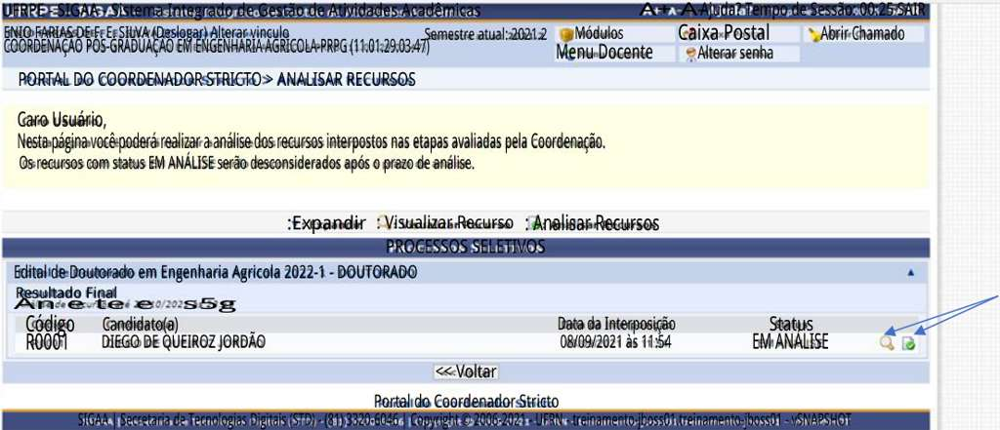

<!-- figure p45-fig1 | described_by: claude:sonnet | ocr_overlap: 0.82 | needs_review: false -->
Figura é captura de tela (screenshot) de página web do sistema SIGAA (Sistema Integrado de Gestão de Atividades Acadêmicas), com uma seta azul desenhada à mão apontando para um ícone, funcionando como anotação sobreposta à imagem original.

**Texto visível (verbatim):**

Cabeçalho, com sobreposição de textos (alguns sobrepostos e parcialmente ilegíveis):
- "UFRPE" sobreposto com "SIGAA" sobreposto com "Sistema Integrado de Gestão de Atividades Acadêmicas"
- Canto superior direito: "A+ A A" / "Ajuda" / "Tempo de Sessão: 00:25:54" / "SAIR"
- "ENIO FARIAS DE F. E SILVA (Deslogar) Alterar vínculo" — sobreposto com "Semestre atual: 2021.2"
- Ícones/menus: "Módulos", "Caixa Postal", "Abrir Chamado"
- "COORDENAÇÃO POS-GRADUAÇÃO EM ENGENHARIA AGRICOLA-PRPG (11.01.29.03.47)" sobreposto com "Menu Docente" / "Alterar senha"

Linha de navegação (breadcrumb):
- "PORTAL DO COORDENADOR STRICTO > ANALISAR RECURSOS"

Caixa de aviso (fundo amarelo claro):
- "Caro Usuário," (sobreposto por rabisco ilegível)
- "Nesta página você poderá realizar a análise dos recursos interpostos nas etapas avaliadas pela Coordenação."
- "Os recursos com status EM ANÁLISE serão desconsiderados após o prazo de análise."

Linha de ações (ícones com texto):
- ": Expandir : Visualizar Recurso : Analisar Recursos" (sobreposto por rabisco ilegível)

Cabeçalho da tabela (fundo cinza):
- "PROCESSOS SELETIVOS"

Linha de processo (fundo cinza claro):
- "Edital de Doutorado em Engenharia Agrícola 2022-1 - DOUTORADO"
- "Resultado Final"
- Abaixo, texto manuscrito/anotação sobreposta ilegível, algo como "Anexe o5g" ou similar [illegible]

Cabeçalhos de colunas da tabela:
- "Código" | "Candidato(a)" | "Data da Interposição" | "Status"

Linha de dados:
- "R0001" | "DIEGO DE QUEIROZ JORDÃO" | "08/09/2021 às 11:54" | "EM ANÁLISE"
- Ao final da linha, dois ícones: uma lupa (visualizar) e um ícone verde/quadrado (ação de analisar)

Linha de rodapé da tabela:
- "<< Voltar"

Barra final (fundo cinza):
- "Portal do Coordenador Stricto"

Rodapé da página:
- "SIGAA | Secretaria de Tecnologia da Informação - (81) 3320-6046 | Copyright © 2006-2021 - UFRPE - treinamento-jboss01.treinamento-jboss01 - vSNAPSHOT"

**Estrutura:**
- Layout vertical típico de página de sistema acadêmico: cabeçalho institucional no topo, barra de breadcrumb, caixa de aviso amarela, barra de ações, tabela de processos seletivos com uma linha de grupo (edital) e, dentro dela, uma subtabela com cabeçalho de colunas e uma única linha de dados, seguida de link "Voltar" e rodapé.
- Seta azul desenhada manualmente (anotação, não parte original da página) parte da margem direita da imagem e aponta para o ícone verde na linha de dados (coluna de ações), ao lado do ícone de lupa — indicando esse ícone específico como ponto de interesse.
- Há rabiscos/anotações manuscritas sobrepostos em pelo menos dois pontos (próximo a "Caro Usuário" e abaixo de "Resultado Final"), cujo conteúdo textual exato é [illegible].

**Valores de dados:**
- Código: R0001
- Candidato: DIEGO DE QUEIROZ JORDÃO
- Data da Interposição: 08/09/2021 às 11:54
- Status: EM ANÁLISE
- Semestre atual: 2021.2
- Tempo de Sessão: 00:25:54
- Telefone no rodapé: (81) 3320-6046
- Copyright: 2006-2021

**Cores com significado:**
- Fundo amarelo claro na caixa de aviso (destaque de instrução ao usuário).
- Ícone verde na coluna de ações (ação "Analisar Recursos", distinto do ícone de lupa cinza "Visualizar").
- Seta azul (anotação manual adicionada sobre a captura, destacando o ícone verde).

~~~text ocr
= stre atual::20212 Módulos Caixa-Posta
COORDENA —|
PORTAL DO COORDENADORSTRIGIOS ANALISAR RECURSOS
Gare Usuário,
dos recursos interpostos nas etapas avaliadas pela Coordenação.
Osrecursos com status EM ANÁLISE serão desconsiderados após 0 prazo de análise.
:
Editalide-Doutorado em Engenharia Agricola 2022-1 - DOUTORADO
Gandidat Data da Intenposição
idato(a)
ROO DIEGO DE QUEIROZ JORDÃO 08/09/2021 as 14:54 Q
~~~

<!-- Start of picture text -->
UFRPE - SIGAA - Sistema Integrado de Gestão de Atividades Acadêmicas A+ A-Ajuda? Tempo de Sessão: 00:25 SAIR ENIO FARIAS DE F. E. SILVA (Deslogar) Alterar vinculo Semestre atual: 2021.2 Módulos Caixa Postal Abrir Chamado COORDENAÇÃO PÓS-GRADUAÇÃO EM ENGENHARIA AGRÍCOLA-PRPG (11.01.29.03.47) Menu Docente Alterar senha PORTAL DO COORDENADOR STRICTO > ANALISAR RECURSOS Caro Usuário, Nesta página você poderá realizar a análise dos recursos interpostos nas etapas avaliadas pela Coordenação. Os recursos com status EM ANÁLISE serão desconsiderados após o prazo de análise. :Expandir : Visualizar Recurso : Analisar Recursos PROCESSOS SELETIVOS Edital de Doutorado em Engenharia Agricola 2022-1 - DOUTORADO Resultado Final An e te e   s5g Código Candidato(a) Data da Interposição Status R0001 DIEGO DE QUEIROZ JORDÃO 08/09/2021 às 11:54 EM ANÁLISE << Voltar Portal do Coordenador Stricto SIGAA | Secretaria de Tecnologias Digitais (STD) - (81) 3320-6046 | Copyright © 2006-2021 - UFRN - treinamento-jboss01.treinamento-jboss01 - vSNAPSHOT <!-- End of picture text -->

Nesta tela, o coordenador ou a comissão poderá apenas visualizar o recurso, ou analisar o recurso, para dar o resultado. 

42 

POR 11:56 28°C Chuva fraca INTL 08/09/2021 

Digite aqui para pesquisar 

<!-- page 46 -->

 

> SIGAA - Sistema Integrado de GX + 

##### ← C ▲Não segurotreinamento.sigs.ufrpe.br/sigaa/ensino/AnaliseRecursosProcessoSeletivo/analise_recurso.jsf 

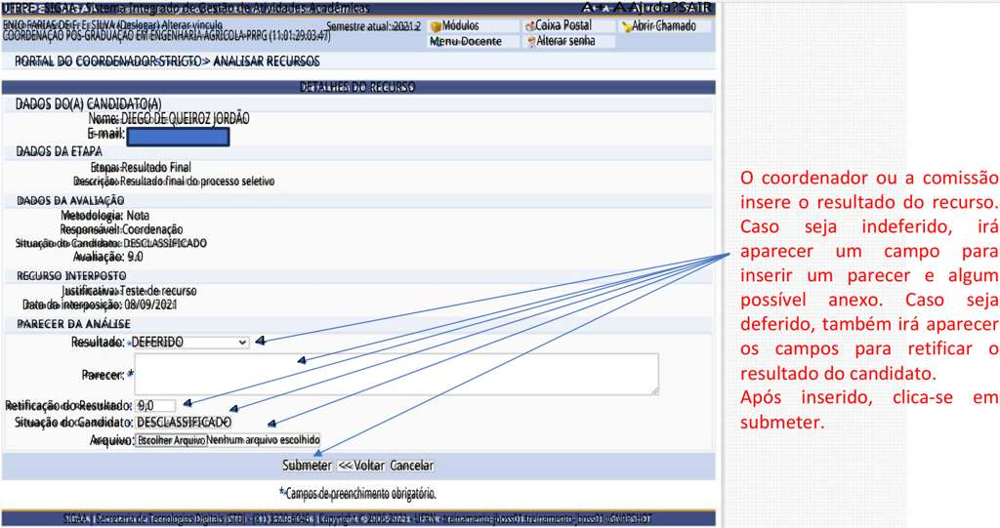

<!-- figure p46-fig1 | described_by: claude:sonnet | ocr_overlap: 0.93 | needs_review: false -->
Descrição:

(1) Tipo: captura de tela de sistema web (SIGAA – Sistema Integrado de Gestão de Atividades Acadêmicas), tela de análise de recurso de processo seletivo, com anotações explicativas em texto vermelho e setas sobrepostas à direita.

(2) Todo texto visível, verbatim:

Topo da página (sobreposto, difícil leitura por texto duplicado/empilhado):
- "UFRPE - SIGAA Sistema Integrado de Gestão de Atividades Acadêmicas"
- "A+ A- A Ajuda ? SAIR"
- "ENIO FARIAS DE FREIRE E SILVA (Deslogado) Alterar vínculo" / "Semestre atual: 2021.2"
- Ícones de menu: "Módulos", "Caixa Postal", "Abrir Chamado"
- "COORDENAÇÃO POS-GRADUAÇÃO EM ENGENHARIA AGRICOLA-PRPG (11:01:29:03:47)" [texto sobreposto, parcialmente ilegível]
- "Menu Docente", "Alterar senha"

Barra de trilha/navegação:
- "PORTAL DO COORDENADOR STRICTO > ANALISAR RECURSOS"

Barra de título da seção:
- "DETALHES DO RECURSO"

Bloco "DADOS DO(A) CANDIDATO(A)":
- "Nome: DIEGO DE QUEIROZ JORDÃO"
- "E-mail:" [campo com valor oculto/apagado — retângulo azul sólido cobrindo o dado]

Bloco "DADOS DA ETAPA":
- "Etapa: Resultado Final"
- "Descrição: Resultado final do processo seletivo"

Bloco "DADOS DA AVALIAÇÃO":
- "Metodologia: Nota"
- "Responsável: Coordenação"
- "Situação do Candidato: DESCLASSIFICADO"
- "Avaliação: 9,0"

Bloco "RECURSO INTERPOSTO":
- "Justificativa: Teste de recurso"
- "Data da interposição: 08/09/2021"

Bloco "PARECER DA ANÁLISE":
- "Resultado:" com dropdown mostrando "DEFERIDO"
- "Parecer: *" (campo de texto, vazio)
- "Retificação do Resultado:" valor "9,0"
- "Situação do Candidato:" valor "DESCLASSIFICADO"
- "Arquivo:" botão "Escolher Arquivo" / "Nenhum arquivo escolhido"

Botões: "Submeter", "<< Voltar", "Cancelar"

Rodapé do formulário:
- "* Campos de preenchimento obrigatório."

Rodapé da página (texto sobreposto/difícil):
- "SIGAA | Secretaria de Tecnologias Digitais (STD) - (81) 3320-6046 | Copyright © 2006-2021 - UFRN - treinamento-jboss01.treinamento-jboss01.vSNAPSHOT" [ilegível em parte por sobreposição]

Texto explicativo em vermelho (painel direito, fora do print da tela, ligado por 7 setas azuis a campos do formulário):
"O coordenador ou a comissão insere o resultado do recurso. Caso seja indeferido, irá aparecer um campo para inserir um parecer e algum possível anexo. Caso seja deferido, também irá aparecer os campos para retificar o resultado do candidato. Após inserido, clica-se em submeter."

(3) Estrutura:
- Imagem dividida em duas áreas: à esquerda, print de tela de sistema web (formulário); à direita, bloco de texto explicativo vermelho.
- Sete setas azuis partem de pontos próximos ao canto superior do texto explicativo e convergem, cada uma apontando para um elemento distinto do formulário à esquerda: (a) dropdown "Resultado", (b) campo "Parecer", (c) campo "Retificação do Resultado", (d) campo "Situação do Candidato", (e) campo "Arquivo"/botão escolher arquivo, (f) botão "Submeter", e mais uma seta adicional próxima à área do parecer — todas indicando os campos que o coordenador deve preencher.
- Formulário organizado em blocos empilhados verticalmente, cada um com cabeçalho em faixa cinza/azul-claro: Dados do(a) Candidato(a) → Dados da Etapa → Dados da Avaliação → Recurso Interposto → Parecer da Análise.
- Barra superior azul escura (cabeçalho do sistema) e barra de rodapé azul escura.
- Não há gráficos, eixos ou tabelas numéricas; é um formulário de interface de usuário.

(4) Valores/números presentes:
- Semestre atual: 2021.2
- Avaliação: 9,0
- Data da interposição: 08/09/2021
- Retificação do Resultado: 9,0
- Telefone no rodapé: (81) 3320-6046
- Copyright: 2006-2021

(5) Cores com significado:
- Texto explicativo e setas em vermelho/azul: cor usada apenas para destacar anotações didáticas sobre o uso do sistema, não faz parte da interface original.
- Campo de e-mail do candidato coberto por retângulo azul sólido, indicando ocultação proposital do dado (anonimização).
- Barras de cabeçalho/rodapé do sistema em azul escuro, cor padrão da interface (sem significado adicional além de estilo visual do SIGAA).

~~~text ocr
-
(11:01 Postal
Menu-Docente ~ Alterar senha
DO ANALISAR RECURSOS
DADOS DO(A) CANDIDATO(A)
Nome:
E-mail:
ROZ JORDÃO
DADOS DA ETAPA
Resultado Final
Descriçãoo Resultado-final do processo seletivo O coordenador ou a comissão
DADOS DA AVALIAÇÃO insere o resultado do recurso.
Metodologia: Nota
Caso seja indeferido, irá
+» aparecer um campo para
REGURSO = inserir um parecer e algum
JustificativasTeste-de-recurso
08/09/2021 possível anexo. Caso seja
PARECER DA ANÁLISE deferido, também irá aparecer
Resultado: os campos para retificar o
Parecer: * resultado do candidato.
Após inserido, clica-se em
Situação docGandidato: DESCLASSIFICADO submeter.
Escolher Arquivo Nenhum arquivo escolhido
Submeter <<Voltar Cancelar
obrigatório.
~~~

<!-- Start of picture text -->
UFRPE - SIGAA - Sistema Integrado de Gestão de Atividades Acadêmicas A+ A-Ajuda?SAIR ENIO FARIAS DE F. E. SILVA (Deslogar) Alterar vinculo Semestre atual: 2021.2 Módulos Caixa Postal Abrir Chamado COORDENAÇÃO PÓS-GRADUAÇÃO EM ENGENHARIA AGRÍCOLA-PRPG (11.01.29.03.47) Menu Docente Alterar senha PORTAL DO COORDENADOR STRICTO > ANALISAR RECURSOS DETALHES DO RECURSO DADOS DO(A) CANDIDATO(A) Nome: DIEGO DE QUEIROZ JORDÃO E-mail: DADOS DA ETAPA Etapa: Resultado Final Descrição: Resultado final do processo seletivo O coordenador ou a comissão DADOS DA AVALIAÇÃO insere o resultado do recurso. Metodologia: Nota Responsável: Coordenação Caso seja indeferido, irá Situação do Candidato: DESCLASSIFICADO Avaliação: 9.0 aparecer um campo para RECURSO INTERPOSTO inserir um parecer e algum Justificativa: Teste de recurso Data da interposição: 08/09/2021 possível anexo. Caso seja PARECER DA ANÁLISE deferido, também irá aparecer Resultado:  DEFERIDO 4 os campos para retificar o 4 Parecer: * resultado do candidato. 4 Após inserido, clica-se em Retificação do Resultado:  9,0 4 Situação do Candidato: DESCLASSIFICADO 4 submeter. Arquivo: Escolher Arquivo Nenhum arquivo escolhido Submeter << Voltar Cancelar * Campos de preenchimento obrigatório. SIGAA | Secretaria de Tecnologias Digitais (STD) - (81) 3320-6046 | Copyright © 2006-2021 - UFRN - treinamento-jboss01.treinamento-jboss01 vSNAPSHOT <!-- End of picture text -->

43 POR 12:01 28°C Chuva fraca● INTL 08/09/2021 

Digite aqui para pesquisar 

<!-- page 47 -->

 

 

 SIGAA - Sistema Integrado de GX + 

> ← C 

###### Não seguro|treinamento.sigs.ufrpe.br/sigaa/stricto/coordenacao.jsf 

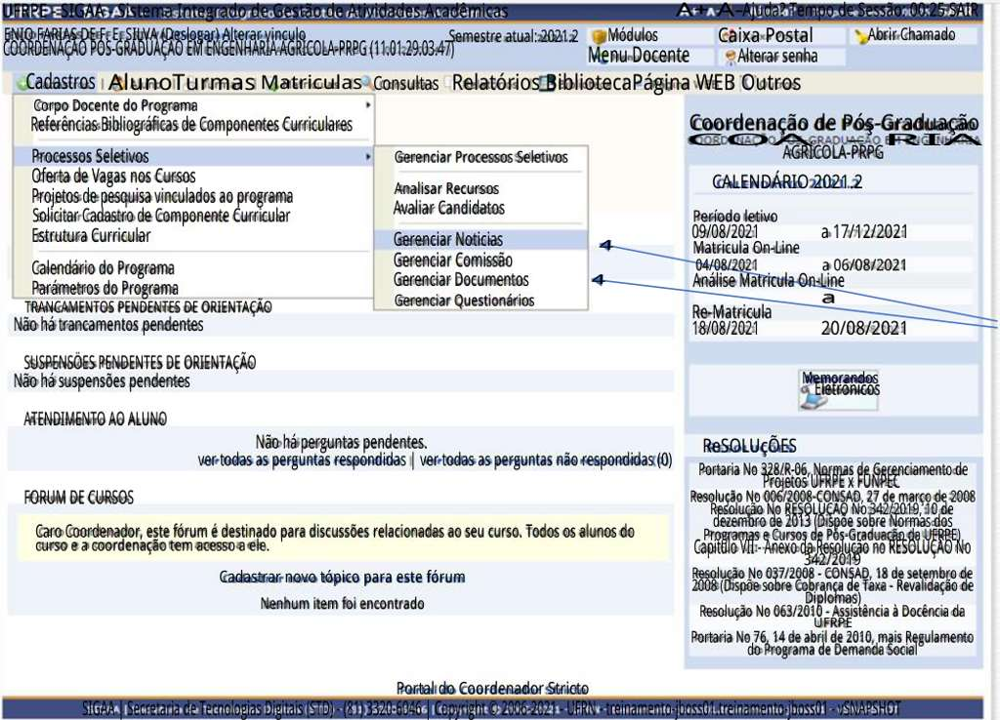

<!-- figure p47-fig1 | described_by: claude:sonnet | ocr_overlap: 0.88 | needs_review: false -->
Figura: captura de tela (screenshot) de sistema web universitário (SIGAA — Sistema Integrado de Gestão de Atividades Acadêmicas), mostrando painel do coordenador com menu suspenso aberto.

**1. Tipo:** screenshot de interface de software (não é gráfico/tabela de dados).

**2. Texto visível (verbatim):**

Topo:
- "UFRPE SIGAA Sistema Integrado de Gestão de Atividades Acadêmicas"
- "A+ A -A Ajuda Tempo de Sessão: 00:25 Sair"
- "ENIO FARIAS DE FREIRE SILVA (Deslogar) Alterar vínculo" — "Semestre atual: 2021.2" — "Módulos" — "Caixa Postal" — "Abrir Chamado"
- "COORDENAÇÃO POS-GRADUAÇÃO EM ENGENHARIA AGRICOLA-PRPG (11:01:29:03:47)" — "Menu Docente" — "Alterar senha"

Barra de menu: "Cadastros | AlunoTurmas Matrículas | Consultas | Relatórios | Biblioteca | Página WEB | Outros"

Menu suspenso (coluna 1, aberto em "Cadastros"):
- Corpo Docente do Programa ▸
- Referências Bibliográficas de Componentes Curriculares
- Processos Seletivos ▸ (destacado/selecionado)
- Oferta de Vagas nos Cursos
- Projetos de pesquisa vinculados ao programa
- Solicitar Cadastro de Componente Curricular
- Estrutura Curricular
- Calendário do Programa
- Parâmetros do Programa

Submenu (coluna 2, de "Processos Seletivos"):
- Gerenciar Processos Seletivos
- Analisar Recursos
- Avaliar Candidatos
- Gerenciar Noticias (destacado em azul)
- Gerenciar Comissão
- Gerenciar Documentos (destacado em azul)
- Gerenciar Questionários

Corpo da página (abaixo do menu):
- "TRANCAMENTOS PENDENTES DE ORIENTAÇÃO" / "Não há trancamentos pendentes"
- "SUSPENSÕES PENDENTES DE ORIENTAÇÃO" / "Não há suspensões pendentes"
- "ATENDIMENTO AO ALUNO" / "Não há perguntas pendentes." / "ver todas as perguntas respondidas | ver todas as perguntas não respondidas (0)"
- "FORUM DE CURSOS" / "Caro Coordenador, este fórum é destinado para discussões relacionadas ao seu curso. Todos os alunos do curso e a coordenação tem acesso a ele." / "Cadastrar novo tópico para este fórum" / "Nenhum item foi encontrado"

Rodapé: "Portal do Coordenador Stricto" / "SIGAA | Secretaria de Tecnologias Digitais (STD) - (81) 3320-6046 | Copyright © 2006-2021 - UFRN - treinamento.jboss01.treinamento.jboss01 - vSNAPSHOT"

Painel lateral direito:
- "Coordenação de Pós-Graduação" + logo "COORDENAÇÃO AGRICOLA-PRPG"
- "CALENDÁRIO 2021.2"
  - "Período letivo" — "09/08/2021 a 17/12/2021"
  - "Matricula On-Line" — "04/08/2021 a 06/08/2021"
  - "Análise Matrícula On-Line" — "a" (data em branco)
  - "Re-Matricula" — "18/08/2021 a 20/08/2021"
- botão "Memorandos Eletrônicos" (ícone)
- "RESOLUÇÕES" com lista:
  - "Portaria No 328/R-06, Normas de Gerenciamento de Projetos UFRPE x FUNPEC"
  - "Resolução No 006/2008-CONSAD, 27 de março de 2008"
  - "Resolução No RESOLUÇAO No 342/2019, 10 de dezembro de 2013 (Dispoe sobre Normas dos Programas e Cursos de Pós-Graduação de UFRPE)"
  - "Capítulo VII- Anexo da Resolução No RESOLUÇAO No 342/2019"
  - "Resolução No 037/2008 - CONSAD, 18 de setembro de 2008 (Dispõe sobre Cobrança de Taxa - Revalidação de Diplomas)"
  - "Resolução No 063/2010 - Assistência à Docência da UFRPE"
  - "Portaria No 76, 14 de abril de 2010, mais Regulamento do Programa de Demanda Social"

**3. Estrutura:** layout típico de sistema web, topo com barra de identificação/usuário, abaixo barra de menu horizontal. Menu "Cadastros" aberto revela coluna de opções à esquerda; item "Processos Seletivos" expande segunda coluna à direita dele (submenu em cascata). Duas setas azuis (◄) apontam da direita da tela para os itens "Gerenciar Noticias" e "Gerenciar Documentos" no submenu, destacando-os — provavelmente anotações de quem capturou a imagem, indicando quais opções devem ser usadas/clicadas. Corpo principal dividido em duas colunas: coluna larga à esquerda com seções (trancamentos, suspensões, atendimento, fórum); coluna estreita à direita com calendário e resoluções.

**4. Valores/datas:**
- Semestre: 2021.2
- Tempo de sessão: 00:25:03:47 (formato aparente hh:mm:ss, com possível erro de exibição "11:01:29:03:47")
- Período letivo: 09/08/2021 a 17/12/2021
- Matrícula On-Line: 04/08/2021 a 06/08/2021
- Análise Matrícula On-Line: sem data final preenchida
- Re-Matrícula: 18/08/2021 a 20/08/2021
- "0" perguntas não respondidas
- Copyright: 2006-2021

**5. Cores com significado:** itens de menu destacados em fundo azul claro ("Processos Seletivos", "Gerenciar Noticias", "Gerenciar Documentos") indicam seleção/hover ou foco; setas azuis são marcações adicionadas sobre a captura para indicar ênfase nesses dois itens específicos do submenu.

~~~text ocr
|
PREG
|
Caixa-Postal
ORDENAÇÃO EM Alterar senha
«Cadastros | AlunoTurmas Matriculas-Consultas WEB Outros
Corpo Docente do Programa » . ,
de Componentes Curriculares Coordenação de P.
Seletivos Gerenciar Processos Seletivos
erta de Vagas nos Cursos DÁRIO 2021
vinculados ao =
Solicitar: Cadastro de Componente Curricular lar
, 209: a 4
Calendario do Programa a 06/08/2021
Parámetros do Programa Garenciar Análise Ma
TRANGAMENTOS PENDENTES DE ORIENTAÇÃO
Não há trancamentos pendentes 18/08/2021 20/08/2021
SUSPENSÕES RENDENTES DE ORIENTAÇÃO
Não há suspensões pendentes
ATENDIMENTO AO ALUNO
perguntas pendentes. ReSOLUÇÕES
ver-todas as perguntas respondidas | ver-todas as perguntas não respondidas (0)
FORUM DE CURSOS Resolução No 27 e marcos 2008
é destinado para discussões relacionadas ao seu curso. Todos os alunos do e
tópico para este fórum
Nenhum item foi encontrado
Di
Resolução No Assistência à Docência da
Portaria No 76, 14 de abril de 2010, mai lamento
Programa de
|
~~~

<!-- Start of picture text -->
UFRPE - SIGAA - Sistema Integrado de Gestão de Atividades Acadêmicas A+ A-Ajuda? Tempo de Sessão: 00:25 SAIR ENIO FARIAS DE F. E. SILVA (Deslogar) Alterar vinculo Semestre atual: 2021.2 Módulos Caixa Postal Abrir Chamado COORDENAÇÃO PÓS-GRADUAÇÃO EM ENGENHARIA AGRÍCOLA-PRPG (11.01.29.03.47) Menu Docente Alterar senha Cadastros AlunoTurmas Matriculas Consultas Relatórios BibliotecaPágina WEB Outros Corpo Docente do Programa Referências Bibliográficas de Componentes Curriculares Coordenação de Póş-Graduação COA  - RIA Processos Seletivos Gerenciar Processos Seletivos AGRÍCOLA-PRPG Oferta de Vagas nos CursosProjetos de pesquisa vinculados ao programa Analisar Recursos CALENDÁRIO 2021.2 Avaliar Candidatos Solicitar Cadastro de Componente Curricular Período letivo Estrutura Curricular Gerenciar Noticias 4 09/08/2021Matricula On-Line a 17/12/2021 Calendário do Programa Gerenciar DocumentosGerenciar Comissão 4 Análise Matricula On-Line04/08/2021 a 06/08/2021 TRANCAMENTOS PENDENTES DE ORIENTAÇÃOParámetros do Programa Gerenciar Questionários Re-Matricula a Não há trancamentos pendentes 18/08/2021 20/08/2021 SUSPENSÖES PENDENTES DE ORIENTAÇÃO Não há suspensões pendentes MemorandosEletrónicos ATENDIMENTO AO ALUNO Não há perguntas pendentes. ReSOLUçÕES ver todas as perguntas respondidas | ver todas as perguntas não respondidas (0) Portaria No 328/R-06, Normas de Gerenciamento de Projetos UFRPE x FUNPEC FORUM DE CURSOS Resolução No 006/2008-CONSAD, 27 de março de 2008 Resolução No RESOLUÇÃO No 342/2019, 10 de dezembro de 2013 (Dispõe sobre Normas dos Caro Coordenador, este fórum é destinado para discussões relacionadas ao seu curso. Todos os alunos do Programas e Cursos de Pós-Graduação da UFRPE) curso e a coordenação tem acesso a ele. Capitulo VII - Anexo da Resolução no RESOLUÇÃO No 342/2019 Cadastrar novo tópico para este fórum Resolução No 037/2008 - CONSAD, 18 de setembro de 2008 (Dispõe sobre Cobrança de Taxa - Revalidação de Nenhum item foi encontrado Diplomas) Resolução No 063/2010 - Assistência à Docência da UFRPE Portaria No 76, 14 de abril de 2010, mais Regulamento do Programa de Demanda Social Portal do Coordenador Stricto SIGAA | Secretaria de Tecnologias Digitais (STD) - (81) 3320-6046 | Copyright © 2006-2021 - UFRN - treinamento-jboss01.treinamento-jboss01 - vSNAPSHOT <!-- End of picture text -->

Ao longo do processo seletivo, a coordenação também poderá inserir notícias e documentos adicionais, caso seja necessário fazer uma retificação do edital, prorrogação das inscrições, ou publicação do resultado das etapas, por exemplo. 

44 28°C Chuva fracaPOR INTL08/09/202112:06  

Q Digite aqui para pesquisar 

<!-- page 48 -->

 

> SIGAA - Sistema Integrado de GX + ← → C ▲Não segurotreinamento.sigs.ufrpe.br/sigaa/stricto/coordenacao.jsf 

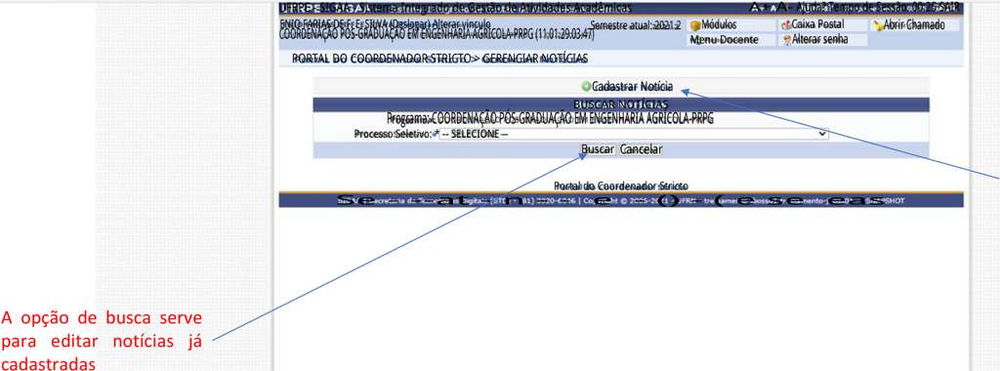

<!-- figure p48-fig1 | described_by: claude:sonnet | ocr_overlap: 0.79 | needs_review: false -->
Figura: captura de tela anotada de sistema web (SIGAA), com uma seta de anotação e texto explicativo sobrepostos.

Texto visível (verbatim, incluindo trechos sobrepostos/[illegible] onde ambíguo):

- Cabeçalho do sistema: "UFRPE SIGAA Sistema Integrado de Gestão de Atividades Acadêmicas" (texto parcialmente sobreposto por outra linha, parte [illegible])
- Canto superior direito: "A+ A- Muda Tempo de Sessão: 00:25 SAIR"
- Linha de usuário: "ENIO FARIAS DE F. E SILVA (Deslogar) Alterar vínculo" (sobreposta)
- "COORDENAÇÃO PÓS-GRADUAÇÃO EM ENGENHARIA AGRÍCOLA-PRPG (11.01.29.03.47)"
- "Semestre atual: 2021.2"
- Ícones/menu: "Módulos", "Caixa Postal", "Abrir Chamado", "Menu Docente", "Alterar senha"
- Trilha de navegação: "PORTAL DO COORDENADOR STRICTO > GERENCIAR NOTÍCIAS"
- Botão: "Cadastrar Notícia" (com ícone verde circular "+")
- Barra de título de seção: "BUSCAR NOTÍCIAS"
- "Programa: COORDENAÇÃO PÓS-GRADUAÇÃO EM ENGENHARIA AGRÍCOLA-PRPG"
- Campo: "Processo Seletivo: * -- SELECIONE --" (caixa suspensa/dropdown)
- Botões: "Buscar" e "Cancelar"
- Rodapé: "Portal do Coordenador Stricto"
- Linha de copyright (pequena, parcialmente [illegible]): "SIE Secretaria de Tecnologia da Informação (STI) - (31) 3319-4596 | Copyright © 2006-2021 - UFRPE - [illegible] | Cliente: [illegible] | Desenvolvimento: [illegible] | SCREENSHOT"
- Texto de anotação (canto inferior esquerdo, em vermelho): "A opção de busca serve para editar notícias já cadastradas"

Estrutura:
- Imagem é um recorte de tela de sistema, emoldurado por fundo pontilhado cinza (indicando captura/recorte).
- Topo: barra de cabeçalho azul/cinza do sistema, com três linhas de informação institucional e menu de ícones à direita.
- Abaixo: breadcrumb de navegação.
- Corpo central: uma caixa com borda, contendo:
  - Linha superior: botão "Cadastrar Notícia" alinhado à esquerda.
  - Barra de título escura: "BUSCAR NOTÍCIAS".
  - Campo "Programa" (texto fixo) e campo "Processo Seletivo" (dropdown "-- SELECIONE --").
  - Linha de botões "Buscar" / "Cancelar".
- Abaixo da caixa: título centralizado "Portal do Coordenador Stricto" e barra de rodapé laranja/azul com texto de copyright.
- Duas setas azuis diagonais partem do texto de anotação vermelho (canto inferior esquerdo) apontando para cima e para a direita:
  - Uma seta aponta para o botão "Buscar".
  - Outra seta aponta para o botão "Cadastrar Notícia" (saindo do mesmo ponto de texto, estendendo-se para fora da borda direita da imagem).
- Não há gráficos, eixos ou valores numéricos de dados; é uma interface de software, não um gráfico estatístico.

Cores com significado:
- Ícone verde circular "+" ao lado de "Cadastrar Notícia" (indica ação de adicionar).
- Texto de anotação e setas em azul/vermelho sobrepostos à captura de tela original, usados para destacar e explicar a função do botão "Buscar" (não fazem parte da interface original do sistema).
- Barra de título "BUSCAR NOTÍCIAS" em azul-marinho escuro com texto branco.
- Rodapé em faixa laranja/azul.

~~~text ocr
atual:20212
MenuDocente senha
do Coordenador Stricto
V | Co © (1 = JERE
A opção de busca serve
para editar notícias já
cadastradas
~~~

<!-- Start of picture text -->
UFRPE - SIGAA - Sistema Integrado de Gestão de Atividades Acadêmicas A+ A- Ajuda? Tempo de Sessão: 00:25 SAIR ENIO FARIAS DE F. E. SILVA (Deslogar) Alterar vinculo Semestre atual: 2021.2 Módulos Caixa Postal Abrir Chamado COORDENAÇÃO PÓS-GRADUAÇÃO EM ENGENHARIA AGRÍCOLA-PRPG (11.01.29.03.47) Menu Docente Alterar senha PORTAL DO COORDENADOR STRICTO > GERENCIAR NOTÍCIAS Cadastrar Notícia BUSCAR NOTÍCIAS Programa: COORDENAÇÃO PÓS-GRADUAÇÃO EM ENGENHARIA AGRÍCOLA-PRPG Processo Seletivo: * -- SELECIONE -- Buscar Cancelar Portal do Coordenador Stricto Se - --at - n - -  e  - () - ( e se  eas A opção de busca serve para editar notícias já cadastradas <!-- End of picture text -->

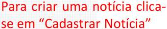

<!-- figure p48-fig2 | described_by: claude:sonnet | ocr_overlap: 1.0 | needs_review: false -->
Small image, red text, light dotted/grid background (decorative, no meaning).

(1) Tipo: imagem de texto simples (instrução/legenda), não gráfico, não diagrama com setas ou eixos.

(2) Texto visível, literal:
"Para criar uma notícia clica-se em "Cadastrar Notícia""
(quebra de linha original: "Para criar uma notícia clica-" / "se em "Cadastrar Notícia"")

(3) Estrutura: texto corrido em duas linhas, sem caixas, sem setas, sem tabela, sem eixos, sem painéis.

(4) Valores numéricos: nenhum.

(5) Cor: texto em vermelho — fundo claro com padrão pontilhado decorativo, sem significado semântico adicional.

~~~text ocr
Para criar uma notícia clica-
se em “Cadastrar Notícia”
~~~

<!-- Start of picture text -->
Para criar uma notícia clica- se em “Cadastrar Notícia” <!-- End of picture text -->

45 

POR 12:08 INTL08/09/2021 

Digite aqui para pesquisar 

28°C Chuva fraca● 

<!-- page 49 -->

 

 SIGAA - Sistema Integrado de GX + 

###### ← C ▲Não segurotreinamento.sigs.ufrpe.br/sigaa/administracao/cadastro/ProcessoSeletivo/noticias/lista.jsf 

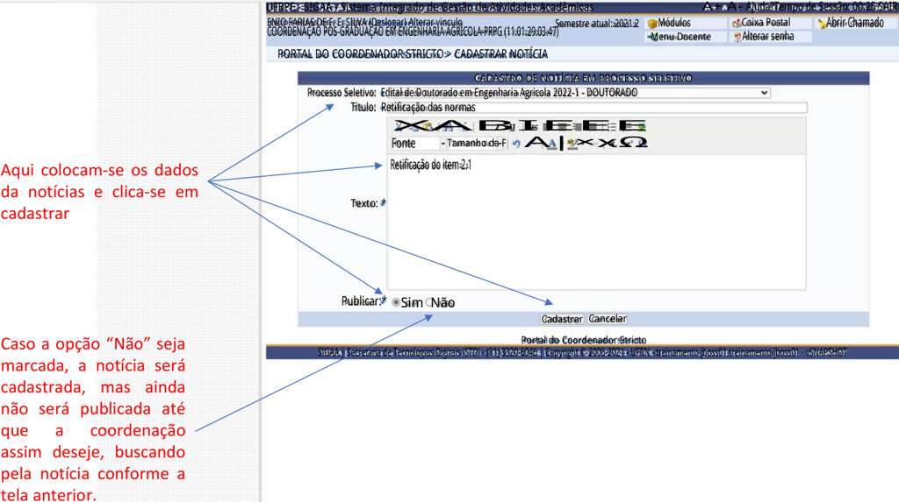

<!-- figure p49-fig1 | described_by: claude:sonnet | ocr_overlap: 0.9 | needs_review: false -->
(1) Captura tela sistema SIGAA, tela "Cadastrar Notícia", com anotações explicativas (setas azuis + texto vermelho).

(2) Texto visível:

Cabeçalho topo (sobreposto, parte [illegible] por sobreposição):
"UFRPE SIGAA — Sistema Integrado de Gestão de Atividades Acadêmicas"
"A+ A- Ajuda Tempo de Sessão: 00:25 Sair"
"ENIO FARIAS DE F. E SILVA (Deslogar) Alterar vínculo"
"COORDENAÇÃO POS-GRADUAÇÃO EM ENGENHARIA AGRICOLA-PRPG (11.01.29.03.47)"
"Semestre atual: 2021.2"
"Módulos" | "Caixa Postal" | "Abrir Chamado"
"Menu Docente" | "Alterar senha"

Breadcrumb: "PORTAL DO COORDENADOR STRICTO > CADASTRAR NOTÍCIA"

Caixa central, título da barra: "CADASTRO DE NOTÍCIA EM PROCESSO SELETIVO"

Campos do formulário:
- "Processo Seletivo:" → dropdown "Edital de Doutorado em Engenharia Agrícola 2022-1 - DOUTORADO"
- "Título:" → campo texto "Retificação das normas"
- Barra de ferramentas editor texto (ícones formatação: X, A, B negrito, I itálico, sublinhado, etc., "Fonte", "Tamanho da F...", ícones desfazer/refazer, cor texto, superscrito/subscrito, ômega)
- "Texto: *" → caixa texto com conteúdo "Retificação do item 2.1"
- "Publicar: *" → opções rádio "Sim" (selecionado) / "Não"

Botões: "Cadastrar" | "Cancelar"

Rodapé caixa: "Portal do Coordenador Stricto"

Rodapé página: "SIGAA | Secretaria de Tecnologias Digitais (STD) - (81) 3320-6046 | Copyright © 2006-2024 - UFRN - treinamento-jboss01.treinamento.jboss01 - vSNAPSHOT"

Anotações vermelhas (lado esquerdo, fora da tela do sistema):
Bloco superior: "Aqui colocam-se os dados da notícias e clica-se em cadastrar"
Bloco inferior: "Caso a opção "Não" seja marcada, a notícia será cadastrada, mas ainda não será publicada até que a coordenação assim deseje, buscando pela notícia conforme a tela anterior."

(3) Estrutura: imagem só print de tela, sem painéis múltiplos. Linha pontilhada vertical cinza divide área anotações (esquerda) da captura sistema (direita). Quatro setas azuis saem do bloco texto superior ("Aqui colocam-se...") apontando para: campo "Processo Seletivo", campo "Título", caixa "Texto", e botão "Cadastrar". Uma seta azul sai do bloco texto inferior ("Caso a opção Não...") apontando para radio "Não" (opção "Publicar").

(4) Valores de dados presentes na tela:
- Semestre atual: 2021.2
- Tempo de Sessão: 00:25
- Código unidade: 11.01.29.03.47
- Edital: Doutorado em Engenharia Agrícola 2022-1
- Título notícia: "Retificação das normas"
- Texto notícia: "Retificação do item 2.1"
- Publicar: Sim (marcado)
- Copyright: 2006-2024

(5) Cores com significado: texto vermelho = anotações explicativas adicionadas sobre print; setas azuis = indicadores apontando elementos da interface; faixa azul-escura = cabeçalho/títulos de seção do sistema; radio "Sim" selecionado (ponto preenchido) vs "Não" vazio.

~~~text ocr
Aqui colocam-se os dados
da notícias e clica-se em
cadastrar
Caso a opção “Não” seja
marcada, a notícia será
cadastrada, mas ainda
não será publicada até
que a coordenação
assim deseje, buscando
pela notícia conforme a
tela anterior.
RORTAL DO COORDENADORSTRIGIO> CADASTRAR
atual::20212
Ue
ct. Caixa Postal
« Alterar senha
Processo Seletivo: Agricola 2022-1 - DOUTORADO
Texto: *
Publicar:* @Sim Não
Titulo: Retificação-das normas
Fonte 9 >< ©
Retificação do
~~~

<!-- Start of picture text -->
UFRPE - SIGAA - Sistema Integrado de Gestão de Atividades Acadêmicas A+ A- Ajuda?Tempo de Sessão: 00:25 SAIR ENIO FARIAS DE F. E. SILVA (Deslogar) Alterar vinculo Semestre atual: 2021.2 Módulos Caixa Postal Abrir Chamado COORDENAÇÃO PÓS-GRADUAÇÃO EM ENGENHARIA AGRÍCOLA-PRPG (11.01.29.03.47) Menu Docente Alterar senha PORTAL DO COORDENADOR STRICTO > CADASTRAR NOTÍCIA CADASTRO DE NOTÍCIA EM PROCESSO SELETIVO Processo Seletivo:  Edital de Doutorado em Engenharia Agricola 2022-1 - DOUTORADO Titulo:  Retificação das normas XABIEEE Fonte Tamanho da F A|×xΩ Retificação do item 2.1 Aqui colocam-se os dados da notícias e clica-se em Texto: * cadastrar Publicar:* Sim  Não Cadastrar Cancelar Caso a opção “Não” seja Portal do Coordenador Stricto SIGAA | Secretaria de Tecnologias Digitais (STD) - (81) 3320-6046 | Copyright © 2006-2021 - UFRN - treinamento-jboss01.treinamento-jboss01 - vSNAPSHOT marcada, a notícia será cadastrada, mas ainda não será publicada até que a coordenação assim deseje, buscando pela notícia conforme a tela anterior. <!-- End of picture text -->

46 

POR 12:10 INTL08/09/2021 

Q Digite aqui para pesquisar 

28°C Chuva fraca 

<!-- page 50 -->

 

 SIGAA - Sistema Integrado de GX + 

← C 

###### ▲Não seguro treinamento.sigs.ufrpe.br/sigaa/stricto/coordenacao.jsf 

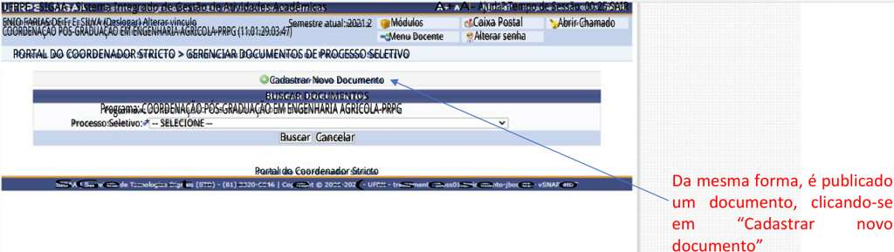

<!-- figure p50-fig1 | described_by: claude:sonnet | ocr_overlap: 0.81 | needs_review: false -->
1. Tipo de figura: captura de tela (screenshot) de interface de sistema web acadêmico, com uma anotação sobreposta em vermelho e uma seta azul apontando para um elemento da tela.

2. Todo o texto visível, verbatim:

Cabeçalho superior:
- "UFRPE SIGAA - Sistema Integrado de Gestão de Atividades Acadêmicas" [texto sobreposto/ilegível parcialmente devido a sobreposição de fontes, mas reconstrução: "UFRPE SIGAA" e "Sistema Integrado de Gestão de Atividades Acadêmicas"]
- "A+ A- Ajuda Tempo de Sessão: 00:25:SAI" [parcialmente ilegível devido a sobreposição]

Linha de identificação do usuário:
- "ENIO FARIAS DE FREIRE SILVA (Deslogar) Alterar vínculo"
- "COORDENAÇÃO PÓS-GRADUAÇÃO EM ENGENHARIA AGRÍCOLA-PRPG (11.01.29.03.47)"
- "Semestre atual: 2021.2"

Menu superior direito (ícones com texto):
- "Módulos"
- "Caixa Postal"
- "Abrir Chamado"
- "Menu Docente"
- "Alterar senha"

Linha de navegação (breadcrumb):
- "PORTAL DO COORDENADOR STRICTO > GERENCIAR DOCUMENTOS DE PROCESSO SELETIVO"

Corpo da página:
- Link/botão com ícone verde: "Cadastrar Novo Documento"
- Barra de título: "BUSCAR DOCUMENTOS"
- Campo: "Programa: COORDENAÇÃO PÓS-GRADUAÇÃO EM ENGENHARIA AGRÍCOLA-PRPG"
- Campo: "Processo Seletivo: * -- SELECIONE --" (caixa de seleção suspensa)
- Botões: "Buscar" e "Cancelar"

Rodapé:
- "Portal do Coordenador Stricto"
- "SIGAA | Sistema de Tecnologias Digitais (STD) - (81) 2020-6416 | Copyright © 2006-202[dígito ilegível] - UFRPE - treinamento@ufrpe.br - desenvolvimento-jbot@..." [parte final ilegível]
- Ícone: "vSNAR 4ID" [illegible parcial]

Texto da anotação vermelha (caixa de texto sobreposta à direita):
- "Da mesma forma, é publicado um documento, clicando-se em "Cadastrar novo documento""

3. Estrutura:
- Página dividida em: cabeçalho (topo), barra de identificação do usuário/sessão, barra de menus de navegação à direita, breadcrumb de localização, corpo principal com formulário de busca, rodapé institucional.
- No corpo, abaixo do breadcrumb, há um link verde "Cadastrar Novo Documento" no canto superior esquerdo da área de conteúdo.
- Logo abaixo, uma barra azul escura com o título "BUSCAR DOCUMENTOS", seguida de um formulário com dois campos (Programa e Processo Seletivo) e dois botões (Buscar, Cancelar).
- Uma seta azul diagonal parte da caixa de texto vermelha (lado direito, fora da interface, sobre fundo cinza) e aponta para o link "Cadastrar Novo Documento" no canto superior esquerdo do corpo da página, indicando que a anotação se refere a esse elemento.
- Linha horizontal cinza vertical separa a captura de tela (à esquerda) da área de anotação (à direita).
- Abaixo da captura de tela, uma barra azul com o texto "Portal do Coordenador Stricto" e, por baixo, o rodapé institucional.

4. Valores numéricos/dados:
- "2021.2" (semestre atual)
- "11.01.29.03.47" (código do vínculo/unidade)
- "00:25" (tempo de sessão, parcialmente sobreposto/ilegível)
- "(81) 2020-6416" (telefone)
- "© 2006-202[ilegível]" (ano final do copyright ilegível)

5. Cores com significado:
- Texto da anotação em vermelho, destacando a instrução adicionada sobre a imagem original.
- Seta em azul, conectando a anotação ao elemento da interface indicado.
- Ícone ao lado de "Cadastrar Novo Documento" em verde (ícone de "adicionar").
- Barras de título do sistema (menu, "Buscar Documentos", rodapé) em azul escuro, padrão visual do sistema SIGAA.

~~~text ocr
E
7 Módulos
Docente
RORTAL DO COORDENADOR STRICTO > GERENCIAR: DOCUMENTOS DE PROGESSO SELETIVO
ctCaixa Postal
« Alterar senha
Novo Documento
Processo Seletivo: -- SELECIONE —
Buscar Cancelar
Rartal: do Coordenador
SA 1 (STO) - (61) | Cor © UFES -
Da mesma forma, é publicado
um documento, clicando-se
em “Cadastrar novo
documento”
~~~

<!-- Start of picture text -->
UFRPE - SIGAA - Sistema Integrado de Gestão de Atividades Acadêmicas A+ A- Ajuda? Tempo de Sessão: 00:25 SAIR ENIO FARIAS DE F. E. SILVA (Deslogar) Alterar vinculo Semestre atual: 2021.2 Módulos Caixa Postal Abrir Chamado COORDENAÇÃO PÓS-GRADUAÇÃO EM ENGENHARIA AGRÍCOLA-PRPG (11.01.29.03.47) Menu Docente Alterar senha PORTAL DO COORDENADOR STRICTO > GERENCIAR DOCUMENTOS DE PROCESSO SELETIVO Cadastrar Novo Documento BUSCAR DOCUMENTOS Programa: COORDENAÇÃO PÓS-GRADUAÇÃO EM ENGENHARIA AGRÍCOLA-PRPG Processo Seletivo: * -- SELECIONE -- Buscar Cancelar Portal do Coordenador Stricto SGe - --t -  - -  e  - ( - s e se  e  o Da mesma forma, é publicado um documento, clicando-se em “Cadastrar novo documento” <!-- End of picture text -->

47 

POR 12:14 INTL 08/09/2021 

Q Digite aqui para pesquisar 

28°C Chuva fraca 

<!-- page 51 -->

 

> SIGAA - Sistema Integrado de GX + 

> ← C ▲Não segurotreinamento.sigs.ufrpe.br/sigaa/administracao/cadastro/ProcessoSeletivo/documentos/form.jsf 

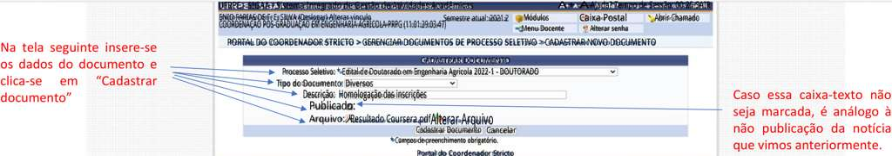

<!-- figure p51-fig1 | described_by: claude:sonnet | ocr_overlap: 0.95 | needs_review: false -->
Captura de tela de interface de sistema acadêmico (SIGAA), com anotações explicativas sobrepostas em vermelho e setas azuis.

**Texto visível na captura (parte superior, sistema):**
- Barra superior esquerda: "UFRPE-SIGA(A) Sistema Integrado de Gestão de Atividades Acadêmicas" (texto parcialmente sobreposto por outra linha, parte [illegible])
- Barra superior direita: "A+ A A Ajuda Tempo de Sessão 00:25 SAIR"
- Linha seguinte: "ENIO FARIAS DE F. E SILVA (Deslogar) Alterar vínculo" (nome parcialmente [illegible] por sobreposição)
- Ao lado: "Semestre atual: 2021.2"
- Ícones de menu: "Módulos", "Caixa Postal", "Abrir Chamado"
- Linha abaixo: "COORDENAÇÃO PÓS-GRADUAÇÃO EM ENGENHARIA AGRÍCOLA-PRPG (11.01.29.03.47)"
- Ícones: "Menu Docente", "Alterar senha"
- Caminho de navegação (breadcrumb): "PORTAL DO COORDENADOR STRICTO > GERENCIAR DOCUMENTOS DE PROCESSO SELETIVO > CADASTRAR NOVO DOCUMENTO"

**Painel central — formulário "CADASTRAR DOCUMENTO":**
- Título da caixa: "CADASTRAR DOCUMENTO"
- Campo: "Processo Seletivo: * Edital de Doutorado em Engenharia Agrícola 2022-1 - DOUTORADO" (campo tipo lista suspensa/combobox)
- Campo: "Tipo do Documento: Diversos" (lista suspensa)
- Campo: "Descrição: Homologação das inscrições" (campo de texto)
- Campo: "Publicado:" (checkbox, aparentemente não marcado)
- Campo: "Arquivo: Resultado Coursera.pdf — Alterar Arquivo" (nome do arquivo anexado, com link/botão "Alterar Arquivo")
- Botões: "Cadastrar Documento" | "Cancelar"
- Texto de rodapé do formulário: "* Campos de preenchimento obrigatório."
- Abaixo do formulário: "Portal do Coordenador Stricto" (texto cortado na borda inferior da imagem, parcialmente [illegible])

**Anotações (texto vermelho, fora do print):**
- Bloco à esquerda: "Na tela seguinte insere-se os dados do documento e clica-se em 'Cadastrar documento'"
- Bloco à direita: "Caso essa caixa-texto não seja marcada, é análogo à não publicação da notícia que vimos anteriormente."

**Estrutura / conectores:**
- Do bloco de texto vermelho à esquerda partem 4 setas azuis horizontais apontando para, respectivamente: o campo "Processo Seletivo", o campo "Tipo do Documento", o campo "Descrição" e o campo/checkbox "Publicado".
- Do bloco de texto vermelho à direita parte 1 seta azul horizontal apontando para o checkbox "Publicado:".
- O print da tela do sistema ocupa a faixa central da imagem; os dois blocos de texto explicativo ficam nas laterais esquerda e direita, sobre fundo com padrão pontilhado cinza claro.

**Cores com significado:**
- Texto explicativo em vermelho (anotações do autor, fora da interface original).
- Setas em azul indicando a qual campo cada anotação se refere.
- Interface do sistema em tons de azul/cinza padrão (barras de navegação azul-escuro, campos em branco/cinza), sem uso de cor para indicar status (ex.: checkbox "Publicado" sem marcação, sem cor diferenciada).

~~~text ocr
ds
atual:20212 Caixa-Postal
PG Alterar senha
PORTAL. DO COORDENADOR STRICTO > DE PROCESSO SELETIVO
Na tela seguinte insere-se
os dados do documento e Processo Seletivo: Doutorado-em Engenharia Agricola 2022-1 - DOUTORADO
clica-se em “Cadastrar
Descrição: Homologação-das inscrições Caso essa caixa-texto não
documento”
Publicado: .
seja marcada, é análogo a
Cadastrar Cancelar não publicação da notícia
% i i i .
que vimos anteriormente.
do Coordenador Stricto
~~~

<!-- Start of picture text -->
UFRPE - SIGAA - Sistema Integrado de Gestão de Atividades Acadêmicas A+ A-Ajuda? Tempo de Sessão: 00:25 SAIR ENIO FARIAS DE F. E. SILVA (Deslogar) Alterar vinculo Semestre atual: 2021.2 Módulos Caixa Postal Abrir Chamado COORDENAÇÃO PÓS-GRADUAÇÃO EM ENGENHARIA AGRÍCOLA-PRPG (11.01.29.03.47) Menu Docente Alterar senha PORTAL DO COORDENADOR STRICTO > GERENCIAR DOCUMENTOS DE PROCESSO SELETIVO > CADASTRAR NOVO DOCUMENTO Na tela seguinte insere-se os dados do documento e CADASTRAR DOCUMENTO Processo Seletivo: * Edital de Doutorado em Engenharia Agricola 2022-1 - DOUTORADO clica-se em “Cadastrar Tipo do Documento: Diversos documento” Descrição:  Homologação das inscrições Caso essa caixa-texto não Publicado: seja marcada, é análogo à Arquivo:Resultado Coursera.pdfAlterar Arquivo Cadastrar Documento Cancelar não publicação da notícia * Campos de preenchimento obrigatório. que vimos anteriormente. Portal do Coordenador Stricto <!-- End of picture text -->

48 

12:16 

28℃ ChuvafracaPOR 12:16 INTL 08/09/2021 

Digite aqui para pesquisar 

<!-- page 52 -->

 

 

 SIGAA - Sistema Integrado de GX + 

> ← C 

###### ▲Não segurotreinamento.sigs.ufrpe.br/sigaa/administracao/cadastro/ProcessoSeletivo/lista.jsf 

A notícia e o documento cadastrado irão aparecer nesta tela para os candidatos 

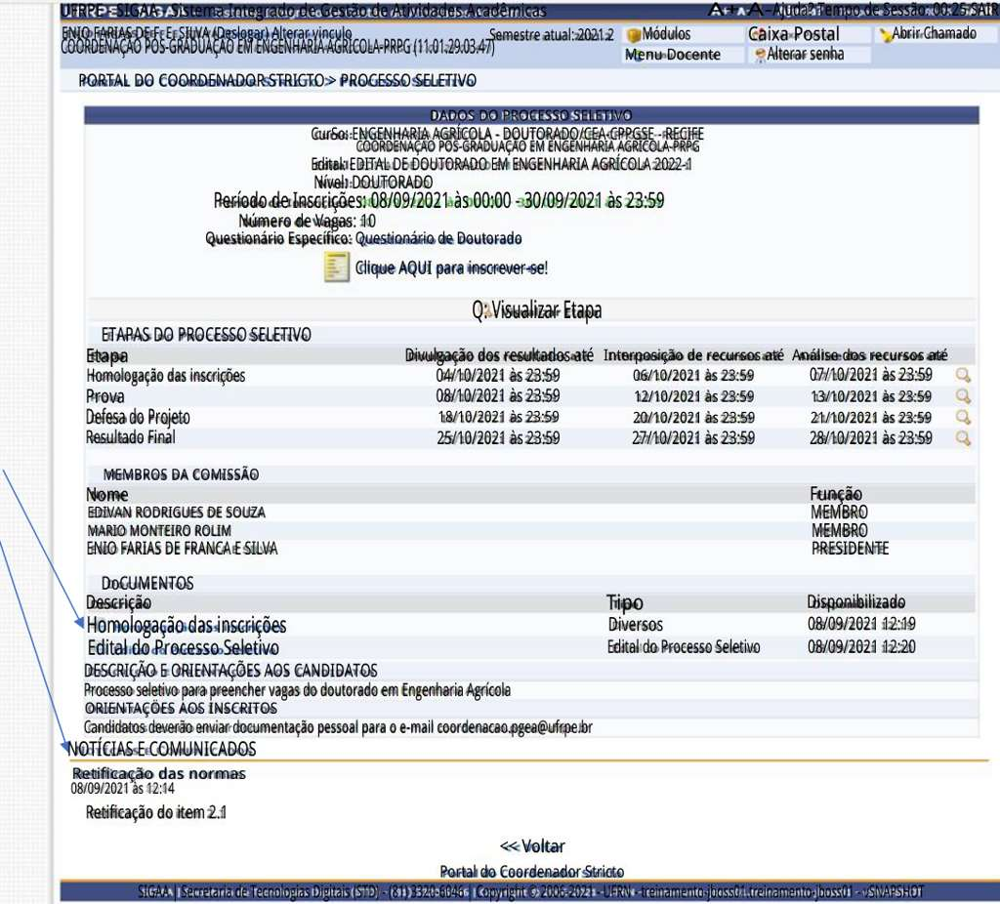

<!-- figure p52-fig1 | described_by: claude:sonnet | ocr_overlap: 0.86 | needs_review: false -->
1) Figur: screenshot web-page. Sistema SIGAA (UFRPE), tela "Portal do Coordenador Stricto".

2) Texto visível (verbatim, parte sobreposta/duplicada por texto fantasma atrás):

Topo: "UFRPE" / "SIGAA - Sistema Integrado de Gestão de Atividades Acadêmicas"
"ENIO FARIAS DE F... E SILVA (Deslogar) Alterar vínculo" / "COORDENAÇÃO POS-GRADUAÇÃO EM ENGENHARIA AGRICOLA-PRPG (11.01.29.03.47)"
Direita topo: "A+ • A • A - Ajuda • Tempo de Sessão: 00:25:5[ilegível]"
"Semestre atual: 2021.2" | "Módulos" | "Caixa Postal" | "Abrir Chamado"
"Menu Docente" | "Alterar senha"

Breadcrumb: "PORTAL DO COORDENADOR STRICTO >> PROCESSO SELETIVO"

Barra título (azul): "DADOS DO PROCESSO SELETIVO"

Campos:
- "Curso: ENGENHARIA AGRICOLA - DOUTORADO/CEA-CPPGSE - RECIFE"
- "COORDENAÇÃO POS-GRADUAÇÃO EM ENGENHARIA AGRICOLA-PRPG"
- "Edital: EDITAL DE DOUTORADO EM ENGENHARIA AGRICOLA 2022-1"
- "Nível: DOUTORADO"
- "Período de Inscrições: 08/09/2021 às 00:00 - 30/09/2021 às 23:59"
- "Número de Vagas: 10"
- "Questionário Específico: Questionário de Doutorado"

Botão/link: "📋 Clique AQUI para inscrever-se!"

Subtítulo: "Q: Visualizar Etapa" (ícone lupa antes do Q)

Seção "ETAPAS DO PROCESSO SELETIVO" — tabela colunas: "Etapa" | "Divulgação dos resultados até" | "Interposição de recursos até" | "Análise dos recursos até" (cada linha tem ícone lupa 🔍 à direita)

Linhas tabela:
| Etapa | Divulgação resultados até | Interposição recursos até | Análise recursos até |
|---|---|---|---|
| Homologação das inscrições | 04/10/2021 às 23:59 | 06/10/2021 às 23:59 | 07/10/2021 às 23:59 |
| Prova | 08/10/2021 às 23:59 | 12/10/2021 às 23:59 | 13/10/2021 às 23:59 |
| Defesa do Projeto | 18/10/2021 às 23:59 | 20/10/2021 às 23:59 | 21/10/2021 às 23:59 |
| Resultado Final | 25/10/2021 às 23:59 | 27/10/2021 às 23:59 | 28/10/2021 às 23:59 |

Seção "MEMBROS DA COMISSÃO" — tabela colunas "Nome" | "Função":
| Nome | Função |
|---|---|
| EDIVAN RODRIGUES DE SOUZA | MEMBRO |
| MARIO MONTEIRO ROLIM | MEMBRO |
| ENIO FARIAS DE FRANÇA E SILVA | PRESIDENTE |

Seção "DOCUMENTOS" — tabela colunas "Descrição" | "Tipo" | "Disponibilizado":
| Descrição | Tipo | Disponibilizado |
|---|---|---|
| Homologação das inscrições | Diversos | 08/09/2021 12:19 |
| Edital do Processo Seletivo | Edital do Processo Seletivo | 08/09/2021 12:20 |

Seção "DESCRIÇÃO E ORIENTAÇÕES AOS CANDIDATOS":
"Processo seletivo para preencher vagas do doutorado em Engenharia Agrícola"
Subseção "ORIENTAÇÕES AOS INSCRITOS":
"Candidatos deverão enviar documentação pessoal para o e-mail coordenacao.pgea@ufrpe.br"

Seção "NOTÍCIAS E COMUNICADOS":
"Retificação das normas" (negrito), data "08/09/2021 às 12:14"
"Retificação do item 2.1"

Rodapé: "<< Voltar"
"Portal do Coordenador Stricto"
"SIGAA | Secretaria de Tecnologias Digitais (STD) - (81) 3320-6046 | Copyright © 2006-2021 - UFRN - treinamento-jboss01.treinamento-jboss01 - vSNAPSHOT"

3) Estrutura: página web single-coluna, sem painéis múltiplos. Topo = barra navegação/cabeçalho sistema (texto duplicado, parece artefato de overlay/scan — duas camadas texto sobrepostas levemente desalinhadas, tipo "ghosting"). Abaixo, breadcrumb, depois caixa retangular com borda, título azul "DADOS DO PROCESSO SELETIVO", seguida blocos de campos empilhados verticalmente, depois 3 tabelas (etapas, comissão, documentos), depois 2 blocos texto livre, depois seção notícias, depois rodapé link e copyright.

Marcações externas (anotações, não parte original da UI): seta azul apontando linha "Homologação das inscrições" (tabela DOCUMENTOS), e outra seta azul apontando "NOTÍCIAS E COMUNICADOS" — ambas vindas de fora esquerda da imagem, provavelmente destaque feito por quem capturou print.

4) Valores numéricos/datas: todos listados acima nas tabelas (datas formato dd/mm/aaaa, horas hh:mm); "Número de Vagas: 10"; código órgão "(11.01.29.03.47)"; tempo sessão "00:25:5[ilegível]"; telefone "(81) 3320-6046"; copyright "2006-2021".

5) Cores com significado: barra título "DADOS DO PROCESSO SELETIVO" fundo azul-escuro texto branco (destaque seção). Cabeçalhos tabela fundo azul-claro. Linha "Homologação das inscrições" (tabela documentos) fundo levemente diferente (zebra striping tabela, sem significado semântico extra). Setas anotação cor azul (apenas marcação externa, não dado do sistema). Linha divisória laranja acima "NOTÍCIAS E COMUNICADOS" separando seção. Resto texto preto sobre fundo branco/cinza claro padrão.

~~~text ocr
Caixa-Postal
: Alterar senha
RORTAL DO PROGESSO SELETIVO
AGRICOLA - DOUTORADO
EM ENGENHARIA AGRICOLA-PRPG
ENGENHARIA AGRÍCOLA
0000 - =30/09/2021 às 23:59
Número de Wagas: 10
Específico: Questionário de Doutorado
E AQUI para inscrever-se!
Q:Visualizar Etapa
ETARAS DO PROCESSO SELETIVO
Etapa Divulgação dos Interpasição de recursos recursos até
Homologação das inscrições 04/10/2021 às 23:59 06/10/2021 às 23:59 07/10/2021 às 23:59
Prova 08/10/2021 às 23:59 12/10/2024 às 23:59 às 23:59
Defesa do Projeto 18/10/2021 às 23:59 20/10/2021 23:59 às 23:59
Resultado Final às 23:59 às 23:59 28/10/2021 às 23:59
MEMBROS DA COMISSÃO
Nome a
EDIVAN RODRIGUES DE SOUZA
MARIO MONTEIRO ROLIM MEMBRO
ENTO FARIAS DE FRANCA SILVA PRESIDENTE
DoGUMENTOS
Descrição Tipo Disponibilizado
Diversos 08/09/2021 12:19
Edital do Processo Seletivo 08/09/2024 42:20
DESGRIÇÃO E ORIENTAÇÕES AOS CANDIDATOS
Processo seletivo para preencher vagas do doutorado em Engenharia Agricola
ORIENTAÇÕES AOS INSCRITOS
Candidatos deverão enviar documentação pessoal para o e-mail
Retificação das normas
12:14
Retificação do item 2.4
<<Voltar
Postal do Coordenador Stricto
~~~

<!-- Start of picture text -->
UFRPE - SIGAA - Sistema Integrado de Gestão de Atividades Acadêmicas A+ A-Ajuda? Tempo de Sessão: 00:25 SAIR ENIO FARIAS DE F. E. SILVA (Deslogar) Alterar vinculo Semestre atual: 2021.2 Módulos Caixa Postal Abrir Chamado COORDENAÇÃO PÓS-GRADUAÇÃO EM ENGENHARIA AGRÍCOLA-PRPG (11.01.29.03.47) Menu Docente Alterar senha PORTAL DO COORDENADOR STRICTO > PROCESSO SELETIVO DADOS DO PROCESSO SELETIVO CurSo: ENGENHARIA AGRÍCOLA - DOUTORADO/CEA-CPPGSE - RECIFE COORDENAÇÃO PÓS-GRADUAÇÃO EM ENGENHARIA AGRÍCOLA-PRPG Edital: EDITAL DE DOUTORADO EM ENGENHARIA AGRÍCOLA 2022-1 Nível: DOUTORADO Período de Inscrições: 08/09/2021 às 00:00 - 30/09/2021 às 23:59 Número de Vagas: 10 Questionário Específico: Questionário de Doutorado Clique AQUI para inscrever-se! Q: Visualizar Etapa ETAPAS DO PROCESSO SELETIVO Etapa Divulgação dos resultados até Interposição de recursos até Análise dos recursos até Homologação das inscrições 04/10/2021 às 23:59 06/10/2021 às 23:59 07/10/2021 às 23:59 Prova 08/10/2021 às 23:59 12/10/2021 às 23:59 13/10/2021 às 23:59 Defesa do Projeto 18/10/2021 às 23:59 20/10/2021 às 23:59 21/10/2021 às 23:59 Resultado Final 25/10/2021 às 23:59 27/10/2021 às 23:59 28/10/2021 às 23:59 MEMBROS DA COMISSÃO Nome Função EDIVAN RODRIGUES DE SOUZA MEMBRO MARIO MONTEIRO ROLIM MEMBRO ENIO FARIAS DE FRANCA E SILVA PRESIDENTE DoCUMENTOS Descrição Tipo Disponibilizado Homologação das inscrições Diversos 08/09/2021 12:19 Edital do Processo Seletivo Edital do Processo Seletivo 08/09/2021 12:20 DESCRIÇÃO E ORIENTAÇÕES AOS CANDIDATOS Processo seletivo para preencher vagas do doutorado em Engenharia Agrícola ORIENTAÇÖES AOS INSCRITOS Candidatos deverão enviar documentação pessoal para o e-mail coordenacao.pgea@ufrpe.br NOTÍCIAS E COMUNICADOS Retificação das normas 08/09/2021 às 12:14 Retificação do item 2.1 << Voltar Portal do Coordenador Stricto SIGAA | Secretaria de Tecnologias Digitais (STD) - (81) 3320-6046 | Copyright © 2006-2021 - UFRN - treinamento-jboss01.treinamento-jboss01 - vSNAPSHOT <!-- End of picture text -->

49 28°C Chuva fracaPOR INTL 08/09/202112:20  

QDigite aqui para pesquisar 

<!-- page 53 -->

 

 SIGAA - Sistema Integrado de GX 

← 

###### C 

###### Não seguro treinamento.sigs.ufrpe.br/sigaa/public/processo_seletivo/area_do_candidato/lista_inscricoes_candidato.jsf 

<!-- figure p53-fig1 | described_by: claude:sonnet | ocr_overlap: 0.84 | needs_review: false -->
Screenshot, SIGAA sistema (Universidade Federal Rural de Pernambuco), página web.

**1. Tipo de figura:** Captura de tela (screenshot) de interface web do sistema acadêmico SIGAA, mostrando detalhes de edital de processo seletivo.

**2. Todo texto visível (verbatim):**

Cabeçalho:
- "Universidade Federal Rural de Pernambuco"
- "Recife, 08 de Setembro de 2021"
- "SIGAA" (logo)
- "Sistema Integrado de Gestão de Atividades Acadêmicas"
- "Acessível para pessoas com deficiência visual"
- "Login"
- "UFRPE" (sob brasão)
- "DIEGO DE QUEIROZ JORDÃO"
- "SAIR"
- "EDITAL DE DOUTORADO EM ENGENHARIA AGRÍCOLA 2022-1-DOUTORADO"

Coluna esquerda:
- "Últimas Notícias"
- "08/09/2021 12:12"
- "Retificação das normas"
- "(Visualizar)"
- "+ Leia Mais"
- "Documentos"
- "Homologação das inscrições (Publicado em: 08/09/2021)"
- "Edital do Processo Seletivo (Publicado em: 08/09/2021)"
- Seta azul apontando para "Retificação das normas / (Visualizar)"

Painel principal (caixa amarela), "Dados do Processo Seletivo":
- "CurSO: ENGENHARIA AGRÍCOLA - DOUTORADO/CEA-CPPGSE -RECIFE"
- "Nível: DOUTORADO"
- "Periodo de Inscrições: 08/09/2021 às 00:00 - 30/09/2021 às 23:59"
- "Número de Vagas: 10"
- "Clique AQUI para acessar o seu Comprovante de Inscrição."

Seção "ETAPAS DO PROCESSO SELETIVO" — quatro barras (etapas), cada uma com três prazos abaixo:

Etapa "Homologação das inscrições":
- "Prazo para Divulgação dos Resultados: 04/10/2021 às 23:59"
- "Prazo para Interposição de Recursos: 06/10/2021 às 23:59"
- "Prazo para Análise de Recursos: 07/10/2021 às 23:59"

Etapa "Prova":
- "Prazo para Divulgação dos Resultados: 08/10/2021 às 23:59"
- "Prazo para Interposição de Recursos: 12/10/2021 às 23:59"
- "Prazo para Análise de Recursos: 13/10/2021 às 23:59"

Etapa "Defesa do Projeto":
- "Prazo para Divulgação dos Resultados: 18/10/2021 às 23:59"
- "Prazo para Interposição de Recursos: 20/10/2021 às 23:59"
- "Prazo para Análise de Recursos: 21/10/2021 às 23:59"

Etapa "Resultado Final":
- "Prazo para Divulgação dos Resultados: 25/10/2021 às 23:59"
- "Prazo para Interposição de Recursos: 27/10/2021 às 23:59"
- "Prazo para Análise de Recursos: 28/10/2021 às 23:59"

Rodapé, "OUTRAS OPERAÇÕES":
- "Visualizar Questionário"
- "Imprimir GRU"
- "Meus Recursos Interpostos"
- "<< Voltar"

**3. Estrutura:**
Layout em duas colunas. Coluna esquerda estreita: bloco "Últimas Notícias" (com seta azul indicando link de retificação) e bloco "Documentos" abaixo. Coluna direita (maior): caixa amarela de destaque com dados do processo seletivo no topo, seguida de lista vertical de quatro etapas do processo seletivo, cada etapa representada por uma barra retangular cinza-azulada (formato de seta/banner) com título, e logo abaixo dela três linhas de texto com prazos (sem caixas separadas). Abaixo das quatro etapas, bloco "OUTRAS OPERAÇÕES" com quatro links/ícones em linha. Não há gráficos, eixos ou tabelas numéricas — é uma página de informações textuais.

**4. Valores numéricos:**
- Vagas: 10
- Datas: 08/09/2021, 30/09/2021, 04/10/2021, 06/10/2021, 07/10/2021, 08/10/2021, 12/10/2021, 13/10/2021, 18/10/2021, 20/10/2021, 21/10/2021, 25/10/2021, 27/10/2021, 28/10/2021
- Horários: 00:00, 23:59 (repetido em todos os prazos)
- Horário da notícia: 12:12

**5. Cores com significado:**
- Caixa amarela clara destaca os "Dados do Processo Seletivo" (área de atenção/resumo principal).
- Barras das quatro etapas em azul-acinzentado (cor neutra, apenas estrutural, sem variação indicando status).
- Seta azul à esquerda aponta para o link de retificação de normas (indicador visual, não dado).
- Botão "Login" em azul escuro, texto branco.

~~~text ocr
ela
Sistema Integrado de Gestão de Atividades Acadêmicas
EDITAL DE DOUTORADO EM ENGENHARIA AGRICOLA 2022-1-DOUTORADO
Dados do Processo Seletivo
ENGENHARIA AGRÍCOLA - DOUTORADO -
D DOUTORADO
Reriodo de Inscrições: 08/09/2021 às 00:00 - 30/09/2021 às 23:59
40 das Numero de Wagas: 10
AQUI para acessar o seu Comprovante de Inscrição
ETAPAS DO PROCESSO SELETIVO
Rrazo para Divulgação dos: às 23:59
Prazo para interposição de Recursos::06/10/2021 às 23:59
Prazo para Análise: de: Recursos::07/10/2021 às 23:59
as 23:59
ão dos: às 23:59
Prazo para ção de às 23:59
Prazo para Análise: de: Recursos::21/10/2021 às 23:59
Elia
Prazo para Divulgação dos Resultados::25/10/2021 às 23:59
Prazo para Recursos::27/10/2021 as 23:59
Prazo para Recursos::28/10/2021 às 23:59
OUTRAS OPERAÇÕES
Visualizar Questionário GRU 2 Meus Recursos
~~~

<!-- Start of picture text -->
Universidade Federal Rural de Pernambuco Recife, 08 de Setembro de 2021 SIGAA Acessível para pessoas com deficiência visual Login UFRPE Sistema Integrado de Gestão de Atividades Acadêmicas DIEGO DE QUEIROZ JORDÃO SAIR EDITAL DE DOUTORADO EM ENGENHARIA AGRÍCOLA 2022-1-DOUTORADO Últimas Notícias Dados do Processo Seletivo 08/09/2021 12:12 Retificação das normas (Visualizar) CurSO: ENGENHARIA AGRÍCOLA - DOUTORADO/CEA-CPPGSE - RECIFE + Leia Mais Nível: DOUTORADO Documentos Periodo de Inscrições: 08/09/2021 às 00:00 - 30/09/2021 às 23:59 Homologação das inscrições Número de Vagas: 10 (Publicado em: 08/09/2021) Edital do Processo Seletivo Clique AQUI para acessar o seu Comprovante de Inscrição. (Publicado em: 08/09/2021) ETAPAS DO PROCESSO SELETIVO Homologação das inscrições Prazo para Divulgação dos Resultados: 04/10/2021 às 23:59 Prazo para Interposição de Recursos: 06/10/2021 às 23:59 Prazo para Análise de Recursos: 07/10/2021 às 23:59 Prova Prazo para Divulgação dos Resultados: 08/10/2021 às 23:59 Prazo para Interposição de Recursos: 12/10/2021 às 23:59 Prazo para Análise de Recursos: 13/10/2021 às 23:59 Defesa do Projeto Prazo para Divulgação dos Resultados: 18/10/2021 às 23:59 Prazo para Interposição de Recursos: 20/10/2021 às 23:59 Prazo para Análise de Recursos: 21/10/2021 às 23:59 Resultado Final Prazo para Divulgação dos Resultados: 25/10/2021 às 23:59 Prazo para Interposição de Recursos: 27/10/2021 às 23:59 Prazo para Análise de Recursos: 28/10/2021 às 23:59 OUTRAS OPERAÇÕES Visualizar Questionário Imprimir GRU Meus Recursos Interpostos << Voltar <!-- End of picture text -->

Irão aparecer também na sua tela no portal do candidato 

SIGAA | Secretaria de Tecnologias Digitais (STD)-(81) 3320-6046 | Copyright © 2006-2021 - UFRN - treinamento-jboss01.treinamento-jboss01 vSNAPSHOT 

50 

POR 12:22 INTL08/09/2021  

28°C Chuva fraca 

Digite aqui para pesquisar 

<!-- page 54 -->

 

 SIGAA - Sistema Integrado de GX + 

> ← C 

###### Não seguro|treinamento.sigs.ufrpe.br/sigaa/administracao/cadastro/ProcessoSeletivo/lista.jsf 

Conforme visto <u>neste slide,</u> a opção “Aprovado em demanda interna” está disponível após o candidato ser aprovado. Esta opção só está disponível pois o candidato se trata de um servidor (o sistema identifica automaticamente pelo CPF), e deve ser marcada para identificar os candidatos aprovados em vaga exclusiva para servidor (eles devem ter enviado a concordância da chefia como documento na inscrição). O sistema irá alterar seu status para “ _(Servidor aprovado em demanda interna)”_ 

<!-- figure p54-fig1 | described_by: claude:sonnet | ocr_overlap: 0.84 | needs_review: false -->
(1) Screenshot de interface web (sistema SIGAA), página de gestão acadêmica, com texto explicativo, uma tabela de dados do processo e uma lista de inscritos, com setas anotadas sobre a captura.

(2) Texto visível, verbatim (alguns trechos sobrepostos/ilegíveis marcados):

Topo:
"UFRPE-SIGAA-A[ilegível, texto sobreposto]Sistema Integrado de Gestão de Atividades Acadêmicas" — "A+ A- Ajuda [ilegível] Tempo de Sessão: 00:25 SAIR"
"ENIO FARIAS DE F[ilegível]E E SILVA (Deslogar) Alterar vínculo" — "Semestre atual: 2021.2" — "Módulos" — "Caixa Postal"
"COORDENAÇÃO POS-GRADUAÇÃO EM ENGENHARIA AGRICOLA-PRPG (11:01:29:03:47)" — "Menu Docente" — "Alterar senha" — "Abrir Chamado"

Linha de navegação (breadcrumb, sobreposta):
"PORTAL DO COORDENADOR STRICTO>>PROCESSOS SELETIVOS>>LISTA DE INSCRITOS"

Corpo de texto (fundo amarelo claro):
"Caro coordenador,"
"Os servidores aprovados no processo seletivo, dentro dos 10% das vagas reservadas para servidores da UFRN, devem ser indicados como SERVIDOR APROVADO EM DEMANDA INTERNA, essa opção só será acessível quando o status do candidato for alterado para CANDIDATO APROVADO e o mesmo for um servidor da instituição."
"Resolução 197/2013-CONSEPE, 10 de dezembro de 2013"
"Art. 17. O número de vagas em cada curso é fixado em edital pelo colegiado do programa, a cada processo seletivo."
"§2º. Visando a atender as necessidades de qualificação dos servidores (docentes/técnicos) da instituição, os cursos de pós-graduação stricto sensu da UFRN destinarão vagas adicionais em seus processos seletivos de um mínimo de 10% (dez por cento) das vagas para servidores da UFRN, observando a capacidade de orientação do programa."
"Art. 72. Visando a atender as necessidades de qualificação dos servidores (docentes/técnicos) da instituição, os cursos de pós-graduação lato sensu da UFRN destinarão vagas complementares em seus processos seletivos de um mínimo de 10% (dez por cento) das vagas para servidores da UFRN."
"Parágrafo único. Em caso de curso auto financiado, os servidores selecionados serão isentos de taxas e mensalidades, exceto os valores referentes à aquisição de material didático."
"Atenção!"
"O cadastro de discentes será permitido apenas após o dia 28/10/2021 às 23:59, prazo máximo para análise dos recursos da etapa de consolidação do processo seletivo."

Caixa "DADOS DO PROCESSO SELETIVO":
"Curso: ENGENHARIA AGRÍCOLA - DOUTORADO/CEA-CPPGSE - RECIFE"
"Nível: DOUTORADO"
"Período de Inscrições: 08/09/2021 a 30/09/2021"
"Número de Inscritos: 1"
"Número de Aprovados: 1"
"Número de Discentes Matriculados e Ativos: 0"

Caixa "FILTRAR INSCRIÇÕES":
"Status da Inscrição: --TODOS--" (campo dropdown)
"Critério de Ordenação: NOME" (campo dropdown)
Botões: "Buscar" "<< Voltar"

Legenda de ícones:
": Visualizar Dados do Candidato : Aprovado em Demanda Interna"
": Cadastrar Discente : Alterar Dados da Inscrição"
": Fazer download de todos os arquivos em anexo"
": Cancelar Inscrição"

Tabela "LISTA DE INSCRITOS (1)":
Cabeçalho: "TODOS" "Inscrição" "Matrícula" "Nome" "CPF/Passaporte" "Status"
Linha de dados: checkbox vazio | "503" | (Matrícula vazia) | "DIEGO DE QUEIROZ JORDÃO (Servidor)" | [campo azul preenchido, valor oculto/ilegível] | "CANDIDATO APROVADO"
Ícones na linha: uma lupa e quatro ícones coloridos (azul, verde, [ilegível cor], verde) — texto dos ícones não legível individualmente além da legenda acima.

Botão: "Baixar Selecionados"

Rodapé:
"Portal do Coordenador Stricto"
"SIGAA | Secretaria de Tecnologias Digitais (STD) - (81) 3320-6046 | Copyright © 2006-2021 - UFRN - treinamento-jboss01.treinamento-jboss01 - vSNAPSHOT"

(3) Estrutura: página web de cima para baixo — barra de topo com infos de sessão; breadcrumb de navegação; bloco de texto explicativo com fundo amarelo; abaixo, três caixas empilhadas com cabeçalho azul escuro: "DADOS DO PROCESSO SELETIVO" (tabela de pares rótulo/valor), "FILTRAR INSCRIÇÕES" (formulário com dois dropdowns e dois botões), legenda textual de ícones; depois tabela "LISTA DE INSCRITOS" com cabeçalho de colunas e uma única linha de dados, seguida de botão "Baixar Selecionados"; rodapé do sistema.

Quatro setas desenhadas à mão (anotações, não originais da página) conectam: duas partindo da margem esquerda (uma da área de texto superior, outra da caixa "DADOS DO PROCESSO SELETIVO") apontando para a linha da tabela de inscritos (campo CPF/Passaporte e nome do candidato); duas setas partindo da margem direita (uma da legenda de ícones, outra da área acima) apontando também para os ícones/coluna de status na linha do candidato "DIEGO DE QUEIROZ JORDÃO".

(4) Valores numéricos/dados: Semestre "2021.2"; tempo de sessão "00:25"; horário "11:01:29:03:47"; percentuais "10% (dez por cento)" (citado 3x); resolução "197/2013"; data "10 de dezembro de 2013"; artigos "Art. 17", "Art. 72", "§2º"; data limite "28/10/2021 às 23:59"; período de inscrições "08/09/2021 a 30/09/2021"; Número de Inscritos "1"; Número de Aprovados "1"; Número de Discentes Matriculados e Ativos "0"; Inscrição nº "503"; total na lista "(1)"; rodapé "(81) 3320-6046"; copyright "2006-2021".

(5) Cores com significado: fundo amarelo claro destaca o aviso/texto normativo; cabeçalhos de caixas em azul escuro com texto branco organizam seções; campo CPF/Passaporte destacado com retângulo azul sólido (provavelmente ocultando dado sensível); ícones da linha de dados em azul e verde (ações diferentes, conforme legenda); setas de anotação em azul indicando pontos de interesse na tela.

~~~text ocr
|
20212 Caixa-Postal
Menu-Docente « Alterar senha
PORTAL DO LISTA DE INSCRITOS
aprovados no «Seletivo, devera
pessa será mesmo for um servidor da
Resolução 197/2013-CONSEPE, 10 de dezembro de 2013
número de vagas é fixado-emedital pelo-colegiado do a processo seletivo.
dum m pa à capac
em seus de um por cen Vagas
financiado, os servidores selecionados isentos de taxas e mensalidades, exceto os valores referentes à aquisição de
permitido apenas após o dia 28/10/2021 da etapa de consolidação do processo
etivo
AGRICOLA -
de a 30/09/2024
Numero de 1
Número de Aprovados:
Número de Discentes
Status da Inscrição--TODOS- v
titério de OrdenaçãoNOME
Buscar <<Voltar
provada Interna
Discente
a
Dic
Insecição Matrícula Nome CRF/Rassa Status
DIEGO DE QUEIROZ JORDÃO (Servidor) CANDIDATO APROVADO
~~~

<!-- Start of picture text -->
UFRPE - SIGAA - Sistema Integrado de Gestão de Atividades Acadêmicas A+ A-Ajuda? Tempo de Sessão: 00:25 SAIR ENIO FARIAS DE F. E. SILVA (Deslogar) Alterar vinculo Semestre atual: 2021.2 Módulos Caixa Postal Abrir Chamado COORDENAÇÃO PÓS-GRADUAÇÃO EM ENGENHARIA AGRÍCOLA-PRPG (11.01.29.03.47) Menu Docente Alterar senha PORTAL DO COORDENADOR STRICTO > PROCESSOS SELETIVOS > LISTA DE INSCRITOS Caro coordenador, Os servidores aprovados no processo seletivo, dentro dos 10% das vagas reservadas para servidores da UFRN, devem ser indicados como SERVIDOR APROVADO EM DEMANDA INTERNA , essa opção só será acessível quando o status do candidato for alterado para CANDIDATO APROVADO e o mesmo for um servidor da instituição. Resolução 197/2013-CONSEPE, 10 de dezembro de 2013 Art. 17. O número de vagas em cada curso é fixado em edital pelo colegiado do programa, a cada processo seletivo. § 2º Visando a atender as necessidades de qualificação dos servidores (docentes/técnicos) da instituição, os cursos de pós-graduação stricto sensu da UFRN destinarão vagas adicionais em seus processos seletivos de um mínimo de 10% (dez por cento) das vagas para servidores da UFRN, observando a capacidade de orientação do programa. Art. 72. Visando a atender as necessidades de qualificação dos servidores (docentes/técnicos) da instituição, os cursos de pós-graduação lato sensu da UFRN destinarão vagas complementares em seus processos seletivos de um minimo de 10% (dez por cento) das vagas para servidores da UFRN. Parágrafo único. Em caso de curso auto financiado, os servidores selecionados serão isentos de taxas e mensalidades, exceto os valores referentes à aquisição de material didático. Atenção! O cadastro de discentes será permitido apenas após o dia 28/10/2021 às 23:59, prazo máximo para análise dos recursos da etapa de consolidação do processo seletivo. 4 DADOS DO PROCESSO SELETIVO CurSo: ENGENHARIA AGRÍCOLA - DOUTORADO/CEA-CPPGSE - RECIFE Nível: DOUTORADO Período de Inscrições: 08/09/2021 a 30/09/2021 Número de Inscritos: 1 Número de Aprovados: 1 Número de Discentes Matriculados e Ativos: 0 FILTRAR INSCRIÇÕES Status da Inscrição:--TODOS- Critério de Ordenação:NOME V Buscar << Voltar : Visualizar Dados do Candidato : Aprovado em Demanda Interna : Cadastrar Discente : Alterar Dados da Inscrição : Fazer download de todos os arquivos em anexo : Cancelar Inscrição LISTA DE INSCRITOS (1) TODOS Inscrição Matrícula Nome CPF/Passaporte Status □ 503 DIEGO DE QUEIROZ JORDÃO (Servidor) CANDIDATO APROVADO Baixar Selecionados Portal do Coordenador Stricto SIGAA | Secretaria de Tecnologias Digitais (STD) - (81) 3320-6046 | Copyright © 2006-2021 - UFRN - treinamento-jboss01.treinamento-jboss01 - vSNAPSHOT <!-- End of picture text -->

A opção “cadastrar discente” só estará disponível após a consolidação do Resultado Final. Esta opção continuará disponível para caso o programa convoque o candidato aprovado mas não classificado em algum remanejamento posterior. 

51 

27°C Chuva fraca●POR INTL 08/09/202112:28  

Digite aqui para pesquisar 

<!-- page 55 -->

###### UFRPE - SIGAA - Sistema Integrado de Gestão de Atividades Acadêmicas 

GIUSEPPA MARIA D. SPENILLO (Deslogar) Alterar vínculo COORDENAÇÃO PÓS-GRADUAÇÃO EM CIÊNCIAS SOCIAIS-PRPG (11.01.29.17.47) 

Semestre atual: 2025.2 

A+ A-| Ajuda? Tempo de Sessão: 00:25SAIR 

Módulos Caixa Postal Abrir Chamado Menu Docente Alterar senha 

PORTAL DO COORDENADOR STRICTO > AVALIAR CANDIDATOS 

Caro Usuário, 

Nesta página você poderá buscar por processos seletivos usando os filtros abaixo e então avaliar os candidatos para cada etapa dos processos seletivos. 

INFORME OS CRITÉRIOS DE BUSCA 

Após o <u>prazo final</u> de análise de Recursos, a Coordenação deverá utilizar o botão “Consolidar <u>Resultado</u> 

#### <u>Final”</u> para permitir o cadastro de candidatos aprovados 

#### de 

Titulo do Edital: Ano: Tipo de Edital: 

Edital OrdinárioEdital Extraordinário Programa: COORDENAÇÃO PÓS-GRADUAÇÃO EM CIÊNCIAS SOCIAIS-PRPG Buscar Limpar Filtro 

- : Visualizar Processo Seletivo : Consolidar Resultado Final : Imprimir Resultado das Etapas : Gerar Planilha : Avaliar : Visualizar Avaliação 

###### PROCESSOS SELETIVOS (2) 

EDITAL ALUNO ESPECIAL 2025.2 - STRICTO SENSU PRESIDENTE: MARIA GRAZIA CRIBARI CARDOSO Etapa Avaliada por Divulgação dos Resultados Análise de Recursos Etapa l- Homologação das Inscrições Comissão aló 28-08-2025 às 12:00 até 30-08-2025 às 12:00 Etapa Il - Análise dos Históricos Escolares Comissão até 28-08-2025 às 16:00 até 30-08-2025 às 18:00 Consolidação Parcial do Processo Seletivo Coordenação até 29-08-2025 às 20.00 até 31-08-2025 às 18:00 Consolidação Final do Processo Seletivo Coordenação até 29-08-2025 às 20:00 até 31-08-2025 às 18:00 O EDITAL DE SELEÇÃO PARA INGRESSO EM 2025.1 ALUNO(A) ESPECIAL DO CURSO DE MESTRA - STRICTO SENSU Etapa Avaliada por Divulgação dos Resultados Análise de Recursos Inscrição Coordenação até 24-02-2025 às 17:00 até 27-02-2025 às 12:00 Avaliação do Histórico Escolar de Graduação Coordenação até 28-02-2025 às 16:00 até 10-03-2025 às 18:00 Resultado Final Coordenação até 24-03-2025 às 20:00 até 26-03-2025 às 13:00 

###### Cancelar 

Portal do Coordenador Stricto 

eect - s---d -  - -  e  ss - (s sei s  u  .t 

52 

<!-- page 56 -->

 

 

 SIGAA - Sistema Integrado de GX + 

← C 

###### Não segurotreinamento.sigs.ufrpe.br/sigaa/administracao/cadastro/ProcessoSeletivo/lista_inscritos.jsf 

Após ser possível cadastrar o discente, o sistema importará os dados que o mesmo inseriu quando candidato. Verifiquem se os dados estão corretos e cliquem em Próximo passo, localizado abaixo dos dados bancários 

Existe um cadastro com este CPF/passaporte no sistema. As informações previamente cadastradas serão utilizadas no formulário abaixo. Por favor, verifique se todos os dados estão corretos. 

<!-- figure p56-fig1 | described_by: claude:sonnet | ocr_overlap: 0.88 | needs_review: false -->
Imagem: screenshot sistema web (formulário cadastro acadêmico, português).

**(1) Tipo:** Captura de tela de formulário web (painel administrativo/coordenador), campos input + dropdowns. Vários campos cobertos por retângulos azuis sólidos (dados ocultos/redigidos), um retângulo preto menor sobre e-mail. Duas setas azuis diagonais apontam para elementos no topo esquerdo e perto de "Banco".

**(2) Texto visível (verbatim):**

Topo, canto direito: "(x) fechar mensagens"

Barra menu: "Cadastros" "Aluno" "Turmas" "Matriculas" "Consultas" "Relatórios" "Biblioteca" "Página WEB" "Outros"

Breadcrumb: "PORTAL DO COORDENADOR STRIGTO > DADOS PESSOAIS"

Cabeçalho barra escura: "DADOS PESSOAIS"

Campos (labels), seção sem título (dados pessoais):
- "CPF:*" [coberto azul]
- "A pessoa é estrangeira" (checkbox, sem valor visível)
- "Nome Social:" [vazio]
- "Nome Oficial:*" [coberto azul]
- "E-Mail:" [coberto preto]
- "Nome da Mãe:*" [coberto azul]
- "Nome do Pai:" [vazio]
- "Gênero:" ⊙ "Masculino" ○ "Feminino"
- "Data de Nascimento:" [coberto azul] (ícone calendário)
- "Estado Civil" [coberto azul]
- "Cor/Raça:" dropdown = "Branco"
- "Escola de Conclusão do Ensino Médio" [coberto azul]
- "Tipo da Escola de Ensino Médio:" dropdown = "Privada"
- "Ano de Conclusão" [vazio]
- "Possui algum tipo de Necessidade Especial:*" ○ "Sim" ○ "Não"
- "Tipo Sanguíneo:" dropdown = "O+"

Seção "NATURALIDADE":
- "País" dropdown = "Brasil"
- "UF:" dropdown = "Pernambuco"
- "Município" dropdown = "RECIFE"
- "Nacionalidade" = "BRASILEIRA"

Seção "DOCUMENTAÇÃO":
- "RG:*" [coberto azul]
- "Órgão de Expedição:*" [coberto azul]
- "UF:" [vazio]
- "Data de Expedição:" [vazio]
- "Titulo de Eleitor:" [vazio] "Zona:" [vazio]
- "Seção:" [vazio] "UF:" dropdown = "--SELECIONE--"
- "Certificado Militar:" [vazio] "Data de Expedição:" [vazio, ícone calendário]
- "Série:" [vazio]
- "Categoria:" [vazio] "órgão:" [vazio]
- "Passaporte:" [vazio]
- "RNE(Registro Nacional de Estrangeiro):" [vazio]

Seção "INFORMAÇÕES PARA CONTATO":
- "CEP:" [coberto azul, texto parcial legível "...formado)" junto - provável "não informado"]
- "N.º" [coberto azul]
- "Logradouro:" [vazio]
- "Complemento:" [vazio]
- "Bairro:" [coberto azul, continua]
- "Município:" dropdown [vazio/coberto]
- "UF:" [coberto azul]
- "Tel. Fixo: (81" [vazio]
- "Tel. Celular:" [coberto azul]

Seção "DADOS BANCÁRIOS":
- "Banco:" dropdown = "Não Registrada"

**(3) Estrutura:** Form vertical único, labels esquerda + campo direita, dividido em blocos por cabeçalhos de seção ("NATURALIDADE", "DOCUMENTAÇÃO", "INFORMAÇÕES PARA CONTATO", "DADOS BANCÁRIOS"). Duas colunas lado a lado em várias linhas (ex: Data Nascimento à direita de Gênero; Cor/Raça à direita de Estado Civil). Duas setas azuis anotação: uma do canto superior esquerdo apontando pra cima/fora da imagem (perto do menu), outra apontando pro dropdown "Banco".

**(4) Valores numéricos:** nenhum número visível além de "(81" (DDD telefone, incompleto, resto coberto).

**(5) Cor com significado:** retângulos azul sólido = dado pessoal sensível redigido/oculto (CPF, nomes, datas, RG, endereço, telefone etc). Retângulo preto = redige especificamente e-mail. Barra azul escura = cabeçalho seção "DADOS PESSOAIS". Setas azul-claro = anotações apontando elementos de interesse (não parte original da interface).

~~~text ocr
, , (x) fechar-mensagens
DO DADOS PESSOAIS
Nome do Pai:
Gênero: e Masculino Feminino Data de
Estado Civi Branco v
Conclusão do Tipo da Escola Privada Vv
Anode Conclusão
Tipo
NATURALIDADE
PatsBrasil UF::Pernambuco V
Vv
Seção:
Nacionalidad BRASILEIRA
DOGUMENTAÇÃO
U
Titulo de Eleitor: { {
Certificado Militar: Data de
Série: Categoria: Órgão:
ormado)
Logradouro
UF
| Tel, Fixor(81 »
DADOS
”
~~~

<!-- Start of picture text -->
(x) fechar mensagens CadastrosAluno Turmas Matriculas Consultas RelatóriosBiblioteca Página WEBOutros PORTAL DO COORDENADOR STRICTO > DADOS PESSOAIS DADOS PESSOAIS CPF:* A pessoa é estrangeira Nome Social: Nome Oficial: * E-Mail: Nome da Mãe: * Nome do Pai: Gênero: Masculino  Feminino Data de Nascimento: Estado Civil Cor/Raça:  Branco Escola de Conclusão do EnsincMédio Tipo da Escola de Ensino Médio:  Privada V Ano de Conclusão Possui algum tipo de Sim Não Necessidade Especial: Tipo Sanguíneo:0+ NATURALIDADE País:Brasil V UF: Pernambuco V Município:RECIFE V Nacionalidade:BRASILEIRA DOCUMENTAÇÃO RG: * Órgão de Expedição: * UF: Data de Expedição: Titulo de Eleitor: Zona: Seção: UF: -- SELECIONE -- Certificado Militar: Data de Expedição: Série: Categoria: órgão: Passaporte: RNE(Registro Nacional de Estrangeiro): INFORMAÇÕES PARA CONTATO CEP: formado) Logradouro: N.° Bairro: Complemento: UF: Município: Tel. Fixo: (81 Tel. Celular: DADOS BANCÁRIOS Banco:Não Registrada <!-- End of picture text -->

53 

POR 12:49 INTL08/09/2021 

QDigite aqui para pesquisar 

27°C Chuva fraca^ 

<!-- page 57 -->

 

SIGAA - Sistema Integrado de GX + 

> ← C Não segurotreinamento.sigs.ufrpe.br/sigaa/geral/pessoa/dados_pessoais.jsf 

O sistema irá apresentar a tela a seguir, onde os dados não são obrigatórios. Depois de inseri-los ou não, clica-se em próximo passo. 

<!-- figure p57-fig1 | described_by: claude:sonnet | ocr_overlap: 0.67 | needs_review: false -->
Captura de tela de interface de sistema web (SIGAA – Sistema Integrado de Gestão de Atividades Acadêmicas), não um gráfico/figura de dados. Texto aparece com sobreposição/renderização ruim em várias partes (fontes sobrepostas), dificultando leitura exata em alguns trechos.

**1. Tipo de figura:** Captura de tela (screenshot) de formulário web de sistema acadêmico, mostrando página "Dados Pessoais Complementares" do Portal do Coordenador Stricto.

**2. Texto visível (de cima para baixo):**

Barra superior:
- "UFRPE" sobreposto a "SIGAA" sobreposto a "Sistema Integrado de Gestão de Atividades Acadêmicas"
- À direita: "A+ A-" "Ajuda?" "Tempo de Sessão: 00:25" "SAIR"
- Linha seguinte (nome do usuário, sobreposto): algo como "ENIO FARIAS DE F... E... SILVA (Deslogar) Alterar vínculo" [parte ilegível por sobreposição]
- "COORDENAÇÃO POS-GRADUAÇÃO EM ENGENHARIA AGRICOLA-PRPG (11.01.29.03.47)"
- Centro: "Semestre atual: 2021.2"
- Ícones/menus à direita: "Módulos", "Caixa Postal", "Menu Docente", "Abrir Chamado", "Alterar senha"

Menu de navegação (texto todo colado, sem espaços visíveis entre itens):
- "Cadastros Aluno Turmas Matrículas Consultas Relatórios Biblioteca Página WEB Outros"
- Abaixo: "PORTAL DO COORDENADOR STRICTO > DADOS PESSOAIS"

Barra de título da seção (fundo azul escuro):
- "DADOS PESSOAIS COMPLEMENTARES"

Bloco "DOCUMENTOS ADICIONAIS":
- Campo: "Número de Identificação Social - NIS:" (campo de texto vazio)
- "Registro Civil" com opções sobrepostas: "Certidão de Nascimento" / "Certidão de Casamento"
- "Modelo do Registro Civil:" com opções: "Antigo - Até 2009" / "Novo - A Partir de 2010" (botão de rádio marcado em "Novo")
- Campo rotulado algo como "Nodnte u la:" [provavelmente "Nome da Matrícula" ou similar — texto sobreposto/ilegível, marcado [illegible]] — campo de texto vazio

Bloco "SITUAÇÃO SÓCIO-ECONÔMICA":
- "Renda familiar (mensal): R$" (campo de texto vazio)
- "Quantidade de membros" com segunda linha sobreposta ilegível: "d o ... fa i ... r" [illegible]
- "Zona de Residência:" opções: "Não informada" / "Rural" / "Urbana"
- "Transporte Escolar Público:" opções: "Não utiliza" / "Municipal" / "Estadual"
- Campo à direita: "Tipo de Transporte:" (campo de texto vazio)

Botões (parte inferior do formulário):
- "<< Voltar" "Cancelar" "Próximo Passo >>"

Rodapé:
- "Portal do Coordenador Stricto"
- "SIGAA | Secretaria de Tecnologias Digitais (STD) - (81) 3320-6046 - Copyright © 2006-2021 - UFRN - treinamento-jboss01.treinamento-jboss01 - vSNAPSHOT"

**3. Estrutura:**
- Layout vertical típico de formulário web.
- Barra superior de sistema (cabeçalho com identidade visual, usuário logado, sessão).
- Menu horizontal de navegação.
- Breadcrumb indicando localização atual.
- Corpo do formulário dividido em duas caixas/seções com título em barra azul: "DOCUMENTOS ADICIONAIS" e "SITUAÇÃO SÓCIO-ECONÔMICA", cada uma contendo campos de texto, botões de opção (radio) e rótulos.
- Uma seta azul diagonal desenhada sobre a imagem (elemento de anotação, não parte original da tela), apontando da margem esquerda (próxima ao campo "Nodnte u la:") em direção ao canto inferior direito, próximo ao botão "Próximo Passo >>" — indicando possivelmente um fluxo ou destaque entre esses dois pontos.
- Botões de ação alinhados horizontalmente abaixo dos dois blocos.
- Rodapé com informações institucionais.

**4. Valores/dados:** Não há valores numéricos preenchidos — todos os campos (NIS, Renda familiar, Tipo de Transporte, campo ilegível) aparecem vazios. Único número relevante: telefone "(81) 3320-6046" no rodapé, e código "11.01.29.03.47" junto ao nome do departamento, e "Semestre atual: 2021.2", "Tempo de Sessão: 00:25".

**5. Cores com significado:**
- Barra de título da seção e cabeçalho em azul escuro, com texto branco, destacando o título da página/seção.
- Botão de rádio selecionado ("Novo - A Partir de 2010") aparentemente em cinza/marcado, indicando opção ativa.
- Seta sobreposta em azul/ciano, usada como marcação de destaque (provavelmente adicionada por quem gerou a figura, não parte do sistema original).

~~~text ocr
| IO
tre Módulos Caixa-Posta
MenuDocente © Alterar senha
WEBQUtros
RORTAL DO COORDENADORSTRIGIO> DADOS PESSOAIS
JAUU
DOCUMENTOS
Numero de
Registro Civibertidão-de-Nascimento
2009 APartir de 2010
Nodnte-ula:
SITUAÇÃO
Tipo de Transporte:
ME
~~~

<!-- Start of picture text -->
UFRPE - SIGAA - Sistema Integrado de Gestão de Atividades Acadêmicas A+ A- Ajuda? Tempo de Sessão: 00:25 SAIR ENIO FARIAS DE F. E. SILVA (Deslogar) Alterar vinculo Semestre atual: 2021.2 Módulos Caixa Postal Abrir Chamado COORDENAÇÃO PÓS-GRADUAÇÃO EM ENGENHARIA AGRÍCOLA-PRPG (11.01.29.03.47) Menu Docente Alterar senha CadastrosAlunoTurmasMatriculasConsultasRelatóriosBibliotecaPágina WEBOutros PORTAL DO COORDENADOR STRICTO > DADOS PESSOAIS DADOS PESSOAIS COMPLEMENTARES DOCUMENTOS ADICIONAIS Número de Identificação Social - NIS: Registro Civil:Certidão de Nascimento Certidão de Casamento Modelo do Registro Civil:Antigo - Até 2009 Novo - A Partir de 2010 Nodnte u la: SITUAÇÃO SÓCIO-ECONÔMICA Renda familiar (mensal): R$ Quantidade de membrosdo  il r Zona de Residência: Nãs informadaRural Urbana Transporte Escolar Público: Não utilizaMunicipalEstadual Tipo de Transporte: << Voltar Cancelar Próximo Passo >> Portal do Coordenador Stricto SIGAA | Secretaria de Tecnologias Digitais (STD) - (81) 3320-6046 | Copyright © 2006-2021 - UFRN - treinamento-jboss01.treinamento-jboss01 - vSNAPSHOT <!-- End of picture text -->

54 

27℃ Chuva fracaPOR INTL 08/09/202112:51  

Digite aqui para pesquisar 

<!-- page 58 -->

 

> SIGAA - Sistema Integrado de GX + 

> ← C Não segurotreinamento.sigs.ufrpe.br/sigaa/geral/pessoa/dados_pessoais_complementares.jsf 

*(imagem omitida: mostra dado pessoal)*

<!-- figure p58-fig2 | described_by: claude:sonnet | ocr_overlap: 0.8 | needs_review: false -->
Captura tela sistema web (SIGAA), não gráfico/dado estatístico. Descrição completa abaixo.

**(1) Tipo**: screenshot interface web — formulário sistema acadêmico SIGAA (UFRPE), com duas setas azuis sobrepostas (anotação) apontando elementos.

**(2) Texto visível (verbatim)**

Barra topo:
- "UFRPE SIGAA Sistema Integrado de Gestão de Atividades Acadêmicas"
- "A+ A- Ajuda? Tempo de Sessão: 00:25 SAIR"
- "ENIO FARIAS DE F. E SILVA (Deslogar) Alterar vínculo"
- "COORDENAÇÃO POS-GRADUAÇÃO EM ENGENHARIA AGRICOLA-PRPG (11.01.29.03.47)"
- "Semestre atual: 2021.2"
- "Módulos"
- "Caixa Postal"
- "Menu Docente"
- "Abrir Chamado"
- "Alterar senha"

Menu navegação:
- "Cadastros Aluno Turmas Matrículas Consultas Relatórios Biblioteca Página WEB Outros"
- "PORTAL DO COORDENADOR STRICTO > CADASTRO DE ALUNO DE STRICTO"

Bloco texto amarelo:
- "Caro usuário,"
- "Para prosseguir com o cadastro em curso de Pós Graduação é necessário informar o DIPLOMA em Curso de Graduação do discente, em obediência à Lei No.9.394, de 20 de dezembro de 1996, Artigo 44, inciso III:"
- "'Art. 44. A educação superior abrangerá os seguintes cursos e programas:"
- "(...)"
- "III - de pós-graduação, compreendendo programas de mestrado e doutorado, cursos de especialização, aperfeiçoamento e outros, abertos a candidatos DIPLOMADO em cursos de graduação e que atendam as exigências das instituições de ensino.'"

Formulário (título barra azul): "DOCUMENTAÇÃO DO DISCENTE"
- "CPF: [CPF omitido]"
- "Nome: DIEGO DE QUEIROZ JORDAO"

Seção "DADOS DE CONCLUSÃO DA GRADUAÇÃO":
- "Instituição de Conclusão:*" — campo dropdown "--SELECIONE--" (com ícone "?")
- "Curso:*" — campo texto vazio
- "Grau Acadêmico: --SELECIONE--"
- "Turno: * --SELECIONE--"
- "Ano-Período de Conclusão: 0" — campo com ícone circular (calendário/relógio)

Seção "DOCUMENTOS DIGITALIZADOS":
- "Arquivo Digitalizado: Escolher Arquivo / Nenhum arquivo escolhido"
- "Tipo do Documento: Documentos Pessoais do Cadastro" (dropdown)
- botão "Enviar Arquivo"

Seção "DECLARAÇÃO DE CONFORMIDADE":
- checkbox (desmarcado) + texto "Declaro que conferi a documentação apresentada pelo candidato comprovando que o mesmo concluiu curso de GRADUAÇÃO, conforme exigido em Lei."

Botões: "<<Dados Pessoais" "Cancelar" "Próximo Passo>>"

Rodapé:
- "*Campos de preenchimento obrigatório."
- "Portal do Coordenador Stricto"
- "SIGAA | Secretaria de Tecnologias Digitais (STD) - (81) 3320-6046 | Copyright © 2006-2021 - UFRN - treinamento-jboss01 treinamento-jboss01 - vSNAPSHOT"

**(3) Estrutura**
- Layout vertical único painel (sem colunas/múltiplos painéis de dados).
- Topo: barra cinza-escura sistema + linha usuário/menu.
- Faixa cinza clara: menu módulos horizontal.
- Caixa amarela: aviso legal.
- Caixa principal azul/cinza: formulário com título em barra azul escura, subseções delimitadas por linhas horizontais ("DADOS DE CONCLUSÃO DA GRADUAÇÃO", "DOCUMENTOS DIGITALIZADOS", "DECLARAÇÃO DE CONFORMIDADE"), campos label:valor.
- Duas setas azuis (anotação manual, não parte original do sistema): uma aponta do canto superior direito da imagem para área próxima ao dropdown "Instituição de Conclusão"/caixa de formulário; outra aponta da margem esquerda para linha "Ano-Período de Conclusão / Documentos Digitalizados". Não conectam a texto específico além de indicar essas regiões do formulário.
- Rodapé centralizado com texto pequeno.

**(4) Valores/números**
- Tempo de Sessão: 00:25
- Semestre atual: 2021.2
- Código coordenação: 11.01.29.03.47
- Lei No. 9.394, de 20/12/1996, Artigo 44, inciso III
- CPF: [CPF omitido]
- Ano-Período de Conclusão: 0
- Telefone rodapé: (81) 3320-6046
- Copyright: 2006-2021

**(5) Cores com significado**
- Barra topo e título "DOCUMENTAÇÃO DO DISCENTE": azul escuro (destaque institucional/seção).
- Caixa aviso legal: fundo amarelo (alerta/atenção).
- Campos obrigatórios marcados com asterisco "*" vermelho/laranja (indicando obrigatoriedade, conforme legenda rodapé).
- Setas sobrepostas: azul (anotação adicionada para indicar pontos de interesse na tela).

~~~text ocr
lo @Mddulos Gaixa-Postal
COORDENAÇÃO senha
Página-WEB Outros
RORTAL DO COORDENADORSSTRICTO > CADASTRO DE ALUNO DESTRICTO
Caro usuário,
ra informar o DIPLOMA em Curso de Graduação-do-discente em-obediênciad de
abrangerá 0s seguintes cursos e programas:
de abertos a candidatos DIPLOMADO
DE QUEIROZ JORDAO
DADOS DE DA GRADUAÇÃO
Instituição de
Gurso:*
Turno:*
O
DOGUMENTOS:D
Arquivo Digitalizado: quivoNenhum escolhido Tipo Documentos:Pessaais do Cadastro Enviar-Arquivo
DE CONFO)
tado pelo candidato comprovando que o mesmo
do
Pessoais Cancelar Próximo Passo->>
*Campos obrigatório.
do
~~~

<!-- Start of picture text -->
☆ <!-- End of picture text -->

Nesta tela deverão ser inseridos os dados do curso de graduação do discente, bem como os documentos exigidos para sua matrícula. Após a inserção, marca-se a caixa texto e clica-se em “Próximo passo” 

*(imagem omitida: mostra dado pessoal)*

<!-- figure p58-fig3 | described_by: claude:sonnet | ocr_overlap: 1.0 | needs_review: false -->
Figura: captura de tela de texto simples, vermelho sobre fundo branco quadriculado, sem gráfico, tabela ou diagrama.

Texto verbatim:
"Caso a instituição de conclusão do discente não esteja disponível na lista, escolhe-se "Outro" no final da lista, e aparecerá um campo para digitar o nome."

Estrutura: bloco único texto, sem caixas, setas, eixos ou painéis. Sem valores numéricos. Cor vermelha só estilística, sem significado funcional.

~~~text ocr
Caso a instituição de conclusão do
discente não esteja disponível na
lista, escolhe-se “Outro” no final da
lista, e aparecerá um campo para
digitar o nome.
~~~

<!-- Start of picture text -->
UFRPE - SIGAA - Sistema Integrado de Gestão de Atividades Acadêmicas A+ A- Ajuda? Tempo de Sessão: 00:25 SAIR ENIO FARIAS DE F. E. SILVA (Deslogar) Alterar vinculo Semestre atual: 2021.2 Módulos Caixa Postal Abrir Chamado COORDENAÇÃO PÓS-GRADUAÇÃO EM ENGENHARIA AGRÍCOLA-PRPG (11.01.29.03.47) Menu Docente Alterar senha CadastrosAlunoTurmasMatriculasConsultasRelatóriosBiblioteca Página WEB Outros PORTAL DO COORDENADOR STRICTO > CADASTRO DE ALUNO DE STRICTO Caro usuário, Para prosseguir com o cadastro em curso de Pós Graduação é necessário informar o DIPLOMA em Curso de Graduação do discente, em obediência à Lei No 9.394, de 20 de dezembro de 1996, Artigo 44, inciso III: "Art. 44. A educação superior abrangerá os seguintes cursos e programas: (...) III - de pós-graduação, compreendendo programas de mestrado e doutorado, cursos de especialização, aperfeiçoamento e outros, abertos a candidatos DIPLOMADO em cursos de graduação e que atendam às exigências das instituições de ensino." DOCUMENTAÇÃO DO DISCENTE CPF: [CPF omitido] Nome: DIEGO DE QUEIROZ JORDAO DADOS DE CONCLUSÃO DA GRADUAÇÃO Instituição de Conclusão:* -- SELECIONE-- V Curso: * Grau Acadêmico: -- SELECIONE -- Turno: * -- SELECIONE - V Ano-Periodo de Conclusão: 0 0 DOCUMENTOS DIGITALIZADOS Arquivo Digitalizado:Escolher ArquivoNenhum arquivo escolhido Tipo do Documento:  Documentos Pessoais do Cadastro Enviar Arquivo DECLARAÇÃO DE CONFORMIDADE Declaro que conferi a documentação apresentada pelo candidato comprovando que o mesmo concluiu curso de GRADUAÇÃO, conforme exigido em Lei. << Dados Pessoais Cancelar Próximo Passo >> * Campos de preenchimento obrigatório. Portal do Coordenador Stricto SIGAA | Secretaria de Tecnologias Digitais (STD) - (81) 3320-6046 | Copyright © 2006-2021 - UFRN - treinamento-jboss01.treinamento-jboss01 - vSNAPSHOT <!-- End of picture text -->

<!-- Start of picture text -->
Caso a instituição de conclusão do discente não esteja disponível na lista, escolhe-se “Outro” no final da lista, e aparecerá um campo para digitar o nome. <!-- End of picture text -->

55 

27℃ Chuva fracaINTL 08/09/2021POR 12:53  

Digite aqui para pesquisar 

<!-- page 59 -->

 

 

 SIGAA - Sistema Integrado de GX + 

###### ← C ▲Não segurotreinamento.sigs.ufrpe.br/sigaa/stricto/discente/documentacao.jsf 

Nesta tela insere-se os dados finais de inserção do discente, e clica-se em “Confirmar” para inseri-lo no sistema. 

<!-- figure p59-fig1 | described_by: claude:sonnet | ocr_overlap: 0.89 | needs_review: false -->
1) Tipo: captura de tela (screenshot) de sistema web — formulário do SIGAA (Sistema Integrado de Gestão de Atividades Acadêmicas), tela "Cadastro de Aluno de Stricto".

2) Texto visível, verbatim:

Barra topo: "UFRPE SIGAA Sistema Integrado de Gestão de Atividades Acadêmicas" | "A+ A- Ajuda Tempo de Sessão: 00:25 SAIR"

Linha usuário: "ENIO FARIAS DE F. e SILVA (Deslogar) Alterar vínculo" | "Semestre atual: 2021.2" | ícones "Módulos" | "Caixa Postal" | "Abrir Chamado"

Linha abaixo: "COORDENAÇÃO POS-GRADUAÇÃO EM ENGENHARIA AGRICOLA-PRPG (11:01:29:03:47)" | "Menu Docente" | "Alterar senha"

Menu navegação: "Cadastros Aluno Turmas Matriculas Consulta Relatórios Biblioteca Página WEB Outros"

Breadcrumb: "PORTAL DO COORDENADOR STRICTO > CADASTRO DE ALUNO DE STRICTO"

Título seção (barra azul escura): "DADOS DO DISCENTE"

Campos formulário (rótulo : valor):
- "Nome:" "DIEGO DE QUEIROZ JORDAO"
- "Ano-Semestre Inicial:" "2021" "-" "2"
- "Ano de Entrada:" "2021"
- "Mês de Entrada: *" "Setembro" (dropdown)
- "Origem do discente:" "--SELECIONE--" (dropdown)
- "Tipo: *" "REGULAR" (dropdown) — seta vermelha aponta pra este campo
- "Forma de Ingresso: *" "--SELECIONE--" (dropdown)
- "Processo Seletivo:" "Edital de teste - MESTRADO"
- "Curso:" "ENGENHARIA AGRÍCOLA - MESTRADO ACADÊMICO - MESTRADO ACADÊMICO"
- "Currículo:*" "SELECIONE" (dropdown)
- "Área de Concentração:" "--SELECIONE--" (dropdown)
- "Linha de Pesquisa:" "--SELECIONE--" (dropdown)
- "Orientador:" "--SELECIONE--" (dropdown)
- "Início da Orientação." (campo data, ícone calendário)
- "Coorientador:" "-SELECIONE-" (dropdown)
- "Início da Coorientação:" (campo data, ícone calendário)
- "Coorientadores Externos:" (campo texto vazio)

Botões: "Confirmar" | "<<Passo Anterior" | "Cancelar" — seta azul aponta pro botão "Confirmar"

Rodapé: "* Campos de preenchimento obrigatório."
"Portal do Coordenador Stricto"
"SIGAA | Secretaria de Tecnologias Digitais (STD) - (81) 3320-6046 | Copyright © 2006-2021 - UFRN - treinamento-jboss01.treinamento-jboss01 - vSNAPSHOT"

3) Estrutura: página web formulário vertical, topo pra baixo: barra sistema → barra usuário/sessão → barra unidade/menu docente → menu navegação horizontal (abas) → breadcrumb → caixa formulário com título azul "DADOS DO DISCENTE" → lista campos label-esquerda/input-direita (um por linha) → linha botões → nota obrigatoriedade → rodapé copyright. Duas setas desenhadas à mão (anotação, não parte original do sistema): uma diagonal vermelha curta apontando pro campo dropdown "Tipo: *REGULAR"; outra diagonal azul longa, saindo da margem esquerda, atravessando o formulário, apontando pro botão "Confirmar".

4) Valores numéricos: "00:25" (tempo sessão) | "2021.2" (semestre atual) | código "11:01:29:03:47" | "2021" (ano-semestre inicial) | "2" (semestre, ao lado do ano) | "2021" (ano de entrada) | "(81) 3320-6046" (telefone) | "2006-2021" (intervalo copyright).

5) Cores com significado: seta vermelha = destaque campo "Tipo"; seta azul = destaque/fluxo até botão "Confirmar"; barras título em azul escuro (SIGAA, "DADOS DO DISCENTE") = padrão visual do sistema, sem significado adicional de dado.

~~~text ocr
J
re
(
atual:20212
Menu Docente
RORTAL DO COORDENADORSTRICTO > CADASTRO DE ALUNO DE STRICTO
TE
Caixa-Postal
Alterar senha
WEB Outros
DIEGO DE QUEIROZ JORDAO
-2
Ano 2021
Mês de Entrada: * Setembro
Origem --SELECIONE--
Tipo: *REGULAR
Forma de ingresso: *-- SELECIONE---
Processo Seletivo: Edital de teste - MESTRADO
Curso: * ENGENHARIA AGRÍCOLA - MESTRADO ACADÉMICO - MESTRADO ACADÊMICO
Currículo;* SEEECION E »-
ea de -SELECIONE —
fi
|
<
EEE
Início da Coorientação:
Coorientadores Externos:
Anterior Cancelar
SSU
|
~~~

<!-- Start of picture text -->
UFRPE - SIGAA - Sistema Integrado de Gestão de Atividades Acadêmicas A+ A-Ajuda? Tempo de Sessão: 00:25 SAIR ENIO FARIAS DE F. E. SILVA (Deslogar) Alterar vinculo Semestre atual: 2021.2 Módulos Caixa Postal Abrir Chamado COORDENAÇÃO PÓS-GRADUAÇÃO EM ENGENHARIA AGRÍCOLA-PRPG (11.01.29.03.47) Menu Docente Alterar senha CadastrosAlunoTurmasMatriculasConsultasRelatórios Biblioteca Página WEB Outros PORTAL DO COORDENADOR STRICTO > CADASTRO DE ALUNO DE STRICTO DADOS DO DISCENTE Nome: DIEGO DE QUEIROZ JORDAO Ano-Semestre Inicial: 2021 2 Ano de Entrada: 2021 Mês de Entrada: * Setembro V Origem do discente:  --SELECIONE-- V Tipo: *REGULAR 4 Forma de Ingresso: *-- SELECIONE -- Processo Seletivo:Edital de teste - MESTRADO V Curso: *ENGENHARIA AGRÍCOLA - MESTRADO ACADÉMICO - MESTRADO ACADÊMICO Currículo:* SELECIONE -- Área de Concentração:--SELECIONE -- Linha de Pesquisa:-- SELECIONE -- V Orientador:-- SELECIONE-- Inicio da Orientação. Coorientador:--SELECIONE- V Início da Coorientação:  Coorientadores Externos: Confirmar << Passo Anterior Cancelar * Campos de preenchimento obrigatório. Portal do Coordenador Stricto SIGAA | Secretaria de Tecnologias Digitais (STD) - (81) 3320-6046 | Copyright © 2006-2021 - UFRN - treinamento-jboss01.treinamento-jboss01 - vSNAPSHOT <!-- End of picture text -->

Lembrem de verificar se o aluno está sendo inserido como regular ou especial 

56 POR 12:57 INTL 08/09/2021 

QDigite aqui para pesquisar 

27°C Chuva fraca 

<!-- page 60 -->

 

 SIGAA - Sistema Integrado de GX + 

← C 

###### Não segurotreinamento.sigs.ufrpe.br/sigaa/stricto/discente/form.jsf 

*(imagem omitida: mostra dado pessoal)*

<!-- figure p60-fig1 | described_by: claude:sonnet | ocr_overlap: 0.82 | needs_review: false -->
Screenshot, web system "SIGAA" (Sistema Integrado de Gestão de Atividades Acadêmicas), portal coordenador pós-graduação. Not chart/graph — captura tela sistema acadêmico.

**(2) Texto visível (verbatim):**

Topo:
- "UFRPE-SIGAA-Sistema Integrado de Gestão de Atividades Acadêmicas"
- "A+ A-" | "Ajuda? Tempo de Sessão:00:25:54R"
- "ENIO FARIAS DE F. E. SILVA (Deslogar) Alterar vínculo" | "Semestre atual:2021.2" | "Módulos" | "Caixa Postal" | "Abrir Chamado"
- "COORDENAÇÃO POS-GRADUAÇÃO EM ENGENHARIA AGRICOLA-PRPG (11:01:29:03:47)" | "Menu Docente" | "Alterar senha"

Mensagem info (ícone "i", seta aponta pra ele):
- "Discente DIEGO DE QUEIROZ JORDAO cadastrado com sucesso, e associado com o número de matrícula 20211002403"
- "(x) fechar mensagens"

Breadcrumb:
- "PORTAL DO COORDENADOR STRICTO >> PROCESSOS SELETIVOS >> LISTA DE INSCRITOS"

Bloco texto (fundo amarelo claro):
- "Caro coordenador,"
- "Os servidores aprovados no processo seletivo, dentro dos 10% das vagas reservadas para servidores da UFRN, devem ser indicados como SERVIDOR APROVADO EM DEMANDA INTERNA, essa opção só será acessível quando o status do candidato for alterado para CANDIDATO APROVADO e o mesmo for um servidor da instituição."
- "Resolução 197/2013-CONSEPE, 10 de dezembro de 2013"
- "Art.17. O número de vagas em cada curso é fixado em edital pelo colegiado do programa, a cada processo seletivo."
- "§2º Visando a atender as necessidades de qualificação dos servidores (docentes/técnicos) da instituição, os cursos de pós-graduação stricto sensu da UFRN destinarão vagas adicionais em seus processos seletivos de um mínimo de 10% (dez por cento) das vagas para servidores da UFRN, observando a capacidade de orientação do programa."
- "Art.72. Visando a atender as necessidades de qualificação dos servidores (docentes/técnicos) da instituição, os cursos de pós-graduação lato sensu da UFRN destinarão vagas complementares em seus processos seletivos de um mínimo de 10% (dez por cento) das vagas para servidores da UFRN."
- "Parágrafo único. Em caso de curso auto financiado, os servidores selecionados serão isentos de taxas e mensalidades, exceto os valores referentes à aquisição de material didático."
- "Atenção!"
- "O cadastro de discentes será permitido apenas após o dia 07/09/2021 às 23:59, prazo máximo para análise dos recursos da etapa de consolidação do processo seletivo."

Caixa "DADOS DO PROCESSO SELETIVO" (título barra azul):
- "Curso: ENGENHARIA AGRICOLA - MESTRADO ACADEMICO/CEA-CPPGSE - RECIFE"
- "Nível: MESTRADO"
- "Período de Inscrições: 03/09/2021 a 03/09/2021"
- "Número de Inscritos: 1"
- "Número de Aprovados: 1"
- "Número de Discentes Matriculados e Ativos: 1"

Caixa "FILTRAR INSCRIÇÕES":
- "Status da Inscrição:" dropdown = "TODOS -"
- "Critério de Ordenação:" dropdown = "NOME"
- botões: "Buscar" | "<< Voltar"

Legenda ícones:
- ": Visualizar Dados do Candidato" | ": Aprovado em Demanda Interna"
- ": Cadastrar Discente" | ": Alterar Dados da Inscrição"
- ": Fazer download de todos os arquivos em anexo"
- ": Cancelar Inscrição"

Tabela "LISTA DE INSCRITOS (1)":
Cabeçalho colunas: "TODOS" | "Inscrição" | "Matrícula" | "Nome" | "CPF/Passaporte" | "Status"
Linha dados: checkbox vazio | "501" | "[CPF omitido]" | "DIEGO DE QUEIROZ JORDÃO (Servidor aprovado em demanda interna)" | [campo CPF/Passaporte coberto por retângulo azul, oculto propositalmente] | "CANDIDATO APROVADO" + ícones ação (lupa, pessoa, impressora, check verde)

Rodapé:
- botão "Baixar Selecionados"

**(3) Estrutura:** página web vertical em seções empilhadas: barra topo (navegação/usuário) → caixa mensagem alerta (ícone info com seta apontando pra ela, do lado esquerdo, fora da imagem) → breadcrumb → bloco texto normativo (fundo amarelo) → tabela dados processo seletivo (título azul) → caixa filtro (campos+botões) → legenda ícones → tabela lista inscritos (1 linha) → botão ação final. Sem gráficos/eixos.

**(4) Valores numéricos:**
- Tempo sessão: 00:25:54 (ou similar, parcialmente sobreposto)
- Semestre: 2021.2
- Matrícula: 20211002403
- Resolução: 197/2013
- Art. 17, Art. 72, §2º
- 10% (dez por cento) — aparece 2x
- Datas: 10/12/2013; 03/09/2021 a 03/09/2021; 07/09/2021 às 23:59
- Número de Inscritos: 1
- Número de Aprovados: 1
- Número de Discentes Matriculados e Ativos: 1
- Inscrição: 501
- Lista (1) item

**(5) Cores com significado:**
- Fundo amarelo claro: bloco aviso/normativo
- Barra azul escuro: título caixa "DADOS DO PROCESSO SELETIVO"
- Retângulo azul sólido: oculta/mascara dado sensível (CPF/Passaporte)
- Ícone verde (check): ação "aprovado"/confirmação na linha tabela
- Texto "CANDIDATO APROVADO" em destaque (negrito), indicando status positivo

~~~text ocr
Ut
atual20212 @Modulos ct Caixa Postal
© Alterar senha
i -Discente com o número de matrícula 20211002403
(x) fechar mensagens
coordenador,
acessivel quando alt GANDIDATO for um servidor da
| olução 1971013 CONSEPE, 10 de dezembro
1770 númerodewagas pelo-colegiado do programa, a cada processo seletivo.
em um de
ento) de Vagas para da da UFRA
nico. & Em auto financiado, os servidores selecionados serão isentos de taxas e mensalidades, exceto os valores referentes à aquisição de
do permitido apenas após o dia 07/09/2021 às 23:59; análise da etapa de consolidação do processo
Sia
ENGENHARIA AGRICOLA - MESTRADO
MESTRADO
de Inseriçõess 03/09/2021:
Número de 1
de 1
Numero de Discentes
Status da Inscrição: TODOS -. v
Critério de
Buscar <<Voltar
Interna
Cadastras-Discente .: da Inscrição
Em anexo
Dic
TODOS Matrícula
509 20211002408 DIEGO DEQUEIROZ em CANDIDATO APROVADO
“*Baixar-Selecionados
~~~

<!-- Start of picture text -->
UFRPE - SIGAA - Sistema Integrado de Gestão de Atividades Acadêmicas A+ A- Ajuda? Tempo de Sessão: 00:25 SAIR ENIO FARIAS DE F. E. SILVA (Deslogar) Alterar vínculo Semestre atual: 2021.2 Módulos Caixa Postal Abrir Chamado COORDENAÇÃO PÓS-GRADUAÇÃO EM ENGENHARIA AGRÍCOLA-PRPG (11.01.29.03.47) Menu Docente Alterar senha Discente DIEGO DE QUEIROZ JORDAO cadastrado com sucesso, e associado com o número de matrícula [CPF omitido] (x) fechar mensagens PORTAL DO COORDENADOR STRICTO > PROCESSOS SELETIVOS > LISTA DE INSCRITOS Carocoordenador, Osservidores aprovados no processo seletivo, dentro dos 10% das vagas reservadas para servidores da UFRN, devem ser indicados como SERVIDOR APROVADO EMDEMANDA INTERNA , essa opção só será acessivel quando o status do candidato for alterado para CANDIDATO APROVADO e o mesmo for um servidor da stituição. Resolução 197/2013-CONSEPE, 10 de dezembro de 2013 Art. 17. O número de vagas em cada curso é fixado em edital pelo colegiado do programa, a cada processo seletivo. § 2° Visando a atender as necessidades de qualificação dos servidores (docentes/técnicos) da instituição, os cursos de pós-graduação stricto sensu da UFRN destinarão vagas adicionais em seus processos seletivos de um mínimo de 10% (dez por cento) das vagas para servidores da UFRN, observando a capacidade de orientação do programa. Art. 72. Visando a atender as necessidades de qualificação dos servidores (docentes/técnicos) da instituição, os cursos de pós-graduação lato sensu da UFRN destinarão vagas complementares em seus processos seletivos de um minimo de 10% (dez por cento) das vagas para servidores da UFRN. Parágrafo único. Em caso de curso auto financiado, os servidores selecionados serão isentos de taxas e mensalidades, exceto os valores referentes à aquisição de material didático. Atenção! O cadastro de discentes será permitido apenas após o dia 07/09/2021 às 23:59, prazo máximo para análise dos recursos da etapa de consolidação do processo seletivo. DADOS DO PROCESSO SELETIVO CurSO: ENGENHARIA AGRÍCOLA - MESTRADO ACADÊMICO/CEA-CPPGSE - RECIFE Nível: MESTRADO Período de Inscrições: 03/09/2021 a 03/09/2021 Número de Inscritos: 1 Número de Aprovados: 1 Número de Discentes Matriculados e Ativos: 1 FILTRAR INSCRIÇÕES Status da Inscrição:TODOS -. Critério de Ordenação:NOME V Buscar << Voltar : Visualizar Dados do Candidato : Aprovado em Demanda Interna : Cadastrar Discente : Alterar Dados da Inscrição : Fazer download de todosos arquivos em anexo : Cancelar Inscrição LISTA DE INSCRITOS (1) TODOS Inscrição Matrícula Nome CPF/Passaporte Status □ 501 [CPF omitido] DIEGO DE QUEIROZ JORDÃO (Servidor aprovado em demanda CANDIDATO APROVADO interna) Baixar Selecionados <!-- End of picture text -->

Após isso o sistema apresenta a mensagem de discente cadastrado. O mesmo deve ser feito para todos os discentes ingressantes. 

<!-- Start of picture text -->
☆ <!-- End of picture text -->

57 

27°C Chuva fraca ^POR INTL08/09/202112:59  

Q Digite aqui para pesquisar
