<!-- page 1 -->

PRPG 

UNIVERSIDADE FEDERAL RURAL DE PERNAMBUCO 

Pró-Reitoria de Pós-Graduação 

## **Manual de Orientação dos Procedimentos Pós-Defesa** 

## **do SIGAA** 

###### **RECIFE/PE** 

**2023** 

1 

Rua Dom Manoel de Medeiros, s/n, Dois Irmãos. Recife - PE | CEP 52171-900 | <u>www.ufrpe.br</u> 

<!-- page 2 -->

PRPG 

UNIVERSIDADE FEDERAL RURAL DE PERNAMBUCO 

### Pró-Reitoria de Pós-Graduação 

###### **REITOR** 

###### Marcelo Brito Carneiro Leão 

###### **VICE-REITOR** 

###### Gabriel Rivas de Melo 

**Pró-Reitoria de Pós-Graduação** 

Maria Madalena Pessoa Guerra 

**Pró-Reitoria de Ensino de Graduação** Maria do Socorro de Lima Oliveira 

###### **Pró-Reitoria de Extensão, Cultura e Cidadania** 

Moisés de Melo Santana 

###### **Pró-Reitoria de Gestão Estudantil e Inclusão** 

Severino Mendes de Azevedo Júnior 

**Pró-Reitoria de Planejamento e Desenvolvimento Institucional** Carolina Guimarães Raposo 

**Pró-Reitoria de Administração** 

Mozart Alexandre Melo de Oliveira 

**Pró-Reitoria de Gestão de Pessoas** 

Renata Andrade de Lima e Souza 

2 

Rua Dom Manoel de Medeiros, s/n, Dois Irmãos. Recife - PE | CEP 52171-900 | <u>www.ufrpe.br</u> 

<!-- page 3 -->

PRPG 

UNIVERSIDADE FEDERAL RURAL DE PERNAMBUCO 

### Pró-Reitoria de Pós-Graduação 

###### **Elaboração:** 

Coordenação Geral dos Programas de Pós-Graduação _Stricto sensu_ 

- Diego de Queiroz Jordão E-mail: sec.cppg@ufrpe.br (ramal: 6052) 

- Analice Gonçalves Régis E-mail: sec.cppg@ufrpe.br (ramal: 6052) 

###### **Revisão e colaboração:** 

Coordenadora dos Programas de Pós-Graduação _Stricto Sensu_ de excelência - Profª  Anete Soares Cavalcanti E-mail: cppg.prpg@ufrpe.br (ramal: 6052) 

Coordenadora dos Programas de Pós-Graduação _Stricto Sensu_ em consolidação - Prof.  Natanael Duarte de Azevedo E-mail: cppg.prpg@ufrpe.br (ramal: 6052) 

###### **Contribuição:** 

Coordenadores e Secretários dos Programas de Pós-Graduação da UFRPE. 

3 

Rua Dom Manoel de Medeiros, s/n, Dois Irmãos. Recife - PE | CEP 52171-900 | <u>www.ufrpe.br</u> 

<!-- page 4 -->

# Índice 

- <u>Passo 1</u> 

- <u>Passo 2</u> 

- <u>Passo 3</u> 

- <u>Passo 4</u> 

- <u>Passo 5</u> 

- <u>Passo 6</u> 

- <u>Passo 7</u> 

- <u>Passo 8</u> 

- <u>Passo 9</u> 

- <u>Passo 10</u> 

- <u>Passo 11</u> 

1 

<!-- page 5 -->

> SIGAA - Sistema Integrado de GX + 

× 

目☆ 三 xkcd - A Webcomic - . 》 

###### 8https://preproducao.sigs.ufrpe.br/sigaa/stricto/coordenacao.jsf 

← C 

###### IntroduçãoSave to MendeleyWelcome to Video Ga... Giant In the Playgroun...Looking For GroupGoblins - Life through ... [bb.com.br]Jurassic World: Adult I...FastGames - Gamers I... FacebookMeme Generator - Im...Nuklear Power » 8-Bit ... xkcd - A Webcomic - . 

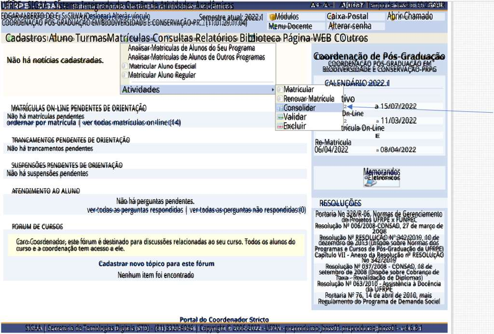

<!-- figure p05-fig1 | described_by: agy | ocr_overlap: 0.95 | needs_review: false -->
### 1. Tipo de figura
Captura de tela anotada da interface web do sistema SIGAA (Sistema Integrado de Gestão de Atividades Acadêmicas) da UFRPE, exibindo o **Portal do Coordenador Stricto** com menus suspensos abertos em dois níveis e uma seta azul adicionada para destacar uma opção específica do submenu. A imagem apresenta texto duplicado/sobreposto em quase toda a tela (uma camada de texto preto sem serifa renderizada sobre o texto original da captura de tela, aparentemente resultante de OCR em PDF).

---

### 2. Todo o texto visível (literal)

**Barra superior (cabeçalho institucional):**
- À esquerda: `UFRPE - SIGAA - Sistema Integrado de Gestão de Atividades Acadêmicas`
- À direita: `A+` `A-` `|` `Ajuda?` `|` `Tempo de Sessão: 00:25` `SAIR`

**Faixa de dados do usuário e atalhos:**
- À esquerda, linha 1: `EDGAR ALBERTO DO E. S. SILVA (Deslogar) Alterar vínculo`
- À esquerda, linha 2: `COORDENAÇÃO PÓS-GRADUAÇÃO EM BIODIVERSIDADE E CONSERVAÇÃO-PR... (11.01.29.17.04)`
- Ao centro: `Semestre atual: 2022.1`
- À direita, primeira linha de botões: `Módulos` | `Caixa Postal` | `Abrir Chamado`
- À direita, segunda linha de botões: `Menu Docente` | `Alterar senha`

**Barra de menu principal (da esquerda para a direita):**
- `Cadastros`
- `Aluno`
- `Turmas`
- `Matrículas`
- `Consultas`
- `Relatórios`
- `Biblioteca`
- `Página WEB`
- `COutros` (texto sobreposto ao original `Outros`)

**Menu suspenso de 1º nível (aberto sob `Matrículas`):**
- `Analisar Matriculas de Alunos do Seu Programa`
- `Analisar Matriculas de Alunos de Outros Programas`
- `Matricular Aluno Especial`
- `Matricular Aluno Regular`
- `Atividades`

**Submenu suspenso de 2º nível (aberto a partir de `Atividades`):**
- `Matricular`
- `Renovar Matrícula`
- `Consolidar`
- `Validar`
- `Excluir`

**Coluna principal esquerda:**
- Área superior de avisos: `Não há notícias cadastradas.`
- Seção `MATRÍCULAS ON-LINE PENDENTES DE ORIENTAÇÃO`
  - `Não há matrículas pendentes`
  - `ordernar por matrícula | ver todas matrículas on-line (14)` (no texto original subjacente lê-se `ordenar por matrícula`)
- Seção `TRANCAMENTOS PENDENTES DE ORIENTAÇÃO`
  - `Não há trancamentos pendentes`
- Seção `SUSPENSÕES PENDENTES DE ORIENTAÇÃO`
  - `Não há suspensões pendentes`
- Seção `ATENDIMENTO AO ALUNO`
  - `Não há perguntas pendentes.`
  - `ver todas as perguntas respondidas | ver todas as perguntas não respondidas(0)`
- Seção `FORUM DE CURSOS`
  - `Caro Coordenador, este fórum é destinado para discussões relacionadas ao seu curso. Todos os alunos do curso e a coordenação tem acesso a ele.`
  - `Cadastrar novo tópico para este fórum`
  - `Nenhum item foi encontrado`

**Coluna lateral direita:**
- Cabeçalho do painel lateral:
  - `Coordenação de Pós-Graduação`
  - `COORDENAÇÃO PÓS-GRADUAÇÃO EM BIODIVERSIDADE E CONSERVAÇÃO-PRPG`
- Bloco de calendário (parte esquerda encoberta pelo submenu de `Atividades`):
  - `CALENDÁRIO 2022.1`
  - `tivo` (início encoberto)
  - `2` `a 15/07/2022` (data inicial encoberta, restando apenas o dígito final `2`)
  - `Dn-Line` (texto sobreposto ao original `On-Line`; início encoberto)
  - `2` `a 11/03/2022` (data inicial encoberta, restando apenas o dígito final `2`)
  - `trícula On-Line` (início encoberto)
  - `E` (sobreposto a caractere subjacente `[illegible]`)
  - `Re-Matricula` (sobreposto ao original `Re-Matrícula`)
  - `06/04/2022` `a 08/04/2022`
- Bloco intermediário:
  - `Memorandos Eletrônicos`
- Bloco de documentos normativos:
  - `RESOLUÇÕES`
  - `Portaria No 328/R-06, Normas de Gerenciamento de Projetos UFRPE x FUNPEC`
  - `Resolução Nº 006/2008-CONSAD, 27 de março de 2008`
  - `Resolução Nº RESOLUÇÃO Nº 342/2019, 10 de dezembro de 2013 (Dispõe sobre Normas dos Programas e Cursos de Pós-Graduação da UFRPE)`
  - `Capítulo VII - Anexo da Resolução nº RESOLUÇÃO No 342/2019`
  - `Resolução Nº 037/2008 - CONSAD, 18 de setembro de 2008 (Dispõe sobre Cobrança de Taxa - Revalidação de Diplomas)`
  - `Resolução Nº 063/2010 - Assistência à Docência da UFRPE`
  - `Portaria Nº 76, 14 de abril de 2010, mais Regulamento do Programa de Demanda Social`

**Rodapé:**
- Acima da barra inferior: `Portal do Coordenador Stricto`
- Barra inferior: `SIGAA | Secretaria de Tecnologias Digitais (STD) - (81) 3320-6046 | Copyright © 2006-2022 - UFRN - preproducao-jboss01.preproducao-jboss01 - v4.6.8-1`

---

### 3. Estrutura

- **Layout geral da página:** Interface dividida em cabeçalho horizontal no topo, barra de navegação horizontal logo abaixo, área central composta por duas colunas (uma coluna principal mais larga à esquerda e uma coluna lateral mais estreita à direita), rodapé na base e uma estreita margem quadriculada vazia fora da interface no extremo direito da figura.
- **Cabeçalho:** Composto por duas faixas empilhadas — a barra institucional superior (título do sistema à esquerda; controles de fonte, ajuda, temporizador de sessão e saída à direita) e a faixa do usuário (nome e unidade à esquerda; semestre ao centro; grade de 2 linhas por 3 colunas de botões de atalho à direita, com a segunda linha contendo apenas 2 botões).
- **Fluxo de navegação dos menus em cascata:**
  1. Na barra de menu horizontal, o item `Matrículas` está selecionado e abre abaixo de si uma caixa retangular suspensa (menu de 1º nível) com 5 opções empilhadas, havendo uma linha horizontal separando as 4 primeiras opções da última (`Atividades`).
  2. A opção `Atividades` possui uma pequena seta triangular preta apontando para a direita, conectando-se diretamente a uma segunda caixa retangular suspensa (submenu de 2º nível) posicionada à direita, contendo 5 opções com pequenos ícones à esquerda de cada item (`Matricular`, `Renovar Matrícula`, `Consolidar`, `Validar`, `Excluir`).
  3. Esse submenu de 2º nível sobrepõe-se à borda esquerda do painel `CALENDÁRIO 2022.1` na coluna lateral direita, ocultando parcialmente os títulos e as datas iniciais dos três primeiros períodos listados.
- **Anotação (seta):** Uma seta reta azul parte da borda direita da imagem, atravessa horizontalmente (com leve inclinação para cima) a margem quadriculada e o bloco do calendário, e termina apontando diretamente para o lado direito da opção `Consolidar` no submenu de `Atividades`.
- **Coluna principal esquerda:** Organizada verticalmente em 6 blocos empilhados — espaço superior de notícias (`Não há notícias cadastradas.`) seguido por 5 painéis com título em caixa alta e faixa de conteúdo abaixo (`MATRÍCULAS ON-LINE PENDENTES DE ORIENTAÇÃO`, `TRANCAMENTOS PENDENTES DE ORIENTAÇÃO`, `SUSPENSÕES PENDENTES DE ORIENTAÇÃO`, `ATENDIMENTO AO ALUNO` e `FORUM DE CURSOS`, este último contendo uma caixa de aviso retangular e, abaixo, o link de cadastro de tópico e o aviso de lista vazia).
- **Coluna lateral direita:** Um grande painel vertical contendo o título da coordenação no topo seguido por 3 caixas empilhadas:
  1. `CALENDÁRIO 2022.1`, organizado em linhas alternadas de nome do período e intervalo de datas (`[data inicial] a [data final]`).
  2. Caixa centralizada com botão/ícone de computador e envelope intitulado `Memorandos Eletrônicos`.
  3. Caixa `RESOLUÇÕES`, organizada como uma lista vertical de 7 entradas separadas por faixas horizontais alternadas.
- **Rodapé:** Título do portal centralizado logo acima de uma barra horizontal de largura total com créditos, telefone, servidor e versão do sistema.

---

### 4. Números e valores de dados

- Tempo de sessão restante: `00:25`
- Código da unidade/coordenação: `11.01.29.17.04`
- Semestre atual / ano do calendário: `2022.1`
- Total em `ver todas matrículas on-line`: `14`
- Total em `ver todas as perguntas não respondidas`: `0`
- Datas no `CALENDÁRIO 2022.1`:
  - 1º período (`...tivo`): finaliza em `15/07/2022` (data inicial parcialmente encoberta terminando em `2`)
  - 2º período (`...Dn-Line` / `...On-Line`): finaliza em `11/03/2022` (data inicial parcialmente encoberta terminando em `2`)
  - 4º período (`Re-Matricula`): `06/04/2022` a `08/04/2022`
- Números e datas nas `RESOLUÇÕES`:
  - Portaria `328/R-06`
  - Resolução `006/2008`, data `27 de março de 2008`
  - Resolução `342/2019`, data `10 de dezembro de 2013`
  - `Capítulo VII`, Resolução `342/2019`
  - Resolução `037/2008`, data `18 de setembro de 2008`
  - Resolução `063/2010`
  - Portaria `76`, data `14 de abril de 2010`
- Telefone no rodapé: `(81) 3320-6046`
- Anos de copyright: `2006-2022`
- Identificadores de servidor no rodapé: `preproducao-jboss01.preproducao-jboss01`
- Versão do sistema: `v4.6.8-1`

---

### 5. Cores com significado

- **Destaque azul claro nos menus:** Indica o caminho de navegação ativo/selecionado pelo cursor — aplicado ao item `Matrículas` na barra principal, ao item `Atividades` no menu suspenso de 1º nível e ao item `Consolidar` no submenu de 2º nível.
- **Seta azul:** Elemento gráfico de anotação externa sobreposto à captura de tela para chamar atenção e apontar especificamente para o comando `Consolidar`.
- **Fundo amarelo claro no `FORUM DE CURSOS`:** Destaca a caixa de mensagem informativa direcionada ao coordenador (`Caro Coordenador, este fórum é destinado...`).
- **Faixas alternadas em cinza/azul muito claro e branco na lista de `RESOLUÇÕES` e no `CALENDÁRIO 2022.1`:** Separam visualmente cada linha/documento da lista.

~~~text ocr
une Biblioteca COutros
de Alunos do Seu Programa
de Alunos de Outros Coordenação di
Aluno Especial
Matricular Aluno Regular
Atividades » Matricular
Matricula
MATRÍGULAS ON-LINE PENDENTES DE ORIENTAÇÃO «Consolidar |
por matrícula | wer todas
TRANCAMENTOS PENDENTES DE ORIENTAÇÃO Re-Matricula
Não há trancamentos 06/04/2022 =
RENDENTES DE ORIENTAÇÃO
Não há suspensões pendentes
ATENDIMENTO AQ ALUNO
Não há perguntas pendentes. RESOLUÇÕES
respondidas | não respondidas((0) de
FORUM DE CURSOS 2008 27 de março de
este fórum para discussões relacionadas ao seu curso, Todos os alunos do
curso e a coordenação tem acesso a ei
Cadastrar novo tépi
pico para este fórum Resolução Nº 637/2008 - CONSAD, 18 de
Nenhum item foi encontrado e
ia à Docência
Portaria Nº 76, 14 de abril de 2010, mais
lemento do Programa de Demanda Social
~~~

<!-- Start of picture text -->
UFRPE - SIGAA - Sistema Integrado de Gestão de Atividades Acadêmicas A+A- Ajuda? Tempo de Sessão: 00:25 SAIR EDGAR ALBERTO DO E. S. SILVA (Deslogar) Alteràr vínculo Semestre atual: 2022.1 Módulos Caixa Postal Abrir Chamado COORDENAÇÃO PÓS-GRADUAÇÃO EM BIODIVERSIDADE E CONSERVAÇÃO-PR... (11.01.29.17.04) Menu Docente Alterar senha Cadastros Aluno TurmasMatrículas Consultas Relatórios Biblioteca Página WEB COutros Analisar Matriculas de Alunos do Seu Programa Não há notícias cadastradas. Analisar Matriculas de Alunos de Outros ProgramasMatricular Aluno Especial Coordenação de Pós-GraduaçãoBIODIVERSIDADE E CONSERVAÇÃO-PRPGCOORDEÑAÇÃO PÓS-GRADUAÇÃO EM Matricular Aluno Regular CALENDÁRIO 2022.1  Atividades Matricular Renovar Matrícula tivo MATRÍCULAS ON-LINE PENDENTES DE ORIENTAÇÃO Consolidar a 15/07/2022 Não há matrículas pendentes Validar Dn-Line ordernar por matrícula | ver todas matrículas on-line (14) Excluir trícula On-Line11/03/2022 TRANCAMENTOS PENDENTES DE ORIENTAÇÃO Re-Matricula E Não há trancamentos pendentes 06/04/2022 08/04/2022 SUSPENSÕES PENDENTES DE ORIENTAÇÃO Não há suspensões pendentes MemorandosEletrônicos ATENDIMENTO AO ALUNO Não há perguntas pendentes. RESOLUÇÕES ver todas as perguntas respondidas | ver todas as perguntas não respondidas (0) Portaria No 328/R-06, Normas de Gerenciamento de Projetos UFRPE x FUNPEC FORUM DE CURSOS Resolução Nº 006/2008-CONSAD, 27 de março de 2008 Resolução Nº RESOLUÇÃO Nº 342/2019, 10 de Caro Coordenador, este fórum é destinado para discussões relacionadas ao seu curso. Todos os alunos do dezembro de 2013 (Dispõe sobre Normas dos curso e a coordenação tem acesso a ele. Programas e Cursos de Pós-Graduação da UFRPE) Capítulo VII - Anexo da Resolução nº RESOLUçÃO No 342/2019 Cadastrar novo tópico para este fórum Resolução Nº 037/2008 - CONSAD, 18 de Nenhum item foi encontrado setembro de 2008 (Dispõe sobre Cobrança de Taxa - Revalidação de Diplomas) Resolução Nº 063/2010 - Assistência à Docência da UFRPE Portaria Nº 76, 14 de abril de 2010, mais Regulamento do Programa de Demanda Social Portal do Coordenador Stricto SIGAA | Secretaria de Tecnologias Digitais (STD) - (81) 3320-6046 | Copyright © 2006-2022 - UFRN - preproducao-jboss01.preproducao-jboss01 - v4.6.8-1 <!-- End of picture text -->

Em primeiro lugar é necessário Consolidar a atividade da defesa 

2 

10:38 

后)POR INTL17/05/202210:38 

市 

ǔ 

S 

29C Chuva fraca 

Digite aqui para pesquisar 

<!-- page 6 -->

SIGAA - Sistema Integrado de G× + 

> 凸 × 

###### https://preproducao.sigs.ufrpe.br/sigaa/graduacao/busca_discente.jsf 

目☆ 

##### C 

← 

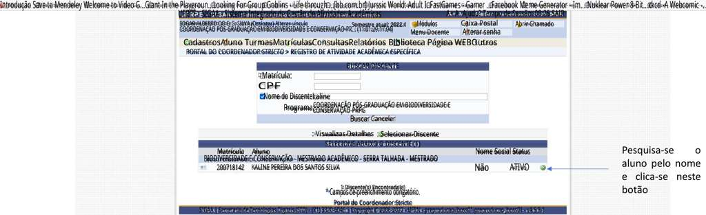

<!-- figure p06-fig1 | described_by: agy | ocr_overlap: 0.74 | needs_review: false -->
### 1. Tipo de figura
Trata-se de uma captura de tela (screenshot) anotada de uma página web do sistema acadêmico **SIGAA** da **UFRPE** (*Portal do Coordenador Stricto*), exibida em um navegador de internet (incluindo a barra de favoritos no topo), acompanhada de uma anotação instrucional externa à direita composta por texto explicativo e uma seta apontando para um botão da interface. A imagem apresenta ainda uma camada de texto preto (proveniente de OCR/renderização do PDF) sobreposta diretamente ao texto original da captura de tela, gerando leve duplicação visual dos caracteres.

---

### 2. Todo o texto visível (ipsis litteris)

**Barra de favoritos do navegador (no topo, da esquerda para a direita):**
- `Introdução`
- `Save to Mendeley`
- `Welcome to Video G...` (na camada subjacente: `Welcome to Video Ga...`)
- `Giant In the Playgroun...`
- `Looking For Group`
- `Goblins - Life through ...`
- `[bb.com.br]`
- `Jurssic World: Adult I...` (na camada subjacente: `Jurassic World: Adult ...`)
- `FastGames - Gamer ...` (na camada subjacente: `FastGames - Gamers ...`)
- `Facebook`
- `Meme Generator - Im...`
- `Nuklear Power 8-Bit...` (na camada subjacente: `Nuklear Power - 8-Bit...`)
- `xkcd - A Webcomic - ...`

**Barra superior do sistema (cabeçalho azul-escuro):**
- À esquerda: `UFRPE - SIGAA - Sistema Integrado de Gestão de Atividades Acadêmicas`
- À direita: `A+` `A-` `Ajuda?` `Tempo de Sessão: 00:25` `SAIR`

**Faixa de identificação do usuário e atalhos (abaixo do cabeçalho):**
- À esquerda (linha 1): `EDGAR ALBERTO DO E. S. SILVA (Deslogar) Alterar vínculo`
- À esquerda (linha 2): `COORDENAÇÃO PÓS-GRADUAÇÃO EM BIODIVERSIDADE E CONSERVAÇÃO-PR... (11.01.29.17.04)`
- Ao centro: `Semestre atual: 2022.1`
- À direita (botões em duas linhas):
  - Linha 1: `Módulos` | `Caixa Postal` | `Abrir Chamado`
  - Linha 2: `Menu Docente` | `Alterar senha`

**Barra de menu principal (da esquerda para a direita):**
- `Cadastros` | `Aluno` | `Turmas` | `Matrículas` | `Consultas` | `Relatórios` | `Biblioteca` | `Página WEB` | `Outros`

**Trilha de navegação (breadcrumb):**
- `PORTAL DO COORDENADOR STRICTO > REGISTRO DE ATIVIDADE ACADÊMICA ESPECÍFICA`

**Formulário de busca:**
- Título da caixa: `BUSCAR DISCENTE`
- Rótulo 1: `Matrícula:` (campo de texto vazio)
- Rótulo 2: `CPF:` (na camada sobreposta: `CPF`; campo de texto vazio)
- Rótulo 3: `Nome do Discente:` (na camada sobreposta: `Nome do Discente`; valor preenchido no campo: `kaline`)
- Rótulo 4: `Programa:` — valor exibido em duas linhas:
  - `COORDENAÇÃO PÓS-GRADUAÇÃO EM BIODIVERSIDADE E`
  - `CONSERVAÇÃO-PRPG`
- Botões na barra inferior do formulário: `Buscar` | `Cancelar`

**Legenda de ícones (acima da tabela de resultados):**
- `: Visualizar Detalhes` (precedido de ícone de ficha/documento)
- `: Selecionar Discente` (precedido de ícone circular verde com seta para a direita)

**Tabela de resultados:**
- Título da tabela: `SELECIONE ABAIXO O DISCENTE (1)`
- Cabeçalhos das colunas: `Matrícula` | `Aluno` | `Nome Social` | `Status`
- Subcabeçalho de agrupamento (estendendo-se por toda a largura da tabela): `BIODIVERSIDADE E CONSERVAÇÃO - MESTRADO ACADÊMICO - SERRA TALHADA - MESTRADO`
- Linha de dados:
  - Coluna `Matrícula`: `200718142`
  - Coluna `Aluno`: `KALINE PEREIRA DOS SANTOS SILVA`
  - Coluna `Nome Social`: `Não`
  - Coluna `Status`: `ATIVO`

**Textos centralizados abaixo da tabela:**
- `1 Discente(s) Encontrado(s)`
- `* Campos de preenchimento obrigatório.`
- `Portal do Coordenador Stricto`

**Rodapé do sistema (faixa azul-escura inferior):**
- `SIGAA | Secretaria de Tecnologias Digitais (STD) - (81) 3320-6046 | Copyright © 2006-2022 - UFRN - preproducao-jboss01.preproducao-jboss01 - v4.6.8-1`

**Anotação instrucional externa (à direita da captura de tela):**
- `Pesquisa-se o`
- `aluno pelo nome`
- `e clica-se neste`
- `botão`

---

### 3. Estrutura da figura

- **Disposição geral:** A imagem está dividida em duas áreas principais lado a lado sobre um fundo claro com padrão quadriculado nas margens laterais da página web:
  1. **Painel central (interface do SIGAA):** Contém a página web centralizada, delimitada por bordas verticais cinzas. No topo absoluto, acima do fundo quadriculado, estende-se de ponta a ponta a barra de favoritos do navegador (cada item precedido por um pequeno ícone — um ícone do Firefox em `Introdução` e ícones cinzas de globo nos demais).
  2. **Margem direita (anotação externa):** Contém o bloco de texto instrucional de quatro linhas e uma seta horizontal retilínea.

- **Blocos internos da interface do SIGAA (de cima para baixo):**
  1. **Cabeçalho institucional:** Faixa azul-escura com borda inferior laranja-dourada contendo o nome do sistema à esquerda e controles de acessibilidade/sessão à direita.
  2. **Painel de sessão do usuário:** Faixa azul-clara contendo nome do usuário, links de deslogar/alterar vínculo, unidade de coordenação, semestre atual e cinco botões com ícones distribuídos em uma grade 2×3 incompleta (`Módulos`, `Caixa Postal`, `Abrir Chamado` na linha superior; `Menu Docente`, `Alterar senha` na linha inferior).
  3. **Barra de navegação:** Faixa bege-clara com 9 itens de menu horizontais, cada um acompanhado de um pequeno ícone à esquerda.
  4. **Trilha de navegação:** Faixa azul muito clara indicando a seção atual.
  5. **Caixa do formulário (`BUSCAR DISCENTE`):** Retângulo centralizado com barra de título azul-escura, corpo branco e barra de botões azul-clara na base. Possui 4 linhas internas:
     - Linha 1: Caixa de seleção (desmarcada) + `Matrícula:` + caixa de entrada de texto vazia.
     - Linha 2: Caixa de seleção (desmarcada) + `CPF:` + caixa de entrada de texto vazia.
     - Linha 3: Caixa de seleção (**marcada**) + `Nome do Discente:` + caixa de entrada de texto longa contendo `kaline`.
     - Linha 4: Rótulo `Programa:` + texto fixo da coordenação em duas linhas.
     - Base do formulário: Dois botões clicáveis lado a lado (`Buscar` e `Cancelar`).
  6. **Caixa de legenda:** Faixa retangular cinza-clara com borda fina centralizando os dois pares ícone + descrição (`Visualizar Detalhes` e `Selecionar Discente`).
  7. **Tabela de resultados (`SELECIONE ABAIXO O DISCENTE (1)`):** Retângulo mais largo que o formulário, composto por:
     - Barra de título azul-escura.
     - Linha de cabeçalho cinza-clara com 6 colunas: coluna estreita de ícone à esquerda (sem rótulo), `Matrícula`, `Aluno`, `Nome Social`, `Status` e coluna estreita de ação à direita (sem rótulo).
     - Linha de agrupamento azul-clara ocupando toda a largura (`BIODIVERSIDADE E CONSERVAÇÃO - MESTRADO ACADÊMICO - SERRA TALHADA - MESTRADO`).
     - 1 linha de dados de fundo branco: ícone de ficha/detalhes à esquerda | `200718142` | `KALINE PEREIRA DOS SANTOS SILVA` | `Não` | `ATIVO` | botão circular verde com seta apontando para a direita.
  8. **Área pós-tabela:** Três linhas de texto centralizadas verticalmente (`1 Discente(s) Encontrado(s)`, `* Campos de preenchimento obrigatório.` e link `Portal do Coordenador Stricto`).
  9. **Rodapé:** Faixa azul-escura com borda superior laranja-dourada contendo informações institucionais e de versão.

- **Seta e conexão:**
  - Uma **seta horizontal azul** parte da lateral esquerda do texto `Pesquisa-se o aluno pelo nome e clica-se neste botão` (localizado à direita da página) e aponta diretamente para a esquerda, terminando exatamente no **botão circular verde com seta para a direita** (ação `Selecionar Discente`) posicionado na extremidade direita da linha do discente `KALINE PEREIRA DOS SANTOS SILVA`.

---

### 4. Todos os números e valores de dados

- Tempo restante de sessão: `00:25`
- Código da unidade/coordenação: `11.01.29.17.04`
- Semestre atual: `2022.1`
- Termo pesquisado no campo `Nome do Discente`: `kaline`
- Quantidade de discentes no título da tabela: `(1)`
- Matrícula do discente: `200718142`
- Nome do discente: `KALINE PEREIRA DOS SANTOS SILVA`
- Nome Social: `Não`
- Status: `ATIVO`
- Contagem de resultados abaixo da tabela: `1` (`1 Discente(s) Encontrado(s)`)
- Telefone no rodapé: `(81) 3320-6046`
- Anos de copyright no rodapé: `2006-2022`
- Identificador de servidor no rodapé: `preproducao-jboss01.preproducao-jboss01` (números `01`)
- Versão do sistema no rodapé: `v4.6.8-1`
- Número presente em favorito do navegador: `8` (`8-Bit...`)

---

### 5. Cores com significado

- **Azul preenchido com marca de verificação branca (caixa de seleção de `Nome do Discente`):** Indica que o filtro de busca por nome está **ativo/selecionado**, diferenciando-o das caixas brancas vazias (desmarcadas) de `Matrícula` e `CPF`.
- **Verde (botão circular com seta branca/verde para a direita na última coluna da tabela e na legenda):** Identifica visualmente o botão de ação `Selecionar Discente`, destacando o passo de avanço/seleção do aluno encontrado.
- **Azul (seta horizontal externa):** Destaca visualmente a indicação instrucional que conecta o texto explicativo à direita ao botão verde de seleção do discente.
- **Azul-escuro (barras de título e cabeçalho/rodapé) e azul-claro (linha de agrupamento do curso):** Diferenciam hierarquicamente cabeçalhos de seção (`BUSCAR DISCENTE`, `SELECIONE ABAIXO O DISCENTE (1)`), agrupamento de curso e linhas de dados.
- **Azul no texto `Portal do Coordenador Stricto` (e no asterisco/estrela de campo obrigatório na camada original):** Indica link clicável de retorno ao portal e marcação de obrigatoriedade.

~~~text ocr
Introdução
RPE - +
World:Adult Aluklear Webcomic -..
E à io;
COORDENAÇÃO POS GRADUAÇÃO
CadastrosAluno Página WEBQutres
RORTAL DO COORDENADORSTRICTO > REGISTRO DE
CPF
ENome-do Discentekaline
Buscar Cancelar
Detalhes
q
HO - MESTRADO ACADÊMICO - SERRA TALHADA - MESTRADO
Pesquisa-se o
BOS SANTOS SILVA Não ANO aluno pelo nome
e clica-se neste
t
botao
~~~

<!-- Start of picture text -->
Introdução Save to Mendeley Welcome to Video G...Giant In the Playgroun...Looking For Group Goblins - Life through ...[bb.com.br] Jurssic World: Adult I..FastGames - Gamer ...Facebook Meme Generator - Im... Nuklear Power 8-Bit...xkcd -A Webcomic -.. UFRPE - SIGAA - Sistema Integrado de Gestão de Atividades Acadêmicas A+ A- Ajuda? Tempo de Sessão: 00:25 SAIR EDGAR ALBERTO DO E. S. SILVA (Deslogar) Alterar vínculo Semestre atual: 2022.1 Módulos Caixa Postal Abrir Chamado COORDENAÇÃO PÓS-GRADUAÇÃO EM BIODIVERSIDADE E CONSERVAÇÃO-PR... (11.01.29.17.04) Menu Docente Alterar senha CadastrosAluno TurmasMatrículasConsultasRelatórios Biblioteca Página WEBOutros PORTAL DO COORDENADOR STRICTO > REGISTRO DE ATIVIDADE ACADÊMICA ESPECÍFICA BUSCAR DISCENTE □Matrícula: CPF Nome do Discente:kaline COORDENAÇÃO PÓS-GRADUAÇÃO EM BIODIVERSIDADE E Programa:CONSERVAÇÃO-PRPG Buscar Cancelar : Visualizar Detalhes : Selecionar Discente SELECIONE ABAIXO O DISCENTE (1) Matrícula Aluno Nome Social Status Pesquisa-se  o BIODIVERSIDADE E CONSERVAÇÃO - MESTRADO ACADÊMICO - SERRA TALHADA - MESTRADO 200718142 KALINE PEREIRA DOS SANTOS SILVA Não ATIVO aluno pelo nome e clica-se neste * Campos de preenchimento obrigatório.1 Discente(s) Encontrado(s) botão Portal do Coordenador Stricto SIGAA | Secretaria de Tecnologias Digitais (STD) - (81) 3320-6046 | Copyright © 2006-2022 - UFRN - preproducao-jboss01.preproducao-jboss01 - v4.6.8-1 <!-- End of picture text -->

≡ 

》 

3 

后物INTL 17/05/2022POR 10:38 星2 

出 

Digite aquí para pesquisar 

29°C Chuva fraca 

<!-- page 7 -->

SIGAA - Sistema Integrado de GX + 

> 凸 × 

目☆ 

← C 

###### https://preproducao.sigs.ufrpe.br/sigaa/graduacao/busca_discente.jsf 

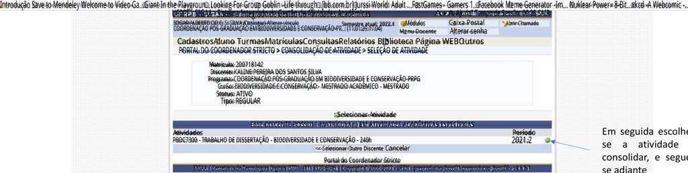

<!-- figure p07-fig1 | described_by: agy | ocr_overlap: 0.84 | needs_review: false -->
### 1. Tipo de figura
Captura de tela anotada da interface web do sistema acadêmico **SIGAA** (Sistema Integrado de Gestão de Atividades Acadêmicas) da **UFRPE**, usada como figura instrucional de tutorial (etapa de seleção de atividade para consolidação no Portal do Coordenador Stricto). A imagem inclui a barra de favoritos do navegador na margem superior, uma anotação textual explicativa acompanhada de uma seta no canto inferior direito e apresenta uma camada de texto preto sem serifa (típica de OCR de PDF) sobreposta de forma levemente desalinhada ao texto original da captura de tela, gerando duplicação visual e pequenas divergências de caracteres em alguns trechos.

---

### 2. Todo o texto visível (literal)

**Barra de favoritos do navegador (topo, da esquerda para a direita):**
- `Introdução`
- `Save to Mendeley`
- `Welcome to Video Ga...`
- `Giant In the Playground..` (na camada sobreposta: `Giant In the Playgroun...`)
- `Looking For Group`
- `Goblins - Life through ..` (na camada sobreposta: `Goblin -Life through..`)
- `[bb.com.br]`
- `Jurassic World: Adult ...` (na camada sobreposta: `Jurssi World: Adult ...`)
- `FastGames - Gamers 1...` (no texto original de fundo, o último caractere visível antes das reticências parece `l` ou `1`: `FastGames - Gamers 1...`)
- `Facebook`
- `Meme Generator - Im...`
- `Nuklear Power » 8-Bit...`
- `xkcd - A Webcomic - ...` (cortado na extremidade direita)

**Barra superior do sistema (cabeçalho):**
- À esquerda: `UFRPE - SIGAA - Sistema Integrado de Gestão de Atividades Acadêmicas`
- À direita: `A+` `A-` `|` `Ajuda?` `|` `Tempo de Sessão: 00:25` `SAIR`

**Faixa de identificação do usuário e atalhos:**
- À esquerda (linha 1): `EDGAR ALBERTO DO E. S. SILVA (Deslogar) Alterar vínculo`
- À esquerda (linha 2): `COORDENAÇÃO PÓS-GRADUAÇÃO EM BIODIVERSIDADE E CONSERVAÇÃO-PR... (11.01.29.17.04)`
- Centro-direita: `Semestre atual: 2022.1`
- Botões à direita (linha 1): `Módulos` | `Caixa Postal` | `Abrir Chamado`
- Botões à direita (linha 2): `Menu Docente` | `Alterar senha`

**Barra de menu principal (da esquerda para a direita):**
- `Cadastros` | `Aluno` | `Turmas` | `Matrículas` | `Consultas` | `Relatórios` | `Biblioteca` | `Página WEB` | `Outros`

**Trilha de navegação (breadcrumb):**
- `PORTAL DO COORDENADOR STRICTO > CONSOLIDAÇÃO DE ATIVIDADE > SELEÇÃO DE ATIVIDADE`

**Quadro de dados do discente (rótulo e valor):**
- `Matrícula:` `200718142`
- `Discente:` `KALINE PEREIRA DOS SANTOS SILVA`
- `Programa:` `COORDENAÇÃO PÓS-GRADUAÇÃO EM BIODIVERSIDADE E CONSERVAÇÃO-PRPG`
- `Curso:` `BIODIVERSIDADE E CONSERVAÇÃO - MESTRADO ACADÊMICO - MESTRADO` (na camada sobreposta: `CurSo:`)
- `Status:` `ATIVO`
- `Tipo:` `REGULAR`

**Barra de legenda de ação:**
- `: Selecionar Atividade` (precedido pelo ícone circular verde com seta para a direita)

**Tabela de atividades acadêmicas específicas:**
- Título da tabela: `ESSE DISCENTE POSSUI 1 MATRÍCULA(s) EM ATIVIDADES ACADÊMICAS ESPECÍFICAS`
- Cabeçalhos das colunas: `Atividades` | `Período` | *(coluna estreita sem título)*
- Linha 1, coluna `Atividades`: `PBDC7300 - TRABALHO DE DISSERTAÇÃO - BIODIVERSIDADE E CONSERVAÇÃO - 240h`
- Linha 1, coluna `Período`: `2021.2`
- Linha 1, coluna de ação: *(sem texto; contém apenas o ícone circular verde com seta branca para a direita)*
- Botões no rodapé da tabela: `<< Selecionar Outro Discente` | `Cancelar`

**Link abaixo da tabela:**
- `Portal do Coordenador Stricto`

**Rodapé do sistema:**
- `SIGAA | Secretaria de Tecnologias Digitais (STD) - (81) 3320-6046 | Copyright © 2006-2022 - UFRN - preproducao-jboss01.preproducao-jboss01 - v4.6.8-1`

**Anotação externa no canto inferior direito (quatro linhas, com a borda direita da imagem cortando parcialmente o final das linhas 1 e 3):**
- Linha 1: `Em seguida escolhe` *(a letra final `e` está parcialmente cortada pela borda direita)*
- Linha 2: `se a atividade`
- Linha 3: `consolidar, e segue` *(a letra final `e` está parcialmente cortada pela borda direita)*
- Linha 4: `se adiante`

---

### 3. Estrutura
- **Enquadramento geral:** A página web do SIGAA ocupa uma coluna central vertical com margens laterais quadriculadas em cinza muito claro e fundo externo branco. Acima de toda a largura da imagem corre a barra horizontal de favoritos do navegador (cada item precedido de um pequeno ícone de site ou globo, sendo o primeiro o ícone do Firefox).
- **Cabeçalho da interface (de cima para baixo):**
  1. Faixa horizontal estreita com o nome do sistema à esquerda e controles de tamanho de fonte (`A+`, `A-`), ajuda, tempo restante de sessão e saída à direita.
  2. Faixa horizontal de informações do usuário contendo, à esquerda, nome/vínculo e coordenação; no centro-direita, o semestre atual; e à direita, um bloco de 5 botões retangulares com ícones dispostos em uma grade de 2 linhas por 3 colunas (3 botões na linha superior e 2 na inferior, com a célula inferior direita vazia).
  3. Barra horizontal de menu de navegação com 9 itens acompanhados de pequenos ícones à esquerda de cada rótulo.
  4. Linha horizontal com a trilha de navegação hierárquica separada pelo símbolo `>`.
- **Painel de dados do discente:** Caixa retangular centralizada com borda fina cinza-clara contendo 6 linhas empilhadas verticalmente no formato `Rótulo: Valor`, alinhadas pelo sinal de dois-pontos.
- **Faixa de legenda:** Caixa retangular estreita logo abaixo do painel do discente, centralizando o ícone circular verde com seta branca para a direita seguido de `: Selecionar Atividade`.
- **Tabela de atividades:**
  - Composta por uma barra de título superior, 1 linha de cabeçalho, 1 linha de dados e 1 barra inferior de ações.
  - Possui **3 colunas**: coluna larga à esquerda (`Atividades`), coluna estreita à direita (`Período`) e uma coluna estreita na extrema direita dedicada ao botão de ação (ícone circular verde com seta branca para a direita).
  - Na faixa inferior da tabela há 2 botões retangulares centralizados lado a lado (`<< Selecionar Outro Discente` e `Cancelar`).
- **Rodapé:** Abaixo da tabela há o link centralizado `Portal do Coordenador Stricto`, seguido pela barra horizontal de rodapé institucional.
- **Anotação e conexão por seta:** No canto inferior direito, fora do quadro da página web, encontra-se o bloco de texto explicativo de 4 linhas. Uma **seta reta diagonal** parte da esquerda desse bloco de texto (aproximadamente na altura da segunda/terceira linha) e aponta para cima e para a esquerda, terminando exatamente sobre o **ícone circular verde com seta para a direita** na linha da atividade `PBDC7300 - TRABALHO DE DISSERTAÇÃO - BIODIVERSIDADE E CONSERVAÇÃO - 240h` (período `2021.2`).

---

### 4. Todos os números e valores de dados
- Tempo de sessão: `00:25`
- Código numérico da coordenação: `11.01.29.17.04`
- Semestre atual: `2022.1`
- Número de matrícula do discente: `200718142`
- Quantidade de matrículas em atividades acadêmicas específicas: `1`
- Código da atividade acadêmica: `PBDC7300` (parte numérica: `7300`)
- Carga horária da atividade: `240h`
- Período da atividade: `2021.2`
- Telefone institucional no rodapé: `(81) 3320-6046`
- Período de copyright no rodapé: `2006-2022`
- Identificador de instância no rodapé: `preproducao-jboss01.preproducao-jboss01` (`01`)
- Versão do sistema no rodapé: `v4.6.8-1`
- Números visíveis nos títulos da barra de favoritos: `1...` (em `FastGames - Gamers 1...`) e `8` (em `Nuklear Power » 8-Bit...`)

---

### 5. Cores com significado
- **Verde (ícone circular verde com seta branca apontando para a direita):** identifica visualmente o comando de ação "Selecionar Atividade", estabelecendo correspondência direta entre o item da legenda acima da tabela e o botão clicável ao final da linha da atividade listada.
- **Azul (seta de anotação):** destaca a instrução do tutorial, conectando o texto explicativo à direita ao botão verde de seleção da atividade na tabela.
- **Azul-escuro, azul-claro e texto em azul na interface:** distinguem hierarquicamente as barras de cabeçalho do sistema, o título da tabela e o rodapé (azul-escuro), as barras de dados do usuário e de botões inferiores da tabela (azul-claro), bem como os elementos navegáveis/links em azul (trilha de navegação e `Portal do Coordenador Stricto`).

~~~text ocr
be tos,
622.4
Página WEBQutros
PORTAL DO COORDENADOR STRICTO > CONSOLIDAÇÃO DE ATIVIDADE > SELEÇÃO DE ATIVIDADE
200718142
DOS SANTOS SI
EM BIODIVERSIDADE E CONSERVAÇÃO-PRPG
MESTRADO ACADÊMICO - MESTRADO
pede
ATIVO
Tipoi: REGULAR
- TRABALHO DE DISSERTAÇÃO - BIODIVERSIDADE E CONSERVAÇÃO - 240h
Discente Cancelar
Paral do Stricto
2024.22
(STD) = |
Em seguida escolhe
se a atividade
consolidar, e segu:
ce adiante
~~~

<!-- Start of picture text -->
Introdução Save to Mendeley Welcome to Video Ga...Giant In the Playgroun...Looking For Group Goblin -Life through ..[bb.com.br] Jurssi World: Adult ...FastGames - Gamers 1...Facebook Meme Generator -Im... Nuklear Power» 8-Bit...xkcd -A Webcomic -.. UFRPE - SIGAA - Sistema Integrado de Gestão de Atividades Acadêmicas A+A-Ajuda? Tempo de Sessão: 00:25 SAIR EDGAR ALBERTO DO E. S. SILVA (Deslogar) Alterar vínculo Semestre atual: 2022.1 Módulos Caixa Postal Abrir Chamado COORDENAÇÃO PÓS-GRADUAÇÃO EM BIODIVERSIDADE E CONSERVAÇÃO-PR... (11.01.29.17.04) Menu Docente Alterar senha CadastrosAluno TurmasMatrículasConsultasRelatórios Biblioteca Página WEBOutros PORTAL DO COORDENADOR STRICTO > CONSOLIDAÇÃO DE ATIVIDADE > SELEÇÃO DE ATIVIDADE Matrícula: 200718142 Discente: KALINE PEREIRA DOS SANTOS SILVA Programa: COORDENAÇÃO PÓS-GRADUAÇÃO EM BIODIVERSIDADE E CONSERVAÇÃO-PRPG CurSo: BIODIVERSIDADE E CONSERVAÇÃO - MESTRADO ACADÊMICO - MESTRADO Status: ATIVO Tipo: REGULAR : Selecionar Atividade ESSE DISCENTE POSSUI 1 MATRÍCULA(s) EM ATIVIDADES ACADÊMICAS ESPECÍFICAS Atividades Período Em seguida escolhe- PBDC7300 - TRABALHO DE DISSERTAÇÃO - BIODIVERSIDADE E CONSERVAÇÃO - 240h 2021.2 se a atividade a << Selecionar Outro Discente Cancelar Portal do Coordenador Stricto consolidar, e segue- SIGAA | Secretaria de Tecnologias Digitais (STD) - (81) 3320-6046 | Copyright © 2006-2022 - UFRN - preproducao-jboss01.preproducao-jboss01 - v4.6.8-1 se adiante <!-- End of picture text -->

Em seguida escolhese a atividade a consolidar, e seguese adiante 

≡ 

》 

4 INTL 17/05/2022POR 10:39 星2 

Digite aquí para pesquisar 

29C Chuva fraca 

INTL 17/05/2022POR 

<!-- page 8 -->

SIGAA - Sistema Integrado de GX + 

> 凸 × 

← C 

目☆ ≡ 

》 

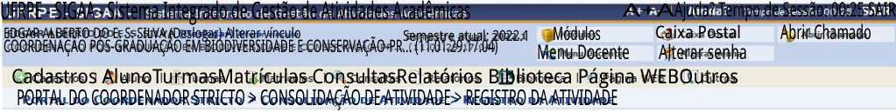

<!-- figure p08-fig1 | described_by: agy | ocr_overlap: 0.7 | needs_review: false -->
**(1) Tipo de figura**

Captura de tela recortada do cabeçalho superior e das barras de navegação da interface web de um sistema acadêmico (SIGAA da UFRPE), extraída de um PDF com uma camada de texto em preto (típica de texto OCR/PDF exposto) sobreposta e levemente deslocada sobre os textos originais da interface, gerando duplicação visual dos rótulos.

**(2) Todo o texto visível (literal)**

* **Barra superior (esquerda):**
  `UFRPE - SIGAA - Sistema Integrado de Gestão de Atividades Acadêmicas`
* **Barra superior (direita):**
  `A+` `A-` `Ajuda?` `Tempo de Sessão: 00:25` `SAIR`
  *(Nota: na camada de texto preta sobreposta, o conjunto aparece colado como `A+AAjuda?Tempo de Sessão: 00:25SAIR`, sem o hífen visível em `A-`, que permanece legível em branco na imagem de fundo.)*
* **Painel de identificação do usuário e da unidade (esquerda):**
  * Linha 1 (esquerda): `EDGAR ALBERTO DO E. S. SILVA (Deslogar) Alterar vínculo`
  * Linha 1 (direita): `Semestre atual: 2022.1`
  * Linha 2: `COORDENAÇÃO PÓS-GRADUAÇÃO EM BIODIVERSIDADE E CONSERVAÇÃO - PR... (11.01.29.17.04)`
* **Botões de atalho (direita do painel do usuário):**
  * Linha superior: `Módulos` | `Caixa Postal` | `Abrir Chamado`
  * Linha inferior: `Menu Docente` | `Alterar senha`
* **Barra de menu principal:**
  `Cadastros` `Aluno` `Turmas` `Matrículas` `Consultas` `Relatórios` `Biblioteca` `Página WEB` `Outros`
  *(Nota: na camada preta sobreposta, alguns itens aparecem sem espaço entre si: `Cadastros AlunoTurmasMatrículas ConsultasRelatórios Biblioteca Página WEBOutros`.)*
* **Barra de trilha de navegação (inferior):**
  `PORTAL DO COORDENADOR STRICTO > CONSOLIDAÇÃO DE ATIVIDADE > REGISTRO DA ATIVIDADE`

**(3) Estrutura**

A figura é composta por quatro faixas horizontais empilhadas de cima para baixo, ocupando toda a largura da imagem (sem gráficos, eixos ou setas de fluxo além dos separadores `>` da trilha de navegação):

1. **Faixa 1 — Barra de título e sessão:** Uma barra horizontal superior contendo, à esquerda, o título do sistema e, à direita, controles utilitários separados por pequenas linhas verticais (`A+` / `A-` | ícone + `Ajuda?` | `Tempo de Sessão: 00:25` | `SAIR`). Uma linha horizontal fina separa esta faixa da faixa seguinte.
2. **Faixa 2 — Painel de usuário e atalhos:** Dividida em duas colunas principais:
   * **Coluna esquerda (informações da sessão):** Contém duas linhas de texto. A primeira exibe o nome do usuário e links de sessão à esquerda (`EDGAR ALBERTO DO E. S. SILVA (Deslogar) Alterar vínculo`) e o período letivo à direita (`Semestre atual: 2022.1`). A segunda linha exibe o nome truncado da coordenação seguido de seu código numérico (`COORDENAÇÃO PÓS-GRADUAÇÃO EM BIODIVERSIDADE E CONSERVAÇÃO - PR... (11.01.29.17.04)`).
   * **Coluna direita (grade de botões):** Uma grade de 2 linhas por 3 colunas contendo 5 caixas retangulares clicáveis (cada uma com um pequeno ícone à esquerda do texto) e a última célula (linha 2, coluna 3) vazia:
     * Linha 1: `[ícone de caixa/cubo] Módulos`, `[ícone de envelope] Caixa Postal`, `[ícone amarelo] Abrir Chamado`.
     * Linha 2: `[ícone azul] Menu Docente`, `[ícone de usuário] Alterar senha`, `[vazio]`.
3. **Faixa 3 — Barra de menu horizontal:** Uma linha única com 9 itens de menu dispostos da esquerda para a direita, cada um precedido por um pequeno ícone temático: `Cadastros` (sinal `+`), `Aluno` (pessoa), `Turmas` (grupo), `Matrículas` (seta sobre documento), `Consultas` (lupa), `Relatórios` (documento), `Biblioteca` (livros/estante), `Página WEB` (página/tela) e `Outros` (documento).
4. **Faixa 4 — Trilha de navegação (*breadcrumb*):** Uma linha única na parte inferior indicando o caminho hierárquico atual dentro do sistema, conectando três níveis da esquerda para a direita por meio do símbolo `>`:
   `PORTAL DO COORDENADOR STRICTO` → `CONSOLIDAÇÃO DE ATIVIDADE` → `REGISTRO DA ATIVIDADE`.

**(4) Todos os números e valores de dados**

* `00:25` — tempo de sessão exibido em `Tempo de Sessão: 00:25`.
* `2022.1` — semestre letivo exibido em `Semestre atual: 2022.1`.
* `11.01.29.17.04` — código identificador da unidade exibido em `(11.01.29.17.04)`.

**(5) Cores com significado**

* **Azul-escuro (com texto branco) e linha divisória laranja:** Delimitam a barra institucional superior do sistema, separando-a visualmente da área de trabalho do usuário.
* **Azul-claro, bege-claro e branco:** Diferenciam hierarquicamente, de cima para baixo, o painel de contexto do usuário e atalhos (azul-claro), a barra de menus do módulo (bege-claro) e a barra de localização/trilha de navegação (branco).
* **Azul nos textos da interface original:** Indica hiperlinks/ações clicáveis em `(Deslogar)`, `Alterar vínculo` e nos itens da trilha de navegação (`PORTAL DO COORDENADOR STRICTO > CONSOLIDAÇÃO DE ATIVIDADE > REGISTRO DA ATIVIDADE`).
* **Preto na camada de texto sobreposta:** Não indica distinção funcional da interface; trata-se apenas da renderização da camada de texto do PDF sobre a captura de tela original.

~~~text ocr
COORDENAÇÃO P
de
Caixa-Postal
Cadastros Biblioteca Pagina WEBQutros
COORDENADOR > REGISTRO
US
AbritGhamado
~~~

<!-- Start of picture text -->
UFRPE - SIGAA - Sistema Integrado de Gestão de Atividades Acadêmicas A+A-Ajuda? Tempo de Sessão: 00:25 SAIR EDGAR ALBERTO DO E. S. SILVA (Deslogar) Alterar vínculo Semestre atual: 2022.1 Módulos Caixa Postal Abrir Chamado COORDENAÇÃO PÓS-GRADUAÇÃO EM BIODIVERSIDADE E CONSERVAÇÃO-PR... (11.01.29.17.04) Menu Docente Alterar senha Cadastros AlunoTurmasMatrículas ConsultasRelatórios Biblioteca Página WEBOutros PORTAL DO COORDENADOR STRICTO > CONSOLIDAÇÃO DE ATIVIDADE > REGISTRO DA ATIVIDADE <!-- End of picture text -->

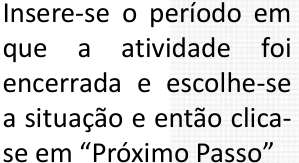

<!-- figure p08-fig2 | described_by: agy | ocr_overlap: 1.0 | needs_review: false -->
1. **Tipo de figura:** Recorte de um bloco de texto instrucional (sem ilustrações, gráficos, diagramas ou tabelas).

2. **Texto visível (literal):**
   - Linha 1: `Insere-se o período em`
   - Linha 2: `que a atividade foi`
   - Linha 3: `encerrada e escolhe-se`
   - Linha 4: `a situação e então clica-`
   - Linha 5: `se em “Próximo Passo”`

   *(Texto contínuo: `Insere-se o período em que a atividade foi encerrada e escolhe-se a situação e então clica-se em “Próximo Passo”` — sem ponto final após as aspas de fechamento.)*

3. **Estrutura:** Um único parágrafo de cinco linhas em fonte sem serifa, com texto justificado nas quatro primeiras linhas e alinhado à esquerda na última linha. Não há caixas, bordas, setas, conexões, eixos, tabelas ou painéis. O fundo é liso na metade esquerda e apresenta um padrão quadriculado muito suave na metade direita, sem função estrutural aparente.

4. **Números ou valores de dados:** Nenhum.

5. **Cores com significado:** Nenhuma; o texto é inteiramente preto sobre fundo branco (com uma grade cinza-claro tênue na metade direita), sem cores que carreguem significado.

~~~text ocr
Insere-se o período em
que a atividade foi
encerrada e escolhe-se
a situação e então clica-
se em “Próximo Passo”
~~~

<!-- Start of picture text -->
Insere-se o período em que a atividade foi encerrada e escolhe-se a situação e então clica- se em “Próximo Passo” <!-- End of picture text -->

Atenção!! Esta atividade foi cadastrada originalmente no PontoA e não contém todas as informações necessárias para sua consolidação. Por favor, informe os dados solicitados para regularizar o cadastro. Matrícula: 200718142 Discente: KALINE PEREIRA DOS SANTOS SILVA Programa: COORDENAÇÃO PÓS-GRADUAÇÃO EM BIODIVERSIDADE E CONSERVAÇÃO-PRPG CurSo: BIODIVERSIDADE E CONSERVAÇÃO - MESTRADO ACADÊMICO - MESTRADO Status: ATIVO Tipo: REGULAR INFORME OS DETALHES DO REGISTRO DA ATIVIDADE Atividade: PBDC7300 - TRABALHO DE DISSERTAÇÃO - BIODIVERSIDADE E CONSERVAÇÃO Tipo da Atividade: DISSERTAÇÃO/TESE Ano Período: 2021 . 2 Data de Início: Agosto / 2021 RESULTADO Data Final:  Março —12022 Situação: APROVADO V << Selecionar Outra Atividade CancelarPróximo Passo >> * Campos de preenchimento obrigatório. Portal do Coordenador Stricto SIGAA | Secretaria de Tecnologias Digitais (STD) - (81) 3320-6046 | Copyright © 2006-2022 - UFRN - preproducao-jboss01.preproducao-jboss01 - v4.6.8-1 

5 

POR 10:39 后物INTL 17/05/2022 早2 

Digite aquí para pesquisar 

29°C Chuva fraca 

<!-- page 9 -->

> SIGAA - Sistema Integrado de GX + 

× 

￥目 

三 》 

← 

###### C 

###### 8https://preproducao.sigs.ufrpe.br/sigaa/stricto/registro_atividade/dados_registro.jsf 

- Introdução Save to MendeleyWelcome to Video Ga... Giant In the Playgroun...Looking For GroupGoblins - Life through .. [bb.com.br] Jurassic World: Adult I... FastGames - Gamers I...Facebook Meme Generator - Im... Nuklear Power » 8-Bit ... xkcd - A Webcomic - .. Numero de paginas: 35 

- TÍTULO 

Aparecerá os dados da banca, então deve-se preencher com o número e com o texto da ata. Também haverá espaços para a escrever na folha de correções, ao final da tela clica-se em “Próximo Passo” 

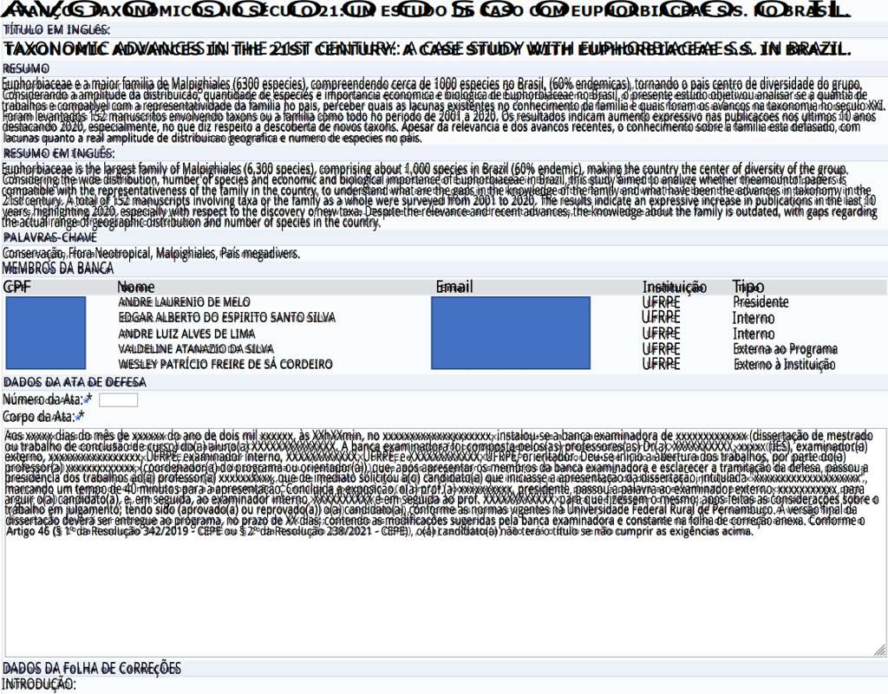

<!-- figure p09-fig1 | described_by: agy | ocr_overlap: 0.93 | needs_review: false -->
### 1. Tipo de figura
Captura de tela de uma interface web de formulário acadêmico institucional (da Universidade Federal Rural de Pernambuco — UFRPE) para visualização de dados de dissertação/trabalho acadêmico, composição da banca examinadora e preenchimento da ata de defesa e da folha de correções. A imagem apresenta um artefato de sobreposição de texto em camada dupla (texto preto mais nítido e levemente ampliado/deslocado sobre o texto original da captura, além de grandes letras pretas distorcidas sobrepostas ao título na primeira linha) e dois retângulos azuis opacos utilizados para ocultar dados pessoais na tabela da banca.

---

### 2. Todo o texto visível (verbatim)

- **Primeira linha (título em português):**
  `AVANÇOS TAXONÔMICOS NO SÉCULO 21: UM ESTUDO DE CASO COM EUPHORBIACEAE S.S. NO BRASIL.`
  *(Nota: sobreposta diretamente a esta linha há uma sequência distorcida de letras pretas grandes, legíveis aproximadamente como `AVO O O O O O S O O O O O O IL`, resultante de artefato de renderização.)*

- **Seção 1 — Rótulo:**
  `TÍTULO EM INGLÊS:`
- **Conteúdo:**
  `TAXONOMIC ADVANCES IN THE 21ST CENTURY: A CASE STUDY WITH EUPHORBIACEAE S.S. IN BRAZIL.`

- **Seção 2 — Rótulo:**
  `RESUMO`
- **Conteúdo:**
  `Euphorbiaceae e a maior familia de Malpighiales (6300 especies), compreendendo cerca de 1000 especies no Brasil, (60% endemicas), tornando o pais centro de diversidade do grupo. Considerando a amplitude da distribuicao, quantidade de especies e importancia economica e biologica de Euphorbiaceae no Brasil, o presente estudo objetivou analisar se a quantia de trabalhos e compativel com a representatividade da familia no pais, perceber quais as lacunas existentes no conhecimento da familia e quais foram os avancos na taxonomia no seculo XXI. Foram levantados 152 manuscritos envolvendo taxons ou a familia como todo no periodo de 2001 a 2020. Os resultados indicam aumento expressivo nas publicacoes nos ultimos 10 anos destacando 2020, especialmente, no que diz respeito a descoberta de novos taxons. Apesar da relevancia e dos avancos recentes, o conhecimento sobre a familia esta defasado, com lacunas quanto a real amplitude de distribuicao geografica e numero de especies no pais.`

- **Seção 3 — Rótulo:**
  `RESUMO EM INGLÊS:`
- **Conteúdo:**
  `Euphorbiaceae is the largest family of Malpighiales (6,300 species), comprising about 1,000 species in Brazil (60% endemic), making the country the center of diversity of the group. Considering the wide distribution, number of species and economic and biological importance of Euphorbiaceae in Brazil, this study aimed to analyze whether theamountof papers is compatible with the representativeness of the family in the country, to understand what are the gaps in the knowledge of the family and what have been the advances in taxonomy in the 21st century. A total of 152 manuscripts involving taxa or the family as a whole were surveyed from 2001 to 2020. The results indicate an expressive increase in publications in the last 10 years, highlighting 2020, especially with respect to the discovery o new taxa. Despite the relevance and recent advances, the knowledge about the family is outdated, with gaps regarding the actual range of geographic distribution and number of species in the country.`

- **Seção 4 — Rótulo:**
  `PALAVRAS-CHAVE`
- **Conteúdo:**
  `Conservação, Flora Neotropical, Malpighiales, País megadivers.`

- **Seção 5 — Rótulo:**
  `MEMBROS DA BANCA`
- **Tabela:**

| CPF | Nome | Email | Instituição | Tipo |
| :--- | :--- | :--- | :--- | :--- |
| *(ocultado por tarja azul)* | `ANDRE LAURENIO DE MELO` | *(ocultado por tarja azul)* | `UFRPE` | `Presidente` |
| *(ocultado por tarja azul)* | `EDGAR ALBERTO DO ESPIRITO SANTO SILVA` | *(ocultado por tarja azul)* | `UFRPE` | `Interno` |
| *(ocultado por tarja azul)* | `ANDRE LUIZ ALVES DE LIMA` | *(ocultado por tarja azul)* | `UFRPE` | `Interno` |
| *(ocultado por tarja azul)* | `VALDELINE ATANAZIO DA SILVA` | *(ocultado por tarja azul)* | `UFRPE` | `Externa ao Programa` |
| *(ocultado por tarja azul)* | `WESLEY PATRÍCIO FREIRE DE SÁ CORDEIRO` | *(ocultado por tarja azul)* | `UFRPE` | `Externo à Instituição` |

- **Seção 6 — Rótulo:**
  `DADOS DA ATA DE DEFESA`
- **Campos e texto:**
  - `Número da Ata:*` *(seguido de caixa de texto vazia)*
  - `Corpo da Ata:*`
  - **Texto dentro da caixa de texto de `Corpo da Ata:*`:**
    `Aos xxxxx dias do mês de xxxxxx do ano de dois mil xxxxxx, às XXhXXmin, no xxxxxxxxxxxxxxxxxxx, instalou-se a banca examinadora de xxxxxxxxxxxxx (dissertação de mestrado ou trabalho de conclusão de curso) do(a) aluno(a) XXXXXXXXXXXXXX. A banca examinadora foi composta pelos(as) professores(as) Dr(a). XXXXXXXXXXX, xxxxx (IES), examinador(a) externo, xxxxxxxxxxxxxxx, UFRPE, examinador interno, XXXXXXXXXXXX, UFRPE, e XXXXXXXXXXXX, UFRPE, orientador. Deu-se início a abertura dos trabalhos, por parte do(a) professor(a) xxxxxxxxxxxx, (coordenador(a) do programa ou orientador(a)), que, após apresentar os membros da banca examinadora e esclarecer a tramitação da defesa, passou a presidência dos trabalhos ao(a) professor(a) xxxxxxxxxx, que de imediato solicitou a(o) candidato(a) que iniciasse a apresentação da dissertação, intitulada "xxxxxxxxxxxxxxxxxxxx", marcando um tempo de 40 minutos para a apresentação. Concluída a exposição, o(a) prof.(a) xxxxxxxxxx, presidente, passou a palavra ao examinador externo, xxxxxxxxxxx, para arguir o(a) candidato(a), e, em seguida, ao examinador interno, XXXXXXXXXX e em seguida ao prof. XXXXXXXXXXXX, para que fizessem o mesmo; após feitas as considerações sobre o trabalho em julgamento; tendo sido (aprovado(a) ou reprovado(a)) o(a) candidato(a), conforme
**(1) Tipo de figura**

Captura de tela de um formulário eletrônico de sistema acadêmico (interface web de registro de defesa de dissertação da Universidade Federal Rural de Pernambuco — UFRPE), contendo metadados do trabalho, tabela dos membros da banca examinadora com dados pessoais ocultados por tarjas azuis e campos editáveis para preenchimento da ata de defesa e da folha de correções. Toda a imagem apresenta um artefato de renderização dupla, no qual uma camada de texto preto nítido aparece sobreposta e ligeiramente desalinhada sobre o texto original da captura de tela; na primeira linha do topo, letras pretas grandes e distorcidas (`AVO O O O O O S O O O O O O IL`) sobrepõem-se ao título em português.

---

**(2) Todo o texto visível, verbatim**

- **Cabeçalho superior (título em português, sob sobreposição de caracteres distorcidos):**
  - `AVANÇOS TAXONÔMICOS NO SÉCULO 21: UM ESTUDO DE CASO COM EUPHORBIACEAE S.S. NO BRASIL.`
- **Rótulo de seção:**
  - `TÍTULO EM INGLÊS:`
- **Texto do título em inglês:**
  - `TAXONOMIC ADVANCES IN THE 21ST CENTURY: A CASE STUDY WITH EUPHORBIACEAE S.S. IN BRAZIL.`
- **Rótulo de seção:**
  - `RESUMO`
- **Texto do resumo (sem acentuação gráfica no original, disposto em 6 linhas):**
  - Linha 1: `Euphorbiaceae e a maior familia de Malpighiales (6300 especies), compreendendo cerca de 1000 especies no Brasil, (60% endemicas), tornando o pais centro de diversidade do grupo.`
  - Linha 2: `Considerando a amplitude da distribuicao, quantidade de especies e importancia economica e biologica de Euphorbiaceae no Brasil, o presente estudo objetivou analisar se a quantia de`
  - Linha 3: `trabalhos e compativel com a representatividade da familia no pais, perceber quais as lacunas existentes no conhecimento da familia e quais foram os avancos na taxonomia no seculo XXI.`
  - Linha 4: `Foram levantados 152 manuscritos envolvendo taxons ou a familia como todo no periodo de 2001 a 2020. Os resultados indicam aumento expressivo nas publicacoes nos ultimos 10 anos`
  - Linha 5: `destacando 2020, especialmente, no que diz respeito a descoberta de novos taxons. Apesar da relevancia e dos avancos recentes, o conhecimento sobre a familia esta defasado, com`
  - Linha 6: `lacunas quanto a real amplitude de distribuicao geografica e numero de especies no pais.`
- **Rótulo de seção:**
  - `RESUMO EM INGLÊS:`
- **Texto do resumo em inglês (disposto em 6 linhas, mantendo as grafias originais `theamountof` e `o new`):**
  - Linha 1: `Euphorbiaceae is the largest family of Malpighiales (6,300 species), comprising about 1,000 species in Brazil (60% endemic), making the country the center of diversity of the group.`
  - Linha 2: `Considering the wide distribution, number of species and economic and biological importance of Euphorbiaceae in Brazil, this study aimed to analyze whether theamountof papers is`
  - Linha 3: `compatible with the representativeness of the family in the country, to understand what are the gaps in the knowledge of the family and what have been the advances in taxonomy in the`
  - Linha 4: `21st century. A total of 152 manuscripts involving taxa or the family as a whole were surveyed from 2001 to 2020. The results indicate an expressive increase in publications in the last 10`
  - Linha 5: `years, highlighting 2020, especially with respect to the discovery o new taxa. Despite the relevance and recent advances, the knowledge about the family is outdated, with gaps regarding`
  - Linha 6: `the actual range of geographic distribution and number of species in the country.`
- **Rótulo de seção:**
  - `PALAVRAS-CHAVE`
- **Texto das palavras-chave:**
  - `Conservação, Flora Neotropical, Malpighiales, País megadivers.`
- **Rótulo de seção:**
  - `MEMBROS DA BANCA`
- **Tabela de membros da banca:**
  - Cabeçalhos das colunas: `CPF` | `Nome` | `Email` | `Instituição` | `Tipo`
  - Linha 1: [ocultado por retângulo azul] | `ANDRE LAURENIO DE MELO` | [ocultado por retângulo azul] | `UFRPE` | `Presidente`
  - Linha 2: [ocultado por retângulo azul] | `EDGAR ALBERTO DO ESPIRITO SANTO SILVA` | [ocultado por retângulo azul] | `UFRPE` | `Interno`
  - Linha 3: [ocultado por retângulo azul] | `ANDRE LUIZ ALVES DE LIMA` | [ocultado por retângulo azul] | `UFRPE` | `Interno`
  - Linha 4: [ocultado por retângulo azul] | `VALDELINE ATANAZIO DA SILVA` | [ocultado por retângulo azul] | `UFRPE` | `Externa ao Programa`
  - Linha 5: [ocultado por retângulo azul] | `WESLEY PATRÍCIO FREIRE DE SÁ CORDEIRO` | [ocultado por retângulo azul] | `UFRPE` | `Externo à Instituição`
- **Rótulo de seção:**
  - `DADOS DA ATA DE DEFESA`
- **Rótulo do primeiro campo de formulário:**
  - `Número da Ata:*` (seguido de caixa de texto vazia)
- **Rótulo do segundo campo de formulário:**
  - `Corpo da Ata:*`
- **Texto pré-preenchido dentro da caixa de texto de `Corpo da Ata:*` (disposto em 10 linhas):**
  - Linha 1: `Aos xxxxx dias do mês de xxxxxx do ano de dois mil xxxxxx, às XXhXXmin, no xxxxxxxxxxxxxxxxxx, instalou-se a banca examinadora de xxxxxxxxxxxxx (dissertação de mestrado`
  - Linha 2: `ou trabalho de conclusão de curso) do(a) aluno(a) XXXXXXXXXXXXXX. A banca examinadora foi composta pelos(as) professores(as) Dr(a). XXXXXXXXXX, xxxxx (IES), examinador(a)`
  - Linha 3: `externo, xxxxxxxxxxxxxxxx, UFRPE, examinador interno, XXXXXXXXXXX, UFRPE, e XXXXXXXXXXX, UFRPE, orientador. Deu-se início a abertura dos trabalhos, por parte do(a)`
  - Linha 4: `professor(a) xxxxxxxxxxxxx, (coordenador(a) do programa ou orientador(a)), que, após apresentar os membros da banca examinadora e esclarecer a tramitação da defesa, passou a`
  - Linha 5: `presidência dos trabalhos ao(à) professor(a) xxxxxxxxxx, que de imediato solicitou a(o) candidato(a) que iniciasse a apresentação da dissertação, intitulada "xxxxxxxxxxxxxxxxxxx",`
  - Linha 6: `marcando um tempo de 40 minutos para a apresentação. Concluída a exposição, o(a) prof.(a) xxxxxxxxxx, presidente, passou a palavra ao examinador externo, xxxxxxxxxxx, para`
  - Linha 7: `arguir o(a) candidato(a), e, em seguida, ao examinador interno, XXXXXXXXXX e em seguida ao prof. XXXXXXXXXXXX, para que fizessem o mesmo; após feitas as considerações sobre o`
  - Linha 8: `trabalho em julgamento; tendo sido (aprovado(a) ou reprovado(a)) o(a) candidato(a), conforme as normas vigentes na Universidade Federal Rural de Pernambuco. A versão final da`
  - Linha 9: `dissertação deverá ser entregue ao programa, no prazo de XX dias, contendo as modificações sugeridas pela banca examinadora e constante na folha de correção anexa. Conforme o`
  - Linha 10: `Artigo 46 (§ 1º da Resolução 342/2019 - CEPE ou § 2º da Resolução 238/2021 - CEPE), o(a) candidato(a) não terá o título se não cumprir as exigências acima.`
- **Rótulo de seção inferior (com letras `o` minúsculas em `FoLHA` e `CoRREÇÕES`):**
  - `DADOS DA FoLHA DE CoRREÇÕES`
- **Subtítulo visível no limite inferior da imagem:**
  - `INTRODUÇÃO:`

---

**(3) Estrutura**

O documento é organizado verticalmente como um único painel de página web dividido em blocos horizontais empilhados, separados por faixas de cabeçalho de seção em largura total com linhas divisórias finas:

1. **Bloco de título em português:** linha única em negrito no topo (sem barra de rótulo visível acima, pois a captura inicia diretamente no título).
2. **Bloco `TÍTULO EM INGLÊS:`:** faixa de rótulo seguida de uma linha de texto em negrito.
3. **Bloco `RESUMO`:** faixa de rótulo seguida de um parágrafo contínuo de 6 linhas em fundo branco.
4. **Bloco `RESUMO EM INGLÊS:`:** faixa de rótulo seguida de um parágrafo contínuo de 6 linhas em fundo branco.
5. **Bloco `PALAVRAS-CHAVE`:** faixa de rótulo seguida de uma única linha com quatro termos separados por vírgula.
6. **Bloco `MEMBROS DA BANCA`:** faixa de rótulo seguida de uma tabela de 5 colunas (`CPF`, `Nome`, `Email`, `Instituição`, `Tipo`) e 6 linhas (1 linha de cabeçalho em cinza claro + 5 linhas de registros). Duas caixas retangulares preenchidas foram desenhadas sobre todas as 5 células de dados da coluna `CPF` (à esquerda) e sobre todas as 5 células de dados da coluna `Email` (ao centro).
7. **Bloco `DADOS DA ATA DE DEFESA`:** faixa de rótulo seguida de dois campos de formulário alinhados à esquerda:
   - Campo `Número da Ata:*`, com um pequeno campo de entrada de texto retangular de linha única à direita do rótulo, vazio.
   - Campo `Corpo da Ata:*`, com o rótulo acima de uma grande caixa de texto multilinha (`textarea`) de borda fina cinza ocupando quase toda a largura da imagem, com 10 linhas preenchidas na metade superior, espaço em branco na metade inferior e alça diagonal de redimensionamento no canto inferior direito.
8. **Bloco `DADOS DA FoLHA DE CoRREÇÕES`:** faixa de rótulo na base da imagem seguida apenas pelo rótulo `INTRODUÇÃO:`, cortado na borda inferior da figura.

Não há setas, fluxogramas, eixos nem gráficos.

---

**(4) Todos os números e valores numéricos**

- `21` (em `SÉCULO 21`) e `21ST` (em `21ST CENTURY`) / `21st` (em `21st century`)
- `XXI` (em `seculo XXI`)
- `6300` / `6,300` (número de espécies de Malpighiales / Euphorbiaceae)
- `1000` / `1,000` (número aproximado de espécies no Brasil)
- `60%` (percentual de espécies endêmicas no Brasil)
- `152` (total de manuscritos levantados)
- `2001` a `2020` (período de levantamento dos manuscritos)
- `10` (em `ultimos 10 anos` / `last 10 years`)
- `2020` (ano destacado para descoberta de novos táxons)
- `5` (quantidade de membros listados na tabela `MEMBROS DA BANCA`, distribuídos em 1 Presidente, 2 Internos, 1 Externa ao Programa e 1 Externo à Instituição)
- `40` (em `40 minutos para a apresentação`)
- `46` (em `Artigo 46`)
- `1º` e `342/2019` (em `§ 1º da Resolução 342/2019 - CEPE`)
- `2º` e `238/2021` (em `§ 2º da Resolução 238/2021 - CEPE`)
- Marcadores de valores numéricos não preenchidos no modelo de ata: `xxxxx` (dia), `xxxxxx` (ano após "dois mil"), `XXhXXmin` (horário) e `XX` (prazo em dias).

---

**(5) Cores com significado**

- **Retângulos azuis sólidos com contorno azul-escuro:** cobrem integralmente os valores das colunas `CPF` e `Email` na tabela `MEMBROS DA BANCA`, funcionando como tarjas de anonimização/ocultação de dados pessoais sensíveis.
- **Ícones de asterisco em azul (`*`)** junto aos rótulos `Número da Ata:*` e `Corpo da Ata:*`: indicam que esses campos do formulário são de preenchimento obrigatório.
- **Faixas de fundo azul-acinzentado claro** e **cabeçalho da tabela em cinza claro:** delimitam visualmente os títulos das seções do formulário e o cabeçalho das colunas da tabela, diferenciando-os das áreas de conteúdo em fundo branco.

~~~text ocr
NG C490 OM Ss.
TÍTULO EM INGLÊS:
THHE DIST À CASE STUDY IN BRAZIL.
cie igs no (60% ru
da fa
que avancos recentes, O conheci
e TMe i i
D E
Fe r edge ily Is ou with gaps regar
PALAVRAS-CHAVE
Malpighiales, Pais megadivers.
DA BANCA
me Email Tipo
ANDRE LAURENIO DE MELO Presidente
EDGAR ALBERTO DO ESPIRITO SANTO SILVA UFRRE Interno
LUIZ ALVES DE LIMA UFRRE Interno
UFRRE Externa ao Programa
WESLEY PATRÍCIO FREIRE DE SÁ CORDEIRO UFRRE Externo à Instituição
DADOS DA ATA DE DEFESA
*
Corpo
no de doi NO
reprovada(a)) E
20 PO no azo de XK i as nea examinadora e constante
Artigo 46 (§ Resolução 19 > ou $ 288/2021 - ran ec
DADOS DA FOLHA DE CORREÇÕES
INTRODUÇÃO:
~~~

<!-- Start of picture text -->
AVO O  OO O O O SO O  O OO O IL TÍTULO EM INGLêS: TAXONOMIC ADVANCES IN THE 21ST CENTURY: A CASE STUDY WITH EUPHORBIACEAE S.S. IN BRAZIL. RESUMO Euphorbiaceae e a maior familia de Malpighiales (6300 especies), compreendendo cerca de 1000 especies no Brasil, (60% endemicas), tornando o pais centro de diversidade do grupo. Considerando a amplitude da distribuicao, quantidade de especies e importancia economica e biologica de Euphorbiaceae no Brasil, o presente estudo objetivou analisar se a quantia de trabalhos e compativel com a representatividade da familia no pais, perceber quais as lacunas existentes no conhecimento da familia e quais foram os avancos na taxonomia no seculo XXI. Foram levantados 152 manuscritos envolvendo taxons ou a familia como todo no periodo de 2001 a 2020. Os resultados indicam aumento expressivo nas publicacoes nos ultimos 10 anos destacando 2020, especialmente, no que diz respeito a descoberta de novos taxons. Apesar da relevancia e dos avancos recentes, o conhecimento sobre a familia esta defasado, com lacunas quanto a real amplitude de distribuicao geografica e numero de especies no pais. RESUMO EM INGLÊS: Euphorbiaceae is the largest family of Malpighiales (6,300 species), comprising about 1,000 species in Brazil (60% endemic), making the country the center of diversity of the group. Considering the wide distribution, number of species and economic and biological importance of Euphorbiaceãe in Brazil, this study aimed to analyze whether theamountof papers is compatible with the representativeness of the family in the country, to understand what are the gaps in the knowledge of the family and what have been the advances in taxonomy in the 21st century. A total of 152 manuscripts involving taxa or the family as a whole were surveyed from 2001 to 2020. The results indicate an expressive increase in publications in the last 10 years, highíighting 2020, especially with respect to the discovery o new taxa. Despite the relevance and recent advances, the knowledge about the family is outdated, with gaps regarding the actual range of geographic distribution and number of species in the country. PALAVRAS-CHAVE Conservação, Flora Neotropical, Malpighiales, País megadivers. MEMBROS DA BANCA CPF Nome Email Instituição Tipo ANDRE LAURENIO DE MELO UFRPE Presidente EDGAR ALBERTO DO ESPIRITO SANTO SILVA UFRPE Interno ANDRE LUIZ ALVES DE LIMA UFRPE Interno VALDELINE ATANAZIO DA SILVA UFRPE Externa ao Programa WESLEY PATRÍCIO FREIRE DE SÁ CORDEIRO UFRPE Externo à Instituição DADOS DA ATA DE DEFESA Número da Ata: * Corpo da Ata: * Aos xxxxx dias do mês de xxxxxx do ano de dois mil xxxxxx, às XXhXXmin, no xxxxxxxxxxxxxxxxxxxx, instalou-se a banca examinadora de xxxxxxxxxxxxx (dissertação de mestrado ou trabalho de conclusão de curso) do(a) aluno(a) XXXXXXXXXXXXXX. A banca examinadora foi composta pelos(as) professores(as) Dr(a). XXXXXXXXXX, xxxxx (IES), examinador(a) externo, xxxxxxxxxxxxxxxxx, UFRPE, examinador interno, XXXXXXXXXXXX, UFRPE, e XXXXXXXXXXXX, UFRPE, orientador. Deu-se início a abertura dos trabalhos, por parte do(a) professor(a) xxxxxxxxxxxxx, (coordenador(a) do programa ou orientador(a)), que, após apresentar os membros da banca examinadora e esclarecer a tramitação da defesa, passou a presidência dos trabalhos ao(à) professor(a) xxxxxxxxxx, que de imediato solicitou a(o) candidato(a) que iniciasse a apresentação da dissertação, intitulada "xxxxxxxxxxxxxxxxxxxx", marcando um tempo de 40 minutos para a apresentação, Concluída a exposição, o(a) prof.(a) xxxxxxxxxx, presidente, passou a palavra ao examinador externo, xxxxxxxxxxx, para argüir o(a) candidato(a), e, em seguida, ao examinador interno, XXXXXXXXXX e em seguida ao prof. XXXXXXXXXXXX, para que fizessem o mesmo; após feitas as considerações sobre o trabalho em julgamento; tendo sido (aprovado(a) ou reprovado(a)) o(a) candidato(a), conforme as normas vigentes na Universidade Federal Rural de Pernambuco. A versão final da dissertação deverá ser entregue ao programa, no prazo de XX dias; contendo as modificações sugeridas pela banca examinadora e constante na folha de correção anexa. Conforme o Artigo 46 (§ 1º da Resolução 342/2019 - CEPE ou § 2º da Resolução 238/2021 - CEPE) , o(a) candidato(a) não terá o título se não cumprir as exigências acima. DADOS DA FoLHA DE CoRREçÕES INTRODUÇÃO: <!-- End of picture text -->

6 

POR 10:40 口 INTL 17/05/2022 

29C Chuva fraca 

日 

Digite aqui para pesquisar 

<!-- page 10 -->

> SIGAA - Sistema Integrado deGX + 

> 凸 × 

← C 

￥目 

###### https://preproducao.sigs.ufrpe.br/sigaa/stricto/ata_defesa/form_ata_correcoes.jsf 

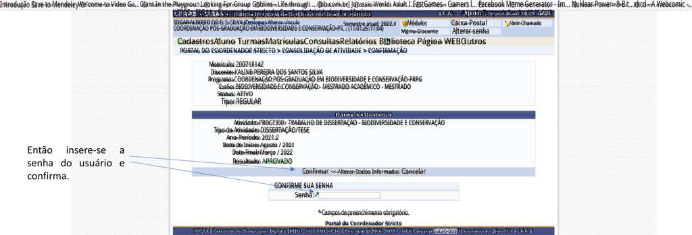

<!-- figure p10-fig1 | described_by: agy | ocr_overlap: 0.79 | needs_review: false -->
**1. Tipo de figura**
Captura de tela anotada (imagem instrucional de manual) de uma página web do sistema SIGAA da UFRPE (Portal do Coordenador Stricto — tela de confirmação de consolidação de atividade acadêmica), exibida em um navegador com a barra de favoritos visível no topo e acompanhada de um texto explicativo à esquerda com duas setas apontando para controles da interface. A imagem apresenta uma camada de texto em fonte preta (artefato de OCR/extração de PDF) sobreposta e ligeiramente deslocada sobre o texto original da captura de tela, causando duplicação visual na maior parte dos textos da interface.

**2. Todo o texto visível (verbatim)**

* **Anotação instrucional (à esquerda, fora da área da página):**
  * `Então insere-se a`
  * `senha do usuário e`
  * `confirma.`

* **Barra de favoritos do navegador (topo, da esquerda para a direita):**
  * `Introdução`
  * `Save to Mendeley`
  * `Welcome to Video Ga...`
  * `Giant In the Playgroun...` (na camada sobreposta: `Giant In the Playgroun.`)
  * `Looking For Group`
  * `Goblins - Life through ...`
  * `[bb.com.br]`
  * `Jurassic World: Adult I...`
  * `FastGames - Gamers l...`
  * `Facebook`
  * `Meme Generator - Im...`
  * `Nuklear Power » 8-Bit ...` (na camada sobreposta: `Nuklear Power»8-Bit...`)
  * `xkcd - A Webcomic - ...`

* **Cabeçalho principal do sistema (faixa superior azul-escura):**
  * À esquerda: `UFRPE - SIGAA - Sistema Integrado de Gestão de Atividades Acadêmicas`
  * À direita: `A+` `A-` `|` `Ajuda` `Tempo de Sessão: 00:25` `SAIR`

* **Subcabeçalho de identificação do usuário e atalhos (faixa azul-clara):**
  * Esquerda, linha 1: `EDGAR ALBERTO DO E. S. SILVA (Deslogar) Alterar vínculo`
  * Esquerda, linha 2: `COORDENAÇÃO PÓS-GRADUAÇÃO EM BIODIVERSIDADE E CONSERVAÇÃO-PR... (11.01.29.17.04)`
  * Centro: `Semestre atual: 2022.1`
  * Direita, linha 1: `Módulos` | `Caixa Postal` | `Abrir Chamado`
  * Direita, linha 2: `Menu Docente` | `Alterar senha`

* **Barra de menu principal (faixa horizontal bege-clara, da esquerda para a direita):**
  * `Cadastros`
  * `Aluno`
  * `Turmas`
  * `Matrículas`
  * `Consultas`
  * `Relatórios`
  * `Biblioteca`
  * `Página WEB`
  * `Outros`

* **Trilha de navegação (breadcrumb):**
  * `PORTAL DO COORDENADOR STRICTO > CONSOLIDAÇÃO DE ATIVIDADE > CONFIRMAÇÃO`

* **Primeiro quadro — Dados do discente (pares rótulo: valor):**
  * `Matrícula: 200718142`
  * `Discente: KALINE PEREIRA DOS SANTOS SILVA`
  * `Programa: COORDENAÇÃO PÓS-GRADUAÇÃO EM BIODIVERSIDADE E CONSERVAÇÃO-PRPG`
  * `Curso: BIODIVERSIDADE E CONSERVAÇÃO - MESTRADO ACADÊMICO - MESTRADO` (na camada sobreposta: `CurSo: BIODIVERSIDADE E CONSERVAÇÃO - MESTRADO ACADÊMICO - MESTRADO`)
  * `Status: ATIVO`
  * `Tipo: REGULAR`

* **Segundo quadro — Dados do registro:**
  * Título da faixa superior: `DADOS DO REGISTRO`
  * `Atividade: PBDC7300 - TRABALHO DE DISSERTAÇÃO - BIODIVERSIDADE E CONSERVAÇÃO`
  * `Tipo da Atividade: DISSERTAÇÃO/TESE`
  * `Ano-Período: 2021.2`
  * `Data de Início: Agosto / 2021`
  * `Data Final: Março / 2022`
  * `Resultado: APROVADO`
  * Botões na barra inferior (da esquerda para a direita): `Confirmar` | `<< Alterar Dados Informados` | `Cancelar`

* **Terceiro quadro — Confirmação de senha:**
  * Título da faixa superior: `CONFIRME SUA SENHA`
  * Rótulo do campo: `Senha: *` (seguido de caixa de entrada vazia)

* **Legenda e link abaixo dos quadros:**
  * `* Campos de preenchimento obrigatório.`
  * `Portal do Coordenador Stricto`

* **Rodapé do sistema (faixa inferior azul-escura):**
  * `SIGAA | Secretaria de Tecnologias Digitais (STD) - (81) 3320-6046 | Copyright © 2006-2022 - UFRN - preproducao-bos01.preproducao-jboss01 - v4.6.8-1` (no texto original branco sob a camada preta, há um pequeno destaque retangular branco na região de `ducao-bos`).

**3. Estrutura**

* **Disposição geral:** A imagem divide-se horizontalmente em uma margem branca à esquerda contendo a anotação textual e, à direita dela (ocupando a maior parte da figura), a captura da tela do navegador. A área do navegador tem no topo a barra de favoritos em linha única com pequenos ícones antes de cada item e, abaixo dela, o conteúdo centralizado do SIGAA em uma coluna de fundo branco ladeada por faixas verticais com padrão quadriculado cinza-claro.
* **Hierarquia vertical dentro da página SIGAA:**
  1. **Cabeçalho principal** (barra horizontal com identificação da instituição/sistema à esquerda e controles de tamanho de fonte, ajuda, temporizador e saída à direita).
  2. **Painel de usuário e atalhos** dividido em três colunas: dados do usuário e unidade à esquerda (2 linhas), semestre atual no centro, e uma grade 2×3 de botões com ícones à direita (3 botões na linha superior: `Módulos`, `Caixa Postal`, `Abrir Chamado`; 2 botões na linha inferior: `Menu Docente`, `Alterar senha`, com o terceiro espaço vazio).
  3. **Barra de menu** horizontal com 9 itens acompanhados de pequenos ícones.
  4. **Trilha de navegação** em uma linha.
  5. **Quadro 1 (dados do discente):** caixa retangular com borda cinza-clara contendo 6 linhas dispostas em formato de duas colunas (rótulos alinhados à direita na primeira coluna; valores alinhados à esquerda na segunda coluna).
  6. **Quadro 2 (`DADOS DO REGISTRO`):** caixa retangular com barra de título no topo, corpo com 6 linhas no mesmo formato rótulo/valor em duas colunas e uma barra inferior contendo 3 botões centralizados lado a lado (`Confirmar`, `<< Alterar Dados Informados`, `Cancelar`).
  7. **Quadro 3 (`CONFIRME SUA SENHA`):** caixa retangular menor e centralizada, com barra de título superior e corpo contendo o rótulo `Senha: *` ao lado de um campo retangular de texto em branco.
  8. **Rodapé de conteúdo:** nota de obrigatoriedade centralizada, seguida abaixo pelo link `Portal do Coordenador Stricto`.
  9. **Barra de rodapé do sistema:** faixa horizontal de ponta a ponta da página centralizada.
* **Setas e conexões:** Duas setas retas finas partem do lado direito do bloco de texto explicativo (`Então insere-se a senha do usuário e confirma.`) na margem esquerda:
  * A **seta superior** parte da altura entre a 1ª e a 2ª linhas do texto e aponta quase horizontalmente (ligeiramente inclinada para baixo) até a borda esquerda do botão `Confirmar`, na barra inferior do quadro `DADOS DO REGISTRO`.
  * A **seta inferior** parte da altura da 2ª linha do texto e desce em diagonal até apontar diretamente para o campo `Senha: *` (na junção entre o rótulo/asterisco e o início da caixa de entrada de texto), dentro do quadro `CONFIRME SUA SENHA`.

**4. Todos os números e valores de dados**

* Tempo de sessão restante: `00:25`
* Código da unidade/programa no cabeçalho: `11.01.29.17.04`
* Semestre atual: `2022.1`
* Matrícula do discente: `200718142`
* Código da atividade: `PBDC7300`
* Ano-Período da atividade: `2021.2`
* Data de Início: `Agosto / 2021`
* Data Final: `Março / 2022`
* Telefone no rodapé: `(81) 3320-6046`
* Intervalo de copyright: `2006-2022`
* Identificadores de servidor no rodapé: `preproducao-bos01.preproducao-jboss01` (`01` em ambos)
* Versão do sistema no rodapé: `v4.6.8-1`
* Número presente em título de favorito na barra do navegador: `8` (em `8-Bit`)

**5. Cores com significado**

* **Verde** na palavra `APROVADO` (no texto original da interface sob o OCR, no campo `Resultado:`): indica status positivo/aprovação na atividade acadêmica.
* **Azul** nos ícones de asterisco/estrela junto a `Senha:` e à legenda `Campos de preenchimento obrigatório.`: sinaliza campo de preenchimento obrigatório.
* **Azul** nas duas setas instrucionais: destaca visualmente a correspondência entre a explicação lateral e os dois elementos de ação na tela (campo de senha e botão `Confirmar`).
* **Azul-escuro com friso laranja/dourado** no cabeçalho e no rodapé, e **azul-escuro** no título `DADOS DO REGISTRO` contra **azul-claro** nas barras de botões/subtítulos: hierarquizam estruturalmente a página, separando identificação do sistema, seções de dados e barras de ação.

~~~text ocr
Introdução the-Playgroun Adult 1. FastGames-: Facebook - lm... Webcomic -..
6224 Caixa-Postal
CadastrosAluno Página WEBQutres
RORTAL DO STRICTO > CONSOLIDAÇÃO DE ATIVIDADE > CONFIRMAÇÃO
DOS SANTOS
EM BIODIVERSIDADE E CONSERVAÇÃO-PRPG
MESTRADO ACADÊMICO - MESTRADO
ATIVO
DIS
TRABALHO DE DISSERTAÇÃO - BIODIVERSIDADE E CONSERVAÇÃO
ii
. Daim / 2021
Então insere-se a / 2622
senha do usuario e Resultado: ARROVADO
confirma. Confirmar informados (Cancelar
ME SUA SENHA
Senha:*
~~~

<!-- Start of picture text -->
Introdução Save to Mendeley Welcome to Video Ga...Giant In the Playgroun...Looking For Group Goblins - Life through ... [bb.com.br] Jurassic World: Adult I... FastGames - Gamers l... Facebook Meme Generator - Im... Nuklear Power» 8-Bit...xkcd - A Webcomic -.. UFRPE - SIGAA - Sistema Integrado de Gestão de Atividades Acadêmicas A+A- Ajuda?Tempo de Sessão: 00:25 SAIR EDGAR ALBERTO DO E. S. SILVA (Deslogar) Alterar vínculo Semestre atual: 2022.1 Módulos Caixa Postal Abrir Chamado COORDENAÇÃO PÓS-GRADUAÇÃO EM BIODIVERSIDADE E CONSERVAÇÃO-PR... (11.01.29.17.04) Menu Docente Alterar senha CadastrosAluno TurmasMatrículasConsultasRelatórios Biblioteca Página WEBOutros PORTAL DO COORDENADOR STRICTO > CONSOLIDAÇÃO DE ATIVIDADE > CONFIRMAÇÃO Matrícula: 200718142 Discente: KALINE PEREIRA DOS SANTOS SILVA Programa: COORDENAÇÃO PÓS-GRADUAÇÃO EM BIODIVERSIDADE E CONSERVAÇÃO-PRPG CurSo: BIODIVERSIDADE E CONSERVAÇÃO - MESTRADO ACADÊMICO - MESTRADO Status: ATIVO Tipo: REGULAR DADOS DO REGISTRO Atividade: PBDC7300 - TRABALHO DE DISSERTAÇÃO - BIODIVERSIDADE E CONSERVAÇÃO Tipo da Atividade: DISSERTAÇÃO/TESE Ano-Período: 2021.2 Data de Início: Agosto / 2021 Então  insere-se  a  Data Final: Março / 2022 senha do usuário e  Resultado: APROVADO Confirmar << Alterar Dados Informados Cancelar confirma. CONFIRME SUA SENHA Senha: * * Campos de preenchimento obrigatório. Portal do Coordenador Stricto SIGAA | Secretaria de Tecnologias Digitais (STD) - (81) 3320-6046 | Copyright © 2006-2022 - UFRN - preproducao-bos01.preproducao-jboss01 - v4.6.8-1 <!-- End of picture text -->

》 

7 

INTL 17/05/2022POR 10:41 星2 

29C Chuva fraca 

Digite aqui para pesquisar 

<!-- page 11 -->

> 凸 × 

> SIGAA - Sistema Integrado de GX + 

###### ← C https://preproducao.sigs.ufrpe.br/sigaa/stricto/coordenacao.jsf 

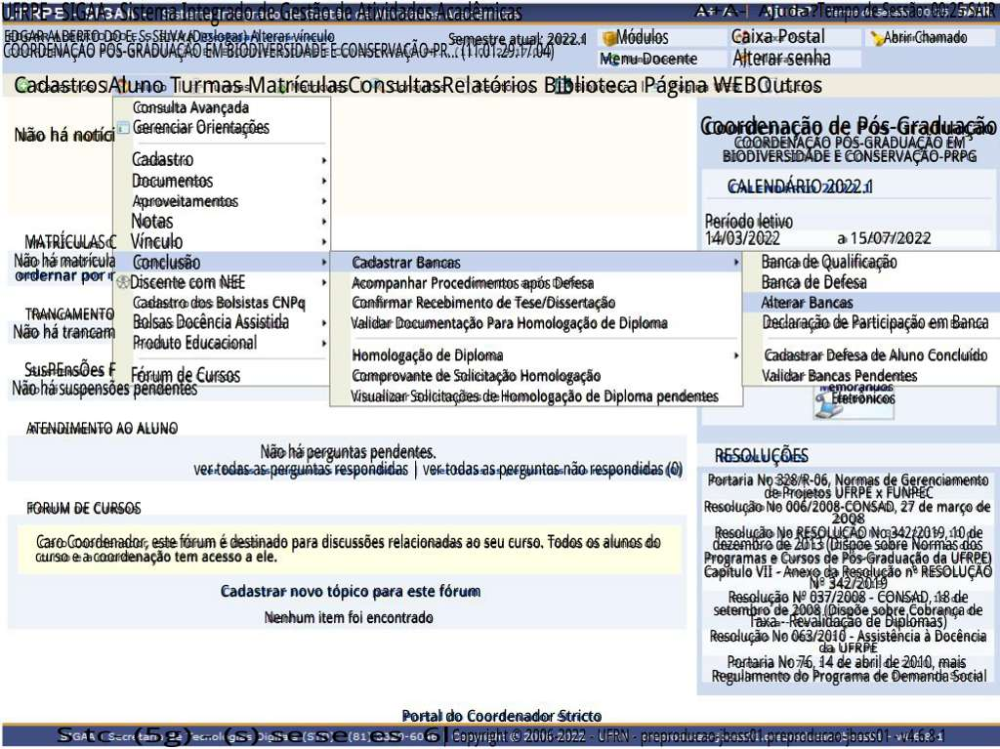

<!-- figure p11-fig2 | described_by: agy | ocr_overlap: 0.91 | needs_review: false -->
### (1) Tipo de figura

Captura de tela de uma interface web do sistema acadêmico **SIGAA** (Sistema Integrado de Gestão de Atividades Acadêmicas) da **UFRPE**, exibindo a página inicial do **Portal do Coordenador Stricto** com um menu suspenso em cascata de três níveis aberto para ilustrar o caminho de navegação até a opção **Alterar Bancas**. Toda a imagem apresenta uma camada de texto preto sobreposta (artefato de OCR do PDF) ligeiramente desalinhada sobre o texto original da captura de tela, gerando aspecto de texto duplicado em vários trechos.

---

### (2) Todo o texto visível (literal)

**Barra superior (cabeçalho institucional):**
- À esquerda: `UFRPE - SIGAA - Sistema Integrado de Gestão de Atividades Acadêmicas`
- À direita: `A+` `A-` `|` `Ajuda?` `Tempo de Sessão: 00:25` `SAIR`

**Faixa de identificação do usuário e atalhos:**
- À esquerda (linha 1): `EDGAR ALBERTO DO E. S. SILVA (Deslogar) Alterar vínculo`
- À esquerda (linha 2): `COORDENAÇÃO PÓS-GRADUAÇÃO EM BIODIVERSIDADE E CONSERVAÇÃO-PR... (11.01.29.17.04)`
- Ao centro: `Semestre atual: 2022.1`
- À direita (botões em duas linhas):
  - Linha 1: `Módulos` | `Caixa Postal` | `Abrir Chamado`
  - Linha 2: `Menu Docente` | `Alterar senha`

**Barra de menu principal (da esquerda para a direita):**
- `Cadastros`
- `Aluno`
- `Turmas`
- `Matrículas`
- `Consultas`
- `Relatórios`
- `Biblioteca`
- `Página WEB`
- `Outros`

**Menu suspenso – Nível 1 (aberto abaixo de `Aluno`):**
- `Consulta Avançada`
- `Gerenciar Orientações`
- `Cadastro`
- `Documentos`
- `Aproveitamentos`
- `Notas`
- `Vínculo`
- `Conclusão`
- `Discente com NEE`
- `Cadastro dos Bolsistas CNPq`
- `Bolsas Docência Assistida`
- `Produto Educacional`
- `Fórum de Cursos`

**Submenu suspenso – Nível 2 (aberto à direita de `Conclusão`):**
- `Cadastrar Bancas`
- `Acompanhar Procedimentos após Defesa`
- `Confirmar Recebimento de Tese/Dissertação`
- `Validar Documentação Para Homologação de Diploma`
- `Homologação de Diploma`
- `Comprovante de Solicitação Homologação`
- `Visualizar Solicitações de Homologação de Diploma pendentes`

**Submenu suspenso – Nível 3 (aberto à direita de `Cadastrar Bancas`):**
- `Banca de Qualificação`
- `Banca de Defesa`
- `Alterar Bancas`
- `Declaração de Participação em Banca`
- `Cadastrar Defesa de Aluno Concluído`
- `Validar Bancas Pendentes`

**Área principal (coluna esquerda, parcialmente encoberta pelos menus suspensos na parte superior):**
- Caixa superior de notícias (cortada à direita pelo menu): `Não há notíci[illegible]`
- Seção de matrículas (cortada à direita pelo menu):
  - Título: `MATRÍCULAS C[illegible]`
  - Texto: `Não há matrícula[illegible]`
  - Link: `ordernar por [illegible]`
- Seção de trancamentos (cortada à direita pelo menu):
  - Título: `TRANCAMENTO[illegible]`
  - Texto: `Não há trancam[illegible]`
- Seção de suspensões (título parcialmente cortado à direita pelo menu):
  - Título: `SUSPENSÕES P[illegible]` (na camada de texto sobreposta aparece como `SusPEnsÕes F`)
  - Texto: `Não há suspensões pendentes`
- Seção de atendimento:
  - Título: `ATENDIMENTO AO ALUNO`
  - Texto: `Não há perguntas pendentes.`
  - Links: `ver todas as perguntas respondidas | ver todas as perguntas não respondidas (0)`
- Seção do fórum:
  - Título: `FORUM DE CURSOS`
  - Aviso: `Caro Coordenador, este fórum é destinado para discussões relacionadas ao seu curso. Todos os alunos do curso e a coordenação tem acesso a ele.`
  - Link: `Cadastrar novo tópico para este fórum`
  - Texto: `Nenhum item foi encontrado`

**Painel lateral direito:**
- Título superior: `Coordenação de Pós-Graduação`
- Subtítulo: `COORDENAÇÃO PÓS-GRADUAÇÃO EM BIODIVERSIDADE E CONSERVAÇÃO-PRPG`
- Bloco de calendário:
  - Título: `CALENDÁRIO 2022.1`
  - Rótulo: `Período letivo`
  - Intervalo: `14/03/2022` `a 15/07/2022`
- Botão central (parcialmente coberto na parte superior pelo menu de nível 3):
  - Texto original parcialmente oculto: `[illegible]emorandos Eletrônicos` (na camada sobreposta lê-se `emoranuos` / `Eletrônicos`)
- Bloco de resoluções:
  - Título: `RESOLUÇÕES`
  - Itens listados (de cima para baixo):
    1. `Portaria No 328/R-06, Normas de Gerenciamento de Projetos UFRPE x FUNPEC`
    2. `Resolução No 006/2008-CONSAD, 27 de março de 2008`
    3. `Resolução No RESOLUÇÃO No 342/2019, 10 de dezembro de 2013 (Dispõe sobre Normas dos Programas e Cursos de Pós-Graduação da UFRPE)`
    4. `Capítulo VII - Anexo da Resolução nº RESOLUÇÃO Nº 342/2019`
    5. `Resolução Nº 037/2008 - CONSAD, 18 de setembro de 2008 (Dispõe sobre Cobrança de Taxa --Revalidação de Diplomas)`
    6. `Resolução No 063/2010 - Assistência à Docência da UFRPE`
    7. `Portaria No 76, 14 de abril de 2010, mais Regulamento do Programa de Demanda Social`

**Rodapé:**
- Rótulo centralizado acima da faixa inferior: `Portal do Coordenador Stricto`
- Faixa inferior (texto branco original da captura): `SIGAA | Secretaria de Tecnologias Digitais (STD) - (81) 3320-6046 | Copyright © 2006-2022 - UFRN - preproducao-jboss01.preproducao-jboss01 - v4.6.8-1`
- Camada de texto preto sobreposta com distorção sobre a metade esquerda do rodapé: `S tc- (5g) - (s) se se es 6| Copyright © 2006-2022 - UFRN - preproducao-jboss01.preproducao-jboss01 - v4.6.8-1`

---

### (3) Estrutura

A tela está organizada em quatro grandes regiões verticais:

1. **Cabeçalho (topo, largura total):**
   - Uma barra estreita superior com o nome do sistema à esquerda e controles de acessibilidade/sessão à direita.
   - Uma faixa intermediária com os dados do usuário e da coordenação à esquerda, o semestre atual ao centro e uma grade de 5 botões com ícones à direita (3 na linha superior e 2 na linha inferior).
   - Uma barra horizontal de navegação com 9 abas/menus com pequenos ícones à esquerda de cada rótulo.

2. **Corpo principal em duas colunas:**
   - **Coluna esquerda (~70% da largura):** seis painéis empilhados verticalmente — avisos/notícias no topo, seguidos pelas seções `MATRÍCULAS C[illegible]`, `TRANCAMENTO[illegible]`, `SUSPENSÕES P[illegible]`, `ATENDIMENTO AO ALUNO` e `FORUM DE CURSOS` (que contém uma caixa interna de texto informativo, um link centralizado e uma mensagem de lista vazia).
   - **Coluna direita (~30% da largura):** dois painéis empilhados:
     - Painel superior (`Coordenação de Pós-Graduação`), contendo o nome da coordenação, o bloco `CALENDÁRIO 2022.1` com o período letivo e, abaixo, um botão quadrado com ícone de documento/computador para memorandos eletrônicos.
     - Painel inferior (`RESOLUÇÕES`), exibindo uma lista vertical de 7 links centralizados em linhas alternadas.

3. **Menus suspensos em cascata (sobrepostos ao corpo principal):**
   - Três caixas retangulares com borda fina cinza e margem esquerda levemente sombreada (para ícones), conectadas em sequência da esquerda para a direita por setas triangulares pretas (`▶`) alinhadas à borda direita dos itens que possuem submenus:
     - A aba **`Aluno`** abre verticalmente o **Menu Nível 1** (13 itens, divididos por duas linhas horizontais separadoras: após `Gerenciar Orientações` e após `Produto Educacional`). Possuem seta `▶` os itens `Cadastro`, `Documentos`, `Aproveitamentos`, `Notas`, `Vínculo`, `Conclusão`, `Discente com NEE`, `Bolsas Docência Assistida` e `Produto Educacional`.
     - O item **`Conclusão`** (com seta `▶`) conecta-se à borda esquerda do **Menu Nível 2** (7 itens, com uma linha separadora horizontal após `Validar Documentação Para Homologação de Diploma`). Possuem seta `▶` os itens `Cadastrar Bancas` e `Homologação de Diploma`.
     - O item **`Cadastrar Bancas`** (com seta `▶`) conecta-se à borda esquerda do **Menu Nível 3** (6 itens, com uma linha separadora horizontal após `Declaração de Participação em Banca`), onde **`Alterar Bancas`** aparece destacado.

4. **Rodapé (base, largura total):**
   - Link `Portal do Coordenador Stricto` centralizado logo acima de uma faixa horizontal estreita de créditos, contato e versão do sistema.

---

### (4) Todos os números e valores de dados

- Tempo de sessão restante: `00:25`
- Semestre atual: `2022.1`
- Código institucional da coordenação: `11.01.29.17.04`
- Ano/semestre do calendário: `2022.1`
- Período letivo: `14/03/2022` a `15/07/2022`
- Perguntas não respondidas: `0`
- Identificadores e datas das normativas:
  - Portaria `328/R-06`
  - Resolução `006/2008-CONSAD`, data `27 de março de 2008`
  - Resolução `342/2019`, data `10 de dezembro de 2013`
  - Capítulo `VII`, Resolução `342/2019`
  - Resolução `037/2008 - CONSAD`, data `18 de setembro de 2008`
  - Resolução `063/2010`
  - Portaria `76`, data `14 de abril de 2010`
- Telefone no rodapé: `(81) 3320-6046`
- Período de direitos autorais: `2006-2022`
- Identificador de servidor/instância: `preproducao-jboss01.preproducao-jboss01`
- Versão do sistema: `v4.6.8-1`
- Caracteres numéricos do artefato de OCR no rodapé: `5g` e `6`

---

### (5) Cores com significado

- **Destaque de fundo azul-claro (lavanda):** marca exatamente a trilha de seleção ativa nos menus, indicando o caminho de navegação que a figura pretende ensinar: **`Aluno` → `Conclusão` → `Cadastrar Bancas` → `Alterar Bancas`**.
- **Fundo amarelo-claro:** destaca a caixa de aviso/orientação dentro da seção `FORUM DE CURSOS`.
- **Texto azul-escuro:** identifica elementos interativos/links (como `Alterar vínculo`, `ver todas as perguntas respondidas`, `ver todas as perguntas não respondidas (0)`, `Cadastrar novo tópico para este fórum`, `Portal do Coordenador Stricto` e os títulos clicáveis/seções).
- **Barras azul-escuro com filete dourado/ocre:** delimitam o cabeçalho institucional no topo e o rodapé do sistema na base.

~~~text ocr
ch
Página
Consulta Avançada
Não há Orientações de Pós-Graduação
E É CONSERVAÇÃO
Documentos CALENDÁRIO:2022
Aproveitamentos »
Notas , Período letivo
Vínculo , 14/03/2022 a 15/07/2022
» Cadastrar Bancas >» Bancade Qualificação
ordernar por com AHEE Procedimenttos após Defesa Banca de Defesa
ENT Gadastro des Bolsistas CNPq Confirmar Recebimento de Tese/Dissertação Alterar Bancas
Docência Assistida Documentação Para Homologação de Diploma Declaração de Participação em Banca
Produto Educacional Homologação de Diploma » Cadastrar Defesa de Aluno Concluído
Fórum de Curses Comprovante de Solicitação Homologação Validar Bancas Pendentes
Solicitações: de Homologação de Diploma pendentes |
ATENDIMENTO AO ALUNO
Não há perguntas pendentes. RESOLUÇÕES
respondidas | as perguntas:não respondidas (0) de
FORUM DE CURSOS Resolução No 2008 CONSAD, 27 de marco de
este fórum é destinado para discussões relacionadas ao seu curso. Todos os alunos do do
curso tem acesso a ele. Progr Cursos da
Cadastrar novo tópico para este fórum Nº CONSAD, 48
item foi encontrado e
Resolução N No - Assistência à Docência
Portaria 14 de abril de 2010, mais
do Programa de Demantia Social
> tam) te | =
~~~

<!-- Start of picture text -->
￥目 <!-- End of picture text -->

IntroduçãoSave to Mendeley Welcome to Video Ga...Giant In the Playgroun...Looking For Group Goblins - Life through... [bb.com.br] Jurassic World: Adult ... FastGames - Gamers l...FacebookMeme Generator - Im...Nuklear Power » 8-Bit ...xkcd - A Webcomic - .. 

<!-- Start of picture text -->
UFRPE - SIGAA - Sistema Integrado de Gestão de Atividades Acadêmicas A+A- Ajuda?Tempo de Sessão: 00:25 SAIR EDGAR ALBERTO DO E. S. SILVA (Deslogar) Alterar vínculo Semestre atual: 2022.1 Módulos Caixa Postal Abrir Chamado COORDENAÇÃO PÓS-GRADUAÇÃO EM BIODIVERSIDADE E CONSERVAÇÃO-PR... (11.01.29.17.04) Menu Docente Alterar senha CadastrosAluno Turmas MatrículasConsultasRelatórios Biblioteca Página WEBOutros Consulta Avançada Não há notíci Gerenciar Orientações Coordenação de Pós-GraduaçãoCOORDENAÇÃO PÓS-GRADUAÇÃO EM Cadastro BIODIVERSIDÃDE E CONSERVAÇÃO-PRPG Documentos CALENDÁRIO 2022.1 Aproveitamentos Notas Período letivo MATRÍCULAS C Vínculo 14/03/2022 a 15/07/2022 Não há matrícula Conclusão Cadastrar Bancas Banca de Qualificação ordernar por r Discente com NEE Acompanhar Procedimentos após Defesa Banca de Defesa Cadastro dos Bolsistas CNPq Confirmar Recebimento de Tese/Dissertação Alterar Bancas Não há trancamTRANCAMENTO Bolsas Docência Assistida Validar Documentação Para Homologação de Diploma Declaração de Participação em Banca Produto Educacional Homologação de Diploma Cadastrar Defesa de Aluno Concluído SusPEnsÕes F Fórum de Cursos Comprovante de Solicitação Homologação Validar Bancas Pendentes Não há suspensões pendentes Visualizar Solicitações de Homologação de Diploma pendentes emoranuosEletrônicos ATENDIMENTO AO ALUNO Não há perguntas pendentes. RESOLUÇÕES ver todas as perguntas respondidas | ver todas as perguntas não respondidas (0) Portaria No 328/R-06, Normas de Gerenciamento de Projetos UFRPE x FUNPEC FORUM DE CURSOS Resolução No 006/2008-CONSAD, 27 de março de 2008 Resolução No RESOLUÇÃO No 342/2019, 10 de Caro Coordenador, este fórum é destinado para discussões relacionadas ao seu curso. Todos os alunos do dezembro de 2013 (Dispõe sobre Normas dos curso e a coordenação tem acesso a ele. Programas e Cursos de Pós-Graduação da UFRPE) Capítulo VII - Anexo da Resolução nº RESOLUÇÃO N° 342/2019 Cadastrar novo tópico para este fórum Resolução Nº 037/2008 - CONSAD, 18 de Nenhum item foi encontrado setembro de 2008 (Dispõe sobre Cobrança deTaxa - Revalidação de Diplomas) Resolução No 063/2010 - Assistência à Docência da UFRPE Portaria No 76, 14 de abril de 2010, mais Regulamento do Programa de Demanda Social Portal do Coordenador Stricto S tc- (5g) - (s) se se  es  6l| Copyright © 2006-2022 - UFRN - preproducao-jboss01.preproducao-jboss01 - v4.6.8-1 <!-- End of picture text -->

Após a ata ser assinada, a mesma deve ser inserida no sistema através deste menu 

》 

8 

POR 10:37 INTL17/05/2022 星2 

29C Chuva fraca 

Q Digite aqui para pesquisar 

<!-- page 12 -->

> 凸 × 

> SIGAA - Sistema Integrado de GX + 

￥目 

###### https://preproducao.sigs.ufrpe.br/sigaa/graduacao/busca_discente.jsf 

← C 

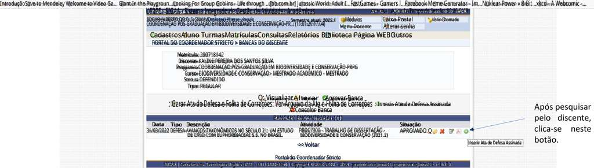

<!-- figure p12-fig1 | described_by: agy | ocr_overlap: 0.78 | needs_review: false -->
### 1. Tipo de figura
Captura de tela anotada de uma interface web — especificamente a tela **Bancas do Discente** do **Portal do Coordenador Stricto** no sistema acadêmico **SIGAA** da **UFRPE** (incluindo a barra de favoritos do navegador no topo) — com uma anotação instrucional e uma seta indicativa à direita. A imagem apresenta sobreposição de texto duplicado em preto (uma camada de texto/OCR visível renderizada ligeiramente deslocada sobre o texto original da captura de tela).

---

### 2. Todo o texto visível (verbatim)

**Barra de favoritos do navegador (topo, da esquerda para a direita):**
- `Introdução`
- `Save to Mendeley`
- `Welcome to Video Ga...`
- `Giant In the Playgroun...`
- `Looking For Group`
- `Goblins - Life through ...`
- `[bb.com.br]`
- `Jurassic World: Adult I...`
- `FastGames - Gamers l...`
- `Facebook`
- `Meme Generator - Im...`
- `Nuklear Power » 8-Bit ..` *(no texto original subjacente: `Nuklear Power » 8-Bit...`)*
- `xkcd - A Webcomic -...`

**Faixa superior do sistema (cabeçalho):**
- À esquerda: `UFRPE - SIGAA - Sistema Integrado de Gestão de Atividades Acadêmicas`
- À direita: `A+` `A-` `Ajuda?` `Tempo de Sessão: 00:25` `SAIR`

**Painel de identificação do usuário e atalhos:**
- À esquerda, linha 1: `EDGAR ALBERTO DO E. S. SILVA (Deslogar) Alterar vínculo`
- À esquerda, linha 2: `COORDENAÇÃO PÓS-GRADUAÇÃO EM BIODIVERSIDADE E CONSERVAÇÃO-PR... (11.01.29.17.04)`
- Ao centro-direita: `Semestre atual: 2022.1`
- Botões à direita, linha 1: `Módulos` | `Caixa Postal` | `Abrir Chamado`
- Botões à direita, linha 2: `Menu Docente` | `Alterar senha`

**Barra de menu principal (da esquerda para a direita):**
- `Cadastros` | `Aluno` | `Turmas` | `Matrículas` | `Consultas` | `Relatórios` | `Biblioteca` | `Página WEB` | `Outros`

**Trilha de navegação (breadcrumb):**
- `PORTAL DO COORDENADOR STRICTO > BANCAS DO DISCENTE`

**Quadro de dados do discente:**
- `Matrícula: 200718142`
- `Discente: KALINE PEREIRA DOS SANTOS SILVA`
- `Programa: COORDENAÇÃO PÓS-GRADUAÇÃO EM BIODIVERSIDADE E CONSERVAÇÃO-PRPG`
- `Curso: BIODIVERSIDADE E CONSERVAÇÃO - MESTRADO ACADÊMICO - MESTRADO`
- `Status: DEFENDIDO`
- `Tipo: REGULAR`

**Quadro de legenda dos ícones de ação:**
*(Na camada de texto sobreposta, o ícone de lupa foi transcrito como `Q` e o ícone de X como `X`; na captura original, cada rótulo é precedido por seu ícone e dois-pontos.)*
- Linha 1: `Q: Visualizar` `Alterar` `Aprovar Banca` *(captura original: `: Visualizar`, `: Alterar`, `: Aprovar Banca`)*
- Linha 2: `: Gerar Ata de Defesa e Folha de Correções` `: Ver Arquivo da Ata e Folha de Correções` `: Inserir Ata de Defesa Assinada`
- Linha 3: `X Cancelar Banca` *(captura original: `: Cancelar Banca`)*

**Tabela de resultados:**
- Faixa de título: `BANCA(s) ENCONTRADA(s) (1)`
- Cabeçalhos das colunas: `Data` | `Tipo` | `Descrição` | `Atividade` | `Situação`
- Valores da única linha de dados:
  - `Data`: `31/03/2022`
  - `Tipo`: `DEFESA`
  - `Descrição`: `AVANÇOS TAXONÔMICOS NO SÉCULO 21: UM ESTUDO DE CASO COM EUPHORBIACEAE S.S. NO BRASIL.`
  - `Atividade`: `PBDC7300 - TRABALHO DE DISSERTAÇÃO - BIODIVERSIDADE E CONSERVAÇÃO (2021.2)`
  - `Situação`: `APROVADO` *(seguido, na coluna de ações, pela letra `Q` sobreposta ao ícone de lupa)*

**Caixa de dica flutuante (tooltip) abaixo do último ícone da tabela:**
- `Inserir Ata de Defesa Assinada`

**Links inferiores centralizados:**
- `<< Voltar`
- `Portal do Coordenador Stricto`

**Rodapé:**
- `SIGAA | Secretaria de Tecnologias Digitais (STD) - (81) 3320-6046 | Copyright © 2006-2022 - UFRN - preproducao-jboss01.preproducao-jboss01 - v4.6.8-1`

**Anotação textual à direita da captura de tela:**
- `Após pesquisar pelo discente, clica-se neste botão.`

---

### 3. Estrutura
- **Enquadramento geral:** A página web do SIGAA ocupa uma coluna centralizada com margens laterais claras (com leve textura quadriculada). Acima dela, estendendo-se por toda a largura da imagem, está a barra de favoritos do navegador. Na margem direita, fora do contêiner da página, encontra-se a anotação instrucional.
- **Cabeçalho e navegação (de cima para baixo dentro da página):**
  1. Faixa horizontal superior do sistema com título à esquerda e controles de acessibilidade/ajuda/sessão/saída à direita.
  2. Painel horizontal de usuário: à esquerda, nome do usuário, links de conta e unidade acadêmica em duas linhas; ao centro-direita, semestre atual; à direita, grade de botões com ícones distribuídos em 2 linhas (3 botões na primeira linha e 2 na segunda).
  3. Barra horizontal de menu com 9 itens acompanhados de pequenos ícones.
  4. Faixa estreita de trilha de navegação (`PORTAL DO COORDENADOR STRICTO > BANCAS DO DISCENTE`).
- **Quadro de dados do discente:** Caixa retangular centralizada, de borda fina, estruturada em 6 linhas de pares rótulo–valor (`Matrícula`, `Discente`, `Programa`, `Curso`, `Status`, `Tipo`).
- **Quadro de legenda:** Caixa retangular de largura total do conteúdo, organizada em 3 linhas centralizadas que associam 7 ícones às respectivas ações:
  - Linha 1: lupa (`Visualizar`), folha com lápis (`Alterar`), círculo verde com sinal de visto (`Aprovar Banca`).
  - Linha 2: documento com lápis/edição (`Gerar Ata de Defesa e Folha de Correções`), ícone de arquivo PDF (`Ver Arquivo da Ata e Folha de Correções`), círculo verde com sinal `+` (`Inserir Ata de Defesa Assinada`).
  - Linha 3: ícone `X` (`Cancelar Banca`).
- **Tabela `BANCA(s) ENCONTRADA(s) (1)`:**
  - Composta por uma barra de título, uma linha de cabeçalho e uma única linha de dados.
  - Possui **5 colunas nomeadas** (`Data`, `Tipo`, `Descrição`, `Atividade`, `Situação`) mais uma **6ª coluna sem cabeçalho** à direita contendo **6 botões de ícone** lado a lado, na seguinte ordem da esquerda para a direita: (1) lupa, (2) folha amarela com lápis, (3) `X` vermelho, (4) documento com ícone de edição, (5) ícone de PDF e (6) círculo verde com `+`.
  - Logo abaixo do 6º botão (círculo verde com `+`), exibe-se uma caixa retangular flutuante (tooltip) com o texto `Inserir Ata de Defesa Assinada`.
- **Área inferior:** Dois links centralizados empilhados verticalmente (`<< Voltar` e `Portal do Coordenador Stricto`), seguidos pela faixa horizontal de rodapé na base da imagem.
- **Anotação e seta:** À direita da área da tabela há um bloco de texto de 4 linhas (`Após pesquisar pelo discente, clica-se neste botão.`). Uma **seta reta** parte da lateral esquerda desse bloco de texto e aponta diagonalmente para baixo e para a esquerda, conectando diretamente a instrução ao **6º botão da coluna de ações da tabela** (o círculo verde com `+`, correspondente a `Inserir Ata de Defesa Assinada`).

---

### 4. Todos os números e valores de dados
- Tempo restante de sessão: `00:25`
- Código da unidade/coordenação: `11.01.29.17.04`
- Semestre atual: `2022.1`
- Número de matrícula do discente: `200718142`
- Quantidade de bancas encontradas: `1` (em `(1)`)
- Data da defesa: `31/03/2022`
- Número presente na descrição da dissertação: `21` (em `SÉCULO 21`)
- Código da atividade: `PBDC7300`
- Período letivo da atividade: `2021.2`
- Telefone da STD no rodapé: `(81) 3320-6046`
- Período de direitos autorais no rodapé: `2006-2022`
- Identificador do servidor no rodapé: `preproducao-jboss01.preproducao-jboss01` (`01`)
- Versão do sistema no rodapé: `v4.6.8-1`
- Número na barra de favoritos: `8` (em `8-Bit`)

---

### 5. Cores com significado
- **Verde** nos ícones circulares com `+` branco (`Inserir Ata de Defesa Assinada`) e com sinal de visto branco (`Aprovar Banca`): sinaliza ações afirmativas de adição/inserção e aprovação; o ícone circular verde com `+` na tabela é o botão-alvo indicado pela anotação.
- **Vermelho** no ícone `X` (`Cancelar Banca`) e no símbolo do ícone de arquivo PDF (`Ver Arquivo da Ata e Folha de Correções`): indica ação de cancelamento no caso do `X` e identifica visualmente o formato de documento PDF.
- **Azul** na seta anotativa: destaca o direcionamento visual que liga a instrução textual à direita ao botão verde com `+` na linha da tabela.
- **Azul** nos links originais da interface (`(Deslogar)`, `Alterar vínculo`, trilha de navegação, `<< Voltar`, `Portal do Coordenador Stricto`) e **azul-escuro** nas faixas de cabeçalho, título da tabela e rodapé: distingue elementos clicáveis e delimita a hierarquia estrutural das seções da página.

~~~text ocr
Welcometo:Video Ga... Group Goblins=-Life . -FastGames- Gamers. Naklear-Rower:
0224
TurmasMatriculasConsultasRelatérios Página
DI COORDENADOR STRICTO > BANCAS DO DISCENTE
200718442
DOS SANTOS
GRADUAÇÃO EM BIODIVERSIDADE E CONSERVAÇÃO-PRPG
MESTRADO AGADEMICO - MEST
DEFENDIDO
Tipo: REGULAR
de de Defesa Assinada
+»
Após pesquisar
pelo discente
NO SECULO 21: UM ESTUDO TRABALHO clica-se neste
U -
COM 5.5, NO BRASIL. 21,2) PLO
de Defesa Assinada] DOtÃO.
~~~

<!-- Start of picture text -->
IntroduçãoSave to Mendeley Welcome to Video Ga... Giant In the Playgroun...Looking For Group Goblins - Life through ...[bb.com.br] Jurassic World: Adult I...FastGames - Gamers l...Facebook Meme Generator - Im...Nuklear Power » 8-Bit ..xkcd - A Webcomic -... UFRPE - SIGAA - Sistema Integrado de Gestão de Atividades Acadêmicas A+A- Ajuda?Tempo de Sessão: 00:25 SAIR EDGAR ALBERTO DO E. S. SILVA (Deslogar) Alterar vínculo Semestre atual: 2022.1 Módulos Caixa Postal Abrir Chamado COORDENAÇÃO PÓS-GRADUAÇÃO EM BIODIVERSIDADE E CONSERVAÇÃO-PR... (11.01.29.17.04) Menu Docente Alterar senha CadastrosAluno TurmasMatrículasConsultasRelatórios Biblioteca Página WEBOutros PORTAL DO COORDENADOR STRICTO > BANCAS DO DISCENTE Matrícula: 200718142 Discente: KALINE PEREIRA DOS SANTOS SILVA Programa: COORDENAÇÃO PÓS-GRADUAÇÃO EM BIODIVERSIDADE E CONSERVAÇÃO-PRPG Curso: BIODIVERSIDADE E CONSERVAÇÃO - MESTRADO ACADÊMICO - MESTRADO Status: DEFENDIDO Tipo: REGULAR Q: Visualizar:Alterar : Aprovar Banca : Gerar Ata de Defesa e Folha de Correções: Ver Arquivo da Ata e Folha de Correções : Inserir Ata de Defesa Assinada X: Cancelar Banca Após pesquisar BANCA(s) ENCONTRADA(s) (1) pelo discente, Data Tipo Descrição Atividade Situação 31/03/2022 DEFESA AVANÇOS TAXONÔMICOS NO SÉCULO 21: UM ESTUDO PBDC7300 - TRABALHO DE DISSERTAÇÃO - APROVADO Q 4 clica-se neste DE CASO COM EUPHORBIACEAE S.S. NO BRASIL. BIODIVERSIDADE E CONSERVAÇÃO (2021.2) << Voltar Inserir Ata de Defesa Assinada botão. Portal do Coordenador Stricto SIGAA | Secretaria de Tecnologias Digitais (STD) - (81) 3320-6046 | Copyright © 2006-2022 - UFRN - preproducao-jboss01.preproducao-jboss01 - v4.6.8-1 <!-- End of picture text -->

》 

https://preproducao.sigs.ufrpe.br/sigaa/graduacao/busca_discente.jsf# 

9 

10:43 

POR 10:43 INTL17/05/2022 星2 

出 

QDigite aquí para pesquisar 

29C Chuva fraca 

<!-- page 13 -->

> SIGAA - Sistema Integrado de GX + 

> 凸 × 

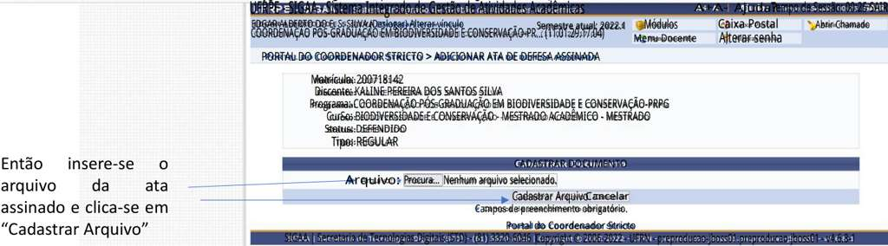

<!-- figure p13-fig2 | described_by: agy | ocr_overlap: 0.89 | needs_review: false -->
### 1. Tipo de figura
Captura de tela anotada de uma página web do sistema acadêmico SIGAA (Sistema Integrado de Gestão de Atividades Acadêmicas) da UFRPE, acompanhada de uma legenda instrucional à esquerda e duas setas indicativas apontando para campos e botões do formulário. Toda a captura de tela apresenta uma camada de texto preto sobreposta e ligeiramente deslocada sobre o texto original da interface (artefato de OCR/extração de PDF), causando efeito visual de texto duplicado.

---

### 2. Todo o texto visível (literal)

**Texto anotado à esquerda (fora da janela do sistema):**
> Então insere-se o arquivo da ata assinado e clica-se em “Cadastrar Arquivo”

**Barra superior do cabeçalho:**
- À esquerda: `UFRPE - SIGAA - Sistema Integrado de Gestão de Atividades Acadêmicas`
- À direita: `A+` `A-` `|` `Ajuda` `|` `Tempo de Sessão: 00:25` `SAIR`

**Faixa de informações do usuário e menu de atalhos:**
- À esquerda (linha 1): `EDGAR ALBERTO DO E. S. SILVA (Deslogar) Alterar vínculo`
- À esquerda (linha 2): `COORDENAÇÃO PÓS-GRADUAÇÃO EM BIODIVERSIDADE E CONSERVAÇÃO-PR... (11.01.29.17.04)`
- Ao centro-direita: `Semestre atual: 2022.1`
- Botões de atalho à direita (linha superior): `Módulos` | `Caixa Postal` | `Abrir Chamado`
- Botões de atalho à direita (linha inferior): `Menu Docente` | `Alterar senha`

**Trilha de navegação (breadcrumb):**
- `PORTAL DO COORDENADOR STRICTO > ADICIONAR ATA DE DEFESA ASSINADA`

**Quadro de dados do discente:**
- `Matrícula: 200718142`
- `Discente: KALINE PEREIRA DOS SANTOS SILVA`
- `Programa: COORDENAÇÃO PÓS-GRADUAÇÃO EM BIODIVERSIDADE E CONSERVAÇÃO-PRPG`
- `Curso: BIODIVERSIDADE E CONSERVAÇÃO - MESTRADO ACADÊMICO - MESTRADO` *(na camada de texto sobreposta aparece grafado `CurSo:`)*
- `Status: DEFENDIDO`
- `Tipo: REGULAR`

**Formulário de envio de documento:**
- Título da caixa: `CADASTRAR DOCUMENTO`
- Rótulo do campo: `Arquivo:` *(seguido de ícone de estrela indicando obrigatoriedade)*
- Botão de seleção de arquivo: `Procurar...` *(na camada de texto sobreposta aparece `Procura...`)*
- Texto ao lado do botão de seleção: `Nenhum arquivo selecionado.`
- Botões de ação na base do formulário: `Cadastrar Arquivo` e `Cancelar`
- Legenda abaixo do formulário: `Campos de preenchimento obrigatório.` *(precedida de ícone de estrela)*

**Link abaixo do formulário:**
- `Portal do Coordenador Stricto`

**Barra de rodapé:**
- `SIGAA | Secretaria de Tecnologias Digitais (STD) - (81) 3320-6046 | Copyright © 2006-2022 - UFRN - preproducao-jboss01.preproducao-jboss01 - v4.6.8-1`

---

### 3. Estrutura da figura

A imagem divide-se horizontalmente em duas áreas principais:

- **Margem esquerda (aproximadamente 28% da largura):** fundo branco à extrema esquerda e fundo quadriculado suave logo ao lado, contendo, na metade inferior, o bloco de texto instrucional em quatro linhas (`Então insere-se o / arquivo da ata / assinado e clica-se em / “Cadastrar Arquivo”`).
- **Área principal à direita (aproximadamente 72% da largura):** interface da página web do SIGAA, organizada verticalmente de cima para baixo nos seguintes blocos:
  1. **Cabeçalho principal:** barra horizontal estreita com o nome do sistema à esquerda e controles de fonte (`A+`, `A-`), ajuda (`Ajuda`), contador de sessão (`Tempo de Sessão: 00:25`) e saída (`SAIR`) à direita.
  2. **Painel de sessão e atalhos:** faixa dividida em uma área textual à esquerda (usuário, vínculo, coordenação e semestre atual) e uma grade de 2 linhas por 3 colunas à direita com cinco botões com ícones (`Módulos`, `Caixa Postal`, `Abrir Chamado` na primeira linha; `Menu Docente`, `Alterar senha` na segunda linha; terceira célula da segunda linha vazia).
  3. **Trilha de navegação:** linha horizontal única com o caminho hierárquico da página, separada do conteúdo por uma linha fina.
  4. **Caixa de resumo do discente:** retângulo com borda cinza-clara e fundo branco contendo uma lista vertical de seis linhas no formato `Rótulo: Valor` (`Matrícula`, `Discente`, `Programa`, `Curso`, `Status`, `Tipo`), com os rótulos alinhados à direita em relação aos dois-pontos e os valores à esquerda.
  5. **Caixa de formulário (`CADASTRAR DOCUMENTO`):** bloco retangular estruturado em três faixas horizontais empilhadas:
     - Faixa superior de título centralizado (`CADASTRAR DOCUMENTO`).
     - Faixa central branca contendo o rótulo `Arquivo:`, um ícone de estrela de campo obrigatório, o botão `Procurar...` e o campo/texto `Nenhum arquivo selecionado.`.
     - Faixa inferior contendo, centralizados lado a lado, os botões `Cadastrar Arquivo` e `Cancelar`.
  6. **Rodapé interno e rodapé do sistema:** abaixo do formulário aparecem, centralizados em linhas sucessivas, a legenda `Campos de preenchimento obrigatório.` (com ícone de estrela à esquerda), o link `Portal do Coordenador Stricto` e, na base da imagem, a barra horizontal de rodapé do SIGAA.

**Setas e conexões:**
- **Seta superior:** parte do espaço à direita da segunda linha do texto instrucional (`arquivo da ata`), inclina-se levemente para cima e para a direita e aponta diretamente para o rótulo/campo `Arquivo:` na faixa de seleção de arquivo do formulário `CADASTRAR DOCUMENTO`.
- **Seta inferior:** parte do espaço à direita da terceira linha do texto instrucional (`assinado e clica-se em`), segue horizontalmente para a direita e aponta diretamente para a borda esquerda do botão `Cadastrar Arquivo`.

---

### 4. Todos os números e valores de dados

- **Tempo restante de sessão:** `00:25`
- **Semestre atual:** `2022.1`
- **Código da unidade/coordenação:** `11.01.29.17.04`
- **Matrícula do discente:** `200718142`
- **Telefone de contato (STD):** `(81) 3320-6046`
- **Período de copyright:** `2006-2022`
- **Identificador de servidor/instância:** `preproducao-jboss01.preproducao-jboss01` (contendo `01` em ambos os segmentos)
- **Versão do sistema:** `v4.6.8-1`

---

### 5. Cores com significado

- **Azul-escuro com filete dourado/laranja:** delimita as barras estruturais da aplicação (cabeçalho superior, título do formulário `CADASTRAR DOCUMENTO` e barra de rodapé).
- **Azul-claro:** destaca a faixa de identificação do usuário/atalhos no topo e a faixa de botões de ação (`Cadastrar Arquivo` e `Cancelar`) na base do formulário.
- **Azul (ícones de estrela):** o pequeno ícone de estrela azul ao lado de `Arquivo:` corresponde ao mesmo ícone antes de `Campos de preenchimento obrigatório.`, indicando que o envio do arquivo é obrigatório.
- **Azul (links na camada original):** identifica elementos clicáveis na interface, como `(Deslogar)`, `Alterar vínculo`, `PORTAL DO COORDENADOR STRICTO` e `Portal do Coordenador Stricto`.
- **Azul (setas de anotação):** diferencia as duas setas explicativas sobrepostas à captura de tela para conectar o texto instrucional aos controles do formulário.

~~~text ocr
Então insere-se o
arquivo da ata
assinado e clica-se em
“Cadastrar Arquivo”
0224 Caixa-Postal
PORTAL DO COORDENADOR STRICTO > ADICIONAR ATA DE DEFESA ASSINADA
KALIMEPEREIRA DOS SANTOS SILVA
EM BIODIVERSIDADE E CONSERVAÇÃO.PRPG
MESTRADO ACADÊMICO - MESTRADO
DEFENDIDO
Axt Precura... Nenhum arquivo selecionado,
» Cadastrar
do Coordenador Stricto
~~~

<!-- Start of picture text -->
￥目 <!-- End of picture text -->

##### ← C https://preproducao.sigs.ufrpe.br/sigaa/stricto/ata_defesa/form_anexar_ata_assinada.jsf ￥目 Introdução Save to MendeleyWelcome to Video Ga...Giant In the Playgroun...Looking For Group Goblins - Life through ...[bb.com.br]Jurassic World: Adult I...FastGamer - Gamers 1...Facebook Meme Generator - Im...Nuklear PGower» 8-Bit...xkced-A Webcomic -... 

<!-- Start of picture text -->
UFRPE - SIGAA - Sistema Integrado de Gestão de Atividades Acadêmicas A+A- Ajuda?Tempo de Sessão: 00:25 SAIR EDGAR ALBERTO DO E. S. SILVA (Deslogar) Alterar vínculo Semestre atual: 2022.1 Módulos Caixa Postal Abrir Chamado COORDENAÇÃO PÓS-GRADUAÇÃO EM BIODIVERSIDADE E CONSERVAÇÃO-PR... (11.01.29.17.04) Menu Docente Alterar senha PORTAL DO COORDENADOR STRICTO > ADICIONAR ATA DE DEFESA ASSINADA Matrícula: 200718142 Discente: KALINE PEREIRA DOS SANTOS SILVA Programa: COORDENAÇÃO PÓS-GRADUAÇÃO EM BIODIVERSIDADE E CONSERVAÇÃO-PRPG CurSo: BIODIVERSIDADE E CONSERVAÇÃO - MESTRADO ACADÊMICO - MESTRADO Status: DEFENDIDO Tipo: REGULAR Então  insere-se  o  CADASTRAR DOCUMENTO Arquivo: Procura... Nenhum arquivo selecionado. arquivo  da  ata Cadastrar ArquivoCancelar assinado e clica-se em   Campos de preenchimento obrigatório. “Cadastrar Arquivo” Portal do Coordenador Stricto SIGAA | Secretaria de Tecnologias Digitais (STD) - (81) 3320-6046 |Copyright © 2006-2022 - UFRN - preproducao-jboss01.preproducao-jboss01 - v4.6.8-1 <!-- End of picture text -->

三 

https://preproducao.sigs.ufrpe.br/sigaa/stricto/ata_defesa/form_anexar_ata_assinada.jsf# 出 QDigite aquí para pesquisar 

10 

INTL 17/05/2022POR 10:44 星2 

29°C Chuva fraca INTL 17/05/2022POR 

<!-- page 14 -->

> 凸 × 

> SIGAA - Sistema Integrado de GX + 

###### ← C https://preproducao.sigs.ufrpe.br/sigaa/stricto/coordenacao.jsf 

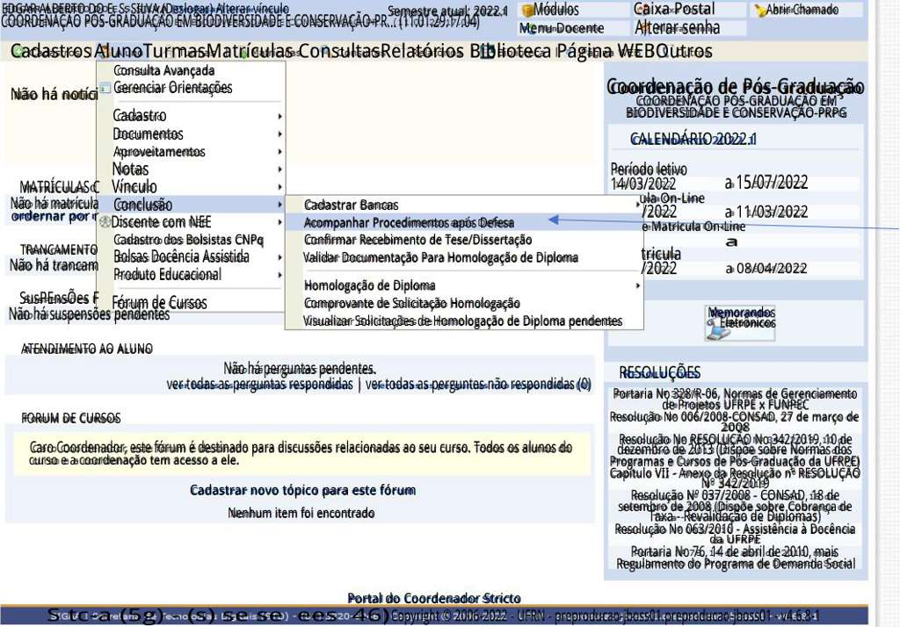

<!-- figure p14-fig2 | described_by: agy | ocr_overlap: 0.9 | needs_review: false -->
### 1. Tipo de figura
Captura de tela anotada da interface web do sistema acadêmico **SIGAA** (*Portal do Coordenador Stricto* da UFRPE), mostrando a navegação por um menu suspenso em dois níveis até a opção de acompanhamento de procedimentos após defesa, destacada por uma seta azul. A imagem apresenta uma camada de texto preto (proveniente de OCR/sobreposição do PDF) renderizada diretamente sobre o texto original da captura de tela, gerando duplicação visual e pequenas divergências de grafia ou legibilidade em alguns trechos.

---

### 2. Todo o texto visível (verbatim)

#### Cabeçalho superior
- Esquerda, linha 1: `EDGAR ALBERTO DO E. S. SILVA (Deslogar) Alterar vínculo`
- Esquerda, linha 2: `COORDENAÇÃO PÓS-GRADUAÇÃO EM BIODIVERSIDADE E CONSERVAÇÃO-PR... (11.01.29.17.04)`
- Centro-direita, linha 1: `Semestre atual: 2022.1`
- Botões à direita, linha 1: `Módulos` | `Caixa Postal` | `Abrir Chamado`
- Botões à direita, linha 2: `Menu Docente` | `Alterar senha`

#### Barra de menu horizontal principal
- `Cadastros` | `Aluno` | `Turmas` | `Matrículas` | `Consultas` | `Relatórios` | `Biblioteca` | `Página WEB` | `Outros`

#### Menu suspenso aberto em `Aluno` (de cima para baixo)
- `Consulta Avançada`
- `Gerenciar Orientações`
- `Cadastro`
- `Documentos`
- `Aproveitamentos`
- `Notas`
- `Vínculo`
- `Conclusão`
- `Discente com NEE`
- `Cadastro dos Bolsistas CNPq`
- `Bolsas Docência Assistida`
- `Produto Educacional`
- `Fórum de Cursos`

#### Submenu aberto em `Conclusão` (de cima para baixo)
- `Cadastrar Bancas`
- `Acompanhar Procedimentos após Defesa`
- `Confirmar Recebimento de Tese/Dissertação`
- `Validar Documentação Para Homologação de Diploma`
- `Homologação de Diploma`
- `Comprovante de Solicitação Homologação`
- `Visualizar Solicitações de Homologação de Diploma pendentes`

#### Coluna principal à esquerda (parcialmente encoberta pelos menus na parte superior)
- Área de notícias: `Não há notíci` *(restante encoberto pelo menu)*
- Seção 1:
  - Título: `MATRÍCULAS C` *(restante encoberto)*
  - Conteúdo: `Não há matrícula` *(restante encoberto)*
  - Link/texto abaixo: `ordernar por r` *(na camada de sobreposição; texto original parcialmente encoberto)*
- Seção 2:
  - Título: `TRANCAMENTO` *(restante encoberto)*
  - Conteúdo: `Não há trancam` *(restante encoberto)*
- Seção 3:
  - Título: `SusPEnsÕes F` *(na camada de sobreposição; texto subjacente parcialmente encoberto em maiúsculas: `SUSPENSÕES` + caractere `[illegible]`)*
  - Conteúdo: `Não há suspensões pendentes`
- Seção 4:
  - Título: `ATENDIMENTO AO ALUNO`
  - Conteúdo: `Não há perguntas pendentes.`
  - Links: `ver todas as perguntas respondidas | ver todas as perguntas não respondidas (0)`
- Seção 5:
  - Título: `FORUM DE CURSOS`
  - Quadro de aviso: `Caro Coordenador, este fórum é destinado para discussões relacionadas ao seu curso. Todos os alunos do curso e a coordenação tem acesso a ele.`
  - Link central: `Cadastrar novo tópico para este fórum`
  - Conteúdo: `Nenhum item foi encontrado`

#### Painel lateral direito (parcialmente encoberto à esquerda pelo submenu de `Conclusão`)
- Cabeçalho:
  - `Coordenação de Pós-Graduação`
  - `COORDENAÇÃO PÓS-GRADUAÇÃO EM BIODIVERSIDADE E CONSERVAÇÃO-PRPG`
- Bloco de calendário:
  - Título: `CALENDÁRIO 2022.1`
  - Item 1: `Período letivo` / `14/03/2022` `a` `15/07/2022`
  - Item 2: `ula On-Line` *(início encoberto)* / `/2022` *(início encoberto)* `a` `11/03/2022`
  - Item 3: `e Matricula On-Line` *(início encoberto)* / `a`
  - Item 4: `tricula` *(início encoberto)* / `/2022` *(início encoberto)* `a` `08/04/2022`
- Botão central:
  - `Memorandos Eletrônicos`
- Bloco de resoluções:
  - Título: `RESOLUÇÕES`
  - Item 1: `Portaria No 328/R-06, Normas de Gerenciamento de Projetos UFRPE x FUNPEC`
  - Item 2: `Resolução No 006/2008-CONSAD, 27 de março de 2008`
  - Item 3: `Resolução No RESOLUÇÃO No 342/2019, 10 de dezembro de 2013 (Dispoe sobre Normas dos Programas e Cursos de Pós-Graduação da UFRPE)`
  - Item 4: `Capitulo VII - Anexo da Resolução nº RESOLUÇÃO Nº 342/2019`
  - Item 5: `Resolução Nº 037/2008 - CONSAD, 18 de setembro de 2008 (Dispõe sobre Cobrança de Taxa - Revalidação de Diplomas)`
  - Item 6: `Resolução No 063/2010 - Assistência à Docência da UFRPE`
  - Item 7: `Portaria No 76, 14 de abril de 2010, mais Regulamento do Programa de Demanda Social`

#### Rodapé
- Texto acima da barra inferior (centralizado): `Portal do Coordenador Stricto`
- Barra inferior (texto original em branco, parcialmente encoberto à esquerda): `SIGAA | Secretaria de Tecnologias Digitais (STD) - ([illegible]) [illegible]20-[illegible]46 | Copyright © 2006-2022 - UFRN - preproducao-jboss01.preproducao-jboss01 - v4.6.8-1`
- Barra inferior (camada de sobreposição em preto): `S tc a (5g) - (s) se se ees 46) Copyright © 2006-2022 - UFRN - preproducao-jboss01.preproducao-jboss01 - v4.6.8-1`

---

### 3. Estrutura
A figura é uma interface web organizada em quatro faixas/áreas principais, sem eixos gráficos ou tabelas de dados numéricos:
- **Topo**:
  1. **Cabeçalho do usuário e da unidade**: identifica o coordenador logado, o programa, o semestre atual e uma grade de 5 botões de acesso rápido distribuídos em 2 linhas (3 na primeira linha e 2 na segunda).
  2. **Barra de navegação horizontal**: 9 itens de menu lado a lado, cada um precedido por um pequeno ícone.
- **Hierarquia de menus suspensos (sobreposta ao corpo da página)**:
  - O item `Aluno` da barra horizontal abre uma **caixa de menu vertical** logo abaixo dele, dividida por duas linhas horizontais em três grupos: (a) 2 itens no topo (`Consulta Avançada`, `Gerenciar Orientações`), (b) 10 itens no centro (`Cadastro` até `Produto Educacional`) e (c) 1 item na base (`Fórum de Cursos`). Pequenos triângulos pretos apontando para a direita (`▸`) à margem direita de `Cadastro`, `Documentos`, `Aproveitamentos`, `Notas`, `Vínculo`, `Conclusão`, `Discente com NEE`, `Bolsas Docência Assistida` e `Produto Educacional` indicam que possuem submenus.
  - O item `Conclusão` desse menu conecta-se diretamente à direita a uma **segunda caixa retangular (submenu)**, dividida por uma linha horizontal em dois grupos: 4 itens acima (`Cadastrar Bancas` até `Validar Documentação Para Homologação de Diploma`) e 3 itens abaixo (`Homologação de Diploma` até `Visualizar Solicitações de Homologação de Diploma pendentes`). Os itens `Cadastrar Bancas` e `Homologação de Diploma` exibem triângulos `▸` à direita.
  - **Seta de anotação**: uma seta azul longa e fina parte da borda direita extrema da imagem, atravessa horizontalmente (com leve inclinação ascendente para a esquerda) a região do calendário no painel direito e termina apontando para o item `Acompanhar Procedimentos após Defesa` dentro do submenu de `Conclusão`.
- **Corpo principal em duas colunas (abaixo da barra de navegação)**:
  - **Coluna esquerda (mais larga)**: empilha verticalmente 6 blocos/seções — caixa de notícias no topo, seguida pelas seções `MATRÍCULAS C...`, `TRANCAMENTO...`, `SusPEnsÕes F...`, `ATENDIMENTO AO ALUNO` e `FORUM DE CURSOS` (esta contendo uma caixa interna de mensagem explicativa acima do link de cadastro e do texto de lista vazia). Os quatro primeiros blocos têm suas metades direitas cobertas pelos menus abertos.
  - **Coluna direita (painel lateral)**: contém, de cima para baixo, o cabeçalho da coordenação, a caixa `CALENDÁRIO 2022.1` (com 4 linhas de eventos/intervalos de datas, parcialmente cobertas à esquerda pelo submenu), o botão gráfico `Memorandos Eletrônicos` e a caixa `RESOLUÇÕES` (lista vertical de 7 normas em linhas alternadas).
- **Base**: linha centralizada com o título do portal acima de uma faixa horizontal estreita de rodapé institucional.

---

### 4. Todos os números e valores de dados
- Semestre atual: `2022.1`
- Código da coordenação no cabeçalho: `11.01.29.17.04`
- Referência do calendário: `2022.1`
- Datas do calendário:
  - Período letivo: `14/03/2022` a `15/07/2022`
  - `...ula On-Line`: `.../2022` a `11/03/2022`
  - `...tricula`: `.../2022` a `08/04/2022`
- Contagem de perguntas não respondidas: `0`
- Identificadores e datas das normativas em `RESOLUÇÕES`:
  - `328/R-06`
  - `006/2008`, `27` de março de `2008`
  - `342/2019`, `10` de dezembro de `2013`
  - `VII`, `342/2019`
  - `037/2008`, `18` de setembro de `2008`
  - `063/2010`
  - `76`, `14` de abril de `2010`
- Rodapé:
  - Período de copyright: `2006-2022`
  - Servidores: `jboss01` (repetido em `preproducao-jboss01.preproducao-jboss01`)
  - Versão do sistema: `v4.6.8-1`
  - Telefone parcialmente encoberto no rodapé original: `([illegible]) [illegible]20-[illegible]46` (na camada de sobreposição: `(5g)` e `46)`)

---

### 5. Cores com significado
- **Destaque azul-claro nos menus**: marca o caminho ativo selecionado na navegação em três níveis — `Aluno` (barra superior) → `Conclusão` (menu suspenso) → `Acompanhar Procedimentos após Defesa` (submenu).
- **Azul da seta de anotação**: destaca e direciona a atenção do leitor exatamente para a opção alvo `Acompanhar Procedimentos após Defesa`.
- **Fundo amarelo-claro** na caixa interna de `FORUM DE CURSOS`: diferencia visualmente a mensagem informativa direcionada ao coordenador em relação ao restante da seção.

~~~text ocr
Biblioteca Página
Avançada G .
há | Gerenciar Orientações Coordena
Não há notici
Gadastro > BIODIVERSIDADE E CONSERVAÇÃO-PRPG
Documentos
Aproveitamentos
Notas , Período letivo
Vínculo , a
Conclusão » Cadastrar Bancas ,
ordernar por fc: Discente com NEE Reompanhar Procedimentos após Defesa
T ENT Gadastro dos Bolsistas CNPq Confirmar Recebimento de Tese/Dissertação a
TRANGAMENTO Assistida Validar Documentação Para Homologação de Diploma ricula
Não há tr a 08/04/2022
Educacional |
Homologação de Diploma >
de le Curses Comprovante de Solicitação Homologação
| Visualizar Solicitações de Homologação de Diploma pendentes
ATENDIMENTO AO ALUNO
hésperguntas pendentes.
respondidas | respondidas (0) —
FORUM DE CURSOS Resolução No 27 de março de
este fórum é destinado para discussões relacionadas ao seu curso. Todas es alunos do
curso tem acesso a ele. Progr Cursos da
Cadastrar novo tópico para este fórum Nº CONSAD, 48
set te Cobra
Nenhum item foi encontrado
e
Resolução N No 06312016 a
Portaria 14 de abril de 2010, mais
do Programa
de DemantlaSociá
~~~

<!-- Start of picture text -->
￥目 <!-- End of picture text -->

IntroduçãoSave to Mendeley Welcome to Video Ga...Giant In the Playgroun...Looking For Group Goblins - Life through... [bb.com.br] Jurassic World: Adult ... FastGames - Gamers l...FacebookMeme Generator - Im... Nuklear Power » 8-Bit ...xkcd - A Webcomic - ... 

》 

###### UFRPE - SIGAA - Sistema Integrado de Gestão de Atividades Acadêmicas A+A- Ajuda?Tempo de Sessão: 00:25 SAIR 

<!-- Start of picture text -->
EDGAR ALBERTO DO E. S. SILVA (Deslogar) Alterar vínculo Semestre atual: 2022.1 Módulos Caixa Postal Abrir Chamado COORDENAÇÃO PÓS-GRADUAÇÃO EM BIODIVERSIDADE E CONSERVAÇÃO-PR... (11.01.29.17.04) Menu Docente Alterar senha Cadastros AlunoTurmasMatrículas ConsultasRelatórios Biblioteca Página WEBOutros Consulta Avançada Não há notíci Gerenciar Orientações Coordenação de Pós-GraduaçãoCOORDENAÇÃO PÓS-GRADUAÇÃO EM Cadastro BIODIVERSIDÃDE E CONSERVAÇÃO-PRPG Documentos CALENDÁRIO 2022.1 Aproveitamentos Notas Período letivo MATRÍCULAS C Vínculo 14/03/2022 a 15/07/2022 Não há matrícula Conclusão Cadastrar Bancas ula On-Line ordernar por r Discente com NEE Acompanhar Procedimentos após Defesa /2022e Matricula On-Linea 11/03/2022 Cadastro dos Bolsistas CNPq Confirmar Recebimento de Tese/Dissertação a TRANCAMENTO Bolsas Docência Assistida Validar Documentação Para Homologação de Diploma tricula Não há trancam /2022 a 08/04/2022 Produto Educacional Homologação de Diploma SusPEnsÕes F Fórum de Cursos Comprovante de Solicitação Homologação Não há suspensões pendentes Visualizar Solicitações de Homologação de Diploma pendentes MemorandosEletrônicos ATENDIMENTO AO ALUNO Não há perguntas pendentes. RESOLUÇÕES ver todas as perguntas respondidas | ver todas as perguntas não respondidas (0) Portaria No 328/R-06, Normas de Gerenciamento de Projetos UFRPE x FUNPEC FORUM DE CURSOS Resolução No 006/2008-CONSAD, 27 de março de 2008 Resolução No RESOLUÇÃO No 342/2019, 10 de Caro Coordenador, este fórum é destinado para discussões relacionadas ao seu curso. Todos os alunos do dezembro de 2013 (Dispõe sobre Normas dos curso e a coordenação tem acesso a ele. Programas e Cursos de Pós-Graduação da UFRPE) Capítulo VII - Anexo da Resolução nº RESOLUÇÃO N° 342/2019 Cadastrar novo tópico para este fórum Resolução Nº 037/2008 - CONSAD, 18 de Nenhum item foi encontrado setembro de 2008 (Dispõe sobre Cobrança deTaxa - Revalidação de Diplomas) Resolução No 063/2010 - Assistência à Docência da UFRPE Portaria No 76, 14 de abril de 2010, mais Regulamento do Programa de Demanda Social Portal do Coordenador Stricto S tc-a (5g) - (s) se se  ees  46)| Copyright © 2006-2022 - UFRN - preproducao-jboss01.preproducao-jboss01 - v4.6.8-1 <!-- End of picture text -->

Depois disso, pode-se conferir o progresso dos Procedimentos pós-Defesa neste menu 

11 后POR INTL17/05/202210:44 星2 

29C Chuva fraca 

Q Digite aqui para pesquisar 

<!-- page 15 -->

SIGAA - Sistema Integrado de GX + 

> 凸 × 

目☆ 

#### ← C https://preproducao.sigs.ufrpe.br/sigaa/graduacao/busca_discente.jsf 

Introdução Save to MendeleyWelcome to Video Ga... Giant In the Playgroun.. Looking For Group Goblins - Life through ... [bb.com.br] Jurassic World: Adult I...FastGames - Gamers l.. Facebook Meme Generator - Im...Nuklear Power » 8-Bit .. xkcd - A Webcomic - .. 

UFRPE - SIG AA - Sistema Integrado de Gestão de Atividades Acadêmicas A+ A- Ajuda? Tempo de Sessão: 00:25 SAIR EDGAR ALBERTO DO E. S. SILVA (Deslogar) Alterar vínculo Semestre atual: 2022.1 Módulos Caixa Postal Abrir Chamado COORDENAÇÃO PÓS-GRADUAÇÃO EM BIODIVERSIDADE E CONSERVAÇÃO-PR... (11.01.29.17.04) Menu Docente Alterar senha PORTAL DO COORDENADOR STRICTO > ACOMPANHAMENTO DOS PROCEDIMENTOS APÓS DEFESA DE TESE/DISSERTAÇÃO Matrícula: 200718142 Discente: KALINE PEREIRA DOS SANTOS SILVA Programa: COORDENAÇÃO PÓS-GRADUAÇÃO EM BIODIVERSIDADE E CONSERVAÇÃO-PRPG CurSo: BIODIVERSIDADE E CONSERVAÇÃO - MESTRADO ACADÊMICO - MESTRADO Status: DEFENDIDO Tipo: REGULAR Caro Coordenador, Abaixo são listados os procedimentos realizados a partir da defesa da Dissertação até a homologação do diploma do discente. Você pode acompanhar a situação de cada um deles e, quando necessário, realizar as devidas operações. CONSOLIDAÇÃO DA ATIVIDADE DE DEFESA ✓ 1º Atividade consolidada. 31/03/2022 Baixar ata da defesa e folhas de correções SUBMISSÃO DA VERSÃO FINAL CORRIGIDA DA DISSERTAÇÃO 2º Aguardando envio pelo aluno. APROVAÇÃO DA VERSÃO FINAL CORRIGIDA DA DISSERTAÇÃO 3º Aguardando envio pelo aluno. SOLICITAÇÃO DA FICHA CATALOGRÁFICA 4º Aguardando solicitação da ficha catalográfica pelo aluno. RESSUBMISSÃO DA VERSÃO FINAL CORRIGIDA DA DISSERTAÇÃO COM FICHA CATALOGRÁFICA 5º Aguardando ressubmissão do trabalho com a ficha catalográfica para revisão do orientador. APROVAÇÃO DA VERSÃO FINAL CORRIGIDA DA DISSERTAÇÃO COM FICHA CATALOGRÁFICA 6º Aguardando ressubmissão do trabalho com a ficha catalográfica para revisão do orientador. ASSINATURA DO TERMO DE AUTORIZAÇÃO DE PUBLICAÇÃO 7º Aguardando assinatura do termo de autorização pelo aluno. RECEBIMENTO DA VERSÃO FINAL PELA COORDENAÇÃO 8º Necessário a aprovação da versão final com ficha catalográfica pelo orientador. 

Vemos que o primeiro passo foi concluído, e o segundo deve ser realizado pelo aluno. 

≡ 

》 

12 

POR 10:45 INTL 17/05/2022 早2 

Digite aquí para pesquisar 

29°C Chuva fraca 

<!-- page 16 -->

> 口 × 

> SIGAA - Sistema Integrado de GX + 

￥目 

###### 8https://preproducao.sigs.ufrpe.br/sigaa/portais/discente/discente.jsf 

← C 

###### IntroduçãoSave to Mendeley Welcome to Video Ga...Giant In the Playgroun...Looking For Group Goblins - Life through ...[bb.com.br] Jurassic World: Adult I... FastGames - Gamers l...FacebookMeme Generator - Im...Nuklear Power » 8-Bit ...xkcd - A Webcomic - .. 

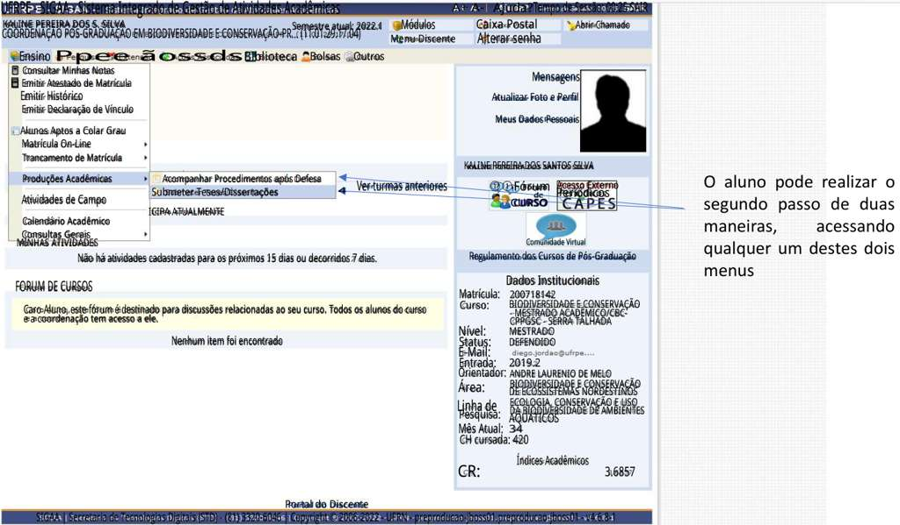

<!-- figure p16-fig1 | described_by: agy | ocr_overlap: 0.89 | needs_review: false -->
**1. Tipo de figura**

Trata-se de uma captura de tela anotada da interface web do sistema acadêmico SIGAA (Portal do Discente da UFRPE), posicionada à esquerda, acompanhada de uma anotação textual explicativa à direita e de duas setas direcionais que apontam para opções específicas de um submenu aberto. A captura apresenta artefatos visuais de sobreposição de texto preto sobre a imagem original (típicos de camada de OCR/extração de PDF), causando leve duplicação em grande parte dos textos e distorção sobre alguns itens da barra de navegação superior.

---

**2. Todo o texto visível (verbatim)**

* **Barra superior (cabeçalho institucional):**
  * Esquerda: `UFRPE - SIGAA - Sistema Integrado de Gestão de Atividades Acadêmicas`
  * Direita: `A+` `A-` `|` `Ajuda?` `Tempo de Sessão: 00:25` `SAIR`

* **Faixa de identificação do discente e atalhos:**
  * Esquerda:
    * `KALINE PEREIRA DOS S. SILVA`
    * `COORDENAÇÃO PÓS-GRADUAÇÃO EM BIODIVERSIDADE E CONSERVAÇÃO-PR... (11.01.29.17.04)`
  * Centro: `Semestre atual: 2022.1`
  * Direita (duas linhas de botões):
    * Linha 1: `Módulos` | `Caixa Postal` | `Abrir Chamado`
    * Linha 2: `Menu Discente` | `Alterar senha`

* **Barra horizontal de navegação principal:**
  * `Ensino`
  * `Pesquisa` (parcialmente encoberto por letras sobrepostas distorcidas: `Ppee`)
  * `Extensão` (parcialmente encoberto por caractere sobreposto: `ã`)
  * `Ações Associadas` (parcialmente encoberto por letras sobrepostas distorcidas: `ossds`)
  * `Biblioteca`
  * `Bolsas`
  * `Outros`

* **Menu suspenso aberto sob `Ensino` (de cima para baixo):**
  * `Consultar Minhas Notas`
  * `Emitir Atestado de Matrícula`
  * `Emitir Histórico`
  * `Emitir Declaração de Vínculo`
  * `Alunos Aptos a Colar Grau`
  * `Matrícula On-Line`
  * `Trancamento de Matrícula`
  * `Produções Acadêmicas`
  * `Atividades de Campo`
  * `Calendário Acadêmico`
  * `Consultas Gerais`

* **Submenu aberto à direita de `Produções Acadêmicas`:**
  * `Acompanhar Procedimentos após Defesa`
  * `Submeter Teses/Dissertações`

* **Área principal de conteúdo (coluna esquerda/central, parcialmente encoberta pelo menu):**
  * À direita do submenu: `Ver turmas anteriores`
  * Abaixo do submenu (trecho parcialmente encoberto à esquerda pelo menu): `ICIPA ATUALMENTE`
  * Seção de atividades:
    * Título: `MINHAS ATIVIDADES`
    * Conteúdo: `Não há atividades cadastradas para os próximos 15 dias ou decorridos 7 dias.`
  * Seção do fórum:
    * Título: `FORUM DE CURSOS`
    * Texto na caixa de aviso: `Caro Aluno, este fórum é destinado para discussões relacionadas ao seu curso. Todos os alunos do curso e a coordenação tem acesso a ele.`
    * Texto abaixo da caixa: `Nenhum item foi encontrado`

* **Painel lateral direito do portal:**
  * Links à esquerda da foto de perfil:
    * `Mensagens`
    * `Atualizar Foto e Perfil`
    * `Meus Dados Pessoais`
  * Faixa com nome: `KALINE PEREIRA DOS SANTOS SILVA`
  * Botões com ícones gráficos:
    * Esquerda: `Fórum de CURSO` (com balões de fala contendo `?` e `!` / sobreposição `1?` `1!`)
    * Direita: `Acesso Externo Periódicos CAPES`
    * Abaixo, centralizado: `Comunidade Virtual`
  * Faixa intermediária: `Regulamento dos Cursos de Pós-Graduação`
  * Seção `Dados Institucionais`:
    * `Matrícula:` `200718142`
    * `Curso:` `BIODIVERSIDADE E CONSERVAÇÃO - MESTRADO ACADÊMICO/CBC-CPPGSC - SERRA TALHADA`
    * `Nível:` `MESTRADO`
    * `Status:` `DEFENDIDO`
    * `E-Mail:` `diego.jordao@ufrpe....`
    * `Entrada:` `2019.2`
    * `Orientador:` `ANDRE LAURENIO DE MELO`
    * `Área:` `BIODIVERSIDADE E CONSERVAÇÃO DE ECOSSISTEMAS NORDESTINOS`
    * `Linha de Pesquisa:` `ECOLOGIA, CONSERVAÇÃO E USO DA BIODIVERSIDADE DE AMBIENTES AQUÁTICOS`
    * `Mês Atual:` `34`
    * `CH cursada:` `420`
  * Subseção `Índices Acadêmicos`:
    * `CR:` `3.6857`

* **Rodapé do portal:**
  * Acima da barra inferior (centralizado): `Portal do Discente`
  * Na barra inferior: `SIGAA | Secretaria de Tecnologias Digitais (STD) - (81) 3320-6046 | Copyright © 2006-2022 - UFRN - preproducao-jboss01.preproducao-jboss01 - v4.6.8.1`

* **Texto de anotação à direita (fora da captura de tela):**
  * `O aluno pode realizar o segundo passo de duas maneiras, acessando qualquer um destes dois menus`

---

**3. Estrutura da figura**

A imagem divide-se horizontalmente em duas regiões principais: à esquerda (cerca de três quartos da largura), a tela completa do Portal do Discente do SIGAA; à direita (cerca de um quarto da largura), uma área de fundo claro com grade sutil contendo o texto explicativo e a origem das setas de anotação.

* **Cabeçalho e navegação (topo da captura):**
  * Três faixas empilhadas horizontalmente: (1) barra superior de sistema com título à esquerda e controles de fonte, ajuda, sessão e saída à direita; (2) faixa de identificação contendo nome, unidade/coordenação, semestre atual e uma grade de botões de atalho (3 na linha superior, 2 na inferior); (3) barra horizontal com 7 abas de menu com ícones (`Ensino` até `Outros`).

* **Menus em cascata (sobrepostos ao lado esquerdo da página):**
  * A partir da aba `Ensino`, abre-se verticalmente uma caixa de menu suspenso com 11 itens distribuídos em 4 grupos separados por linhas horizontais sutis. Quatro itens (`Matrícula On-Line`, `Trancamento de Matrícula`, `Produções Acadêmicas` e `Consultas Gerais`) possuem uma pequena seta triangular preta à direita indicando a existência de submenu.
  * A partir do item `Produções Acadêmicas`, abre-se à sua direita uma caixa retangular de submenu contendo 2 itens empilhados: `Acompanhar Procedimentos após Defesa` (acima) e `Submeter Teses/Dissertações` (abaixo).

* **Corpo principal do portal (duas colunas abaixo da barra de navegação):**
  * **Coluna esquerda/central (mais larga):** contém, de cima para baixo, uma área superior parcialmente oculta pelo menu suspenso (onde se veem o link `Ver turmas anteriores` e o fragmento `ICIPA ATUALMENTE`), seguida pela seção `MINHAS ATIVIDADES` (faixa de título e caixa com texto) e pela seção `FORUM DE CURSOS` (título, caixa retangular de aviso e mensagem de ausência de itens abaixo).
  * **Coluna direita (painel de perfil):** organizada em blocos verticais dentro de uma moldura única: (1) bloco superior com 3 links alinhados à direita e um quadro retangular com silhueta de busto à direita; (2) faixa com o nome completo do discente; (3) painel com 3 botões gráficos (2 lado a lado em cima e 1 centralizado abaixo); (4) faixa de link para o regulamento; (5) tabela chave-valor de duas colunas sob `Dados Institucionais` (11 linhas de rótulo à esquerda e valor à direita), encerrando com o subtítulo centralizado `Índices Acadêmicos` e a linha `CR:` à esquerda com o valor numérico alinhado à direita.

* **Rodapé (base da captura):**
  * Link centralizado `Portal do Discente` logo acima de uma faixa horizontal contendo os créditos institucionais, telefone, copyright, servidor e versão.

* **Conexões das setas de anotação:**
  * Ambas as setas partem de um ponto comum imediatamente à esquerda do texto explicativo (`O aluno pode realizar o segundo passo de duas maneiras, acessando qualquer um destes dois menus`), atravessam horizontalmente o painel lateral direito e a área central do portal e conectam-se diretamente às duas opções do submenu de `Produções Acadêmicas`:
    * A **seta superior** aponta para a borda direita de `Acompanhar Procedimentos após Defesa`.
    * A **seta inferior** aponta para a borda direita de `Submeter Teses/Dissertações`.

---

**4. Todos os números e valores de dados**

* Tempo de sessão: `00:25`
* Código da coordenação/unidade: `11.01.29.17.04`
* Semestre atual: `2022.1`
* Intervalos de dias em `MINHAS ATIVIDADES`: `15` (próximos 15 dias) e `7` (decorridos 7 dias)
* Matrícula: `200718142`
* Entrada (semestre de ingresso): `2019.2`
* Mês Atual: `34`
* CH cursada (carga horária cursada): `420`
* CR (Coeficiente de Rendimento): `3.6857`
* Telefone no rodapé: `(81) 3320-6046`
* Anos de copyright no rodapé: `2006-2022`
* Identificador de servidor no rodapé: `preproducao-jboss01.preproducao-jboss01` (números `01`)
* Versão do sistema no rodapé: `v4.6.8.1`
* Numerais por extenso no texto explicativo: `segundo` (passo), `duas` (maneiras), `dois` (menus)

---

**5. Cores com significado**

* **Azul-claro (realce de fundo):** indica o estado ativo/selecionado na navegação em cascata, destacando a aba `Ensino`, o item `Produções Acadêmicas` no menu suspenso e a opção `Submeter Teses/Dissertações` no submenu.
* **Azul (setas):** diferencia visualmente as duas setas de anotação instrucional (que ligam o texto explicativo às duas opções de submenu) dos elementos originais da interface do SIGAA.
* **Amarelo-claro (caixa de destaque):** sinaliza uma caixa de aviso informativo ao usuário na seção `FORUM DE CURSOS`.
* **Azul-escuro com filete laranja/dourado:** delimita as barras estruturais de cabeçalho e rodapé do sistema SIGAA.
* **Preto (silhueta no quadro de perfil):** representa o espaço reservado padrão indicando ausência de foto cadastrada pelo discente.

~~~text ocr
| Mii gh:
2Bolsas
E Consultar Minhas
Emitir Atestado de Matricula
Histórico Atualizar Foto e Perfil
Emitir Declaração de Vínculo
Munas Aptos a Colar Grau
Matrícula On-Line
Trancamento de Matrícuta >
Meus Dados Pessoais
Rroduções Acadêmicas E Acompanhar Procedimentos após Defesa
Atividades de Campo :
Calendario Académico
Consultas Gerais
Não há atividades cadastradas para os próximos 15 dias ou decorridos 7 dias. Regulamento-das Cursos de Pós-Graduação
Dados Institucionais
FORUM DE CURSOS Matrícula: 200718142
este-fórum édes para discussões relacionadas ao seu curso. os alunos do curso Curso:
coordenação tem TALHADA
Nível: MESTRADO
Nenhum item foi encontrado DEFENDIDO
diego.jordao@ufrpe..
2019.2
ANDRE LAURENIO DE MELO
Mês
CH cursada: 420
Índices Acadêmicos
GR: 36857
VA |
O aluno pode realizar o
segundo passo de duas
maneiras, acessando
qualquer um destes dois
menus
~~~

<!-- Start of picture text -->
UFRPE - SIGAA - Sistema Integrado de Gestão de Atividades Acadêmicas A+ A- Ajuda?Tempo de Sessão: 00:25 SAIR KALINE PEREIRA DOS S. SILVA Semestre atual: 2022.1 Módulos Caixa Postal Abrir Chamado COORDENAÇÃO PÓS-GRADUAÇÃO EM BIODIVERSIDADE E CONSERVAÇÃO-PR... (11.01.29.17.04) Menu Discente Alterar senha Ensino Ppee ãossdsBiblioteca Bolsas Outros Consultar Minhas Notas 日 Emitir Atestado de Matrícula Mensagens Emitir Histórico Atualizar Foto e Perfil Emitir Declaração de Vínculo Meus Dados Pessoais Alunos Aptos a Colar Grau Matrícula On-Line Trancamento de Matrícula KALINE PEREIRA DOS SANTOS SILVA Produções Acadêmicas Acompanhar Procedimentos após Defesa Submeter Teses/Dissertações 4 Ver turmas anteriores ①①Fórum Periódicos Acesso Externo O aluno pode realizar o Atividades de Campo ICIPA ATUALMENTE CURSO segundo passo de duas Consultas GeraisCalendário Acadêmico maneiras,  acessando MINHAS ATIVIDADES Comunidade Virtual qualquer um destes dois Não há atividades cadastradas para os próximos 15 dias ou decorridos 7 dias. Regulamento dos Cursos de Pós-Graduação menus Dados Institucionais FORUM DE CURSOS Matrícula: 200718142 Curso: BIODIVERSIDADE E CONSERVAÇÃO Caro Aluno, este fórum é destinado para discussões relacionadas ao seu curso. Todos os alunos do curso - MESTRADO ACADÊMICO/CBC- e a coordenação tem acesso a ele. CPPGSC - SERRA TALHADA Nível: MESTRADO Nenhum item foi encontrado Status: DEFENDIDO E-Mail: Entrada: 2019.2 Orientador: ANDRE LAURENIO DE MELO Área: DE ECOSSISTEMAS NORDESTINOSBIODIVERSIDADE E CONSERVAÇÃO Linha dePesquisa: AQUÁTICOSECOLOGIA, CONSERVAÇÃO E USODA BIODIVERSIDADE DE AMBIENTES Mês Atual: 34 CH cursada: 420 Índices Acadêmicos CR: 3.6857 Portal do Discente SIGAA | Secretaria de Tecnologias Digitais (STD) - (81) 3320-6046 | Copyright © 2006-2022 - UFRN - preproducao-jboss01.preproducao-jboss01 - v4.6.8-1 <!-- End of picture text -->

》 

13 后制POR INTL17/05/202210:47 星2 

29C Chuva fraca 

Q Digite aqui para pesquisar 

<!-- page 17 -->

SIGAA - Sistema Integrado de GX + 

> 凸 × 

← ← C https://preproducao.sigs.ufrpe.br/sigaa/portais/discente/discente.jsf 

目☆ 

≡ 

|Introdução Save to MendeleyWelcome to Video Ga... Giant In the Playgroun.. Looking For Group Goblins - Life through ... [bb.com.br] Jurassic World: Adult I...FastGames - Gamers l.. Facebook Meme Generator - Im...Nuklear Power » 8-Bit ... xkcd - A Webcomic - ... UFRPE - SIG AA - Sistema Integrado de Gestão de Atividades Acadêmicas A+ A- Ajuda?Tempo de Sessão: 00:25 SAIR KALINE PEREIRA DOS S. SILVA Semestre atual: 2022.1 Módulos Caixa Postal Abrir Chamado COORDENAÇÃO PÓS-GRADUAÇÃO EM BIODIVERSIDADE E CONSERVAÇÃO-PR... (11.01.29.17.04) Menu Discente Alterar senha PORTAL DO DISCENTE > ACOMPANHAMENTO DOS PROCEDIMENTOS APÓS DEFESA DE TESE/DISSERTAÇÃO|
|---|
|Matrícula: 200718142 Discente: KALINE PEREIRA DOS SANTOS SILVA Programa: COORDENAÇÃO PÓS-GRADUAÇÃO EM BIODIVERSIDADE E CONSERVAÇÃO-PRPG CurSo: BIODIVERSIDADE E CONSERVAÇÃO - MESTRADO ACADÊMICO - MESTRADO Status: DEFENDIDO Tipo: REGULAR|
|Caro Aluno, Abaixo são listados os procedimentos realizados a partir da defesa de sua Dissertação até a homologação do diploma. Você pode acompanhar a situação de cada um deles e, quando necessário, realizar as devidas operações.|
|O primeiro menu leva para esta tela onde ele pode clicar em “Submeter versão corrigida” CONSOLIDAÇÃO DA ATIVIDADE DE DEFESA ✓ 1º Atividade consolidada. 31/03/2022 Baixar ata da defesa e folhas de correções 2º SUBMISSÃO DA VERSÃO FINAL CORRIGIDA DA DISSERTAÇÃO Aguardando envio pelo aluno. Submeter versão corrigida 3º APROVAÇÃO DA VERSÃO FINAL CORRIGIDA DA DISSERTAÇÃO Aguardando envio pelo aluno. SOLICITAÇÃO DA FICHA CATALOGRÁFICA 4º Aguardando solicitação da ficha catalográfica pelo aluno.|
|RESSUBMISSÃO DA VERSÃO FINAL CORRIGIDA DA DISSERTAÇÃO COM FICHA CATALOGRÁFICA 5º Aguardando ressubmissão do trabalho com a ficha catalográfica para revisão do orientador.|
|6º APROVAÇÃO DA VERSÃO FINAL CORRIGIDA DA DISSERTAÇÃO COM FICHA CATALOGRÁFICA Aguardando ressubmissão do trabalho com a ficha catalográfica para revisão do orientador.|
|7º ASSINATURA DO TERMO DE AUTORIZAÇÃO DE PUBLICAÇÃO Aguardando assinatura do termo de autorização pelo aluno.|
|8º RECEBIMENTO DA VERSÃO FINAL PELA COORDENAÇÃO Necessário a aprovação da versão final com ficha catalográfica pelo orientador.|

》 

14 

POR 10:47 INTL 17/05/2022 早2 

Digite aquí para pesquisar 

29C Chuva fraca 

<!-- page 18 -->

> SIGAA - Sistema Integrado de G× + 

凸 × 

C 

← 

目☆ 

###### https://preproducao.sigs.ufrpe.br/sigaa/portais/discente/discente.jsf 

###### IntroduçãoSave to MendeleyWelcome to Video Ga... Giant In the Playgroun...Looking For Group Goblins - Life through ... [bb.com.br] Jurassic World: Adult I...FastGames - Gamers l...Facebook Meme Generator - Im...Nuklear Power » 8-Bit..xkcd - A Webcomic -... 

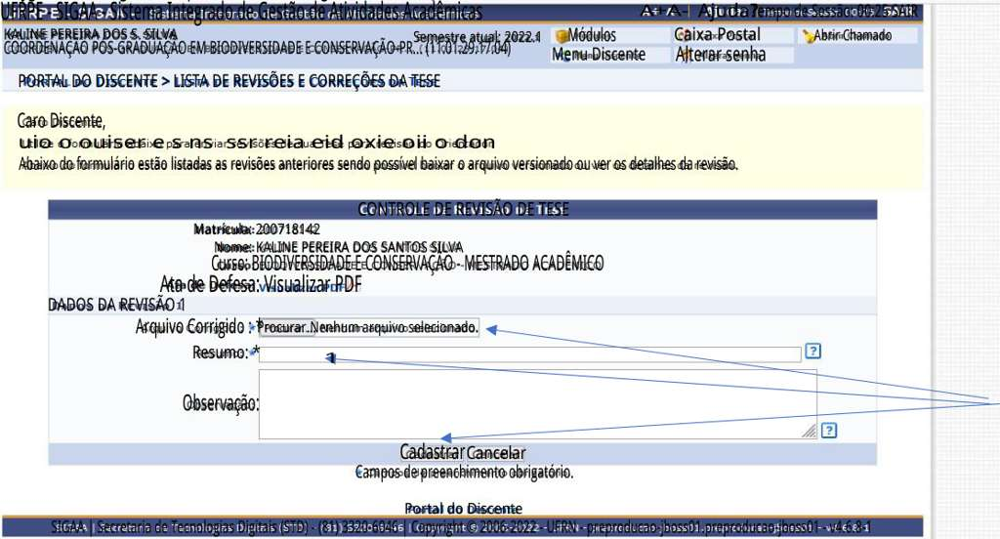

<!-- figure p18-fig1 | described_by: agy | ocr_overlap: 0.82 | needs_review: false -->
### 1. Tipo de figura
Captura de tela de uma interface web do sistema acadêmico SIGAA (Sistema Integrado de Gestão de Atividades Acadêmicas) da UFRPE, exibindo o formulário de envio e controle de revisão de tese no Portal do Discente, com três setas azuis de anotação adicionadas sobre a imagem a partir da margem direita. A imagem apresenta sobreposição de uma camada de texto preto (artefato típico de camada OCR renderizada sobre uma imagem em PDF), fazendo com que quase todos os textos apareçam duplicados e levemente deslocados e gerando uma linha de texto distorcido sobre a segunda linha do quadro de instruções.

### 2. Todo o texto visível (literal)

**Barra de cabeçalho superior:**
- `UFRPE - SIGAA - Sistema Integrado de Gestão de Atividades Acadêmicas`
- `A+` `A-` `|` `Ajuda?` `|` `Tempo de Sessão: 00:25` `SAIR`

**Barra secundária de identificação e ações:**
- `KALINE PEREIRA DOS S. SILVA`
- `COORDENAÇÃO PÓS-GRADUAÇÃO EM BIODIVERSIDADE E CONSERVAÇÃO-PR... (11.01.29.17.04)`
- `Semestre atual: 2022.1`
- `Módulos`
- `Caixa Postal`
- `Abrir Chamado`
- `Menu Discente`
- `Alterar senha`

**Trilha de navegação:**
- `PORTAL DO DISCENTE > LISTA DE REVISÕES E CORREÇÕES DA TESE`

**Quadro de instruções (fundo amarelo-claro):**
- `Caro Discente,`
- Texto original subjacente: `Utilize o formulário abaixo para enviar revisões de sua Tese para revisão do Orientador`
- Camada de texto preto sobreposta na mesma linha (distorcida): `uio o ouiser e s ns ssr reia eid oxie oii o don`
- `Abaixo do formulário estão listadas as revisões anteriores sendo possível baixar o arquivo versionado ou ver os detalhes da revisão.`

**Painel principal do formulário:**
- Título da barra superior: `CONTROLE DE REVISÃO DE TESE`
- `Matrícula: 200718142`
- `Nome: KALINE PEREIRA DOS SANTOS SILVA`
- `Curso: BIODIVERSIDADE E CONSERVAÇÃO - MESTRADO ACADÊMICO`
- `Ata de Defesa: Visualizar PDF`
- Subtítulo de seção: `DADOS DA REVISÃO 1`
- `Arquivo Corrigido : *`
- Botão e texto do seletor de arquivo: `Procurar...` `Nenhum arquivo selecionado.`
- `Resumo: *`
- Dentro da caixa de texto de `Resumo: *` (sobreposto à ponta da seta azul): `1`
- Ícone ao lado direito de `Resumo: *`: `?`
- `Observação:`
- Ícone ao lado direito inferior de `Observação:`: `?`
- Botões na barra inferior do formulário: `Cadastrar` `Cancelar`
- Legenda abaixo do formulário: `* Campos de preenchimento obrigatório.` (com o asterisco representado pelo ícone azul original sob o `C`)

**Link acima do rodapé:**
- `Portal do Discente`

**Barra de rodapé:**
- `SIGAA | Secretaria de Tecnologias Digitais (STD) - (81) 3320-6046 | Copyright © 2006-2022 - UFRN - preproducao-jboss01.preproducao-jboss01 - v4.6.8-1`

### 3. Estrutura
A figura organiza-se verticalmente como uma página web centralizada (com uma estreita margem direita de fundo quadriculado claro fora da moldura da página), composta pelos seguintes blocos e conexões:

- **Cabeçalho em três faixas horizontais:**
  1. Faixa superior estreita com o nome institucional do sistema à esquerda e controles de tamanho de fonte (`A+`, `A-`), ajuda (`Ajuda?`), tempo de sessão (`Tempo de Sessão: 00:25`) e saída (`SAIR`) à direita.
  2. Faixa intermediária contendo, à esquerda, o nome da discente e o nome/código da coordenação; no centro-direita, o semestre atual; e, à direita, uma grade de botões de ação em duas linhas (`Módulos`, `Caixa Postal`, `Abrir Chamado` na linha superior; `Menu Discente`, `Alterar senha` na linha inferior), cada um acompanhado de um pequeno ícone à esquerda.
  3. Faixa inferior fina exibindo a trilha de navegação (`PORTAL DO DISCENTE > LISTA DE REVISÕES E CORREÇÕES DA TESE`).
- **Caixa de aviso/instruções:** retângulo horizontal de largura quase total contendo três linhas de texto orientando o envio de revisões da tese.
- **Painel central do formulário (`CONTROLE DE REVISÃO DE TESE`):** caixa retangular centralizada dividida em quatro áreas verticais:
  1. Barra de título (`CONTROLE DE REVISÃO DE TESE`).
  2. Bloco de resumo dos dados acadêmicos em quatro linhas no formato rótulo-valor (`Matrícula`, `Nome`, `Curso`, `Ata de Defesa`, este último acompanhado do link `Visualizar PDF` e de um ícone de documento PDF).
  3. Barra de subseção (`DADOS DA REVISÃO 1`).
  4. Grade de preenchimento em duas colunas (rótulos alinhados à direita na coluna esquerda; campos de entrada na coluna direita):
     - Linha 1: `Arquivo Corrigido : *` -> controle de seleção de arquivo contendo o botão `Procurar...` e o status `Nenhum arquivo selecionado.`.
     - Linha 2: `Resumo: *` -> campo de texto de linha única (vazio na interface original, mas com o dígito preto `1` sobreposto sobre a ponta da seta) seguido por um botão de ajuda `?`.
     - Linha 3: `Observação:` -> caixa de texto multilinha vazia com alça diagonal de redimensionamento no canto inferior direito, seguida por um botão de ajuda `?`.
  5. Barra de rodapé do painel contendo dois botões lado a lado centralizados: `Cadastrar` e `Cancelar`.
  6. Abaixo do painel, centralizada, a legenda `* Campos de preenchimento obrigatório.`.
- **Área inferior da página:** link centralizado `Portal do Discente` acima da faixa horizontal de rodapé institucional.
- **Setas de anotação (sobrepostas à interface):** três setas retilíneas azuis entram juntas pela margem direita da imagem (convergindo para um ponto comum fora da área visível à direita) e se abrem em leque para a esquerda, conectando essa origem externa a três controles do formulário:
  - **Seta superior:** sobe diagonalmente e aponta para a extremidade direita do controle de arquivo do campo `Arquivo Corrigido : *` (`Procurar... Nenhum arquivo selecionado.`).
  - **Seta intermediária:** inclina-se levemente para cima e aponta para o interior do campo de texto `Resumo: *` (sob o caractere `1` sobreposto).
  - **Seta inferior:** inclina-se levemente para baixo e aponta para a parte superior do botão `Cadastrar`.

### 4. Todos os números e valores de dados
- `00:25` — tempo restante de sessão (`Tempo de Sessão: 00:25`).
- `2022.1` — semestre letivo atual (`Semestre atual: 2022.1`).
- `11.01.29.17.04` — código identificador da unidade (`COORDENAÇÃO PÓS-GRADUAÇÃO EM BIODIVERSIDADE E CONSERVAÇÃO-PR...`).
- `200718142` — número de matrícula (`Matrícula: 200718142`).
- `1` — número da revisão no subtítulo `DADOS DA REVISÃO 1`.
- `1` — caractere numérico preto sobreposto à ponta da seta intermediária dentro do campo `Resumo: *`.
- `(81) 3320-6046` — número de telefone da Secretaria de Tecnologias Digitais (STD) no rodapé.
- `2006-2022` — intervalo de anos de direitos autorais (`Copyright © 2006-2022 - UFRN`).
- `01` (duas ocorrências em `preproducao-jboss01.preproducao-jboss01`) — identificador da instância/servidor no rodapé.
- `v4.6.8-1` — número de versão do sistema no rodapé.

### 5. Cores com significado
- **Azul-escuro (com filete dourado/laranja na borda):** identifica as barras estruturais principais do sistema (cabeçalho global, título do formulário `CONTROLE DE REVISÃO DE TESE` e rodapé).
- **Azul-claro:** delimita faixas secundárias de contexto e ação (identificação do usuário/menus no topo, subtítulo `DADOS DA REVISÃO 1` e barra dos botões `Cadastrar` / `Cancelar`).
- **Amarelo-claro:** destaca o quadro informativo de instruções dirigidas ao discente.
- **Azul nos asteriscos (`*`):** sinaliza campos de preenchimento obrigatório (`Arquivo Corrigido` e `Resumo`), em correspondência ao ícone azul na legenda `* Campos de preenchimento obrigatório.`.
- **Azul nos textos de link e ícones `?`:** indica elementos clicáveis de navegação/visualização (`PORTAL DO DISCENTE`, `Visualizar PDF`, `Portal do Discente`) e botões de ajuda contextual.
- **Vermelho no ícone de documento:** indica que o arquivo vinculado a `Visualizar PDF` está no formato PDF.
- **Azul nas três setas sobrepostas:** diferencia as anotações explicativas externas dos elementos originais da interface.

~~~text ocr
|
WE PEREIRA DOS $. SILVA Caixa-Postal
COORDENAÇÃO POs
PORTAL DO DISCENTE > LISTA DE REVISÕES E CORREÇÕES DA TESE
(aro Discente,
ib
Abaixo do formulário estão listadas as revisões anteriores sendo possível baixar 6 arquivo versionado ou wer as detalhes dla revisão.
Mome:: KALINE PEREIRA DOS SANTOS SILVA
MESTRADO ACADEMICO
Mede
DADOS DA REVISÃO
Arquivo Corrigido
Cadastrar Gancelar
Carapos-de preenchimento obrigatório.
Rortal do Discente
= | 29722 = wil ES
~~~

<!-- Start of picture text -->
UFRPE - SIGAA - Sistema Integrado de Gestão de Atividades Acadêmicas A+A- Ajuda?Tempo de Sessão: 00:25 SAIR KALINE PEREIRA DOS S. SILVA Semestre atual: 2022.1 Módulos Caixa Postal Abrir Chamado COORDENAÇÃO PÓS-GRADUAÇÃO EM BIODIVERSIDADE E CONSERVAÇÃO-PR... (11.01.29.17.04) Menu Discente Alterar senha PORTAL DO DISCENTE > LISTA DE REVISÕES E CORREÇÕES DA TESE Caro Discente, uio o ouiser e s ns  ssr reia eid oxie oii o don Abaixo do formulário estão listadas as revisões anteriores sendo possível baixar o arquivo versionado ou ver os detalhes da revisão. CONTROLE DE REVISÃO DE TESE Matrícula: 200718142 Nome: KALINE PEREIRA DOS SANTOS SILVA Curso: BIODIVERSIDADE E CONSERVAÇÃO - MESTRADO ACADÊMICO Ata de Defesa: Visualizar PDF DADOS DA REVISÃO 1 Arquivo Corrigido : * Procurar...Nenhum arquivo selecionado. Resumo: * 1 Observação: CadastrarCancelar  Campos de preenchimento obrigatório. Portal do Discente SIGAA | Secretaria de Tecnologias Digitais (STD) - (81) 3320-6046 | Copyright © 2006-2022 - UFRN - preproducao-jboss01.preproducao-jboss01 - v4.6.8-1 <!-- End of picture text -->

Enquanto o segundo menu vai diretamente para a mesma tela que se segue após clicar no botão da tela anterior 

Aqui o aluno insere o arquivo da versão corrigida (ainda sem a ficha catalográfica) e escreve um resumo, e também pode fazer uma observação. Em seguida clica-se em “Cadastrar” 

三 

》 

15 

INTL 17/05/2022POR 10:47 星2 

Digite aqui para pesquisar 

29°C Chuva fraca 

<!-- page 19 -->

> 凸 × 

> SIGAA - Sistema Integrado de GX + 

目☆ 三 

← C 

###### https://preproducao.sigs.ufrpe.br/sigaa/stricto/versao_trabalho/lista.jsf 

|Introdução Save to Mendeley Welcome to Video Ga...Gia|nt In the Playgroun...Looking For Group Goblins - Life through ... [bb.com.br]Jurassic World: Adult .. FastGames - Gamers I...Face S l 20221|bookMeme Generator - Im..|. Nuklear Power » 8-Bit ...xkcd - A Webcomi - .|
|---|---|---|---|
||emestre atua: . COORDENAÇÃO PÓS-GRADUAÇÃO EM BIODIVERSIDADE E CONSERVAÇÃO-PR... (11.01.29.17.04) Menu Discente Alterar senha|||
||• Revisão cadastrado(a) com sucesso! PORTAL DO DISCENTE > ACOMPANHAMENTO DOS PROCEDIMENTOS APÓS DEFESA DE TESE/DISSERTAÇÃO|(x) fechar mensagens||
||Matrícula: 200718142 Discente: KALINE PEREIRA DOS SANTOS SILVA Programa: COORDENAÇÃO PÓS-GRADUAÇÃO EM BIODIVERSIDADE E CONSERVAÇÃO-PRPG Curso: BIODIVERSIDADE E CONSERVAÇÃO - MESTRADO ACADÊMICO - MESTRADO Status: DEFENDIDO Tipo: REGULAR|||
||Caro Aluno, Abaixo são listados os procedimentos realizados a partir da defesa de sua Dissertação até a homologação do diploma. Você pode acompanhar a situação de cada um deles e, quando necessário, realizar as devidas operações.|||
|Após o aluno submeter a versão final corrigida, ela|CONSOLIDAÇÃO DA ATIVIDADE DE DEFESA ✓ 1º Atividade consolidada. 31/03/2022 Baixar ata da defesa e folhas de correções 2º SUBMISSÃO DA VERSÃO FINAL CORRIGIDA DA DISSERTAÇÃO √ Submetido. 17/05/2022 Conferir histórico de revisã~~o~~||O aluno também pode clicar neste botão para |
|deve ser aprovada| ||verificar em que situação|
| pelo seu orientador.|APROVAÇÃO DA VERSÃO FINAL CORRIGIDA DA DISSERTAÇÃO 3º Aguardando revisão do orientador. SOLICITAÇÃO DA FICHA CATALOGRÁFICA 4o Aguardando solicitação da ficha catalográfica pelo aluno.||se encontra sua submissão|
||5º RESSUBMISSÃO DA VERSÃO FINAL CORRIGIDA DA DISSERTAÇÃO COM FICHA CATALOGRÁFICA Aguardando ressubmissão do trabalho com a ficha catalográfica para revisão do orientador.|||
||APROVAÇÃO DA VERSÃO FINAL CORRIGIDA DA DISSERTAÇÃO COM FICHA CATALOGRÁFICA 6º Submetido para revisão do orientador.|||
||7º ASSINATURA DO TERMO DE AUTORIZAÇÃO DE PUBLICAÇÃO Aguardando assinatura do termo de autorização pelo aluno.|||
||8º RECEBIMENTO DA VERSÃO FINAL PELA COORDENAÇÃO Coordenação aguardando recebimento.|||

》 

16 

POR 10:48 

29℃ Chuva fraca 

Digite aqui para pesquisar 

1/1/21 1202 

<!-- page 20 -->

SIGAA - Sistema Integrado de GX + 

> 凸 × 

###### 目☆ 

##### ← → C 

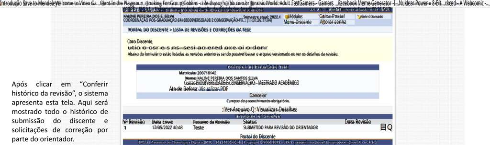

<!-- figure p20-fig1 | described_by: agy | ocr_overlap: 0.89 | needs_review: false -->
### 1. Tipo de figura
Captura de tela de uma página do sistema web acadêmico **SIGAA** (Sistema Integrado de Gestão de Atividades Acadêmicas) da **UFRPE**, exibida dentro de um navegador web (com barra de favoritos visível no topo), acompanhada de um parágrafo explicativo à esquerda, no formato de manual ou guia de usuário. Sobre a captura de tela há uma camada de texto preto gerada por OCR renderizada de forma visível e levemente desalinhada em relação ao texto original da interface, produzindo efeito de texto duplicado e alguns erros de reconhecimento de caracteres.

---

### 2. Todo o texto visível (verbatim)

**Texto explicativo à esquerda da tela:**
> Após clicar em “Conferir histórico da revisão”, o sistema apresenta esta tela. Aqui será mostrado todo o histórico de submissão do discente e solicitações de correção por parte do orientador.

**Barra de favoritos do navegador (topo da imagem, da esquerda para a direita):**
- Texto subjacente da captura de tela:
  `Introdução` | `Save to Mendeley` | `Welcome to Video Ga...` | `Giant In the Playgroun...` | `Looking For Group` | `Goblins - Life through...` | `bb.com.br` | `Jurassic World: Adult ...` | `FastGames - Gamers ...` | `Facebook` | `Meme Generator - Im...` | `Nuklear Power » 8-Bit...` | `xkcd - A Webcomic - ...`
- Texto preto sobreposto (quando difere do original):
  `[bb.com.br]` | `Juratsic World: Adult ...` | `FastGamers - Gamers ...` | `Meme Generator -I...` | `xkced - A Webcomic -...`

**Cabeçalho superior do sistema (faixa azul-escura):**
- À esquerda: `UFRPE - SIGAA - Sistema Integrado de Gestão de Atividades Acadêmicas`
- À direita: `A+` `A-` `Ajuda?` `Tempo de Sessão: 00:25` `SAIR`

**Faixa de identificação do usuário e atalhos (faixa azul-clara):**
- À esquerda (linha 1): `KALINE PEREIRA DOS S. SILVA`
- À esquerda (linha 2): `COORDENAÇÃO PÓS-GRADUAÇÃO EM BIODIVERSIDADE E CONSERVAÇÃO-PR... (11.01.29.17.04)`
- Ao centro-esquerda: `Semestre atual: 2022.1`
- Botões à direita (linha 1): `Módulos` | `Caixa Postal` | `Abrir Chamado`
- Botões à direita (linha 2): `Menu Discente` | `Alterar senha`

**Trilha de navegação (breadcrumb):**
- `PORTAL DO DISCENTE > LISTA DE REVISÕES E CORREÇÕES DA TESE`

**Caixa de instruções (fundo amarelo-claro):**
- Linha 1: `Caro Discente,`
- Linha 2 (texto original subjacente): `Utilize o formulário abaixo para enviar revisões de sua Tese para revisão do Orientador.`
- Linha 2 (texto preto sobreposto corrompido pelo OCR): `utio o osr e s ns sesi ao ered oxe oi o donr`
- Linha 3: `Abaixo do formulário estão listadas as revisões anteriores sendo possível baixar o arquivo versionado ou ver os detalhes da revisão.`

**Painel de controle de revisão:**
- Título da barra superior: `CONTROLE DE REVISÃO DE TESE`
- Campos e valores:
  - `Matrícula: 200718142`
  - `Nome: KALINE PEREIRA DOS SANTOS SILVA`
  - `Curso: BIODIVERSIDADE E CONSERVAÇÃO - MESTRADO ACADÊMICO`
  - `Ata de Defesa: Visualizar PDF`
- Botão na barra inferior do painel: `Cancelar`
- Legenda abaixo do painel: `Campos de preenchimento obrigatório.`

**Barra de legenda de ícones acima da tabela:**
- Texto original subjacente (com ícones de documento e lupa): `Ver Arquivo` | `Visualizar Detalhes`
- Texto preto sobreposto: `:Ver Arquivo Q: Visualizar Detalhes`

**Tabela de histórico de revisões:**
- Título da barra superior: `HISTÓRICO DE REVISÕES`
- Cabeçalhos das colunas: `Nº Revisão` | `Data Envio` | `Resumo da Revisão` | `Status` | `Data Revisão` | *(coluna de ações sem título)*
- Linha 1:
  - `Nº Revisão`: `1`
  - `Data Envio`: `17/05/2022 10:48`
  - `Resumo da Revisão`: `Teste`
  - `Status`: `SUBMETIDO PARA REVISÃO DO ORIENTADOR`
  - `Data Revisão`: *(célula vazia)*
  - Coluna de ações: dois ícones (documento e lupa), sobrepostos pelos caracteres de OCR `目Q`

**Link abaixo da tabela:**
- `Portal do Discente`

**Rodapé do sistema (faixa azul-escura inferior):**
- `SIGAA | Secretaria de Tecnologias Digitais (STD) - (81) 3320-6046 | Copyright © 2006-2022 - UFRN - preproducao-jboss01.preproducao-jboss01 - v4.6.8-1`

---

### 3. Estrutura
A figura é dividida horizontalmente em duas áreas principais, sem setas ou conectores entre elas:
- **Coluna esquerda (cerca de 25% da largura):** bloco de texto explicativo alinhado à esquerda, posicionado na metade inferior da imagem, sobre fundo branco à esquerda e fundo quadriculado cinza-claro à direita.
- **Área central-direita (captura de tela da página web):** página centralizada sobre fundo quadriculado claro, delimitada por bordas verticais cinzas e composta pelos seguintes blocos empilhados de cima para baixo:
  1. **Barra de favoritos do navegador:** linha horizontal contínua no topo com 13 itens precedidos por pequenos ícones circulares/favicons.
  2. **Cabeçalho principal do SIGAA:** barra horizontal com título institucional à esquerda e controles de tamanho de fonte (`A+`, `A-`), ajuda, contador de sessão e saída à direita.
  3. **Painel de dados da sessão do discente:** faixa contendo nome da discente, coordenação do programa de pós-graduação e semestre atual à esquerda, e uma grade de 2 linhas por 3 colunas de botões com ícones à direita (3 botões na primeira linha e 2 botões na segunda).
  4. **Trilha de navegação:** linha simples abaixo do cabeçalho indicando o caminho hierárquico até a tela atual.
  5. **Caixa de aviso/instruções:** retângulo largo contendo três linhas de texto informativo ao discente.
  6. **Caixa/formulário “CONTROLE DE REVISÃO DE TESE”:** painel retangular composto por barra de título superior, corpo central com 4 linhas de pares rótulo-valor centralizados (sendo a quarta linha acompanhada de um link e ícone de arquivo PDF), barra inferior com o botão centralizado `Cancelar` e, imediatamente abaixo da caixa, a indicação de campos obrigatórios precedida por um pequeno ícone azul de estrela/asterisco.
  7. **Barra de legenda de ações:** faixa estreita centralizada exibindo o significado dos dois ícones usados na tabela abaixo (ícone de folha/documento para `Ver Arquivo` e ícone de lupa para `Visualizar Detalhes`).
  8. **Tabela “HISTÓRICO DE REVISÕES”:** composta por barra de título, linha de cabeçalho com 6 colunas (`Nº Revisão`, `Data Envio`, `Resumo da Revisão`, `Status`, `Data Revisão` e coluna sem título para ícones de ação) e 1 linha de registro preenchida (com a coluna `Data Revisão` em branco e dois ícones de ação à direita).
  9. **Link de retorno:** link centralizado `Portal do Discente` abaixo da tabela.
  10. **Rodapé institucional:** barra horizontal inferior com identificação do sistema, telefone de contato, direitos autorais, identificador do servidor e número de versão.

---

### 4. Todos os números e valores de dados
- Tempo de sessão restante: `00:25`
- Código da unidade/coordenação: `11.01.29.17.04`
- Semestre atual: `2022.1`
- Matrícula: `200718142`
- Nº Revisão: `1`
- Data Envio: `17/05/2022 10:48`
- Telefone da STD no rodapé: `(81) 3320-6046`
- Período de copyright: `2006-2022`
- Identificador de servidor/instância: `preproducao-jboss01.preproducao-jboss01` (contendo `01` duas vezes)
- Versão do sistema: `v4.6.8-1`
- Valor na barra de favoritos: `8-Bit` (em `Nuklear Power » 8-Bit...`)

---

### 5. Cores com significado
- **Azul-escuro (com filete laranja/dourado de separação):** identifica o cabeçalho principal do sistema, o rodapé institucional e as barras de título das seções principais (`CONTROLE DE REVISÃO DE TESE` e `HISTÓRICO DE REVISÕES`).
- **Azul-claro:** destaca a barra de contexto do usuário logado, a barra inferior do formulário (área de ação do botão `Cancelar`) e o cabeçalho das colunas da tabela.
- **Amarelo-claro:** destaca a caixa de instruções/aviso direcionada ao discente (`Caro Discente,...`), diferenciando-a do conteúdo do formulário e da tabela.
- **Texto azul (na camada original da captura de tela):** indica links clicáveis (`PORTAL DO DISCENTE`, `Visualizar PDF` e `Portal do Discente`).
- **Ícone vermelho e branco ao lado de `Visualizar PDF`:** identifica visualmente que o arquivo da Ata de Defesa está em formato PDF.
- **Pequeno ícone azul à esquerda de `Campos de preenchimento obrigatório.`:** funciona como legenda visual do marcador de obrigatoriedade do formulário.

~~~text ocr
Introdução
RPE
PEREIRA DOS SILVA bririChamado
PORTAL DO DISCENTE > LISTA DE REVISÕES E CORREÇÕES DA TEESE
(aro Discente,
utio exeiei oodenr
Abaixo do formulário estão listadas as revisões anteriores sendo baixar 9 arquivo versionado ou wer as detalhes dla revisão.
DE
Matrícula: 200718142
PEREIRA DOS SANTOS MES ACADÊMICO
Após clicar em “Conferir MESTRADO
Mede DefesaVisualizar RDF
histórico da revisão”, o sistema
apresenta esta tela. Aqui será
mostrado todo o histórico de Q:
submissão do discente e Data Envio Resumo da Revisão Status
solicitações de correção por 1 Teste SUBMETIDO PARA REVISÃO DO ORIENTADOR
parte do orientador. do Discente
~~~

<!-- Start of picture text -->
Introdução Save to MendeleyWelcome to Video Ga...Giant In the Playgroun...Looking For Group Goblins - Life through...[bb.com.br]Juratsic World: Adult ...FastGamers - Gamers ...Facebook Meme Generator -I...Nuklear Power » 8-Bit...xkced - A Webcomic -... UFRPE - SIGAA - Sistema Integrado de Gestão de Atividades Acadêmicas A+ A- Ajuda? Tempo de Sessão: 00:25 SAIR KALINE PEREIRA DOS S. SILVA Semestre atual: 2022.1 Módulos Caixa Postal Abrir Chamado COORDENAÇÃO PÓS-GRADUAÇÃO EM BIODIVERSIDADE E CONSERVAÇÃO-PR... (11.01.29.17.04) Menu Discente Alterar senha PORTAL DO DISCENTE > LISTA DE REVISÕES E CORREÇÕES DA TESE Caro Discente, utio o osr e s ns  sesi ao ered oxe oi o donr Abaixo do formulário estão listadas as revisões anteriores sendo possível baixar o arquivo versionado ou ver os detalhes da revisão. CONTROLE DE REVISÃO DE TESE Matrícula: 200718142 Nome: KALINE PEREIRA DOS SANTOS SILVA Após  clicar  em  “Conferir  Curso: BIODIVERSIDADE E CONSERVAÇÃO - MESTRADO ACADÊMICO Ata de Defesa: Visualizar PDF histórico da revisão”, o sistema  Cancelar apresenta esta tela. Aqui será   Campos de preenchimento obrigatório. mostrado todo o histórico de  : Ver Arquivo Q: Visualizar Detalhes HISTÓRICO DE REVISÕES submissão  do  discente  e  Nº Revisão Data Envio Resumo da Revisão Status Data Revisão 1 17/05/2022 10:48 Teste SUBMETIDO PARA REVISÃO DO ORIENTADOR 目Q solicitações de correção por Portal do Discente parte do orientador. SIGAA | Secretaria de Tecnologias Digitais (STD) - (81) 3320-6046 | Copyright © 2006-2022 - UFRN - preproducao-jboss01.preproducao-jboss01 - v4.6.8-1 <!-- End of picture text -->

≡ 

》 

17 

INTL 17/05/2022POR 10:49 星2 

Digite aqui para pesquisar 

29°C Chuva fraca 

<!-- page 21 -->

> SIGAA - Sistema Integrado de GX + 

× 

← C 

###### IntroduçãoSave to Mendeley 

目☆ 三 xkcd - A Webcomic - ... 》 

###### 8https://preproducao.sigs.ufrpe.br/sigaa/portais/docente/docente.jsf 

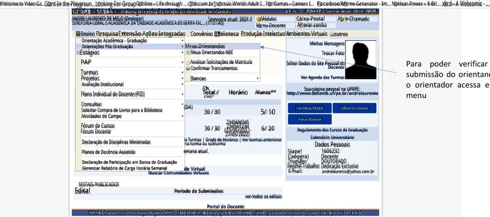

<!-- figure p21-fig1 | described_by: agy | ocr_overlap: 0.89 | needs_review: false -->
### 1. Tipo de figura

Trata-se de uma captura de tela anotada de uma interface web — especificamente o **Portal do Docente** do sistema **SIGAA (Sistema Integrado de Gestão de Atividades Acadêmicas)** da **UFRPE** — acompanhada, à direita, de uma anotação textual explicativa ligada por uma seta azul a um item de submenu. A captura inclui no topo a barra de favoritos de um navegador e apresenta, sobreposta a praticamente toda a interface original, uma camada visível de texto preto gerada por reconhecimento óptico de caracteres (OCR), causando duplicação/desalinhamento visual dos rótulos e alguns erros de reconhecimento. A margem direita do texto explicativo encontra-se cortada.

---

### 2. Todo o texto visível (verbatim)

#### Barra de favoritos do navegador (topo da imagem)
- `Welcome to Video Ga...`
- `Giant In the Playgroun...`
- `Looking For Group`
- `Goblins - Life through ...`
- `[bb.com.br]`
- `Jurassic World: Adult I...`
- `FastGames - Gamers I...`
- `Facebook`
- `Meme Generator - Im...`
- `Nuklear Power » 8-Bit ...`
- `xkcd - A Webcomic - ...` *(extremo direito parcialmente cortado)*

#### Cabeçalho superior do sistema
- À esquerda: `UFRPE - SIGAA - Sistema Integrado de Gestão de Atividades Acadêmicas`
- À direita: `A+` `A-` `|` `Ajuda?` `|` `Tempo de Sessão: 00:25` `SAIR`

#### Faixa de identificação do usuário e atalhos
- À esquerda (linha 1): `ANDRE LAURENIO DE MELO (Deslogar)`
- À esquerda (linha 2): `DIRETORIA GERAL E ACADÊMICA DA UNIDADE ACADÊMICA DE SERRA TAL... (11.01.43)`
- Ao centro: `Semestre atual: 2021.1`
- À direita (linha 1 de botões): `Módulos` | `Caixa Postal` | `Abrir Chamado`
- À direita (linha 2 de botões): `Menu Docente` | `Alterar senha`

#### Barra de menu horizontal
- `Ensino`
- `Pesquisa`
- `Extensão`
- `Ações Integradas`
- `Convênios`
- `Biblioteca`
- `Produção Intelectual`
- `Ambientes Virtuais`
- `Outros` *(camada OCR sobreposta exibe `outros`)*

#### Menu suspenso sob `Ensino` (de cima para baixo)
- `Orientação Acadêmica - Graduação`
- `Orientações Pós-Graduação`
- `Estágios`
- `PAP`
- `Turmas`
- `Projetos`
- `Avaliação Institucional`
- `Plano Individual do Docente (PID)`
- `Consultas`
- `Solicitar Compra de Livros para a Biblioteca`
- `Atividades de Campo`
- `Fórum de Cursos`
- `Fórum Docente`
- `Declaração de Disciplinas Ministradas`
- `Planos de Docência Assistida`
- `Declaração de Participação em Banca de Graduação`
- `Gerenciar Relatório de Carga Horária Semanal`

#### Submenu aberto à direita de `Orientações Pós-Graduação` (de cima para baixo)
- `Meus Orientandos`
- `Meus Orientandos NEE`
- `Analisar Solicitações de Matrícula`
- `Confirmar Trancamentos`
- `Bancas`

#### Área central (parcialmente encoberta à esquerda pelo menu suspenso)
- Cabeçalhos de colunas visíveis:
  - `Ch. Total / CHD*` *(camada OCR sobreposta exibe `Ch.` / `Total //` sobre `Ch. Total / CHD*`)*
  - `Horário`
  - `Alunos**`
- Linha 1 visível da tabela:
  - Fragmento à esquerda (junto à borda do menu): `(DA)`
  - Coluna `Ch. Total / CHD*`: `30 / 30`
  - Coluna `Horário`: *(vazia)*
  - Coluna `Alunos**`: `5 / 10` *(camada OCR sobreposta ligeiramente deslocada, parecendo `5// 10`)*
- Linha 2 visível da tabela:
  - Coluna `Ch. Total / CHD*`: `30 / 30`
  - Coluna `Horário`: `23456M345` / `23456T234` / `(23/05/2022-` / `27/05/2022)`
  - Coluna `Alunos**`: `6 / 20`
- Links e fragmentos de texto abaixo da tabela (inícios encobertos pelo menu):
  - `is Turmas | Grade de Horários | Ver turmas anteriores`
  - `na turma ou subturma`
  - `emana atual.`
- Seção de comunidades virtuais (parte visível abaixo do menu):
  - `de Virtual` *(início encoberto pelo menu)*
  - `Buscar Comunidades Virtuais`
- Seção de editais (parte inferior):
  - Título: `EDITAIS PUBLICADOS`
  - Cabeçalhos: `Edital` | `Período de Submissões`
  - Link à direita: `ver todos os editais`

#### Painel lateral direito (perfil do docente)
- Links junto à silhueta de foto:
  - `Minhas Mensagens`
  - `Trocar Foto`
  - `Editar Dados do Site Pessoal do Docente`
  - `Ver Agenda das Turmas`
- Bloco de endereço pessoal:
  - `Sua página pessoal na UFRPE:`
  - `http://www.docente.ufrpe.br/andrelaurenio`
- Botões retangulares azuis:
  - `Periódicos CAPES`
  - `Ofícios Eletrônicos`
  - `Fórum Docente`
- Links institucionais:
  - `Regulamento dos Cursos de Graduação`
  - `Calendário Universitário`
- Bloco `Dados Pessoais`:
  - Título: `Dados Pessoais`
  - `Siape:` *(camada OCR sobreposta exibe `Siape!`)* — `1606232`
  - `Categoria:` *(camada OCR sobreposta exibe `Caeogra)`)* — `Docente`
  - `Titulação:` *(camada OCR sobreposta exibe `Titug5geo:`)* — `DOUTORADO`
  - `Regime Trabalho:` — `Dedicação Exclusiva`
  - `E-mail:` — `andrelaurenio@yahoo.com.br`

#### Rodapé da página
- Link centralizado acima da faixa: `Portal do Docente`
- Texto na faixa inferior: `SIGAA | Secretaria de Tecnologias Digitais (STD) - (81) 3320-6046 | Copyright © 2006-2022 - UFRN - preproducao-jboss01.preproducao-jboss01 - v4.6.8-1`

#### Anotação explicativa à direita da captura de tela (texto cortado na margem direita)
- Linha 1: `Para poder verificar`
- Linha 2: `submissão do orientan`*(letra seguinte cortada na borda direita)*
- Linha 3: `o orientador acessa e`*(letra seguinte cortada na borda direita)*
- Linha 4: `menu`

---

### 3. Estrutura da figura

- **Disposição geral**:
  - À esquerda/centro (ocupando cerca de dois terços da largura, centralizada sobre um fundo quadriculado claro), encontra-se a janela do Portal do Docente do SIGAA, encimada por uma barra horizontal de favoritos do navegador que atravessa toda a largura superior.
  - À direita, sobre o fundo quadriculado e a margem branca externa, situa-se um bloco de texto explicativo de quatro linhas sem moldura.

- **Conexão / seta**:
  - Uma seta reta e fina de cor azul parte da margem esquerda do texto explicativo (entre a segunda e a terceira linha), cruza obliquamente para cima e para a esquerda sobre o painel lateral direito do SIGAA (passando sobre a silhueta da foto de perfil e os links `Trocar Foto` / `Editar Dados do Site Pessoal do Docente`) e aponta diretamente para a borda direita do item `Meus Orientandos` no submenu aberto.

- **Hierarquia de painéis e navegação dentro da página do SIGAA**:
  1. **Cabeçalho** em duas faixas horizontais (barra superior institucional e barra de dados do usuário com grade 2×3 de atalhos à direita, tendo 3 botões na 1ª linha e 2 na 2ª).
  2. **Barra de menu principal** horizontal com 9 categorias com ícones à esquerda de cada rótulo.
  3. **Menus em cascata sobrepostos ao corpo principal**:
     - Do primeiro item da barra horizontal (`Ensino`) abre-se um **menu suspenso vertical** de 17 opções divididas em grupos por finas linhas horizontais separadoras. Os itens com submenus possuem um pequeno triângulo preto voltado para a direita (`▸`): `Orientação Acadêmica - Graduação`, `Orientações Pós-Graduação`, `Estágios`, `PAP`, `Turmas`, `Projetos`, `Avaliação Institucional`, `Plano Individual do Docente (PID)`, `Consultas` e `Atividades de Campo`.
     - Do segundo item desse menu (`Orientações Pós-Graduação`) abre-se à direita um **submenu vertical** com 5 opções (as duas primeiras separadas das duas seguintes por uma linha horizontal, e a última, `Bancas`, com indicador `▸`).
  4. **Coluna principal (centro-esquerda, sob o menu)**:
     - **Tabela de turmas** (parcialmente oculta à esquerda pelo menu suspenso): mostra 3 colunas visíveis à direita (`Ch. Total / CHD*`, `Horário`, `Alunos**`), uma faixa horizontal de agrupamento e 2 linhas de registros, seguidas por uma barra de links e linhas de legenda parcialmente encobertas.
     - **Bloco de Comunidades Virtuais** logo abaixo.
     - **Bloco `EDITAIS PUBLICADOS`** na parte inferior, estruturado como tabela vazia com duas colunas (`Edital` e `Período de Submissões`) e o link `ver todos os editais` abaixo à direita.
  5. **Coluna lateral direita (painel do docente)**, empilhada verticalmente em 5 subblocos:
     - Links rápidos à esquerda e caixa quadrada com silhueta preta de busto à direita.
     - Link da página pessoal na UFRPE.
     - Grade de 3 botões retangulares (2 na primeira linha, 1 na segunda).
     - Dois links institucionais centralizados.
     - Tabela `Dados Pessoais` com 2 colunas (rótulo à esquerda, valor à direita) e 5 linhas.
  6. **Rodapé** com o link `Portal do Docente` acima de uma faixa institucional horizontal.

---

### 4. Todos os números e valores de dados

- **Tempo de sessão restante**: `00:25`
- **Semestre atual**: `2021.1`
- **Código da unidade acadêmica**: `11.01.43`
- **Tabela de turmas — Linha 1**:
  - `Ch. Total / CHD*`: `30 / 30`
  - `Alunos**`: `5 / 10`
- **Tabela de turmas — Linha 2**:
  - `Ch. Total / CHD*`: `30 / 30`
  - `Horário`: `23456M345`, `23456T234`, período `23/05/2022` a `27/05/2022`
  - `Alunos**`: `6 / 20`
- **Dados Pessoais**:
  - `Siape`: `1606232`
- **Rodapé**:
  - Telefone da Secretaria de Tecnologias Digitais (STD): `(81) 3320-6046`
  - Intervalo de copyright: `2006-2022`
  - Identificador de instância/servidor: `preproducao-jboss01.preproducao-jboss01` (`01`)
  - Versão do sistema: `v4.6.8-1`
- **Barra de favoritos**:
  - `8` em `Nuklear Power » 8-Bit ...`

---

### 5. Cores com significado

- **Azul-claro (destaque de fundo nos menus)**: indica o caminho de navegação atualmente selecionado/focado — `Ensino` na barra superior, `Orientações Pós-Graduação` no primeiro menu suspenso e `Meus Orientandos` no submenu lateral.
- **Azul médio (seta de anotação)**: conecta visualmente o texto explicativo à direita ao item de menu que o orientador deve acessar (`Meus Orientandos`).
- **Azul-escuro com borda laranja/dourada (cabeçalho e rodapé) e azul-escuro nos botões**: identifica as barras institucionais do SIGAA e destaca visualmente os três botões de acesso rápido no painel lateral (`Periódicos CAPES`, `Ofícios Eletrônicos` e `Fórum Docente`).
- **Preto (silhueta de perfil)**: representa a ausência/ocultação da fotografia do docente no painel lateral direito.

~~~text ocr
Weleome-to Videocaa.. the L.. - Em... - ..
-
atual: 2024.1
ATA |
Caixa-Postal
| Convênios
Acadêmica - Graduação
Orientações Pós-Graduação
» Meus Orientandos NEE
PAP » de Matrícula
» Trancamentes
»
Baneas
iação Institucional >
Plano Individual do Horário
de Livro Biblioteca
à para a Bi
Atividades de Campo 5/10
6/20
Declaração de Disciplinas Ministradas ls urmas | Grade
Planos de Docência emana atual,
de Participação em Banca de Graduação
Relatório de Carga Virtual
RUBLICADOS
Edital de Submissões
os editais
Portal do Docente
|
Editar- Dados do Site
Ver Agenda das Tenimas
Regulamento dos Cursos de Graduação
Calendário Universitário
Sia
Ca
andrelaurenio@yahoo.com.br
=
Para poder verificar
submissão do orientan
o orientador acessa e
menu
~~~

<!-- Start of picture text -->
Welcome to Video Ga...Giant In the Playgroun...Looking For GroupGoblins - Life through ...  [bb.com.br]Jurassic World: Adult I...FastGames - Gamers I... FacebookMeme Generator - Im...Nuklear Power » 8-Bit ... xkcd - A Webcomic - ... UFRPE - SIGAA - Sistema Integrado de Gestão de Atividades Acadêmicas A+A- Ajuda? Tempo de Sessão: 00:25 SAIR ANDRE LAURENIO DE MELO (Deslogar) Semestre atual: 2021.1 Módulos Caixa Postal Abrir Chamado DIRETORIA GERAL E ACADÊMICA DA UNIDADE ACADÊMICA DE SERRA TAL... (11.01.43) Menu Docente Alterar senha 目Ensino PesquisaExtensão Ações Integradas Convênios Biblioteca Produção IntelectualAmbientes Virtuais outros Orientação Acadêmica - Graduação Orientações Pós-Graduação Meus Orientandos Minhas Mensagens Estágios Meus Orientandos NEE Trocar Foto PAP V Confirmar TrancamentosAnalisar Solicitações de Matrícula Editar Dados do Site Pessoal doDocente Para poder verificar a Turmas submissão do orientando, Projetos Bancas Ver Agenda das Turmas Avaliação Institucional o orientador acessa este Plano Individual do Docente (PID) Ch.Total / Horário Alunos** http://www.docente.ufrpe.br/andrelaurenioSua página pessoal na UFRPE: menu Consultas (DA) Periódicos CAPES Oficios Eletrônicos Solicitar Compra de Livros para a Biblioteca 30 / 30 5/ 10 Atividades de Campo Fórum Docente 23456M345 Fórum de Cursos 23456T234 Fórum Docente 30 / 30 (23/05/2022- 6/ 20 Regulamento dos Cursos de Graduação 27/05/2022) Calendário Universitário is Turmas | Grade de Horários | Ver turmas anteriores Declaração de Disciplinas Ministradas na turma ou subturma Dados Pessoais Planos de Docência Assistida emana atual. Siape! 1606232 Caeogra) Docente Declaração de Participação em Banca de Graduação Titug5geo: DOUTORADO Gerenciar Relatório de Carga Horária Semanal de Virtual Regime Trabalho: Dedicação Exclusiva Buscar Comunidades Virtuais E-mail: andrelaurenio@yahoo.com.br EDITAIS PUBLICADOS Edital Período de Submissões ver todos os editais Portal do Docente SIGAA | Secretaria de Tecnologias Digitais (STD) - (81) 3320-6046 | Copyright © 2006-2022 - UFRN - preproducao-jboss01.preproducao-jboss01 - v4.6.8-1 <!-- End of picture text -->

Para poder verificar a submissão do orientando, o orientador acessa este 

https://preproducao.sigs.ufrpe.br/sigaa/portais/docente/docente.jsf# 

18 

POR 10:50 INTL17/05/2022 

ǔ 市 

29C Chuva fraca 

Digite aqui para pesquisar 

<!-- page 22 -->

> SIGAA - Sistema Integrado de GX + 

> 凸 × 

← C 

###### 目☆ 

###### https://preproducao.sigs.ufrpe.br/sigaa/portais/docente/docente.jsf 

###### Introdução Save to MendeleyWelcome to Video Ga...Giant In the Playgroun...Looking For Group Goblins - Life through...[bb.com.br]Juratssic World: Adult ...FastGames -Gamers 1...Facebook Meme Generator -Im...Nuklear Power 8-rit...xkcd-A Webcomic -.. UFRPE - SIGAA - Sistema Integrado de Gestão de Atividades Acadêmicas A+A- Ajuda?Tempo de Sessão: 00:25 SAIRTempo de Sessão: 00:25 SAIR 

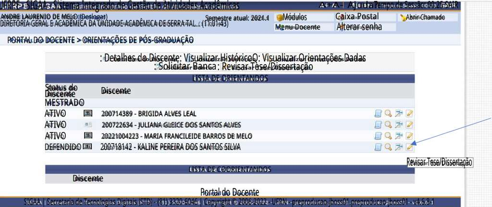

<!-- figure p22-fig1 | described_by: agy | ocr_overlap: 0.92 | needs_review: false -->
**(1) Tipo de figura**
Captura de tela anotada de uma interface web do sistema acadêmico SIGAA (Sistema Integrado de Gestão de Atividades Acadêmicas) da UFRPE, exibindo a página de orientações de pós-graduação no Portal do Docente, com uma seta de anotação indicando um botão de ação e sua dica flutuante (*tooltip*). A imagem apresenta texto duplicado/sobreposto em preto (camada de texto de OCR renderizada sobre a captura original).

**(2) Todo o texto visível, verbatim**

*Barra superior do cabeçalho:*
- À esquerda: `UFRPE - SIGAA - Sistema Integrado de Gestão de Atividades Acadêmicas` *(o `U` inicial está levemente cortado na borda esquerda; a camada de texto sobreposta em preto exibe `JFRPE - SIGAA - Sistema Integrado de Gestão de Atividades Acadêmicas`)*
- À direita: `A+` `A-` `|` `Ajuda?` `|` `Tempo de Sessão: 00:25` `SAIR` *(na camada sobreposta em preto: `A+A- Ajuda Tempo de Sessão: 00:25 SAIR`)*

*Painel de identificação do usuário e atalhos:*
- À esquerda, linha 1: `ANDRE LAURENIO DE MELO (Deslogar)`
- À esquerda, linha 2: `DIRETORIA GERAL E ACADÊMICA DA UNIDADE ACADÊMICA DE SERRA TAL... (11.01.43)`
- Ao centro: `Semestre atual: 2021.1`
- Botões à direita, linha 1: `Módulos`, `Caixa Postal`, `Abrir Chamado`
- Botões à direita, linha 2: `Menu Docente`, `Alterar senha`

*Trilha de navegação:*
- `PORTAL DO DOCENTE > ORIENTAÇÕES DE PÓS-GRADUAÇÃO`

*Caixa de legenda de ícones:*
- Linha 1: `: Detalhes do Discente` `: Visualizar Histórico` `: Visualizar Orientações Dadas` *(a camada de texto sobreposta em preto renderiza `: Detalhes do Discente: Visualizar HistóricoQ: Visualizar Orientações Dadas`, com `Q` sobre o ícone de lupa)*
- Linha 2: `: Solicitar Banca` `: Revisar Tese/Dissertação`

*Primeira tabela — cabeçalhos e células:*
- Título da tabela: `LISTA DE ORIENTANDOS`
- Cabeçalho de colunas: `Status do Discente` | `Discente`
- Subcabeçalho de grupo: `MESTRADO`
- Linha 1: `ATIVO` | `200714389 - BRIGIDA ALVES LEAL` *(artefato de OCR `国` sobreposto ao ícone à esquerda da matrícula)*
- Linha 2: `ATIVO` | `200722634 - JULIANA GLEICE DOS SANTOS ALVES`
- Linha 3: `ATIVO` | `20221004223 - MARIA FRANCILEIDE BARROS DE MELO` *(artefato de OCR `国` sobreposto ao ícone à esquerda da matrícula)*
- Linha 4: `DEFENDIDO` | `200718142 - KALINE PEREIRA DOS SANTOS SILVA` *(artefato de OCR `国` sobreposto ao ícone à esquerda da matrícula)*

*Dica flutuante (tooltip) abaixo da linha 4, à direita:*
- `Revisar Tese/Dissertação`

*Segunda tabela:*
- Título da tabela: `LISTA DE COORIENTANDOS`
- Cabeçalho de coluna: `Discente`

*Link inferior centralizado:*
- `Portal do Docente`

*Rodapé:*
- `SIGAA | Secretaria de Tecnologias Digitais (STD) - (81) 3320-6046 | Copyright © 2006-2022 - UFRN - preproducao-jboss01.preproducao-jboss01 - v4.6.8-1`

**(3) Estrutura**
A interface está organizada verticalmente em seis faixas principais dentro de um contêiner central branco delimitado à direita por uma margem quadriculada clara:
1. **Cabeçalho institucional e barra do usuário (topo):** Faixa superior estreita com o nome do sistema à esquerda e controles de acessibilidade/ajuda/sessão à direita. Abaixo dela, um painel horizontal contém os dados do docente e da unidade à esquerda, o semestre atual ao centro e uma grade de cinco botões com ícones à direita (três na linha superior: `Módulos` com ícone de caixa/cubo amarelo, `Caixa Postal` com ícone de envelope/correio e `Abrir Chamado` com ícone de sino; dois na linha inferior: `Menu Docente` e `Alterar senha`). Logo abaixo aparece a barra de trilha de navegação (`PORTAL DO DOCENTE > ORIENTAÇÕES DE PÓS-GRADUAÇÃO`).
2. **Caixa de legenda de ícones:** Retângulo horizontal cinza-claro centralizado acima da primeira tabela, apresentando cinco pares ícone–descrição distribuídos em duas linhas: (i) ícone de ficha/documento para `Detalhes do Discente`, (ii) ícone de pergaminho para `Visualizar Histórico`, (iii) ícone de lupa para `Visualizar Orientações Dadas`, (iv) ícone de folha com elemento de diagrama/solicitação para `Solicitar Banca` e (v) ícone de lápis sobre folha para `Revisar Tese/Dissertação`.
3. **Tabela `LISTA DE ORIENTANDOS`:** Composta por uma barra de título, uma linha de cabeçalho com duas colunas principais (`Status do Discente` à esquerda e `Discente` à direita, além de uma área implícita de ícones de ação na extremidade direita), uma faixa de agrupamento horizontal (`MESTRADO`) e quatro linhas de registros. Em cada linha constam, da esquerda para a direita: o status do discente, o ícone de `Detalhes do Discente`, a matrícula e o nome completo do discente e, alinhados à direita, quatro ícones de ação na ordem da legenda (`Visualizar Histórico`, `Visualizar Orientações Dadas`, `Solicitar Banca` e `Revisar Tese/Dissertação`).
4. **Anotação com seta e tooltip:** Uma seta reta longa entra pela borda direita externa da imagem, inclinada para baixo e para a esquerda, apontando diretamente para o quarto ícone da quarta linha (o ícone de lápis de `Revisar Tese/Dissertação` correspondente à discente `200718142 - KALINE PEREIRA DOS SANTOS SILVA`, cujo status é `DEFENDIDO`). Imediatamente abaixo desse ícone aparece uma caixa retangular branca com borda fina cinza exibindo o texto `Revisar Tese/Dissertação`.
5. **Tabela `LISTA DE COORIENTANDOS`:** Possui barra de título e cabeçalho de coluna `Discente`, sem nenhuma linha de registro preenchida abaixo.
6. **Link e rodapé:** Abaixo das tabelas há o link centralizado `Portal do Docente`, seguido por uma faixa de rodapé em toda a largura da página.

**(4) Todos os números e valores de dados**
- Tempo de sessão restante: `00:25`
- Código da unidade acadêmica: `11.01.43`
- Semestre atual: `2021.1`
- Total de orientandos listados em `MESTRADO`: 4 discentes (3 com status `ATIVO` e 1 com status `DEFENDIDO`):
  - Matrícula `200714389` — `BRIGIDA ALVES LEAL` (`ATIVO`)
  - Matrícula `200722634` — `JULIANA GLEICE DOS SANTOS ALVES` (`ATIVO`)
  - Matrícula `20221004223` — `MARIA FRANCILEIDE BARROS DE MELO` (`ATIVO`)
  - Matrícula `200718142` — `KALINE PEREIRA DOS SANTOS SILVA` (`DEFENDIDO`)
- Total de coorientandos listados em `LISTA DE COORIENTANDOS`: 0
- Telefone no rodapé: `(81) 3320-6046`
- Período de copyright: `2006-2022`
- Identificador de instância no servidor: `preproducao-jboss01.preproducao-jboss01` (`01`)
- Versão do sistema: `v4.6.8-1`

**(5) Cores que carregam significado**
- **Azul médio na seta de anotação:** destaca o elemento interativo-alvo da instrução (o ícone de lápis `Revisar Tese/Dissertação` na linha da discente com status `DEFENDIDO`).
- **Azul-escuro nas barras horizontais (com texto branco original) e borda dourada/laranja:** separa hierarquicamente o cabeçalho global do sistema, os títulos das duas tabelas (`LISTA DE ORIENTANDOS` e `LISTA DE COORIENTANDOS`) e o rodapé.
- **Cinza-claro nos cabeçalhos de coluna e alternância entre branco e azul muito claro nas linhas da tabela:** distingue cabeçalhos, subgrupo (`MESTRADO`) e registros consecutivos para facilitar a leitura linha a linha.
- **Cores dos ícones de ação (pergaminho azul, lupa dourada/marrom, documento azul e lápis amarelo):** diferenciam visualmente cada função disponível para cada orientando, ligando cada ícone da tabela à sua entrada correspondente na legenda superior.

~~~text ocr
RPE |
LAURENIO D
PORTAL DO DOCENTE > ORIENTAÇÕES DE PÓS-GRADUAÇÃO
Dadas
Caixa-Postal
MESTRADO
AFIVO E 20074389 - BRIGIDA ALVES LEAL BQ
=" 200722634 - JULIANA DOS SANTOS ALVES BQ
20221004223 - MARIA FRANCILEIDE BARROS DE MELO
DEFENDIDO - KALINE PEREIRA DOS SANTOS SILVA
~~~

<!-- Start of picture text -->
UFRPE - SIGAA - Sistema Integrado de Gestão de Atividades Acadêmicas A+A- Ajuda?Tempo de Sessão: 00:25 SAIRTempo de Sessão: 00:25 SAIR ANDRE LAURENIO DE MELO (Deslogar) Semestre atual: 2021.1 Módulos Caixa Postal Abrir Chamado DIRETORIA GERAL E ACADÊMICA DA UNIDADE ACADÊMICA DE SERRA TAL... (11.01.43) Menu Docente Alterar senha PORTAL DO DOCENTE > ORIENTAÇÕES DE PÓS-GRADUAÇÃO : Detalhes do Discente: Visualizar HistóricoQ: Visualizar Orientações Dadas : Solicitar Banca : Revisar Tese/Dissertação LISTA DE ORIENTANDOS Status do Discente Discente MESTRADO ATIVO 国 200714389 - BRIGIDA ALVES LEAL ATIVO 200722634 - JULIANA GLEICE DOS SANTOS ALVES ATIVO 国 20221004223 - MARIA FRANCILEIDE BARROS DE MELO DEFENDIDO 国 200718142 - KALINE PEREIRA DOS SANTOS SILVA Revisar Tese/Dissertação LISTA DE COORIENTANDOS Discente Portal do Docente SIGAA | Secretaria de Tecnologias Digitais (STD) - (81) 3320-6046 | Copyright © 2006-2022 - UFRN - preproducao-jboss01.preproducao-jboss01 - v4.6.8-1 <!-- End of picture text -->

Nesta tela, o orientador clica neste botão, referente ao orientando o qual ele deseja revisar 

≡ 

》 

https://preproducao.sigs.ufrpe.br/sigaa/portais/docente/docente.jsf# 

19 

INTL 17/05/2022POR 10:51 星2 

出 

Digite aquí para pesquisar 

29°C Chuva fraca 

INTL 17/05/2022POR 

<!-- page 23 -->

> 凸 × 

> SIGAA - Sistema Integrado de GX + 

##### ←→ C https://preproducao.sigs.ufrpe.br/sigaa/stricto/orientacao/orientandos.jsf 

目☆ ≡ 

》 

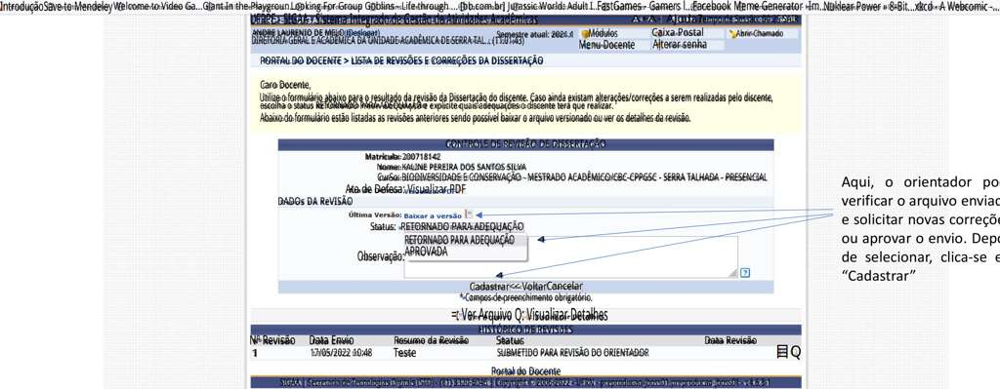

<!-- figure p23-fig1 | described_by: claude:sonnet | ocr_overlap: 0.89 | needs_review: false -->
Figura: captura de tela (screenshot) de interface web, com anotação textual sobreposta à direita e três setas/indicadores desenhados em azul apontando para elementos da tela. No topo da imagem aparecem, sobrepostas/fantasmas, abas de navegador de outro contexto (ruído visual, não fazem parte do conteúdo da captura): "Introdução", "Save to Mendeley", "Welcome to Video Ga...", "Giant In the Playgroun...", "Looking For Group Goblins - Life through ...", "(bb.com.br]", "Jurassic World: Adult I...", "FastGames - Gamers I...", "Facebook Meme Generator", "Im...Nuklear Power » 8-Bit...xkcd - A Webcomic -...".

(1) Tipo de figura: captura de tela de um sistema acadêmico web (portal SIGAA), mostrando um formulário de "Controle de Revisão de Dissertação", com uma caixa de texto explicativo à direita contendo instruções de uso.

(2) Todo o texto visível, verbatim:

Cabeçalho do sistema:
- "UFRPE SIGAA - Sistema Integrado de Gestão de Atividades Acadêmicas"
- "A+ A- | Ajuda ? | Tempo de Sessão: 00:25 SAIR"
- "ANDRE LAURENIO DE MELO (Deslogar)"
- "DIRETORIA GERAL E ACADÊMICA DA UNIDADE ACADÊMICA DE SERRA TAL... (11.01.43)"
- "Semestre atual: 2024.1"
- "Módulos" / "Caixa Postal" / "Abrir Chamado"
- "Menu Docente" / "Alterar senha"

Caminho de navegação:
- "PORTAL DO DOCENTE > LISTA DE REVISÕES E CORREÇÕES DA DISSERTAÇÃO"

Caixa de instrução (fundo amarelo claro):
- "Caro Docente,"
- "Utilize o formulário abaixo para o resultado da revisão da Dissertação do discente. Caso ainda existam alterações/correções a serem realizadas pelo discente, escolha o status RETORNADO PARA ADEQUAÇÃO e explicite quais adequações o discente terá que realizar."
- "Abaixo do formulário estão listadas as revisões anteriores sendo possível baixar o arquivo versionado ou ver os detalhes da revisão."

Bloco "CONTROLE DE REVISÃO DE DISSERTAÇÃO" (barra de título azul escura):
- "Matrícula: 200718142"
- "Nome: KALINE PEREIRA DOS SANTOS SILVA"
- "Curso: BIODIVERSIDADE E CONSERVAÇÃO - MESTRADO ACADÊMICO/CBC-CPPGSC - SERRA TALHADA - PRESENCIAL"
- "Ata de Defesa: Visualizar PDF"

Seção "DADOS DA REVISÃO":
- "Última Versão: Baixar a versão" (link azul) + ícone pequeno ao lado
- "Status: RETORNADO PARA ADEQUAÇÃO" — com menu suspenso (dropdown) aberto logo abaixo mostrando duas opções: "RETORNADO PARA ADEQUAÇÃO" e "APROVADA"
- "Observação:" seguido de uma caixa de texto grande vazia, com um pequeno ícone de redimensionamento no canto inferior direito e um ícone de interrogação azul "?" ao lado

Botões:
- "Cadastrar" | "<< Voltar" | "Cancelar"
- "* Campos de preenchimento obrigatório."

Seção seguinte:
- "= Ver Arquivo  Q: Visualizar Detalhes" (ícones associados: um ícone de prancheta/lista e um ícone de lupa "Q")

Tabela "HISTÓRICO DE REVISÕES" (barra de título azul escura), com colunas:
- "Nº Revisão" | "Data Envio" | "Resumo da Revisão" | "Status" | "Data Revisão"
Linha de dados única:
- "1" | "17/05/2022 10:48" | "Teste" | "SUBMETIDO PARA REVISÃO DO ORIENTADOR" | (coluna "Data Revisão" vazia) — e na extrema direita ícones repetidos de prancheta/lista e lupa "Q"

Rodapé:
- "Portal do Docente"
- "SIGAA | Secretaria de Tecnologias Digitais (STD) - (81) 3320-6046 | Copyright © 2006-2022 - UFRN - preproducao-jboss01.preproducao-jboss01 - v4.6.8-1"

Texto de anotação à direita da captura (caixa de texto explicativo, corrido em preto, parcialmente cortado na borda direita da imagem):
- "Aqui, o orientador po[de] verificar o arquivo enviad[o] e solicitar novas correçõe[s] ou aprovar o envio. Depo[is] de selecionar, clica-se e[m] "Cadastrar"" — últimas letras de cada linha cortadas pela borda da imagem [illegible nas extremidades: "pode", "enviado", "correções", "Depois", "em" reconstituídos pelo contexto, mas as letras finais exatas estão fisicamente cortadas].

(3) Estrutura / conexões:
- Três linhas azuis (setas) partem da área de texto explicativo à direita e apontam para três elementos distintos à esquerda, dentro do formulário "DADOS DA REVISÃO":
  - Uma seta aponta para o ícone ao lado de "Baixar a versão" (campo "Última Versão").
  - Uma seta aponta para a opção "RETORNADO PARA ADEQUAÇÃO" dentro do menu suspenso do campo "Status".
  - Uma seta aponta para o botão "Cadastrar".
- Layout geral: cabeçalho do sistema no topo (barra azul escura + barra de usuário), abaixo caminho de navegação, abaixo caixa de aviso amarela, abaixo o painel de formulário "CONTROLE DE REVISÃO DE DISSERTAÇÃO" com campos empilhados verticalmente (Matrícula, Nome, Curso, Ata de Defesa, depois subseção Dados da Revisão com Última Versão, Status com dropdown, Observação com textarea, depois linha de botões), e por fim tabela "HISTÓRICO DE REVISÕES" com uma única linha de dados, seguida do rodapé do sistema.
- Não há eixos nem painéis múltiplos — é uma única tela de formulário web com uma tabela embutida.

(4) Valores/dados numéricos:
- Matrícula: 200718142
- Tempo de Sessão: 00:25
- Semestre atual: 2024.1
- Nº Revisão: 1
- Data Envio: 17/05/2022 10:48
- Telefone no rodapé: (81) 3320-6046
- Copyright © 2006-2022
- Versão do sistema: v4.6.8-1

(5) Cores com significado:
- Barras de título e cabeçalhos em azul escuro (identidade visual do sistema SIGAA).
- Caixa de aviso/instrução com fundo amarelo claro, destacando texto de orientação ao usuário.
- Links clicáveis ("Baixar a versão", "Visualizar PDF", "Visualizar Detalhes") em azul, texto comum em preto.
- Setas de anotação em azul, usadas para ligar o texto explicativo aos elementos correspondentes da interface.
- Linhas de texto duplicadas/fantasmas (sombra) sobre praticamente todo o conteúdo da captura — artefato visual (efeito de sobreposição/ghosting), sem significado semântico, presente de forma consistente em todas as linhas de texto da imagem.

~~~text ocr
Welcometo:Video Meme-Generator Power
1
ixa-Postal
PORTAL DO DOCENTE > LISTA DE REVISÕES E CORREÇÕES DA DISSERTAÇÃO
Caro Docente,
for i faso ainda ale correções a serem realizadas pelo discente,
Abaixo-do formulário estão listadas as revisões anteriores possivel baixar 0 arquivo 65 detalhes da revisão.
200718142
PEREIRA DOS SANTOS SILVA.
- MESTRADO - SERRA TALHADA - PRESENGIAL
DADOS DA ReVISAO
Última Versão: Baixar a versão |"
Status: REFORNADO
PARA
AB
obrigatório.
Resumo da Revisão Status Data Revisão
Teste SUBMETIDO PARA REVISÃO DO ORIENTADOR BQ
Aqui, o orientador po
verificar o arquivo enviac
e solicitar novas correçõe
ou aprovar o envio. Dep:
de selecionar, clica-se «
“Cadastrar”
~~~

<!-- Start of picture text -->
IntroduçãoSave to Mendeley Welcome to Video Ga...Giant In the Playgroun...Looking For Group Goblins - Life through ... [bb.com.br] Jurassic World: Adult I... FastGames - Gamers l...Facebook Meme Generator -Im... Nuklear Power » 8-Bit...xkcd - A Webcomic -... UFRPE - SIGAA - Sistema Integrado de Gestão de Atividades Acadêmicas A+A- Ajuda?Tempo de Sessão: 00:25 SAIR ANDRE LAURENIO DE MELO (Deslogar) Semestre atual: 2021.1 Módulos Caixa Postal Abrir Chamado DIRETORIA GERAL E ACADÊMICA DA UNIDADE ACADÊMICA DE SERRA TAL... (11.01.43) Menu Docente Alterar senha PORTAL DO DOCENTE > LISTA DE REVISÕES E CORREÇÕES DA DISSERTAÇÃO Caro Docente, Utilize o formulário abaixo para o resultado da revisão da Dissertação do discente. Caso ainda existam alterações/correções a serem realizadas pelo discente, escolha o status RETORNADO PARA ADEQUAçÃO e explicite quais adequações o discente terá que realizar. Abaixo do formulário estão listadas as revisões anteriores sendo possível baixar o arquivo versionado ou ver os detalhes da revisão. CONTROLE DE REVISÃO DE DISSERTAÇÃO Matrícula: 200718142 Nome: KALINE PEREIRA DOS SANTOS SILVA CurSo: BIODIVERSIDADE E CONSERVAÇÃO - MESTRADO ACADÊMICO/CBC-CPPGSC - SERRA TALHADA - PRESENCIAL Aqui, o orientador pode Ata de Defesa: Visualizar PDF DADOs DA ReVISÃO verificar o arquivo enviado, e solicitar novas correções, Status:  RETORNADO PARA ADEQUAÇÃO 4 RETORNADO PARA ADEQUAÇÃO ou aprovar o envio. Depois Observação: APROVADA de selecionar, clica-se em 4 “Cadastrar” Cadastrar<< VoltarCancelar * Campos de preenchimento obrigatório. =: Ver Arquivo Q: Visualizar Detalhes HISTÓRICO DE REVISõES Nº Revisão Data Envio Resumo da Revisão Status Data Revisão 1 17/05/2022 10:48 Teste SUBMETIDO PARA REVISÃO DO ORIENTADOR 目Q Portal do Docente SIGAA | Secretaria de Tecnologias Digitais (STD) - (81) 3320-6046 | Copyright © 2006-2022 - UFRN - preproducao-jboss01.preproducao-jboss01 - v4.6.8-1 <!-- End of picture text -->

Aqui, o orientador pode verificar o arquivo enviado, e solicitar novas correções, ou aprovar o envio. Depois de selecionar, clica-se em “Cadastrar” 

20 

INTL 17/05/2022POR 10:51 星2 

出 

Digite aqui para pesquisar 

29°C Chuva fraca 

<!-- page 24 -->

UFRPE - SIGAA - Sistema Integrado de Gestão de Atividades Acadêmicas A+ A- Ajuda? | Tempo de Sessão: 00:25 SAIR DIEGO DE Q. JORDAO Semestre atual: 2022.1 Módulos Caixa Postal Abrir Chamado PRO-REITORIA DE PÓS-GRADUAÇÃO-PRPG (11.01.29) Alterar senha STRICTO SENSU > ACOMPANHAMENTO DOS PROCEDIMENTOS APÓS DEFESA DE TESE/DISSERTAÇÃO Matrícula: 200722536 Discente: ANDERSON CLAYTON CESARIO PERGENTINO DA SILVA Programa: COORDENAÇÃO PÓS-GRADUAÇÃO EM ADMINISTRAÇÃO E DESENVOLVIMENTO RURAL-PRPG Curso: ADMINISTRAÇÃO E DESENVOLVIMENTO RURAL - MESTRADO ACADÊMICO - MESTRADO Status: DEFENDIDO Tipo: REGULAR Caro Coordenador, Abs o ao o eooo e e s  se e dd e soea sod so sos s x Você pode acompanhar a situação de cada um deles e, quando necessário, realizar as devidas operações. CONSOLIDAÇÃO DA ATIVIDADE DE DEFESA ✓ 1ºAtividade consolidada. 12/05/2022 Baixar ata da defesa e folhas de correções SUBMISSÃO DA VERSÃO FINAL CORRIGIDA DA DISSERTAÇÃO ✓ 2º Submetido. 01/06/2022 APROVAÇÃO DA VERSÃO FINAL CORRIGIDA DA DISSERTAÇÃO ✓ 3º Versão final Aprovada. 01/06/2022 

O aluno deverá acessar o sistema da biblioteca para solicitar a ficha catalográfica, e inserí-la junto ao seu trabalho final 

|4º|SOLICITAÇÃO DA FICHA CATALOGRÁFICA √ O(A) aluno(a) deverá solicitar a ficha catalográfica acessando http://www.sib.ufrpe.br/ficha-catalografica- gerador|
|---|---|
|5º|RESSUBMISSÃO DA VERSÃO FINAL CORRIGIDA DA DISSERTAÇÃO COM FICHA CATALOGRÁFICA ✓ Após inserir a Ficha Catalográfica, o(a) aluno(a) deverá submeter a versão final no Menu: Ensino > Produções Acadêmicas > Submeter Teses/Dissertações.|
|6º|APROVAÇÃO DA VERSÃO FINAL CORRIGIDA DA DISSERTAÇÃO COM FICHA CATALOGRÁFICA ✓ O(A) orientador(a) deverá aprovar a versão final corrigida com Ficha Catalográfica, acessando o Menu: Ensino > Orientações Pós-Graduação > Meus Orientandos > Revisar Tese/Dissertação.|
|7º|ASSINATURA DO TERMO DE AUTORIZAÇÃO DE PUBLICAÇÃO Aguardando assinatura do termo de autorização pelo aluno.|
|8º|RECEBIMENTO DA VERSÃO FINAL PELA COORDENAÇÃO Coordenação aguardando recebimento.|
|gº|VALIDAR DOCUMENTOS OBRIGATÓRIOS Necessário a assinatura do termo de publicação pelo aluno.|

PREENCHIMENTO DO QUESTIONÁRIO 10º Aguardando o preenchimento do questionário pelo aluno. 

SOLICITAÇÃO DE HOMOLOGAÇÃO DO DIPLOMA 

21 

<!-- page 25 -->

> 口 × ￥目 

> SIGAA - Sistema Integrado de GX + 

###### 8https://preproducao.sigs.ufrpe.br/sigaa/portais/discente/discente.jsf 

← C 

###### FastGames - Gamers l...FacebookMeme Generator - Im...Nuklear Power » 8-Bit ...xkcd - A Webcomic - ... 》 A+ A- Ajuda?Tempo de Sessão: 00:25 SAIRTempo de Sessão: 00:25 SAIR 

###### IntroduçãoSave to Mendeley Welcome to Video Ga...Giant In the Playgroun...Looking For Group Goblins - Life through ...[bb.com.br] Jurassic World: Adult I... 

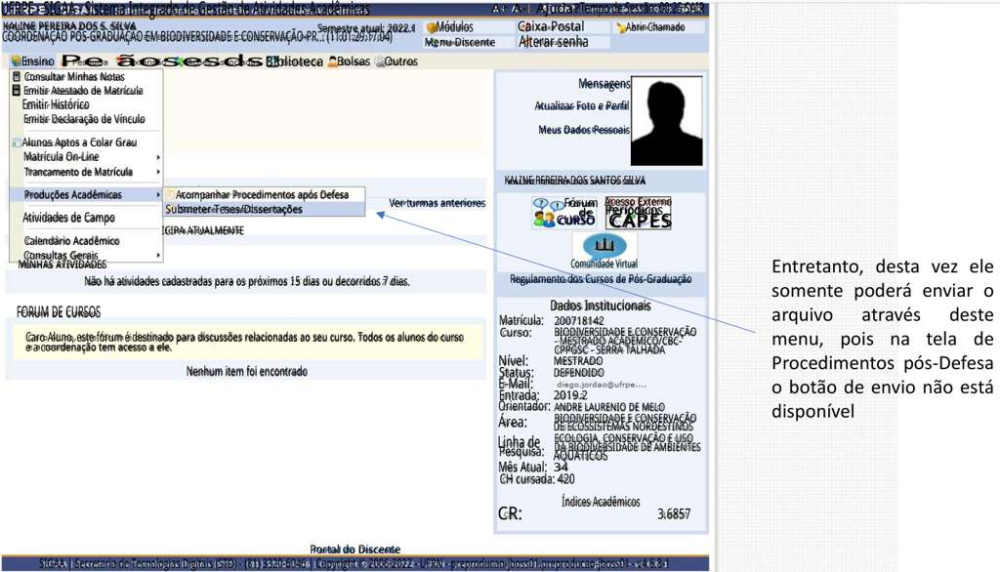

<!-- figure p25-fig1 | described_by: claude:sonnet | ocr_overlap: 0.94 | needs_review: false -->
1. Tipo de figura: Captura de tela (screenshot) de sistema web acadêmico (SIGAA), com seta azul e caixa de texto anotada sobrepostas — comentário explicativo tipo anotação de print.

2. Texto visível (verbatim onde legível; trechos sobrepostos/ghosting marcados [illegible]):

Cabeçalho topo: "UFRPE SIGAA" + texto sobreposto ilegível "A+ A- | Ajuda? | Tempo de Sessão: 00:29:55 SAIR" [parcialmente illegible por sobreposição]

Linha abaixo: "KALINE PEREIRA DOS S. SILVA" sobreposta com outro texto [illegible] — "COORDENAÇÃO POS-GRADUAÇÃO EM BIODIVERSIDADE E CONSERVAÇÃO-PR..." (11:01:29/7:04) [illegible parcial]
"Semestre atual: 2022.4"
Ícones/menu: "Módulos", "Caixa Postal", "Abrir Chamado", "Menu Discente", "Alterar senha"

Barra de abas: "Ensino", "Pesquisa" (texto sobreposto/duplicado, [illegible] parcial), "Biblioteca", "Bolsas", "Outros"

Menu lateral esquerdo (expandido):
- "Consultar Minhas Notas"
- "Emitir Atestado de Matrícula"
- "Emitir Histórico"
- "Emitir Declaração de Vínculo"
- "Alunos Aptos a Colar Grau"
- "Matrícula On-Line" (com seta de submenu)
- "Trancamento de Matrícula" (com seta de submenu)
- "Produções Acadêmicas" (com seta de submenu, destacado/selecionado) → abre submenu com duas opções:
  - "Acompanhar Procedimentos após Defesa"
  - "Submeter Teses/Dissertações" (linha destacada em azul, aparenta ser opção em foco)
- "Atividades de Campo"
- "Calendário Acadêmico"
- "Consultas Gerais" (com seta de submenu)

Texto sobreposto atrás do menu (parcialmente visível, [illegible]): "Ver turmas anteriores", "...CIPA ATUALMENTE", "MINHAS ATIVIDADES"

Abaixo do menu: "Não há atividades cadastradas para os próximos 15 dias ou decorridos 7 dias."

Seção: "FORUM DE CURSOS"
Texto em caixa amarela: "Caro Aluno, este fórum é destinado para discussões relacionadas ao seu curso. Todos os alunos do curso e a coordenação tem acesso a ele."
"Nenhum item foi encontrado"

Painel direito, topo: "Mensagens"
"Atualizar Foto e Perfil"
"Meus Dados Pessoais"
(ícone silhueta de pessoa, foto não cadastrada)

Nome repetido/sobreposto: "KALINE PEREIRA DOS SANTOS SILVA" [parcial illegible por sobreposição]

Ícones: "Fórum de CURSO", "Acesso Externo Periódicos CAPES", "Comunidade Virtual"
Link: "Regulamento dos Cursos de Pós-Graduação"

Bloco "Dados Institucionais":
- "Matrícula: 200718142"
- "Curso: BIODIVERSIDADE E CONSERVAÇÃO - MESTRADO ACADÊMICO/CBC-CPPGSC - SERRA TALHADA"
- "Nível: MESTRADO"
- "Status: DEFENDIDO"
- "E-Mail: diego.jordao@ufrpe...." [truncado/illegible final]
- "Entrada: 2019.2"
- "Orientador: ANDRE LAURENIO DE MELO"
- "Área: BIODIVERSIDADE E CONSERVAÇÃO DE ECOSSISTEMAS NORDESTINOS"
- "Linha de Pesquisa: ECOLOGIA, CONSERVAÇÃO E USO DA BIODIVERSIDADE DE AMBIENTES AQUÁTICOS"
- "Mês Atual: 34"
- "CH cursada: 420"

Bloco "Índices Acadêmicos":
- "CR: 3,6857"

Rodapé: "Portal do Discente"
"SIGAA | Secretaria de Tecnologias Digitais (STD) - (81) 3320-6046 | Copyright © 2006-2022 - UFRN - preproducao-jboss01.preproducao-jboss01 - v4.6.8.1"

Caixa de anotação (texto preto, canto direito, fora do print, é comentário do autor da imagem):
"Entretanto, desta vez ele somente poderá enviar o arquivo através deste menu, pois na tela de Procedimentos pós-Defesa o botão de envio não está disponível"

3. Estrutura: Imagem única de tela de sistema (SIGAA), dividida em: barra superior de cabeçalho/navegação; faixa de abas horizontal (Ensino/Pesquisa/Biblioteca/Bolsas/Outros); coluna esquerda com menu hierárquico em árvore (itens com submenus indicados por setas, item "Produções Acadêmicas" expandido mostrando dois subitens); área central/inferior esquerda com avisos (atividades, fórum); coluna direita com bloco de foto/perfil, ícones de atalho, dados institucionais tabulares (rótulo: valor) e índice CR. Uma seta azul diagonal parte da caixa de texto anotada (à direita, fora da interface do sistema) e aponta para o subitem de menu "Submeter Teses/Dissertações", indicando que é esse o item ao qual o comentário se refere. Várias áreas do print mostram texto duplicado/sobreposto (ghosting), sugerindo problema de captura ou renderização da imagem original.

4. Valores numéricos presentes:
- Semestre atual: 2022.4
- Tempo de Sessão: 00:29:55 [illegible parcial]
- Matrícula: 200718142
- Entrada: 2019.2
- Mês Atual: 34
- CH cursada: 420
- CR: 3,6857
- "Não há atividades... para os próximos 15 dias ou decorridos 7 dias" (números 15 e 7)
- Telefone rodapé: (81) 3320-6046
- Copyright: 2006-2022
- Versão: v4.6.8.1

5. Cores com significado: linha de menu "Submeter Teses/Dissertações" destacada em fundo azul claro (indica item em foco/selecionado, alvo da seta); caixa de aviso do fórum com fundo amarelo claro (destaque de aviso/informação); seta de anotação em azul; texto da anotação em preto sobre fundo branco; restante da interface em tons padrão azul/branco/preto típicos do SIGAA.

~~~text ocr
|
RE SILVA 0224 Caixa-Postal
POS
Ehiioteca
E Consultas Minhas Notas
Atestado de Mensagens
Histórico Atualizar Foto e Perfil
Emitir Declaração de Vínculo
Munas Aptos a Colar Grau
Matrícula On-Line
Tramcamento de
Produções Acadêmicas | Acompanhar Procedimentos após Defesa
Atividades de Campo
ATUALMENTE
Meus Dados Pessoais
Calendário Acadêmico
Consultas Gerais >
Não há atividades cadastradas para os próximos 15 dias ou decorridos 7 dias.
FORUM DE CURSOS
Entretanto, desta vez ele
somente poderá enviar o
Matrícula: 200718142 arquivo através deste
para discussões relacionadas ao seu curso, Todos os alunos do curso O menu, pois na tela de
tem CRRGSC - SERRA TALHADA
Nível:
Procedimentos pos-Defesa
o botão de envio não está
enta ANDRE LAURENIO disponível
a
Mas
CH cursada: 420
Índices Acadêmicos
GR:
~~~

<!-- Start of picture text -->
UFRPE - SIGAA - Sistema Integrado de Gestão de Atividades Acadêmicas A+ A- Ajuda?Tempo de Sessão: 00:25 SAIRTempo de Sessão: 00:25 SAIR KALINE PEREIRA DOS S. SILVA Semestre atual: 2022.1 Módulos Caixa Postal Abrir Chamado COORDENAÇÃO PÓS-GRADUAÇÃO EM BIODIVERSIDADE E CONSERVAÇÃO-PR... (11.01.29.17.04) Menu Discente Alterar senha Ensino Pe ãosesdsBiblioteca Bolsas Outros Consultar Minhas Notas 日 Emitir Atestado de Matrícula Mensagens Emitir Histórico Atualizar Foto e Perfil Emitir Declaração de Vínculo Meus Dados Pessoais Alunos Aptos a Colar Grau Matrícula On-Line Trancamento de Matrícula KALINE PEREIRA DOS SANTOS SILVA Produções Acadêmicas Acompanhar Procedimentos após Defesa Ver turmas anteriores Fórum Acesso Externo Submeter Teses/Dissertações de Periódicos Atividades de Campo CURSO CAPES ICIPA ATUALMENTE Calendário Acadêmico 山 Consultas Gerais MINHAS ATIVIDADES Comunidade Virtual Entretanto, desta vez ele Não há atividades cadastradas para os próximos 15 dias ou decorridos 7 dias. Regulamento dos Cursos de Pós-Graduação somente poderá enviar o Dados Institucionais FORUM DE CURSOS Matrícula: 200718142 arquivo  através  deste Curso: BIODIVERSIDADE E CONSERVAÇÃO Caro Aluno, este fórum é destinado para discussões relacionadas ao seu curso. Todos os alunos do curso - MESTRADO ACADÊMICO/CBC- menu, pois na tela de e a coordenação tem acesso a ele. CPPGSC - SERRA TALHADA Nenhum item foi encontrado Nível:Status: MESTRADODEFENDIDO Procedimentos pós-Defesa E-Mail: o botão de envio não está Entrada: 2019.2 Área:Orientador: DE ECOSSISTEMAS NORDESTINOSBIODIVERSIDADE E CONSERVAÇÃOANDRE LAURENIO DE MELO disponível Linha dePesquisa: AQUÁTICOSECOLOGIA, CONSERVAÇÃO E USODA BIODIVERSIDADE DE AMBIENTES Mês Atual: 34 CH cursada: 420 Índices Acadêmicos CR: 3.6857 Portal do Discente SIGAA | Secretaria de Tecnologias Digitais (STD) - (81) 3320-6046 | Copyright © 2006-2022 - UFRN - preproducao-jboss01.preproducao-jboss01 - v4.6.8-1 <!-- End of picture text -->

Após conseguir a ficha catalográfica, o aluno deverá repetir os passos anteriores para submissão do arquivo 

22 

后制POR INTL17/05/202210:52 星2 

29C Chuva fraca 

Q Digite aqui para pesquisar 

<!-- page 26 -->

> SIGAA - Sistema Integrado de GX + 

凸 × 

###### 目☆ 

← → C https://preproducao.sigs.ufrpe.br/sigaa/portais/discente/discente.jsf 

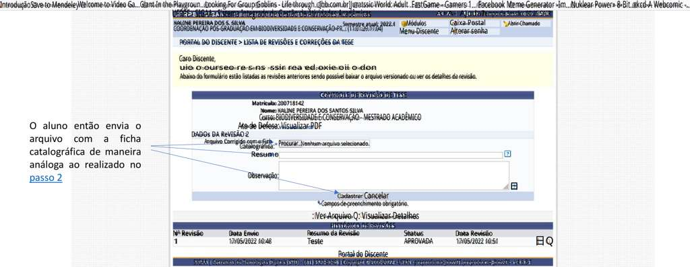

<!-- figure p26-fig1 | described_by: claude:sonnet | ocr_overlap: 0.86 | needs_review: false -->
(1) Tipo de figura: captura de tela (screenshot) de página web de sistema acadêmico (portal SIGAA/SIGA da UFRPE), com anotação sobreposta (texto e duas setas azuis) explicando o fluxo.

(2) Texto visível, verbatim:

Faixa superior (abas de navegador, sobrepostas e parcialmente ilegíveis por sobreposição com o conteúdo abaixo): "Introdução", "Save to Mendeley", "Welcome to Video Ga...", "Giant In the Playgroun...", "Looking For Group", "Goblins - Life through...", "[bb.com.br] Jurassic World: Adult...", "FastGame - Gamers 1...", "Facebook Meme Generator ‹Im...", "Nuklear Power» 8‑Bit...", "xkcd-A Webcomic -..."

Cabeçalho do sistema (texto sobreposto, parcialmente ilegível): "UFRPE | SIGAA" / "Sistema Integrado de Gestão de Atividades Acadêmicas"; indicadores "A+ A- | Ajuda ?"; "Tempo de Sessão: 00:05:25 SAIR"
Linha de identificação do usuário: "KALINE PEREIRA DOS S. SILVA" / "COORDENAÇÃO POS-GRADUAÇÃO EM BIODIVERSIDADE E CONSERVAÇÃO-PR..." ; "(11:01:29:17:04)"; "Semestre atual: 2022.4"
Menu: "Módulos", "Caixa Postal", "Abrir Chamado", "Menu Discente", "Alterar senha"

Linha de trilha (breadcrumb): "PORTAL DO DISCENTE > LISTA DE REVISÕES E CORREÇÕES DA TESE"

Caixa de aviso (fundo amarelo claro), texto parcialmente sobreposto/ilegível: "Caro Discente," seguido de linha ilegível (sobreposição de duas frases), e abaixo: "Abaixo do formulário estão listadas as revisões anteriores sendo possível baixar o arquivo versionado ou ver os detalhes da revisão."

Bloco "CONTROLE DE REVISÃO DE TESE" (título em barra azul escura):
- "Matrícula: 200718142"
- "Nome: KALINE PEREIRA DOS SANTOS SILVA"
- "Curso: BIODIVERSIDADE E CONSERVAÇÃO - MESTRADO ACADÊMICO"
- "Ato de Defesa: Visualizar PDF"
- "DADOS DA REVISÃO 2"
- "Arquivo Corrigido com a Ficha Catalográfica: *" — botão "Procurar..." + "Nenhum arquivo selecionado."
- "Resumo:" (campo de texto vazio, com ícone de interrogação "?")
- "Observação:" (campo de texto maior, vazio)
- Botões: "Cadastrar" "Cancelar"
- "* Campos de preenchimento obrigatório."

Linha de legenda de ícones: ": Ver Arquivo  Q: Visualizar Detalhes"

Tabela "HISTÓRICO DE REVISÕES", colunas: "Nº Revisão | Data Envio | Resumo da Revisão | Status | Data Revisão"
Linha de dados: "1 | 17/05/2022 10:48 | Teste | APROVADA | 17/05/2022 10:51" (com ícones de planilha e lupa/Q no final da linha)

Rodapé: "Portal do Discente"
Linha final: "SIGAA | Secretaria de Tecnologia da Informação (STI) - (81) 3320-6946 | Copyright © 2006-2022 - UFRN - preproducao-jboss01.preproducao-jboss01 - v4.6.8-1"

Texto de anotação (à esquerda, fonte preta maior, fora do screenshot original): "O aluno então envia o arquivo com a ficha catalográfica de maneira análoga ao realizado no passo 2" — com "passo 2" como link sublinhado em azul.

(3) Estrutura: imagem única, sem painéis separados. No topo, faixa horizontal de abas de navegador sobrepõe o cabeçalho do site. Abaixo, cabeçalho do sistema com logo/título, dados do usuário e menus. Em seguida caixa de aviso amarela. Depois bloco de formulário "CONTROLE DE REVISÃO DE TESE" com campos de dados do aluno, campo de upload de arquivo, campos de texto "Resumo" e "Observação", botões de ação. Abaixo, tabela de histórico de revisões. Rodapé do sistema ao final.

À esquerda da imagem, bloco de texto explicativo conectado por duas setas azuis diagonais que apontam da frase explicativa para dois pontos do formulário: uma seta aponta para o campo "Arquivo Corrigido com a Ficha Catalográfica" (botão "Procurar..."), outra seta aponta para o campo "Observação".

(4) Valores/dados numéricos: Matrícula "200718142"; Semestre "2022.4"; horário "11:01:29:17:04"; tempo de sessão "00:05:25"; Nº Revisão "1"; datas "17/05/2022 10:48" e "17/05/2022 10:51"; telefone "(81) 3320-6946"; anos de copyright "2006-2022"; versão do sistema "v4.6.8-1".

(5) Cores com significado: caixa de aviso com fundo amarelo claro (alerta/instrução); barras de título em azul escuro com texto branco (cabeçalhos de seção); linha de status "APROVADA" em texto preto sobre fundo padrão de tabela (sem destaque colorido especial); setas e link "passo 2" em azul, indicando elemento interativo/direcional; restante da interface em tons de cinza/azul claro típicos de sistema administrativo.

~~~text ocr
IntrodugdoSave to: Ga... GroupGoblins - Word: Webcomic
PEREIRA DOS S. SILVA Caixa-Postal
DO DISCENTE > LISTA DE REVISÕES E CORREÇÕES DA TEESE
Case Discente,
rea ed ib odon
Abaixo do formulário estão listadas as revisões anteriores sendo possível baixar 6 arquivo versionado as detalhes dla revisão.
200718142
KALINE PEREIRA DOS SANTOS SILVA A
MESTRADO
O aluno então envia o Mede
: : DADOs DA ReVISÃO 2
arquivo com a ficha Arquivo Corrigido Procurar. selecionado.
catalográfica de maneira
análoga ao realizado no
passo 2
Cancelar
obrigatório.
Nº Revisão Data Envio Data Revisão
1 10:48 Teste APROVADA 10:54 HQ
=
=
eS |
~~~

<!-- Start of picture text -->
IntroduçãoSave to MendeleyWelcome to Video Ga...Giant In the Playgroun...Looking For Group Goblins - Life through...[bb.com.br]Juratssic World: Adult ...FastGame - Gamers 1... Facebook Meme Generator -Im...Nuklear Power» 8-Bit..xkcd-A Webcomic -.. UFRPE - SIGAA - Sistema Integrado de Gestão de Atividades Acadêmicas A+A- Ajuda?Tempo de Sessão: 00:25 SAIR KALINE PEREIRA DOS S. SILVA Semestre atual: 2022.1 Módulos Caixa Postal Abrir Chamado COORDENAÇÃO PÓS-GRADUAÇÃO EM BIODIVERSIDADE E CONSERVAÇÃO-PR... (11.01.29.17.04) Menu Discente Alterar senha PORTAL DO DISCENTE > LISTA DE REVISÕES E CORREÇÕES DA TESE Caro Discente, uio o ourseo re s ns  ssir rea ed oxie oii o don Abaixo do formulário estão listadas as revisões anteriores sendo possível baixar o arquivo versionado ou ver os detalhes da revisão. CONTROLE DE REVISÃO DE TESE Matrícula: 200718142 Nome: KALINE PEREIRA DOS SANTOS SILVA Curso: BIODIVERSIDADE E CONSERVAÇÃO - MESTRADO ACADÊMICO O aluno então envia o  Ata de Defesa: Visualizar PDF DADOs DA ReVISÃO 2 arquivo com a ficha  Arquivo Corrigido com a FichCatalográfica: Procurar...Nenhum arquivo selecionado. catalográfica de maneira  Resumo análoga ao realizado no passo 2 Observação: 日 Cadastrar Cancelar * Campos de preenchimento obrigatório. : Ver Arquivo Q: Visualizar Detalhes HISTÓRICO DE REVISÕES Nº Revisão Data Envio Resumo da Revisão Status Data Revisão 1 17/05/2022 10:48 Teste APROVADA 17/05/2022 10:51 日Q Portal do Discente SIGAA | Secretaria de Tecnologias Digitais (STD) - (81) 3320-6046 | Copyright © 2006-2022 - UFRN - preproducao-jboss01.preproducao-jboss01 - v4.6.8-1 <!-- End of picture text -->

≡ 

》 

23 

POR 10:53 

Digite aqui para pesquisar 

29°C Chuva fraca 

INTL 17/05/2022 

<!-- page 27 -->

> SIGAA - Sistema Integrado de GX + 

> 凸 × 

C 

← 

目☆ 

###### https://preproducao.sigs.ufrpe.br/sigaa/portais/docente/docente.jsf 

###### Introdução Save to MendeleyWelcome to Video Ga...Giant In the Playgroun...Looking For Group Goblins - Life through...[bb.com.br]Juratssic World: Adult ...FastGames -Gamers 1...Facebook Meme Generator -Im...Nuklear Power 8-rit...xkcd-A Webcomic -.. UFRPE - SIGAA - Sistema Integrado de Gestão de Atividades Acadêmicas A+A- Ajuda?Tempo de Sessão: 00:25 SAIRTempo de Sessão: 00:25 SAIR 

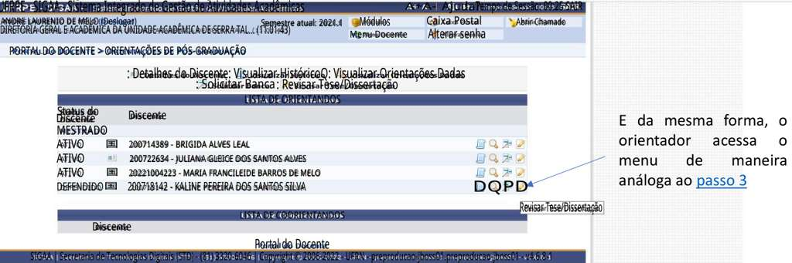

<!-- figure p27-fig1 | described_by: claude:sonnet | ocr_overlap: 0.86 | needs_review: false -->
Now I have enough detail to write the full description.

---

A figura é uma captura de tela (screenshot) de uma interface web de sistema acadêmico, com uma caixa de texto explicativa sobreposta à direita contendo uma anotação (callout) ligada por uma seta à imagem. O print apresenta um efeito visual de "fantasma"/texto duplicado (duas camadas de texto levemente desalinhadas horizontalmente), de modo que quase todo o texto da tela aparece sobreposto duas vezes; a transcrição abaixo reflete o texto reconstituído a partir dessa sobreposição.

**1. Tipo de figura:** Print de tela (screenshot) de um portal web acadêmico (sistema SIGAA), com anotação textual externa à imagem, ligada por seta.

**2. Todo o texto visível (verbatim):**

Barra superior (faixa azul escura):
- "UFRPE - SIGAA - Sistema Integrado de Gestão de Atividades Acadêmicas"
- À direita: "A+ A- | Ajuda | Tempo de Sessão: 00:25 ... SAIR" (segundos ilegíveis devido à sobreposição)

Linha abaixo (faixa azul clara):
- "ANDRE LAURENIO DE MELO (Deslogar)"
- "DIRETORIA GERAL E ACADÊMICA DA UNIDADE ACADÊMICA DE SERRA TAL... (11:01:43)"
- "Semestre atual: 2024.1"
- Ícones/menus: "Módulos", "Caixa Postal", "Menu Docente", "Alterar senha"

Trilha de navegação (breadcrumb):
- "PORTAL DO DOCENTE > ORIENTAÇÕES DE PÓS-GRADUAÇÃO"

Linha de links (centralizada, duas linhas):
- ": Detalhes do Discente : Visualizar Histórico : Visualizar Orientações Dadas"
- ": Solicitar Banca : Revisar Tese/Dissertação"

Barra de título da tabela 1 (faixa azul escura, centralizada):
- "LISTA DE ORIENTANDOS"

Cabeçalho das colunas:
- "Status do Discente" | "Discente"

Linha de categoria:
- "MESTRADO"

Linhas de dados (4 linhas):
1. "ATIVO" | ícone | "200714389 - BRIGIDA ALVES LEAL" | ícones de ação
2. "ATIVO" | ícone | "200722634 - JULIANA GLEICE DOS SANTOS ALVES" | ícones de ação
3. "ATIVO" | ícone | "20221004223 - MARIA FRANCILEIDE BARROS DE MELO" | ícones de ação
4. "DEFENDIDO" | ícone | "200718142 - KALINE PEREIRA DOS SANTOS SILVA" | texto grande em negrito "DQPD" no lugar dos ícones de ação

Caixa de tooltip (abaixo/à direita de "DQPD"):
- "Revisar Tese/Dissertação"

Barra de título da tabela 2 (faixa azul escura, centralizada):
- "LISTA DE CO-ORIENTANDOS"

Cabeçalho da tabela 2:
- "Discente" (lista vazia, sem linhas de dados)

Rodapé:
- "Portal do Docente" (link central)
- Barra inferior azul: "SIGAA | Secretaria de Tecnologia da Informação (STI) - (81) 3320-6046 | Copyright © 2006-2022 - UFRN - preproducao-jboss01.preproducao-jboss01 - v4.6.8-1"

Caixa de anotação externa (texto preto, à direita da imagem, fora da tela capturada):
- "E da mesma forma, o orientador acessa o menu de maneira análoga ao passo 3" — com "passo 3" como link azul sublinhado (hyperlink).

**3. Estrutura (caixas, setas, conexões):**
- No topo, duas faixas horizontais (cabeçalho do sistema): uma azul escura com o nome do sistema e opções de sessão; uma azul clara com dados do usuário logado, semestre e menus de atalho (Módulos, Caixa Postal, Menu Docente, Alterar senha).
- Abaixo, uma trilha de navegação (breadcrumb) em texto preto/azul.
- Um bloco central com duas linhas de links de ação (sublinhados, estilo hyperlink), centralizado.
- Uma tabela ("LISTA DE ORIENTANDOS") com cabeçalho de faixa azul escura, duas colunas ("Status do Discente", "Discente"), uma linha de categoria ("MESTRADO") e quatro linhas de alunos, cada uma com um ícone de status, o código e nome do discente, e uma coluna de ícones de ação à direita (ícones pequenos: tipo "caderno/editar", "lupa", "seta/compartilhar", "lápis").
- Na quarta linha (DEFENDIDO), os ícones de ação são substituídos pelo texto grande "DQPD", sobre o qual há uma seta preta horizontal apontando da anotação externa para essa posição.
- Uma segunda tabela abaixo ("LISTA DE CO-ORIENTANDOS"), com cabeçalho de coluna "Discente" e nenhuma linha de dados (tabela vazia).
- Uma caixa retangular de tooltip sobreposta próxima ao canto inferior direito da primeira tabela, com o texto "Revisar Tese/Dissertação".
- Rodapé com link central e barra de copyright/versão do sistema.
- À direita de toda a captura de tela (fora da moldura da interface), em fundo branco, um parágrafo de anotação ligado por uma seta azul diagonal que aponta da frase para o texto "DQPD" dentro da tabela — indicando que esse elemento da interface corresponde ao ponto mencionado no texto.

**4. Números/valores de dados:**
- Semestre atual: 2024.1
- Horário de login: (11:01:43)
- Tempo de sessão: 00:25 (segundos ilegíveis)
- Matrículas dos discentes: 200714389, 200722634, 20221004223, 200718142
- Telefone: (81) 3320-6046
- Copyright: 2006-2022
- Versão do sistema: v4.6.8-1

**5. Cores com significado:**
- Faixas de cabeçalho e títulos de tabela em azul escuro (destacam estrutura/navegação do sistema).
- Faixa secundária em azul claro (área de informações do usuário).
- Texto de links em azul sublinhado, tanto na interface (ex.: "Revisar Tese/Dissertação") quanto na anotação externa ("passo 3"), indicando hyperlinks clicáveis.
- Seta azul (na anotação externa) e seta preta (dentro da captura, apontando para "DQPD") indicam direção de referência entre o texto explicativo e o elemento da interface.
- Linha de categoria "MESTRADO" em fundo levemente acinzentado/diferenciado do restante das linhas da tabela.

~~~text ocr
-
LAURENTO Caixa-Postal
PORTAL DO DOCENTE > ORIENTAÇÕES DE PÓS-GRADUAÇÃO
Dadas
MESTRADO
AFIVO E 20074389 - BRIGIDA ALVES LEAL BQ
AFIVO =" 200722634 - JULIANA GLEIGE DOS SANTOS Q
ATIVO 20221004223 - MARIA FRANCILEIDE BARROS DE MELO
200748142 - KALINE PEREIRA DOS SANTOS SILVA DQP
E da mesma forma, o
orientador acessa O
menu de maneira
análoga ao passo 3
~~~

<!-- Start of picture text -->
UFRPE - SIGAA - Sistema Integrado de Gestão de Atividades Acadêmicas A+A- Ajuda?Tempo de Sessão: 00:25 SAIRTempo de Sessão: 00:25 SAIR ANDRE LAURENIO DE MELO (Deslogar) Semestre atual: 2021.1 Módulos Caixa Postal Abrir Chamado DIRETORIA GERAL E ACADÊMICA DA UNIDADE ACADÊMICA DE SERRA TAL... (11.01.43) Menu Docente Alterar senha PORTAL DO DOCENTE > ORIENTAÇÕES DE PÓS-GRADUAÇÃO : Detalhes do Discente: Visualizar HistóricoQ: Visualizar Orientações Dadas : Solicitar Banca : Revisar Tese/Dissertação LISTA DE ORIENTANDOS Status do Discente Discente E da mesma forma, o MESTRADO ATIVO 国 200714389 - BRIGIDA ALVES LEAL orientador  acessa  o ATIVO 200722634 - JULIANA GLEICE DOS SANTOS ALVES menu  de  maneira ATIVO 国 20221004223 - MARIA FRANCILEIDE BARROS DE MELO DEFENDIDO 国 200718142 - KALINE PEREIRA DOS SANTOS SILVA DQPD análoga ao passo 3 LISTA DE COORIENTANDOS Revisar Tese/Dissertação Discente Portal do Docente SIGAA | Secretaria de Tecnologias Digitais (STD) - (81) 3320-6046 | Copyright © 2006-2022 - UFRN - preproducao-jboss01.preproducao-jboss01 - v4.6.8-1 <!-- End of picture text -->

≡ 

》 

https://preproducao.sigs.ufrpe.br/sigaa/portais/docente/docente.jsf# 

24 

POR 10:54 

出 

Digite aquí para pesquisar 

29°C Chuva fraca 

INTL 17/05/2022 

<!-- page 28 -->

> SIGAA - Sistema Integrado de GX + 

> 凸 × 

##### ← ← C https://preproducao.sigs.ufpe.br/sigaa/stricto/orientacao/orientandos.sf 

###### 目☆ 

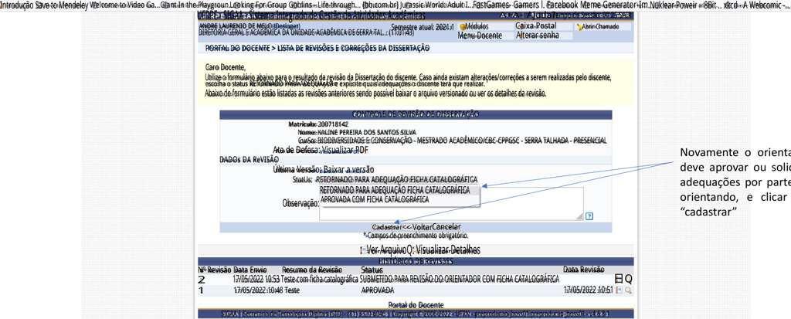

<!-- figure p28-fig1 | described_by: claude:sonnet | ocr_overlap: 0.82 | needs_review: false -->
Figura: captura de tela de sistema web (SIGAA/UFRPE), com anotação sobreposta (seta e texto explicativo). Não é gráfico de dados.

**1. Tipo de figura:** screenshot de interface de sistema de gestão acadêmica, com uma seta azul e um texto de anotação adicionados sobre a imagem.

**2. Todo texto visível (verbatim):**

Faixa superior (abas de navegador sobrepostas, texto parcialmente ilegível por sobreposição): "Introdução", "Save to Mendeley", "Welcome to Video Ga...", "Giant In the Playgroun...", "Looking For Group Goblins - Life through...", "[bb.com.br]", "Jurassic World: Adult I...", "FastGames- Gamers I...", "Facebook Meme Generator - Im...", "Nuklear Power » 8Bit...", "xkcd - A Webcomic -..." [trechos ilegíveis pela sobreposição das abas].

Cabeçalho do sistema: "UFRPE SIGAA | Sistema Integrado de Gestão de Atividades Acadêmicas"

Linha de usuário: "ANDRE LAURENIO DE MELO (Deslogar)" / "DIRETORIA GERAL E ACADÊMICA DA UNIDADE ACADÊMICA DE SERRA TAL...(11:01:43)" — "Semestre atual: 2021.1" — ícones "Módulos", "Caixa Postal", "Abrir Chamado" — "Menu Docente", "Alterar senha" — "A+ A- | Ajuda (Tempo de Sessão: 00:05:58)"

Caminho de navegação: "PORTAL DO DOCENTE > LISTA DE REVISÕES E CORREÇÕES DA DISSERTAÇÃO"

Caixa de aviso (amarela):
"Caro Docente,
Utilize o formulário abaixo para o resultado da revisão da Dissertação do discente. Caso ainda existam alterações/correções a serem realizadas pelo discente, escolha o status RETORNADO PARA ADEQUAÇÃO e explicite quais adequações o discente terá que realizar.
Abaixo do formulário estão listadas as revisões anteriores sendo possível baixar o arquivo versionado ou ver os detalhes da revisão."

Título de seção (barra azul escura): "CONTROLE DE REVISÃO DE DISSERTAÇÃO"

Campos de dados:
- "Matrícula: 200718142"
- "Nome: KALINE PEREIRA DOS SANTOS SILVA"
- "Curso: BIODIVERSIDADE E CONSERVAÇÃO - MESTRADO ACADÊMICO/CBC-CPPGSC - SERRA TALHADA - PRESENCIAL"
- "Ata de Defesa: Visualizar PDF"

Seção "DADOS DA REVISÃO":
- "Última Versão: Baixar a versão"
- "Status:" com caixa de seleção mostrando: "RETORNADO PARA ADEQUAÇÃO FICHA CATALOGRÁFICA" (valor selecionado, em destaque) e abaixo, lista suspensa com duas opções: "RETORNADO PARA ADEQUAÇÃO FICHA CATALOGRÁFICA" e "APROVADA COM FICHA CATALOGRÁFICA"
- "Observação:" (campo de texto vazio, com ícone de interrogação azul "?" no canto)

Botões: "Cadastrar <<< Voltar Cancelar"
Nota: "* Campos de preenchimento obrigatório."

Legenda de ícones: ": Ver Arquivo  Q: Visualizar Detalhes" (ícones de disquete/planilha e lupa)

Tabela "HISTÓRICO DE REVISÕES", colunas: "Nº Revisão | Data Envio | Resumo da Revisão | Status | Data Revisão"
Linha 1: "2 | 17/05/2022 10:53 | Teste com ficha catalográfica | SUBMETIDO PARA REVISÃO DO ORIENTADOR COM FICHA CATALOGRÁFICA | [vazio]" com ícones de disquete e lupa
Linha 2: "1 | 17/05/2022 10:48 | Teste | APROVADA | 17/05/2022 10:51" com ícones de disquete e lupa

Rodapé: "SIGAA | Secretaria de Tecnologias Digitais (STD) - (81) 3320-6046 | Copyright © 2006-2022 - UFRN - preproducao-jboss01-preproducao-jboss01 - v4.6.8-1"

Texto da anotação (caixa à direita, fora da interface do sistema):
"Novamente o orienta[dor] deve aprovar ou soli[citar] adequações por parte [do] orientando, e clicar [em] "cadastrar""
(texto cortado na borda direita da imagem, parte final ilegível — marcado [illegible] onde cortado)

**3. Estrutura:**
- Topo: faixa de abas de navegador sobrepostas (ruído visual, não faz parte do sistema).
- Abaixo: janela do sistema SIGAA, organizada verticalmente em blocos: cabeçalho/login → trilha de navegação → aviso amarelo → painel "CONTROLE DE REVISÃO DE DISSERTAÇÃO" com dados do aluno → bloco "DADOS DA REVISÃO" com campo Status (dropdown aberto mostrando 2 opções) e campo Observação → botões de ação → legenda de ícones → tabela "HISTÓRICO DE REVISÕES" (2 linhas de dados) → rodapé do sistema.
- Uma seta azul parte do texto de anotação (à direita, fora da tela do sistema) e aponta para o campo dropdown de "Status" (as opções "RETORNADO PARA ADEQUAÇÃO FICHA CATALOGRÁFICA" / "APROVADA COM FICHA CATALOGRÁFICA").
- Uma segunda seta azul, menor, parte do mesmo bloco de texto e aponta para o botão "Cadastrar".
- Tabela histórico tem 5 colunas e 2 linhas, cada linha com 2 ícones de ação à direita.

**4. Valores numéricos:**
- Matrícula: 200718142
- Semestre: 2021.1
- Tempo de sessão: 00:05:58
- Nº Revisão: 2 e 1
- Datas/horas: 17/05/2022 10:53; 17/05/2022 10:48; 17/05/2022 10:51
- Telefone rodapé: (81) 3320-6046
- Copyright: 2006-2022
- Versão sistema: v4.6.8-1

**5. Cores com significado:**
- Barra de título da seção e cabeçalho do menu: azul escuro (indica cabeçalhos/seções do sistema).
- Caixa de aviso ao docente: fundo amarelo claro (alerta/instrução).
- Setas e texto de anotação explicativa: azul (indicam elementos adicionados por quem anotou a imagem, não parte original do sistema).
- Linha "2" na tabela de histórico: texto em vermelho (status "SUBMETIDO PARA REVISÃO DO ORIENTADOR COM FICHA CATALOGRÁFICA", revisão ainda pendente), contrastando com a linha "1" em texto padrão/escuro (status "APROVADA").

~~~text ocr
Introdução the-Playgroun |. facebook
o de
LAURENIO DE ixa-Postal
EACADÊMICA DA
RORTAL DO DOCENTE > LISTA DE REVISÕES E CORREÇÕES DA DISSERTAÇÃO
Gare Docente,
do discente. faso ai ainda alterações/correções a serem realizadas pelo discente,
terá que realizar.
Abaixo-do-formulário estão listadas as revisões anteriores sendo baixar cx
Matricula: 200718142
PEREIRA DOS SANTOS SILVA
- MESTRADO ACADÊMICO/GBE-CPPGSE - SERRA TALHADA - PRESEAIGIAL
Ate de Novamen rient:
DADOS DA
Baixar aversão deve aprovar ou soli
adequações por parte
StatUs: PARA ADEQUAÇÃO
PARA AÇÃO FICHA CAT; i i
ORNADO PARA ADEQUAÇÃO FICHA CATALOGRAFICA orientando, e clicar
Observação: COM FICHA CATALOGRÁRICA
AB
Cadastrar<<VoltarCancelar
obrigatório.
Visualizas-Detalhes
Dafa Revisão
Data Envio Resumo da Revisão
2 10:53 PARA DO ORIENTADOR COM FICHA
1 Teste APROVADA
10:51
~~~

<!-- Start of picture text -->
Introdução Save to Mendeley Welcome to Video Ga...Giant In the Playgroun...Looking For Group Goblins - Life through... [bb.com.br] Jurassic World: Adult I... FastGames- Gamers l. Facebook Meme Generator-Im...Nuklear Poweir » 8Bit .. xkcd - A Webcomic -... UFRPE - SIGAA - Sistema Integrado de Gestão de Atividades Acadêmicas A+A- Ajuda?Tempo de Sessão: 00:25 SAIR ANDRE LAURENIO DE MELO (Deslogar) Semestre atual: 2021.1 Módulos Caixa Postal Abrir Chamado DIRETORIA GERAL E ACADÊMICA DA UNIDADE ACADÊMICA DE SERRA TAL... (11.01.43) Menu Docente Alterar senha PORTAL DO DOCENTE > LISTA DE REVISÕES E CORREÇÕES DA DISSERTAÇÃO Caro Docente, Utilize o formulário abaixo para o resultado da revisão da Dissertação do discente. Caso ainda existam alterações/correções a serem realizadas pelo discente, escolha o status RETORNADO PARA ADEQUAçÃO e explicite quais adequações o discente terá que realizar. Abaixo do formulário estão listadas as revisões anteriores sendo possível baixar o arquivo versionado ou ver os detalhes da revisão. CONTROLE DE REVISÃO DE DISSERTAÇÃO Matrícula: 200718142 Nome: KALINE PEREIRA DOS SANTOS SILVA CurSo: BIODIVERSIDADE E CONSERVAÇÃO - MESTRADO ACADÊMICO/CBC-CPPGSC - SERRA TALHADA - PRESENCIAL Ata de Defesa: Visualizar PDF Novamente o orientador DADOs DA ReVISÃO Última Versão: Baixar a versão deve aprovar ou solicitar StatUs:  RETORNADO PARA ADEQUAÇÃO FICHA CATALOGRÁFICA adequações por parte do RETORNADO PARA ADEQUAÇÃO FICHA CATALOGRÁFICA Observação: APROVADA COM FICHA CATALOGRÁFICA orientando, e clicar em “cadastrar” Cadastrar<< VoltarCancelar * Campos de preenchimento obrigatório. ： Ver ArquivoQ: Visualizar Detalhes HISTÓRICO DE REVISõES Nº Revisão Data Envio Resumo da Revisão Status Data Revisão 2 17/05/2022 10:53 Teste com ficha catalográfica SUBMETIDO PARA REVISÃO DO ORIENTADOR COM FICHA CATALOGRÁFICA 日Q 1 17/05/2022 10:48 Teste APROVADA 17/05/2022 10:51 Portal do Docente SIGAA | Secretaria de Tecnologias Digitais (STD) - (81) 3320-6046 | Copyright © 2006-2022 - UFRN - preproducao-jboss01.preproducao-jboss01 - v4.6.8-1 <!-- End of picture text -->

Novamente o orientador deve aprovar ou solicitar adequações por parte do orientando, e clicar em “cadastrar” 

≡ 

》 

25 

POR 10:54 

Digite aqui para pesquisar 

29°C Chuva fraca 

INTL 17/05/2022 

<!-- page 29 -->

SIGAA - Sistema Integrado de GX + 

> 凸 × 

目☆ 

←→ C https://preproducao.sigs.ufrpe.br/sigaa/portais/discente/discente.jsf 

Introdução Save to MendeleyWelcome to Video Ga...Giant In the Playgroun...Looking For Group Goblins- Life through ...[bb.com.br]Jurass.ic World: Adult I...FastGames - Gamers ... Facebook Meme Generator - Im...Nuklear Power» 8-Bt...xkcd - A Webcomic -.. 

|Caro Aluno, Abaixo são listad Você pode acom|os os procedimentos realizados a partir da defesa de sua Dissertação até a homologação do diploma. panhar a situação de cada um deles e, quando necessário, realizar as devidas operações.|
|---|---|
|1º|CONSOLIDAÇÃO DA ATIVIDADE DE DEFESA ✓ Atividade consolidada. 31/03/2022 Baixar ata da defesa e folhas de correções|
|2º 3º| SUBMISSÃO DA VERSÃO FINAL CORRIGIDA DA DISSERTAÇÃO √ Submetido. 17/05/2022 Conferir histórico de revisão APROVAÇÃO DA VERSÃO FINAL CORRIGIDA DA DISSERTAÇÃO ✓ Versão final Aprovada. 17/05/2022|
|4º|SOLICITAÇÃO DA FICHA CATALOGRÁFICA ✓ Procedimento desconsiderado devido ao módulo de biblioteca estar inativo.|
|5º|RESSUBMISSÃO DA VERSÃO FINAL CORRIGIDA DA DISSERTAÇÃO COM FICHA CATALOGRÁFICA ✓ Procedimento desconsiderado devido ao módulo de biblioteca estar inativo. 17/05/2022|
|6º|APROVAÇÃO DA VERSÃO FINAL CORRIGIDA DA DISSERTAÇÃO COM FICHA CATALOGRÁFICA √ Procedimento desconsiderado devido ao módulo de biblioteca estar inativo.|
|7º|ASSINATURA DO TERMO DE AUTORIZAÇÃO DE PUBLICAÇÃO Aguardando assinatura do termo de autorização pelo aluno. Assinar termo de autorização|
|8º| RECEBIMENTO DA VERSÃO FINAL PELA COORDENAÇÃO Coordenação aguardando recebimento.|
|o6|INSERIR DOCUMENTOS OBRIGATÓRIOS Necessário a assinatura do termo de publicação pelo aluno.|
|10º|PREENCHIMENTO DO QUESTIONÁRIO Aguardando o preenchimento do questionário pelo aluno.|
|11º|SOLICITAÇÃO DE HOMOLOGAÇÃO DO DIPLOMA Necessário inserir os documentos obrigatórios.|

Após a versão final com ficha catalográfica ser aprovada, o discente deverá assinar o termo de autorização de publicação clicando aqui 

》 

26 

POR 10:56 

Q Digite aqui para pesquisar 

29°C Chuva fraca 

INTL 17/05/2022 

<!-- page 30 -->

> 凸 × 

> SIGAA - Sistema Integrado de GX + 

目☆ 三 

###### https://preproducao.sigs.ufrpe.br/sigaa/stricto/producao_academica/acompanhamento_procedimentos_apos_defesa.jsf 

← C 

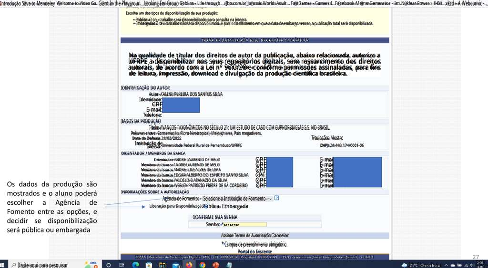

<!-- figure p30-fig1 | described_by: claude:sonnet | ocr_overlap: 0.83 | needs_review: false -->
**(1) Tipo de figura:** Captura de tela (screenshot) de formulário web do sistema SIGAA — "Termo de Autorização para Produções Acadêmicas". Texto duplicado/sobreposto (ghosting), como se duas capturas estivessem empilhadas. No topo, barra de abas de navegador aberta mostra vários sites irrelevantes ao conteúdo. Na parte inferior, barra de tarefas Windows. À esquerda, caixa de texto explicativa com seta azul apontando pro formulário.

**(2) Texto visível (verbatim):**

Abas navegador (topo, truncadas): "Introdução", "Save to Mendeley", "Welcome to Video Ga...", "Giant In the Playgroun...", "Looking For Group Goblins - Life through ...", "4bb.com.br|Jurassic World: Adult...", "Fast Games - Gamers I...", "Facebook Meme Generator - i...", "Nuklear Power » 8-Bit...", "xkcd - A Webcomic - ...".

Topo da página (parcialmente cortado): "...período, o produto será disponibilizado na íntegra."
"Escolha um dos tipos de disponibilização da sua produção:"
"• Pública: O seu trabalho será disponibilizado para consulta na íntegra."
"• Embargada: O seu trabalho não será disponibilizado. A partir do momento em que a data de embargo vencer, a publicação total será disponibilizada."

Barra título central: "TERMO DE AUTORIZAÇÃO PARA PRODUÇÕES ACADÊMICAS"

Parágrafo principal: "Na qualidade de titular dos direitos de autor da publicação, abaixo relacionada, autorizo a UFRPE a disponibilizar nos seus repositórios digitais, sem ressarcimento dos direitos autorais, de acordo com a Lei nº 9610/98, conforme permissões assinaladas, para fins de leitura, impressão, download e divulgação da produção científica brasileira."

Seção "IDENTIFICAÇÃO DO AUTOR":
- "Autor: KALINE PEREIRA DOS SANTOS SILVA"
- "Identidade:" [campo oculto por retângulo azul]
- "CPF:" [oculto]
- "E-mail:" [oculto]
- "Telefone:" [valor não visível/vazio]

Seção "DADOS DA PRODUÇÃO":
- "Título: AVANÇOS TAXONÔMICOS NO SÉCULO 21: UM ESTUDO DE CASO COM EUPHORBIACEAE S.S. NO BRASIL."
- "Palavras-chave: Conservação, Flora Neotropical, Malpighiales, País megadiverso."
- "Data da Defesa: 31/03/2022"
- "Titulação: Mestre"
- "Instituição de Defesa: Universidade Federal Rural de Pernambuco/UFRPE"
- "CNPJ: 24.446.174/0001-06"

Seção "ORIENTADOR / MEMBROS DA BANCA" (colunas: Nome, CPF, E-mail — CPF e E-mail ocultos por retângulos azuis):
- "Orientador: ANDRÉ LAURÊNIO DE MELO"
- "Membro da banca: ANDRÉ LAURÊNIO DE MELO"
- "Membro da banca: ANDRÉ LUIZ ALVES DE LIMA"
- "Membro da banca: EDGAR ALBERTO DO ESPÍRITO SANTO SILVA"
- "Membro da banca: VALDELINE ATANAZIO DA SILVA"
- "Membro da banca: WESLEY PATRÍCIO FREIRE DE SÁ CORDEIRO"

Seção "INFORMAÇÕES SOBRE A AUTORIZAÇÃO":
- "Agência de Fomento: Selecione a Instituição de Fomento ▾" [ícone "?" de ajuda ao lado]
- "Liberação para Disponibilização: Pública Embargada" (opções de seleção, texto sobreposto/duplicado)

Caixa "CONFIRME SUA SENHA":
- "Senha: *" seguido de campo com pontos mascarando senha (fundo amarelo)

Botões: "Assinar Termo de Autorização" | "Cancelar"

Rodapé: "* Campos de preenchimento obrigatório."
"Portal do Discente"
"SIGAA | Secretaria de Tecnologia da Informação (STI) - (81) 3320-6046 | Copyright © 2006-2022 - UFRN - preproducao-jboss01.preproducao-jboss01 - v4.6.8-1"

Número de página no canto inferior direito: "27"

Caixa de texto explicativa (lado esquerdo, fora do formulário): "Os dados da produção são mostrados e o aluno poderá escolher a Agência de Fomento entre as opções, e decidir se disponibilização será pública ou embargada"

Barra de tarefas Windows (base): ícone de busca "Digite aqui para pesquisar", ícones de apps, relógio com temperatura "23°C Chuva fraca".

**(3) Estrutura:**
- Painel lateral esquerdo: caixa de texto explicativa com seta azul ligando até duas partes do formulário — uma apontando pro campo "Agência de Fomento" e outra pro campo "Liberação para Disponibilização".
- Formulário dividido em blocos horizontais empilhados (de cima pra baixo): aviso sobre disponibilização → título do termo → parágrafo de autorização → bloco "Identificação do Autor" (tabela nome/identidade/CPF/e-mail/telefone) → bloco "Dados da Produção" (tabela título/palavras-chave/data/titulação/instituição/CNPJ) → bloco "Orientador/Membros da Banca" (tabela com 6 linhas × 3 colunas: Nome, CPF, E-mail) → bloco "Informações sobre a Autorização" (dropdown + opções rádio) → bloco "Confirme sua Senha" (campo texto) → botões de ação → rodapé institucional.
- Vários campos sensíveis (CPF, e-mail, identidade, senha) cobertos por retângulos sólidos azuis (redação de dados pessoais).
- Não há gráfico/eixo numérico — é formulário institucional, não gráfico de dados.

**(4) Valores numéricos:**
- Lei nº 9610/98
- Data da Defesa: 31/03/2022
- CNPJ: 24.446.174/0001-06
- Telefone STI: (81) 3320-6046
- Copyright © 2006-2022
- Versão sistema: v4.6.8-1
- Número página: 27
- Temperatura: 23°C

**(5) Cores com significado:** Retângulos azul sólido cobrem/ocultam dados pessoais sensíveis (identidade, CPF, e-mail, senha parcial) — indicam redação/censura de privacidade, não dado real. Fundo amarelo claro no topo (aviso) e no campo de senha destaca essas áreas. Seta azul na caixa explicativa indica direção de leitura/associação com campos do formulário.

~~~text ocr
Introdução Save-te:Mendeley the Playgroun... Life .. - Em.
Escolha um dos tipos de disponibilização da sua produção:
total será disponibilizada.
Be
qualidade de dos direitos de autor da publicação, abaixo relaci a
FIGS Is, sem ressarcimento dos
de acordo com a Lei nº 9610) nissões para
Ge inmpressão, download e divulgação da pr científica brasileira,
IDENHFIGAÇÃO DO AUTOR
DOS SANTOS SILVA
DADOS DA PRODUÇÃO |
Neotropi adivers.
Dota da 022 Mestre
Federal Rural de Pernambuco/UFRRE
/ MEMBROS DA BANCA
DE MELO E-mai
ANDRES AURENIO DE MELO |
DE LIMA |
hancas EDGARALBERTO DO ESPIRITO SANTO SILVA |
da DA SILVA |
|
Os dados da produção são FREIRE DE SÁ CORDEIRO
mostrados e o aluno poderá INFORMAÇÕES SOBRE A AUTORIZAÇÃO
eng
escolher a Agência de de Formento
liberação Embargada
Fomento entre as opções, e
decidir se disponibilização
Z P
sera publica ou embargada
Termo de Autorização Cancelar
obrigatório,
Chuva
o pesquisar
~~~

<!-- Start of picture text -->
Introdução Save to Mendeley Welcome to Video Ga... Giant In the Playgroun... Looking For Group Goblins - Life through ... [bb.com.br]Jurassic World: Adult .. FastGames - Gamers I...Facebook Meme Generator - Im...Nuklear Power » 8-Bit ...  xkcd - A Webcomic - .. Escolha um dos tipos de disponibilização da sua produção: • Pública: O seu trabalho será disponibilizado para consulta na íntegra. • Embargada: O seu trabalho não será disponibilizado. A partir do momento em que a data de embargo vencer, a publicação total será disponibilizada. TERMO DE AUTORIZAÇÃO PARA PRODUÇÕES ACADÊMICAS Na qualidade de titular dos direitos de autor da publicação, abaixo relacionada, autorizo a UFRPE a disponibilizar nos seus repositórios digitais, sem ressarcimento dos direitos autorais, de acordo com a Lei n° 96i0/98 e conforme permissões assinaladas, para fins de leitura, impressão, download e divulgação da produção científica brasileira. IDENTIFICAÇÃO DO AUTOR Autor: KALINE PEREIRA DOS SANTOS SILVA Identidade: CPF E-mail: Telefone: DADOS DA PRODUÇÃO Título: AVANÇOS TAXONÔMICOS NO SÉCULO 21: UM ESTUDO DE CASO COM EUPHORBIACEAE S.S. NO BRASIL. Palavras-chave: Conservação, Flora Neotropical, Malpighiales, País megadivers. Data da Defesa: 31/03/2022 Titulação: Mestre Instituição deDesa: Universidade Federal Rural de Pernambuco/UFRPE CNPJ: 24.416.174/0001-06 ORIENTADOR / MEMBROS DA BANCA Orientador: ANDRE LAURENIO DE MELO CPF E-mail Membro da banca: ANDRE LAURENIO DE MELO CPF E-mail Membro da banca: ANDRE LUIZ ALVES DE LIMA CPF E-mail Membro da banca: EDGAR ALBERTO DO ESPIRITO SANTO SILVA CPF: E-mail Membro da banca: VALDELINE ATANAZIO DA SILVA CPF E-mail Os dados da produção são  Membro da banca: WESLEY PATRÍCIO FREIRE DE SÁ CORDEIRO CPF E-mail mostrados e o aluno poderá  INFORMAÇÕES SOBRE A AUTORIZAÇÃO Agência de Fomento: -- Selecione a Instituição de Formento -- escolher  a  Agência  de Liberação para Disponibilização:Pública  Embargada Fomento entre as opções, e CONFIRME SUA SENHA decidir se disponibilização Senha: *… será pública ou embargada Assinar Termo de AutorizaçãoCancelar * Campos de preenchimento obrigatório. Portal do Discente SIGAA | Secretaria de Tecnologias Digitais (STD) - (81) 3320-6046 | Copyright © 2006-2022 - UFRN - preproducao-jboss01.preproducao-jboss01 - v4.6.8-1 27 POR Digite aqui para pesquisar 市 29C Chuva fraca <!-- End of picture text -->

》 

POR 10:56 1/1/21 1202 

Digite aqui para pesquisar 

<!-- page 31 -->

> 凸 × 

> 惠SIGAA - Sistema Integrado de GX + 

三 

目☆ 

← C 

8https://preproducao.sigs.ufrpe.br/sigaa/biblioteca/publicacoes_academicas/assinaTermoAutorizacaoPublicacaoAcademica.jsf 

Welcome to Video Ga...Giant In the Playgroun...Looking For Group Goblins - Life through ...[bb.com.br]Jurassic World: Adult I...FastGames - Gamers I...Facebook Meme Generator - Im...Nuklear Power » 8-Bit .. xkcd - A Webcomi - . 

###### IntroduçãoSave to Mendeley 

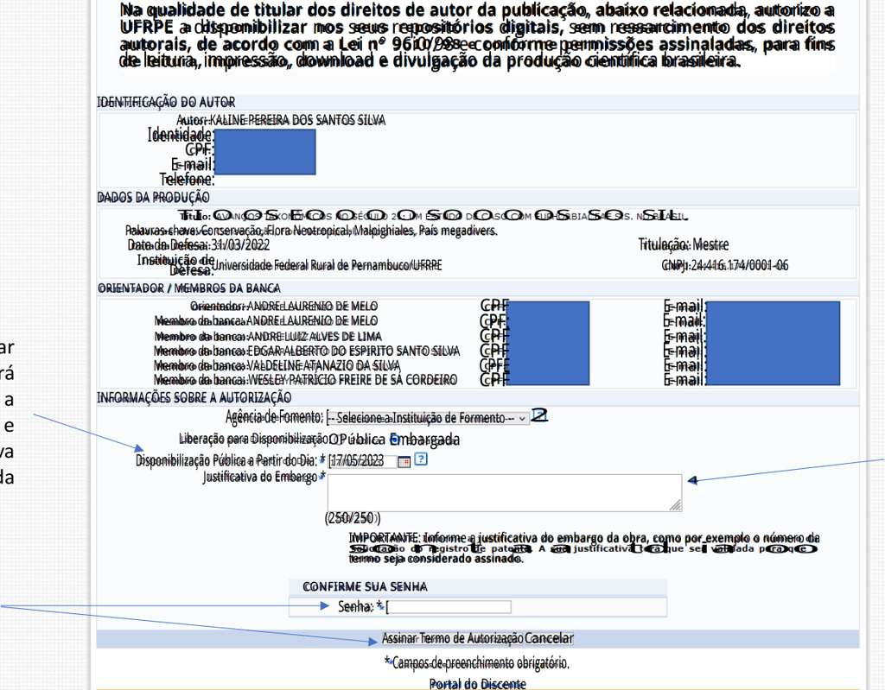

<!-- figure p31-fig1 | described_by: claude:sonnet | ocr_overlap: 0.86 | needs_review: false -->
Tipo figura: captura tela formulário web (sistema repositório institucional UFRPE), com texto sobreposto/fantasma (dupla exposição), tornando trechos parcialmente ilegíveis.

**1) Tipo:** Print de formulário de autorização digital (não gráfico/diagrama de dados) — layout tipo painel com campos de preenchimento, caixas de texto e setas de anotação apontando pra campos específicos.

**2) Texto visível (verbatim, onde legível):**

Bloco topo (texto sobreposto, parcialmente duplicado/ilegível):
"Na qualidade de titular dos direitos de autor da publicação, abaixo relacionada, autorizo a UFRPE a disponibilizar nos seus repositórios digitais, sem ressarcimento dos direitos autorais, de acordo com a Lei n° 9610/98 e conforme permissões assinaladas, para fins de leitura, impressão, download e divulgação da produção científica brasileira."
(camada sobreposta fantasma repete fragmentos da mesma frase, tipo "...dos repositórios ressarcimento Lei n° 9610/98 conforme permissões..." — ilegível com precisão onde dupla)

Seção "IDENTIFICAÇÃO DO AUTOR":
- Autor: KALINE PEREIRA DOS SANTOS SILVA
- Identidade: [caixa azul, oculto]
- CPF: [caixa azul, oculto]
- E-mail: [caixa azul, oculto]
- Telefone: [illegible, sobreposto]

Seção "DADOS DA PRODUÇÃO" (título sobreposto, difícil ler com exatidão):
- Título: texto duplicado/ilegível, aparenta algo como "...AVANÇOS TAXONÔMICOS... MALPIGHIALES... BRASIL" [illegible]
- Palavras-chave: Conservação, Flora Neotropical, Malpighiales, País megadivers[o] (cortado/sobreposto)
- Data da Defesa: 31/03/2022
- Titulação: Mestre
- Instituição de Defesa: Universidade Federal Rural de Pernambuco/UFRPE
- CNPJ: 24.446.174/0001-06

Seção "ORIENTADOR / MEMBROS DA BANCA" (texto sobreposto/duplicado, nomes repetidos duas vezes cada linha):
- Orientador: ANDRE LAURENIO DE MELO — CPF: [caixa azul] — E-mail: [caixa azul]
- Membro da banca: ANDRE LAURENIO DE MELO — CPF: [caixa azul] — E-mail: [caixa azul]
- Membro da banca: ANDRE LUIZ ALVES DE LIMA — CPF: [caixa azul] — E-mail: [caixa azul]
- Membro da banca: EDGAR ALBERTO DO ESPIRITO SANTO SILVA — CPF: [caixa azul] — E-mail: [caixa azul]
- Membro da banca: VALDELINE ATANAZIO DA SILVA — CPF: [caixa azul] — E-mail: [caixa azul]
- Membro da banca: WESLEY PATRICIO FREIRE DE SÁ CORDEIRO — CPF: [caixa azul] — E-mail: [caixa azul]

Seção "INFORMAÇÕES SOBRE A AUTORIZAÇÃO":
- Agência de Fomento: "-- Selecione a Instituição de Formento --" (dropdown, ícone "?" ao lado)
- Liberação para Disponibilização: "Pública" / "Embargada" (duas opções, sobrepostas)
- Disponibilização Pública a Partir do Dia: * campo data preenchido "17/05/2023" (ícone calendário e "?")
- Justificativa do Embargo: * caixa texto vazia, contador "(250/250)"
- Texto nota: "IMPORTANTE: Informe a justificativa do embargo da obra, como por exemplo o número da solicitação de registro de patente. Sua justificativa deverá ser validada para que o termo seja considerado assinado." (parcialmente sobreposto/ilegível em trechos)

Seção "CONFIRME SUA SENHA":
- Senha: * [campo de entrada vazio]

Botões: "Assinar Termo de Autorização" / "Cancelar"

Rodapé:
- "* Campos de preenchimento obrigatório."
- "Portal do Discente"

**3) Estrutura:**
- Página dividida em seções horizontais com cabeçalhos em barra cinza: "IDENTIFICAÇÃO DO AUTOR", "DADOS DA PRODUÇÃO", "ORIENTADOR / MEMBROS DA BANCA", "INFORMAÇÕES SOBRE A AUTORIZAÇÃO", "CONFIRME SUA SENHA".
- Dentro de cada seção, campos label: valor em linhas.
- Tabela banca: 3 colunas (papel/nome, CPF, E-mail), 6 linhas (1 orientador + 5 membros, um nome repetido).
- Dados sensíveis (Identidade, CPF, E-mail) ocultos por retângulos sólidos azuis (redação de privacidade) — cor azul usada especificamente pra indicar mascaramento de dado sensível, não decorativo.
- 4 setas azuis finas, desenhadas por cima da imagem (anotação externa, não parte original do formulário), apontando da margem esquerda/direita pra: campo "Disponibilização Pública a Partir do Dia", campo "Justificativa do Embargo", campo "Senha", botão "Assinar Termo de Autorização". À esquerda da margem há fragmentos de texto cortados de outra camada/coluna (illegible, só restos de palavras: "ar", "rá", "a", "e", "va", "da").
- Imagem geral sofre de "ghosting": texto duplicado deslocado poucos pixels, sugerindo erro de extração/renderização do PDF (duas camadas de texto sobrepostas).

**4) Valores numéricos/datas:**
- Data da Defesa: 31/03/2022
- CNPJ: 24.446.174/0001-06
- Disponibilização Pública a Partir do Dia: 17/05/2023
- Contador caracteres: 250/250

**5) Cor com significado:** Retângulos sólidos azul-escuro cobrem todos campos de dado pessoal sensível (Identidade, CPF, E-mail de autor e banca) — indica redação/anonimização. Setas azul-claro são marcação/anotação apontando campos de ação no formulário (datas, justificativa, senha, botão assinar).

~~~text ocr
de titular dos direitos de autor da publicação, abaixo relaciomadia, auttorizo a
ibilizar mos seus digitais, sem ressarcimento dos
€ acordo com a Lei nº 9610) permissões assinaladas, para fins
download e divulgação da brasileira.
DO AUTOR
DOS SANTOS SILVA
DADOS DA PRODUÇÃO
SO
País megadivers.
Date de Mestre
iniversidade Federal Rural de
ORIENTADOR / MEMBROS DA BANCA
AURENTO DE MELO
ANDREA AURENTO DE MELO
Membro da ALVES DE LIMA
ar DO ESPÍRITO SANTO SILVA G
DA SILVA
a da bancas FREIRE DE SÁ CORDEIRO
a INFORMAÇÕES SOBRE A AUTORIZAÇÃO
= |- de Formento~ « 12
Liberação para ública Embasgada
Disponibilização Pública a [17/05/2023
la Justificativa do Embargo +
(050/250))
a do embarg o da obra camo por 0 dia
istr at A ju
termo seja considerado
CONFIRME SUA SENHA
de Autorização Cancelar
obrigatório.
do Discente
~~~

<!-- Start of picture text -->
Na qualidade de titular dos direitos de autor da publicação, abaixo relacionada, autorizo a UFRPE a disponibilizar nos seus repositórios digitais, sem ressarcimento dos direitos autorais, de acordo com a Lei n° 96i0/98 e conforme permissões assinaladas, para fins de leitura, impressão, download e divulgação da produção científica brasileira. IDENTIFICAÇÃO DO AUTOR Autor: KALINE PEREIRA DOS SANTOS SILVA Identidade: CPF: E-mail: Telefone: DADOS DA PRODUÇÃO TI O OS EO O O O SO O O OS  SO  SIL. Palavras-chave: Conservação, Flora Neotropical, Malpighiales, País megadivers. Data da Defesa: 31/03/2022 Titulação: Mestre Instituição deDefesa: Universidade Federal Rural de Pernambuco/UFRPE CNPJ: 24.416.174/0001-06 ORIENTADOR / MEMBROS DA BANCA Orientador: ANDRE LAURENIO DE MELO CPF E-mail: Membro da banca: ANDRE LAURENIO DE MELO CPF: E-mail: Membro da banca: ANDRE LUIZ ALVES DE LIMA CPF E-mail: Membro da banca: EDGAR ALBERTO DO ESPIRITO SANTO SILVA CPF E-mail: Membro da banca: VALDELINE ATANAZIO DA SILVA CPFE E-mail: Membro da banca: WESLEY PATRÍCIO FREIRE DE SÁ CORDEIRO CPF E-mail: INFORMAÇÕES SOBRE A AUTORIZAÇÃO Agência de Fomento: [-- Selecione a Instituição de Formento -- 2 Liberação para Disponibilização:OPública Embargada Disponibilização Pública a Partir do Dia: * [17/05/2023 da  Justificativa do Embargo * 4 (250/250 ) IMPORTANTE: Informe a justificativa do embargo da obra, como por exemplo o número da so n  t  a a    td  ia  oo termo seja considerado assinado. CONFIRME SUA SENHA Senha: * [ Assinar Termo de AutorizaçãoCancelar * Campos de preenchimento obrigatório. Portal do Discente <!-- End of picture text -->

Caso a razão do embargo seja por publicação de artigos, o discente deverá escrever “EMBARGO POR SUBMISSÃO DE ARTIGO” e posteriormente encaminhar ao e-mail <u>sec.cppg@ufrpe.br</u> o Comprovante de depósito enviado pela Biblioteca. 

Caso o decida por solicitar embargo, o discente deverá escolher uma data para a disponibilização pública, e escrever uma justificativa baseado na razão da solicitação do embargo 

Caso a razão do embargo seja por questão de patente, o discente deverá inserir o número do processo da solicitação de dispensa de depósito conforme o <u>roteiro da Biblioteca.</u> 

Então insere-se a senha e clica-se em “Assinar” 

》 

SIGAA | Secretaria de Tecnologias Digitais (STD) - (81) 3320-6046 |Copyright © 2006-2022 - UFRN - preproducao-jboss01.preproducao-jboss01 - v4.6.8-1 

28 

POR 10:56 1/1/21 1202 

市 

ǔ 

29C Chuva fraca 

Digite aqui para pesquisar 

<!-- page 32 -->

> 凸 × 

> SIGAA - Sistema Integrado de GX + 

目☆ 三 

###### https://preproducao.sigs.ufrpe.br/sigaa/biblioteca/publicacoes_academicas/assinaTermoAutorizacaoPublicacaoAcademica.jsf 

← C 

|Introdução Save to Mendeley Welcome to Video Ga...Giant In the Playgroun...Looking For Group Goblins - Life through ...[bb.com.br] Jurassic World: Adult I...FastGames - Gamers I...Facebook Meme Ge Caro Aluno, Abaixo são listados os procedimentos realizados a partir da defesa de sua Dissertação até a homologação do diploma. Você pode acompanhar a situação de cada um deles e, quando necessário, realizar as devidas operações.|nerator - Im...Nuklear Power » 8-Bit ...xkcd - A Webcomic - ...|
|---|---|
|CONSOLIDAÇÃO DA ATIVIDADE DE DEFESA ✓ 1º Atividade consolidada. 31/03/2022 Baixar ata da defesa e folhas de correções SUBMISSÃO DA VERSÃO FINAL CORRIGIDA DA DISSERTAÇÃO ✓ 2º Submetido. 17/05/2022 Conferir histórico de revisão APROVAÇÃO DA VERSÃO FINAL CORRIGIDA DA DISSERTAÇÃO ✓ 3º Versão final Aprovada. 17/05/2022||
|SOLICITAÇÃO DA FICHA CATALOGRÁFICA ✓ 4o Procedimento desconsiderado devido ao módulo de biblioteca estar inativo.||
|O aluno poderá clicar aqui para visualizar o termo de Autorização de Publicação RESSUBMISSÃO DA VERSÃO FINAL CORRIGIDA DA DISSERTAÇÃO COM FICHA CATALOGRÁFICA √ 5º Procedimento desconsiderado devido ao módulo de biblioteca estar inativo. 17/05/2022 APROVAÇÃO DA VERSÃO FINAL CORRIGIDA DA DISSERTAÇÃO COM FICHA CATALOGRÁFICA ✓ 6º Procedimento desconsiderado devido ao módulo de biblioteca estar inativo. ASSINATURA DO TERMO DE AUTORIZAÇÃO DE PUBLICAÇÃO √ 7º Autorizado para disponibilização da produção de maneira pública. 17/05/2022 Visualizar Termo de Autorização de Publicação 8º RECEBIMENTO DA VERSÃO FINAL PELA COORDENAÇÃO Coordenação aguardando recebimento.|Caso o aluno tenha solicitado por publicação embargada, este passo só estará concluído após autorização por parte da **PRPG**|
|9º INSERIR DOCUMENTOS OBRIGATÓRIOS Necessário recebimento da versão final pela coordenação.||
|10º PREENCHIMENTO DO QUESTIONÁRIO Aguardando o preenchimento do questionário pelo aluno.||
|SOLICITAÇÃO DE HOMOLOGAÇÃO DO DIPLOMA 11º Necessário inserir os documentos obrigatórios. Portal do Discente||

》 

SIGAA | Secretaria de Tecnologias Digitais (STD) - (81) 3320-6046 |Copyright © 2006-2022 - UFRN - preproducao-jboss01.preproducao-jboss01 - v4.6.8-1 

29 

POR 10:57 

市 

Digite aqui para pesquisar 

日 

29C Chuva fraca 

口 

1/1/21 1202 

<!-- page 33 -->

> 凸 × 

> SIGAA - Sistema Integrado de GX + 

###### ← C https://preproducao.sigs.ufrpe.br/sigaa/stricto/coordenacao.jsf 

￥目 xkcd - A Webcomic - ... 》 

IntroduçãoSave to Mendeley Welcome to Video Ga...Giant In the Playgroun...Looking For Group Goblins - Life through... [bb.com.br] Jurassic World: Adult ... FastGames - Gamers l...FacebookMeme Generator - Im...Nuklear Power » 8-Bit ...xkcd - A Webcomic - ... 

###### A+A- Ajuda?Tempo de Sessão: 00:25 SAIRTempo de Sessão: 00:25 SAIR 

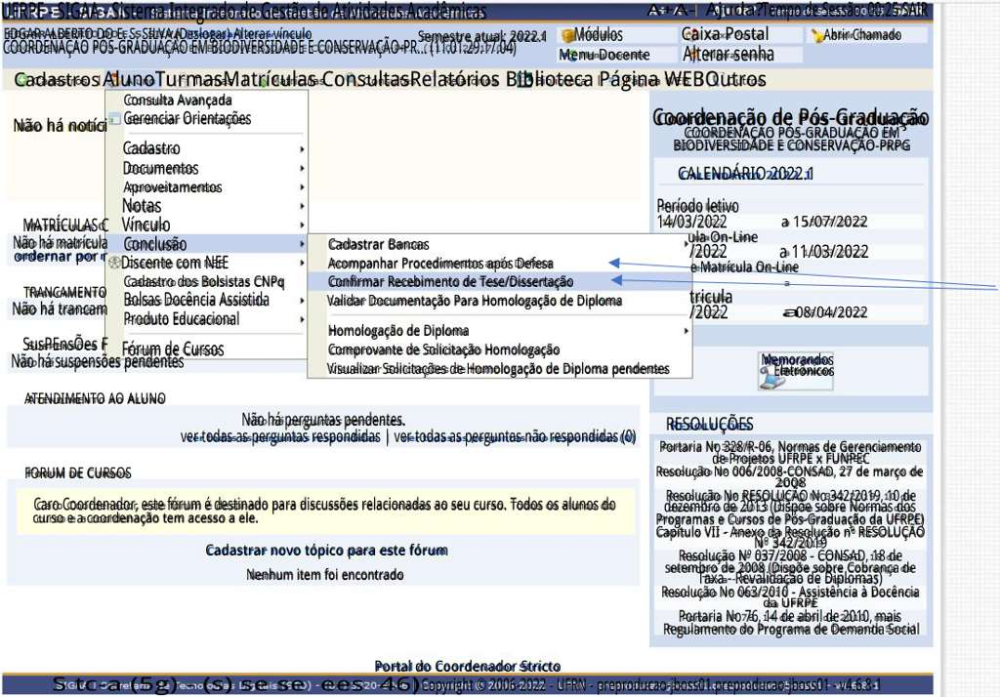

<!-- figure p33-fig1 | described_by: claude:sonnet | ocr_overlap: 0.88 | needs_review: false -->
1. Tipo de figura: captura de tela (screenshot) de sistema web acadêmico (SIGAA/SIG@ UFRPE), menu de contexto aberto sobre painel do coordenador.

2. Texto visível (tudo, verbatim):

Topo:
- "UFRPE SIGAA — Sistema Integrado de Gestão de Atividades Acadêmicas"
- "A+ A- | Ajuda | Tempo de Sessão: 05:59:58" (parte sobreposta/ilegível)
- "EDGAR ALBERTO DO E.S. SILVA (Desligar) Alterar vínculo"
- "COORDENAÇÃO PÓS-GRADUAÇÃO EM BIODIVERSIDADE E CONSERVAÇÃO-PR... (11:01:29:7:04)"
- "Semestre atual: 2022.1"
- "Módulos" | "Caixa Postal" | "Abrir Chamado"
- "Menu Docente" | "Alterar senha"

Barra de menu principal: "Cadastros | Aluno | Turmas | Matrículas | Consultas | Relatórios | Biblioteca | Página WEB | Outros"

Menu suspenso (coluna 1):
- "Consulta Avançada"
- "Gerenciar Orientações"
- "Cadastro ▸"
- "Documentos ▸"
- "Aproveitamentos ▸"
- "Notas ▸"
- "Vínculo ▸"
- "Conclusão ▸" (destacado/selecionado)
- "Discente com NEE ▸"
- "Cadastro dos Bolsistas CNPq"
- "Bolsas Docência Assistida ▸"
- "Produto Educacional ▸"
- "Fórum de Cursos"

Submenu (coluna 2, aberto a partir de "Conclusão"):
- "Cadastrar Bancas ▸"
- "Acompanhar Procedimentos após Defesa ▸"
- "Confirmar Recebimento de Tese/Dissertação" (apontado por seta)
- "Validar Documentação Para Homologação de Diploma ▸"
- "Homologação de Diploma ▸"
- "Comprovante de Solicitação Homologação"
- "Visualizar Solicitações de Homologação de Diploma pendentes"

Coluna esquerda (atrás do menu, parcialmente coberta):
- "Não há notícias"
- "MATRÍCULAS..." / "Não há matrícula..." / "...ordenar por..."
- "TRANCAMENTO..." / "Não há trancam..."
- "Suspensões..." / "Não há suspensões pendentes"
- "ATENDIMENTO AO ALUNO"
- "Não há perguntas pendentes."
- "ver todas as perguntas respondidas | ver todas as perguntas não respondidas (0)"
- "FÓRUM DE CURSOS"
- "Caro Coordenador, este fórum é destinado para discussões relacionadas ao seu curso. Todos os alunos do curso e a coordenação têm acesso a ele."
- "Cadastrar novo tópico para este fórum" (link)
- "Nenhum item foi encontrado"

Painel direito:
- "Coordenação de Pós-Graduação"
- "COORDENAÇÃO PÓS-GRADUAÇÃO EM BIODIVERSIDADE E CONSERVAÇÃO-PRPG"
- "CALENDÁRIO 2022.1"
- "Período letivo: 14/03/2022 a 15/07/2022"
- "...Matrícula On-Line: .../2022 a 11/03/2022"
- "...rícula: .../2022 a 08/04/2022"
- Ícone + "Memorandos Eletrônicos"
- "RESOLUÇÕES"
- "Portaria Nº 328/R-06, Normas de Gerenciamento de Projetos UFRPE x FUNPEC"
- "Resolução Nº 006/2008-CONSAD, 27 de março de 2008"
- "Resolução Nº RESOLUÇÃO Nº 342/2019, 10 de dezembro de 2013 (Dispõe sobre Normas dos Programas e Cursos de Pós-Graduação da UFRPE) Capítulo VII - Anexo da Resolução nº RESOLUÇÃO Nº 342/2019"
- "Resolução Nº 037/2008 - CONSAD, 18 de setembro de 2008 (Dispõe sobre Cobrança de Taxa - Revalidação de Diplomas)"
- "Resolução Nº 063/2010 - Assistência à Docência da UFRPE"
- "Portaria Nº 76, 14 de abril de 2010, mais Regulamento do Programa de Demanda Social"

Rodapé:
- "Portal do Coordenador Stricto Sensu"
- "SIGAA | Copyright © 2006-2022 - UFRN - preprodução-bioss01.preprodução-bioss01 - v6.8.1"

3. Estrutura: layout típico de intranet acadêmica — cabeçalho no topo com identificação do usuário e vínculo; barra de navegação horizontal abaixo do cabeçalho; menu em cascata com três níveis aberto sobre o conteúdo (menu principal → "Conclusão" → submenu com opções de conclusão de curso); duas colunas de conteúdo ao fundo (esquerda: avisos/matrículas/fórum; direita: calendário e resoluções), parcialmente encobertas pelo menu; seta azul aponta do item "Conclusão" para "Confirmar Recebimento de Tese/Dissertação", indicando a opção sendo destacada/selecionada na imagem.

4. Valores numéricos:
- Semestre: 2022.1
- Tempo de sessão: 05:59:58
- Código entre parênteses: (11:01:29:7:04)
- Perguntas não respondidas: (0)
- Datas: 14/03/2022, 15/07/2022, .../2022, 11/03/2022, .../2022, 08/04/2022
- Portaria Nº 328/R-06
- Resolução Nº 006/2008
- data: 27 de março de 2008
- Resolução Nº 342/2019
- data: 10 de dezembro de 2013
- Capítulo VII
- Resolução Nº 037/2008
- data: 18 de setembro de 2008
- Resolução Nº 063/2010
- Portaria Nº 76
- data: 14 de abril de 2010
- Copyright: 2006-2022
- versão: v6.8.1

5. Cores com significado: seta azul indicando item selecionado/destacado ("Confirmar Recebimento de Tese/Dissertação"); item "Conclusão" com fundo destacado (seleção ativa no menu); restante da interface em tons padrão (cinza/branco/azul) sem significado funcional adicional.

~~~text ocr
chi
9
Caixa-Postal
Cadastros Biftioteca Pagina
Consulta Avançada
Não há Orientações
Gadastro > E É E CONSERVAÇÃO PRPG
Documentos
Aproveitamentos >
Notas , Período letivo
a 15/07/2022
» Cadastrar Bancas
ordernar por fc: Discente com NEE >| Procedimentos após Defesa
n ENT dos Bolsistas CNPq Confirmar Recebimento de Tese/ <— -
Assistida Validar Documentação Para Homologação de Diploma ricula
Não há te /2022 =08/04/2022
Produto Educacional »
Homologação de Diploma >
Fórum de Cursos Comprovante de Solicitação Homologação
| Visualizer Solicitações de Homologação de Diploma pendentes
ATENDIMENTO AO ALUNO
pendentes. RESOLUÇÕES
respondidas | as perguntas:não respondidas (0) —
FORUM DE CURSOS Resolução No 2008 CONSAD, 27 de marco de
este fórum é destinado para discussões relacionadas ao seu curso. Todos os alunos do de
curso tem acesso a ele. Progr Cursos da
Cadastrar novo tópico para este fórum
Nenhum item foi encontrado
Nº CONSAD,
Cob
e
Resolução N No - Assistência à Docência
Portaria 14 de 2010, mais
do Programa de Demantia Social
>iGi É @ Ss rel ane
5 Lig TO) =
~~~

<!-- Start of picture text -->
UFRPE - SIGAA - Sistema Integrado de Gestão de Atividades Acadêmicas A+A- Ajuda?Tempo de Sessão: 00:25 SAIRTempo de Sessão: 00:25 SAIR EDGAR ALBERTO DO E. S. SILVA (Deslogar) Alterar vínculo Semestre atual: 2022.1 Módulos Caixa Postal Abrir Chamado COORDENAÇÃO PÓS-GRADUAÇÃO EM BIODIVERSIDADE E CONSERVAÇÃO-PR... (11.01.29.17.04) Menu Docente Alterar senha Cadastros AlunoTurmasMatrículas ConsultasRelatórios Biblioteca Página WEBOutros Consulta Avançada Não há notíci Gerenciar Orientações Coordenação de Pós-GraduaçãoCOORDENAÇÃO PÓS-GRADUAÇÃO EM Cadastro BIODIVERSIDÃDE E CONSERVAÇÃO-PRPG Documentos CALENDÁRIO 2022.1 Aproveitamentos Notas Período letivo MATRÍCULAS C Vínculo 14/03/2022 a 15/07/2022 Não há matrícula Conclusão Cadastrar Bancas ula On-Line ordernar por r Discente com NEE Acompanhar Procedimentos após Defesa /2022e Matrícula On-Linea 11/03/2022 Cadastro dos Bolsistas CNPq Confirmar Recebimento de Tese/Dissertação TRANCAMENTO Bolsas Docência Assistida Validar Documentação Para Homologação de Diploma tricula Não há trancam /2022 a08/04/2022 Produto Educacional Homologação de Diploma SusPEnsÕes F Fórum de Cursos Comprovante de Solicitação Homologação Não há suspensões pendentes Visualizar Solicitações de Homologação de Diploma pendentes MemorandosEletrônicos ATENDIMENTO AO ALUNO Não há perguntas pendentes. RESOLUÇÕES ver todas as perguntas respondidas | ver todas as perguntas não respondidas (0) Portaria No 328/R-06, Normas de Gerenciamento de Projetos UFRPE x FUNPEC FORUM DE CURSOS Resolução No 006/2008-CONSAD, 27 de março de 2008 Resolução No RESOLUÇÃO No 342/2019, 10 de Caro Coordenador, este fórum é destinado para discussões relacionadas ao seu curso. Todos os alunos do dezembro de 2013 (Dispõe sobre Normas dos curso e a coordenação tem acesso a ele. Programas e Cursos de Pós-Graduação da UFRPE) Capítulo VII - Anexo da Resolução nº RESOLUÇÃO N° 342/2019 Cadastrar novo tópico para este fórum Resolução Nº 037/2008 - CONSAD, 18 de Nenhum item foi encontrado setembro de 2008 (Dispõe sobre Cobrança deTaxa - Revalidação de Diplomas) Resolução No 063/2010 - Assistência à Docência da UFRPE Portaria No 76, 14 de abril de 2010, mais Regulamento do Programa de Demanda Social Portal do Coordenador Stricto S tc-a (5g) - (s) se se  ees  46)| Copyright © 2006-2022 - UFRN - preproducao-jboss01.preproducao-jboss01 - v4.6.8-1 <!-- End of picture text -->

Em seguida, a coordenação deverá confirmar o recebimento da versão final através de um destes menus 

30 POR 10:59 INTL17/05/2022 

29C Chuva fraca 

Q Digite aqui para pesquisar 

<!-- page 34 -->

> 凸 × 

> SIGAA - Sistema Integrado de GX + 

目☆ 三 ⊕ xkcd - A Webcomic - . 》 

← C 

###### 8https://preproducao.sigs.ufrpe.br/sigaa/graduacao/busca_discente.jsf 

###### Introdução Save to MendeleyWelcome to Video Ga... Giant In the Playgroun...Looking For GroupGoblins - Life through ...[bb.com.br]Jurassic World: Adult I..FastGames - Gamers I...Facebook Meme Generator - Im... Nuklear Power » 8-Bit ... ⊕ xkcd - A Webcomic - . 

UFRPE - SIGAA - Sistema Integrado de Gestão de Atividades Acadêmicas 

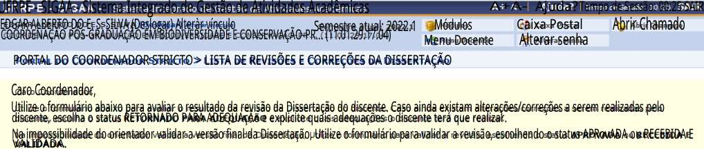

<!-- figure p34-fig1 | described_by: claude:sonnet | ocr_overlap: 0.82 | needs_review: false -->
Captura de tela de sistema web (interface de portal acadêmico), não é gráfico/figura de dados.

**Texto visível (verbatim):**

Barra superior: "UFRPE | SIGAA — Sistema Integrado de Gestão de Atividades Acadêmicas". Canto direito: "A+ A- | Ajuda? | Tempo de Sessão: 00:25 AAR" [illegible parte final da sigla].

Linha identificação usuário: "EDGAR ALBERTO DO E. S. SILVA (Deslogar) (Alterar vínculo)" / "COORDENAÇÃO PÓS-GRADUAÇÃO EM BIODIVERSIDADE E CONSERVAÇÃO PR... (11:01:29:17:04)" [final truncado/illegible]. Ao centro: "Semestre atual: 2022.1". Menu direita, duas colunas: "Módulos" / "Menu Docente" e "Caixa Postal" / "Alterar senha", e "Abrir Chamado".

Linha de navegação (breadcrumb, em negrito/sublinhado azul): "PORTAL DO COORDENADOR STRICTO > LISTA DE REVISÕES E CORREÇÕES DA DISSERTAÇÃO".

Corpo do texto (fundo amarelo claro):
"Caro Coordenador,

Utilize o formulário abaixo para avaliar o resultado da revisão da Dissertação do discente. Caso ainda existam alterações/correções a serem realizadas pelo discente, escolha o status RETORNADO PARA ADEQUAÇÃO e explicite quais adequações o discente terá que realizar.

Na impossibilidade do orientador validar a versão final da Dissertação, utilize o formulário para validar a revisão, escolhendo o status APROVADA ou RECEBIDA E VALIDADA."

**Estrutura:** layout típico de página web institucional, sem painéis/eixos/gráficos. De cima pra baixo: (1) barra de título do sistema (fundo azul escuro); (2) barra de identificação do usuário/sessão com linha divisória laranja; (3) faixa cinza-claro com menu de links à direita em duas colunas; (4) linha de breadcrumb/navegação em negrito; (5) bloco de texto informativo sobre fundo amarelo claro, sem bordas definidas, só texto corrido em 3 parágrafos.

**Valores numéricos:** "2022.1" (semestre), "00:25" (tempo de sessão, parcial), "(11:01:29:17:04)" (sequência numérica junto ao vínculo do coordenador, formato não identificado — possível ID/timestamp [illegible] o que exatamente representa).

**Cores com significado:** fundo azul escuro na barra superior (padrão de cabeçalho de sistema); linha divisória laranja (separador visual); fundo cinza-claro na barra de menu; texto do breadcrumb em azul (indica link/navegação); fundo amarelo claro no bloco de aviso/instrução (destaque de alerta/instrução importante); texto em negrito "RETORNADO PARA ADEQUAÇÃO", "APROVADA", "RECEBIDA E VALIDADA" destacando os status possíveis.

Nota técnica: toda a imagem apresenta efeito de texto duplicado/fantasma (deslocamento horizontal de poucos pixels sobrepondo cada linha), provável artefato de extração/renderização do PDF original — texto permanece legível por repetição, sem perda de conteúdo.

~~~text ocr
| ue
0221 @Médules
CR Alterar-senha
RORTAL DO LISTA DE REVISÕES E CORREÇÕES DA DISSERTAÇÃO
formulário abaixo pata avaliar resultado da revisão da de discente. Caso ainda existam a serem realizadas pelo
escolha o status REFORNADO explicite discente terá que realiz
o revisão Ao w
~~~

<!-- Start of picture text -->
UFRPE - SIGAA - Sistema Integrado de Gestão de Atividades Acadêmicas A+A- Ajuda? Tempo de Sessão: 00:25 SAIR EDGAR ALBERTO DO E. S. SILVA (Deslogar) Alteràr vínculo Semestre atual: 2022.1 Módulos Caixa Postal Abrir Chamado COORDENAÇÃO PÓS-GRADUAÇÃO EM BIODIVERSIDADE E CONSERVAÇÃO-PR... (11.01.29.17.04) Menu Docente Alterar senha PORTAL DO COORDENADOR STRICTO > LISTA DE REVISÕES E CORREÇÕES DA DISSERTAÇÃO Caro Coordenador, Utilize o formulário abaixo para avaliar o resultado da revisão da Dissertação do discente. Caso ainda existam alterações/correções a serem realizadas pelo discente, escolha o status RETORNADO PARA ADEQUAçÃo e explicite quais adequações o discente terá que realizar. Na impossibilidade do orientador validar a versão final da Dissertação, Utilize o formulário para validar a revisão, escolhendo o status APRovADA ou RECEBIDA E VALIDADA. <!-- End of picture text -->

Abaixo do formulário estão listadas as revisões anteriores sendo possível baixar o arquivo versionado ou ver os detalhes da revisão. 

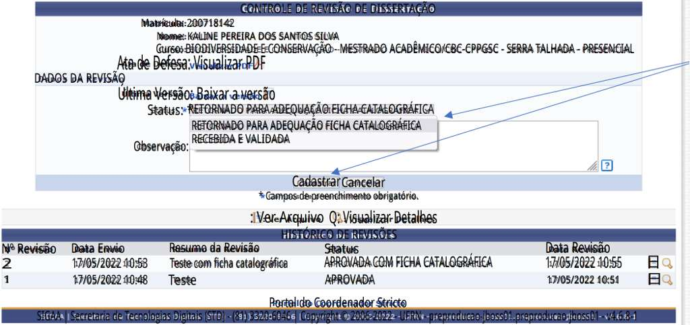

<!-- figure p34-fig2 | described_by: claude:sonnet | ocr_overlap: 0.79 | needs_review: false -->
Screenshot de interface sistema (SIGAA), não gráfico/figura de dados.

**(1) Tipo:** captura de tela de formulário web de controle de revisão de dissertação, com dropdown aberto sobreposto.

**(2) Texto visível (verbatim):**

Título topo: "CONTROLE DE REVISÃO DE DISSERTAÇÃO"

Campos:
- "Matrícula: 200718142"
- "Nome: KALINE PEREIRA DOS SANTOS SILVA"
- "Curso: BIODIVERSIDADE E CONSERVAÇÃO - MESTRADO ACADÊMICO/CBC-CPPGSC - SERRA TALHADA - PRESENCIAL"
- "Ata de Defesa: Visualizar PDF"

Seção "DADOS DA REVISÃO":
- "Última Versão: Baixar a versão"
- "Status:" com campo selecionado mostrando "RETORNADO PARA ADEQUAÇÃO FICHA CATALOGRÁFICA"
- Dropdown aberto (sobrepondo texto acima) com duas opções:
  - "RETORNADO PARA ADEQUAÇÃO FICHA CATALOGRÁFICA"
  - "RECEBIDA E VALIDADA"
- "Observação:" (caixa de texto vazia, ícone "?" ao lado)
- Botões: "Cadastrar" / "Cancelar"
- Nota: "* Campos de preenchimento obrigatório."

Legenda ícones: "I: Ver Arquivo  Q: Visualizar Detalhes" (ícones parcialmente sobrepostos pelo texto do dropdown)

Seção "HISTÓRICO DE REVISÕES" — tabela com colunas:
"Nº Revisão | Data Envio | Resumo da Revisão | Status | Data Revisão"

Linha 1: "2 | 17/05/2022 10:53 | Teste com ficha catalográfica | APROVADA COM FICHA CATALOGRÁFICA | 17/05/2022 10:55" + ícones 🗎🔍
Linha 2: "1 | 17/05/2022 10:48 | Teste | APROVADA | 17/05/2022 10:51" + ícones 🗎🔍

Rodapé: "Portal do Coordenador Stricto"
Linha final (pequena, borrada): "SIGAA | Secretaria de Tecnologias Digitais (STD) - (81) 3320-6-?46 [illegible] | Copyright © 2006-2022 - UFRN - preproducao-jboss01.preproducao-jboss01 - v4.6.8-1"

**(3) Estrutura:** topo = bloco dados aluno (4 campos empilhados); abaixo = bloco "DADOS DA REVISÃO" com campo status (dropdown ativo, lista suspensa aberta sobre o campo, duas setas azuis apontando pra ele indicando interação/destaque de seleção) + campo observação + botões ação; abaixo = legenda ícones; abaixo = tabela histórico (2 colunas cabeçalho, 2 linhas dados, cada linha com 2 ícones ação à direita); rodapé = texto sistema.

**(4) Valores numéricos:** matrícula 200718142; datas/horas 17/05/2022 10:53, 10:55, 10:48, 10:51; nº revisão 2 e 1; versão sistema v4.6.8-1; telefone (81) 3320-6[illegible]46.

**(5) Cores:** setas azuis apontando pro campo status/dropdown (indicam destaque/interação do usuário, sem outro significado semântico); resto preto/branco/cinza padrão interface SIGAA.

~~~text ocr
DIE De
KALINE PEREIRA DOS SANTOS SILVA
- MESTRADO ACADÊMICO/CBE-CPPGSE - SERRA TALHADA - PRESENIGIAL
Mede
DADOS DA REVISÃO
Ultima .
Status» REFORNADO PARA
REFORNADO PARA ADEQUAÇÃO FICHA CATALOGRÁRICA |
RECEBIDA E VALIDADA
Cadastrar Cancelar
obrigatório.
Detalhes
Nº Revisão Data Envio Resumo da Revisão
Data Revisão
2 ficha catalográfica COM FICHA CATALOGRARICA Ha
1 Teste APROVADA 17/05/2022 10:51 HQ
~~~

<!-- Start of picture text -->
CONTROLE DE REVISÃO DE DISSERTAÇÃO Matrícula: 200718142 Nome: KALINE PEREIRA DOS SANTOS SILVA Curso: BIODIVERSIDADE E CONSERVAÇÃO - MESTRADO ACADÊMICO/CBC-CPPGSC - SERRA TALHADA - PRESENCIAL Ata de Defesa: Visualizar PDF DADOS DA REVISÃO Última Versão: Baixar a versão Status: *RETORNADO PARA ADEQUAÇÃO FICHA CATALOGRÁFICA RETORNADO PARA ADEQUAÇÃO FICHA CATALOGRÁFICA Observação: RECEBIDA E VALIDADA CadastrarCancelar * Campos de preenchimento obrigatório. : Ver Arquivo Q: Visualizar Detalhes HISTÓRICO DE REVISÕES Nº Revisão Data Envio Resumo da Revisão Status Data Revisão 2 17/05/2022 10:53 Teste com ficha catalográfica APROVADA COM FICHA CATALOGRÁFICA 17/05/2022 10:55 日 1 17/05/2022 10:48 Teste APROVADA 17/05/2022 10:51 日 Portal do Coordenador Stricto SIGAA | Secretaria de Tecnologias Digitais (STD) - (81) 3320-6046 | Copyright © 2006-2022 - UFRN - preproducao-jboss01.preproducao-jboss01 - v4.6.8-1 <!-- End of picture text -->

De forma análoga ao passo 3 e ao passo 6 realizados pelo orientador, a coordenação insere sua avaliação, e clica em “cadastrar” 

31 

POR 10:59 INTL17/05/2022 

ǔ 

S 

29C Chuva fraca 

Digite aqui para pesquisar 

日 

<!-- page 35 -->

> 凸 × 

> SIGAA - Sistema Integrado de GX + 

目☆ 

8 https://preproducao.sigs.ufrpe.br/sigaa/portais/discente/discente.jsf 

##### C 

← 

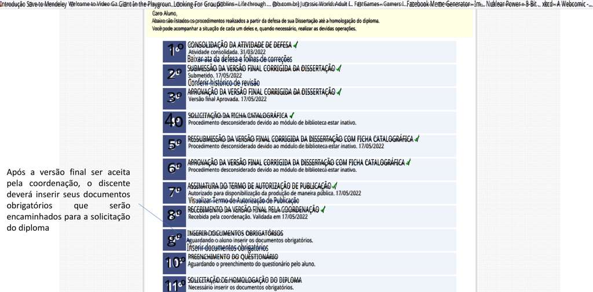

<!-- figure p35-fig1 | described_by: claude:sonnet | ocr_overlap: 0.88 | needs_review: false -->
Figura: captura de tela de navegador mostrando uma página web institucional (tipo painel de acompanhamento acadêmico), com uma aba de navegador sobreposta por cima do conteúdo, causando sobreposição parcial de texto em várias linhas.

**(2) Texto visível, verbatim:**

Faixa superior (abas do navegador, texto sobreposto ao conteúdo abaixo, em fonte pequena): "Introdução Save to Mendeley Welcome to Video Ga... Giant In the Playgroun... Looking For Group Goblins - Life through... [bb.com.br] Jurassic World: Adult I... Fast Games - Gamers !... Facebook Meme Generator - Im... Nuklear Power » 8-Bit ... xkcd - A Webcomic -..."

Bloco de texto em fundo amarelo claro (topo do conteúdo):
"Caro Aluno,
Abaixo são listados os procedimentos realizados a partir da defesa de sua Dissertação até a homologação do diploma.
Você pode acompanhar a situação de cada um deles e, quando necessário, realizar as devidas operações."

Lista numerada (cada item com número em caixa escura à esquerda, título em azul, linha(s) de status em texto normal, e às vezes um link sublinhado azul; marca de verificação verde √ ao lado de vários títulos; algumas linhas aparecem sobrepostas/duplicadas por causa da aba do navegador em cima, dificultando leitura total):

1º — CONSOLIDAÇÃO DA ATIVIDADE DE DEFESA ✓
Atividade consolidada. 31/03/2022
Baixar ata da defesa e folhas de correções [texto parcialmente sobreposto/ilegível]

2º — SUBMISSÃO DA VERSÃO FINAL CORRIGIDA DA DISSERTAÇÃO ✓
Submetido. 17/05/2022
Conferir histórico de revisão [parcialmente sobreposto]

3º — APROVAÇÃO DA VERSÃO FINAL CORRIGIDA DA DISSERTAÇÃO ✓
Versão final Aprovada. 17/05/2022

4º — SOLICITAÇÃO DA FICHA CATALOGRÁFICA ✓
Procedimento desconsiderado devido ao módulo de biblioteca estar inativo.

5º — RESSUBMISSÃO DA VERSÃO FINAL CORRIGIDA DA DISSERTAÇÃO COM FICHA CATALOGRÁFICA ✓
Procedimento desconsiderado devido ao módulo de biblioteca estar inativo. 17/05/2022

6º — APROVAÇÃO DA VERSÃO FINAL CORRIGIDA DA DISSERTAÇÃO COM FICHA CATALOGRÁFICA ✓
Procedimento desconsiderado devido ao módulo de biblioteca estar inativo.

7º — ASSINATURA DO TERMO DE AUTORIZAÇÃO DE PUBLICAÇÃO ✓
Autorizado para disponibilização da produção de maneira pública. 17/05/2022
Visualizar Termo de Autorização de Publicação [parcialmente sobreposto]

8º — RECEBIMENTO DA VERSÃO FINAL PELA COORDENAÇÃO ✓
Recebida pela coordenação. Validada em 17/05/2022

9º — INSERIR DOCUMENTOS OBRIGATÓRIOS
Aguardando o aluno inserir os documentos obrigatórios.
Inserir documentos obrigatórios [link, parcialmente sobreposto]

10º — PREENCHIMENTO DO QUESTIONÁRIO
Aguardando o preenchimento do questionário pelo aluno.

11º — SOLICITAÇÃO DE HOMOLOGAÇÃO DO DIPLOMA
Necessário inserir os documentos obrigatórios.

Caixa de texto à esquerda, fora da lista, ligada por uma linha/seta diagonal apontando para o item 9º ("INSERIR DOCUMENTOS OBRIGATÓRIOS"):
"Após a versão final ser aceita pela coordenação, o discente deverá inserir seus documentos obrigatórios que serão encaminhados para a solicitação do diploma"

**(3) Estrutura:**
- Topo: faixa horizontal de abas de navegador sobreposta ao restante da imagem.
- Logo abaixo, um bloco retangular com fundo amarelo claro contendo o texto de saudação ("Caro Aluno...").
- Abaixo dele, uma lista vertical de 11 itens numerados (1º a 11º), cada um formando uma "linha" com: caixa numerada azul-escura à esquerda (número ordinal em algarismo grande preto/branco), e à direita o título do procedimento em azul, seguido por uma ou duas linhas de status/descrição em texto preto, por vezes com link sublinhado. Marca de verificação verde (√) aparece ao lado dos títulos dos itens 1 a 8, indicando conclusão; itens 9, 10 e 11 não têm marca de verificação, indicando pendência.
- Uma anotação (caixa de texto) foi adicionada manualmente à esquerda da imagem, fora da tabela original, conectada por uma linha diagonal fina ao item 9º, funcionando como uma chamada/callout explicativo.
- Não há eixos nem gráficos numéricos; é uma captura de tela de interface web (lista de status/etapas), não um gráfico de dados.

**(4) Valores/datas:**
- 31/03/2022 (item 1º)
- 17/05/2022 (aparece nos itens 2º, 3º, 5º, 7º, 8º)
- Números ordinais da lista: 1º, 2º, 3º, 4º, 5º, 6º, 7º, 8º, 9º, 10º, 11º

**(5) Cores com significado:**
- Fundo amarelo claro: destaque do texto de boas-vindas/instruções.
- Caixas numeradas em azul-escuro/arroxeado: identificação sequencial das etapas.
- Texto em azul: títulos dos procedimentos e links clicáveis.
- Marca de verificação verde (√): indica etapa concluída (presente nos itens 1º–8º, ausente nos itens 9º–11º, que estão pendentes).
- Linha azul fina: conecta a anotação explicativa ao item 9º.

Observação: devido à sobreposição da faixa de abas do navegador e de outro elemento de texto por cima da lista, partes de várias linhas (especialmente nos itens 1º, 2º, 7º e 9º) ficam parcialmente ilegíveis — reproduzidas acima conforme possível identificar; trechos adicionais sobrepostos permanecem [illegible].

~~~text ocr
Introdução Looking For L. -..
Garo Aluno,
realizados a partir da defesa de sua até a homologação do diploma,
acompanhar a situação de cada um deles e, quando necessário, realizar as devidas operações.
CONSOLIDAÇÃO DA ATIVIDADE DE DEFESA
Atividade consolidada. 31/03/2022
da defesasa
DA VERSÃO FINAL CORRIGIDA DA DISSERTAÇÃO
Submetido. 17/05/2022
Conterie-histórico-de revisão
ARRONAÇÃO BA VERSÃO FINAL CORRIGIDA DA DISSERT/
Versão final Aprovada. 17/05/2022
SOLICITAÇÃO DA CATALOGRAFIEA
Procedimento desconsiderado devido ao módulo de biblioteca estar inativo.
DA VERSÃO FINAL CORRIGIDA DA DISSERTAÇÃO COM FICHA af
Procedimento desconsiderado devido ao inativo. 17/05/2022
ÃO DA VERSÃO FINAL CORRIGIDA DA DISSERTAÇÃO FICHA of
Após a versão final ser aceita On Procedimento desconsiderado devido ao módulo de
pela coordenação, o discente TERMO DE AUTORIZAÇÃO DE
deverá inserir seus documentos pare . 47/05/2022
obrigatórios RECEBIMENTO DA VERSÃO FINAL
encaminhados para a solicitação Recebida pela coordenação. Validada em 17/05/2022
do diploma 7 = =
juardando-oaluno inserir os documentos obrigatórios.
I obigatóios
DO QUESTIONÁRIO
Aguardando o preenchimento do questionário pelo aluno.
BO DIPLOMA
Necessário inserir os documentos obrigatórios.
~~~

<!-- Start of picture text -->
Introdução Save to Mendeley Welcome to Video Ga... Giant In the Playgroun...Looking For Group Goblins - Life through ... [bb.com.br] Jurassic World: Adult I.. FastGames - Gamers l... Facebook Meme Generator - Im... Nuklear Power » 8-Bit .. xkcd - A Webcomic -... Caro Aluno, Abaixo são listados os procedimentos realizados a partir da defesa de sua Dissertação até a homologação do diploma. Você pode acompanhar a situação de cada um deles e, quando necessário, realizar as devidas operações. CONSOLIDAÇÃO DA ATIVIDADE DE DEFESA ✓ 1º Atividade consolidada. 31/03/2022 Baixar ata da defesa e folhas de correções SUBMISSÃO DA VERSÃO FINAL CORRIGIDA DA DISSERTAÇÃO ✓ 2º Submetido. 17/05/2022 Conferir histórico de revisão APROVAÇÃO DA VERSÃO FINAL CORRIGIDA DA DISSERTAÇÃO ✓ 3º Versão final Aprovada. 17/05/2022 4o SOLICITAÇÃO DA FICHA CATALOGRÁFICA ✓ Procedimento desconsiderado devido ao módulo de biblioteca estar inativo. RESSUBMISSÃO DA VERSÃO FINAL CORRIGIDA DA DISSERTAÇÃO COM FICHA CATALOGRÁFICA √ 5º Procedimento desconsiderado devido ao módulo de biblioteca estar inativo. 17/05/2022 APROVAÇÃO DA VERSÃO FINAL CORRIGIDA DA DISSERTAÇÃO COM FICHA CATALOGRÁFICA √ 6º Procedimento desconsiderado devido ao módulo de biblioteca estar inativo. Após a versão final ser aceita pela coordenação, o discente  ASSINATURA DO TERMO DE AUTORIZAÇÃO DE PUBLICAÇÃO ✓ deverá inserir seus documentos  7º Autorizado para disponibilização da produção de maneira pública. 17/05/2022 Visualizar Termo de Autorização de Publicação obrigatórios  que  serão RECEBIMENTO DA VERSÃO FINAL PELA COORDENAÇÃO ✓ encaminhados para a solicitação  8º Recebida pela coordenação. Validada em 17/05/2022 do diploma INSERIR DOCUMENTOS OBRIGATÓRIOS Aguardando o aluno inserir os documentos obrigatórios. gº Inserir documentos obrigatórios PREENCHIMENTO DO QUESTIONÁRIO 10º Aguardando o preenchimento do questionário pelo aluno. SOLICITAÇÃO DE HOMOLOGAÇÃO DO DIPLOMA 11º Necessário inserir os documentos obrigatórios. <!-- End of picture text -->

三 

》 

Portal do Discente 

SIGAA | Secretaria de Tecnologias Digitais (STD) - (81) 3320-6046 |Copyright © 2006-2022 - UFRN - preproducao-jboss01.preproducao-jboss01 - v4.6.8-1 

32 

POR 11:00 

市 

Digite aqui para pesquisar 

29C Chuva fraca 

日 

口 

1/1/21 1202 

<!-- page 36 -->

> SIGAA - Sistema Integrado de GX + 

凸 × 

← C 

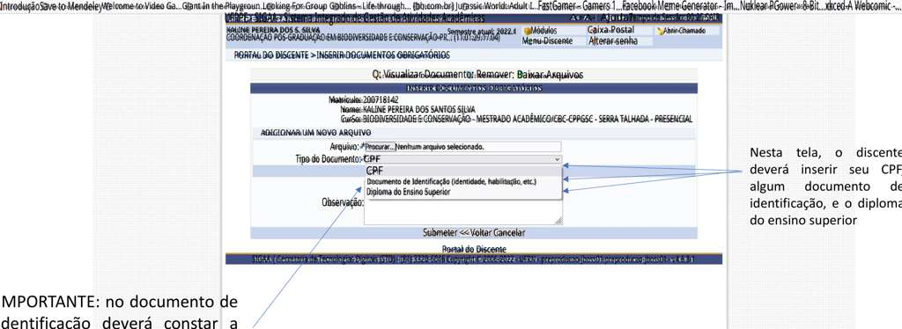

<!-- figure p36-fig2 | described_by: claude:sonnet | ocr_overlap: 0.78 | needs_review: false -->
Captura de tela de um sistema acadêmico (SIGAA/SIGA) sobreposta a abas de navegador, com anotações explicativas acrescentadas por fora da tela.

**1. Tipo de figura:** Captura de tela (screenshot) de uma interface de sistema web universitário, com duas setas/anotações manuscritas em texto adicionadas à imagem para indicar e explicar elementos da tela.

**2. Texto visível (verbatim):**

Abas do navegador (parcialmente sobrepostas, em cima da imagem): "Introdução", "Save to Mendeley", "Welcome to Video Ga...", "Giant In the Playgroun...", "Looking For Group Goblins - Life through...", "[bb.com.br]", "Jurassic World: Adult I...", "FastGamer - Gamers 1...", "Facebook Meme Generator - Im...", "Nuklear PGower» &Bit...", "xkcd-A Webcomic -..."

Cabeçalho do sistema: "UFRPE SIGAA Sistema Integrado de Gestão de Atividades Acadêmicas"
Ícones/links no canto superior direito: "A+ A- Ajuda Tempo de Sessão: 00:05:55 SAIR"

Linha de identificação do usuário:
"KALINE PEREIRA DOS S. SILVA"
"COORDENAÇÃO POS-GRADUAÇÃO EM BIODIVERSIDADE E CONSERVAÇÃO-PR... (11:01:29,17:04)"
"Semestre atual: 2022.1"

Menu superior direito: "Módulos", "Caixa Postal", "Abrir Chamado", "Menu Discente", "Alterar senha"

Caminho de navegação: "PORTAL DO DISCENTE > INSERIR DOCUMENTOS OBRIGATÓRIOS"

Barra de ícones/legenda: "Q: Visualizar Documento   : Remover   : Baixar Arquivos"

Título da seção: "INSERIR DOCUMENTOS OBRIGATÓRIOS"

Dados do aluno:
"Matrícula: 2007181.42" [parcialmente ilegível devido à sobreposição; dígitos podem estar incorretos]
"Nome: KALINE PEREIRA DOS SANTOS SILVA"
"Curso: BIODIVERSIDADE E CONSERVAÇÃO - MESTRADO ACADÊMICO/CBC-CPPGSC - SERRA TALHADA - PRESENCIAL"

Subtítulo: "ADICIONAR UM NOVO ARQUIVO"

Campo: "Arquivo: * Procurar... Nenhum arquivo selecionado."

Campo: "Tipo do Documento:" com menu suspenso aberto mostrando as opções:
- "CPF" (selecionado, aparece também no campo fechado)
- "Documento de Identificação (identidade, habilitação, etc.)"
- "Diploma do Ensino Superior"

Campo: "Observação:" (caixa de texto vazia)

Botões: "Submeter" | "Voltar" | "Cancelar"

Rodapé/link: "Portal do Discente"

Rodapé do sistema: "SIGAA | Secretaria de Tecnologia Digital (STD) - (81) 3320-6045 | Copyright © 2006-2022 - UFRN - preproducao-jboss01-preproducao-jboss01 - v4.6.8.1"

Texto de anotação à direita da imagem (fora da tela do sistema):
"Nesta tela, o discente deverá inserir seu CPF, algum documento de identificação, e o diploma do ensino superior"

Texto de anotação à esquerda/abaixo da imagem (cortado, início de frase):
"IMPORTANTE: no documento de identificação deverá constar a" [frase continua além da borda da imagem, restante não visível/ilegível]

**3. Estrutura (caixas, setas, conexões):**
- A imagem central é a captura de tela do sistema SIGAA, emoldurada em um quadro.
- Duas setas azuis finas partem do texto à direita ("Nesta tela, o discente deverá inserir seu CPF...") e apontam para dentro do menu suspenso "Tipo do Documento", indicando especificamente as três opções da lista (CPF, Documento de Identificação, Diploma do Ensino Superior) — cada seta aponta para uma das três linhas do menu.
- Uma terceira seta azul parte do texto inferior esquerdo ("IMPORTANTE: no documento de identificação...") e aponta para a opção "CPF" no topo do menu suspenso (ou para a área do campo "Tipo do Documento").
- A tela do sistema está organizada em blocos empilhados verticalmente: cabeçalho institucional → dados do usuário logado → menu de módulos → trilha de navegação (breadcrumb) → barra de legenda de ícones → título da seção → bloco de dados do aluno (matrícula, nome, curso) → formulário "Adicionar um novo arquivo" (campos Arquivo, Tipo do Documento com dropdown aberto, Observação) → botões de ação → rodapé.
- Acima de toda a tela do sistema há uma faixa de abas de navegador sobrepostas, parcialmente cobrindo o cabeçalho do SIGAA.

**4. Valores/dados numéricos:**
- Semestre atual: 2022.1
- Tempo de Sessão: 00:05:55
- Matrícula: 2007181.42 [dígitos parcialmente obscurecidos pela aba de navegador sobreposta; leitura incerta]
- Horário entre parênteses: 11:01:29,17:04 [sequência numérica pouco clara devido à sobreposição de texto]
- Telefone no rodapé: (81) 3320-6045
- Copyright: 2006-2022
- Versão do sistema: v4.6.8.1

**5. Cores com significado:**
- Cabeçalho do sistema (barra superior) em azul escuro, com texto branco, indicando identidade visual institucional (UFRPE/SIGAA).
- Barra "INSERIR DOCUMENTOS OBRIGATÓRIOS" em azul escuro com texto branco, destacando o título da seção.
- Linha "Tipo do Documento: CPF" dentro do menu suspenso aparece destacada em cinza (indicando item atualmente selecionado/em foco).
- Setas de anotação em azul, usadas para direcionar visualmente a atenção do leitor aos campos do formulário mencionados no texto explicativo.
- Restante da interface em tons de cinza claro e branco, padrão de sistemas administrativos, sem outras cores com valor semântico adicional.

~~~text ocr
Ga...Glantdn
RPE
WE PEREIRA DOS 5. SILVA
022.4
COORDENAÇÃO POS-GRADUAÇÃO CONSERVAÇÃO
DO DISCENTE OBRIGATÓRIOS
Remaver:
Matricula: 200718142
PEREIRA DOS SANTOS SILVA
BIODIVERS DADE ECONGERVACAG - MESTRADO ACADEMICO/GBE-CPPGSE - SERRA TALHADA - PRESEAIGIAL
ADICIONAR: UM NOVO ARQUIVO
Arquivo: arquivo selecionado.
Tipo do Nesta tela, o discente
GPF deverá inserir seu CPF
Documento de Identificação (identidade, habilitação, etc.)
de == algum de
identificação, e o
do ensino superior
| =
MPORTANTE: no documento de
dentificacão deverá constar a
~~~

<!-- Start of picture text -->
目☆ <!-- End of picture text -->

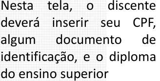

<!-- figure p36-fig3 | described_by: claude:sonnet | ocr_overlap: 1.0 | needs_review: false -->
Figura 1: bloco texto simples, sem bordas/caixas/setas/eixos. Texto completo verbatim:

"Nesta tela, o discente deverá inserir seu CPF, algum documento de identificação, e o diploma do ensino superior"

Sem números, sem cores com significado (texto preto, fundo branco).

~~~text ocr
Nesta tela, o discente
deverá inserir seu CPF
algum documento de
identificação, e o diploma
do ensino superior
~~~

<!-- Start of picture text -->
IntroduçãoSave to Mendeley Welcome to Video Ga...Giant In the Playgroun...Looking For Group Goblins - Life through... [bb.com.br] Jurassic World: Adult I... FastGamer - Gamers 1...Facebook Meme Generator - Im...Nuklear PGower» 8-Bit...xkced-A Webcomic -... UFRPE - SIGAA - Sistema Integrado de Gestão de Atividades Acadêmicas A+A- Ajuda?Tempo de Sessão: 00:25 SAIR KALINE PEREIRA DOS S. SILVA Semestre atual: 2022.1 Módulos Caixa Postal Abrir Chamado COORDENAÇÃO PÓS-GRADUAÇÃO EM BIODIVERSIDADE E CONSERVAÇÃO-PR... (11.01.29.17.04) Menu Discente Alterar senha PORTAL DO DISCENTE > INSERIR DOCUMENTOS OBRIGATÓRIOS Q: Visualizar Documento: Remover: Baixar Arquivos INSERIR DOCUMENTOS OBRIGATÓRIOS Matrícula: 200718142 Nome: KALINE PEREIRA DOS SANTOS SILVA CurSo: BIODIVERSIDADE E CONSERVAÇÃO - MESTRADO ACADÊMICO/CBC-CPPGSC - SERRA TALHADA - PRESENCIAL ADICIONAR UM NOVO ARQUIVO Arquivo: *Procurar...]Nenhum arquivo selecionado. Nesta tela, o discente Tipo do Documento: *CPF CPF deverá inserir seu CPF, Documento de Identificação (identidade, habilitação, etc.) algum  documento  de Diploma do Ensino Superior Observação: identificação, e o diploma do ensino superior Submeter << Voltar Cancelar Portal do Discente SIGAA | Secretaria de Tecnologias Digitais (STD) - (81) 3320-6046 Copyright © 2006-2022 - UFRN - preproducao-jboss01.preproducao-jboss01 - v4.6.8-1 IMPORTANTE: no documento de identificação deverá constar a <!-- End of picture text -->

<!-- Start of picture text -->
Nesta tela, o discente deverá inserir seu CPF, algum  documento  de identificação, e o diploma do ensino superior <!-- End of picture text -->

### IMPORTANTE: no documento de identificação deverá constar a **NATURALIDADE** do discente! 

≡ 

》 

33 

POR 11:00 

Digite aqui para pesquisar 

29°C Chuva fraca 

INTL 17/05/2022 

<!-- page 37 -->

凸 × 

> SIGAA - Sistema Integrado de GX + 

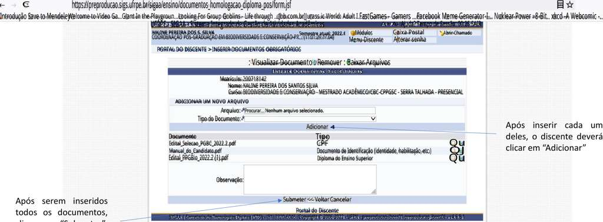

<!-- figure p37-fig1 | described_by: claude:sonnet | ocr_overlap: 0.86 | needs_review: false -->
(1) Tipo figura: screenshot anotado sistema web (SIGAA), com setas e textos explicativos sobrepostos — tutorial de uso.

(2) Texto visível, literal:

Barra URL navegador: "https://preproducao.sigs.ufrpe.br/sigaa/ensino/documentos_homologacao_diploma_pos/form.jsf"

Abas navegador (sobrepostas, parcialmente ilegíveis): "Introdução", "Save to Mendeley", "Welcome to Video Ga...", "Giant in the Playgroun...", "Looking For Group Goblins - Life through...", "jbb.com.br", "Jurassic World: Adult I...", "Fast Games - Gamers...", "Facebook Meme Generator-I...", "Nuclear Power »8-Bit..", "xkcd - A Webcomic -..."

Cabeçalho sistema: "UFRPE | SAI - Sistema Integrado de Gestão de Atividades Acadêmicas" / "A+ A- A" / "Abrir chamado" / "Tempo de Sessão 00:25:55"

Linha usuário: "KALINE PEREIRA DOS S. SILVA" / "COORDENAÇÃO POS-GRADUAÇÃO EM BIODIVERSIDADE E CONSERVAÇÃO-PR...(11.01.29.17.04)" / "Semestre atual: 2022.4"

Menu: "Módulos" / "Caixa Postal" / "Menu Discente" / "Alterar senha"

Navegação: "PORTAL DO DISCENTE > INSERIR DOCUMENTOS OBRIGATÓRIOS"

Barra ícones: "Visualizar Documento" / "Remover" / "Baixar Arquivos"

Título caixa: "INSERIR DOCUMENTOS OBRIGATÓRIOS"

Campos:
- "Matrícula: 200718142"
- "Nome: KALINE PEREIRA DOS SANTOS SILVA"
- "Curso: BIODIVERSIDADE E CONSERVAÇÃO - MESTRADO ACADÊMICO/CBC-CPPGSC - SERRA TALHADA - PRESENCIAL"

Seção: "ADICIONAR UM NOVO ARQUIVO"
- "Arquivo: *Procurar... Nenhum arquivo selecionado."
- "Tipo do Documento: *" (campo dropdown vazio)
- Botão: "Adicionar"

Tabela documentos (colunas "Documento" / "Tipo", cada linha com ícones "Q", "u" ou "J" à direita):
1. "Edital_Selecao_PGBC_2022.2.pdf" — "CPF"
2. "Manual_do_Candidato.pdf" — "Documento de Identificação (identidade, habilitação, etc.)"
3. "Edital_PPGBio_2022.2 (1).pdf" — "Diploma do Ensino Superior"

Campo: "Observação:" (caixa texto vazia)

Botões rodapé: "Submeter <<" "Voltar" "Cancelar"

Rodapé: "Portal do Discente"
"SIGAA | Secretaria de Tecnologias Digitais (STD) - (81) 3320.6046 | Copyright © 2006-2022 - UFRN - preproducao-jboss01.preproducao-jboss01 - v4.6.8.1"

Textos anotação (callouts azuis, fonte maior, sobre fundo branco fora do screenshot):
- Direita, apontando com seta azul para botão "Adicionar": "Após inserir cada um deles, o discente deverá clicar em 'Adicionar'"
- Esquerda inferior, apontando com seta azul para botão "Submeter": "Após serem inseridos todos os documentos, [texto cortado na borda inferior da imagem, continuação ilegível/cortada — provável 'clicar em Submeter' mas não visível]"

(3) Estrutura: imagem única (sem painéis múltiplos). Topo: barra URL + abas navegador sobrepostas ilegíveis em parte, cruzando cabeçalho do sistema. Corpo: screenshot de página SIGAA centralizado, com cabeçalho institucional, bloco dados do aluno, formulário de upload (campo arquivo + dropdown tipo + botão Adicionar), tabela de 3 documentos já inseridos, campo observação, botões ação, rodapé. Duas setas azuis diagonais ligam textos explicativos (fora do screenshot, nas bordas direita e esquerda inferior da imagem) aos elementos do formulário: uma aponta para o botão "Adicionar", outra para o botão "Submeter". Não há eixos, gráficos nem legendas de cores.

(4) Valores/dados: Matrícula "200718142"; Semestre "2022.4"; Tempo de Sessão "00:25:55"; 3 arquivos listados na tabela; telefone rodapé "(81) 3320.6046"; copyright "2006-2022"; versão sistema "v4.6.8.1".

(5) Cores com significado: texto e ícones de ação (upload/remover/baixar) e links em azul (padrão hyperlink/ação); setas de anotação em azul destacando fluxo de uso; fundo do formulário em tons claros de azul/cinza (bandas alternadas de linha, sem significado semântico além de leitura visual). Nenhuma outra cor carrega informação adicional.

~~~text ocr
- diploma: Ww
Introdução the Playgroun. Adult Facebook Webcomic -..
| |
Caixa-Postal
PORTAL DO DISCENTE >INGERIRDOGUMENTOS OBRIGATÓRIOS
Remover :
DUM
PEREIRA DOS SANTOS SILVA
- MESTRADO ACADEMICO/GBE-CPPGSE - SERRA TALHADA - PRESENGIAL
ADICIONAR: UM NOVO ARQUIVO
Arquivo:*Procurar... Nenhum arquivo selecionado.
Após inserir cada um
Decumento Tigo deles, o discente devera
Edital Selecao, Oy
Manual, do. Candidato Documento de Identificação (identidade, habilitação, etc) clicar em “Adicionar”
2022.2 Diploma do Ensino Superior
Observação:
Após serem inseridos Submeter <<Voltar Gancelar
todos os docu mentos,
1
do
~~~

<!-- Start of picture text -->
← C https://preproducao.sigs.ufrpe.br/sigaa/ensino/documentos_homologacao_diploma_pos/form.jsf 目☆ Introdução Save to MendeleyWelcome to Video Ga...Giant In the Playgroun...Looking For Group Goblins - Life through ...[bb.com.br]Jurass.ic World: Adult I...FastGames - Gamers ...Facebook Meme Generator-I... Nuklear Power »8-Bit.. xkcd -A Webcomic -.. UFRPE - SIGAA - Sistema Integrado de Gestão de Atividades Acadêmicas A+ A- Ajuda? Tempo de Sessão: 00:25 SAIR KALINE PEREIRA DOS S. SILVA Semestre atual: 2022.1 Módulos Caixa Postal Abrir Chamado COORDENAÇÃO PÓS-GRADUAÇÃO EM BIODIVERSIDADE E CONSERVAÇÃO-PR... (11.01.29.17.04) Menu Discente Alterar senha PORTAL DO DISCENTE > INSERIR DOCUMENTOS OBRIGATÓRIOS : Visualizar Documento : Remover : Baixar Arquivos INSERIR DOCUMENTOS OBRIGATÓRIOS Matrícula: 200718142 Nome: KALINE PEREIRA DOS SANTOS SILVA CurSo: BIODIVERSIDADE E CONSERVAÇÃO - MESTRADO ACADÊMICO/CBC-CPPGSC - SERRA TALHADA - PRESENCIAL ADICIONAR UM NOVO ARQUIVO Arquivo: *Procurar... Nenhum arquivo selecionado. Tipo do Documento: * V Adicionar 4 Após inserir cada um Documento Tipo deles, o discente deverá Edital_Selecao_PGBC_2022.2.pdf CPF Qu clicar em “Adicionar” Manual_do_Candidato.pdf Documento de Identificação (identidade, habilitação, etc.) QJ Edital_PPGBio_2022.2 (1).pdf Diploma do Ensino Superior Qu Observação: Após serem inseridos  Submeter << Voltar Cancelar todos os documentos,  Portal do Discente SIGAA | Secretaria de Tecnologias Digitais (STD) - (81) 3320-6046 |Copyright © 2006-2022 - UFRN - preproducao-jboss01.preproducao-jboss01 - v4.6.8-1 <!-- End of picture text -->

← C 

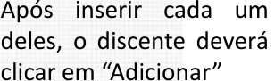

<!-- figure p37-fig2 | described_by: claude:sonnet | ocr_overlap: 0.88 | needs_review: false -->
Figura: bloco texto simples (não gráfico/tabela), fundo padrão pontilhado leve.

Texto verbatim: "Após inserir cada um deles, o discente deverá clicar em "Adicionar""

Estrutura: linha única texto, quebrada em 3 linhas, sem caixas/setas/eixos/painéis. Sem cores com significado (texto preto, fundo branco pontilhado).

~~~text ocr
Apos inserir cada um
deles, o discente deverá
clicar em “Adicionar”
~~~

<!-- Start of picture text -->
Após inserir cada um deles, o discente deverá clicar em “Adicionar” <!-- End of picture text -->

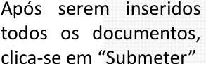

<!-- figure p37-fig3 | described_by: claude:sonnet | ocr_overlap: 1.0 | needs_review: false -->
1) Tipo: imagem de texto simples (trecho de legenda/instrução extraído de PDF, sem tabela, eixos ou setas).

2) Texto visível, verbatim:
"Após serem inseridos todos os documentos, clica-se em "Submeter""

3) Estrutura: bloco único de texto, três linhas, alinhamento justificado, sem caixas, setas, painéis ou eixos.

4) Valores numéricos: nenhum.

5) Cores: sem significado — texto preto sobre fundo claro (leve textura/pontilhado de fundo, sem função informativa).

~~~text ocr
Após serem inseridos
todos os documentos,
clica-se em “Submeter”
~~~

<!-- Start of picture text -->
Após serem inseridos todos os documentos, clica-se em “Submeter” <!-- End of picture text -->

≡ 

》 

34 

后物INTL 17/05/2022POR 11:01 

出 

Digite aqui para pesquisar 

29°C Chuva fraca 

<!-- page 38 -->

> 凸 × 

> SIGAA - Sistema Integrado de GX + 

￥目 

###### ← C https://preproducao.sigs.ufrpe.br/sigaa/stricto/coordenacao.jsf 

###### IntroduçãoSave to Mendeley Welcome to Video Ga...Giant In the Playgroun...Looking For Group Goblins - Life through... [bb.com.br] Jurassic World: Adult ... FastGames - Gamers l...FacebookMeme Generator - Im... Nuklear Power » 8-Bit ...xkcd - A Webcomic - .. 

###### A+A- Ajuda?Tempo de Sessão: 00:25 SAIRTempo de Sessão: 00:25 SAIR 

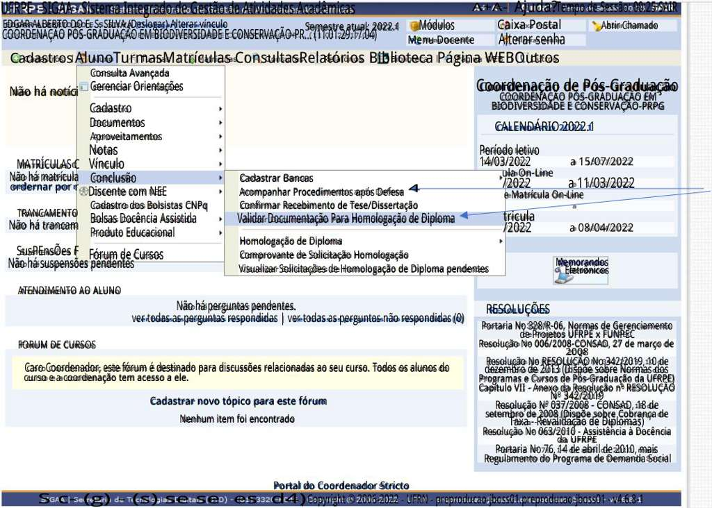

<!-- figure p38-fig1 | described_by: claude:sonnet | ocr_overlap: 0.87 | needs_review: false -->
(1) Tipo de figura: captura de tela (screenshot) de sistema web acadêmico (SIGAA/SIG@-like), com texto sobreposto/duplicado (efeito de dupla exposição, como duas capturas sobrepostas), dificultando leitura de parte do conteúdo. Há uma seta azul grossa apontando da direita para um item de menu.

(2) Texto visível (verbatim, quando legível; trechos sobrepostos marcados):

Topo da página (sobreposto, parcialmente ilegível):
"UFRPE | SIGAA..." sobreposto com algo como "Sistema Integrado de Gestão de Atividades Acadêmicas" [parte ilegível por sobreposição]
"EDGAR ALBERTO DO E. SILVA / Deslogar | Alterar vínculo" [sobreposto, parcialmente ilegível]
"COORDENAÇÃO PÓS-GRADUAÇÃO EM BIODIVERSIDADE E CONSERVA..." (texto cortado) "(11:01:29:17:04)" [números parcialmente ilegíveis]
"Semestre atual: 2022.1"
Ícones/links: "Módulos", "Caixa Postal", "Abrir Chamado"
"Menu Docente", "Alterar senha"
"A+ A- | Ajuda ? | Tempo de Sessão: 05:55 AM" [sobreposto, parcialmente ilegível]

Barra de menu principal: "Cadastros Aluno Turmas Matrículas Consultas Relatórios Biblioteca Página WEB Outros" (texto sobreposto/duplicado)

Menu suspenso (coluna da esquerda, visível sobre a página):
- "Consulta Avançada"
- "Gerenciar Orientações"
- "Cadastro" ▸
- "Documentos" ▸
- "Aprovamentos" ▸
- "Notas" ▸
- "Vínculo" ▸
- "Conclusão" ▸ (submenu aberto)
- "Discente com NEE"
- "Cadastro dos Bolsistas CNPq"
- "Bolsas Docência Assistida"
- "Produto Educacional"
- "Fórum de Cursos"

Submenu de "Conclusão" (coluna central, aberto):
- "Cadastrar Bancas"
- "Acompanhar Procedimentos após Defesa"
- "Confirmar Recebimento de Tese/Dissertação"
- "Validar Documentação Para Homologação de Diploma" (item destacado, apontado pela seta azul)
- "Homologação de Diploma" ▸
- "Comprovante de Solicitação Homologação"
- "Visualizar Solicitações de Homologação de Diploma pendentes"

Coluna esquerda do corpo da página (sobreposta com outro texto, parcialmente ilegível):
"Não há notícias" [sobreposto]
"MATRÍCULAS..." / "Não há matrícula..." / "ordenar por..." [parcialmente ilegível por sobreposição]
"TRANCAMENTO..." / "Não há trancamento..." pendentes" [parcialmente ilegível]
"SUSPENSÕES..." / "Não há suspensões pendentes"

"ATENDIMENTO AO ALUNO"
"Não há perguntas pendentes."
"ver todas as perguntas respondidas | ver todas as perguntas não respondidas (0)" [sobreposto]

"FÓRUM DE CURSOS"
"Caro Coordenador, este fórum é destinado para discussões relacionadas ao seu curso. Todos os alunos do curso e a coordenação tem acesso a ele." [sobreposto/duplicado]
"Cadastrar novo tópico para este fórum" (link)
"Nenhum item foi encontrado"

Painel direito:
"Coordenação de Pós-Graduação" (título, sobreposto duplicado)
"COORDENAÇÃO PÓS-GRADUAÇÃO EM BIODIVERSIDADE E CONSERVAÇÃO-PRPG" [sobreposto]
"CALENDÁRIO 2022.1"
"Período letivo"
"14/03/2022 a 15/07/2022"
"...2/2022 a 11/03/2022" [início cortado/ilegível, possivelmente "Matrícula On-line"]
"e Matrícula On-line" [sobreposto parcial]
"...tricula" [cortado] "...2/2022 a 08/04/2022" [parcialmente ilegível]

Ícone/link: "Memorandos Eletrônicos"

"RESOLUÇÕES" (lista):
- "Portaria No 328/R-06, Normas de Gerenciamento de Projetos UFPE x FUNPEC"
- "Resolução No 006/2008-CONSAD, 27 de março de 2008"
- "Resolução No RESOLUÇÃO No 342/2019, 10 de dezembro de 2013" [texto sobreposto, incoerente/ilegível nessa forma] "Programas e Cursos de Pós-Graduação da UFRPE Capítulo VII - Anexo da Resolução No RESOLUÇÃO No 342/2019"
- "Resolução No 037/2008 - CONSAD, 18 de setembro de 2008 (Dispõe sobre Cobrança de Taxa - Revalidação de Diplomas)"
- "Resolução No 063/2010 - Assistência à Docência da UFRPE"
- "Portaria No 76, 14 de abril de 2010, mais Regulamento do Programa de Demanda Social"

Rodapé:
"Portal do Coordenador Stricto"
"SIGAA | Sistema de Tecnologias da Informação (STI) - 01.332.(304) | Copyright © 2006-2022 - UFRN - [sobreposto/ilegível] - v.6.8.1" [várias partes ilegíveis por sobreposição: "preprodução-bioss01.preprodução-bioss01"-like]

(3) Estrutura: página web de portal acadêmico em três colunas principais. Cabeçalho horizontal no topo com identificação do usuário e links. Abaixo, barra de menu horizontal com categorias. Um menu suspenso vertical abre a partir da barra, com um segundo submenu ("Conclusão") abrindo à direita do primeiro, em cascata (menu > submenu). Seta azul grossa, desenhada sobre a imagem (anotação manual, não parte original da tela), aponta da borda direita da imagem horizontalmente para a esquerda, indicando o item "Validar Documentação Para Homologação de Diploma" no submenu. Corpo da página dividido em coluna esquerda (avisos/matrículas/fórum) e coluna direita (calendário, resoluções, rodapé institucional). Não há gráficos, eixos ou tabelas numéricas — é interface de sistema com menus e textos informativos.

(4) Valores numéricos/datas presentes:
- Semestre atual: 2022.1
- Horário sobreposto: (11:01:29:17:04) [provavelmente contador de sessão, dígitos parcialmente confiáveis por sobreposição]
- Tempo de Sessão: 05:55 AM [parcialmente ilegível]
- CALENDÁRIO 2022.1
- Período letivo: 14/03/2022 a 15/07/2022
- Datas parciais ilegíveis: "...2/2022 a 11/03/2022" e "...2/2022 a 08/04/2022"
- "ver todas as perguntas não respondidas (0)" → valor 0
- Portaria No 328/R-06
- Resolução No 006/2008-CONSAD, 27 de março de 2008
- Resolução No 342/2019, 10 de dezembro de 2013
- Resolução No 037/2008 - CONSAD, 18 de setembro de 2008
- Resolução No 063/2010
- Portaria No 76, 14 de abril de 2010
- Copyright © 2006-2022
- Versão do sistema: v.6.8.1
- Código rodapé: 01.332.(304) [dígitos entre parênteses incertos por sobreposição]

(5) Cores com significado: seta de anotação em azul (destaca item do menu "Validar Documentação Para Homologação de Diploma"); item de menu correspondente também aparece com fundo azul claro destacado (hover/seleção); barra superior de identificação do usuário em azul; restante da interface em tons neutros (branco/cinza) sem outras cores semânticas relevantes.

~~~text ocr
chi
Cadastros Biftioteca Pagina
Avançada Pós-G
há | Gerenciar Orientações
Não ha
Gadastro > BIOD E É E CONSERVAÇÃO PRPG
Documentos CALENDÁRIO:2022
Aproveitamentos »
Notas , Período letivo
Vínculo , 14/03/2022
Conelusão » Cadastrar Bancas
ordernar por fc: Discente com NEE >| Acompanhar Procedimentos após Defesa
ENT Gadastre dos Bolsistas CNPq Recebimento de =
Bolsas Docência Assistida» Para Homologação de Diploma
Produto Educacional E |
Homologação de Diploma >
Fórum de Cursos Comprovante de Solicitação Homologação
Solicitações: de Homologação de Diploma
ATENDIMENTO AO ALUNO
perguntas pendentes. RESOLUÇÕES
respondidas | as perguntas:não respondidas (0) 4
FORUM DE CURSOS Resolução No 2008 CONSAD, 27 de marco de
este fórum é destinado para discussões relacionadas ao seu curso. Todos os alunos do do
curso tem acesso a ele. Progr Cursos da
Cadastrar novo tópico para este fórum Nº CONSAD, 48
item foi encontrado e
Resolução N No - Assistência à Docência
Portaria 14 de 2010, mais
do Programa de Demantia Social
> GA Se te | d= Te E =
~~~

<!-- Start of picture text -->
UFRPE - SIGAA - Sistema Integrado de Gestão de Atividades Acadêmicas A+A- Ajuda?Tempo de Sessão: 00:25 SAIRTempo de Sessão: 00:25 SAIR EDGAR ALBERTO DO E. S. SILVA (Deslogar) Alterar vínculo Semestre atual: 2022.1 Módulos Caixa Postal Abrir Chamado COORDENAÇÃO PÓS-GRADUAÇÃO EM BIODIVERSIDADE E CONSERVAÇÃO-PR... (11.01.29.17.04) Menu Docente Alterar senha Cadastros AlunoTurmasMatrículas ConsultasRelatórios Biblioteca Página WEBOutros Consulta Avançada Não há notíci Gerenciar Orientações Coordenação de Pós-GraduaçãoCOORDENAÇÃO PÓS-GRADUAÇÃO EM Cadastro BIODIVERSIDÃDE E CONSERVAÇÃO-PRPG Documentos CALENDÁRIO 2022.1 Aproveitamentos Notas Período letivo MATRÍCULAS C Vínculo 14/03/2022 a 15/07/2022 Não há matrícula Conclusão Cadastrar Bancas ula On-Line ordernar por r Discente com NEE Acompanhar Procedimentos após Defesa 4 /2022e Matrícula On-Linea 11/03/2022 Cadastro dos Bolsistas CNPq Confirmar Recebimento de Tese/Dissertação Não há trancamTRANCAMENTO Bolsas Docência Assistida Validar Documentação Para Homologação de Diploma tricula/2022 a 08/04/2022 Produto Educacional Homologação de Diploma SusPEnsÕes F Fórum de Cursos Comprovante de Solicitação Homologação Não há suspensões pendentes Visualizar Solicitações de Homologação de Diploma pendentes MemorandosEletrônicos ATENDIMENTO AO ALUNO Não há perguntas pendentes. RESOLUÇÕES ver todas as perguntas respondidas | ver todas as perguntas não respondidas (0) Portaria No 328/R-06, Normas de Gerenciamento de Projetos UFRPE x FUNPEC FORUM DE CURSOS Resolução No 006/2008-CONSAD, 27 de março de 2008 Resolução No RESOLUÇÃO No 342/2019, 10 de Caro Coordenador, este fórum é destinado para discussões relacionadas ao seu curso. Todos os alunos do dezembro de 2013 (Dispõe sobre Normas dos curso e a coordenação tem acesso a ele. Programas e Cursos de Pós-Graduação da UFRPE) Capítulo VII - Anexo da Resolução nº RESOLUÇÃO N° 342/2019 Cadastrar novo tópico para este fórum Resolução Nº 037/2008 - CONSAD, 18 de Nenhum item foi encontrado setembro de 2008 (Dispõe sobre Cobrança deTaxa - Revalidação de Diplomas) Resolução No 063/2010 - Assistência à Docência da UFRPE Portaria No 76, 14 de abril de 2010, mais Regulamento do Programa de Demanda Social Portal do Coordenador Stricto S c- (g) - (s) se se  es  d4)| Copyright © 2006-2022 - UFRN - preproducao-jboss01.preproducao-jboss01 - v4.6.8-1 <!-- End of picture text -->

Após o discente inserir os documentos, a coordenação deverá validá-los, acessando um destes menus 

》 

35 

11:03 

后POR INTL17/05/202211:03 

29C Chuva fraca 

Q Digite aqui para pesquisar 

<!-- page 39 -->

> SIGAA - Sistema Integrado de GX + 

凸 × 

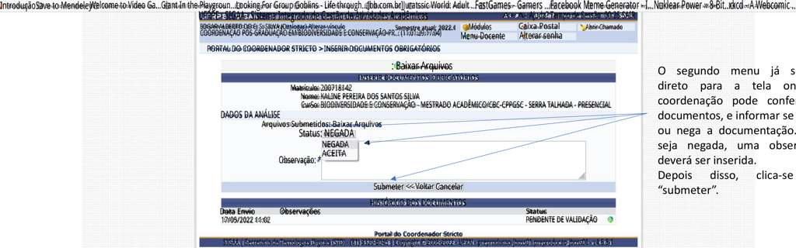

<!-- figure p39-fig2 | described_by: claude:sonnet | ocr_overlap: 0.89 | needs_review: false -->
(1) Tipo de figura: captura de tela (screenshot) de sistema web acadêmico, com anotações sobrepostas (setas azuis e texto explicativo à direita). Parte do texto à direita aparece cortado na borda da imagem.

(2) Texto visível, verbatim:

Barra de abas do navegador (topo, textos sobrepostos e de difícil leitura, parcialmente ilegíveis): "Introdução", "Save to Mendeley", "Welcome to Video Ga...", "Giant In the Playgroun...", "Looking For Group", "Goblins - Life through...", "jbb.com.br", "Jurastic World: Adult...", "FastGames - Gamers...", "Facebook Meme Generator", "I...", "Nuklear Power »", "8-Bit...", "xkcd", "A Webcomic..."

Cabeçalho do sistema: "UFRPE | SIGAA | Sistema Integrado de Gestão de Atividades Acadêmicas" — "A+ A- Ajuda? Tempo de sessão 00:05 Sair"

Linha de usuário: "EDGAR ALBERTO DO E S SILVA (Desligar) Alterar vínculo" / "COORDENAÇÃO PÓS-GRADUAÇÃO EM BIODIVERSIDADE E CONSERVAÇÃO-PR... (11:01:29:17:04)" — "Módulos" — "Caixa Postal" — "Abrir Chamado" — "Menu Docente" — "Alterar senha"

Trilha de navegação: "PORTAL DO COORDENADOR STRICTO > INSERIR DOCUMENTOS OBRIGATÓRIOS"

Título: "Baixar Arquivos"

Barra de seção: "INSERIR DOCUMENTOS OBRIGATÓRIOS"

Campos:
- "Matrícula: 2007181 42"
- "Nome: KALINE PEREIRA DOS SANTOS SILVA"
- "Curso: BIODIVERSIDADE E CONSERVAÇÃO - MESTRADO ACADÊMICO/CBC-CPPGSC - SERRA TALHADA - PRESENCIAL"

Seção "DADOS DA ANÁLISE":
- "Arquivos Submetidos: Baixar Arquivos"
- "Status: NEGADA" (campo com dropdown aberto mostrando opções: "NEGADA", "ACEITA")
- "Observação: *" (caixa de texto vazia)

Botões: "Submeter" — "Voltar" — "Cancelar"

Seção "HISTÓRICO DOS DOCUMENTOS":
Tabela com colunas: "Data Envio" | "Observações" | "Status"
Linha de dados: "17/05/2022 11:02" | (observações em branco) | "PENDENTE DE VALIDAÇÃO" (com ícone circular verde)

Rodapé: "Portal do Coordenador Stricto"
"SIGAA | Secretaria de Tecnologias Digitais (STD) - (84) 3342-6896 | Copyright © 2006-2022 - UFRN - preproducao-jboss01.preproducao:jboss01 - v4.6.8-1"

Texto anotado à direita (caixa de texto, parcialmente cortada na margem direita da imagem — linhas incompletas marcadas como [illegible] onde cortadas):
"O segundo menu já s[illegible, cortado]
direto para a tela on[illegible, cortado]
coordenação pode confer[illegible, cortado]
documentos, e informar se[illegible, cortado]
ou nega a documentação.[provável continuação cortada: "Caso"/"Se"]
seja negada, uma obser[illegible, cortado]
deverá ser inserida.
Depois disso, clica-se [em]
"submeter"."

(3) Estrutura: Captura de tela de página de sistema (SIGAA) ocupa a maior parte da imagem, à esquerda/centro. À direita da tela, fora do sistema, há um bloco de texto explicativo anotando a imagem. Três setas azuis partem desse bloco de texto e apontam para dentro da tela: uma aponta para o campo "Status" com o dropdown aberto (opções NEGADA/ACEITA), uma segunda aponta para a caixa de texto "Observação", e uma terceira aponta para a área dos botões "Submeter << Voltar Cancelar". Não há eixos nem painéis múltiplos — é uma única captura de tela com elementos de formulário empilhados verticalmente (cabeçalho, dados do aluno, dados da análise, histórico em tabela, rodapé).

(4) Valores/dados numéricos presentes: Matrícula "2007181 42"; horário de sessão "11:01:29:17:04"; tempo de sessão "00:05"; data "17/05/2022 11:02"; telefone "(84) 3342-6896"; copyright "2006-2022"; versão "v4.6.8-1"; semestre "2022.4".

(5) Cores com significado: ícone circular verde ao lado de "PENDENTE DE VALIDAÇÃO" na tabela de histórico (indicador de status). Setas e texto de anotação em azul, usados para apontar elementos específicos da interface (não fazem parte do sistema original). Fundo da imagem com padrão de grade cinza claro (provavelmente marca d'água de ferramenta de captura/anotação, sem significado informativo).

~~~text ocr
Ga... .. FaceBook Meme-Generator mL...
A |
0224 Caixa-Postal
POS-GRADUAÇÃO CONSERVAÇÃO
PORTAL DO STRICTO > OBRIGATÓRIOS
segundo já
200718142 direto para a tela on
PEREIRA DOS SANTOS SILVA
| - MESTRADO - SERRA FALHADA - coordenação pode
DADOS DA ANALISE | documentos, e informar se
Status: NEGADA ou nega a documentação.
NEGADA | seja negada, uma _ obset
Observação: * deverá ser inserida.
y; Depois
Submeter <<Voltar “submeter”.
Data (Observações Status .
17/05/2022 14:02 PENDENTE DE VALIDAÇÃO
|
~~~

<!-- Start of picture text -->
目☆ <!-- End of picture text -->

← C 

≡ 

》 

<!-- Start of picture text -->
IntroduçãoSave to MendeleyWelcome to Video Ga...Giant In the Playgroun...Looking For Group Goblins - Life through...[bb.com.br]Juratssic World: Adult ...FastGames - Gamers ...Facebook Meme Generator - I...Nuklear Power » 8-Bit..xkcd - A Webcomic .. UFRPE - SIGAA - Sistema Integrado de Gestão de Atividades Acadêmicas A+ A- Ajuda? Tempo de Sessão: 00:25 SAIR EDGAR ALBERTO DO E. S. SILVA (Deslogar) Alterar vínculo Semestre atual: 2022.1 Módulos Caixa Postal Abrir Chamado COORDENAÇÃO PÓS-GRADUAÇÃO EM BIODIVERSIDADE E CONSERVAÇÃO-PR... (11.01.29.17.04) Menu Docente Alterar senha PORTAL DO COORDENADOR STRICTO > INSERIR DOCUMENTOS OBRIGATÓRIOS : Baixar Arquivos O segundo menu já seguirá INSERIR DOCUMENTOS OBRIGATÓRIOS Matrícula: 200718142 direto para a tela onde a Nome: KALINE PEREIRA DOS SANTOS SILVA coordenação pode conferir os CurSo: BIODIVERSIDADE E CONSERVAÇÃO - MESTRADO ACADÊMICO/CBC-CPPGSC - SERRA TALHADA - PRESENCIAL DADOS DA ANÁLISE documentos, e informar se aceita Arquivos Submetidos: Baixar Arquivos Status: NEGADA  ou nega a documentação. Caso NEGADA 4 seja negada, uma observação ACEITA Observação: * deverá ser inserida. Depois  disso,  clica-se Submeter << Voltar Cancelar “submeter”. HISTÓRICO DOS DOCUMENTOS Data Envio Observações Status 17/05/2022 11:02 PENDENTE DE VALIDAÇÃO Portal do Coordenador Stricto SIGAA | Secretaria de Tecnologias Digitais (STD) - (81) 3320-6046 | Copyright © 2006-2022 - UFRN - preproducao-jboss01.preproducao-jboss01 - v4.6.8-1 <!-- End of picture text -->

O segundo menu já seguirá direto para a tela onde a coordenação pode conferir os documentos, e informar se aceita ou nega a documentação. Caso seja negada, uma observação deverá ser inserida. 

Depois disso, clica-se em “submeter”. 

36 

POR 11:04 

Digite aqui para pesquisar 

29C Chuva fraca 

INTL 17/05/2022 

<!-- page 40 -->

> 凸 × 

> SIGAA - Sistema Integrado de GX + 

目☆ 

###### https://preproducao.sigs.ufrpe.br/sigaa/portais/discente/discente.jsf 

##### C 

← 

|Introdução Save to Mendeley Welcome to Video Ga...Giant In the Playgroun...Looking For GroupGoblins - Life through ... [bb.com.br]Jurassic World: Adult I.. FastGames - Gamers l...Facebook Meme Generator - m...Nuklear Power » 8-Bit ...xkcd - A Webcomic - . Caro Aluno, Abaixo são listados os procedimentos realizados a partir da defesa de sua Dissertação até a homologação do diploma. Você pode acompanhar a situação de cada um deles e, quando necessário, realizar as devidas operações.|
|---|
|CONSOLIDAÇÃO DA ATIVIDADE DE DEFESA ✓ 1º Atividade consolidada. 31/03/2022 Baixar ata da defesa e folhas de correções SUBMISSÃO DA VERSÃO FINAL CORRIGIDA DA DISSERTAÇÃO ✓ 2º Submetido. 17/05/2022 Conferir histórico de revisão |
|APROVAÇÃO DA VERSÃO FINAL CORRIGIDA DA DISSERTAÇÃO ✓ 3º Versão final Aprovada. 17/05/2022|
|SOLICITAÇÃO DA FICHA CATALOGRÁFICA✓ 4o Procedimento desconsiderado devido ao módulo de biblioteca estar inativo.|
|RESSUBMISSÃO DA VERSÃO FINAL CORRIGIDA DA DISSERTAÇÃO COM FICHA CATALOGRÁFICA √ 5º Procedimento desconsiderado devido ao módulo de biblioteca estar inativo. 17/05/2022|
|APROVAÇÃO DA VERSÃO FINAL CORRIGIDA DA DISSERTAÇÃO COM FICHA CATALOGRÁFICA √ 6º Procedimento desconsiderado devido ao módulo de biblioteca estar inativo.|
|Após os documentos serem ASSINATURA DO TERMO DE AUTORIZAÇÃO DE PUBLICAÇÃO ✓ 7º Autorizado para disponibilização da produção de maneira pública. 17/05/2022 Visualizar Termo de Autorização de Publicação |
|aceitos pela coordenação, o discente deverá preencher RECEBIMENTO DA VERSÃO FINAL PELA COORDENAÇÃO ✓ 8º Recebida pela coordenação. Validada em 17/05/2022|
|o questionário proposto pela PRPG e pelo DRCA 9º INSERIR DOCUMENTOS OBRIGATÓRIOS ✓ Documentação Aceita Conferir histórico dos documentos 10º PREENCHIMENTO DO QUESTIONÁRIO Aguardando o preenchimento do questionário pelo aluno. Preencher questionário 11º SOLICITAÇÃO DE HOMOLOGAÇÃO DO DIPLOMA Aguardando o preenchimento do questionário pelo aluno. Portal do Discente|

三 

》 

SIGAA | Secretaria de Tecnologias Digitais (STD) - (81) 3320-6046 |Copyright © 2006-2022 - UFRN - preproducao-jboss01.preproducao-jboss01 - v4.6.8-1 

37 

11:05 

POR 

市 

Digite aqui para pesquisar 

29C Chuva fraca 

日 

1/1/21 1202 

<!-- page 41 -->

> 凸 × 

> SIGAA - Sistema Integrado de GX + 

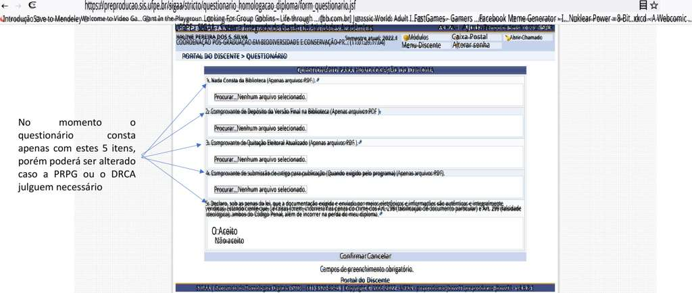

<!-- figure p41-fig1 | described_by: claude:sonnet | ocr_overlap: 0.88 | needs_review: false -->
**(1) Tipo de figura:** Captura de tela (screenshot) de página web de um sistema acadêmico (SIGAA), anotada com uma caixa de texto explicativa e setas, sobreposta a abas de navegador do browser.

**(2) Todo texto visível (verbatim):**

Barra de endereço do navegador:
`https://preproducao.sis.ufpe.br/sigaa/stricto/questionario_homologacao_diploma/form_questionario.jsf`

Abas do navegador (sobrepostas, parcialmente ilegíveis por sobreposição): "Introdução", "Save to Mendeley", "Welcome to Video Ga...", "Giant In the Playgroun.", "Looking For Group Goblins - Life through...", "[bb.com.br]", "Jurassic World: Adult I...", "FastGames - Gamers ...", "Facebook Meme Generator", "I...", "Nuklear Power » 8-Bit.", "xkcd", "A Webcomic..."

Cabeçalho do sistema: "UFRPE | SIGAA - Sistema Integrado de Gestão de Atividades Acadêmicas"
Canto superior direito: "A+ A- | Ajuda | Tempo de Sessão: 00:05:5?AR" [illegible parte final]

Linha do usuário: "KALINE PEREIRA DOS S. SILVA" / "COORDENAÇÃO POS-GRADUAÇÃO EM BIODIVERSIDADE E CONSERVAÇÃO PR...(11.01.29.17.04)"
À direita: "Semestre atual: 2022.1"

Menu superior direito: "Módulos" / "Caixa Postal" | "Menu Discente" / "Abrir Chamado" | "Alterar senha"

Trilha de navegação: "PORTAL DO DISCENTE > QUESTIONÁRIO"

Título da caixa principal: "QUESTIONÁRIO PARA HOMOLOGAÇÃO DO DIPLOMA"

Item 1: "1. Nada Consta da Biblioteca (Apenas arquivos PDF). *"
Campo: "Procurar... Nenhum arquivo selecionado."

Item 2: "2. Comprovante de Depósito da Versão Final na Biblioteca (Apenas arquivos PDF)."
Campo: "Procurar... Nenhum arquivo selecionado."

Item 3: "3. Comprovante de Quitação Eleitoral Atualizado (Apenas arquivos PDF). *"
Campo: "Procurar... Nenhum arquivo selecionado."

Item 4: "4. Comprovante de submissão de artigo para publicação (Quando exigido pelo programa) (Apenas arquivos PDF)."
Campo: "Procurar... Nenhum arquivo selecionado."

Item 5: "5. Declaro, sob as penas da lei, que a documentação exigida e enviada por meios eletrônicos e informações são autênticas e integralmente verídicas, estando ciente que, se falsas forem, incorrerei nas penas do crime dos Art. 298 (falsificação de documento particular) e Art. 299 (falsidade ideológica), ambos do Código Penal, além de incorrer na perda do meu diploma. *"
Opções (botões de rádio): "O Aceito" / "Não aceito"

Botões: "Confirmar" / "Cancelar"

Texto abaixo: "Campos de preenchimento obrigatório."
Link: "Portal do Discente"

Rodapé: "SIGAA | Secretaria de Tecnologias Digitais (STD) - (81) 3320-6946 | Copyright © 2006-2022 - UFRN - preproducao-jbosss01.preproducao-jbosss01 - v4.6.8-1"

Caixa de anotação (texto adicionado, à esquerda da imagem):
"No momento o questionário consta apenas com estes 5 itens, porém poderá ser alterado caso a PRPG ou o DRCA julguem necessário"

**(3) Estrutura:**
Layout: página de formulário web de coluna única, com cabeçalho institucional no topo (logo/título SIGAA, dados do usuário, menu de links), seguido de trilha de navegação, e abaixo um quadro retangular central contendo o questionário com 5 itens numerados empilhados verticalmente. Os itens 1 a 4 têm formato idêntico: um rótulo de pergunta seguido por um campo de upload de arquivo (botão "Procurar..." + texto "Nenhum arquivo selecionado"). O item 5 é um bloco de texto declaratório seguido por duas opções de seleção única (radio buttons): "O Aceito" e "Não aceito". Abaixo do quadro há dois botões lado a lado: "Confirmar" e "Cancelar". Fora do print, à esquerda, uma caixa de texto branca com borda contém uma anotação explicativa; dela partem 5 setas azuis, uma para cada um dos 5 itens numerados do questionário, apontando da caixa de texto para cada bloco de item correspondente (1, 2, 3, 4 e 5).

**(4) Valores/números:** Semestre atual: 2022.1; Tempo de sessão: 00:05:5? (parcialmente ilegível); telefone no rodapé: (81) 3320-6946; Copyright 2006-2022; versão do sistema: v4.6.8-1; matrícula/código do usuário: 11.01.29.17.04; cinco itens numerados de 1 a 5 no questionário.

**(5) Cores com significado:** Setas e contorno da caixa de anotação em azul, usadas para indicar explicitamente a qual item numerado do questionário cada explicação se refere. Cabeçalho do sistema e linhas do quadro em tom azul-acinzentado claro, típico de interface institucional, sem significado semântico adicional além de organização visual.

~~~text ocr
es €
Ga... lant4n World .. Facebook wi,
RORTAL DO DISCENTE > QUESTIONÁRIO
‘h. Nada Consta da Biblioteca (Apenas RDA).
Procurar... Nenhum arquivo selecionado.
Ze de Depósito da Final na Biblioteca (Apenas
No . Procurar. Nenhum arquivo selecionado.
questionário consta
apenas com estes 5 itens,
porém poderá ser alterado arquivo selecionado.
caso a PRPG ou o DRCA 4 Comprovante de exigido pelo programa) (Apenas
julguem necessário arquivo selecionado.
Gonfirmar Gancelar
~~~

<!-- Start of picture text -->
← C https://preproducao.sis.ufpe.br/sigaa/stricto/questionario_homologacao_diploma/form_questionario.jsf 目☆ IntroduçãoSave to Mendeley Welcome to Video Ga...Giant In the Playgroun... Looking For Group Goblins - Life through ... [bb.com.br] Jurassic World: Adult I...FastGames - Gamers ...Facebook Meme Generator - I...Nuklear Power » 8-Bit..xkcd - A Webcomic .. UFRPE - SIGAA - Sistema Integrado de Gestão de Atividades Acadêmicas A+A- Ajuda?Tempo de Sessão: 00:25 SAIR KALINE PEREIRA DOS S. SILVA Semestre atual: 2022.1 Módulos Caixa Postal Abrir Chamado COORDENAÇÃO PÓS-GRADUAÇÃO EM BIODIVERSIDADE E CONSERVAÇÃO-PR... (11.01.29.17.04) Menu Discente Alterar senha PORTAL DO DISCENTE > QUESTIONÁRIO QUESTIONÁRIO PARA HOMOLOGAÇÃO DO DIPLOMA 1. Nada Consta da Biblioteca (Apenas arquivos PDF ). * Procurar...Nenhum arquivo selecionado. 2. Comprovante de Depósito da Versão Final na Biblioteca (Apenas arquivos PDF ). No  momento  o Procurar...Nenhum arquivo selecionado. questionário  consta 3. Comprovante de Quitação Eleitoral Atualizado (Apenas arquivos PDF ). * apenas com estes 5 itens, porém poderá ser alterado  Procurar...Nenhum arquivo selecionado. caso a PRPG ou o DRCA  4. Comprovante de submissão de artigo para publicação (Quando exigido pelo programa) (Apenas arquivos PDF). julguem necessário Procurar...Nenhum arquivo selecionado. 5. Declaro, sob as penas da lei, que a documentação exigida e enviada por meios eletrônicos e informações são autênticas e integralmente veridicas, estando ciente que, se falsas forem, incorrerá nas penas do crime dos Art. 298 (falsificação de documento particular) e Art. 299 (falsidade ideológica), ambos do Código Penal, além de incorrer na perda do meu diploma. * O Aceito  Não aceito ConfirmarCancelar Campos de preenchimento obrigatório. Portal do Discente SIGAA | Secretaria de Tecnologias Digitais (STD) - (81) 3320-6046 | Copyright © 2006-2022 - UFRN - preproducao-jboss01.preproducao-jboss01 - v4.6.8-1 <!-- End of picture text -->

≡ 

》 

38 

后物INTL 17/05/2022POR 11:05 

出 

Q Digite aqui para pesquisar 

29°C Chuva fraca 

<!-- page 42 -->

> 凸 × 

> SIGAA - Sistema Integrado de GX + 

###### ← C https://preproducao.sigs.ufrpe.br/sigaa/stricto/coordenacao.jsf 

<!-- figure p42-fig2 | same image as p14-fig2 -->

<!-- Start of picture text -->
￥目 <!-- End of picture text -->

IntroduçãoSave to Mendeley Welcome to Video Ga...Giant In the Playgroun...Looking For Group Goblins - Life through... [bb.com.br] Jurassic World: Adult ... FastGames - Gamers l...FacebookMeme Generator - Im... Nuklear Power » 8-Bit ...xkcd - A Webcomic - ... 

###### A+A- Ajuda?Tempo de Sessão: 00:25 SAIR 

###### UFRPE - SIGAA - Sistema Integrado de Gestão de Atividades Acadêmicas 

<!-- Start of picture text -->
EDGAR ALBERTO DO E. S. SILVA (Deslogar) Alterar vínculo Semestre atual: 2022.1 Módulos Caixa Postal Abrir Chamado COORDENAÇÃO PÓS-GRADUAÇÃO EM BIODIVERSIDADE E CONSERVAÇÃO-PR... (11.01.29.17.04) Menu Docente Alterar senha Cadastros AlunoTurmasMatrículas ConsultasRelatórios Biblioteca Página WEBOutros Consulta Avançada Não há notíci Gerenciar Orientações Coordenação de Pós-GraduaçãoCOORDENAÇÃO PÓS-GRADUAÇÃO EM Cadastro BIODIVERSIDÃDE E CONSERVAÇÃO-PRPG Documentos CALENDÁRIO 2022.1 Aproveitamentos Notas Período letivo MATRÍCULAS C Vínculo 14/03/2022 a 15/07/2022 Não há matrícula Conclusão Cadastrar Bancas ula On-Line ordernar por r Discente com NEE Acompanhar Procedimentos após Defesa e Matrícula On-Line/2022 a 11/03/2022 Cadastro dos Bolsistas CNPq Confirmar Recebimento de Tese/Dissertação TRANCAMENTO Bolsas Docência Assistida Validar Documentação Para Homologação de Diploma tricula Não há trancam /2022 a 08/04/2022 Produto Educacional Homologação de Diploma SusPEnsÕes F Fórum de Cursos Comprovante de Solicitação Homologação Não há suspensões pendentes Visualizar Solicitações de Homologação de Diploma pendentes MemorandosEletrônicos ATENDIMENTO AO ALUNO Não há perguntas pendentes. RESOLUÇÕES ver todas as perguntas respondidas | ver todas as perguntas não respondidas (0) Portaria No 328/R-06, Normas de Gerenciamento de Projetos UFRPE x FUNPEC FORUM DE CURSOS Resolução No 006/2008-CONSAD, 27 de março de 2008 Resolução No RESOLUÇÃO No 342/2019, 10 de Caro Coordenador, este fórum é destinado para discussões relacionadas ao seu curso. Todos os alunos do dezembro de 2013 (Dispõe sobre Normas dos curso e a coordenação tem acesso a ele. Programas e Cursos de Pós-Graduação da UFRPE) Capítulo VII - Anexo da Resolução nº RESOLUÇÃO N° 342/2019 Cadastrar novo tópico para este fórum Resolução Nº 037/2008 - CONSAD, 18 de Nenhum item foi encontrado setembro de 2008 (Dispõe sobre Cobrança deTaxa - Revalidação de Diplomas) Resolução No 063/2010 - Assistência à Docência da UFRPE Portaria No 76, 14 de abril de 2010, mais Regulamento do Programa de Demanda Social Portal do Coordenador Stricto S tc-a (5g) - (s) se se  ees  46)| Copyright © 2006-2022 - UFRN - preproducao-jboss01.preproducao-jboss01 - v4.6.8-1 <!-- End of picture text -->

A coordenação poderá verificar as respostas do questionário acessando este menu 

》 

39 POR 11:07 INTL17/05/2022 

29C Chuva fraca 

Q Digite aqui para pesquisar 

<!-- page 43 -->

> 凸 × 

> SIGAA - Sistema Integrado de GX + 

目☆ 三 

###### https://preproducao.sigs.ufrpe.br/sigaa/graduacao/busca_discente.jsf 

← C 

|Introdução Save to Mendeley Welcome to Video Ga...Giant In the Playgroun...Looking For GroupGoblins - Life through ... [bb.com.br]Jurassic World: Adult I...FastGames - Gamers l...Facebook Meme Gener|ator - Im... Nuklear Power » 8-Bit ..xkcd - A Webcomic - .|
|---|---|
|Caro Coordenador, Abaixo são listados os procedimentos realizados a partir da defesa da Dissertação até a homologação do diploma do discente. Você pode acompanhar a situação de cada um deles e, quando necessário, realizar as devidas operações.||
|CONSOLIDAÇÃO DA ATIVIDADE DE DEFESA ✓ 1º Atividade consolidada. 31/03/2022 月Baixar ata da defesa e folhas de correções SUBMISSÃO DA VERSÃO FINAL CORRIGIDA DA DISSERTAÇÃO ✓ 2º Submetido. 17/05/2022||
|APROVAÇÃO DA VERSÃO FINAL CORRIGIDA DA DISSERTAÇÃO ✓ 3º Versão final Aprovada. 17/05/2022||
|SOLICITAÇÃO DA FICHA CATALOGRÁFICA ✓ 4o Procedimento desconsiderado devido ao módulo de biblioteca estar inativo.||
|RESSUBMISSÃO DA VERSÃO FINAL CORRIGIDA DA DISSERTAÇÃO COM FICHA CATALOGRÁFICA √ 5º Procedimento desconsiderado devido ao módulo de biblioteca estar inativo. 17/05/2022||
|APROVAÇÃO DA VERSÃO FINAL CORRIGIDA DA DISSERTAÇÃO COM FICHA CATALOGRÁFICA √ 6º Procedimento desconsiderado devido ao módulo de biblioteca estar inativo.||
|ASSINATURA DO TERMO DE AUTORIZAÇÃO DE PUBLICAÇÃO ✓ 7º Autorizado para disponibilização da produção de maneira pública. 17/05/2022||
|8º RECEBIMENTO DA VERSÃO FINAL PELA COORDENAÇÃO ✓ Recebida pela coordenação. Validada em 17/05/2022 Clique aqui para obter a última versão do trabalho submetida pelo discente e aprovada.|E em seguida clicando neste botão|
|9º VALIDAR DOCUMENTOS OBRIGATÓRIOS ✓ Documentação Aceita||
|10º PREENCHIMENTO DO QUESTIONÁRIO √ Questionário Preenchido. QVisualizar resposta 11º SOLICITAÇÃO DE HOMOLOGAÇÃO DO DIPLOMA Aguardando solicitação da coordenação. Solicitar homologação||

》 

Portal do Coordenador Stricto 

SIGAA | Secretaria de Tecnologias Digitais (STD) - (81) 3320-6046 | Copyright © 2006-2022 - UFRN - preproducao-jboss01.preproducao-jboss01 - v4.6.8-1 

40 

POR 11:07 

市 

29C Chuva fraca 

Digite aqui para pesquisar 

1/1/21 1202 

<!-- page 44 -->

> SIGAA - Sistema Integrado de GX + 

凸 × 

← C 

###### https://preproducao.sigs.ufrpe.br/sigaa/stricto/questionario_homologacao_diploma/visualizar_respostas.jsf 

###### 目☆ 

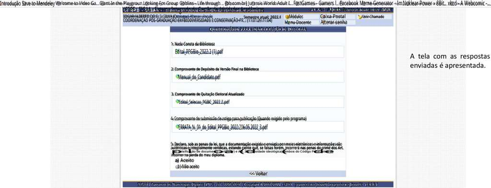

<!-- figure p44-fig1 | described_by: claude:sonnet | ocr_overlap: 0.95 | needs_review: false -->
1. Tipo de figura: captura de tela (screenshot) de sistema web acadêmico, sobreposta a captura de várias abas de navegador abertas ao fundo (abas ilegíveis em maior parte, sobrepostas pela janela principal).

2. Texto visível, verbatim:

Abas de navegador (topo, parcialmente sobrepostas, trechos legíveis):
"Introdução", "Save to Mendeley", "Welcome to Video Ga...", "Giant In the Playgroun...", "Looking For Group Goblins – Life through ...", "(bb.com.br)", "Jurassic World: Adult I...", "FastGames - Gamers I...", "Facebook Meme Generator - 'Im Nuklear Power » 8Bit...", "xkcd - A Webcomic - ..."

Janela principal do sistema:
- "UFRPE SIGAA | Sistema Integrado de Gestão de Atividades Acadêmicas"
- "A+ A- | Ajuda | Tempo de Sessão: 00:15:33 AR"
- "EDGAR ALBERTO DO E.S. SILVA (Deslogar) Alterar vínculo" — "Semestre atual: 2022.1"
- "COORDENAÇÃO PÓS-GRADUAÇÃO EM BIODIVERSIDADE E CONSERVAÇÃO-PR..." — "(11:01:29:17:04)" [possivelmente timestamp, parte ilegível]
- Menu superior direito: "Módulos" / "Caixa Postal" / "Abrir Chamado"
- "Menu Docente" / "Alterar senha"

Título central: "QUESTIONÁRIO PARA HOMOLOGAÇÃO DE DIPLOMA"

Campos do formulário (numerados 1 a 5):
1. "Nada Consta da Biblioteca" — caixa com arquivo: "Edital_PPGBio_2022.2 (1).pdf"
2. "Comprovante de Depósito da Versão Final na Biblioteca" — caixa com arquivo: "Manual_do_Candidato.pdf" (ícone verde ao lado)
3. "Comprovante de Quitação Eleitoral Atualizado" — caixa com arquivo: "Edital_Selecao_PGBC_2022.2.pdf" (ícone verde ao lado)
4. "Comprovante de submissão de artigo para publicação (Quando exigido pelo programa)" — caixa com arquivo: "ERRATA_N_01_do_Edital_PPGBio_2022.206.05.2022_3.pdf" (ícone verde ao lado)
5. Texto declaratório: "Declaro, sob as penas da lei, que a documentação exigida e enviada por meios eletrônicos e informações são autênticas e integralmente verídicas, estando ciente que, se falsas forem, incorrerá nas penas do crime dos Art. [ilegível] (Falsificação de documento) e Art. [ilegível] (Falsidade ideológica) ambos do Código Penal, além de incorrer na perda do meu diploma."
   - Opção a) "Aceito" (marcada, bolinha preenchida)
   - Opção b) "Não aceito" (não marcada)

Botão: "<< Voltar"

Rodapé: "SIGAA | Secretaria de Tecnologias Digitais (STD) - (81) 3320-6046 | Copyright © 2006-2022 - UFRN - preproducao-jboss01.preproducao-jboss01 - v4.6.8.1"

Legenda ao lado direito da imagem (texto fora do print, nota explicativa):
"A tela com as respostas enviadas é apresentada."

3. Estrutura: janela de navegador única em primeiro plano contendo formulário institucional; barra de abas com ~10 abas abertas atrás, ilegíveis exceto títulos parciais citados acima. Dentro da janela principal: cabeçalho do sistema (logo/nome + menu), barra de usuário/sessão, barra de módulos, corpo com título de seção, 5 blocos sequenciais empilhados verticalmente (campos 1-4 são caixas de texto com nome de arquivo anexado + ícone de status verde nos itens 2-4; item 5 é bloco de texto + duas opções de rádio), botão de navegação no rodapé do formulário, rodapé do sistema. Nenhum gráfico, eixo ou painel múltiplo — layout único de formulário vertical. À direita da captura, fora da janela do navegador, legenda textual explicativa.

4. Valores numéricos: "2022.1" (semestre), "00:15:33" (tempo de sessão), "(11:01:29:17:04)" [provável timestamp, dígitos parcialmente sobrepostos/ilegíveis — não garantido], "(81) 3320-6046" (telefone), "2006-2022" (intervalo copyright), "v4.6.8.1" (versão sistema), nomes de arquivo contêm números: "2022.2", "2022.2 (1)", "N_01", "206.05.2022_3" [numeração do arquivo de errata confusa/possivelmente sobreposta — trecho "206.05.2022" pode ser leitura distorcida de "20.06.05.2022" ou similar, marcado como incerto].

5. Cores com significado: ícones verdes ao lado dos arquivos 2, 3 e 4 (indicando provavelmente upload/validação bem-sucedida); item 1 sem ícone colorido visível; opção "a) Aceito" marcada com bolinha preenchida em preto (seleção ativa) vs "b) Não aceito" vazia (não selecionada); cabeçalho e barras do sistema em azul escuro (cor padrão institucional, sem significado adicional de dado).

~~~text ocr
Introdução Saveto-Mendeley |,
WES
Consta da Biblioteca
A tela com as respostas
de Depósito da Versão Final na enviadas é apresentada.
pdf
% de Quitação Eleitoral Atualizado
Selecao,
(Quando exigido pelo programa)
do. Edital.
%. as ue a
e ideológica do
do meu d
a)
| = =
~~~

<!-- Start of picture text -->
Introdução Save to Mendeley Welcome to Video Ga...Giant In the Playgroun..Looking For Group Goblins - Life through .. [bb.com.br] Jurassic World: Adult I... FastGames - Gamers l.. Facebook Meme Generator - Im...Nuklear Power » 8Bit.. xkcd - A Webcomic -... UFRPE - SIGAA - Sistema Integrado de Gestão de Atividades Acadêmicas A+A- Ajuda?Tempo de Sessão: 00:25 SAIR EDGAR ALBERTO DO E. S. SILVA (Deslogar) Alterar vínculo Semestre atual: 2022.1 Módulos Caixa Postal Abrir Chamado COORDENAÇÃO PÓS-GRADUAÇÃO EM BIODIVERSIDADE E CONSERVAÇÃO-PR... (11.01.29.17.04) Menu Docente Alterar senha QUESTIONÁRIO PARA HOMOLOGAÇÃO DE DIPLOMA 1. Nada Consta da Biblioteca Edital_PPGBio_2022.2 (1).pdf A tela com as respostas enviadas é apresentada. 2. Comprovante de Depósito da Versão Final na Biblioteca Manual_do_Candidato.pdf 3. Comprovante de Quitação Eleitoral Atualizado Edital_Selecao_PGBC_2022.2.pdf 4. Comprovante de submissão de artigo para publicação (Quando exigido pelo programa) ERRATA_N._01_do_Edital_PPGBio_2022.206.05.2022_3.pdf 5. Declaro, sob as penas da lei, que a documentação exigida e enviada por meios eletrônicos e informações são autênticas e integralmente veridicas, estando ciente que, se falsas forem, incorrerá nas penas do crime dos Art. p l    oa (d     (     de incorrer na perda do meu diploma. a) Aceito b) Não aceito << Voltar SIGAA | Secretaria de Tecnologias Digitais (STD) - (81) 3320-6046 |Copyright © 2006-2022 - UFRN - preproducao-jboss01.preproducao-jboss01 - v4.6.8-1 <!-- End of picture text -->

A tela com as respostas enviadas é apresentada. 

≡ 

》 

41 

POR 11:07 

Q Digite aqui para pesquisar 

29°C Chuva fraca 

INTL 17/05/2022 

<!-- page 45 -->

> 凸 × 

> SIGAA - Sistema Integrado de GX + 

￥目 

###### ← C https://preproducao.sigs.ufrpe.br/sigaa/stricto/coordenacao.jsf 

IntroduçãoSave to Mendeley Welcome to Video Ga...Giant In the Playgroun...Looking For Group Goblins - Life through... [bb.com.br] Jurassic World: Adult I... FastGames - Gamers l...FacebookMeme Generator - Im... Nuklear Power » 8-Bit ...xkcd - A Webcomic - .. 

###### A+A- Ajuda?Tempo de Sessão: 00:25 SAIR 

###### UFRPE - SIGAA - Sistema Integrado de Gestão de Atividades Acadêmicas 

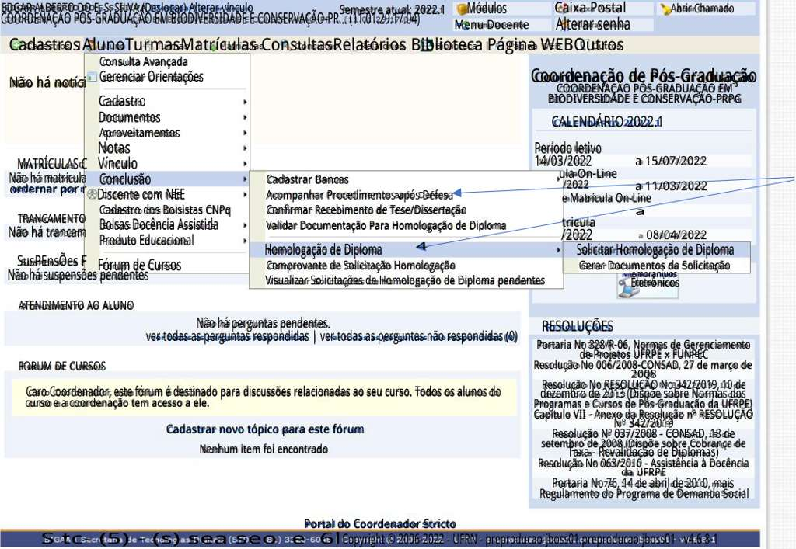

<!-- figure p45-fig1 | described_by: claude:sonnet | ocr_overlap: 0.9 | needs_review: false -->
Print tela do sistema SIGAA (Sistema Integrado de Gestão de Atividades Acadêmicas), mostrando um menu de navegação em cascata aberto sobre a página inicial do Coordenador de Pós-Graduação. O texto aparece sobreposto/fantasma em várias partes (duas capturas sobrepostas), tornando trechos ilegíveis ou duplicados — isso é indicado abaixo.

**1) Tipo de figura:** Captura de tela (screenshot) de interface de sistema web acadêmico, com um menu suspenso multinível aberto e uma seta indicando um item de destino.

**2) Texto visível (verbatim):**

Barra superior (texto sobreposto, parcialmente ilegível):
- "EDGAR ALBERTO DO.F..S..SILVA (Desligar) Alterar vínculo" [parte ilegível por sobreposição]
- "COORDENAÇÃO POS-GRADUAÇÃO EM BIODIVERSIDADE E CONSERVAÇÃO-PR...(11:01:29,17:04)" [final ilegível]
- "Semestre atual: 2022.1"
- Ícones/botões: "Módulos", "Caixa Postal", "Abrir Chamado"
- "Menu Docente", "Alterar senha"

Barra de menus principal (também sobreposta):
- "Cadastros", "Aluno", "Turmas", "Matrículas", "Consultas", "Relatórios", "Biblioteca", "Página WEB", "Outros"

Menu suspenso (primeira coluna, à esquerda):
- "Consulta Avançada"
- "Gerenciar Orientações"
- "Cadastro" ▸
- "Documentos" ▸
- "Aproveitamentos" ▸
- "Notas" ▸
- "Vínculo" ▸
- "Conclusão" ▸ (item destacado/selecionado)
- "Discente com NEE" ▸
- "Cadastro dos Bolsistas CNPq" ▸
- "Bolsas Docência Assistida" ▸
- "Produto Educacional" ▸
- "Fórum de Cursos" ▸

Submenu (segunda coluna, aberto a partir de "Conclusão"):
- "Cadastrar Bancas"
- "Acompanhar Procedimentos após Defesa"
- "Confirmar Recebimento de Tese/Dissertação"
- "Validar Documentação Para Homologação de Diploma"
- "Homologação de Diploma" ▸ (item destacado/selecionado)
- "Comprovante de Solicitação Homologação"
- "Visualizar Solicitações de Homologação de Diploma pendentes"

Submenu (terceira coluna, aberto a partir de "Homologação de Diploma"):
- "Solicitar Homologação de Diploma"
- "Gerar Documentos da Solicitação"

Abaixo do menu, à direita, parcialmente coberto: ícones/legendas "Memorandos" e "Eletrônicos".

Área à esquerda, atrás do menu (texto sobreposto/parcialmente ilegível):
- "Não há notíci[as]" [ilegível]
- "MATRÍCULAS C[...]"
- "Não há matrícula[s]... ordenar por [...]" [ilegível]
- "TRANCAMENTO[S]"
- "Não há trancament[os]" [ilegível]
- "SUSPENSÕES P[...]"
- "Não há suspensões pendentes"
- "ATENDIMENTO AO ALUNO"
- "Não há perguntas pendentes."
- "ver todas as perguntas respondidas | ver todas as perguntas não respondidas (0)"
- "FÓRUM DE CURSOS"
- "Caro Coordenador, este fórum é destinado para discussões relacionadas ao seu curso. Todos os alunos do curso e a coordenação têm acesso a ele."
- "Cadastrar novo tópico para este fórum"
- "Nenhum item foi encontrado"

Painel à direita:
- Título: "Coordenação de Pós-Graduação"
- "COORDENAÇÃO POS-GRADUAÇÃO EM BIODIVERSIDADE E CONSERVAÇÃO-PRPG" (repetido/sobreposto)
- "CALENDÁRIO 2022.1"
- "Período letivo" — "14/03/2022" a "15/07/2022"
- "[matríc]ula On-Line [...]/2022" a "11/03/2022"
- "[r]e Matrícula On-Line" a "[...]/2022"
- "[...]trícula" a "08/04/2022"
- "RESOLUÇÕES"
- "Portaria No 328/R-06, Normas de Gerenciamento de Projetos UFPE x FUNPEC"
- "Resolução No 006/2008-CONSAD, 27 de março de 2008"
- "Resolução No 342/2019, 10 de dezembro de 2013 (Dispõe sobre Normas dos Programas e Cursos de Pós-Graduação da UFRPE) Capítulo VII - Anexo da Resolução nº 342/2019"
- "Resolução Nº 037/2008 - CONSAD, 18 de setembro de 2008 (Dispõe sobre Cobrança de Taxa - Revalidação de Diplomas)"
- "Resolução No 063/2010 - Assistência à Docência da UFRPE"
- "Portaria No 76, 14 de abril de 2010, mais Regulamento do Programa de Demanda Social"

Rodapé:
- "Portal do Coordenador Stricto"
- "SIGAA | Copyright © 2006-2022 - UFRN - [pré-produção] jboss01.[pré-produção] jboss01 - v4.6.8.1" [texto sobreposto, trechos ilegíveis]

**3) Estrutura:**
- Canto superior esquerdo: barra de identificação do usuário/coordenação (sobreposta).
- Canto superior direito: botões de módulos/caixa postal/chamado.
- Logo abaixo: barra horizontal de menus principais (Cadastros, Aluno, Turmas, etc.).
- Um menu em cascata de 3 níveis está aberto, abrindo-se para a direita a partir do item "Conclusão" (nível 1) → "Homologação de Diploma" (nível 2) → coluna final com "Solicitar Homologação de Diploma" e "Gerar Documentos da Solicitação" (nível 3).
- Uma seta (linha azul com ponta) parte da borda direita da terceira coluna do menu e aponta para a direita, em direção à área do painel lateral (próxima a "CALENDÁRIO 2022.1" / ícones "Memorandos"/"Eletrônicos"), indicando provavelmente um destino ou próximo passo relacionado à solicitação.
- Metade esquerda da tela, atrás do menu: coluna com seções de avisos (notícias, matrículas, trancamentos, suspensões, atendimento ao aluno, fórum de cursos).
- Metade direita: painel com título da coordenação, calendário acadêmico (tabela de datas) e lista de resoluções/portarias.
- Rodapé: identificação do sistema (SIGAA/UFRN) e versão.
- Não há gráficos, eixos ou tabelas de dados numéricos além das datas do calendário.

**4) Valores/números:**
- Semestre: 2022.1
- Horário no canto superior: "11:01:29,17:04" [parcialmente ilegível, possivelmente hora/timestamp]
- Datas do período letivo: 14/03/2022 a 15/07/2022
- Datas de matrícula on-line: trecho inicial ilegível a 11/03/2022
- Data final de outro prazo: 08/04/2022
- Números de portarias/resoluções: 328/R-06; 006/2008-CONSAD (27/03/2008); 342/2019 (10/12/2013); 037/2008-CONSAD (18/09/2008); 063/2010; Portaria Nº 76 (14/04/2010)
- Pergunta não respondidas: (0)
- Versão do sistema: v4.6.8.1
- Copyright: © 2006-2022

**5) Cores com significado:**
- Fundo azul-claro nas barras superiores de identificação/menu principal.
- Itens de menu destacados em azul mais escuro/realce (ex.: "Conclusão" e "Homologação de Diploma"), indicando o caminho de navegação selecionado.
- Seta em azul sólido indicando direção/destino do fluxo.
- Texto em preto sobre fundo branco nos painéis de conteúdo (calendário, resoluções, avisos).

~~~text ocr
Biblioteca Página
Avançada G .
há | Orientaçõ Coordena
Nae há notici OP
Gadastro BIODIVERSIDADE E CONSERVAÇÃO
Documentos 1
Aproveitamentos
Notas , Período letivo
Vínculo 14/03/2022 a 15/07/2022
Conelusão » Cadastrar Bancas
ordernar por fc: Discente com NEE Acompanhar
T ENT Gadastro dos Bolsistas CNPq Confirmar Recebimento de Tese/Dissertação in a
TRANGAMENTO Assistida Validar Documentação Para Homologação de Diploma
Educacional
Homologação de Diploma > de
1 de Comprovante de Solicitação Homologação | Gerar Documentos da da Solicitação
| de Homologação de Diploma |
ATENDIMENTO AO ALUNO
Não há perguntas pendentes
respondidas | No de Gerenciamento
FORUM DE CURSOS Resolução No 27 de março de
este fórum é destinado para discussões relacionadas ao seu curso. Todas es alunos do
curso tem acesso a ele. Progr Cursos da
Cadastrar novo tópico para este fórum Nº CONSAD, 48
set te Cobra
item foi encontrado e
Resolução N No 06312016 a
Portaria 1.4 le abril de 2010, mais
do Programa de
> GAA Tec =.
~~~

<!-- Start of picture text -->
EDGAR ALBERTO DO E. S. SILVA (Deslogar) Alterar vínculo Semestre atual: 2022.1 Módulos Caixa Postal Abrir Chamado COORDENAÇÃO PÓS-GRADUAÇÃO EM BIODIVERSIDADE E CONSERVAÇÃO-PR... (11.01.29.17.04) Menu Docente Alterar senha Cadastros AlunoTurmasMatrículas ConsultasRelatórios Biblioteca Página WEBOutros Consulta Avançada Não há notíci Gerenciar Orientações Coordenação de Pós-GraduaçãoCOORDENAÇÃO PÓS-GRADUAÇÃO EM Cadastro BIODIVERSIDÃDE E CONSERVAÇÃO-PRPG Documentos CALENDÁRIO 2022.1 Aproveitamentos Notas Período letivo MATRÍCULAS C Vínculo 14/03/2022 a 15/07/2022 Não há matrículaordernar por r Discente com NEEConclusão Acompanhar Procedimentos após DefesaCadastrar Bancas ula On-Linee Matrícula On-Line/2022 a 11/03/2022 Cadastro dos Bolsistas CNPq Confirmar Recebimento de Tese/Dissertação a TRANCAMENTO Bolsas Docência Assistida Validar Documentação Para Homologação de Diploma tricula Não há trancam /2022 08/04/2022 Produto Educacional Homologação de Diploma 4 Solicitar Homologação de Diploma SusPEnsÕes F Fórum de Cursos Comprovante de Solicitação Homologação Gerar Documentos da Solicitação Não há suspensões pendentes Visualizar Solicitações de Homologação de Diploma pendentes Eletrônicosemoraniuos ATENDIMENTO AO ALUNO Não há perguntas pendentes. RESOLUÇÕES ver todas as perguntas respondidas | ver todas as perguntas não respondidas (0) Portaria No 328/R-06, Normas de Gerenciamento de Projetos UFRPE x FUNPEC FORUM DE CURSOS Resolução No 006/2008-CONSAD, 27 de março de 2008 Resolução No RESOLUÇÃO No 342/2019, 10 de Caro Coordenador, este fórum é destinado para discussões relacionadas ao seu curso. Todos os alunos do dezembro de 2013 (Dispõe sobre Normas dos curso e a coordenação tem acesso a ele. Programas e Cursos de Pós-Graduação da UFRPE) Capítulo VII - Anexo da Resolução nº RESOLUÇÃO N° 342/2019 Cadastrar novo tópico para este fórum Resolução Nº 037/2008 - CONSAD, 18 de Nenhum item foi encontrado setembro de 2008 (Dispõe sobre Cobrança deTaxa - Revalidação de Diplomas) Resolução No 063/2010 - Assistência à Docência da UFRPE Portaria No 76, 14 de abril de 2010, mais Regulamento do Programa de Demanda Social Portal do Coordenador Stricto S tc- (5) - (s) sea seo  e  6l| Copyright © 2006-2022 - UFRN - preproducao-jboss01.preproducao-jboss01 - v4.6.8-1 <!-- End of picture text -->

Caso os documentos tenham sido enviados corretamente, a coordenação poderá solicitar a homologação do diploma através de um destes menus 

》 

42 POR 11:08 INTL17/05/2022 

29C Chuva fraca 

Q Digite aqui para pesquisar 

<!-- page 46 -->

> 惠SIGAA - Sistema Integrado de GX + 

× 

￥目 三 xkcd - A Webcomic - .. 》 

###### https://preproducao.sigs.ufrpe.br/sigaa/graduacao/busca_discente.jsf 

← C 

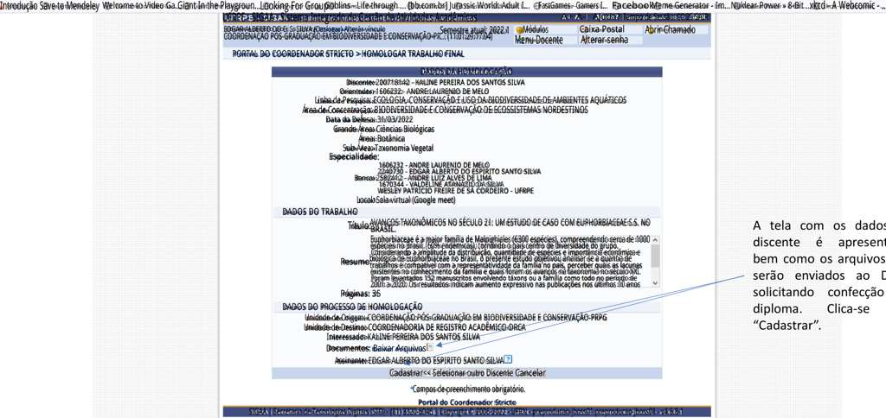

<!-- figure p46-fig1 | described_by: claude:sonnet | ocr_overlap: 0.86 | needs_review: false -->
Captura de tela de interface web (sistema acadêmico), com uma seta e uma caixa de texto explicativa sobrepostas (anotação adicionada à captura).

**1. Tipo de figura:** Print/screenshot de página de sistema web (SIGAA – Portal do Coordenador Stricto), com anotação manual (seta azul apontando para um ícone, e um bloco de texto explicativo ao lado direito).

**2. Textos visíveis:**

Na linha superior da janela do navegador (abas abertas, texto pequeno e parcialmente sobreposto ao cabeçalho da página, lido da esquerda para a direita): "Introdução Save to Mendeley", "Welcome to Video Ga...", "Giant In the Playgroun...", "Looking For Group", "Goblins - Life through ...", "[bb.com.br] Jurassic World: Adult l...", "FastGames - Gamers I...", "Facebook", "Meme Generator - Im...", "Nuklear Power » 8-Bit...", "xkcd - A Webcomic -...".

Cabeçalho institucional (sobreposto parcialmente pelas abas do navegador): "UFRPE" / "SIGAA" | "Sistema Integrador de Gestão de Atividades Acadêmicas" | "A+ A- | Ajuda? | Tempo de sessão: 00:05:25 AR".

Linha de identificação do usuário: "EDGAR ALBERTO DO E... S-SILVA (Desligar) Alterar vínculo" / "COORDENAÇÃO PÓS-GRADUAÇÃO EM BIODIVERSIDADE E CONSERVAÇÃO-PR...(11:01:29:17:04)" — "Semestre atual: 2022.1".

Menu: "Módulos" | "Caixa Postal" | "Abrir Chamado" / "Menu Docente" | "Alterar senha".

Caminho de navegação: "PORTAL DO COORDENADOR STRICTO > HOMOLOGAR TRABALHO FINAL".

Bloco "DADOS DA HOMOLOGAÇÃO":
- Discente: 200718142 – KALINE PEREIRA DOS SANTOS SILVA
- Orientador: 1606232 – ANDRE LAURENIO DE MELO
- Linha de Pesquisa: ECOLOGIA, CONSERVAÇÃO E USO DA BIODIVERSIDADE DE AMBIENTES AQUÁTICOS
- Área de Concentração: BIODIVERSIDADE E CONSERVAÇÃO DE ECOSSISTEMAS NORDESTINOS
- Data da Defesa: 31/03/2022
- Grande Área: Ciências Biológicas
- Área: Botânica
- Sub-Área: Taxonomia Vegetal
- Especialidade: (em branco)
- Banca:
 1606232 – ANDRE LAURENIO DE MELO
 2240730 – EDGAR ALBERTO DO ESPIRITO SANTO SILVA
 2582442 – ANDRE LUIZ ALVES DE LIMA
 1670344 – VALDELINE ATANAZIO DA SILVA
 WESLEY PATRICIO FREIRE DE SA CORDEIRO – UFRPE
- Local: Sala virtual (Google meet)

Bloco "DADOS DO TRABALHO":
- Título: AVANÇOS TAXONÔMICOS NO SÉCULO 21: UM ESTUDO DE CASO COM EUPHORBIACEAE S.S. NO BRASIL.
- Resumo (texto corrido, em caixa de rolagem): "Euphorbiaceae é a maior família de Malpighiales (6300 espécies), compreendendo cerca de 1000 espécies no Brasil (60% endêmicas), tornando o país centro de diversidade do grupo. Considerando a amplitude da distribuição, quantidade de espécies e importância econômica e biológica de Euphorbiaceae no Brasil, o presente estudo objetivou analisar se a quantia de trabalhos é compatível com a representatividade da família no país, perceber quais as lacunas existentes no conhecimento da família e quais foram os avanços na taxonomia no século XXI. Foram levantados 152 manuscritos envolvendo táxons ou a família como todo no período de 2001 a 2020. Os resultados indicam aumento expressivo nas publicações nos últimos 10 anos."
- Páginas: 35

Bloco "DADOS DO PROCESSO DE HOMOLOGAÇÃO":
- Unidade de Origem: COORDENAÇÃO PÓS-GRADUAÇÃO EM BIODIVERSIDADE E CONSERVAÇÃO-PRPG
- Unidade de Destino: COORDENADORIA DE REGISTRO ACADÊMICO-DRCA
- Interessado: KALINE PEREIRA DOS SANTOS SILVA
- Documentos: "Baixar Arquivos" (com ícone, destacado em vermelho)
- Assinante: EDGAR ALBERTO DO ESPIRITO SANTO SILVA (com ícone "?" destacado em azul)

Botões: "Cadastrar << Selecionar outro Discente Cancelar"

Nota de rodapé: "*Campos de preenchimento obrigatório." / "Portal do Coordenador Stricto" (link).

Rodapé do sistema: "SIGAA | Secretaria de Tecnologia da Informação (STI) - (81) 3320-6946 | Copyright © 2006-2022 - UFRN - preproducao-jboss01.preproducao-jboss01 - v4.6.8.1".

Caixa de texto explicativa (anotação, canto direito, fora da tela do sistema): "A tela com os dados [do] discente é apresent[ada] bem como os arquivos [que] serão enviados ao D[RCA] solicitando confecção [do] diploma. Clica-se "Cadastrar"."

**3. Estrutura:**
- Parte superior: barra de abas do navegador (horizontal), sobreposta ao cabeçalho institucional da página do sistema.
- Abaixo: cabeçalho do SIGAA com logo/título, dados do usuário logado e menus.
- Corpo da página dividido em três seções empilhadas verticalmente, cada uma com um título em barra azul escura: "DADOS DA HOMOLOGAÇÃO", "DADOS DO TRABALHO", "DADOS DO PROCESSO DE HOMOLOGAÇÃO". Cada seção é uma lista de campos "rótulo: valor".
- Dentro de "DADOS DO TRABALHO", o campo "Resumo" contém uma caixa de texto rolável (com barra de rolagem lateral) delimitada por borda cinza.
- Ícones pequenos ao lado de "Baixar Arquivos" (quadrado vermelho) e "Assinante" (círculo azul com "?").
- Abaixo das seções: três botões lado a lado ("Cadastrar", "<< Selecionar outro Discente", "Cancelar").
- Seta azul diagonal: parte da região do botão "Cadastrar"/ícone "Baixar Arquivos" (lado esquerdo-inferior da tela do sistema) e aponta para cima/direita, até a caixa de texto explicativa posicionada fora da imagem do sistema, à direita.
- Não há gráficos, eixos ou painéis numéricos; é uma interface de formulário web.

**4. Valores/números presentes:**
- Semestre atual: 2022.1
- Tempo de sessão: 00:05:25 (parcialmente sobreposto, pode estar [illegible] no segundo dígito)
- Matrícula do discente: 200718142
- Matrícula do orientador: 1606232
- Matrículas da banca: 1606232, 2240730, 2582442, 1670344
- Data da Defesa: 31/03/2022
- Família Euphorbiaceae: 6300 espécies (Malpighiales); cerca de 1000 espécies no Brasil; 60% endêmicas
- Páginas: 35
- 152 manuscritos levantados
- Período analisado: 2001 a 2020
- Telefone no rodapé: (81) 3320-6946
- Copyright: 2006-2022
- Versão do sistema: v4.6.8.1

**5. Cores com significado:**
- Barras de título das seções em azul escuro (apenas estrutural/estética, sem codificação de dado).
- Ícone ao lado de "Baixar Arquivos" destacado com contorno/realce vermelho (indica elemento de interesse/clique).
- Ícone "?" ao lado de "Assinante" destacado com contorno azul (indica elemento de interesse/clique).
- Seta azul usada apenas como indicador gráfico de direção (não codifica dado).
- Links em azul (texto "Portal do Coordenador Stricto", "Cadastrar", etc.) seguem padrão convencional de hyperlink, sem significado adicional de dado.

~~~text ocr
Im... -...
| aw |
Caixa-Postal
Alterar-senha
-KALINE PEREIRA DOS SANTOS SILVA
Orientadosr 6662322 ANDRELAURENIO DE MELO
E | NORDESTINOS
Data da
1606232 - ANDRE LAURENIO DE MELO
- EDGAR ALBERTO DO ESPIRITO SANTO SILVA
ALVES DE LIMA
LINE ATANAZ
WESLEY PATRICK CIO FREIRE DE SA CORDEIRO - UFRPE
(Google meet)
DADOS DO TRABALHO
discente é apresent
bem como os arquivos
serão enviados ao
solicitando confecção
diploma. Clica-se
“Cadastrar”.
a
aumento nas to
Paginas: 35
DADOS DO PROGESSO DE HOMOLOGAÇÃO
POSSGRADUAÇÃO EM BIODIVERSIDADE E CONSER
COORDENADORIA DE REGISTRO
DOS
Documentos:
Selecionasroutro Discente Cancelar
obrigatório.
Portal do
= VA
~~~

<!-- Start of picture text -->
Introdução Save to Mendeley Welcome to Video Ga... Giant In the Playgroun...Looking For Group Goblins - Life through ... [bb.com.br] Jurassic World: Adult I... FastGames - Gamers I... FacebookMeme Generator - Im...Nuklear Power » 8-Bit ... xkcd - A Webcomic - .. UFRPE - SIGAA - Sistema Integrado de Gestão de Atividades Acadêmicas A+ A- Ajuda? Tempo de Sessão: 00:25 SAIR EDGAR ALBERTO DO E. S. SILVA (Deslogar) Alteràr vínculo Semestre atual: 2022.1 Módulos Caixa Postal Abrir Chamado COORDENAÇÃO PÓS-GRADUAÇÃO EM BIODIVERSIDADE E CONSERVAÇÃO-PR... (11.01.29.17.04) Menu Docente Alterar senha PORTAL DO COORDENADOR STRICTO > HOMOLOGAR TRABALHO FINAL DADOS DA HOMOLOGAÇÃO Discente: 200718142 - KALINE PEREIRA DOS SANTOS SILVA Orientador: 1606232 - ANDRE LAURENIO DE MELO Linha de Pesquisa: ECOLOGIA, CONSERVAÇÃO E USO DA BIODIVERSIDADE DE AMBIENTES AQUÁTICOS Área de Concentração: BIODIVERSIDADE E CONSERVAÇÃO DE ECOSSISTEMAS NORDESTINOS Data da Defesa: 31/03/2022 Grande Área: Ciências Biológicas Área: Botânica Sub-Área: Taxonomia Vegetal Especialidade: 1606232 - ANDRE LAURENIO DE MELO 2240730 - EDGAR ALBERTO DO ESPIRITO SANTO SILVA Banca: 2582412 - ANDRE LUIZ ALVES DE LIMA 1670344 - VALDELINE ATANAZIO DA SILVA WESLEY PATRÍCIO FREIRE DE SÁ CORDEIRO - UFRPE Local: Sala virtual (Google meet) DADOS DO TRABALHO Título: AVANÇOS TAXONÔMICOS NO SÉCULO 21: UM ESTUDO DE CASO COM EUPHORBIACEAE S.S. NO BRASÍL. A tela com os dados do espécies no Brasil, (60% endêmicas), tornando o país centro de diversidade do grupo.Euphorbiaceae é a maior família de Malpighiales (6300 espécies), compreendendo cerca de 1000 discente  é  apresentada, Considerando a amplitude da distribuição, quantidade de espécies e importância econômica e Resumo: biológica de Euphorbiaceae no Brasil, o presente estudo objetivou analisar se a quantia de bem como os arquivos que trabalhos é compatível com a representatividade da família no país, perceber quais as lacunas existentes no conhecimento da família e quais foram os avanços na taxonomia no século XXI.Foram levantados 152 manuscritos envolvendo táxons ou a família como todo no período de serão enviados ao DRCA 2001 a 2020. Os resultados indicam aumento expressivo nas publicações nos últimos 10 anos Páginas: 35 solicitando confecção do DADOS DO PROCESSO DE HOMOLOGAÇÃO diploma.  Clica-se Unidade de Origem: COORDENAÇÃO PÓS-GRADUAÇÃO EM BIODIVERSIDADE E CONSERVAÇÃO-PRPG Unidade de Destino: COORDENADORIA DE REGISTRO ACADÊMICO-DRCA “Cadastrar”. Interessado: KALINE PEREIRA DOS SANTOS SILVA Documentos: Baixar Arquivos Assinante: EDGAR ALBFRTO DO ESPIRITO SANTO SILVA Cadastrar<< Selecionar outro Discente Cancelar Campos de preenchimento obrigatório. Portal do Coordenador Stricto SIGAA | Secretaria de Tecnologias Digitais (STD) - (81) 3320-6046 | Copyright © 2006-2022 - UFRN - preproducao-jboss01.preproducao-jboss01 - v4.6.8-1 <!-- End of picture text -->

A tela com os dados do discente é apresentada, bem como os arquivos que serão enviados ao DRCA solicitando confecção do diploma. Clica-se em “Cadastrar”. 

43 )POR INTL17/05/202211:08 E 

ǔ 

29C Chuva fraca 

Digite aqui para pesquisar 

日 

<!-- page 47 -->

> 凸 × 

> SIGAA - Sistema Integrado de GX + 

￥目 

###### https://preproducao.sigs.ufrpe.br/sigaa/stricto/homologacao_trabalho_final/info_defesa.jsf 

← C 

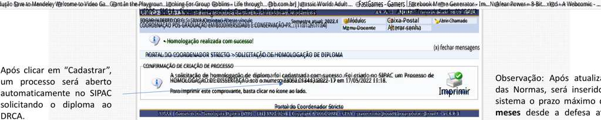

<!-- figure p47-fig1 | described_by: claude:sonnet | ocr_overlap: 0.81 | needs_review: false -->
Imagem de captura de tela (screenshot) de navegador web, mostrando um sistema acadêmico (SIGAA) com anotações sobrepostas em português.

**1. Tipo de figura:** Print de tela de navegador, com uma janela do sistema SIGAA ao centro e duas caixas de texto explicativas (uma à esquerda, outra à direita) ligadas à tela por uma seta, formando um diagrama anotado (não é gráfico de dados).

**2. Todo o texto visível (verbatim):**

Faixa de abas do navegador (no topo, parcialmente sobrepostas e cortadas, muitas ilegíveis):
"...ução Save to Mendeley", "Welcome to Video Ga...", "Giant In the Playgroun...", "Looking For Group Goblins...", "Life through... (bb.com.br)", "Jurassic World: Adult...", "FastGames - Gamers I, Facebook Meme Generator", "Im...", "Nuklear Power » 8-Bit...xkcd « A Webcomic -..."

Cabeçalho da janela do sistema:
"UFRPE SIGAA — Sistema Integrado de Gestão de Atividades Acadêmicas"
"A+ A- | Ajuda | ..." (parte ilegível) "Tempo de Sessão: 00:25 AM" [ilegível, parte sobreposta]

Linha de identificação do usuário:
"EDGAR ALBERTO DO E S SILVA (Desligar) Alterar vínculo"
"COORDENAÇÃO PÓS-GRADUAÇÃO EM BIODIVERSIDADE E CONSERVAÇÃO-PR... (11:01:29:17:04)"
"Semestre atual: 2022.1"

Menu superior direito (ícones/links):
"Módulos" — "Caixa Postal"
"Menu Docente" — "Abrir Chamado"
"Menu Docente" — "Alterar senha"

Mensagem de sistema:
"(i) • Homologação realizada com sucesso!"
"(x) fechar mensagens"

Caminho de navegação (breadcrumb):
"PORTAL DO COORDENADOR STRICTO > SOLICITAÇÃO DE HOMOLOGAÇÃO DE DIPLOMA"

Caixa de confirmação:
"CONFIRMAÇÃO DE CRIAÇÃO DE PROCESSO"
"(i) A solicitação de homologação de diploma foi cadastrada com sucesso. Foi criado no SIPAC um Processo de HOMOLOGAÇÃO DE DISSERTAÇÃO sob o número 23080.013443/2022-17 em 17/05/2022 11:18."
"Para imprimir este comprovante, basta clicar no ícone ao lado."
Ícone verde de confirmação (check) com texto "Imprimir" ao lado.

Rodapé:
"Portal do Coordenador Stricto"
"SIGAA | Secretaria de Tecnologias Digitais (STD) - (81) 3320-6046 | Copyright © 2006-2022 - UFRN - preproducao.jboss01.preproducao.jboss01 - v4.6.8.1"

Caixa de texto à esquerda, fora da tela do sistema:
"Após clicar em 'Cadastrar', um processo será aberto automaticamente no SIPAC solicitando o diploma ao DRCA."

Caixa de texto à direita, fora da tela do sistema:
"Observação: Após atualiza[ção] das Normas, será inserido[a] [n]o sistema o prazo máximo d[e] meses [em negrito] desde a defesa at[é]..." (texto cortado na borda direita da imagem, final ilegível)

**3. Estrutura:**
- Topo: faixa horizontal com abas de navegador lado a lado, sem ligação com o resto.
- Centro: captura de tela do sistema SIGAA, organizada em barras horizontais empilhadas: cabeçalho institucional, linha de usuário/vínculo, barra de menus, caixa de aviso de sucesso, breadcrumb de navegação, caixa de confirmação do processo (com ícone informativo à esquerda e ícone de impressão à direita), e rodapé institucional.
- Uma seta diagonal azul parte da caixa de texto da esquerda e aponta para dentro da caixa de confirmação do processo, indicando o número do processo gerado.
- Caixa de texto à esquerda: fora e à esquerda da tela do sistema, sem seta ligando-a diretamente a nenhum elemento específico além da seta citada.
- Caixa de texto à direita: fora e à direita da tela do sistema, isolada, sem seta visível conectando-a à captura de tela.

**4. Valores numéricos:**
- Semestre: 2022.1
- Horário: 11:01:29:17:04 (junto ao nome da coordenação) e tempo de sessão "00:25" [parte ilegível]
- Número do processo SIPAC: 23080.013443/2022-17
- Data/hora de criação: 17/05/2022 11:18
- Telefone no rodapé: (81) 3320-6046
- Direitos autorais: 2006-2022
- Versão do sistema: v4.6.8.1
- Prazo máximo mencionado em "meses" (quantidade numérica específica não aparece — está em negrito mas o número não é legível/visível antes do corte).

**5. Cores com significado:**
- Ícone "(i)" de informação e texto da mensagem de sucesso "Homologação realizada com sucesso!" em verde, indicando confirmação positiva.
- Ícone de check (✓) verde ao lado de "Imprimir", reforçando sucesso da operação.
- Seta de anotação em azul, usada apenas para apontar/ligar o texto explicativo ao número do processo, sem outro significado codificado.
- Fundo da janela do sistema em tons claros (cinza/azul claro), padrão de interface, sem significado de dado.

~~~text ocr
lução Mendeley Welcometo:Video Ga...Glantdn thePlaygroun.. Life br]
Após clicar em “Cadastrar”,
um processo será aberto
automaticamente no SIPAC
solicitando o diploma ao
DRCA.
i) «Homologação realizada com sucesso!
(x) fechar mensagens
PORTAL DO COORDENADOR DE DIPLOMA
CONFIRMAÇÃO DE CRIAÇÃO DE PROGESSO
A selicitação de hem cadastsada SIPAC um Processo de
i i) HOM em 17/05/2022 11:18.
este comprovante, basta clicar no ao lado.
|
GhasiGames - Gamers | Facebook In...
Observação: Após atualiz
das Normas, será inseridc
sistema o prazo máximo «
meses desde a defesa a
~~~

<!-- Start of picture text -->
Introdução Save to Mendeley Welcome to Video Ga...Giant In the Playgroun...Looking For Group Goblins - Life through... [bb.com.br] Jurassic World: Adult ...Looking For Group Goblins - Life through... [bb.com.br] Jurassic World: Adult ... FastGames - Gamers l...Facebook Meme Generator - Im...Nuklear Power » 8-Bit...xkcd - A Webcomic - ... UFRPE - SIGAA - Sistema Integrado de Gestão de Atividades Acadêmicas A+A- Ajuda?Tempo de Sessão: 00:25 SAIR EDGAR ALBERTO DO E. S. SILVA (Deslogar) Alterar vínculo Semestre atual: 2022.1 Módulos Caixa Postal Abrir Chamado COORDENAÇÃO PÓS-GRADUAÇÃO EM BIODIVERSIDADE E CONSERVAÇÃO-PR... (11.01.29.17.04) Menu Docente Alterar senha • Homologação realizada com sucesso! (x) fechar mensagens PORTAL DO COORDENADOR STRICTO > SOLICITAÇÃO DE HOMOLOGAÇÃO DE DIPLOMA CONFIRMAÇÃO DE CRIAÇÃO DE PROCESSO Após clicar em “Cadastrar”, um processo será aberto  HOMOLOGAÇAO DE DISSERTAÇÃO sob o número 23082.013443/2022-17 em 17/05/2022 11:18.A solicitação de homologação de diploma foi cadastrada com sucesso. Foi criado no SIPAC um Processo de Observação: Após atualização automaticamente no SIPAC  Para imprimir este comprovante, basta clicar no ícone ao lado. Imprimir das Normas, será inserido no sistema o prazo máximo de solicitando o diploma ao  Portal do Coordenador Stricto SIGAA | Secretaria de Tecnologias Digitais (STD) - (81) 3320-6046 | Copyright © 2006-2022 - UFRN - preproducao-jboss01.preproducao-jboss01 - v4.6.8-1 meses  desde a defesa até a DRCA. <!-- End of picture text -->

Introdução Save to Mendeley Welcome to Video Ga...Giant In the Playgroun...Looking For Group Goblins - Life through... [bb.com.br] Jurassic World: Adult ...Looking For Group Goblins - Life through... [bb.com.br] Jurassic World: Adult ... 

Observação: Após atualização das Normas, será inserido no sistema o prazo máximo de **3 meses** desde a defesa até a solicitação do diploma. Caso esse prazo se exceda, somente quem poderá autorizar a solicitação do diploma é a **PRPG** . 

》 

44 

POR 11:18 INTL 17/05/2022 早4 

Q Digite aqui para pesquisar 

30°C Chuva fraca
