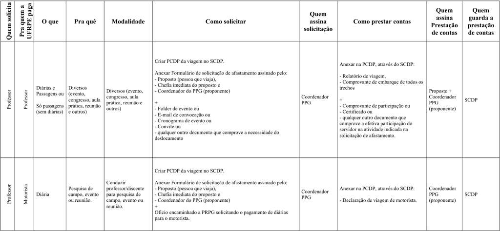

<!-- page 1 -->

PRPG 

UNIVERSIDADE FEDERAL RURAL DE PERNAMBUCO 

### Pró-Reitoria de Pós-Graduação 

# **Manual de Orientação para Utilização dos Recursos PROAP/CAPES** 

##### **RECIFE/PE** 

**2023** 

1 

Rua Dom Manoel de Medeiros, s/n, Dois Irmãos. Recife - PE | CEP 52171-900 | <u>www.ufrpe.br</u> 


<!-- page 2 -->

PRPG 

UNIVERSIDADE FEDERAL RURAL DE PERNAMBUCO 

### Pró-Reitoria de Pós-Graduação 

**REITOR** 

Marcelo Brito Carneiro Leão 

**VICE-REITOR** 

Gabriel Rivas de Melo 

##### **Pró-Reitoria de Pós-Graduação** 

Maria Madalena Pessoa Guerra 

**Pró-Reitoria de Ensino de Graduação** Flávia Carolina Lins da Silva 

**Pró-Reitoria de Extensão, Cultura e Cidadania** 

Moisés de Melo Santana 

##### **Pró-Reitoria de Gestão Estudantil e Inclusão** 

Severino Mendes de Azevedo Júnior 

**Pró-Reitoria de Planejamento e Desenvolvimento Institucional** Carolina Guimarães Raposo 

**Pró-Reitoria de Administração** 

Mozart Alexandre Melo de Oliveira 

**Pró-Reitoria de Gestão de Pessoas** 

Renata Andrade de Lima e Souza 

2 

Rua Dom Manoel de Medeiros, s/n, Dois Irmãos. Recife - PE | CEP 52171-900 | <u>www.ufrpe.br</u> 


<!-- page 3 -->

UNIVERSIDADE FEDERAL RURAL DE PERNAMBUCO 

## PRPG 

### Pró-Reitoria de Pós-Graduação 

##### **Elaboração:** 

Setor Financeiro da PRPG 

- João Ferreira dos Santos Pimentel Neto E-mail: <u>financeiro.prpg@ufrpe.br (ramal: 6056)</u> 

- Raquelle Cavalcanti Souza da SIlva E-mail: <u>raquelle.cavalcanti@ufrpe.br (ramal: 6056)</u> 

- Rodrigo Luiz Costa Cavalcanti E-mail: <u>rodrigo.ccavalcanti@ufrpe.br</u> 

##### **Revisão e colaboração:** 

Pró-Reitora de Pós-Graduação 

- Profª Maria Madalena Pessoa Guerra E-mail: <u>proreitor.prpg@ufrpe.br (ramal: 6050)</u> 

Coordenadora dos Programas de Pós-Graduação _Stricto Sensu_ de excelência 

- Profª  Anete Soares Cavalcanti E-mail: <u>cppg.prpg@ufrpe.br</u> (ramal: 6052) 

Coordenadora dos Programas de Pós-Graduação _Stricto Sensu_ em consolidação - Prof.  Natanael Duarte de Azevedo E-mail: <u>cppg.prpg@ufrpe.br</u> (ramal: 6052) 

##### **Colaboração técnica:** 

- João Henrique de Medeiros Delgado E-mail: <u>joao.delgado@ufrpe.br (ramal:6056)</u> 

##### **Contribuição:** 

Coordenadores e Secretários dos Programas de Pós-Graduação da UFRPE. 

3 

Rua Dom Manoel de Medeiros, s/n, Dois Irmãos. Recife - PE | CEP 52171-900 | <u>www.ufrpe.br</u> 


<!-- page 4 -->

PRPG 

UNIVERSIDADE FEDERAL RURAL DE PERNAMBUCO 

### Pró-Reitoria de Pós-Graduação 

##### **Apresentação** 

O Programa de Apoio à Pós-Graduação (PROAP), concedido pela Coordenação de Aperfeiçoamento de Pessoal de Nível Superior (CAPES), destina-se a proporcionar melhores condições para a formação de recursos humanos, bem como para a produção e o aprofundamento do conhecimento nos cursos de Pós-Graduação _Stricto Sensu_ , nos níveis de Mestrado e Doutorado acadêmicos, mantidos por instituições públicas. 

Este Manual tem como objetivo orientar e padronizar os procedimentos de solicitação/requisição de despesas previstas na Portaria CAPES PROAP nº 156, de 28 de novembro de 2014, pelos Programas de Pós-Graduação _Stricto Sensu_ (PPG), da Universidade Federal Rural de Pernambuco (UFRPE). Recomenda-se que, antes de qualquer procedimento para utilização dos recursos PROAP, o(a) coordenador(a) do programa leia atentamente este manual elaborado pela PRPG. A execução orçamentária do PROAP necessita de vários procedimentos que devem ser cuidadosamente observados pelos PPG, visando atender às normas contábeis e financeiras exigidas por lei. 

A utilização de cada elemento de despesa previsto na portaria PROAP é de grande importância para garantir a eficácia na gestão destes recursos. Caso necessite tirar algumas dúvidas, ou identifique algum procedimento não previsto neste manual, favor entrar em contato com a PRPG pelo telefone (81) 33206056 ou e-mail (financeiro.prpg@ufrpe.br). 

###### **_Profa Maria Madalena Pessoa Guerra_** 

Pró-Reitora de Pós-Graduação 

4 

Rua Dom Manoel de Medeiros, s/n, Dois Irmãos. Recife - PE | CEP 52171-900 | <u>www.ufrpe.br</u> 


<!-- page 5 -->

> UNIVERSIDADE PRPG FEDERAL RURAL DE PERNAMBUCO 

### Pró-Reitoria de Pós-Graduação 

##### **Sumário** 

|**1. Legislação e características orçamentárias**......................................................... 6|
|---|
|**2. Vigência**.................................................................................................................. 7|
|**3. Beneficiário do recurso**......................................................................................... 7|
|**4. Tipos de despesas**................................................................................................... 7|
|**4.1. Ajuda de custo ao discente**.............................................................................. 7|
|**4.2. Diárias e passagens**.......................................................................................... 8|
|4.2.1. Solicitação  .................................................................................................. 9|
|4.2.2. Utilização de carro oficial com motorista ................................................... 9|
|4.2.3. Viagens internacionais  ............................................................................... 9|
|**4.3. Compras e contratações de serviços**............................................................ 10|
|**4.4. Auxílio pesquisador**...................................................................................... 10|
|**5. Tabela de itens financiáveis**................................................................................ 11|
|**6. Outras observações**.............................................................................................. 16|
|**6.1.Justificativa para não recebimento de Nota Fiscal**...................................... 16|
|**6.2.Descrição do serviço**....................................................................................... 16|
|**6.3. Imagem de assinatura colada**....................................................................... 17|
|**6.4 O recibo “A” modelo CAPES**........................................................................ 17|


5 

Rua Dom Manoel de Medeiros, s/n, Dois Irmãos. Recife - PE | CEP 52171-900 | <u>www.ufrpe.br</u> 


<!-- page 6 -->

PRPG 

UNIVERSIDADE FEDERAL RURAL DE PERNAMBUCO 

### Pró-Reitoria de Pós-Graduação 

De modo a facilitar a leitura e também a execução das despesas foi elaborada a tabela de itens financiáveis pelo PROAP, contendo, entre outras informações, descrição da despesa, quem solicita e quem faz a prestação de contas. 

Antes serão abordados temas gerais que regem as finanças públicas, entre as quais o recurso do PROAP. 

###### **1. Legislação e características orçamentárias** 

O presente manual se baseia na <u>Portaria nº 156/2014 da CAPES</u> que regulamenta o PROAP (Programa de Apoio à Pós-Graduação), além de todas as legislações que controlam a execução orçamentária federal. 

A referida Portaria, em seu Artigo 6º, afirma: 

Deverá ser verificado junto às unidades responsáveis pela execução financeira e contábil da instituição o enquadramento dos elementos de despesa nas atividades financiáveis descritas no Art. 7º, bem como os procedimentos e a documentação comprobatória das despesas pagas na forma deste regulamento, observadas as disposições da Lei de Diretrizes Orçamentárias (LDO), do Manual de Contabilidade Aplicada ao Setor Público (MCASP) e do Manual Técnico de Orçamento (MTO) vigentes no respectivo exercício, as normas vinculantes e as alterações posteriores emitidas pela Secretaria do Tesouro Nacional (STN) e pela Secretaria de Orçamento Federal (SOF). 

É importante frisar que a unidade responsável pela execução financeira e contábil do PROAP enviado à UFRPE (Universidade Federal Rural de Pernambuco) através de Nota de Crédito pelo SIAFI (Sistema Integrado de Administração Financeira do Governo Federal), conforme plano de trabalho cadastrado no TED (Termo de Execução Descentralizado) tramitado pelo SIMEC (Sistema Integrado de Monitoramento Execução e Controle) é a própria UFRPE. 

Assim sendo, cabe a UFRPE, conforme outorga ao referido artigo, definir o enquadramento dos elementos de despesas, os procedimentos e a documentação comprobatória, observando LDO, MCASP e MTO. Apesar da Portaria não citar, mas por se tratar de crédito orçamentário, também é necessário observar o PPA (Plano Plurianual), a LOA (Lei Orçamentária Anual) e entre outras normativas, uma que 

6 

Rua Dom Manoel de Medeiros, s/n, Dois Irmãos. Recife - PE | CEP 52171-900 | <u>www.ufrpe.br</u> 


<!-- page 7 -->

PRPG 

UNIVERSIDADE FEDERAL RURAL DE PERNAMBUCO 

### Pró-Reitoria de Pós-Graduação 

merece destaque é a Lei de Licitações e Contratos da Administração Pública (Lei 8.666/93). 

O manual pretende abordar as principais despesas utilizadas pelos Programas de Pós-Graduação da UFRPE, de modo a facilitar a solicitação e sua devida prestação de contas. De modo algum, a leitura do presente manual substitui a leitura da Portaria nº <u>156/2014 da CAPES</u> que regulamenta o PROAP e outras legislações vigentes. 

O Manual foi elaborado para o contexto da UFRPE, com base na experiência dos servidores que trabalham com o assunto. 

###### **2. Vigência** 

Por se tratar de TED, o recurso financeiro do PROAP tem prazo de utilização. Sua vigência é do dia da assinatura do TED até 31 de dezembro do mesmo ano, podendo ser prorrogado a critério da concedente, no caso, a CAPES. 

Nenhuma despesa poderá ocorrer fora do prazo de vigência do PROAP. Isso inclui ressarcimentos e auxílios a pesquisadores. Por exemplo, para ser ressarcido de alguma despesa, além de toda formalidade legal, é necessário que a despesa tenha ocorrido no período de vigência do PROAP. O mesmo caso para auxílio pesquisador, cuja compra de material ou a contratação de pequenos serviços, devidamente comprovadas, devem ser feitas na vigência do TED. 

###### **3. Beneficiário do recurso** 

As utilizações do recurso do PROAP são diversas, podendo ser empenhado também para professores e discentes. É importante ressaltar que a prestação de contas é de responsabilidade de cada um. A do discente é de responsabilidade do discente e a do professor é de responsabilidade do professor. 

###### **4. Tipos de despesas** 

###### **4.1. Ajuda de custo ao discente** 

É o recurso que o discente recebe para o desenvolvimento de estudo e pesquisa 

de natureza cientifica. Na solicitação é necessário indicar à efetiva destinação do 

7 

Rua Dom Manoel de Medeiros, s/n, Dois Irmãos. Recife - PE | CEP 52171-900 | <u>www.ufrpe.br</u> 


<!-- page 8 -->

UNIVERSIDADE FEDERAL RURAL DE PERNAMBUCO 

## PRPG 

### Pró-Reitoria de Pós-Graduação 

recurso, por exemplo, se é para participação em eventos, deve indicar o nome do evento, data e local da realização; se combustível indicar o roteiro da viagem, com quilometragem, data realização, e assim por diante. 

Por determinação da Portaria do PROAP, ninguém pode receber recurso para diárias maior que o valor equivalente de um servidor de nível superior. Os valores são diferentes dependendo da localidade, do trajeto, do período da viagem e dos dias de ida e volta (por exemplo, saída num dia com chegada a sede no dia seguinte). Desta forma, orienta-se consultar o setor financeiro da PRPG para verificar o limite de valor de ajuda de custo ao discente para a finalidade de diárias. Também vale a pena lembrar que, o recurso de diárias é para pagar hospedagem, alimentação e deslocamento urbano. Os valores solicitados para passagens, inscrição de eventos, entre outros correlatos a viagem e não listados acima, deverão ser devidamente discriminados no formulário de solicitação de empenho. 

Para fins de prestação de contas, os valores recebidos de ajuda de custo ao discente para custear parcialmente as diárias em eventos científicos, deverão ser comprovados através da apresentação do certificado de participação no evento junto com o relatório de viagem. Para todas as outras despesas, a comprovação da utilização do recurso é nota Fiscal conforme detalhamento na tabela do item 5. 

Para viagens de campo a prestação de contas deverá ser toda por nota fiscal. Caso a cidade não disponha de serviço de hospedagem e alimentação que emita nota fiscal, será aceito excepcionalmente relatório detalhado da viagem com foto e anuência do orientador. 

Também é importante saber que para compra de material de escritório (papel, caneta, lápis, borracha, grampo, entre outros) é necessário negativa do pedido do mesmo material feito ao Almoxarifado central da UFRPE, comprovando a indisponibilidade. 

Os pedidos deverão ser realizados através da Solicitação de Empenho, disponível na página da PRPG, obedecendo ao modelo e as informações solicitadas e devidamente assinado e carimbado pelo coordenador do PPG. 

###### **4.2. Diárias e passagens** 

Todos os afastamentos de servidores públicos federais devem ser cadastrados no SCDP (Sistema de Concessão de Diárias e Passagens), independente de como a 

8 

Rua Dom Manoel de Medeiros, s/n, Dois Irmãos. Recife - PE | CEP 52171-900 | <u>www.ufrpe.br</u> 


<!-- page 9 -->

PRPG 

UNIVERSIDADE FEDERAL RURAL DE PERNAMBUCO 

### Pró-Reitoria de Pós-Graduação 

viagem será custeada. Diante disso, e de modo a melhor controlar a execução do recurso, fica vedado o custeio de passagens, hospedagens e locomoções urbanas feitas por servidores públicos federais com recurso PROAP por fora do SCDP. Assim sendo, a prestação de contas do recurso PROAP utilizado em diárias e passagens será o próprio PCDP (Processo de Concessão de Diárias e Passagens) devidamente finalizada no sistema. 

###### 4.2.1.Solicitação 

A solicitação de afastamento, com ou sem pagamento de diárias ou passagens, deverá ser feita através do formulário específico disponível na página da PRPG. 

Toda solicitação deverá ser assinada pelo proposto (pessoa que vai viajar), por sua chefia imediata, e pelo coordenador do PPG. É necessário anexar no SCDP documentação comprobatória, convites e e-mails com programação e cronograma, conforme apresentado na tabela de itens financiáveis. 

O PPG que ainda não tiver técnico-administrativo com acesso ao SCDP, deverá providenciar o seu treinamento para cadastramento de viagens no sistema, junto a CCDP (Coordenação de Concessão de Diárias e Passagens/PROAD) 

A autorização da Pró-Reitoria de Pós-Graduação ocorrerá via sistema após o devido cadastro e encaminhamento efetuado pelo PPG. 

###### 4.2.2.Utilização de veículo oficial com motorista 

Para utilização de veículo oficial, com motorista, além do formulário de solicitação de afastamento é necessário encaminhar um ofício à PRPG solicitando o pagamento de diárias para o motorista com recurso do PROAP do PPG. 

###### 4.2.3.Viagens internacionais 

Dadas às peculiaridades das viagens internacionais e seu elevado custo, solicitamos que entre em contato com o setor de apoio financeiro da PRPG (ramal: 6056) e com o CCDP (ramal: 6070) para verificação da documentação, etapas e prazos do processo. 

9 

Rua Dom Manoel de Medeiros, s/n, Dois Irmãos. Recife - PE | CEP 52171-900 | <u>www.ufrpe.br</u> 


<!-- page 10 -->

PRPG 

UNIVERSIDADE FEDERAL RURAL DE PERNAMBUCO 

### Pró-Reitoria de Pós-Graduação 

###### **4.3. Compras e contratações de serviços** 

As compras e contratações com recurso PROAP são para despesas de custeio das atividades científico-acadêmicas. Podem ocorrer por licitação, conforme processo interno da Universidade, por dispensa de licitação, com base no Art.24, Inc.XXI da Lei 8.666/93 ou por inexigibilidade de licitação. Para ambos os casos, seja compra ou contratação, é necessário a elaboração de Termo de especificação de bens ou serviços de acordo com o modelo disponível na página da PRPG, indicando o objetivo da compra/contratação e a justificando a necessidade se fazer o serviço/compra. 

Para esses casos é necessário abrir processo para a PRPG dar seguimento junto a PROAD. Desta forma, o solicitante deverá entrar em contato com o setor financeiro da PRPG (ramal:6056 – e-mail:financeiro.prpg@ufrpe.br) para verificar a correta instrução processual para seu pedido. 

###### **4.4. Auxílio pesquisador** 

São despesas orçamentárias para apoio financeiro concedido a pesquisadores, exceto na condição de estudante, para o desenvolvimento de pesquisas científicas e tecnológicas, nas suas mais diversas modalidades. 

O valor repassado financeiramente deve obedecer aos princípios legais da legalidade, impessoalidade, moralidade, publicidade e economicidade. Para tanto, é condição de legalidade o recolhimento de nota fiscal junto ao fornecedor, receber exatamente o que está na nota fiscal, entre outros. Também é condição de impessoalidade e moralidade não contratar e nem comprar materiais de parentes, familiares, nem de pessoas próximas que ensejem dúvidas sobre a economicidade. Também é condição de publicidade a guarda da nota fiscal, indicando a real utilização do recurso público destinado à pesquisa através do referido auxílio. 

Também é importante saber que para compra de material de escritório (papel, caneta, lápis, borracha, grampo, entre outros) é necessário negativa do pedido do mesmo material feito ao Almoxarifado central da UFRPE, comprovando a indisponibilidade. 

10 

Rua Dom Manoel de Medeiros, s/n, Dois Irmãos. Recife - PE | CEP 52171-900 | <u>www.ufrpe.br</u> 


<!-- page 11 -->

PRPG 

UNIVERSIDADE FEDERAL RURAL DE PERNAMBUCO 

#### Pró-Reitoria de Pós-Graduação 

###### **5. Tabela de itens financiáveis** 

|**Quem solicita**<br>**Pra quem a**<br>**UFRPEpaga **|<br>**O que**|**Pra quê**|**Modalidade**|**Como solicitar**|**Quem**<br>**assina**<br>**solicitação**|**Como prestar contas**|**Quem**<br>**assina**<br>**Prestação**<br>**de contas**|**Quem**<br>**guarda a**<br>**prestação**<br>**de contas**|
|---|---|---|---|---|---|---|---|---|
|Discente<br>Discente|Ajuda de<br>custo|Evento -<br>Hospedagem<br>Alimentação e<br>Transporte|Custeio parcial|Abrir Processo para PRPG com:<br>Solicitação de empenho<br>Com data de ida, de volta e Local.<br>+<br>Informação oficial do evento (Folder ou e-mail)|Coordenador<br>PPG|Entregar para secretaria ou coordenação.<br>PPG:<br>Relatório de viagem +<br>NF de passagens (se for o caso) +<br>Certificado de comparecimento.|<br>Professor<br>orientador|Secretaria do<br>PPG|
|Discente<br>Discente|Ajuda de<br>custo|Evento -<br>Hospedagem<br>Alimentação e<br>Transporte|Custeio total|Abrir Processo para PRPG com:<br>Solicitação de empenho<br>Com data de ida, de volta e Local.<br>+<br>Informação oficial do evento (Folder ou e-mail)|Coordenador<br>PPG|Entregar para secretaria ou coordenação.<br>PPG:<br>Relatório de viagem +<br>Certificado de comparecimento +<br>NFs de passagens +<br>NFs de alimentação +<br>NFs de locomoção urbana<br>(NFs com CPF em nome do discente)|<br>Professor<br>orientador|Secretaria do<br>PPG|
|Discente<br>Discente|Ajuda de<br>custo|Inscrição de<br>evento|Ressarcimento|Abrir Processo para PRPG com:<br>Solicitação de empenho +<br>Certificado de comparecimento +<br>- Nota fiscal em nome do discente;<br>- Por se tratar de ressarcimento, é necessário se comprovar a devida<br>quitação da despesa.<br>- Quando cartão de crédito, anexar demonstrativo do cartão e<br>quitação do mesmo;<br>- Quando de outra forma, anexar comprovante de transferência,<br>de pagamento de boleto, recibo de pagamento em dinheiro (espécie)<br>ou qualquer outra forma que demostre que a pessoa, utilizando o seu<br>recurso, já quitou a despesa.|Coordenador<br>PPG|Como o próprio Processo contêm a Nota<br>Pagamento da inscrição, ele serve de pre|fiscal do<br>stação de contas.|<br>Contabilidade<br>após<br>pagamento|
|Discente<br>Discente|Ajuda de<br>custo|Pesquisa de<br>campo|Combustível|Abrir Processo para PRPG com:<br>Solicitação de empenho indicando:<br>Necessidade da viagem ser de carro e não de outro meio de<br>transporte mais econômico,<br>Roteiro,<br>Datas e<br>Quilometragem.|Coordenador<br>PPG|Entregar para secretaria ou coordenação.<br>PPG:<br>Relatório de viagem +<br>NFs dos abastecimentos<br>(NFs com CPF em nome do discente)|<br>Professor<br>orientador|Secretaria do<br>PPG|


11 

Rua Dom Manoel de Medeiros, s/n, Dois Irmãos. Recife - PE | CEP 52171-900 | <u>www.ufrpe.br</u> 


<!-- page 12 -->

PRPG 

UNIVERSIDADE FEDERAL RURAL DE PERNAMBUCO 

#### Pró-Reitoria de Pós-Graduação 

|**Quem solicita**<br>**Pra quem a**<br>**UFRPEpaga **|**O que**|**Pra quê**|**Modalidade**|**Como solicitar**|**Quem**<br>**assina**<br>**solicitação**|**Como prestar contas**|**Quem**<br>**assina**<br>**Prestação**<br>**de contas**|**Quem**<br>**guarda a**<br>**prestação**<br>**de contas**|
|---|---|---|---|---|---|---|---|---|
|Discente<br>Discente|Ajuda de<br>custo|Pesquisa de<br>campo|Hospedagem e<br>Alimentação|Abrir Processo para PRPG com:<br>Solicitação de empenho indicando:<br>Necessidade da viagem,<br>Roteiro e<br>Datas.|Coordenador<br>PPG|Entregar para secretaria ou coordenação.<br>PPG:<br>Relatório de viagem +<br>NFs da hospedagem e da alimentação<br>(NFs com CPF em nome do discente)|Professor<br>orientador|Secretaria do<br>PPG|
|Discente<br>Discente|Ajuda de<br>custo|Pesquisa de<br>campo|Material para<br>pesquisa|Abrir Processo para PRPG com:<br>Solicitação de empenho indicando:<br>Necessidade da viagem e<br>quais materiais pretende-se comprar.|Coordenador<br>PPG|Entregar para secretaria ou coordenação.<br>PPG:<br>Relatório de viagem +<br>NFs dos materiais comprados<br>(NFs com CPF em nome do discente)|<br>Professor<br>orientador|Secretaria do<br>PPG|
|Professor<br>Professor|Apenas<br>Diárias ou<br>Só<br>afastamento<br>(sem diárias)|Diversos<br>(evento,<br>congresso, aula<br>prática, reunião<br>e outros)|Diversos (evento,<br>congresso, aula<br>prática, reunião e<br>outros)|Criar PCDP da viagem no SCDP.<br>Anexar Formulário de solicitação de afastamento assinado pelo:<br>- Proposto (pessoa que viaja),<br>- Chefia imediata do proposto e<br>- Coordenador do PPG (proponente)<br>+<br>- Folder de evento ou<br>- E-mail de convocação ou<br>- Cronograma de evento ou<br>- Convite ou<br>- qualquer outro documento que comprove a necessidade do<br>deslocamento|Coordenador<br>PPG|Anexar na PCDP, através do SCDP:<br>- Relatório de viagem<br>+<br>- Comprovante de participação ou<br>- Certificado ou<br>- qualquer outro documento que<br>comprove a efetiva participação do<br>servidor na atividade indicada na<br>solicitação de afastamento.|Proposto +<br>Coordenador<br>PPG<br>(proponente)|SCDP|


12 

Rua Dom Manoel de Medeiros, s/n, Dois Irmãos. Recife - PE | CEP 52171-900 | <u>www.ufrpe.br</u> 


<!-- page 13 -->

PRPG 

UNIVERSIDADE FEDERAL RURAL DE PERNAMBUCO 

#### Pró-Reitoria de Pós-Graduação 




<!-- figure p13-fig1 | described_by: agy | ocr_overlap: 1.0 | needs_review: false -->
### 1. Tipo de figura
Trata-se de uma **tabela informativa / quadro de procedimentos administrativos** (sem título ou legenda externos), que descreve fluxos de solicitação e prestação de contas de diárias e passagens no âmbito da UFRPE (Universidade Federal Rural de Pernambuco).

---

### 2. Todo o texto visível (transcrição literal)

#### Linha de cabeçalho (da esquerda para a direita)
1. **Coluna 1 (texto vertical, rotacionado 90° no sentido anti-horário):** `Quem solicita`
2. **Coluna 2 (texto vertical, rotacionado 90° no sentido anti-horário):** `Pra quem a UFRPE paga`
3. **Coluna 3:** `O que`
4. **Coluna 4:** `Pra quê`
5. **Coluna 5:** `Modalidade`
6. **Coluna 6:** `Como solicitar`
7. **Coluna 7:** `Quem assina solicitação`
8. **Coluna 8:** `Como prestar contas`
9. **Coluna 9:** `Quem assina Prestação de contas`
10. **Coluna 10:** `Quem guarda a prestação de contas`

#### Linha de dados 1
- **Coluna 1 (`Quem solicita` — texto vertical, rotacionado 90° no sentido anti-horário):**
  `Professor`
- **Coluna 2 (`Pra quem a UFRPE paga` — texto vertical, rotacionado 90° no sentido anti-horário):**
  `Professor`
- **Coluna 3 (`O que`):**
  ```
  Diárias e Passagens ou

  Só passagens (sem diárias)
  ```
- **Coluna 4 (`Pra quê`):**
  `Diversos (evento, congresso, aula prática, reunião e outros)`
- **Coluna 5 (`Modalidade`):**
  `Diversos (evento, congresso, aula prática, reunião e outros)`
- **Coluna 6 (`Como solicitar`):**
  ```
  Criar PCDP da viagem no SCDP.

  Anexar Formulário de solicitação de afastamento assinado pelo:
  - Proposto (pessoa que viaja),
  - Chefia imediata do proposto e
  - Coordenador
**1. Tipo de figura**
Tabela informativa/administrativa em preto e branco com bordas pretas finas, descrevendo procedimentos de solicitação e prestação de contas de viagens (diárias e passagens) na UFRPE.

**2. Todo o texto visível (transcrição literal)**

*Cabeçalhos das colunas (da esquerda para a direita):*
- Coluna 1 (texto vertical): `Quem solicita`
- Coluna 2 (texto vertical): `Pra quem a UFRPE paga`
- Coluna 3: `O que`
- Coluna 4: `Pra quê`
- Coluna 5: `Modalidade`
- Coluna 6: `Como solicitar`
- Coluna 7: `Quem assina solicitação`
- Coluna 8: `Como prestar contas`
- Coluna 9: `Quem assina Prestação de contas`
- Coluna 10: `Quem guarda a prestação de contas`

*Primeira linha de dados (Linha 1):*
- Coluna 1 (texto vertical): `Professor`
- Coluna 2 (texto vertical): `Professor`
- Coluna 3: `Diárias e Passagens ou` (espaço de linha) `Só passagens (sem diárias)`
- Coluna 4: `Diversos (evento, congresso, aula prática, reunião e outros)`
- Coluna 5: `Diversos (evento, congresso, aula prática, reunião e outros)`
- Coluna 6:
  - Parágrafo inicial: `Criar PCDP da viagem no SCDP.`
  - Bloco seguinte: `Anexar Formulário de solicitação de afastamento assinado pelo:` seguido pelos itens `- Proposto (pessoa que viaja),`, `- Chefia imediata do proposto e` e `- Coordenador do PPG (proponente)`
  - Símbolo de adição isolado em linha própria: `+`
  - Lista de opções: `- Folder de evento ou`, `- E-mail de convocação ou`, `- Cronograma de evento ou`, `- Convite ou` e `- qualquer outro documento que comprove a necessidade do deslocamento`
- Coluna 7: `Coordenador PPG`
- Coluna 8:
  - Parágrafo inicial: `Anexar na PCDP, através do SCDP:`
  - Primeira lista: `- Relatório de viagem,` e `- Comprovante de embarque de todos os trechos`
  - Símbolo de adição isolado em linha própria: `+`
  - Segunda lista: `- Comprovante de participação ou`, `- Certificado ou` e `- qualquer outro documento que comprove a efetiva participação do servidor na atividade indicada na solicitação de afastamento.`
- Coluna 9: `Proposto + Coordenador PPG (proponente)`
- Coluna 10: `SCDP`

*Segunda linha de dados (Linha 2):*
- Coluna 1 (texto vertical): `Professor`
- Coluna 2 (texto vertical): `Motorista`
- Coluna 3: `Diária`
- Coluna 4: `Pesquisa de campo, evento ou reunião.`
- Coluna 5: `Conduzir professor/discente para pesquisa de campo, evento ou reunião.`
- Coluna 6:
  - Parágrafo inicial: `Criar PCDP da viagem no SCDP.`
  - Bloco seguinte: `Anexar Formulário de solicitação de afastamento assinado pelo:` seguido pelos itens `- Proposto (pessoa que viaja),`, `- Chefia imediata do proposto e` e `- Coordenador do PPG (proponente)`
  - Símbolo de adição na linha logo abaixo: `+`
  - Texto final: `Ofício encaminhado a PRPG solicitando o pagamento de diárias para o motorista.`
- Coluna 7: `Coordenador PPG`
- Coluna 8:
  - Parágrafo inicial: `Anexar na PCDP, através do SCDP:`
  - Item único abaixo de uma linha em branco: `- Declaração de viagem de motorista.`
- Coluna 9: `Coordenador PPG (proponente)`
- Coluna 10: `SCDP`

**3. Estrutura**
- A figura é composta por uma única grade retangular com 3 linhas horizontais (1 linha de cabeçalho e 2 linhas de registros) e 10 colunas verticais, todas delimitadas por linhas contínuas finas pretas, sem células mescladas, sem setas, sem eixos e sem painéis adicionais.
- Todos os cabeçalhos da primeira linha estão em negrito e centralizados nas células.
- As duas primeiras colunas são estreitas e possuem texto rotacionado em 90 graus no sentido anti-horário (leitura de baixo para cima), tanto nos cabeçalhos quanto nas células de dados.
- As colunas 3 a 10 têm texto na orientação horizontal, alinhado à esquerda e centralizado verticalmente nas linhas de dados. As colunas 6 (`Como solicitar`) e 8 (`Como prestar contas`) são as mais largas para acomodar listas instrucionais com múltiplas linhas.
- A Linha 1 detalha o fluxo quando um professor solicita diárias/passagens (ou só passagens) para si mesmo; a Linha 2 detalha o fluxo quando um professor solicita diária para um motorista.

**4. Números e valores de dados**
Não há números, valores quantitativos, datas ou porcentagens presentes na imagem.

**5. Cores com significado**
Não há cores com significado na figura: o fundo é inteiramente branco e o texto e as bordas são exclusivamente pretos.

~~~text ocr
Quem solicita
Pra quem a
UFRPE paga
Modalidade
Como solicitar
Criar PCDP da viagem no SCDP.
Anexar Formulário de solicitação de afastamento assinado pelo:
- Proposto (pessoa que viaja),
- Chefia imediata do proposto e
Quem
assina
Prestação
de contas
Quem
assina
solicitação
Como prestar contas
Anexar na PCDP, através do SCDP:
- Relatório de viagem,
- Comprovante de embarque de todos os
Quem
guarda a
prestação
de contas
Diárias e Diversos trechos
5 5 Diversos (evento, - Coordenador do PPG (proponente) Proposto +
Passagens ou | (evento,
congresso, aula Coordenador Coordenador
2 congresso, aula +
o o 25 prática, reunião e + PPG PPG
É |Só passagens | prática, reunião outros) = Folder de - Comprovante de participação ou (proponente)
(sem diárias) | e outros) - Certificado ou
- E-mail de convocação ou
- Cronograma de evento ou - qualquer outro documento que
ou comprove a efetiva participação do
. servidor na atividade indicada na
- qualquer outro documento que comprove a necessidade do
deslocamento solicitação de afastamento.
Criar PCDP da viagem no SCDP.
a Conduzir Anexar Formulário de solicitação de afastamento assinado pelo:
Z Pesquisa de professor/discente - Proposto (pessoa que viaja). Coordenador Anexar na PCDP, através do SCDP: Coordenador
2 campo, evento | para pesquisa de - Chefia imediata do proposto e PPG PPG
É ou reunião. campo, evento ou - Coordenador do PPG (proponente) - Declaração de viagem de motorista. (proponente)
reunião.
+
Ofício encaminhado a PRPG solicitando o pagamento de diárias
para o motorista.
~~~


<!-- Start of picture text -->
Quem  Quem<br>Quem<br>assina  guarda a<br>O que  Pra quê  Modalidade  Como solicitar  assina  Como prestar contas<br>Prestação  prestação<br>solicitação<br>de contas  de contas<br>Criar PCDP da viagem no SCDP.<br>Anexar na PCDP, através do SCDP:<br>Anexar Formulário de solicitação de afastamento assinado pelo:<br>- Relatório de viagem,<br>- Proposto (pessoa que viaja),<br>- Comprovante de embarque de todos os<br>- Chefia imediata do proposto e<br>Diárias e  Diversos  trechos<br>Diversos (evento,  - Coordenador do PPG (proponente)  Proposto +<br>Passagens ou (evento,<br>congresso, aula  congresso, aula prática, reunião e  +  Coordenador PPG  +  Coordenador PPG  SCDP<br>Só passagens (sem diárias)  prática, reunião e outros)  outros)  - Folder de evento ou  - Comprovante de participação ou - Certificado ou  (proponente)<br>- E-mail de convocação ou<br>- qualquer outro documento que<br>- Cronograma de evento ou<br>- Convite ou   comprove a efetiva participação do<br>servidor na atividade indicada na<br>- qualquer outro documento que comprove a necessidade do<br>solicitação de afastamento.<br>deslocamento<br>Criar PCDP da viagem no SCDP.<br>Conduzir  Anexar Formulário de solicitação de afastamento assinado pelo:<br>Pesquisa de  professor/discente  - Proposto (pessoa que viaja),  Anexar na PCDP, através do SCDP:  Coordenador<br>Coordenador<br>Diária  campo, evento  para pesquisa de  - Chefia imediata do proposto e   PPG  PPG  SCDP<br>ou reunião.  campo, evento ou  - Coordenador do PPG (proponente)  - Declaração de viagem de motorista.  (proponente)<br>reunião.  +<br>Ofício encaminhado a PRPG solicitando o pagamento de diárias<br>para o motorista.<br>Pra quem a<br>Quem solicita  UFRPE paga<br>Professor  Professor<br>Professor  Motorista<br><!-- End of picture text -->

13 

Rua Dom Manoel de Medeiros, s/n, Dois Irmãos. Recife - PE | CEP 52171-900 | <u>www.ufrpe.br</u> 


<!-- page 14 -->

PRPG Pró-Reitoria de Pós-Graduação 

UNIVERSIDADE FEDERAL RURAL DE PERNAMBUCO 

|**Quem solicita**<br>**Pra quem a**<br>**UFRPEpaga **|**O que**|**Pra quê**|**Modalidade**|**Como solicitar**|**Quem**<br>**assina**<br>**solicitação**|**Como prestar contas**|**Quem**<br>**assina**<br>**Prestação**<br>**de contas**|<br>**Quem**<br>**guarda a**<br>**prestação**<br>**de contas**|
|---|---|---|---|---|---|---|---|---|
|Professor<br>Empresa|Compra de<br>materiais|Atividades de<br>pesquisa|Compra de material<br>de consumo para<br>pesquisa (Dispensa<br>de licitação Lei<br>8666/93 Art. 24º,<br>Inciso XXI)|Abrir Processo para PRPG com:<br>- Formulário de solicitação Empenho indicando a necessidade da<br>compra, quais materiais pretende-se comprar;<br>- Termo de Especificação de Bens;<br>- Três orçamentos, que as solicitações sejam enviadas por e-mail<br>para as Empresas;<br>- Três Pesquisas do Painel de preço do Governo Federal, para cada<br>item, quando não houver, anexar pesquisa de preço pela internet,<br>mas com justificativa;<br>- Certidão Negativa da Receita Federal e FGTS;|Coordenador<br>PPG|Atestar a nota fiscal de compra e anexar<br>ao empenho, enviando para<br>Contabilidade para pagamento.|<br>Coordenador<br>PPG|Contabilidade<br>após<br>pagamento|
|Professor<br>Empresa|Compra de<br>materiais|Atividades de<br>pesquisa|Compra de material<br>de consumo para<br>pesquisa<br>(INEXIGIBILIDADE<br>de licitação Lei<br>8666/93)|<br>Abrir Processo para PRPG com:<br>- Formulário de solicitação Empenho indicando a necessidade da<br>compra, quais materiais pretende-se comprar;<br>- Termo de Especificação de Serviço;<br>- Orçamento<br>- 03 (Três) notas fiscais da empresa, para comparação ao preço<br>praticado no mercado (Setor Público ou Privado);<br>- Certidão Negativa da Receita Federal e FGTS;<br>- Atestado de exclusividade fornecido pelo órgão de registro do<br>comércio do local.|Coordenador<br>PPG|Atestar a nota fiscal de compra e anexar<br>ao empenho, enviando para<br>Contabilidade para pagamento.|<br>Coordenador<br>PPG|Contabilidade<br>após<br>pagamento|
|Professor<br>Empresa|Contratação<br>de serviços|Atividades de<br>pesquisa|Serviço de<br>manutenção de<br>Equipamento,<br>Laboratório de<br>Pesquisa e Eventos<br>Técnico-Científicos<br>(Dispensa de licitação<br>Lei 8666/93 Art. 24º,<br>Inciso XXI)|<br>Abrir Processo para PRPG com:<br>- Formulário de solicitação Empenho indicando a necessidade do<br>serviço, quais serviços se pretende realizar;<br>- Três orçamentos, e que as solicitações sejam enviadas por e-mail<br>para  as Empresas;<br>- Certidão Negativa da Receita Federal e FGTS;<br>-Informar o número do patrimônio do equipamento.|Coordenador<br>PPG|Atestar a nota fiscal de serviço e anexar<br>ao empenho, enviando para<br>Contabilidade para pagamento.|Coordenador<br>PPG|Contabilidade<br>após<br>pagamento|


14 

Rua Dom Manoel de Medeiros, s/n, Dois Irmãos. Recife - PE | CEP 52171-900 | <u>www.ufrpe.br</u> 


<!-- page 15 -->

PRPG Pró-Reitoria de Pós-Graduação 

UNIVERSIDADE FEDERAL RURAL DE PERNAMBUCO 

|**Quem solicita**<br>**Pra quem a**<br>**UFRPEpaga **|**O que**|**Pra quê**|**Modalidade**|**Como solicitar**|**Quem**<br>**assina**<br>**solicitação**|**Como prestar contas**|**Quem**<br>**assina**<br>**Prestação**<br>**de contas**|<br> <br>**Quem**<br>**guarda a**<br>**prestação**<br>**de contas**|
|---|---|---|---|---|---|---|---|---|
|Professor<br>Empresa|Contratação<br>de serviços|Atividades de<br>pesquisa|Serviço de manutenção<br>de Equipamento,<br>Laboratório de Pesquisa<br>e Eventos Técnico-<br>Científicos<br>(INEXIGIBILIDADE de<br>licitação Lei 8666/93)|Abrir Processo para PRPG com:<br>- Formulário de solicitação Empenho indicando a necessidade do<br>serviço, quais serviços se pretende;<br>- Termo de Especificação de Serviço;<br>- Orçamento<br>- 03 (Três) notas fiscais da empresa, para comparação ao preço<br>praticado no mercado (Setor Público ou Privado) ;<br>- Certidão Negativa da Receita Federal e FGTS;<br>- Atestado de exclusividade fornecido pelo órgão de registro do<br>comércio do local.|Coordenador<br>PPG|Atestar a nota fiscal de serviço e anexar<br>ao empenho, enviando para<br>Contabilidade para pagamento.|Coordenador<br>PPG|Contabilidade<br>após<br>pagamento|
|Professor<br>Professor|Auxílio<br>Pesquisador|Diversos<br>(Compras de<br>materiais,<br>contratações de<br>serviços)|Compras ou Serviços de<br>manutenção de<br>Equipamento e<br>Laboratório de Pesquisa|Abrir Processo para PRPG com:<br>- Formulário de solicitação Empenho indicando a necessidade da<br>compra ou serviço;<br>- Projeto de pesquisa;|Coordenador<br>PPG|Entregar para secretaria ou<br>coordenação. PPG:<br>Relatório+<br>NFs dos materiais comprados e<br>Serviços<br>(NFs com CPF em nome do docente)|Coordenador<br>PPG|Secretaria do<br>PPG|
|Professor<br>Professor|Ressarcimento|Ressarcimento<br>de Publicação e<br>tradução de<br>artigos<br>Científicos|Ressarcimento<br>dedespesa a servidor<br>público|Abrir Processo para PRPG com:<br>- Formulário de solicitação Empenho +<br>- Cópia do artigo;<br>- Nota fiscal ou Invoice (Internacional) em nome do docente;<br>- Por se tratar de ressarcimento ao Servidor Público, é necessário<br>se comprovar a devida quitação da despesa.<br>- Quando cartão de crédito, anexar demonstrativo do cartão e<br>quitação do mesmo;<br>- Quando de outra forma, anexar comprovante de<br>transferência, de pagamento de boleto, recibo de pagamento em<br>dinheiro (espécie) ou qualquer outra forma que demostre que o<br>servidor público, utilizando o seu recurso, já quitou a despesa.|Coordenador<br>PPG|Como o próprio Processo contém a<br>Nota fiscal do Pagamento da publicação<br>ou tradução e o comprovante de<br>quitação da despesa, ele serve de<br>prestação de contas.|Coordenador<br>PPG|Contabilidade<br>após<br>pagamento|


15 

Rua Dom Manoel de Medeiros, s/n, Dois Irmãos. Recife - PE | CEP 52171-900 | <u>www.ufrpe.br</u> 


<!-- page 16 -->

PRPG 

UNIVERSIDADE FEDERAL RURAL DE PERNAMBUCO 

### Pró-Reitoria de Pós-Graduação 

###### **6. Outras observações** 

Baseado em experiências passadas e nos vários questionamentos dos Programas de Pós-Graduação foram elencados os seguintes pontos: 

###### **6.1. Justificativa para não recebimento de Nota Fiscal** 

A Universidade Federal Rural de Pernambuco está inserida num contexto social diferenciado prestando um serviço de extrema importância para a população. Não é razoável que uma determinada pesquisa fique sem seu resultado porque um tipo específico de fornecedor de serviço não entrega nota fiscal, contudo é necessário estabelecer limites. 

A regra é que toda prestação de contas de auxílio pesquisador ou ajuda de custo ao discente deverá ser feita com nota fiscal. O não recebimento de nota fiscal deverá ser devidamente justificado no processo de prestação de contas, anexando recibo, foto ou qualquer outro meio que comprove que o serviço ou compra foi efetivamente prestado e pago. 

Por exemplo, é de conhecimento que serviços de barqueiros para coleta de material no mar, não fornecem nota fiscal. Contudo, serviços de tradução e revisão de artigo científico já tem uma grande quantidade de prestadores devidamente cadastrados, emitindo notas fiscais, não justificando a contratação de um revisor/tradutor que não emita notas fiscais. 

###### **6.2. Descrição do serviço** 

Nas solicitações de ajuda de custo e de auxílio pesquisador, é proibido utilização de termos genéricos como: “etc”, “entre outros” e “demais serviços”. Só serão aceitos pedidos com descrição clara do material ou do serviço que se pretende contratar. Além disso, é importante deixar claro no processo de prestação de contas a que se refere cada nota fiscal, com descrição do serviço, tanto na utilização do auxílio pesquisador, quanto para a ajuda de custo ao discente. Muitas vezes os fornecedores de serviços não indicam de forma completa o que foi efetivamente realizado ou entregue. Desta forma, quando não estiver explícito na nota fiscal, deverá ser indicado ou no formulário próprio 

16 

Rua Dom Manoel de Medeiros, s/n, Dois Irmãos. Recife - PE | CEP 52171-900 | <u>www.ufrpe.br</u> 


<!-- page 17 -->

PRPG 

UNIVERSIDADE FEDERAL RURAL DE PERNAMBUCO 

### Pró-Reitoria de Pós-Graduação 

da prestação de contas ou em um ofício complementar a prestação de contas, a descrição do que foi feito. 

###### **6.3. Imagem da assinatura colada** 

Imagem de assinatura “colada” digitalmente em documento não é o mesmo que assinatura digital. 

É vedada a utilização, por qualquer servidor público, da assinatura de outrem. 

Não é legal a outorga da chefia para utilização da imagem de sua assinatura em qualquer documento que seja. 

Sendo assim, o coordenador ou seu substituto legalmente instituído deverão assinar os documentos fisicamente ou digitalmente, podendo ser assinatura do SIPAC ou do sistema do governo federal “sou.gov”. 

###### **6.4. O Recibo “A” modelo CAPES** 

O Recibo “A” modelo CAPES é um documento para prestação de contas de recurso recebido pelo professor pesquisador,  diretamente da CAPES, o qual utiliza para pagamento de “bolsa” para pessoa física e tais recebedores deverão atestar, mediante este documento, que receberam aquele recurso do professor responsável pelo projeto. 

A prestação de conta de bolsa é diferente da prestação de conta de auxílio pesquisador e de ajuda de custo ao discente. 

Portanto, este documento não é próprio do PROAP, sendo utilizado para prestação de contas de recurso que a CAPES administra diretamente com o pesquisador. 

17 

Rua Dom Manoel de Medeiros, s/n, Dois Irmãos. Recife - PE | CEP 52171-900 | <u>www.ufrpe.br</u>
