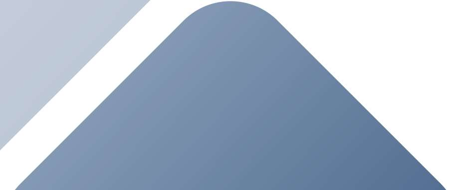
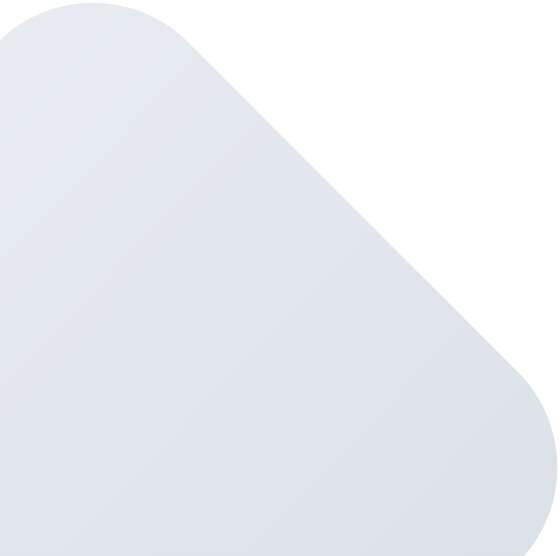
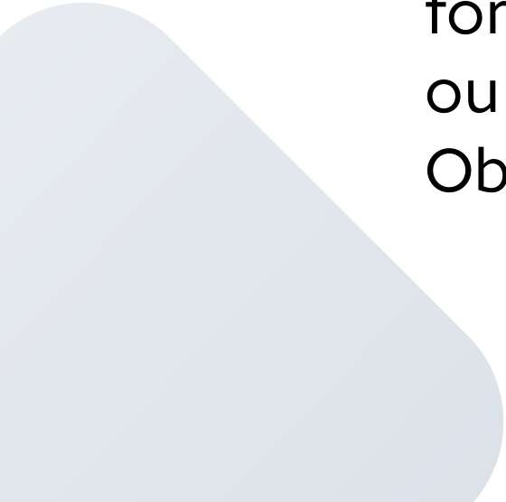
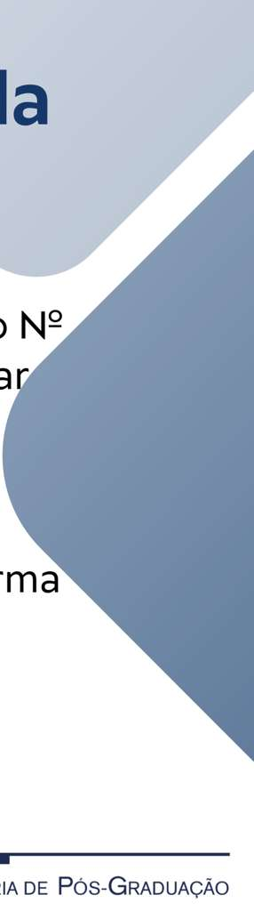
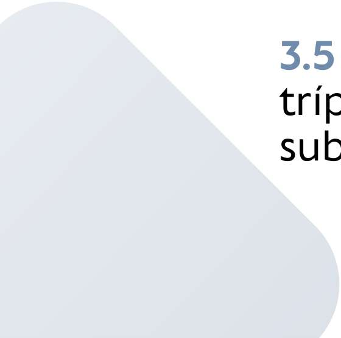
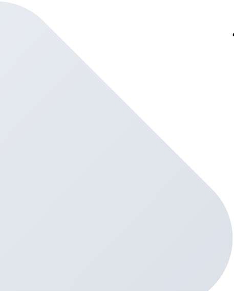
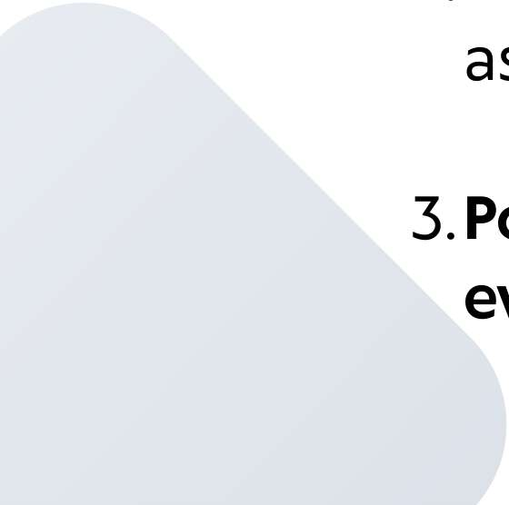
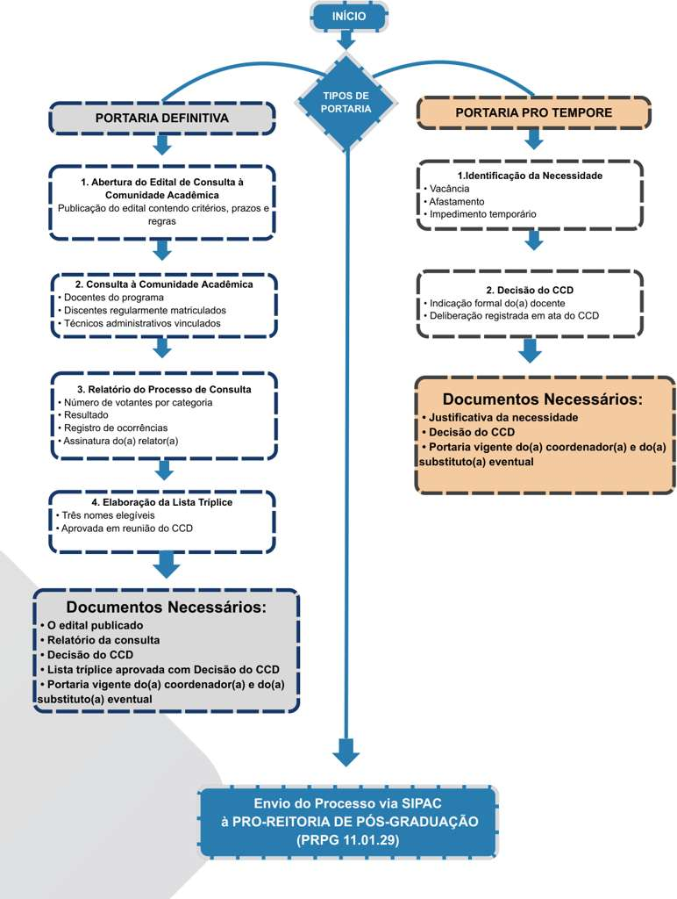

<!-- page 1 -->

# **Manual para Solicitação de Portarias de Coordenação de Curso** 

<!-- figure p01-fig1 | described_by: agy | ocr_overlap: None | needs_review: false -->
1. **Type of figure:** A purely decorative, abstract geometric graphic (likely a cropped header, footer, or page-layout accent extracted from a PDF) with no informational content, chart, or diagram.

2. **Visible text:** None. There are no titles, labels, legends, captions, axis ticks, or cell values in the image.

3. **Structure:** There are no boxes, arrows, connections, axes, rows, columns, or panels. The image consists solely of two large geometric shapes against a plain white background:
   - In the upper-left corner, a cropped right-triangular region bounded by the top and left edges of the image and a straight diagonal edge sloping upward from the lower-left edge to the upper-left-center of the top edge.
   - Across the center and bottom, a large rounded-apex triangular shape (resembling the top corner of a rotated rounded rectangle or chevron) whose curved peak nearly touches the top-center edge and whose two straight diagonal sides descend to the bottom edge near the bottom-left and bottom-right corners. A uniform diagonal white strip separates the upper-left shape from the left side of the larger central shape, while the upper-right area of the image is plain white.

4. **Numbers and data values:** None.

5. **Colours:** Colours do not carry any semantic, categorical, or data meaning; the two shapes use purely decorative tones (pale blue-grey on the upper-left shape and darker slate blue-grey on the lower-center shape, each with a subtle gradient) over a white background.

<!-- figure p01-fig2 | described_by: agy | ocr_overlap: 0.67 | needs_review: false -->
1. **Tipo de figura:** Logotipo institucional (marca tipográfica) da Pró-Reitoria de Pós-Graduação (PRPG).

2. **Todo o texto visível (verbatim):**
   - Linha superior: `PRPG`
   - Linha inferior (em estilo versalete, com iniciais maiores em `P`, `R`, `P` e `G`, e leve espaço após o primeiro hífen): `PRÓ- REITORIA DE PÓS-GRADUAÇÃO` (equivalente a `Pró- Reitoria de Pós-Graduação` em versalete)

3. **Estrutura:**
   - Composição monocromática sobre fundo branco, organizada verticalmente em três elementos empilhados e alinhados à esquerda:
     - **Topo (à esquerda):** a sigla `PRPG` em fonte sem serifa grande e negrito.
     - **Meio:** um elemento divisor horizontal que percorre toda a largura do texto inferior. Ele começa à esquerda como uma barra retangular grossa (estendendo-se sob `PRPG` e avançando um pouco além da letra `G`) e continua à direita como uma linha horizontal fina alinhada à borda superior da barra grossa.
     - **Base:** a denominação `PRÓ- REITORIA DE PÓS-GRADUAÇÃO` em fonte sem serifa fina, ocupando toda a largura abaixo da linha divisória.
   - Não há caixas, setas, eixos, tabelas ou múltiplos painéis.

4. **Números ou valores de dados:** Não há números ou valores de dados na imagem.

5. **Cores com significado:** Nenhuma cor carrega significado informativo ou codificação de dados; toda a tipografia e a barra horizontal aparecem uniformemente em azul-marinho escuro sobre fundo branco apenas por identidade visual.

~~~text ocr
PRPG
PRO- REITORIA DE POS-GRADUACAO
~~~

<!-- page 2 -->

#### **Elaboração:** Maria Isabel de Moraes Gomes Maria Laura C. Vila Nova de Lima 

**Supervisão:** 

Prof. Rinaldo Aparecido Mota Pró-Reitor de Pós-Graduação 

Dados Internacionais de Catalogação na Publicação (CIP) Sistema Integrado de Bibliotecas da UFRPE Bibliotecária Suely Manzi – CRB/4 809 

G633m Gomes, Maria Isabel de Moraes Manual para solicitação de portarias de coordenação de curso / Maria Isabel de Moraes Gomes, Maria Laura C. Vila Nova de Lima. – 1. ed. - Recife: UFRPE, Pró-Reitoria de Pós-Graduação, 2026. 10 p. : il. 

Disponível online. 

1. Universidades e faculdades públicas 2. Universidades e faculdades - Administração 3. Universidades e faculdades pós-graduação 4. Coordenação do Programa 5. Documentos oficiais – Recife (PE) I. Lima, Maria Laura C. Vila Nova de II. Título 

CDD 378 

<!-- page 3 -->

## **Sumário** 

**1. Introdução 2. Tipos de Portaria 2.1 - Portaria Definitiva 2.2 - Portaria Pro Tempore 3. Processo de Consulta para Escolha da Coordenação 3.1 - Publicação do Edital 3.2 - Consulta à Comunidade Acadêmica 3.3 - Relatoria do Processo de Consulta 3.4 - Aprovação pelo CCD 3.5 - Composição da Lista Tríplice 4. Solicitação de Portaria 4.1 - Coordenador(a) e Substituto(a) eventual 4.2 - Coordenador(a) Pro tempore** 

<!-- figure p03-fig1 | described_by: agy | ocr_overlap: None | needs_review: false -->
1. **Kind of figure:** A purely decorative background graphic (a cropped geometric shape with no data, diagram, or informational content, likely a page-layout or corner accent extracted from a PDF).

2. **Visible text:** None. There are no titles, labels, legends, captions, axis ticks, or cell values anywhere in the image.

3. **Structure:** The image consists of a single large rounded rectangle rotated approximately 45 degrees (oriented diagonally from upper-left to lower-right) set against a plain white background. The shape extends beyond and is cropped by the left edge and bottom edge of the image frame, leaving visible only its rounded upper corner near the top-left, its straight diagonal upper-right edge, its rounded rightmost corner near the lower-right, and a short segment of its straight lower-right edge meeting the bottom border. There are no boxes, arrows, connections, axes, rows, columns, or panels.

4. **Numbers or data values:** None.

5. **Colours:** None of the colours carry informational or semantic meaning; the shape is rendered in a very faint, smooth pale blue-grey tone on a plain white background purely for visual decoration.

**5. Fluxograma** 

<!-- page 4 -->

## **1. Introdução** 

Este manual apresenta os procedimentos e os documentos necessários para a solicitação de portarias de coordenação de curso dos Programas de Pós-Graduação da Universidade Federal Rural de Pernambuco. 

<!-- figure p04-fig1 | described_by: agy | ocr_overlap: None | needs_review: false -->
1. **Type of figure:** A purely decorative abstract graphic (likely a background design element extracted from a PDF layout); it is not a chart, diagram, table, or informational illustration.

2. **Visible text:** None. There are no titles, labels, legends, captions, axis ticks, or cell values anywhere in the image.

3. **Structure:** The image consists of a single cropped geometric shape on a solid white, nearly square background. The shape is a large, diagonally oriented rounded rectangle (or pill-like form) angled at roughly 45 degrees from the upper-left toward the lower-right. It fills most of the lower-left and central area of the frame, extending beyond the left and bottom edges, with one rounded corner near the top-left, a straight diagonal edge sloping downward to the right, and a second rounded corner near the bottom-right. The upper-right triangular portion of the frame is blank white. There are no boxes, arrows, connections, axes, rows, columns, or panels.

4. **Numbers or data values:** None.

5. **Meaningful colours:** None; colour does not encode any data or meaning. The shape is rendered in a very faint, smooth light blue-gray gradient against a plain white background purely for decorative styling.

<!-- page 5 -->

## **2. Tipos de Portaria** 

**2.1 - Portaria Definitiva** 

Utilizada para **nomeação oficial do(a) coordenador(a) e do(a) substituto(a) eventual** do programa, com duração de dois anos. **2.2 - Portaria Pro Tempore** 

Utilizada quando é necessário nomear um(a) coordenador(a) de forma temporária, geralmente devido à vacância, afastamento ou até à realização de eleição. Obs.: **Não há Portaria Pro Tempore para Substituto Eventual** 

<!-- figure p05-fig1 | described_by: agy | ocr_overlap: None | needs_review: false -->
1. **Tipo de figura:** Fragmento recortado de uma página de documento contendo apenas um elemento gráfico decorativo de fundo (uma forma geométrica arredondada em diagonal) e o início de três linhas de texto no canto superior direito, cortadas pelas margens da imagem. Não se trata de um gráfico de dados, diagrama completo ou tabela.

2. **Texto visível (verbatim):**
   Todas as linhas estão localizadas no canto superior direito, em fonte preta sem serifa, alinhadas à esquerda e truncadas pelo recorte da imagem:
   - Linha 1 (cortada na borda superior e na borda direita): `for` (o topo do `f` está cortado pela margem superior e o terceiro caractere é interrompido exatamente na margem direita, apresentando haste vertical e curva superior à direita compatíveis com `r` ou o início de `n`/`m`; o restante está fora da imagem `[illegible]`).
   - Linha 2: `ou` (seguido de um espaço em branco até a margem direita; o restante da linha está fora da imagem).
   - Linha 3 (cortada na borda direita): `Ob` (com o contorno direito do `b` encostado/cortado na margem direita; o restante está fora da imagem `[illegible]`).

   Não há títulos completos, legendas, rótulos, notas de rodapé, marcas de eixo ou valores de células visíveis.

3. **Estrutura:**
   - O fundo da imagem é branco sólido em formato aproximadamente quadrado.
   - Ocupando a maior parte da região inferior esquerda até a borda inferior direita há uma única forma geométrica sólida com cantos amplamente arredondados e borda reta inclinada na diagonal (descendo do canto superior esquerdo rumo ao canto inferior direito), cortada pelas margens esquerda e inferior — com aparência de parte de um quadrado ou retângulo de cantos arredondados rotacionado.
   - No espaço branco do quadrante superior direito, fora da forma diagonal, dispõem-se verticalmente e com espaçamento uniforme as três linhas horizontais de texto parcial, alinhadas à esquerda entre si.
   - Não há caixas, setas, conexões, eixos, linhas/colunas ou múltiplos painéis.

4. **Números ou valores de dados:** Não há nenhum número ou valor quantitativo na imagem.

5. **Cores com significado:** Nenhuma cor transmite significado informacional ou codificação de dados (há apenas cinza-azulado claro decorativo na forma de fundo, texto em preto e fundo em branco).

<!-- Start of picture text -->
Obs.: <!-- End of picture text -->

<!-- page 6 -->

<!-- figure p06-fig1 | described_by: agy | ocr_overlap: None | needs_review: false -->
1. **Tipo de figura:** Trata-se de um recorte vertical estreito da margem direita de uma página de documento institucional em português (aparentemente capa ou folha de rosto), contendo formas geométricas decorativas, fragmentos de texto cortados na borda esquerda e parte do rodapé. Não é um gráfico, tabela ou diagrama.

2. **Todo o texto visível (verbatim):** Todo o texto está cortado na borda esquerda da imagem. De cima para baixo, lê-se:
   - Topo esquerdo (fonte grande, sem serifa, em negrito): `[ilegível]a` (visível apenas uma haste vertical rente à borda esquerda seguida pela letra `a`).
   - Parte centro-superior esquerda (fonte média, sem serifa, regular), em duas linhas:
     - Linha 1: `[ilegível] Nº` (visível apenas a curva direita de uma letra minúscula arredondada na borda esquerda, seguida de espaço e `Nº`, com o símbolo ordinal sublinhado).
     - Linha 2: `ar` (com a borda esquerda da letra `a` levemente cortada e a extremidade direita do `r` encostando na forma geométrica à direita).
   - Parte centro-inferior esquerda (fonte média, sem serifa, regular): `rma` (com o lado esquerdo da letra `r` levemente cortado na borda esquerda).
   - Rodapé inferior (fonte sem serifa em versalete, com `P` e `G` maiores): `RIA DE PÓS-GRADUAÇÃO` (com a parte esquerda da letra `R` inicial cortada na borda esquerda).

3. **Estrutura:** A imagem consiste em um único recorte vertical estreito sobre fundo branco, sem painéis, caixas conectadas, setas, eixos, linhas ou colunas. Sua organização espacial é composta por:
   - **Forma geométrica superior:** Uma grande área sólida ocupa o topo da imagem (estendendo-se além das bordas superior, esquerda e direita), com um canto inferior arredondado à esquerda e uma borda reta inclinada diagonalmente para cima e para a direita. O fragmento de texto `[ilegível]a` está posicionado sobre essa forma, próximo à borda esquerda.
   - **Faixa diagonal branca:** Uma faixa branca diagonal de espessura uniforme separa a forma superior da forma central, subindo da esquerda para a direita.
   - **Forma geométrica central/direita:** Uma grande forma sólida entra por toda a porção média da borda direita, formando um grande canto arredondado voltado para a esquerda próximo ao meio vertical da imagem, com a aresta superior inclinada para cima-direita (paralela à forma superior) e a aresta inferior inclinada para baixo-direita.
   - **Blocos de texto intermediários:** Sobre a área branca acima do canto arredondado da forma central encontram-se as duas linhas `[ilegível] Nº` e `ar`; sobre a área branca abaixo do canto arredondado encontra-se `rma`.
   - **Rodapé:** Próximo à parte inferior há uma linha horizontal fina que vai da borda esquerda até quase a margem direita (alinhada ao fim do texto abaixo), acompanhada em seu trecho inicial à esquerda por um pequeno segmento retangular mais espesso logo abaixo da linha. Abaixo dessa linha divisória encontra-se o texto `RIA DE PÓS-GRADUAÇÃO`.

4. **Números ou valores de dados:** Não há nenhum número ou valor de dado visível na imagem (há apenas a abreviação `Nº`, sem valor numérico visível no recorte).

5. **Cores com significado:** Nenhuma cor carrega significado quantitativo ou categórico de dados; as cores presentes (tons de azul-acinzentado claro e médio nas formas geométricas, azul-escuro no título superior e no rodapé, preto no texto intermediário e branco no fundo) têm função exclusivamente estética e de hierarquia visual/identidade institucional.

~~~text ocr
IA DE POS-GRADUACAO
~~~

## **3. Processo de Consulta para Escolha da Coordenação** 

A Coordenação do Programa deverá abrir processo específico para conduzir a consulta à comunidade acadêmica, seguindo a Resolução Nº 294/2008 do Conselho Universitário. Nesse processo deverão constar as etapas necessárias para a realização do pleito: 

**3.1 - Publicação do Edital** - O Programa de Pós-Graduação deve abrir edital contendo os prazos de inscrição, critérios de elegibilidade, forma de votação e de apuração. 

**3.2 - Consulta à Comunidade Acadêmica** - Participam: Professores do programa; Alunos regularmente matriculados; Técnicos Administrativos vinculados. 

<!-- page 7 -->

**3.3 - Relatoria do Processo de Consulta** - O resultado da consulta deverá ser relatado por um(a) professor(a) formalmente designado(a). O relatório deve apresentar o número de votantes por categoria, o resultado final da votação e os registros de eventuais ocorrências **3.4 - Aprovação pelo CCD** - O relatório deverá ser submetido ao Colegiado de Coordenação Didática (CCD) do programa, que deve registrar em ata a deliberação e a aprovação do resultado, bem como emitir a decisão. 

<!-- figure p07-fig1 | described_by: agy | ocr_overlap: None | needs_review: false -->
1. **Tipo de figura:** Fragmento recortado de un encabezado de sección o elemento gráfico decorativo extraído de un documento PDF (no corresponde a un gráfico de datos, tabla ni diagrama).

2. **Texto visible (textual):**
   En la zona superior derecha aparecen tres líneas de texto en tipografía sin serifa, alineadas a la izquierda; las líneas segunda y tercera quedan cortadas por el borde derecho de la imagen:
   - Línea 1: `3.5`
   - Línea 2: `tríp` (el extremo derecho de la letra `p` queda ligeramente recortado por el borde derecho de la imagen; el resto de la palabra no es visible)
   - Línea 3: `sub` (el extremo derecho de la letra `b` queda ligeramente recortado por el borde derecho de la imagen; el resto de la palabra no es visible)

   No se muestran leyendas, pies de figura, marcas de ejes ni celdas.

3. **Estructura:**
   No hay cuadros, flechas, conexiones, ejes, filas, columnas ni paneles.
   - Sobre un fondo blanco liso, la parte izquierda e inferior izquierda de la imagen está ocupada por una gran forma geométrica decorativa de contorno redondeado (similar a una cápsula o rectángulo de esquinas muy redondeadas) inclinada en diagonal de arriba a la izquierda hacia abajo a la derecha (aproximadamente a 45°). La forma se extiende fuera de los bordes izquierdo e inferior de la imagen, mientras que su extremo redondeado superior, su borde recto diagonal y su curva redondeada inferior derecha quedan visibles dentro del encuadre.
   - En el espacio blanco del cuadrante superior derecho, a la derecha del borde diagonal de dicha forma, se ubica un único bloque de texto compuesto por las tres líneas apiladas verticalmente y alineadas por su margen izquierdo (`3.5`, `tríp` y `sub`). El bloque está recortado horizontalmente por el borde derecho de la figura.

4. **Números o valores de datos:**
   - `3.5` (único valor numérico presente; funciona visualmente como numeración de sección o apartado y no como dato cuantitativo).

5. **Colores con significado:**
   - El número `3.5` aparece en azul grisáceo y en negrita, lo que lo diferencia jerárquicamente del texto `tríp` y `sub`, que está en negro y peso regular.
   - El tono azul grisáceo muy claro de la gran forma diagonal sobre el fondo blanco es meramente decorativo y no codifica información.

~~~text ocr
sub
~~~

**3.5 - Composição da Lista Tríplice -** Deve ser elaborada uma lista tríplice contendo três nomes elegíveis, para coordenador(a) e substituto(a) eventual, aprovada em reunião do CCD. 

<!-- page 8 -->

<!-- figure p08-fig1 | described_by: agy | ocr_overlap: None | needs_review: false -->
1. **Type of figure:** A cropped decorative graphic fragment (likely part of a PDF cover, header, or page background design) consisting of geometric shapes and a clipped piece of text; it is not a chart, diagram, or table.

2. **Visible text (verbatim):**
   - Bottom-left corner (cropped along the bottom edge and adjacent to the left edge): `ual` (lowercase sans-serif characters; the lower portions of the letters are cut off by the bottom border of the image, and any preceding characters, if present, lie outside the left edge).
   - No titles, labels, legends, captions, axis ticks, or cell values are present.

3. **Structure:**
   - Single-panel image on a plain white background, with no boxes, arrows, connectors, axes, rows, or columns.
   - **Main shape:** A large rotated shape (resembling a square/diamond with wide rounded corners rotated approximately 45 degrees) occupies most of the upper and central area. Its rounded left corner meets the upper-left area near the left border, its rounded bottom corner sits just above the bottom edge slightly right of center, and its upper and right edges extend beyond the top and right borders of the image.
   - **Bottom-right shape:** A small straight-edged triangular corner extends into the extreme bottom-right of the frame, parallel to the lower-right edge of the main shape, separated from it by a diagonal band of white background.
   - **Bottom-left text:** The clipped letters `ual` sit in the white area at the extreme bottom-left, cut off horizontally by the bottom edge of the image.

4. **Numbers and data values:** None.

5. **Meaningful colours:** None; colours are purely decorative and do not convey data or semantic distinctions (a light muted blue-grey for the main rotated shape and a darker muted blue-grey for both the bottom-right corner shape and the clipped text, on a white background).

**4. Solicitação de Portaria 4.1 - Coordenador(a) e Substituto(a) eventual** 

O processo aberto para a eleição deverá ser enviado, via SIPAC, à PRO-REITORIA DE PÓS-GRADUAÇÃO-PRPG ( **11.01.29** ), contendo: 

1.O Edital de eleição publicado; 

2.Relatório da consulta, assinado pelo(a) relator(a); 

3. **Decisão** de aprovação em reunião do CCD; 

<!-- figure p08-fig2 | described_by: agy | ocr_overlap: None | needs_review: false -->
1. **Type of figure:** A decorative background graphic / cropped page-layout element extracted from a PDF, rather than an informational chart, diagram, or table.

2. **Visible text:** There is no legible text in the image (no titles, labels, legends, captions, axis ticks, or cell values). At the far right border near the upper-right area, a tiny fragment of a black glyph is clipped off by the edge of the crop: `[illegible]`.

3. **Structure:** There are no boxes, arrows, axes, rows, columns, or panels. The image consists solely of a single large, solid, rounded geometric shape (resembling a tilted rounded rectangle or corner lobe) extending diagonally from the upper-left edge toward the lower-right edge, occupying roughly the lower-left two-thirds of the frame against a plain white background, plus the severely clipped black fragment at the upper-right border.

4. **Numbers and data values:** None.

5. **Meaningful colours:** None; the light blue-grey fill of the geometric shape and the white background are purely decorative and carry no data or categorical meaning.

4. **Lista tríplice** acompanhada da decisão, aprovada em reunião do CCD; 5. **Portaria Portaria vigente do(a) coordenador(a) e do(a) substituto(a) eventual.** 

<!-- figure p08-fig3 | described_by: agy | ocr_overlap: 0.67 | needs_review: false -->
1. **Tipo de figura:** Logotipo institucional (marca tipográfica).
2. **Texto visível (verbatim):**
   - Linha superior: `PRPG`
   - Linha inferior: `PRÓ-REITORIA DE PÓS-GRADUAÇÃO` (em versalete, com as iniciais `P`, `R`, `P` e `G` em tamanho maior, correspondendo a `Pró-Reitoria de Pós-Graduação`).
3. **Estrutura:** Composição horizontal simples alinhada à esquerda, sem caixas, setas, eixos, tabelas ou painéis. Na parte superior esquerda aparece a sigla `PRPG` em negrito e fonte sem serifa. Logo abaixo, uma barra horizontal contínua percorre toda a largura do logotipo: ela começa como uma faixa retangular espessa sob `PRPG` (avançando ligeiramente além do `G`) e, a partir daí, continua à direita apenas como um traço fino alinhado à borda superior da faixa espessa até o final do texto inferior. Abaixo da barra, em uma única linha com fonte sem serifa mais fina, figura o nome completo por extenso `PRÓ-REITORIA DE PÓS-GRADUAÇÃO`, definindo a largura total da imagem.
4. **Números ou valores de dados:** Não há números nem valores de dados na imagem.
5. **Cores:** As cores não carregam significado informacional ou categórico; toda a marca é monocromática (azul-marinho escuro sobre fundo branco) apenas para fins de identidade visual.

~~~text ocr
PRPG
Pró- REITORIA DE POS-GRADUACAO
~~~

<!-- page 9 -->

**4. Solicitação de Portaria 4.2 - Coordenador(a) Pro Tempore** O processo enviado, via SIPAC, à PRO-REITORIA DE PÓS-GRADUAÇÃO - PRPG ( **11.01.29** ), deverá conter: 

1. **Justificativa** da necessidade; 

2. **Decisão** do CCD contendo a indicação formal do(a) docente para assumir temporariamente a coordenação; 

<!-- figure p09-fig1 | described_by: agy | ocr_overlap: None | needs_review: false -->
1. **Type of figure:** A cropped decorative background graphic from a PDF page, capturing part of a large rounded geometric shape alongside clipped fragments of adjacent numbered-list text along the right edge. It is not a chart, diagram, or data visualization.

2. **Visible text (verbatim):**
   - Very top-right edge (only the bottom tip of a clipped character is visible): `[illegible]`
   - Upper right (regular sans-serif): `as` (the right edge of `s` is slightly clipped by the image border)
   - Middle right: `3.` (regular sans-serif) followed by `P[illegible]` (bold sans-serif; only the left curved portion of the letter following `P` is visible before the right border)
   - Below `P[illegible]` (aligned with `P`, bold sans-serif): `e[illegible]` (only the left downward-sloping diagonal stroke of the character following `e` is visible before the right border)
   - There are no titles, labels, legends, captions, axis ticks, or cell values.

3. **Structure:**
   - A single large, solid, rounded geometric shape fills most of the left and lower portions of the frame, extending past the left and bottom borders. Its exposed edge runs diagonally downward from a rounded corner near the top-left to a rounded corner near the bottom-right.
   - The upper-right area is a plain white background containing the left margin of a vertically stacked text block, with a gap between the upper line (`as`) and the numbered list entry (`3. P[illegible]` / `e[illegible]`).
   - There are no boxes, arrows, connections, axes, rows, columns, or panels.

4. **Numbers and data values:**
   - `3.` (a list item number). No other numbers or data values appear.

5. **Meaningful colours:**
   - None. The pale grey-blue shape is purely decorative, and the text is black on a white background.

~~~text ocr
as
3.
~~~

<!-- Start of picture text -->
3. <!-- End of picture text -->

3. **Portaria vigente do(a) coordenador(a) e do(a) substituto(a) eventual.** 

<!-- page 10 -->

### **5. Fluxograma** 

<!-- figure p10-fig1 | described_by: agy | ocr_overlap: 0.97 | needs_review: false -->
### 1. Tipo de figura
Fluxograma vertical de processo administrativo com dois ramos paralelos a partir de um nó de decisão central.

### 2. Todo o texto visível (literal)

**Nó inicial (topo):**
- `INÍCIO`

**Nó de decisão central:**
- `TIPOS DE PORTARIA`

**Ramo esquerdo — Portaria Definitiva:**
- Caixa de título: `PORTARIA DEFINITIVA`
- Caixa da etapa 1:
  - `1. Abertura do Edital de Consulta à Comunidade Acadêmica`
  - `Publicação do edital contendo critérios, prazos e regras`
- Caixa da etapa 2:
  - `2. Consulta à Comunidade Acadêmica`
  - `• Docentes do programa`
  - `• Discentes regularmente matriculados`
  - `• Técnicos administrativos vinculados`
- Caixa da etapa 3:
  - `3. Relatório do Processo de Consulta`
  - `• Número de votantes por categoria`
  - `• Resultado`
  - `• Registro de ocorrências`
  - `• Assinatura do(a) relator(a)`
- Caixa da etapa 4:
  - `4. Elaboração da Lista Tríplice`
  - `• Três nomes elegíveis`
  - `• Aprovada em reunião do CCD`
- Caixa final do ramo esquerdo:
  - `Documentos Necessários:`
  - `• O edital publicado`
  - `• Relatório da consulta`
  - `• Decisão do CCD`
  - `• Lista tríplice aprovada com Decisão do CCD`
  - `• Portaria vigente do(a) coordenador(a) e do(a) substituto(a) eventual`

**Ramo direito — Portaria Pro Tempore:**
- Caixa de título: `PORTARIA PRO TEMPORE`
- Caixa da etapa 1:
  - `1.Identificação da Necessidade`
  - `• Vacância`
  - `• Afastamento`
  - `• Impedimento temporário`
- Caixa da etapa 2:
  - `2. Decisão do CCD`
  - `• Indicação formal do(a) docente`
  - `• Deliberação registrada em ata do CCD`
- Caixa final do ramo direito:
  - `Documentos Necessários:`
  - `• Justificativa da necessidade`
  - `• Decisão do CCD`
  - `• Portaria vigente do(a) coordenador(a) e do(a) substituto(a) eventual`

**Caixa final (base):**
- `Envio do Processo via SIPAC`
- `à PRO-REITORIA DE PÓS-GRADUAÇÃO`
- `(PRPG 11.01.29)`

### 3. Estrutura e conexões
O fluxograma é organizado de cima para baixo, simetricamente em torno de um eixo vertical central, composto por caixas retangulares de cantos arredondados com bordas tracejadas e um losango de decisão também com borda tracejada:

- **Tronco inicial e ramificação:**
  - A caixa `INÍCIO` (centralizada no topo) conecta-se por uma seta curta voltada para baixo ao vértice superior do losango `TIPOS DE PORTARIA`.
  - Da lateral superior esquerda do losango `TIPOS DE PORTARIA`, parte uma linha curva em arco (sem ponta de seta) até o topo da caixa `PORTARIA DEFINITIVA`, iniciando a coluna esquerda.
  - Da lateral superior direita do losango `TIPOS DE PORTARIA`, parte uma linha curva em arco (sem ponta de seta) até o topo da caixa `PORTARIA PRO TEMPORE`, iniciando a coluna direita.
  - Do vértice inferior do losango `TIPOS DE PORTARIA`, desce uma longa linha vertical reta pelo centro da imagem (separando visualmente as duas colunas) que termina em uma seta voltada para baixo apontando para o topo central da caixa final `Envio do Processo via SIPAC à PRO-REITORIA DE PÓS-GRADUAÇÃO (PRPG 11.01.29)`.

- **Coluna esquerda (`PORTARIA DEFINITIVA`) — sequência vertical linear de 6 caixas ligadas por setas apontando para baixo:**
  1. `PORTARIA DEFINITIVA` →
  2. `1. Abertura do Edital de Consulta à Comunidade Acadêmica` →
  3. `2. Consulta à Comunidade Acadêmica` →
  4. `3. Relatório do Processo de Consulta` →
  5. `4. Elaboração da Lista Tríplice` →
  6. `Documentos Necessários:` (sem seta saindo de sua base).

- **Coluna direita (`PORTARIA PRO TEMPORE`) — sequência vertical linear de 4 caixas ligadas por setas apontando para baixo:**
  1. `PORTARIA PRO TEMPORE` →
  2. `1.Identificação da Necessidade` →
  3. `2. Decisão do CCD` →
  4. `Documentos Necessários:` (sem seta saindo de sua base).

- **Base:**
  - Centralizada na parte inferior está a caixa `Envio do Processo via SIPAC à PRO-REITORIA DE PÓS-GRADUAÇÃO (PRPG 11.01.29)`, recebendo a seta vertical central originada no losango `TIPOS DE PORTARIA`.
  - Não há eixos, tabelas, legendas ou painéis separados.

### 4. Números e valores de dados
- Numeração sequencial das etapas da coluna esquerda (`PORTARIA DEFINITIVA`): `1`, `2`, `3`, `4`.
- Quantidade descrita por extenso na etapa 4 da coluna esquerda: `Três` (em `Três nomes elegíveis`).
- Numeração sequencial das etapas da coluna direita (`PORTARIA PRO TEMPORE`): `1`, `2`.
- Código identificador da unidade destinatária na caixa final: `11.01.29` (em `PRPG 11.01.29`).

### 5. Cores com significado
- **Azul médio (preenchimento sólido, texto branco, borda tracejada cinza-claro):** distingue o fluxo principal comum aos dois procedimentos — início (`INÍCIO`), decisão (`TIPOS DE PORTARIA`) e encaminhamento final (`Envio do Processo via SIPAC à PRO-REITORIA DE PÓS-GRADUAÇÃO (PRPG 11.01.29)`), bem como todas as setas e linhas conectoras.
- **Azul-marinho (bordas tracejadas) com preenchimento cinza-claro ou branco:** agrupa todo o ramo `PORTARIA DEFINITIVA`; o preenchimento **cinza-claro** diferencia o cabeçalho (`PORTARIA DEFINITIVA`) e a lista de `Documentos Necessários:`, enquanto o preenchimento **branco** identifica as etapas procedimentais intermediárias (1 a 4).
- **Cinza-escuro/grafite (bordas tracejadas) com preenchimento laranja-claro (pêssego) ou branco:** agrupa todo o ramo `PORTARIA PRO TEMPORE`, diferenciando-o visualmente do ramo definitivo; o preenchimento **laranja-claro** destaca o cabeçalho (`PORTARIA PRO TEMPORE`) e a lista de `Documentos Necessários:`, enquanto o preenchimento **branco** identifica as etapas procedimentais intermediárias (1 e 2).

~~~text ocr
TIPOS DE
4 PORTARIA
| PORTARIA DEFINITIVA J
abertura do
1. Abertura do Edital de Consulta à
Comunidade Acadêmica |
Publicação do edital contendo critérios, prazos e
| regras |
2. Consulta à Comunidade Acadêmica
* Docentes do programa
* Discentes regularmente matriculados
* Técnicos administrativos vinculados J
Relatório do Processo de
|
3. Relatório do Processo de Consulta
* Número de votantes por categoria
* Resultado
* Registro de ocorrências
Assinatura do(a) relator(a)
4. Elaboração da Lista Tríplice
| + Três nomes elegíveis |
* Aprovada em reunião do CCD
| Documentos Necessarios:
J
* O edital publicado |
* Relatório da consulta
* Decisão do CCD |
| ¢ Lista tríplice aprovada com Decisão do CCD
| ¢ Portaria vigente do(a) coordenador(a) e do(a)
eventual
E
| 1.Identificação da Necessidade
* Vacância
* Afastamento
* Impedimento temporário J
| 2. Decisão do CCD
| + Indicação formal do(a) docente |
* Deliberação registrada em ata do CCD
Envio do Processo via SIPAC
a PRO-REITORIA DE POS-GRADUAGAO
(PRPG 11.01.29)
~~~

<!-- Start of picture text -->
INÍCIO TIPOS DE PORTARIA PORTARIA PRO TEMPORE PORTARIA DEFINITIVA 1.Identificação da Necessidade 1. Abertura do Edital de Consulta à • Vacância Comunidade Acadêmica  • Afastamento  Publicação do edital contendo critérios, prazos e  • Impedimento temporário regras 2. Consulta à Comunidade Acadêmica 2. Decisão do CCD  • Docentes do programa  • Indicação formal do(a) docente  • Discentes regularmente matriculados  • Deliberação registrada em ata do CCD  • Técnicos administrativos vinculados 3. Relatório do Processo de Consulta • Número de votantes por categoria Documentos Necessários:  • Resultado  • Justificativa da necessidade  • Registro de ocorrências  • Decisão do CCD  • Assinatura do(a) relator(a)  • Portaria vigente do(a) coordenador(a) e do(a) substituto(a) eventual 4. Elaboração da Lista Tríplice  • Três nomes elegíveis  • Aprovada em reunião do CCD Documentos Necessários:  • O edital publicado  • Relatório da consulta  • Decisão do CCD  • Lista tríplice aprovada com Decisão do CCD  • Portaria vigente do(a) coordenador(a) e do(a) substituto(a) eventual Envio do Processo via SIPAC  à PRO-REITORIA DE PÓS-GRADUAÇÃO (PRPG 11.01.29) <!-- End of picture text -->

<!-- page 11 -->

http://www.prppg.ufrpe.br/pt-br E-mail: sec.prpg@ufrpe.br Whatsapp Business: (81) 3320-6050
