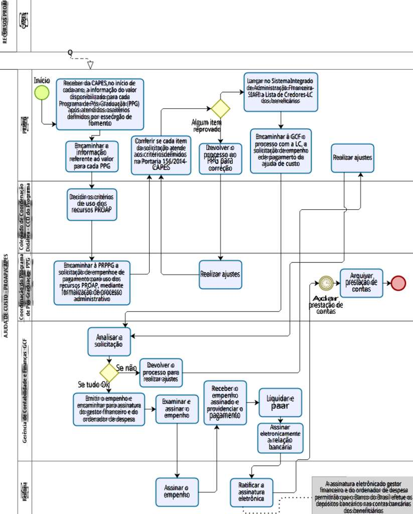

<!-- page 1 -->

# **ANEXO III – MAPEAMENTO DO PROCESSO: AJUDA DE CUSTO – PROAP/CAPES** 

<!-- figure p01-fig1 | described_by: agy | ocr_overlap: 0.71 | needs_review: false -->
**(1) Tipo de figura**

Fluxograma de processo em notação BPMN (*Business Process Model and Notation*), estruturado em duas piscinas horizontais (*pools*) divididas em raias funcionais (*swimlanes*), representando o fluxo administrativo e financeiro de concessão, pagamento e prestação de contas de ajuda de custo com recursos PROAP/CAPES. A imagem apresenta compressão horizontal e um artefato visual de sobreposição/duplicação de texto em quase todos os rótulos.

---

**(2) Todo o texto visível (transcrição literal)**

*Nota: onde a sobreposição tipográfica altera espaçamentos ou letras, transcreve-se exatamente o que aparece visível.*

**Piscina superior (cabeçalhos verticais à esquerda, lidos de baixo para cima):**
- Título da piscina: `RECURSOS PROAP`
- Raia: `CAPES`
- Sobre a origem da seta tracejada na borda inferior desta piscina aparece um símbolo circular com pequeno traço inferior semelhante a `Q` (correspondente ao círculo inicial de um fluxo de mensagem BPMN com artefato gráfico).

**Piscina inferior (cabeçalhos verticais à esquerda, lidos de baixo para cima):**
- Título da piscina: `AJUDA DE CUSTO - PROAP/CAPES`
- Raia 1: `PRPPG`
- Raia 2: `Colegiado de Coordenação Didática - CCD do Programa`
- Raia 3: `Coordenação do Programa de Pós-Graduação - PPG`
- Raia 4: `Gerência de Contabilidade e Finanças - GCF`
- Raia 5: `Reitoria`

**Textos dentro da raia `PRPPG`:**
- Rótulo acima do evento de início: `Início`
- Caixa 1: `Receber da CAPES, no início de cada ano, a informação do valor disponibilizado para cada Programa de Pós-Graduação (PPG) após atendidos os critérios definidos por esse órgão de fomento`
- Caixa 2: `Encaminhar a informação referente ao valor para cada PPG`
- Caixa 3: `Conferir se cada item da solicitação atende aos critérios definidos na Portaria 156/2014-CAPES`
- Rótulo junto à saída inferior do losango de decisão: `Algum item reprovado`
- Caixa 4: `Devolver o processo ao PPG para correção`
- Caixa 5: `Lançar no Sistema Integrado de Administração Financeira-SIAFI a Lista de Credores-LC dos beneficiários`
- Caixa 6: `Encaminhar à GCF o processo com a LC, a solicitação de empenho e de pagamento da ajuda de custo`
- Caixa 7 (extrema direita): `Realizar ajustes`

**Textos dentro da raia `Colegiado de Coordenação Didática - CCD do Programa`:**
- Caixa: `Decidir os critérios de uso dos recursos PROAP`

**Textos dentro da raia `Coordenação do Programa de Pós-Graduação - PPG`:**
- Caixa 1 (à esquerda): `Encaminhar à PRPPG a solicitação de empenho e de pagamento para uso dos recursos PROAP, mediante formalização de processo administrativo`
- Caixa 2 (ao centro): `Realizar ajustes`
- Rótulo abaixo do evento de relógio (à direita): primeira palavra com sobreposição corrompida sobre a camada de fundo — na camada de fundo lê-se `Aguardar`, sobreposta por caracteres espessos `[illegible]` (com aspecto semelhante a `Adar`) — seguida de `prestação de contas`
- Caixa 3 (à direita): `Arquivar prestação de contas`

**Textos dentro da raia `Gerência de Contabilidade e Finanças - GCF`:**
- Caixa 1: `Analisar a solicitação`
- Rótulo na saída à direita do losango de decisão: `Se não`
- Rótulo na saída inferior do losango de decisão: `Se tudo Ok`
- Caixa 2: `Devolver o processo para realizar ajustes`
- Caixa 3: `Emitir o empenho e encaminhar para assinatura do gestor financeiro e do ordenador de despesa`
- Caixa 4: `Examinar e assinar o empenho`
- Caixa 5: `Receber o empenho assinado e providenciar o pagamento`
- Caixa 6: `Liquidar e paar` *(grafado literalmente como `paar`, sem a letra "g")*
- Caixa 7: `Assinar eletronicamente a relação bancária`

**Textos dentro da raia `Reitoria`:**
- Caixa 1: `Assinar o empenho`
- Caixa 2: `Ratificar a assinatura eletrônica`
- Caixa de anotação (canto inferior direito): `A assinatura eletrônica do gestor financeiro e do ordenador de despesa permitirão que o Banco do Brasil efetue os depósitos bancários nas contas bancárias dos beneficiários`

---

**(3) Estrutura e conexões**

O diagrama compõe-se de duas piscinas horizontais separadas por um espaço em branco:

- **Piscina superior (`RECURSOS PROAP` / raia `CAPES`)**: não contém elementos internos. De sua borda inferior parte uma **seta tracejada** (fluxo de mensagem BPMN, iniciada por pequeno círculo aberto e terminada em triângulo vazado) que desce, dobra à direita e aponta para a borda superior da piscina `AJUDA DE CUSTO - PROAP/CAPES`, imediatamente acima da primeira atividade da raia `PRPPG`.

- **Piscina inferior (`AJUDA DE CUSTO - PROAP/CAPES`)**, dividida em 5 raias horizontais empilhadas de cima para baixo (`PRPPG`, `Colegiado de Coordenação Didática - CCD do Programa`, `Coordenação do Programa de Pós-Graduação - PPG`, `Gerência de Contabilidade e Finanças - GCF` e `Reitoria`), contendo os seguintes fluxos de sequência (setas contínuas com ponta preenchida) e associações:

1. **Início do processo (`PRPPG`)**: o círculo de início (`Início`) liga-se por uma seta que desce e dobra à direita até a lateral esquerda de **`Receber da CAPES, no início de cada ano, a informação do valor disponibilizado para cada Programa de Pós-Graduação (PPG) após atendidos os critérios definidos por esse órgão de fomento`**.
2. **`Receber da CAPES...` (`PRPPG`)** → seta descendente para o topo de **`Encaminhar a informação referente ao valor para cada PPG`** (`PRPPG`).
3. **`Encaminhar a informação referente ao valor para cada PPG` (`PRPPG`)** → seta descendente atravessando para a raia `Colegiado de Coordenação Didática - CCD do Programa`, entrando no topo de **`Decidir os critérios de uso dos recursos PROAP`**.
4. **`Decidir os critérios de uso dos recursos PROAP` (`CCD`)** → seta descendente atravessando para a raia `Coordenação do Programa de Pós-Graduação - PPG`, entrando no topo de **`Encaminhar à PRPPG a solicitação de empenho e de pagamento para uso dos recursos PROAP, mediante formalização de processo administrativo`**.
5. **`Encaminhar à PRPPG a solicitação...` (`PPG`)** → seta que sai pela direita, sobe atravessando a raia `CCD` e retorna à raia `PRPPG`, entrando na base de **`Conferir se cada item da solicitação atende aos critérios definidos na Portaria 156/2014-CAPES`**.
6. **`Conferir se cada item...` (`PRPPG`)** → seta que sai pelo topo, sobe e dobra à direita, entrando no vértice esquerdo do **primeiro losango de decisão** (`PRPPG`).
7. **Primeiro losango de decisão (`PRPPG`)** possui duas saídas:
   - **Saída inferior** (rotulada `Algum item reprovado`): desce diretamente para o topo de **`Devolver o processo ao PPG para correção`** (`PRPPG`).
     - **`Devolver o processo ao PPG para correção` (`PRPPG`)** → seta descendente atravessando a raia `CCD` até a raia `PPG`, entrando no topo de **`Realizar ajustes`** (caixa central da raia `PPG`).
     - **`Realizar ajustes` (`PPG`)** → seta que sai pela esquerda, sobe atravessando a raia `CCD` até a raia `PRPPG` e entra novamente na base de **`Conferir se cada item da solicitação atende aos critérios definidos na Portaria 156/2014-CAPES`**, formando um laço de correção.
   - **Saída superior** (sem rótulo): sobe a partir do vértice superior do losango, dobra à direita e entra na lateral esquerda de **`Lançar no Sistema Integrado de Administração Financeira-SIAFI a Lista de Credores-LC dos beneficiários`** (`PRPPG`).
8. **`Lançar no Sistema Integrado...` (`PRPPG`)** → seta descendente para o topo de **`Encaminhar à GCF o processo com a LC, a solicitação de empenho e de pagamento da ajuda de custo`** (`PRPPG`).
9. **`Encaminhar à GCF o processo...` (`PRPPG`)** → seta longa que desce atravessando as raias `CCD` e `PPG`, dobra à esquerda perto da base da raia `PPG`, desce para a raia `Gerência de Contabilidade e Finanças - GCF` e entra no topo de **`Analisar a solicitação`**.
10. **`Analisar a solicitação` (`GCF`)** → seta descendente para o vértice superior do **segundo losango de decisão** (`GCF`).
11. **Segundo losango de decisão (`GCF`)** possui duas saídas:
    - **Saída à direita** (rotulada `Se não`): entra na lateral esquerda de **`Devolver o processo para realizar ajustes`** (`GCF`).
      - **`Devolver o processo para realizar ajustes` (`GCF`)** → seta que sai pela direita, sobe atravessando as raias `PPG` e `CCD`, dobra à direita e sobe até entrar na base de **`Realizar ajustes`** (extrema direita da raia `PRPPG`).
      - **`Realizar ajustes` (`PRPPG`)** → seta que sai pela base (à esquerda da seta de entrada), desce atravessando a raia `CCD` (com um pequeno arco de cruzamento sobre a seta que sobe), entra na raia `PPG`, dobra à esquerda, desce até a raia `GCF`, dobra à esquerda e entra na lateral direita de **`Analisar a solicitação`**, formando um segundo laço de ajustes.
    - **Saída inferior** (rotulada `Se tudo Ok`): desce para o topo de **`Emitir o empenho e encaminhar para assinatura do gestor financeiro e do ordenador de despesa`** (`GCF`).
12. **`Emitir o empenho e encaminhar...` (`GCF`)** → seta para a direita entrando na lateral esquerda de **`Examinar e assinar o empenho`** (`GCF`).
13. **`Examinar e assinar o empenho` (`GCF`)** → seta descendente atravessando para a raia `Reitoria`, entrando no topo de **`Assinar o empenho`**.
14. **`Assinar o empenho` (`Reitoria`)** → seta que sai pela direita, sobe de volta para a raia `GCF` e entra na base de **`Receber o empenho assinado e providenciar o pagamento`**.
15. **`Receber o empenho assinado e providenciar o pagamento` (`GCF`)** → seta para a direita entrando na lateral esquerda de **`Liquidar e paar`** (`GCF`).
16. **`Liquidar e paar` (`GCF`)** → seta descendente entrando no topo de **`Assinar eletronicamente a relação bancária`** (`GCF`).
17. **`Assinar eletronicamente a relação bancária` (`GCF`)** → seta que desce para a raia `Reitoria`, dobra à esquerda e depois desce entrando no topo de **`Ratificar a assinatura eletrônica`**.
18. **`Ratificar a assinatura eletrônica` (`Reitoria`)** possui duas ligações:
    - **Linha pontilhada sem seta** (associação BPMN): sai da base da caixa, contorna para a direita e para cima e conecta-se à lateral esquerda da caixa de anotação **`A assinatura eletrônica do gestor financeiro e do ordenador de despesa permitirão que o Banco do Brasil efetue os depósitos bancários nas contas bancárias dos beneficiários`**, localizada no canto inferior direito da raia `Reitoria`.
    - **Seta contínua de fluxo de sequência**: sai da lateral direita da caixa, sobe atravessando toda a raia `GCF` (pelo traçado vertical mais à direita) até a raia `Coordenação do Programa de Pós-Graduação - PPG`, dobra à direita e entra na lateral esquerda do **evento intermediário de temporizador** (círculo com ícone de relógio, rotulado `Aguardar`/[illegible] `prestação de contas`).
19. **Evento intermediário de temporizador (`PPG`)** → seta para a direita entrando na lateral esquerda de **`Arquivar prestação de contas`** (`PPG`).
20. **`Arquivar prestação de contas` (`PPG`)** → seta para a direita conectada ao **círculo de evento de fim** (sem rótulo), encerrando o processo na raia `PPG`.

---

**(4) Números e valores de dados**

- Único dado numérico presente no texto do diagrama: **`156/2014`**, referente à identificação normativa `Portaria 156/2014-CAPES`.
- Não há outros números, valores monetários, percentuais, prazos quantitativos ou dados tabulares na figura.

---

**(5) Cores com significado**

- **Verde-claro com borda verde** (círculo): indica o evento de início do fluxo (`Início`).
- **Azul-claro com borda azul** (retângulos de cantos arredondados): indica todas as atividades/tarefas do processo.
- **Amarelo-claro com borda amarelo-oliva** (losangos): indica os gateways de decisão (bifurcações condicionais).
- **Bege/oliva-dourado com borda dupla** (círculo com mostrador de relógio): indica o evento intermediário de temporizador (espera pela prestação de contas).
- **Vermelho-claro/salmão com borda vermelha espessa** (círculo): indica o evento de encerramento (fim) do processo.
- **Cinza-claro com borda cinza** (retângulo ligado por linha pontilhada): indica a caixa de anotação explicativa.

~~~text ocr
RE
início de no Sistemalntegrado
definidos: par essedrgão de
fomento
s
|
C
Gerência dê Contabilidade
~~~

<!-- Start of picture text -->
CAPES RECURSOS PROAP Q Início Receber da CAPES,no início de Lançar no SistemaIntegrado cada ano, a informação do valor de Administração Financeira- Programa de Pós-Graduação (PPG)disponibilizado para cada SIAFI a Lista de Credores-LCdos beneficários após atendidos osaitérios definidos por esseórgão de PRPPG fomento Algum itemreprovado Encaminhar à GCF o Conferir se cada item referente ao valorpara cada PPGEncaminhar ainformação na Portaria 156/2014-aos critériosdefinidosda solicitação atendeCAPES processo aoDevolver oPPG paracorreção solicitação de empenhoprocesso com a LC, aede pagamerto daajuda de custo Realizar ajustes Decidir os critérios de uso dos recursos PROAP Colegiado de C o rdenaçãoDidática - C D do Programa Encaminhar à PRPPG a solicitação de empenhoe derecursos PROAP, mediantepagamento para uso dos Realizar ajustes prestação deArquivar formalização de processo contas administrativo Adar prestação de contas C o rdenação do Programa de Pós-Graduação-  P G AJUDA DE CUSTO -PROAP/CAPES Analisar a solicitação Se não Devolver o processo para realizar ajustes Se tudo Ok Receber o empenho Emitir o empenho e Examinar e assinado e Liquidar e encaminhar para assinatura assinar o providenciar o paar do gestor financeiro e do ordenador de despesa empenho pagamento Assinar eletronicamente Gerência deContab i l d a e  Fi na çs -GCF a relaçãobancária Assinar o assinaturaRatificar a financeiro e do ordenador de despesaA assinatura eletrônicado gestor Reitoria empenho eletrônica permitirão que o Banco do Brasil efetue os depósitos bancários nas contas bancárias dos beneficiários <!-- End of picture text -->

Powered by bizagiModeler
