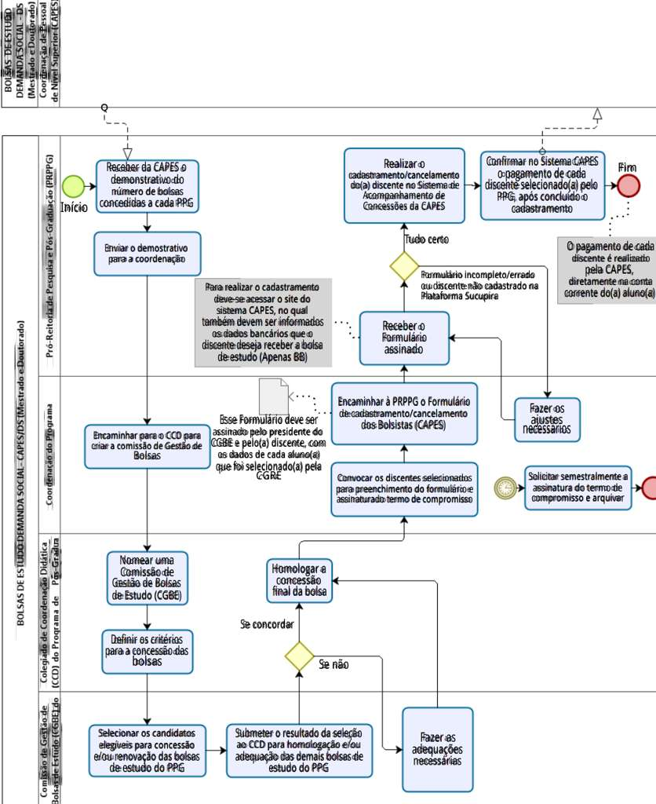
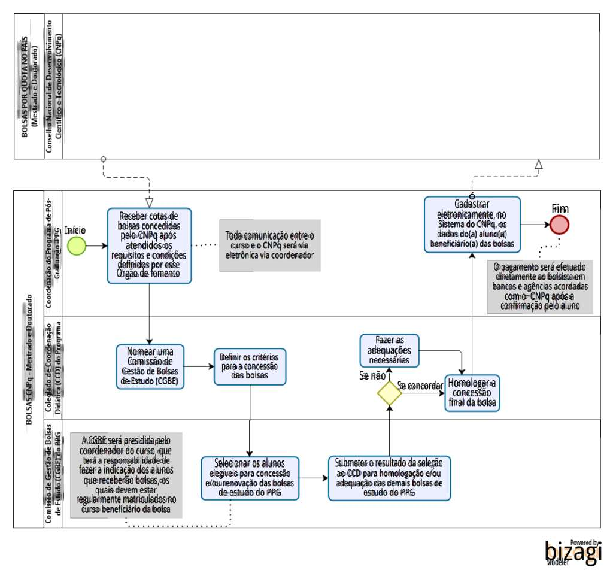

<!-- page 1 -->

# **ANEXO I – MAPEAMENTO DO PROCESSO: BOLSA DE ESTUDO DEMANDA SOCIAL – CAPES/DS** 

<!-- figure p01-fig1 | described_by: agy | ocr_overlap: 0.93 | needs_review: false -->
### 1. Tipo de figura
Trata-se de um **fluxograma de processo de negócios em notação BPMN (Business Process Model and Notation)**, organizado em piscinas (*pools*) e raias horizontais (*swimlanes*), que descreve o fluxo de concessão, renovação, cadastramento, cancelamento e acompanhamento de bolsas de estudo da modalidade Demanda Social (CAPES/DS) de Mestrado e Doutorado. Observa-se na imagem um leve artefato de renderização/duplicação fantasma atrás da maioria dos textos, além de dois rótulos verticais de raias e um evento final à direita parcialmente cortados pelas bordas.

---

### 2. Todo o texto visível (literal)

**Piscina superior (rótulos verticais na margem esquerda, lidos de baixo para cima):**
- Cabeçalho externo da piscina: `BOLSAS DE ESTUDO DEMANDA SOCIAL - DS (Mestrado e Doutorado)`
- Cabeçalho da raia: `Coordenação de Pessoal de Nível Superior (CAPES)`

**Piscina inferior/principal (rótulos verticais na margem esquerda, lidos de baixo para cima):**
- Cabeçalho externo da piscina: `BOLSAS DE ESTUDO DEMANDA SOCIAL- CAPES/DS (Mestrado e Doutorado)`
- Cabeçalho da 1.ª raia: `Pró-Reitoria de Pesquisa e Pós-Graduação (PRPPG)`
- Cabeçalho da 2.ª raia: `Coordenação do Programa`
- Cabeçalho da 3.ª raia: `Colegiado de Coordenação Didática (CCD) do Programa de   Pós-Gradua` *(texto cortado na borda da célula antes do fim da palavra)*
- Cabeçalho da 4.ª raia: `Comissão de Gestão de Bolsas de Estudo (CGBE) do` *(texto truncado após "do")*

**Textos na 1.ª raia — `Pró-Reitoria de Pesquisa e Pós-Graduação (PRPPG)`:**
- Rótulo do evento inicial: `Início`
- Caixa 1: `Receber da CAPES o demonstrativo do número de bolsas concedidas a cada PPG`
- Caixa 2: `Enviar o demonstrativo para a coordenação`
- Nota cinza à esquerda da caixa de recebimento do formulário: `Para realizar o cadastramento deve-se acessar o site do sistema CAPES, no qual também devem ser informados os dados bancários que o discente deseja receber a bolsa de estudo (Apenas BB)`
- Caixa 3: `Receber o Formulário assinado`
- Rótulo do ramo superior do losango de decisão: `Tudo certo`
- Rótulo do ramo direito/inferior do losango de decisão: `Formulário incompleto/errado ou discente não cadastrado na Plataforma Sucupira`
- Caixa 4: `Realizar o cadastramento/cancelamento do(a) discente no Sistema de Acompanhamento de Concessões da CAPES`
- Caixa 5: `Confirmar no Sistema CAPES o pagamento de cada discente selecionado(a) pelo PPG, após concluído o cadastramento`
- Rótulo do evento final: `Fim`
- Nota cinza abaixo do evento final: `O pagamento de cada discente é realizado pela CAPES, diretamente na conta corrente do(a) aluno(a)`

**Textos na 2.ª raia — `Coordenação do Programa`:**
- Caixa 1 (à esquerda): `Encaminhar para o CCD para criar a comissão de Gestão de Bolsas`
- Legenda sob o ícone de documento (à esquerda da caixa de encaminhamento à PRPPG): `Esse Formulário deve ser assinado pelo presidente do CGBE e pelo(a) discente, com os dados de cada aluno(a) que foi selecionado(a) pela CGBE` *(na última palavra, a parte inferior da letra "B" está levemente cortada, lembrando visualmente um "R")*
- Caixa 2 (centro superior): `Encaminhar à PRPPG o Formulário de cadastramento/cancelamento dos Bolsistas (CAPES)`
- Caixa 3 (centro inferior): `Convocar os discentes selecionados para preenchimento do formulário e assinatura do termo de compromisso`
- Caixa 4 (direita superior): `Fazer os ajustes necessários`
- Caixa 5 (direita inferior): `Solicitar semestralmente a assinatura do termo de compromisso e arquivar`

**Textos na 3.ª raia — `Colegiado de Coordenação Didática (CCD) do Programa de   Pós-Gradua`:**
- Caixa 1 (esquerda superior): `Nomear uma Comissão de Gestão de Bolsas de Estudo (CGBE)`
- Caixa 2 (esquerda inferior): `Definir os critérios para a concessão das bolsas`
- Caixa 3 (centro superior): `Homologar a concessão final da bolsa`
- Rótulo do ramo superior do losango de decisão: `Se concordar`
- Rótulo do ramo direito/inferior do losango de decisão: `Se não`

**Textos na 4.ª raia — `Comissão de Gestão de Bolsas de Estudo (CGBE) do`:**
- Caixa 1 (esquerda): `Selecionar os candidatos elegíveis para concessão e/ou renovação das bolsas de estudo do PPG`
- Caixa 2 (centro): `Submeter o resultado da seleção ao CCD para homologação e/ou adequação das demais bolsas de estudo do PPG`
- Caixa 3 (direita): `Fazer as adequações necessárias`

---

### 3. Estrutura (piscinas, raias, caixas, ícones e conexões)

O diagrama possui **duas piscinas empilhadas verticalmente**, com os títulos dispostos na vertical à esquerda:

1. **Piscina superior (`Coordenação de Pessoal de Nível Superior (CAPES)`)**: aparece como uma faixa retangular vazia (piscina de caixa preta/externa) sem tarefas internas, interagindo com a piscina inferior por meio de dois fluxos de mensagem (setas tracejadas com círculo aberto na origem e ponta triangular aberta no destino).
2. **Piscina inferior (`BOLSAS DE ESTUDO DEMANDA SOCIAL- CAPES/DS (Mestrado e Doutorado)`)**: dividida horizontalmente em quatro raias empilhadas, de cima para baixo: PRPPG, Coordenação do Programa, CCD e CGBE.

**Fluxo principal de sequência (setas sólidas com ponta preta preenchida) e conexões:**
1. Na raia **PRPPG**, o evento circular `Início` conecta-se à direita à tarefa `Receber da CAPES o demonstrativo do número de bolsas concedidas a cada PPG`.
   - Esta tarefa também recebe no topo um **fluxo de mensagem tracejado** vindo da borda inferior esquerda da piscina da **CAPES**.
2. De `Receber da CAPES o demonstrativo do número de bolsas concedidas a cada PPG`, uma seta desce para `Enviar o demonstrativo para a coordenação` (ainda na raia **PRPPG**).
3. De `Enviar o demonstrativo para a coordenação`, uma seta desce para a raia **Coordenação do Programa**, entrando no topo de `Encaminhar para o CCD para criar a comissão de Gestão de Bolsas`.
4. Desta tarefa, uma seta desce para a raia **CCD**, entrando no topo de `Nomear uma Comissão de Gestão de Bolsas de Estudo (CGBE)`.
5. De `Nomear uma Comissão de Gestão de Bolsas de Estudo (CGBE)`, uma seta desce para `Definir os critérios para a concessão das bolsas` (ainda na raia **CCD**).
6. De `Definir os critérios para a concessão das bolsas`, uma seta desce para a raia **CGBE**, entrando no topo de `Selecionar os candidatos elegíveis para concessão e/ou renovação das bolsas de estudo do PPG`.
7. Desta tarefa, uma seta vai para a direita até `Submeter o resultado da seleção ao CCD para homologação e/ou adequação das demais bolsas de estudo do PPG` (ainda na raia **CGBE**).
8. Desta tarefa, uma seta sobe para a raia **CCD**, entrando na ponta inferior de um **losango de decisão (gateway)** sem texto interno. Desse losango partem dois caminhos:
   - **Caminho superior (`Se concordar`)**: sobe diretamente para a base da tarefa `Homologar a concessão final da bolsa` (raia **CCD**).
   - **Caminho direito/inferior (`Se não`)**: sai pela direita do losango, desce até a raia **CGBE** e entra pelo lado esquerdo da tarefa `Fazer as adequações necessárias`.
9. De `Fazer as adequações necessárias` (raia **CGBE**), uma seta sai pelo topo, sobe até a raia **CCD**, dobra à esquerda e entra pelo lado direito da tarefa `Homologar a concessão final da bolsa`.
10. De `Homologar a concessão final da bolsa` (raia **CCD**), uma seta sai pelo topo, desloca-se para a direita e sobe para a raia **Coordenação do Programa**, entrando na base de `Convocar os discentes selecionados para preenchimento do formulário e assinatura do termo de compromisso`.
11. Desta tarefa, uma seta sobe para `Encaminhar à PRPPG o Formulário de cadastramento/cancelamento dos Bolsistas (CAPES)` (ainda na raia **Coordenação do Programa**).
    - Conectado ao lado esquerdo desta tarefa por uma **linha pontilhada com ponta de seta aberta** (apontando da tarefa para o artefato) há um **ícone de documento** (folha com canto superior direito dobrado) acompanhado do texto `Esse Formulário deve ser assinado pelo presidente do CGBE e pelo(a) discente, com os dados de cada aluno(a) que foi selecionado(a) pela CGBE`.
12. De `Encaminhar à PRPPG o Formulário de cadastramento/cancelamento dos Bolsistas (CAPES)`, uma seta sobe para a raia **PRPPG**, entrando na base de `Receber o Formulário assinado`.
    - Conectada ao lado esquerdo de `Receber o Formulário assinado` por uma **linha pontilhada** (associação sem ponta de seta) está a caixa de anotação cinza `Para realizar o cadastramento deve-se acessar o site do sistema CAPES, no qual também devem ser informados os dados bancários que o discente deseja receber a bolsa de estudo (Apenas BB)`.
13. De `Receber o Formulário assinado`, uma seta sobe até a ponta inferior de um segundo **losango de decisão (gateway)** na raia **PRPPG**. Desse losango partem dois caminhos:
    - **Caminho direito/inferior (`Formulário incompleto/errado ou discente não cadastrado na Plataforma Sucupira`)**: sai pela direita, desce para a raia **Coordenação do Programa** e entra no topo de `Fazer os ajustes necessários`. De `Fazer os ajustes necessários`, uma seta sai pelo lado esquerdo, sobe de volta à raia **PRPPG** e entra pelo lado direito em `Receber o Formulário assinado` (formando um laço de retorno).
    - **Caminho superior (`Tudo certo`)**: sobe diretamente para a base de `Realizar o cadastramento/cancelamento do(a) discente no Sistema de Acompanhamento de Concessões da CAPES` (raia **PRPPG**).
14. De `Realizar o cadastramento/cancelamento do(a) discente no Sistema de Acompanhamento de Concessões da CAPES`, uma seta vai para a direita até `Confirmar no Sistema CAPES o pagamento de cada discente selecionado(a) pelo PPG, após concluído o cadastramento`.
    - Do topo desta tarefa parte um **fluxo de mensagem tracejado** que sobe até a borda inferior direita da piscina da **CAPES**.
15. De `Confirmar no Sistema CAPES o pagamento de cada discente selecionado(a) pelo PPG, após concluído o cadastramento`, uma seta vai para a direita até o evento circular `Fim`.
    - Conectada abaixo do evento `Fim` por uma **linha pontilhada** (sem ponta de seta) está a caixa de anotação cinza `O pagamento de cada discente é realizado pela CAPES, diretamente na conta corrente do(a) aluno(a)`.

**Fluxo paralelo/independente (na raia `Coordenação do Programa`, canto inferior direito):**
- Sem conexão direta por setas ao fluxo principal, inicia-se com um **evento circular temporizador** (círculo duplo contendo um ícone de relógio analógico, sem rótulo textual).
- Uma seta sólida vai para a direita até a tarefa `Solicitar semestralmente a assinatura do termo de compromisso e arquivar`.
- Desta tarefa, uma seta sólida vai para a direita até um **evento circular de fim** (sem rótulo textual, parcialmente cortado na borda direita da imagem).

---

### 4. Números e valores de dados
A figura não contém números, valores quantitativos, datas ou escalas numéricas. A única indicação de periodicidade presente é textual: `semestralmente` (na tarefa `Solicitar semestralmente a assinatura do termo de compromisso e arquivar`). O ícone de relógio do evento temporizador apresenta apenas marcações gráficas de mostrador, sem algarismos legíveis.

---

### 5. Cores com significado
- **Verde** (círculo preenchido de verde-claro com borda verde): identifica o **evento de início** (`Início`).
- **Vermelho/rosa** (círculos preenchidos de rosa/vermelho-claro com borda vermelha espessa): identificam os **eventos de término** (`Fim` na raia da PRPPG e o evento final sem rótulo no fluxo periódico da Coordenação do Programa).
- **Azul** (retângulos de cantos arredondados com preenchimento azul muito claro e borda azul): identificam todas as **atividades/tarefas** do processo.
- **Amarelo/bege** (losangos amarelo-claros com borda oliva/dourada; círculo duplo bege-amarelado do relógio): identificam os **pontos de decisão (gateways)** e o **evento temporizador**.
- **Cinza-claro**: identifica os **artefatos auxiliares/informativos**, isto é, as duas caixas retangulares de observação textual e o ícone de documento (objeto de dados).

~~~text ocr
BOLSAS DE ES
Pró-Reit
s-Gradua
Enviar o demostrativo
coordenação
Para realizar o cadastramento
deve-se acessar o site do
i CAPES, no
também devem
as dados de cada aluno(a)
que foi selecionado(a) pela
Se concordar
cadastrado na
Plataforma Sucupira
Encaminhar à PRPPG o
des Bolsistas (CAPES)
Canvocar os discentes
preenchimento do formulários
de compromisso
Edo | (CCD) do Programa de Pã
ção de
> (CER
Comissão di
elegíveis para concessão ao CCD para
Submeter o resultado da sei
das bolsas adequação das demais
estudo do PPG
u
~~~

<!-- Start of picture text -->
BOLSAS DE ESTUDODEMANDA SOCIAL -DS(Mestrado eDoutoradCrd o resoal o ) de Nível Superior (CAPES) Q Receber da CAPES o Realizar o Confirmar no Sistema CAPES Fim demonstrativo do cadastramento/cancelamento o pagamento de cada Início concedidas a cada PPGnúmero de bolsas do(a) discente no Sistema deAcompanhamento deConcessões da CAPES discente selecionado(a) peloPPG, após concluído ocadastramento Tudo certo Enviar o demostrativo O pagamento de cada para a coordenação discente é realizado Formulário incompleto/errado pela CAPES, diretamente na conta Para realizar o cadastramento ou discente não cadastrado na deve-se acessar o site do Plataforma Sucupira corrente do(a) aluno(a) sistema CAPES, no qual também devem ser informados Receber o os dados bancários que o Formulário discente deseja receber a bolsa assinado de estudo (Apenas BB) Pró-Re i tora d e Psquisa ePós-Gr a dução ( P RG) Encaminhar à PRPPG o Formulário Fazer os de cadastramento/cancelamento Esse Formulário deve ser ajustes dos Bolsistas (CAPES) necessários Encaminhar para o CCD para assinado pelo presidente do criar a comissão de Gestão de CGBE e pelo(a) discente, com Bolsas os dados de cada aluno(a) que foi selecionado(a) pela CGRE Convocar os discentes selecionados Solicitar semestralmente a para preenchimento do formulário e assinatura do termo de assinaturado termo de compromisso compromisso e arquivar C o rdenação do Programa Nomear uma Pós-Gradua Comissão de Homologar a Gestão de Bolsas concessão final da bolsa de Estudo (CGBE) Se concordar BOpd DdO - D S  D  dol Definir os critérios para a concessão das bolsas Se não Colegia d o eC o rdenação Didática Selecionar os candidatos Submeter o resultado da seleção Fazer as elegíveis para concessão ao CCD para homologação e/ou adequações e/ou renovação das bolsas adequação das demais bolsas de necessárias de estudo do PPG estudo do PPG Comi s ão de Gestão de Bol s a de Estudo (CGBE) do <!-- End of picture text -->

Powered by bizagiModeler 

<!-- page 2 -->

# **ANEXO II – MAPEAMENTO DO PROCESSO: BOLSA CNPq** 

<!-- figure p02-fig1 | described_by: agy | ocr_overlap: 1.0 | needs_review: false -->
### 1. Tipo de figura
Trata-se de um fluxograma de processo modelado na notação BPMN (*Business Process Model and Notation*), com piscinas (*pools*) e raias (*lanes*), elaborado no software Bizagi Modeler, que representa o processo de gestão e concessão de bolsas de Mestrado e Doutorado por cota do CNPq.

---

### 2. Todo o texto visível (transcrição literal)

**Piscina superior:**
- Título da piscina (vertical): `BOLSAS POR QUOTA NO PAÍS (Mestrado e Doutorado)`
- Título da raia (vertical): `Conselho Nacional de Desenvolvimento Científico e Tecnológico (CNPq)`

**Piscina inferior:**
- Título da piscina (vertical): `BOLSAS CNPq - Mestrado e Doutorado`

- **Raia 1 (superior):**
  - Título da raia (vertical): `Coordenação do Programa de Pós-Graduação - PPG`
  - Rótulo do evento inicial: `Início`
  - Caixa de tarefa: `Receber cotas de bolsas concedidas pelo CNPq após atendidos os requisitos e condições definidos por esse Órgão de fomento`
  - Caixa de anotação: `Toda comunicação entre o curso e o CNPq será via eletrônica via coordenador`
  - Caixa de tarefa: `Cadastrar eletronicamente, no Sistema do CNPq, os dados do(a) aluno(a) beneficiário(a) das bolsas`
  - Rótulo do evento final: `Fim`
  - Caixa de anotação: `O pagamento será efetuado diretamente ao bolsista em bancos e agências acordadas com o CNPq após a confirmação pelo aluno`

- **Raia 2 (intermediária):**
  - Título da raia (vertical): `Colegiado de Coordenação Didática (CCD) do Programa`
  - Caixa de tarefa: `Nomear uma Comissão de Gestão de Bolsas de Estudo (CGBE)`
  - Caixa de tarefa: `Definir os critérios para a concessão das bolsas`
  - Rótulo da ramificação superior do losango de decisão: `Se não`
  - Caixa de tarefa: `Fazer as adequações necessárias`
  - Rótulo da ramificação direita do losango de decisão: `Se concordar`
  - Caixa de tarefa: `Homologar a concessão final da bolsa`

- **Raia 3 (inferior):**
  - Título da raia (vertical): `Comissão de Gestão de Bolsas de Estudo (CGBE) do PPG`
  - Caixa de anotação: `A CGBE será presidida pelo coordenador do curso, que terá a responsabilidade de fazer a indicação dos alunos que receberão bolsas, os quais devem estar regularmente matriculados no curso beneficiário da bolsa`
  - Caixa de tarefa: `Selecionar os alunos elegíveis para concessão e/ou renovação das bolsas de estudo do PPG`
  - Caixa de tarefa: `Submeter o resultado da seleção ao CCD para homologação e/ou adequação das demais bolsas de estudo do PPG`

**Rodapé (canto inferior direito):**
- Logotipo/crédito: `Powered by bizagi Modeler`

*(Observação visual: os textos da figura apresentam leve sobreposição/duplicação de camada típica da extração de PDF, sem prejuízo à legibilidade de nenhum caractere.)*

---

### 3. Estrutura e conexões

A figura é organizada horizontalmente em duas piscinas empilhadas verticalmente, com cabeçalhos rotacionados na vertical à esquerda (lidos de baixo para cima):

1. **Piscina superior (`BOLSAS POR QUOTA NO PAÍS (Mestrado e Doutorado)`):**
   - Contém uma única raia (`Conselho Nacional de Desenvolvimento Científico e Tecnológico (CNPq)`), cujo interior está vazio, atuando como participante externo que troca mensagens com a piscina inferior.

2. **Piscina inferior (`BOLSAS CNPq - Mestrado e Doutorado`):**
   - Dividida em três raias horizontais, de cima para baixo:
     1. `Coordenação do Programa de Pós-Graduação - PPG`
     2. `Colegiado de Coordenação Didática (CCD) do Programa`
     3. `Comissão de Gestão de Bolsas de Estudo (CGBE) do PPG`

**Fluxos de mensagem (setas tracejadas com círculo vazado na origem e ponta triangular vazada no destino, entre as duas piscinas):**
- Da borda inferior da piscina superior (`Conselho Nacional de Desenvolvimento Científico e Tecnológico (CNPq)`) desce, desvia à direita e entra pela borda superior da tarefa `Receber cotas de bolsas concedidas pelo CNPq após atendidos os requisitos e condições definidos por esse Órgão de fomento` (raia 1).
- Da borda superior da tarefa `Cadastrar eletronicamente, no Sistema do CNPq, os dados do(a) aluno(a) beneficiário(a) das bolsas` (raia 1) sobe, desvia à direita e chega à borda inferior da piscina superior (`Conselho Nacional de Desenvolvimento Científico e Tecnológico (CNPq)`).

**Fluxos de sequência (setas contínuas pretas com ponta preenchida, dentro da piscina inferior):**
1. O evento `Início` (raia 1) conecta-se à direita com a tarefa `Receber cotas de bolsas concedidas pelo CNPq após atendidos os requisitos e condições definidos por esse Órgão de fomento` (raia 1).
2. `Receber cotas de bolsas concedidas pelo CNPq após atendidos os requisitos e condições definidos por esse Órgão de fomento` (raia 1) conecta-se para baixo com a tarefa `Nomear uma Comissão de Gestão de Bolsas de Estudo (CGBE)` (raia 2).
3. `Nomear uma Comissão de Gestão de Bolsas de Estudo (CGBE)` (raia 2) conecta-se à direita com a tarefa `Definir os critérios para a concessão das bolsas` (raia 2).
4. `Definir os critérios para a concessão das bolsas` (raia 2) conecta-se para baixo com a tarefa `Selecionar os alunos elegíveis para concessão e/ou renovação das bolsas de estudo do PPG` (raia 3).
5. `Selecionar os alunos elegíveis para concessão e/ou renovação das bolsas de estudo do PPG` (raia 3) conecta-se à direita com a tarefa `Submeter o resultado da seleção ao CCD para homologação e/ou adequação das demais bolsas de estudo do PPG` (raia 3).
6. `Submeter o resultado da seleção ao CCD para homologação e/ou adequação das demais bolsas de estudo do PPG` (raia 3) conecta-se para cima com o vértice inferior de um losango de decisão sem texto interno (raia 2).
7. Do losango de decisão (raia 2) partem duas saídas:
   - Pelo vértice superior, com o rótulo `Se não`, conecta-se para cima à tarefa `Fazer as adequações necessárias` (raia 2). Em seguida, da borda direita de `Fazer as adequações necessárias`, a seta segue à direita e dobra para baixo, entrando pela borda superior da tarefa `Homologar a concessão final da bolsa` (raia 2).
   - Pelo vértice direito, com o rótulo `Se concordar`, conecta-se diretamente à direita à borda esquerda da tarefa `Homologar a concessão final da bolsa` (raia 2).
8. `Homologar a concessão final da bolsa` (raia 2) conecta-se para cima com a borda inferior da tarefa `Cadastrar eletronicamente, no Sistema do CNPq, os dados do(a) aluno(a) beneficiário(a) das bolsas` (raia 1).
9. `Cadastrar eletronicamente, no Sistema do CNPq, os dados do(a) aluno(a) beneficiário(a) das bolsas` (raia 1) conecta-se à direita com o evento `Fim` (raia 1).

**Associações de anotações de texto (linhas pontilhadas pretas sem ponta de seta):**
- Da borda direita de `Receber cotas de bolsas concedidas pelo CNPq após atendidos os requisitos e condições definidos por esse Órgão de fomento` (raia 1) liga-se horizontalmente à anotação `Toda comunicação entre o curso e o CNPq será via eletrônica via coordenador`.
- Da borda inferior de `Selecionar os alunos elegíveis para concessão e/ou renovação das bolsas de estudo do PPG` (raia 3) desce, corre para a esquerda e sobe até a borda inferior da anotação `A CGBE será presidida pelo coordenador do curso, que terá a responsabilidade de fazer a indicação dos alunos que receberão bolsas, os quais devem estar regularmente matriculados no curso beneficiário da bolsa`.
- Da borda inferior do evento `Fim` (raia 1) desce, faz um pequeno desvio à esquerda e conecta-se à borda superior da anotação `O pagamento será efetuado diretamente ao bolsista em bancos e agências acordadas com o CNPq após a confirmação pelo aluno`.

---

### 4. Números e valores de dados
Não há números, datas, prazos, percentuais ou valores quantitativos na figura.

---

### 5. Cores com significado
- **Verde-claro com contorno verde (círculo):** identifica o evento de início do processo (`Início`).
- **Vermelho/rosa-claro com contorno vermelho-escuro espesso (círculo):** identifica o evento de término do processo (`Fim`).
- **Azul muito claro com contorno azul (retângulos de cantos arredondados):** distingue as atividades/tarefas executadas ao longo do fluxo.
- **Amarelo-claro com contorno amarelo-oliva (losango):** indica o ponto de decisão condicional (gateway) que divide o fluxo entre `Se não` e `Se concordar`.
- **Cinza-claro (retângulos com borda aberta à direita/formato de colchete à esquerda):** diferencia as notas explicativas/regras de negócio dos passos operacionais do fluxograma.

~~~text ocr
BOLSA
Toda comunicação
curso e o CNPq será via
eletrônica via coordenador
Definir os
para a concessão
das bolsas
para
das bolsas
o
dados
beneficiário(a) das bolsas
resultado da se
das
bizagi
~~~

<!-- Start of picture text -->
BOLSAS POR QUOTA NO PAÍS(Mestrado eDoutorado) Conselho Nacional deD e sn v olimentoCientífico eTecnológico (CNPq) ó Cadastrar Fim Receber cotas de eletronicamente, no bolsas concedidas Sistema do CNPq, os Início pelo CNPq após Toda comunicação entre o dados do(a) aluno(a) atendidos os curso e o CNPq será via beneficiário(a) das bolsas requisitos e condições eletrônica via coordenador definidos por esse O pagamento será efetuado Graduação-  P G Órgão de fomento diretamente ao bolsista em bancos e agências acordadas com o~CNPq após a C o rdenação do Programa de Pós- confirmação pelo aluno Fazer as Nomear umaComissão de Definir os critérios adequaçõesnecessárias Gestão de Bolsas para a concessão das bolsas Se não de Estudo (CGBE) Se concordar Homologar a concessão final da bolsa Colegiado de C o rdenaçãoDidática ( C D) do Programa BOL S A CNPq -Mestrado eDoutorado A CGBE será presidida pelo coordenador do curso, que terá a responsabilidade de Selecionar os alunos Submeter o resultado da seleção fazer a indicação dos alunos elegíveis para concessão ao CCD para homologação e/ou que receberão bolsas, os e/ou renovação das bolsas adequação das demais bolsas de quais devem estar de estudo do PPG estudo do PPG regularmente matriculados no Comi s ão de Gestão de Bol de Estudo (CGBE) do  s a P G curso beneficiário da bolsa Powered by bizagiModeler <!-- End of picture text -->
