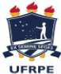
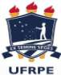

<!-- page 1 -->

<!-- figure p01-fig1 | described_by: agy | ocr_overlap: None | needs_review: false -->
(1) **Tipo de figura:**
Trata-se do brasão/logotipo institucional da Universidade Federal Rural de Pernambuco (UFRPE).

(2) **Texto visível (literal):**
- Na faixa sobreposta à parte inferior do escudo (lema em latim): `EX SEMINE SEGES`
- Abaixo do brasão (sigla institucional): `UFRPE`

(3) **Estrutura e disposição visual:**
- **Escudo central:** Um escudo de contorno duplo (azul-escuro e branco) com topo angulado em ponta central e base arredondada/apontada para baixo.
- **Interior do escudo:**
  - À direita, a silhueta branca de um semeador em pé, voltado para a esquerda, lançando sementes (pequenos pontos brancos que caem em diagonal rumo ao solo).
  - À esquerda, no alto, cinco estrelas brancas de cinco pontas dispostas formando a constelação do Cruzeiro do Sul.
  - Na base do escudo, faixas curvas alternadas em branco e azul-escuro representando sulcos de terra arada.
- **Tochas:** Três tochas posicionadas verticalmente por trás do escudo — uma central mais alta e duas laterais simétricas. As copas e chamas das três tochas aparecem acima da borda superior do escudo, e as bases (cabos) das três tochas projetam-se para baixo da borda inferior do escudo.
- **Listel (faixa):** Uma faixa arqueada na parte inferior do escudo, com dobras nas duas extremidades laterais, contendo a inscrição `EX SEMINE SEGES`.
- **Texto inferior:** Centralizado na base da imagem, abaixo dos cabos das tochas, encontra-se a sigla `UFRPE` em letras maiúsculas sem serifa.
- Não há caixas de fluxograma, setas, eixos, linhas/colunas de tabela ou múltiplos painéis.

(4) **Números ou valores de dados:**
Não há números ou valores quantitativos na imagem.

(5) **Cores com significado:**
- **Azul-escuro:** Fundo do escudo, listel (faixa do lema) e letras da sigla `UFRPE`.
- **Branco:** Silhueta do semeador, sementes, estrelas do Cruzeiro do Sul, linhas dos sulcos da terra, contorno interno do escudo e letras do lema `EX SEMINE SEGES`.
- **Amarelo/Dourado:** Corpo (cabo e base da copa) das três tochas.
- **Vermelho:** Chamas no topo das três tochas.

~~~text ocr
UFRPE
~~~

## MINISTÉRIO DA EDUCAÇÃO UNIVERSIDADE FEDERAL RURAL DE PERNAMBUCO REITORIA

## OFÍCIO CIRCULAR Nº 004/2024/GR/UFRPE

## Às Comissões de Avaliação de Progressão Docente da UFRPE,

Assunto: Orientações sobre Progressão Funcional Docente.

Prezadas(os),

1. Considerando a emissão do PARECER n. 00038/2023/CGGP/DECOR/CGU/AGU, publicado em 23/11/2023, em que altera o entendimento até então vigente a respeito das promoções e progressões docentes.
2. O referido parecer redefiniu o entendimento que anteriormente exigia para a progressão não apenas os 24 meses de exercício em cada nível da carreira, mas também a conclusão de uma avaliação de desempenho para iniciar um novo ciclo avaliativo, alterando o interstício caso o pedido não ocorresse dentro do prazo. Agora, o entendimento parte da premissa de que a avaliação tem natureza declaratória, não condicionando a progressão funcional ao término de cada 24 meses, ensejando que o professor tem direito à progressão quando atender ao requisito de tempo, ou seja, seu interstício e desde que tenha obtido a pontuação necessária, observada a prescrição quinquenal.
3. A partir da data da publicação já estamos aplicando o que determina o PARECER n. 00038/2023/CGGP/DECOR/CGU/AGU, conforme NOTA n. 00217/2023/DICON/PFUFRPE/PGF/AGU e, sendo assim, informamos:
- é possível ao docente requerer, num único processo, em razão do acúmulo de interstícios, a progressão em mais de um nível (progressões múltiplas);
- os efeitos cadastrais e financeiros da progressão solicitadas a partir de 23/11/2023, de quem efetivamente cumpriu com os requisitos, devem retroagir à data do cumprimento do interstício e estão sujeitos à prescrição quinquenal.
4. Ressalta-se que o que ocorreu não foi a correção de um equívoco por parte da UFRPE, e sim uma alteração no entendimento da AGU, o que possibilitou pacificar a situação em todas as Universidades.
5. Essa alteração no entendimento da AGU trouxe uma vitória para a categoria e é fruto de um trabalho coletivo de luta.

Recife, 09 de abril I de 2024.

<!-- page 2 -->

<!-- figure p02-fig1 | described_by: agy | ocr_overlap: None | needs_review: false -->
**(1) Tipo de figura**
Trata-se do brasão/logotipo institucional da Universidade Federal Rural de Pernambuco (UFRPE).

**(2) Todo o texto visível (transcrição literal)**
- Na faixa sobre a parte inferior do escudo (lema em latim): `EX SEMINE SEGES`
- Na parte inferior da imagem (sigla em português): `UFRPE`

**(3) Estrutura e disposição visual**
- **Escudo central:** Um escudo de contorno duplo sobreposto a três tochas verticais (uma central mais alta e duas laterais levemente inclinadas para fora), cujas chamas aparecem no topo do escudo e cujas bases se projetam na parte inferior.
- **Interior do escudo:**
  - À esquerda superior: cinco estrelas brancas dispostas formando a constelação do Cruzeiro do Sul.
  - À direita: a silhueta branca de um semeador (figura humana de perfil voltada para a esquerda) caminhando sobre sulcos de terra (faixas brancas e azuis curvas na base do escudo) e lançando sementes (pequenos pontos brancos que caem da mão estendida em direção ao solo).
- **Faixa (listel):** Uma fita arqueada atravessa a porção inferior do escudo, dobrando-se nas extremidades laterais, contendo a inscrição `EX SEMINE SEGES`.
- **Base:** Abaixo do escudo e das extremidades inferiores das tochas, encontra-se a sigla `UFRPE` em letras maiúsculas sem serifa.

**(4) Números ou valores de dados**
Não há números, eixos ou valores quantitativos na figura (apenas elementos gráficos, como 3 tochas e 5 estrelas).

**(5) Cores com significado visual/simbólico**
- **Azul-escuro:** fundo do escudo, faixa do lema e letras da sigla `UFRPE` (representando o céu e a sobriedade institucional).
- **Branco:** silhueta do semeador, sementes, estrelas da constelação, sulcos do solo, linhas de contorno interno do escudo e texto `EX SEMINE SEGES`.
- **Amarelo/dourado:** corpo (tocha/suporte) das três tochas no topo e na base do escudo.
- **Vermelho:** chamas das três tochas no topo do escudo.

~~~text ocr
UFRPE
~~~

## MINISTÉRIO DA EDUCAÇÃO UNIVERSIDADE FEDERAL RURAL DE PERNAMBUCO

## REITORIA

6. Diante do exposto, as concessões deverão considerar este Ofício Circular. Dúvidas solicitamos entrar em contato com a CPPD.

Atenciosamente,

<!-- figure p02-fig2 | described_by: agy | ocr_overlap: 0.75 | needs_review: false -->
**1. Tipo de figura**
Carimbo ou selo retangular de assinatura digital (emitido pelo SERPRO — Serviço Federal de Processamento de Dados).

**2. Todo o texto visível (na íntegra)**
- `ASSINADO DIGITALMENTE`
- `MARCELO BRITO CARNEIRO LEAO`
- `A conformidade com a assinatura pode ser verificada em:`
- `http://serpro.gov.br/assinador-digital`
- `SERPRO`

**3. Estrutura e disposição dos elementos**
- A figura consiste em um único quadro retangular horizontal com fundo branco e borda fina cinza-clara.
- **Lado esquerdo (alinhado à esquerda, disposto em quatro linhas verticais):**
  - Primeira linha (topo): o rótulo `ASSINADO DIGITALMENTE` em letras maiúsculas pequenas.
  - Segunda linha (abaixo da primeira): o nome do signatário `MARCELO BRITO CARNEIRO LEAO` em letras maiúsculas maiores e em negrito.
  - Terceira linha (abaixo, após um pequeno espaçamento vertical): o texto `A conformidade com a assinatura pode ser verificada em:` em fonte pequena regular.
  - Quarta linha (abaixo da terceira): o endereço eletrônico `http://serpro.gov.br/assinador-digital` em negrito.
- **Lado direito:**
  - **Canto superior direito:** elemento gráfico decorativo composto por três arcos concêntricos de quarto de círculo em diferentes tons de azul.
  - **Canto inferior direito:** logotipo do `SERPRO`, composto por um ícone circular azul contendo uma forma estilizada em "S" branca à esquerda, seguido pela sigla `SERPRO` em letras maiúsculas em negrito à direita.
- Não há setas, eixos, tabelas (linhas/colunas) ou múltiplos painéis.

**4. Números ou valores de dados**
Nenhum número ou valor numérico está presente na imagem.

**5. Cores com significado**
Não há codificação de dados por cores; toda a tipografia, o logotipo institucional do SERPRO e os arcos gráficos no canto superior direito utilizam tons de azul (azul-escuro, azul-médio e azul-claro/ciano) sobre fundo branco como identidade visual institucional.

~~~text ocr
MARCELO BRITO CARNEIRO LEAO
A confoemidade com a assinatura pode ser verificade em:
~~~

## PROF. MARCELO BRITO CARNEIRO LEÃO

Matrícula SIAPE nº 1049365 Reitor
