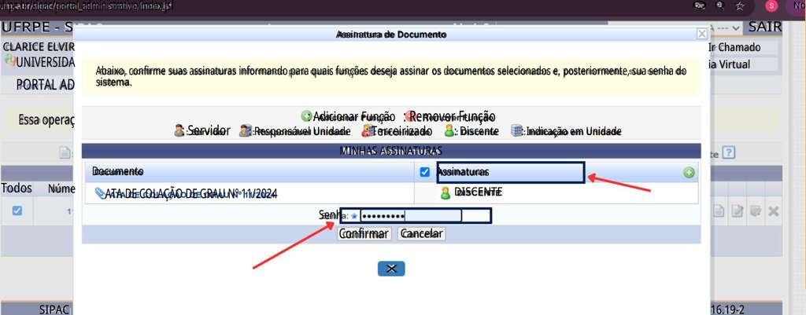

<!-- page 1 -->

##### Tutorial: Assinatura no SIPAC 

SEG UFRPE 

<!-- page 2 -->

#### 1º Passo 

<!-- figure p02-fig1 | described_by: agy | ocr_overlap: None | needs_review: false -->
1. **Type of figure:** A typographic logo / wordmark.
2. **Visible text (verbatim):** `SEG`
3. **Structure:** A single panel with no boxes, arrows, axes, rows, or columns. It consists solely of the three uppercase sans-serif letters `S`, `E`, and `G` arranged horizontally in a single line, filling almost the entire frame, layered directly over a slightly smaller, blurred duplicate of the same `SEG` lettering positioned behind and slightly lower as a drop-shadow effect.
4. **Numbers and data values:** None.
5. **Meaningful colours:** None; colours are purely stylistic (black foreground letters with a dark blue blurred shadow over a light grey background).

<!-- Start of picture text -->
SEG <!-- End of picture text -->

UFRPE 

sigs.ufrpe.br/sipac/?modo=classico Q☆ Nov UFRPE - SIPAC - Sistema Integrado de Patrimônio, Administração e Contratos ATENÇÃO! O sistema diferencia letras maiúsculas de minúsculas APENAs na senha, portanto ela deve ser digitada da mesma maneira que no cadastro. SIGAA SIPAC SIGRH (Acadêmico) (Administrativo) (Recursos Humanos) SIGAdmin (Administração e Comunicação) Perdeu o e-mail de confirmação de cadastro? clique aqui para recuperá-lo. Esqueceu o login? Clique aqui para recuperá-lo. Esqueceu a senha? clique aqui para recuperá-la. Entrar no Sistema Usuário: clarice.elvira Senha: Entrar Servidor, caso ainda não possua cadastro no SIPAC, clique no link abaixo. Cadastre-se 

No 1º passo você deve selecionar a aba do SIPAC, e colocar seu usuário e senha padrão do SIGAA 

Su-c - s-oeoo-erd - n - -    ses:ss - (s seia eo p s I ds 

<!-- page 3 -->

### 2° Passo 

<!-- figure p03-fig1 | described_by: agy | ocr_overlap: None | needs_review: false -->
1. **Type of figure:** A typographic logo / wordmark graphic.

2. **All visible text (verbatim):**
   `SEG`

   (There are no titles, labels, legends, captions, axis ticks, or cell values.)

3. **Structure:** A single frame with no boxes, arrows, axes, rows, columns, or sub-panels. The three uppercase sans-serif letters `SEG` are arranged horizontally across nearly the entire width and height of the image, layered directly in front of a slightly blurred and slightly offset duplicate of the same `SEG` lettering that forms a drop shadow.

4. **Numbers and data values:** None.

5. **Meaningful colours:** None; colour does not encode data or categories (the graphic uses black foreground text with a blurred dark blue shadow over a light grey background solely as visual/branding styling).

<!-- Start of picture text -->
SEG <!-- End of picture text -->

UFRPE 

sigs.ufrpe.br/sipac/portal_administrativo/index.jsf Q ☆ 

UFRPE - SIPAC - Sistema Integrado de Patrimônio, Administração e Contratos Ajuda? Tempo de Sessão: 01:30 --- MUDAR DE SISTEMA --- SAIR CLARICE ELVIRA Orçamento: 2024 Módulos Caixa Postal Abrir Chamado Portal Admin. Alterar Senha Mesa Virtual RequisiçõesComunicaçãoCompras Contratos Projetos Orçamento Patrimônio Móvel ProtocoloTelefonia Outros 

###### Em seguida selecione a aba “DOCUMENTOS" na parte inferior direita da pagina. 

Não há notícias cadastradas. Caixa Postal Trocar Foto Editar Perfil Alterar Senha Avisos Bens Extrato Material Processos Requisições Transportes Gast... Licitações Minutas Abaixo estão listados os 20 últimos tópicos cadastrados. em de Andamento Contratos Consulta Informações: MEMO de Editais Clique em para visualizar informações e cadastrar comentário sobre o tópico. DOCUMENTOS clique em para remover o tópico. Última Título Criado por Respostas 1 Postagem insalubridade 30/05/2023 DEPA 1 CONVÊNIO DA UFRPE COM MONTPELLIER SUPAGRO NO DADOS FUNCIONAIS DO SERVIDOR 19/10/2021 DEPA 2 PROJETO DE INTERCÃMBIO BRASIL-FRANÇA (BRAFAGRI) Coordenado pela Profa. Rosimar dos Santos Musser Categoria: Estagiário Pró-Reitor de Gestão Estudantil e Inclusão 17/05/2021 DB 2 Cargo: CARGO NÃO INFORMADO Vínculo: Estagiário Ver todos os Tópicos SECRETARIA GERAL DOS Cadastrar Novo Tópico Exercício:CONSELHOS DA 

###### Não há notícias cadastradas. 

Categoria: Estagiário CARGO NÃO INFORMADO Cargo: Vínculo: Estagiário SECRETARIA GERAL DOS Exercício:CONSELHOS DA ADMINISTRAÇÃO SUPERIORSEG (11.01.23) SECRETARIA GERAL DOS Lotação:CONSELHOS DA ADMINISTRAÇÃO SUPERIORSEG (11.01.23) 

<!-- page 4 -->

# 3° Passo 

> s.ufrpe.br/sipac/portal_administrativo/index.jsf ②☆ UFRPE - SIPAC - Sistema Integrado de Patrimônio, Administração e Contratos Ajuda? Tempo de Sessão: 01:30 --- MUDAR DE SISTEMA --- SAIR CLARICE ELVIRA Módulos Caixa Postal Abrir Chamado Orçamento: 2024 Portal Admin. Alterar Senha Mesa Virtual UNIVERSIDADE FEDERAL RURAL DE PERNAMBUCO (11) PORTAL ADMINISTRATIVO > AsSINATURA DE DoCUMENTOS 

s.ufrpe.br/sipac/portal_administrativo/index.jsf 

Essa operação permite que os Documentos criados e pendentes de assinatura possam ser assinados pelo usuário logado. 

Ícones: Visualizar Documento : Assinar Documento : Alterar Documento X: Cancelar Documento : Documento Pendente 

DOCUMENTOS PENDENTES DE ASSINATURA Todos Número/Ano Tipo do Documento Protocolo do Documento Processo Associado Data de Cadastro 23082.031747/2024-28 18/12/2024 ATA DE COLAÇÃO DE GRAU 11/2024 x Assunto Detalhado: Ata teste Assinar Documentos Selecionados Cancelar Portal Administrativo p-c -  -eto-ed - Non - -    esees:s - (as) sei seo  s I in 

<!-- figure p04-fig1 | described_by: agy | ocr_overlap: None | needs_review: false -->
1. **Type of figure:** A cropped organizational logo or header banner extracted from a PDF, consisting of a blurry raster graphic (a crest on the left and a large acronym on the right) with crisp black text overlaid on top of it (consistent with a visible OCR text layer rendered over a scanned image).

2. **All visible text (verbatim):**
   - Overlaid black text across the bottom of the left crest: `EX SEVINE SERS`
   - Underlying blurry text inside the curved banner at the bottom of the left crest: `[illegible]`
   - Overlaid black text on the right: `SEG`
   - Underlying blurry text on the right (behind the black overlay): `SEG`

3. **Structure:** The image is a single horizontal strip with two side-by-side components on a plain light background (no boxes, arrows, axes, rows, columns, or multiple panels):
   - **Left component:** A shield-shaped crest cropped along the top edge and right at the bottom edge. Inside the dark shield are scattered small light dots, a light curved band rising from lower left toward the right, and the lower portion (legs) of a standing light-coloured figure positioned on the right side of the curved band. Below the band, along the base of the shield, is a curved banner containing `[illegible]` light lettering; the narrow black sans-serif text `EX SEVINE SERS` is overlaid straight across this banner.
   - **Right component:** The large bold sans-serif letters `SEG` from the underlying blurry logo, overlaid directly by a slightly taller, thinner, sharp black sans-serif `SEG` shifted slightly upward and to the left of the underlying letters.

4. **Numbers or data values:** None; the image contains no numbers or data values.

5. **Colours carrying meaning:** Colour differentiates the two superimposed layers—the underlying blurry logo graphic is in dark blue and white (dark blue shield and bold blue `SEG` on a light off-white/grey background), whereas the sharp overlaid text (`EX SEVINE SERS` and `SEG`) is in solid black.

<!-- Start of picture text -->
EX SEVINE SERSSEG <!-- End of picture text -->

UFRPE 

No 3º passo voce deve marcar o item “ToDos" e em seguida clicar em 

"ASSINAR DOCUMENTOS SELECIONADOS" 

<!-- page 5 -->

## 4º Passo 

<!-- figure p05-fig1 | described_by: agy | ocr_overlap: None | needs_review: false -->
1. **Type of figure**: A typographic logo / wordmark graphic.

2. **Visible text**:
   - `SEG`
   - No titles, labels, legends, captions, axis ticks, or cell values are present.

3. **Structure**: A single-panel rectangular graphic containing the three uppercase sans-serif letters "S", "E", and "G" arranged horizontally side by side, spanning nearly the full width and height of the image. Directly behind the crisp foreground lettering is a blurred duplicate of "SEG" offset slightly downward and to the right, creating a drop-shadow effect. There are no boxes, arrows, connecting lines, axes, rows, columns, or additional panels.

4. **Numbers and data values**: None.

5. **Colours**: The foreground letters are black, the blurred drop-shadow letters are dark blue, and the background is light grey; the colours are purely decorative/stylistic and do not encode data.

<!-- Start of picture text -->
SEG <!-- End of picture text -->

UFRPE 

E por ultimo selecione a OpÇãO “ASSINATURAS" confirme com sua senha Padrao utilizada no SIGAA 

sigs.ufrpe.br/sipac/portal_administrativo/index.jsf 

<!-- figure p05-fig2 | described_by: agy | ocr_overlap: 0.89 | needs_review: false -->
**(1) Tipo de figura**

Trata-se de uma captura de tela (screenshot) de interface web anotada com destaques gráficos (retângulos e setas), extraída de um manual ou documento em PDF, exibindo uma janela modal de assinatura eletrônica de documento aberta sobre a tela do Portal Administrativo do sistema SIPAC da UFRPE em um navegador web. (Há leve sobreposição de camada de texto preto sobre o texto original da captura, sem impedir a leitura.)

---

**(2) Todo o texto visível (verbatim)**

* **Barra superior do navegador:**
  * `ufrpe.br/sipac/portal_administrativo/index.jsf`
  * `S`
  * `No` *(truncado na borda direita)*

* **Página de fundo (parcialmente encoberta pela janela modal):**
  * Lado esquerdo (de cima para baixo):
    * `UFRPE - S` *(cortado pela janela modal)*
    * `CLARICE ELVIR` *(cortado pela janela modal)*
    * `UNIVERSIDA` *(cortado pela janela modal)*
    * `PORTAL AD` *(cortado pela janela modal)*
    * `Essa operaç` *(cortado pela janela modal)*
    * Cabeçalhos da tabela de fundo: `Todos` | `Núme` *(cortado pela janela modal)*
    * Célula sob `Núme`: `1` *(seguido de dígito parcialmente cortado pela janela modal)*
    * Rodapé esquerdo: `SIPAC`
  * Lado direito (de cima para baixo):
    * `A ---` *(cortado à esquerda)*
    * `SAIR`
    * `Ir Chamado` *(cortado à esquerda)*
    * `ia Virtual` *(cortado à esquerda)*
    * `te` *(cortado à esquerda)* seguido de `?`
    * Rodapé direito: `16.19-2`

* **Janela modal em primeiro plano (`Assinatura de Documento`):**
  * Barra de título: `Assinatura de Documento` | `X`
  * Caixa de aviso/instrução:
    `Abaixo, confirme suas assinaturas informando para quais funções deseja assinar os documentos selecionados e, posteriormente, sua senha do sistema.`
  * Painel de legenda:
    * Linha 1: `: Adicionar Função` | `: Remover Função`
    * Linha 2: `: Servidor` | `: Responsável Unidade` | `: Terceirizado` | `: Discente` | `: Indicação em Unidade`
  * Barra de título da tabela: `MINHAS ASSINATURAS`
  * Tabela:
    * Cabeçalhos das colunas: `Documento` | `Assinaturas`
    * Linha 1, coluna 1: `ATA DE COLAÇÃO DE GRAU N° 11/2024`
    * Linha 1, coluna 2: `DISCENTE`
  * Campo de confirmação de senha:
    * Rótulo: `Senha:` (seguido de ícone de asterisco `*`)
    * Conteúdo do campo de texto: `•••••••••|` *(9 pontos pretos de máscara de senha seguidos de cursor vertical)*
  * Botões de ação: `Confirmar` | `Cancelar`
  * Botão inferior centralizado: `X`

---

**(3) Estrutura**

* **Camada de fundo (navegador e página do sistema):**
  * No topo, uma barra escura de endereço do navegador exibe a URL à esquerda e, à direita, ícones de chave, lupa, estrela, avatar circular com `S` e um indicador truncado com `No`.
  * Abaixo, a interface do sistema SIPAC aparece esmaecida/encoberta no centro pela janela modal.
  * À esquerda da modal veem-se o cabeçalho institucional (`UFRPE - S`), dados de identificação (`CLARICE ELVIR`, ícone + `UNIVERSIDA`, `PORTAL AD`), início de uma caixa de aviso (`Essa operaç`), um ícone de documento com `:`, o início de uma tabela de duas colunas visíveis (`Todos` com uma caixa de seleção marcada na linha de dados; `Núme` com `1` parcialmente cortado) e a barra de rodapé com `SIPAC`.
  * À direita da modal veem-se um menu suspenso truncado (`A ---` com seta para baixo), o botão `SAIR`, links truncados (`Ir Chamado`, `ia Virtual`), o fim de uma legenda com `te` e um botão de ajuda `?`, quatro colunas de ícones de ação na linha da tabela de fundo (documento, documento com lápis, documento com engrenagem/selo e `X`) e a barra de rodapé com `16.19-2`.

* **Camada em primeiro plano (janela modal centralizada):**
  * **Barra de título** no topo com `Assinatura de Documento` centralizado e um botão `X` no canto superior direito.
  * **Painel de instrução** retangular logo abaixo, contendo o texto explicativo em duas linhas.
  * **Painel de legenda** retangular com borda cinza, organizado em duas linhas centralizadas:
    * Linha superior com dois comandos de ação: ícone de círculo `+` com `: Adicionar Função` e ícone de círculo `-` com `: Remover Função`.
    * Linha inferior com cinco perfis/funções acompanhados de seus ícones: pessoa (`: Servidor`), pessoa diante de prédio (`: Responsável Unidade`), pessoa com prédio (`: Terceirizado`), pessoa (`: Discente`) e prédio (`: Indicação em Unidade`).
  * **Painel/Tabela `MINHAS ASSINATURAS`:**
    * Faixa superior de cabeçalho contendo `MINHAS ASSINATURAS`.
    * Tabela de **2 colunas** e **1 linha de dados**:
      * **Coluna 1 (`Documento`):** contém o ícone de clipe de papel seguido de `ATA DE COLAÇÃO DE GRAU N° 11/2024`.
      * **Coluna 2 (`Assinaturas`):** o cabeçalho possui, da esquerda para a direita, uma caixa de seleção marcada, o texto `Assinaturas` e, na extremidade direita, um ícone circular com `+`. A célula de dados abaixo contém o ícone de pessoa (correspondente a Discente) seguido de `DISCENTE`.
  * **Linha do campo de senha**, centralizada logo abaixo da tabela: rótulo `Senha:`, ícone de estrela/asterisco `*` e uma caixa de entrada de texto com 9 pontos mascarados e cursor piscante à direita do último ponto.
  * **Faixa inferior da tabela**, centralizada, contendo dois botões lado a lado: `Confirmar` e `Cancelar`.
  * **Área branca inferior da modal**, contendo um botão retangular centralizado com `X`.

* **Anotações gráficas sobrepostas (caixas e setas):**
  * **Destaque 1 (cabeçalho de assinaturas):** um retângulo de borda espessa azul-escura envolve o texto `Assinaturas` e o espaço à sua direita dentro do cabeçalho da segunda coluna (deixando de fora a caixa de seleção marcada à esquerda e o ícone `+` à direita). Uma **seta vermelha** parte da direita (sobre a área vazia da linha de `DISCENTE`, inclinada levemente para cima e para a esquerda) e aponta diretamente para a borda direita desse retângulo azul-escuro.
  * **Destaque 2 (campo de senha):** um retângulo de borda espessa azul-escura envolve o final de `Senha:`, o ícone `*`, toda a caixa de entrada da senha e um pequeno espaço em branco à direita dela. Uma **seta vermelha** parte do quadrante inferior esquerdo (abaixo da coluna `Documento`, inclinada para cima e para a direita) e aponta diretamente para o canto inferior esquerdo desse retângulo azul-escuro (logo abaixo de `Senha:`).

---

**(4) Todos os números e valores de dados**

* Número e ano do documento na tabela da modal: `11/2024` (em `ATA DE COLAÇÃO DE GRAU N° 11/2024`).
* Número parcialmente visível na coluna `Núme` da tabela de fundo: `1` (seguido de caractere parcialmente cortado pela janela modal).
* Quantidade de caracteres mascarados exibidos no campo `Senha:`: `9` pontos pretos (`•••••••••`).
* Identificador/versão no rodapé direito da página de fundo: `16.19-2`.

---

**(5) Cores com significado**

* **Vermelho (setas) e azul-escuro (retângulos de contorno):** são anotações editoriais que direcionam a atenção do leitor para os dois pontos de ação necessários na tela — a verificação/seleção da área `Assinaturas` e o preenchimento do campo `Senha:`.
* **Verde (`+`) e vermelho (`-`) nos ícones de função:** verde indica adição (`Adicionar Função`, também repetido no cabeçalho da coluna `Assinaturas`), enquanto vermelho indica remoção (`Remover Função`).
* **Cores dos ícones de perfil na legenda e na tabela:** distinguem os tipos de vínculo — verde identifica `Discente` (correspondendo ao ícone verde exibido junto a `DISCENTE` na tabela), vermelho identifica `Terceirizado`, e cinza/amarelo identifica `Servidor`.
* **Amarelo-claro:** fundo da caixa de instrução no topo da janela modal, destacando o aviso operacional.
* **Azul (caixas de seleção e asterisco):** o preenchimento azul nas caixas de seleção indica estado marcado/selecionado (tanto em `Todos` quanto em `Assinaturas`), e o asterisco azul ao lado de `Senha:` sinaliza campo de preenchimento obrigatório.

~~~text ocr
JFRPE - S
de Documento À
CLARICE ELVIR
SAIR
Ir Chamado
confirme suas assinaturas informando para quais funções deseja assinar os documentos selecionados e, sua senha do
PORTALAD
Essa operac
Função
3 Unidade em Unidade
RAS
Todos Nume DISCENTE
A
Confirmar Cancelar
Y
10,
~~~

<!-- Start of picture text -->
sigs.ufrpe.br/sipac/portal_administrativo/index.jsf O Q ☆ No UFRPE - S SAIR Assinatura de Documento CLARICE ELVIR Ir Chamado UNIVERSIDA ia Virtual Abaixo, confirme suas assinaturas informando para quais funções deseja assinar os documentos selecionados e, posteriormente, sua senha do PORTAL AD sistema. : Adicionar Função : Remover Função Essa operaç : Servidor : Responsável Unidade : Terceirizado : Discente : Indicação em Unidade MINHAS ASSINATURAS Documento Assinaturas Todos Núme ATA DE COLAÇÃO DE GRAU Nº 11/2024 DISCENTE Senh Confirmar Cancelar x SIPAC 16.19-2 <!-- End of picture text -->

<!-- page 6 -->

#### 5° Passo 

<!-- figure p06-fig1 | described_by: agy | ocr_overlap: None | needs_review: false -->
1. **Kind of figure**: A standalone typographic logo or wordmark graphic, tightly cropped around three uppercase letters.

2. **All visible text (verbatim)**:
   - `SEG`

3. **Structure**: A single flat graphic with no boxes, arrows, axes, tables, or panels. It consists of the three uppercase sans-serif letters `SEG` arranged horizontally in a single line, with a blurred, thicker duplicate of the same letters (`SEG`) layered directly behind them and offset slightly downward and to the right as a drop shadow, all set against a plain light-gray background.

4. **Numbers and data values**: None.

5. **Colours**: Colours are purely stylistic/branding rather than data-encoding (black foreground letters with a blurred dark-blue drop shadow on a light-gray background).

<!-- Start of picture text -->
SEG <!-- End of picture text -->

UFRPE 

sigs.ufrpe.br/sipac/portal_administrativo/index.jsf Q☆ Nov UFRPE - SIPAC - Sistema Integrado de Patrimônio, Administração e Contratos Ajuda? Tempo de Sessão: 01:00 --- MUDAR DE SISTEMA --- SAIR CLARICE ELVIRA Orçamento: 2024 Módulos Caixa Postal Abrir Chamado Portal Admin. Alterar Senha Mesa Virtual UNIVERSIDADE FEDERAL RURAL DE PERNAMBUCO (11) PORTAL ADMINISTRATIVO > ASSINATURA DE DoCUMENTOS 

sigs.ufrpe.br/sipac/portal_administrativo/index.jsf 

• Assinatura(s) realizada(s) com sucesso 

Essa operação permite que os Documentos criados e pendentes de assinatura possam ser assinados pelo usuário logado. 

NENHUM DOCUMENTO PENDENTE DE ASSINATURA FOI ENCONTRADO. 

Pronto seu documento foi assinado. 

Portal Administrativo 

- - po-e-eoid -  - -    eses/:ss - (s) se se p s  ds
